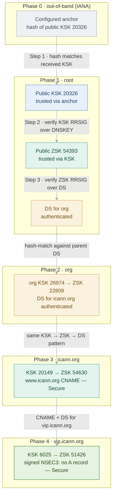
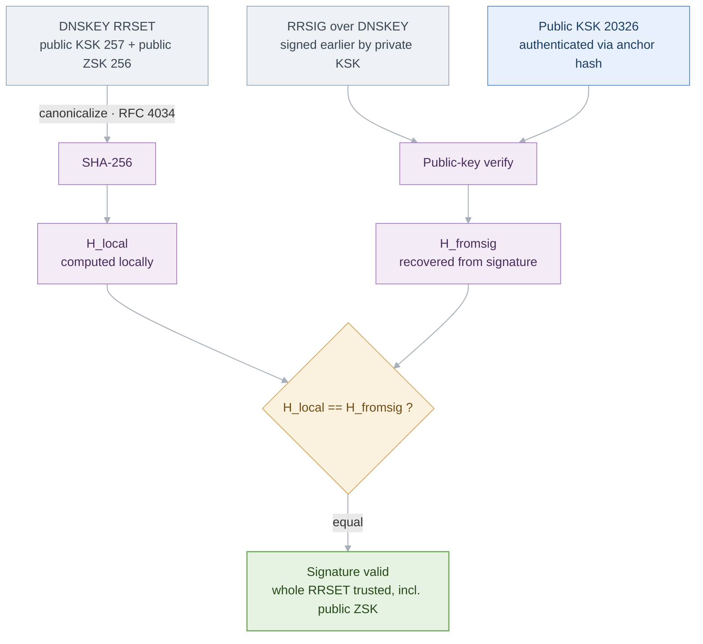

# DNSSEC

## Conceptual Overview

**DNSSEC (DNS Security Extensions)** is a secure _add-on_ for DNS. It does **not** replace DNS — it adds to it. Conceptually, picture DNS at the bottom with DNSSEC layered on top. Every query is therefore either _DNS on its own_ or _DNS + DNSSEC_.

DNSSEC provides two main improvements over plain DNS:

1. **Data origin authentication** — verify that the data you receive genuinely came from the zone you think it did (e.g. are these really `netflix.com`'s records, even if cached?).
2. **Data integrity protection** — verify that the data hasn't been modified since the zone administrator created it.

It achieves both by establishing a **chain of trust** between the DNS root and individual DNS records, in a **cryptographically verifiable** way. It uses public key cryptography to secure DNS, much like HTTPS/certificates secure HTTP.

> ⚠️ **Important scope note:** DNSSEC does **not correct** anything. It only lets you _validate_ whether data is genuinely from a given source and whether it's been altered. It doesn't tell you what the correct result _should_ be — but knowing that integrity is valid (or in doubt) is usually enough.

> 📚 Reference: [Cloudflare — DNSSEC](https://www.cloudflare.com/learning/dns/dnssec/)

---

## Problem / Context — Why DNSSEC Is Needed

Plain DNS was built when the internet was viewed as a largely friendly place, rather than the adversarial environment it now is. It has no built-in way to validate the integrity or origin of data, which opens it to attacks such as **cache poisoning**.

### Cache Poisoning Walkthrough

![[dns-how-it-can-be-disrupted.png]]

Reading the diagram — **center** is the resolver server (the victim's cache); **bottom** is Evil Bob (the bad actor); **left** is Bob (the legitimate user) and the `catagram.io` destination; the **top** shows the resolver walking the tree.

1. Evil Bob issues a DNS query for `catagram.io`, kicking off the resolver's normal **walking-the-tree** process.
2. **While that's happening**, Evil Bob races a fake response back, pretending to be the authoritative name server ("I'm the authoritative NS for `catagram.io`, here's your result" — _not really, lol_).
3. The forged result lands in the resolver and the **cache is now poisoned**.
4. When the _real_ user Bob later queries `catagram.io`, he's served the poisoned result.
5. Bob is directed to something he _thinks_ is `catagram.io` but isn't.

> ⚠️ A poisoned cache entry is reused for **all** `catagram.io` queries until the **TTL expires**.

> 🎯 This is an oversimplified example (real DNS has some protections), but it illustrates the core weakness: plain DNS gives you no way to tell whether a result is authentic. A **DNSSEC-capable resolver would identify the poisoned data** as invalid.

### Additive & Backward Compatible

![[dnssec-high-level-what-it-is.png]]

- A **DNS-only** client querying the same name servers receives **only DNS results** — it's never exposed to DNSSEC, which is how backward compatibility is preserved.
- A **DNSSEC-capable** client receives **both** DNS and DNSSEC results, and uses the DNSSEC results to validate the DNS results.
- In a **valid (unexploited)** scenario, results look the same and DNSSEC validation goes unnoticed.
- In an **exploited** environment, the DNS-only client is unaware anything is wrong, while the **DNSSEC client can easily identify the invalid records**.

### `dig` Demonstration

A normal query:

```
dig www.icann.org
```

…returns an **answer section** (e.g. a CNAME pointing at another name, then an A record with an IPv4 address) — but with **no way to validate integrity**, especially when querying a non-authoritative resolver like `8.8.8.8`.

Adding the DNSSEC flag:

```
dig www.icann.org +dnssec
```

…returns the **same DNS results plus an `RRSIG`** (a DNSSEC resource type) for each record — essentially a digital signature of the corresponding record, used to validate the normal DNS data.

---

## Mechanics — How DNSSEC Works _Within_ a Zone

This section covers the **data integrity** part of DNSSEC. (Requires background on DNS, hashing, and digital signing.)

### RRSET (Resource Record Set)

![[dnssec-RRSET.png]]

A **resource record set (RRSET)** is the set of all resource records with the **same name AND same type**.

Example zone `icann.org`:

- `www` → CNAME → its own RRSET (one record).
- `www.vip` → A (IPv4) → its own RRSET.
- `www.vip` → AAAA (IPv6) → its own RRSET.
- `icann.org` → four MX records → all four share the same name and type, so they form **one RRSET**.

> 🎯 **DNSSEC validates RRSETs, not individual resource records.** This is a common exam trap.

### RRSIG & the Zone Signing Key (ZSK)

![[dnssec-RRSIG-and-zone-signing-key.png]]

- An **RRSIG** record stores a **digital signature of an RRSET**, created using the **private** part of the **Zone Signing Key (ZSK)** key pair.
- The signing process (the diagram's playful "Digital-Signature-O-Tron-9000" — really just a standard cryptographic process) takes the plain-text RRSET + the private ZSK and outputs the signature.
- The signature is stored alongside the RRSET under the **same name**, but with record type **`RRSIG`**.
    - Normal DNS clients see only the RRSET.
    - DNSSEC clients see the RRSET **and** the matching RRSIG.

> ⚠️ The **private ZSK is NOT stored in the zone**. It's kept offline and separated. Like any private key, it must be guarded.

> ⚠️ If the RRSET changes, the **RRSIG must be regenerated** (which requires the private ZSK). Any **unauthorised change** to the RRSET without a matching RRSIG regeneration produces an **invalid signature** — so tampering is detectable.

So: _assuming you trust that the private ZSK is in safe hands_, a valid RRSIG for a corresponding RRSET tells you the RRSET is in a valid, admin-created state — and you can tell if it changes.

### DNSKEY

![[dnssec-DNSKEY.png]]

To **verify** an RRSIG, a resolver needs the **public** part of the ZSK. Public keys aren't sensitive, so they just need to be published — this is the job of the **`DNSKEY`** record.

- The DNSKEY record stores **public keys** used to verify RRSIGs in the zone.
- It can hold two key types, distinguished by a **flag** value:
    - **Flag `256` = Zone Signing Key (ZSK)**
    - **Flag `257` = Key Signing Key (KSK)**

**Validation flow inside a zone:** the DNSSEC resolver takes the plain-text RRSET + its matching RRSIG + the DNSKEY (public ZSK), and confirms that the RRSIG matches the RRSET and was generated by the private ZSK → **Verified RRSET**.

> ⚠️ This validation is only as trustworthy as the DNSKEY itself. You must trust (a) that only the zone admin holds the private key, and (b) that it's the _correct_ ZSK. Analogy: a photo ID only proves identity if you trust the ID is real and issued by a genuine authority — which is exactly why fake IDs are a problem. DNSSEC solves this with a verifiable chain of trust up to the root (covered below).

### Key Signing Key (KSK) — Why Two Keys?

![[dnssec-key-signing-key.png]]

The DNSKEY record set _itself_ also needs an RRSIG so it can be validated. But the DNSKEY RRSET is signed by a **different** key — the **Key Signing Key (KSK)** — producing the **`RRSIG DNSKEY`** record.

- **ZSK** signs everything _else_ in the zone (creating most RRSIGs).
- **KSK** signs _only the DNSKEY record set_ (as the name suggests, it signs keys).
- The **public KSK** is also stored in the DNSKEY record set.
- The **DNSKEY (KSK) is the point of trust for the zone.**

**Why split into two keys?** It enables an _admin split_ and makes key rotation efficient:

- Best practice is to **cycle the ZSK fairly often**.
- The **parent zone references the child's KSK** (not the ZSK).
- Because only the KSK is referenced upward, you can **regenerate/rotate the ZSK entirely within the zone** — regenerate all RRSIGs, update the DNSKEY RRSET, and re-sign the DNSKEY RRSET with the private KSK — **without involving the parent zone**.
- If a _single_ key were used, every ZSK change would require parent-zone changes — inefficient at global scale.

> 🎯 **Chain within the zone:** parent trusts our **KSK** → KSK signs our **ZSK** → ZSK signs all **RRSETs** (as RRSIGs).

> ⚠️ Outstanding question at this point: _how is the KSK itself trusted?_ **Spoiler: from the parent zone** — covered next.

---

## Chain of Trust — _Between_ Zones

### DS Record (Delegated Signer)

![[dnssec-DS-record.png]]

A **DS (Delegated Signer)** record is how a **parent** zone delegates trust to a **child** zone.

Example: parent `.org` delegating to child `icann.org`.

Because DNSSEC builds on DNS, delegation starts with normal DNS:

- **NS records** in `.org` point at `icann.org`'s name servers. This integrates `icann.org` into DNS but provides **no DNSSEC verification** ("NS delegates control… does **NOT** verify").

For trust, the parent adds:

- A **DS record set** storing a **hash of the child's public KSK**. Because the hash is one-way and unique, this record is the parent **explicitly stating it trusts the child's KSK** ("`.org` states that anyone can trust the public KSK that `icann.org` is using").
- A matching **`RRSIG DS`** — a signature of the DS RRSET, created with the **parent's (`.org`) private ZSK** — so the DS record itself can be validated.

The parent zone also publishes its own keys:

- A **DNSKEY** record set with `.org`'s public ZSK and KSK (used to validate RRSIGs in `.org`).
- A matching **`RRSIG DNSKEY`**, created by signing the DNSKEY RRSET with `.org`'s **KSK**.

> 🎯 If you trust `.org`'s public **KSK**, you trust everything in `.org` — including its DS-record trust delegation to `icann.org`. And `.org`'s own KSK is trusted in exactly the same way: via a DS record in _its_ parent, the **root zone**.

### Validation Flow (Root → Record Set)

![[dnssec-validation-flow.png]]

Reading the diagram — three zones across the top (**Root `.`**, **`.org`**, **`icann.org`**); each emits a **Public KSK** and a **DS-HASH (child KSK)**; green check-marks at the bottom feed the validating resolver (the "super-smart" brain). The chain links **child → parent** via public KSKs and the parent's DS records:

- `icann.org` has a public **KSK**; `.org` validates it because `.org` stores a **hash of that KSK** in its DS record.
- `.org` has its own **KSK**; the **root zone** stores a hash of it in _its_ DS record.
- At the **root**, there's no parent to provide trust → the root's KSK is a **trust anchor** that is **explicitly trusted** by every DNSSEC-capable resolver/client by default.

Following the chain top-down, every step is **cryptographically validated**:

1. Root **KSK** has signed the root **ZSK**.
2. Root ZSK has signed the **`.org` DS record** in the root zone → validated.
3. That DS matches `.org`'s public **KSK** → validated.
4. Inside `.org`, the KSK signed the ZSK, which signed record sets including the **`icann.org` DS record** → validated.
5. That DS contains a hash of **`icann.org`'s public KSK** → validated.

This is how trust flows from root → TLDs → domains → individual record sets, all cryptographically verifiable at every step.

> 🎯 **Mnemonic for the link mechanism (added):** _"Parent holds a **hash** of the child's **KSK**, in a **DS** record."_ — **K**SK is hashed, **D**S delegates.

---

---

## Worked Example — A Real Chain, End to End (`www.icann.org`)

> The infographics above explain each piece conceptually. This section walks the **same chain with real, observed values** for `www.icann.org`, and shows what happens at the very bottom when the requested record doesn't exist. Key tags and algorithms below come from a DNSSEC debugger (VeriSign Labs / DNSViz) and are a snapshot — ZSK tags rotate routinely; KSK/DS are stable. Hex digests and signatures are truncated for readability.

The chain is **signed end to end**: root → org → icann.org → vip.icann.org.

|Zone|KSK (key tag)|ZSK (key tag)|DS in parent|Algorithm|
|---|---|---|---|---|
|`.` (root)|20326|54393|— (trust anchor)|RSASHA256 (8)|
|`org`|26974|22809|DS 26974, signed by root ZSK|RSASHA256 (8)|
|`icann.org`|20149|54630|DS 20149, signed by org ZSK|ECDSAP256SHA256 (13)|
|`vip.icann.org`|6025|51426|DS 6025, signed by icann.org ZSK|RSASHA256 (8)|

The signing algorithm can differ per zone (root/org use RSASHA256, icann.org uses ECDSA P-256) — each zone picks its own; validation only needs the DS digest and the DNSKEY algorithm to line up within a zone.

A guiding principle for the whole walk: **signing is done ahead of time by each zone operator with private keys (in HSMs); the resolver only ever fetches and verifies the published RRSIGs.** The private key is never published — only its _product_, the RRSIG, is.

### Phase 0 — the anchor is already in place (out-of-band)

The resolver ships with one preconfigured fact: a **hash of the public root KSK 20326**, distributed by IANA out-of-band (not learned from DNS). This is the one link in the chain trusted by configuration rather than by a signature.

### Phase 1 — root zone: anchor → KSK → ZSK → DS(org)

1. **Authenticate the public KSK.** Fetch the root DNSKEY RRSET; compute `SHA-256(public KSK 20326)` and compare to the anchor (a **hash of the public root KSK 20326**). Match → the public KSK is trusted. A forged DNSKEY fails here.
2. **Verify the RRSIG over the DNSKEY RRSET.** The root operator signed that RRSET earlier with the **private KSK**; the resolver verifies the published RRSIG with the **public KSK**. Success → the whole RRSET is trusted, including the **public ZSK 54393**.
3. **Verify the RRSIG over the DS for `org`.** The DS was signed by the root **private ZSK**; verify it with the public ZSK 54393 → the **DS for `org`** is authenticated and handed down.

### Phase 2 — `org` zone

Hash the **public `org` KSK 26974** and compare to the DS from root → trusted. The `org` KSK validates the `org` DNSKEY RRSET → public `org` ZSK 22809 trusted. The `org` ZSK signed the **DS for `icann.org` (20149)** → authenticated, handed down. (Same pattern as Phase 1, but the trusted hash now comes from the parent's DS rather than the configured anchor.)

### Phase 3 — `icann.org` zone

Hash the **public `icann.org` KSK 20149** against the DS from `org` → trusted (this zone uses ECDSA P-256). The KSK validates the DNSKEY RRSET → public ZSK 54630 trusted. `www.icann.org` is a **CNAME** to `www.vip.icann.org`; the CNAME RRSET's RRSIG (made by the `icann.org` ZSK) verifies → **Secure** so far. The zone also carries the **DS for `vip.icann.org` (6025)**, authenticating the delegation to the sub-zone.

### Phase 4 — `vip.icann.org`: a signed proof of "no A record"

`vip.icann.org` is itself signed (KSK 6025 / ZSK 51426, validated via the DS from `icann.org`). Following the CNAME, the resolver asks for the target's A record — and there isn't one: that name is served by a global traffic manager, not a static A record. Instead of an unsigned dead end, the zone returns an authenticated **NSEC3** record proving **no A record exists**, plus its RRSIG. The resolver verifies that RRSIG and accepts the proof.

Result: the entire path is **Secure** and carries the **AD** flag. There is no A RRSIG simply because there is **no A RRSET** — its absence is itself cryptographically proven. (Contrast this with an _unsigned_ zone, where the lack of signatures means Insecure — see the troubleshooting section below.)

### The chain in one diagram

In the diagram, "KSK / ZSK trusted" means the **public** key is trusted; each arrow is a _signs-and-authenticates_ link (signed by the corresponding **private** key, verified with the public key). Each subgraph is one phase.



Color legend: gray = out-of-band anchor (configured, not signed), blue = KSK (authenticating key), teal = ZSK (working key carrying trust onward), amber = DS / cross-zone delegation, green = final Secure result.

---

## Deep Dive — What "verify the RRSIG" Actually Computes

A point that's easy to get wrong: the verifier does **not** "regenerate an RRSIG with the public key and compare byte-for-byte" — a public key can't _produce_ a signature. Verification compares **two hashes**:

1. **Compute a hash locally** — canonicalize the target RRSET per RFC 4034 (sort it, prepend the RRSIG's metadata fields), take SHA-256 → `H_local`.
2. **Recover a hash from the signature** — run the public-key verify operation with the already-authenticated public key over the RRSIG's signature value → `H_fromsig`.
3. **Compare** — `H_local == H_fromsig ?` Equal → signature valid → the whole RRSET (including any public ZSK inside a DNSKEY RRSET) is trusted.

Contrast: "both sides share one key and each recompute, then compare" is the **HMAC / symmetric** model — DNSSEC is **not** that. DNSSEC is **asymmetric**: the public key can't recompute what the private key produced; it can only _verify and recover the original hash_, then compare.



## The Trust Anchor & The Root Signing Ceremony

### The Trust Anchor

![[dnssec-the-trust-anchor.png]]

Within a normal zone, trust comes from the parent's DS record. But the **root zone has no parent**, so a more rigorous process is needed — one secure enough that its output can be **absolutely trusted by every DNSSEC resolver and client**. This concept is the **trust anchor**.

- The **private `.` DNS Root KSK** is "the key to the internet" — locked away, protected, and **never exposed**, inside **Hardware Security Modules (HSMs)**.
- The **public `.` DNS Root KSK** is hard-coded/explicitly trusted by all DNSSEC clients, and it **verifies the absolute trust** (well — the _signed version_) of the root's DNSKEY records.
- With the public root KSK, you can verify anything signed by the private root KSK locked in the HSMs.

> ⚠️ Because the private root KSK's security is so tight, it isn't practical to use constantly. So a separate **root zone ZSK** handles day-to-day signing of the root zone.

### The Signing Ceremony

![[dnssec-root-signing-ceremony.png]]

> 🎯 Not the confetti kind of ceremony. The whole purpose is to **take the root zone ZSK into the ceremony, sign it with the private root KSK** under hugely controlled conditions, and output the **root zone `RRSIG DNSKEY`** — the single record that makes the root zone (and therefore everything below it) trustworthy.

> 🎯 **In short: the signing ceremony uses the Root KSK to sign a set of Root ZSKs.** More precisely, the private root KSK signs the root **DNSKEY RRSET** (which _contains_ the public KSK plus the bundle of public ZSKs), producing the **`RRSIG DNSKEY`**. So the ZSKs are signed as a _set_ — enough to cover rotation until the next ceremony — rather than the key material being signed individually.

**Key facts:**

- Two secure locations hold redundant copies of the root KSK: **El Segundo, CA** and **Culpeper, VA**. Ceremonies **alternate** between them.
- The private root KSK lives in **redundant HSMs** that never leave their locations; the keys never leave the HSMs.
- The HSM is interacted with **only via a Ceremony Laptop** connected over an **Ethernet cable**, operated only by the **Ceremony Administrator**. The laptop has **no battery and no storage** — it's **stateless** (air-gapped) and stores nothing after the ceremony.
- The HSM can only be used when **Crypto Officers** insert their allocated **operator cards**. There are **14 Crypto Officers** total (7 affiliated with each location); **at least 3** must attend. Dates are picked when **4–5** are available for resilience.
- Other roles: Ceremony Administrator, Internal Witness, Credentials Safe Controller, Hardware Safe Controller, plus the Crypto Officers.
- **Verisign** is the current **root zone maintainer**: it generates and delivers the **ZSKs** (a _bundle_ of many, to allow rotation between ceremonies). The KSR (key-signing request) bundle holds enough ZSKs to last until the next ceremony.
- The whole event is **public, recorded/streamed, and independently audited** (by two Big Four firms not associated with Verisign or ICANN).

**Outputs:** the HSM (via the laptop) signs the public ZSK/KSK and produces the signatures that become the **`RRSIG DNSKEY`** records for the DNS root zone.

**Cadence:** the ceremony happens roughly **every three months**; the root KSK itself **rarely changes**.

> 🎯 The security design ensures groups of human participants **can't collude** to corrupt the process — formally targeting **less than a 1-in-1,000,000** chance of compromise (assuming a 5% dishonesty rate). The reason you can trust the root servers is that you can trust the people signing — and the reason you can trust _them_ is the strict, audited protocol they follow.

> 📚 Reference: [Cloudflare — Root Signing Ceremony](https://www.cloudflare.com/learning/dns/dnssec/root-signing-ceremony/)

---

---

## Troubleshooting — Three Reasons You See "No RRSIG"

> Practical companion to the theory above. "`dig +dnssec` returned no RRSIG" is a symptom with **several distinct causes** — telling them apart is most of the diagnostic work.

|Example|What you observe|Actual reason|
|---|---|---|
|`netflix.com`|DNSKEY / RRSIG come back empty|The **zone is unsigned** — no DNSKEY at all, so nothing is signed (Insecure).|
|`www.icann.org` (A lookup)|No RRSIG on an address record|There is **no A record at that name**; a signed NSEC3 proves non-existence. The chain is fully Secure.|
|a CNAME into an unsigned CDN zone|CNAME has an RRSIG, the final A does not|The **CNAME target zone is unsigned** → that leaf is Insecure.|

**Unsigned zone (`netflix.com`).** Ask a validating resolver for its DNSKEY and nothing comes back:

```
dig @8.8.8.8 netflix.com DNSKEY +dnssec
```

No DNSKEY → the zone was never signed → no RRSIG exists for any record in it. In the `.com` parent there's also **no DS** for `netflix.com`, and `.com` returns a signed NSEC3 proving that absence. A perfectly valid **Insecure** result, not a failure.

**Signed chain, but the name has no A record (`www.icann.org`).** The chain _is_ signed all the way down, yet a direct A lookup shows no address RRSIG — because `www.icann.org` is a CNAME and the final name has no A record to sign (answered by a global traffic manager). The "missing" RRSIG is replaced by a signed NSEC3 proof of non-existence (the Worked Example above walks this in full).

### The four validation outcomes

|Outcome|Meaning|
|---|---|
|**Secure**|Full chain verified; the resolver sets the **AD** flag. (The whole `www.icann.org` path, including the NSEC3 "no A record" proof.)|
|**Insecure**|A _proven_ gap in signing (no DS, e.g. an unsigned zone); answer returned, no AD flag. (`netflix.com`.)|
|**Bogus**|Signatures present but verification fails (expired RRSIG, key mismatch, broken chain); returns **SERVFAIL**, withholds the answer.|
|**Indeterminate**|Can't reach a trust anchor at all.|

### Useful `dig` commands

> Why `@8.8.8.8` everywhere: some resolvers (including certain ISP defaults) don't support DNSSEC, so the same query can return different results depending on which resolver answers. To keep results consistent, these notes always point `dig` at Google Public DNS (`8.8.8.8`), a validating, DNSSEC-aware resolver. Any other validating resolver (e.g. Cloudflare's `1.1.1.1`) works too — just be explicit about which one you're querying.

```bash
# Did it validate? Check for the ad flag in the response flags
dig @8.8.8.8 www.icann.org +dnssec

# Follow the CNAME and see the signed NSEC3 "no A record" proof
dig @8.8.8.8 www.icann.org A +dnssec

# Prove a zone apex really is signed (the apex returns an RRSIG)
dig @8.8.8.8 icann.org SOA +dnssec

# Compare: an unsigned zone — no DNSKEY, hence no RRSIG anywhere in it
dig @8.8.8.8 netflix.com DNSKEY +dnssec

# View the root DNSKEY (current KSK/ZSK plus their RRSIG)
dig @8.8.8.8 . DNSKEY +dnssec

# View a child zone's DS (signed by the parent)
dig @8.8.8.8 org DS +dnssec
dig @8.8.8.8 icann.org DS +dnssec
```

> If `dig` isn't installed: Ubuntu `apt install dnsutils`, macOS `brew install bind`.

## Exam Quick-Reference

|Concept|What it is|Trigger keywords|
|---|---|---|
|**DNSSEC**|Secure _add-on_ to DNS; origin auth + integrity; additive, backward-compatible|"validate DNS data", "cache poisoning protection", "chain of trust to root"|
|**RRSET**|All records with **same name + same type**|"set of records", DNSSEC validates _sets_|
|**RRSIG**|Digital signature **of an RRSET**|created by **private ZSK**|
|**ZSK (Zone Signing Key)**|Signs all RRSETs in the zone; private part kept **offline**, not in zone|DNSKEY **flag 256**|
|**KSK (Key Signing Key)**|Signs the **DNSKEY RRSET** only; point of trust for the zone; referenced by parent|DNSKEY **flag 257**|
|**DNSKEY**|Publishes **public** ZSK/KSK to verify RRSIGs|flag 256 = ZSK, 257 = KSK|
|**DS (Delegated Signer)**|Parent record holding a **hash of the child's public KSK**|parent→child trust, "delegated signer"|
|**RRSIG DNSKEY**|Signature of the DNSKEY RRSET, made by the **KSK**|validates the keys themselves|
|**Trust Anchor**|The **root KSK**, explicitly trusted (no parent)|"no parent zone", "explicitly trusted", root|
|**Root Signing Ceremony**|Signs root ZSK with private root KSK in HSMs|El Segundo / Culpeper, Crypto Officers, HSM, Verisign|

---

## Traps & Gotchas

> ⚠️ DNSSEC **validates RRSETs, not individual records.**

> ⚠️ DNSSEC **doesn't fix or correct** bad data — it only flags whether data is authentic/unmodified.

> ⚠️ The **private ZSK is not stored in the zone**; only the **public** ZSK (via DNSKEY) is.

> ⚠️ **ZSK** signs zone records; **KSK** signs _the DNSKEY record set_. Don't swap these.

> ⚠️ A **DS record stores a hash of the child's KSK** (not the ZSK, not the full key).

> ⚠️ The **root KSK has no parent** → it's a **trust anchor**, trusted explicitly/by default, not via a DS record.

> ⚠️ DNSKEY flags: **256 = ZSK**, **257 = KSK** (KSK is the larger number — it's the "higher" key).

---

> 📝 _Editorial additions (added beyond source material — accept or remove): the "K-hash/DS-delegates" mnemonic in the validation-flow section, the quick-reference table, and the traps/gotchas summary list. All factual content is sourced from the Cantrill DNSSEC videos/infographics and the Cloudflare reference._
> 
> 📝 _Added sections (beyond the original course notes): "Worked Example — A Real Chain, End to End" (real key tags + NSEC3 endpoint for `www.icann.org`), "Deep Dive — What 'verify the RRSIG' Actually Computes" (the two-hash comparison), and "Troubleshooting — Three Reasons You See 'No RRSIG'" (with `dig` commands). The two Mermaid diagrams render natively in Obsidian and most Markdown viewers. Real key tags are a snapshot — ZSK tags rotate routinely; verify current values with the `dig` commands._