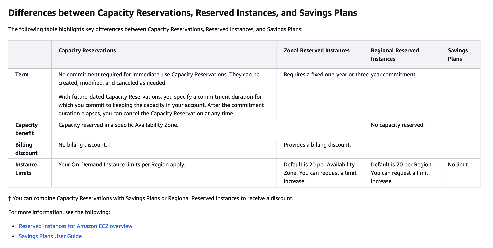

# EC2 Purchase Options

> **Terminology note:** These are officially called **purchase options**. You'll often hear them called _launch types_, but "purchase options" is the correct AWS term and the one to use.

The mental model for choosing: **always start with On-Demand as the default, then move to an alternative only if you can justify it** based on cost, capacity, or licensing needs.

For the exam, the three to know deeply are **On-Demand, Spot, and Reserved**. Dedicated Hosts and Dedicated Instances matter mainly for specific edge cases (licensing, hardware isolation).

---

## On-Demand

The default. Deliberately unremarkable — it has no strong pros or cons, which is exactly why it's the baseline you compare everything else against.

![[raw/aws-cert-study-notes/aws-solution-architect/assets/ec2-purchase-option-on-demand.png]]

**Reading the diagram:** Two EC2 hosts (A and B) each hold a mix of instance sizes (`2xl`, `4xl`). The two different colour shadings represent _different AWS customers_ whose instances coexist on the same physical hosts — this is the "shared hardware" idea. The single highlighted `2xl` illustrates "isolated but shared": each instance is walled off from the others even though the underlying metal is shared. The blank space in each host is unused/wasted capacity. The stopwatch on the left is the billing model — per-second while running, with the reminder that storage and other associated resources bill regardless of instance state.

**How it works**

- Instances run on a **shared pool** of EC2 hosts. Instances are isolated and protected, but multiple AWS customers' instances share the same underlying hardware.
- This sharing lets AWS allocate resources efficiently, which is why the baseline price is reasonable.
- Instances of different sizes share the same hosts, each consuming a defined allocation of host resources.

**Billing**

- **Per-second billing while the instance is running.** Stop the instance and you stop paying for its compute.
- ⚠️ **Gotcha:** Associated resources (e.g. storage) consume capacity _regardless of instance state_, so they keep charging even while the instance is stopped. Compute charges stop on shutdown; storage and similar resources do not.

**Characteristics**

- No interruptions — runs until you decide otherwise (barring hardware failure).
- **No capacity reservation.** If AWS hits a major capacity shortage, On-Demand gets no priority on remaining capacity (Reserved does).
- Predictable, constant pricing defined upfront — but **no discount** and **no upfront commitment**.

**Good for**

- Short-term workloads (provision → run → terminate).
- Workloads of **unknown** duration or type.
- Short-term/unknown workloads that **cannot tolerate interruption**.

---

## Spot

The **cheapest** way to get EC2 capacity — **up to ~90% off** the On-Demand price — by buying spare host capacity that would otherwise sit idle.

![[ec2-purchase-option-spot-instances.png]]

**Reading the diagram:** Same two hosts, but read the **left column as a price ladder rising from bottom to top**. The **bottom pink tier** has a _banknote_ and is labelled **ON-DEMAND** — the normal, reliable, higher price. The **grey tiers above** are spare capacity sold as Spot, marked with _coins_ instead of a banknote because they're cheaper. The red arrow points to the **current published spot price** at the top.

The two coin stacks map onto the worked example as the two customers' **maximum prices** — think of them as a 2-coin max and a 4-coin max:

- When the current spot price sits at the lower level (2 coins), both customers' instances run, and _both_ pay 2 (you always pay the current price, never your max).
- When AWS needs that capacity back for incoming On-Demand demand (which always occupies the higher pink tier) and raises the spot price to 4, the customer whose maximum was only 2 has their instances **terminated**, while the 4-coin customer keeps running — now paying 4. The empty grey tier at the very top is the capacity freed up in the process.

**How it works**

- For each instance type, in each region, there's some amount of unused host capacity at any moment.
- AWS publishes a **spot price** for that spare capacity; the price rises and falls with how much spare capacity is available.
- You set a **maximum price** you're willing to pay. This is a ceiling, _not_ what you pay — you always pay the **current spot price**, never more than your max.
- **If the spot price rises above your maximum, your Spot instances are terminated.** This is the defining trade-off: Spot capacity is **not reliable**.

**Key consequence of the pricing model**

- Two customers running the same instance type in the same region pay the _same_ current spot price, regardless of their differing maximums. A higher maximum only buys you more _tolerance_ before termination — not a different rate.

**Good for** (anything that can absorb interruption and just re-run)

- Non-time-critical work.
- Highly parallel workloads splittable into many pieces (e.g. scientific analysis) where failed pieces can be rerun.
- Bursty capacity needs (e.g. media/image processing).
- Cost-sensitive workloads that wouldn't be economical on On-Demand.
- Stateless workloads (no user/session state stored on the instance).

**Anti-patterns — never use Spot for**

- Anything that **can't tolerate interruption**.
- Long-term, consistent, reliable compute.
- Business-critical systems — e.g. domain controllers, mail servers, traditional websites, flight-control-style systems.

---

## Reserved Instances

For **long-term, consistent** EC2 usage. Where On-Demand handles unknown/short-term, Reserved handles the parts of your infrastructure that are _always on and never change_.

![[ec2-purchase-option-reserved-instances.png]]

**Reading the diagram:** The top timeline shows the commitment — reservations run for **1- or 3-year terms and you pay for the whole term** (the crossed-out middle block means you can't bail out partway). The four boxes in the middle row are the application logic: (1) no reservation → full per-second price; (2) a reservation matching the instance → reduced or zero per-second price; (3) an unused reservation → **still billed** (the empty dashed box); (4) a reservation applied to a _larger_ same-family instance → **partial coverage**. The bottom row is the three payment structures, ordered by increasing discount: No-Upfront (per-second fee only), Partial Upfront (some coins + a reduced per-second fee), and All Upfront (the treasure chest — no per-second fee).

**How it works**

- A **commitment** to AWS to consume EC2 resources over a fixed term. In return, you get a reduced (or eliminated) per-second cost.
- The reservation applies to a matching instance, reducing or removing its per-second price.
- ⚠️ **Gotcha:** Once committed, **you pay whether you use it or not.** An unused reservation is wasted money — plan reservations carefully.
- **Partial application:** a reservation for a smaller instance (e.g. a `T3.large`-sized reservation) applied to a larger instance of the same family gives a _partial_ discount covering an equivalent portion of the larger instance.

**Scope: AZ vs. Region**

- **Locked to an Availability Zone** → benefits only instances in that AZ, _and_ reserves capacity in that AZ.
- **Locked to a Region** → does _not_ reserve capacity, but the discount can apply to instances in _any_ AZ in that region.

**Term length** (longer = bigger discount, but more risk your needs change)

- **1 year** or **3 years**.

**Payment structure** (more paid upfront = bigger discount)

- **No Upfront** — reduced per-second fee, paid running or not. Least discount; no cash-flow hit.
- **Partial Upfront** — smaller lump sum plus a lower per-second fee. The balanced middle ground.
- **All Upfront** — entire term paid in advance, no per-second fee. Greatest discount.
- 💡 **3-year + All Upfront = the largest possible Reserved discount.**

**Good for**

- Components with **known, consistent, long-term** usage that need the lowest cost and **can't tolerate interruption**.

### Standard vs. Scheduled Reserved

There was originally only one reserved option; it's now called **Standard Reserved**, and AWS has since added more flexible variants.

- **Standard Reserved** — what's described above. Best when you need the cheapest EC2 running essentially **24/7/365** for the full 1- or 3-year term.
- **Scheduled Reserved Instances** — situational, for usage that's **long-term and known but not constant**. You commit to a recurring **frequency + duration + time window** (e.g. daily for 5 hours, every Friday for 24 hours, or 100 hours per month). You reserve the capacity and get a slight discount versus On-Demand, but **can only use the capacity inside that window**.
  - ⚠️ **Restrictions:** doesn't support all instance types/regions; minimum **1,200 hours/year**; minimum commitment is **1 year**.
  - Reach for this when you need EC2 only for specific hours/days/blocks rather than all the time.

![[ec2-purchase-option-scheduled-reserved-instances.png]]

**Reading the diagram:** The three illustrations are example recurring patterns this option covers — **daily** (batch processing for 5 hours starting at 23:00), **weekly** (sales analysis every Friday for 24 hours), and **monthly** (100 hours of EC2 per month). The shaded slivers represent the reserved time blocks within each repeating period. The right-hand note restates the constraints: not all instance types/regions, and the 1,200-hours/year + 1-year-term minimums.

---

## Capacity Reservations

When a region or AZ runs short on capacity (e.g. after a major failure), AWS hands out remaining EC2 capacity in a fixed **priority order**:

1. **Reserved** commitments first.
2. **On-Demand** next.
3. **Spot** gets whatever is left.

So if a workload is business-critical and _must_ be launchable on demand, you need to reserve capacity rather than rely on getting it.

![[ec2-purchase-option-capacity-reservations.png]]

**Reading the diagram:** A single region with two AZs (AZA and AZB). A **Regional Reservation** (top arrow) gives a billing discount to valid instances in _any_ AZ but reserves no capacity — flagged as risky during major faults when capacity is scarce. A **Zonal Reservation** (lower-left arrow) gives both the billing discount _and_ reserved capacity, but only in that one AZ. Instances elsewhere get **full price and no capacity reservation**. The treasure-chest + instance pairs in AZB show **On-Demand Capacity Reservations**: capacity booked in a specific AZ that you pay for at full On-Demand price whether consumed or not — the greyed-out instance is reserved-but-unused capacity you're still billed for. The battery icons (full vs. near-empty) hint at how much guaranteed capacity each approach leaves you during a shortage.

**Key distinction — two separate components:** a reservation has a **billing** component and a **capacity** component, and they can be used together or independently.

- **Regional reservation** — billing discount for matching instances in **any AZ** in the region, but reserves **no capacity**; instances launch at the **same priority as On-Demand**.
- **Zonal reservation** — same billing discount **and** reserves capacity, but only in **one specific AZ**; launch elsewhere in the region and you get neither benefit.
- **On-Demand Capacity Reservation** — books capacity in a specific AZ with **no 1/3-year commitment** and **no billing discount**. You pay for the booked capacity whether you use it or not — purely a capacity guarantee.

**At a glance** — note the common thread: **all three are billed when idle**; what differs is what you get for it.

|                                    | Billed if idle? | Reserves capacity? | Term lock | Discount |
| ---------------------------------- | --------------- | ------------------ | --------- | -------- |
| **Regional reservation**           | Yes             | No                 | 1 or 3 yr | Yes      |
| **Zonal reservation**              | Yes             | Yes (one AZ)       | 1 or 3 yr | Yes      |
| **On-Demand Capacity Reservation** | Yes             | Yes (one AZ)       | None      | No       |

> **Terminology note:** A Reserved Instance is fundamentally a **billing discount** applied to matching On-Demand usage — _not_ a capacity object. Capacity reservation is a separate concept. The link: a **zonal** RI (scoped to one AZ) has its discount **paired with a capacity reservation** in that AZ, whereas a **regional** RI reserves **no capacity** (it only provides the discount, plus AZ and instance-size flexibility). The **On-Demand Capacity Reservation** is the standalone way to reserve capacity with no term commitment; it carries no discount itself, but a Regional RI or Savings Plan discount can be applied to it.

### Combining discount + capacity

Because _discount_ and _capacity_ sit on separate axes, you can mix and match. The four practical combinations:

| Setup                                            | Discount? | Capacity reserved? | Notes                                                |
| ------------------------------------------------ | --------- | ------------------ | ---------------------------------------------------- |
| **Regional RI** alone                            | Yes       | No                 | Flexible across AZs/sizes, but no capacity guarantee |
| **On-Demand Capacity Reservation** alone         | No        | Yes (one AZ)       | Capacity guaranteed, billed at full On-Demand        |
| **Regional RI + On-Demand Capacity Reservation** | Yes       | Yes (one AZ)       | The recommended combo to get _both_                  |
| **Zonal RI**                                     | Yes       | Yes (one AZ)       | Both in one purchase; locked to one AZ               |

Key points for the combined case:

- A **Regional RI discount automatically applies to a matching On-Demand Capacity Reservation** — this is a supported, AWS-recommended pattern. (Savings Plans work the same way.)
- **Discounts hit running instances first**, then cover unused reserved capacity. Either way you pay the discounted rate, not full On-Demand.
- ⚠️ **Trap:** this discount-stacking only works with **Regional** RIs. A **zonal RI's discount does _not_ apply to a separate On-Demand Capacity Reservation** — which makes sense, since a zonal RI already carries its own bundled capacity reservation.

**Official references for this table:**

- Capacity Reservation pricing and billing — `https://docs.aws.amazon.com/AWSEC2/latest/UserGuide/capacity-reservations-pricing-billing.html`
- Reserve compute capacity with On-Demand Capacity Reservations — `https://docs.aws.amazon.com/AWSEC2/latest/UserGuide/ec2-capacity-reservations.html`
- Regional and zonal Reserved Instances (scope) — `https://docs.aws.amazon.com/AWSEC2/latest/UserGuide/reserved-instances-scope.html`
- How Reserved Instance discounts are applied — `https://docs.aws.amazon.com/AWSEC2/latest/UserGuide/apply_ri.html`

### AWS's own comparison (Capacity Reservations vs. RIs vs. Savings Plans)

AWS publishes a four-way table on the [On-Demand Capacity Reservations page](https://docs.aws.amazon.com/AWSEC2/latest/UserGuide/ec2-capacity-reservations.html) that adds **term** and **instance-limit** dimensions on top of the discount/capacity split:

|                      | On-Demand Capacity Reservation                                                                      | Zonal RI                        | Regional RI                         | Savings Plan         |
| -------------------- | --------------------------------------------------------------------------------------------------- | ------------------------------- | ----------------------------------- | -------------------- |
| **Term**             | None for immediate-use (create/modify/cancel freely); future-dated ones carry a commitment duration | Fixed 1- or 3-year              | Fixed 1- or 3-year                  | Fixed 1- or 3-year   |
| **Capacity benefit** | Capacity reserved in one AZ                                                                         | Capacity reserved in one AZ     | No capacity reserved                | No capacity reserved |
| **Billing discount** | None (†)                                                                                            | Provides a discount             | Provides a discount                 | Provides a discount  |
| **Instance limits**  | Your per-Region On-Demand limits apply                                                              | Default 20 per AZ (increasable) | Default 20 per Region (increasable) | No limit             |

† As above, an On-Demand Capacity Reservation can be combined with a Savings Plan or Regional RI to pick up a discount.

A couple of details worth noting from the same page: an immediate-use Capacity Reservation has **no term commitment**, but a **future-dated** one does carry a commitment duration before you can cancel. Also, **active and unused Capacity Reservations count toward your On-Demand instance limits**, which is why "your per-Region On-Demand limits apply" appears in that column.

> Source: _Reserve compute capacity with EC2 On-Demand Capacity Reservations_ — `https://docs.aws.amazon.com/AWSEC2/latest/UserGuide/ec2-capacity-reservations.html` 

⚠️ **Gotcha:** Capacity reservations still need a planning exercise — booked-but-unused capacity is billed. If usage turns out to be consistent and long-term, re-evaluate whether a Reserved purchase would be cheaper.

---

## Savings Plans

Think of a Savings Plan as a reservation based on **hourly spend** rather than a specific instance type/AZ/region. You commit to a minimum **$/hour for 1 or 3 years** and get a discounted rate up to that committed spend; usage beyond the commitment falls back to normal On-Demand rates.

- **General Compute Savings Plan** — up to **~66% off**, applies across **EC2, Fargate, and Lambda**.
- **EC2 Savings Plan** — up to **~72% off**, but **EC2 only**.

**Choosing:** if you consume only EC2, the EC2 plan saves more. If you're adopting containers/serverless, a general plan lets you commit once and spread it across EC2 → Fargate → Lambda — handy for an org **migrating away from EC2** over time.

> 📝 **Exam scope:** you only need to know Savings Plans exist and roughly how they work.

---

## Dedicated Hosts

An **entire physical EC2 host allocated to you**, designed for a specific instance family (e.g. A, C, R).

![[ec2-purchase-option-dedicated-hosts.png]]

**Reading the diagram:** The host is described in physical terms (e.g. _R5, 2 sockets, 48 cores_) — that's the point: **licensing is tied to the physical sockets/cores**, not the instance's allocation. The red **X** shows you can't launch beyond the host's physical capacity, so you must manage that capacity yourself. The green refresh icon is **Host Affinity** — instances stay linked to the same host across a stop/start. At the bottom: you **pay for the host**, with **no per-instance charges**.

**How it works**

- You **pay for the host**. Instances launched on it have **no per-second charge**.
- You can run various instance sizes up to the host's full physical resource capacity.
- You **manage capacity** yourself — once the host is full, you can't launch more instances on it.
- **Host Affinity** can link instances to a specific host so they return to the same host after a stop/start.

**Why use it**

- Primarily for **socket- or core-based software licensing** that's tied to the physical machine's resources rather than the instance's allocation. This is the main exam reason.
- Also gives hardware isolation (only your instances run on the host).

---

## Dedicated Instances

A **middle ground** between the shared model and Dedicated Hosts.

![[ec2-purchase-option-dedicated-instances.png]]

**Reading the diagram:** This compares all three tenancy models side by side. **Default/Shared** — your instances (the coloured blocks) sit alongside other customers' on the same host, with no host exposure and no capacity to manage. **Dedicated Host** — the whole host is yours (one large block); you pay for the host and manage its capacity. **Dedicated Instances** — the hardware runs only your instances (no other customers), but you don't own or manage the host; you accept extra charges in exchange for dedicated hardware.

**How it works**

- Your instances run on hardware that **no other customer shares**, but you **don't pay for or manage the host** itself.
- AWS commits to never placing another customer's instances on that hardware.
- **Fees:** a one-off **per-region hourly fee** while you're using Dedicated Instances (regardless of count), plus a fee for the instances themselves.

**Why use it**

- Strict requirements that **prohibit sharing hardware**, where you want EC2's benefits and guaranteed hardware isolation but don't want to manage a host.

---

## Tenancy / Hosting Model Summary

| Model                   | Hardware sharing                        | You pay for                | Capacity to manage   | Typical reason                                    |
| ----------------------- | --------------------------------------- | -------------------------- | -------------------- | ------------------------------------------------- |
| **Shared (default)**    | Shared with other customers             | Instances (per-second)     | None                 | On-Demand, Spot, Reserved                         |
| **Dedicated Instances** | Your instances only, no other customers | Instances + per-region fee | None                 | Can't share hardware, don't want to manage a host |
| **Dedicated Hosts**     | Your instances only (whole host)        | The host                   | Yes (host is finite) | Socket/core-based licensing                       |

The **shared** model underpins On-Demand, Spot, and Reserved — no host exposure, no capacity to manage, just per-second billing (adjusted by any reservations). Sharing is fine in ~99% of cases; Dedicated Instances and Dedicated Hosts exist for the exceptions.

---

## Quick Decision Recap

- **Default everything to On-Demand**, then justify a move away.
- **Spot** → cheapest, but interruptible. Only for interruption-tolerant, re-runnable, stateless, or cost-sensitive work.
- **Reserved (Standard)** → known, consistent, long-term, can't-be-interrupted workloads needing lowest cost.
- **Scheduled Reserved** → known recurring time windows (not 24/7).
- **Capacity Reservations** → guarantee launchable capacity in an AZ; zonal reserves capacity, regional only discounts billing, and On-Demand capacity reservations skip the term commitment (no discount).
- **Savings Plans** → commit to an hourly spend (EC2-only or general EC2/Fargate/Lambda) for broad, flexible discounts.
- **Dedicated Hosts** → physical-machine (socket/core) licensing.
- **Dedicated Instances** → no-shared-hardware requirement without managing a host.

> Reminder of the capacity priority order under shortage: **Reserved → On-Demand → Spot**.
