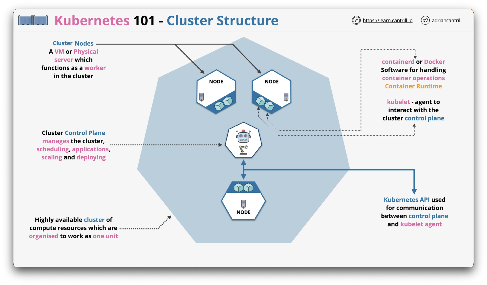
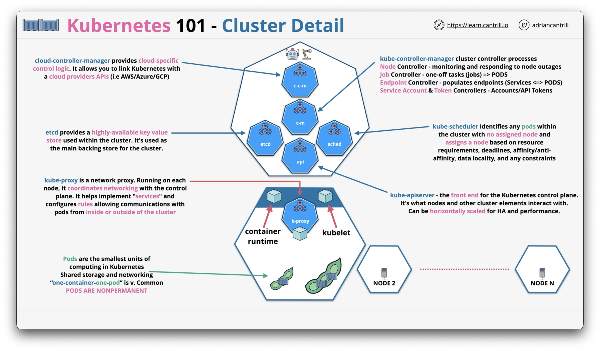

# Kubernetes 101

> **What it is:** Kubernetes (K8s) is an open-source **container orchestration system**. You use it to automate the **deployment, scaling, and management** of containerized applications.

At a high level, Kubernetes lets you run containers in a **reliable and scalable** way, makes efficient use of resources, and exposes your containerized applications to the outside world or your business. The mental model from the lecture: _it's like Docker, but with robots to automate it and the intelligence to do the thinking._

Kubernetes is **cloud-agnostic** — it runs on-premises and on many public cloud platforms (AWS, Azure, GCP). This note is a high-level architectural overview only; Kubernetes is a large, complex topic and this covers just the foundations.

---

## 1. Cluster Structure (high-level)

A **cluster** is a **highly available cluster of compute resources, organized to work as one unit.**

At the top level there are two roles:

- **Cluster Control Plane** — the part that **manages** the cluster. It performs scheduling, application management, scaling, and deployment, plus much more.
- **Nodes** — virtual **or** physical servers that function as **workers** in the cluster. These are the things that actually **run your containerized applications**.

Running on each node, at minimum, is:

- A **container runtime** — `containerd` or another runtime (Docker is one option) — software that handles container operations.
- **kubelet** — an agent that interacts with the control plane. kubelet communicates with the control plane using the **Kubernetes API**.

So the top-level flow is: the **control plane orchestrates** containerized applications, which **run on nodes**.



### Diagram walkthrough — Cluster Structure

This infographic shows the cluster as one large shaded heptagon (the "one unit") with components placed inside and explanatory callouts around the edges.

**Context (the big shaded shape):** The pale blue heptagon represents the **highly available cluster of compute resources organised to work as one unit** (bottom-left callout). Everything inside it is part of the single logical cluster.

**Main / middle objects:**

- **Three NODE hexagons** (two at top, one at bottom) — each shows a small **server icon** (the VM or physical machine) and **light-blue cube icons** (the containers/workloads running on that node). The top-left callout defines a **Cluster Node** as _a VM or physical server which functions as a worker in the cluster._
- **The robot hexagon in the center** — this is the **Cluster Control Plane**. The robot imagery reinforces the "automation + intelligence" metaphor. The left callout states the control plane **manages the cluster: scheduling, applications, scaling, and deploying.**

**Arrows / relationships:**

- **Dotted arrows from the nodes pointing down to the robot** represent the **kubelet** agent on each node reaching back to the control plane. The right callout defines **kubelet** as the _agent to interact with the cluster control plane._
- The **dotted arrow into the top-right of the diagram** points at the **containerd / Docker** callout — the **Container Runtime**, _software for handling container operations_, which lives on each node.
- The **solid blue double-headed arrow** between the robot and the right side represents the **Kubernetes API**, _used for communication between the control plane and the kubelet agent_ (bottom-right callout).

**Footer / takeaway:** The bottom callouts anchor the two foundational ideas — the cluster is **highly available and acts as one unit**, and **all control-plane ↔ node communication flows over the Kubernetes API.**

---

## 2. Cluster & Node Detail

Zooming in: the control plane sits at the top, and a single node sits at the bottom (running the minimum container runtime + kubelet for control-plane communication). A real cluster will usually have **many nodes** — a single-node cluster is rare and typically only a test environment.



### Diagram walkthrough — Cluster Detail

**Context (the two big shapes):**

- The **upper heptagon** is the **control plane**, again topped with the **robot icon** (automation/intelligence). Inside it are five blue hexagons — the control-plane components.
- The **lower hexagon** is a **single cluster node**, with two additional hexagons to the right (**NODE 2 … NODE N**, connected by a dotted line) showing that the cluster scales out to many nodes.

**Main / middle objects — Control plane (the five blue hexagons):**

- **`c-c-m`** — cloud-controller-manager (top)
- **`c-m`** — kube-controller-manager (center)
- **`etcd`** — the key/value store (left)
- **`sched`** — kube-scheduler (right)
- **`api`** — kube-apiserver (bottom)

**Main / middle objects — Node (lower hexagon):**

- A dark band across the top holds **light-blue cube icons** (containers) plus the **`k-proxy`** hexagon.
- **Red arrows** point from the labels **"container runtime"** (left) and **"kubelet"** (right) up to the cubes — these are the two pieces of node software.
- The **green soybean/pod pods** at the bottom of the node represent **Pods** (the green callout: _Pods are the smallest units of computing in Kubernetes; shared storage and networking; "one-container-one-pod" is very common; **PODS ARE NONPERMANENT**_).

**Arrows / relationships:**

- The **red line** from the left **kube-proxy** callout connects to the `k-proxy` hexagon on the node — kube-proxy runs on every node.
- The **blue arrow** from the lower-right **kube-apiserver** callout points at the `api` hexagon, marking it as the front door of the control plane.
- The remaining callouts (cloud-controller-manager, kube-controller-manager, etcd, kube-scheduler) each have arrows pointing to their respective hexagon.

**Footer / takeaway:** Control-plane components do the _thinking_ (scheduling, state, controllers, cloud integration, API front-end); the node runs the _work_ (containers inside pods) with kube-proxy, kubelet, and the container runtime as the local supporting software.

---

## 3. Pods — the unit you actually work with

**Pods are the smallest unit of computing in Kubernetes.**

- A pod can hold **multiple containers** that share storage and networking, **but the very common pattern is one-container-one-pod** (one container per pod). It's cleaner.
- **Don't think in containers — think in pods.** You work with and manage pods; the pod handles the container(s) inside it.
- Run **multiple containers in one pod only** when they are **tightly coupled**, need close proximity, and genuinely rely on each other.

### Pods are non-permanent (critical concept)

You'll be exposed to pods but will **rarely manage them directly.** To get maximum value from Kubernetes, treat pods as **temporary** — created, do a job, then disposed of. A pod can be:

- **Deleted** when finished,
- **Evicted** for lack of resources, or
- Lost if the **node itself fails.**

Pods are **not** designed to be viewed as highly available entities. Other objects (services, etc.) provide the permanence.

---

## 4. Control Plane Components

|Component|Formal name|Role|
|---|---|---|
|**API**|`kube-apiserver`|**Front end** for the control plane. Everything interacts with it to talk to the control plane. **Can be scaled horizontally** for performance and HA.|
|**etcd**|`etcd`|A **highly available key/value store** — a simple database inside the cluster acting as the **main backing store** for cluster data.|
|**Scheduler**|`kube-scheduler`|Constantly checks for **pods with no assigned node**, then **assigns a node** based on resource requirements, deadlines, affinity/anti-affinity, data locality, and other constraints. Ensures nodes get utilized effectively.|
|**Cloud Controller Manager** _(optional)_|`cloud-controller-manager`|Lets Kubernetes **integrate with a cloud provider** (AWS/Azure/GCP). Optional — a small home deployment won't use it.|
|**Controller Manager**|`kube-controller-manager`|A **collection of controller processes** (see below).|

### kube-controller-manager — the collection of controllers

- **Node Controller** — monitors and responds to **node outages.**
- **Job Controller** — runs pods to **execute jobs** (one-off / one-off tasks).
- **Endpoint Controller** — **populates endpoints**, linking **services to pods.**
- **Service Account & Token Controllers** — handle **account and API token creation.**

### Node software (runs on every node)

- **Container runtime** (`containerd` / Docker / other) — handles container operations.
- **kubelet** — agent that talks to the control plane via the Kubernetes API.
- **kube-proxy** (`kproxy`) — a **network proxy on every node** that coordinates networking with the control plane. It helps implement **services** and configures **rules** allowing communication with pods **from inside or outside** the cluster.

---

## 5. Key Terms / Summary Glossary

|Term|Definition|
|---|---|
|**Cluster**|Conceptually, a **deployment of Kubernetes.** Provides management, orchestration, healing, and service access.|
|**Node**|The actual **compute resource** (VM or physical server); pods run on nodes.|
|**Pod**|One or more containers — the **smallest admin unit.** Commonly one-container-one-pod. **Not permanent / not long-lived;** the cluster replaces them as required.|
|**Service**|An **abstraction from pods.** This is typically what you'd think of as "the application." An app can be containerized across many pods, but the **service is the consistent thing you interact with.**|
|**Job**|An **ad-hoc** unit of work. Creates one or more pods, runs until complete, retries if required, then finishes. Often used for back-end/isolated work.|
|**Ingress**|How something **external** to the cluster **accesses a service.** Flow: external users → **ingress** → routed through the cluster → **service** → one or more **pods** (the actual app).|
|**Ingress Controller**|Software that **arranges the underlying hardware to allow ingress.** Example: the **AWS Load Balancer** ingress controller uses ALB/NLB. Others exist (e.g. NGINX).|

### Request flow (external → app)

```
External users → Ingress → Service → Pod(s) → Container(s)
```

---

## 6. Storage & State

> **Architect pods to be stateless.** Pods are temporary, so if your app has long-running state you need somewhere to store it.

- **State** can mean **session data** or data in the traditional sense.
- **Default storage in Kubernetes is ephemeral**, provided **locally by a node.** If a pod **moves between nodes, that storage is lost.**
- **AWS analogy:** think of default ephemeral pod storage like **EC2 Instance Store volumes** (local, non-persistent).
- **Persistent Volumes (PVs)** provide persistent storage whose **lifecycle outlives any single pod** using them. This is how you provision normal long-running storage for containerized apps.

---

## 7. Exam-Oriented Callouts

**Keyword triggers**

- "**Container orchestration**" → Kubernetes.
- "**Front end** for the control plane" / "everything interacts with it" → **kube-apiserver**.
- "**Key/value store** / backing store for the cluster" → **etcd**.
- "Assigns **pods to nodes**" / "pods with no node" → **kube-scheduler**.
- "Integrate with **AWS/Azure/GCP**" → **cloud-controller-manager** (optional).
- "Responds to **node outages**" → **Node Controller** (inside kube-controller-manager).
- "**External access** to a service" → **Ingress** (+ Ingress Controller for the hardware).
- "Consistent **abstraction** over pods / the application you interact with" → **Service**.
- "**Persistent** storage that outlives a pod" → **Persistent Volume (PV)**.

**Traps to watch**

- **Pods are NOT permanent or highly available.** Don't treat them as durable.
- **kube-proxy runs on every node** (a node component), **not** in the control plane — even though it implements services.
- **cloud-controller-manager is optional** — only present when integrating with a cloud platform.
- Don't confuse **Service** (consistent abstraction / "the application") with **Ingress** (external entry point) or **Endpoint Controller** (links services to pods).
- **Default pod storage is ephemeral and node-local** — lost on pod relocation. Mentally map it to **EC2 Instance Store**, not EBS.
- A **Job** is ad-hoc (runs to completion); it is **not** a long-running service.

**Mnemonics**

- Control-plane components: **A.E.S.C.C.** → **A**pi, **E**tcd, **S**cheduler, **C**ontroller-manager, **C**loud-controller-manager.
- "**Think pods, not containers.**"

---

## 8. Forward References

- **AWS implementation of Kubernetes → EKS** (Elastic Kubernetes Service) — covered in follow-up videos.
- **Services, Ingress, Persistent Volumes** — deeper dives likely in later/technical-deep-dive content.