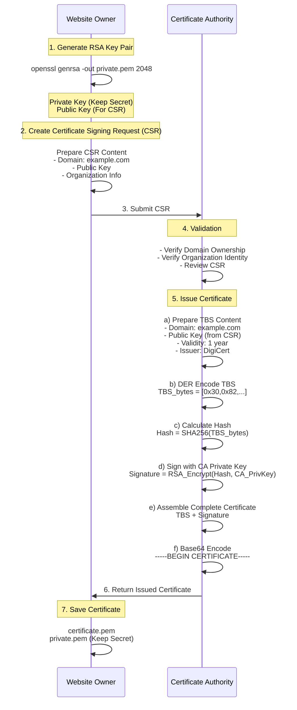
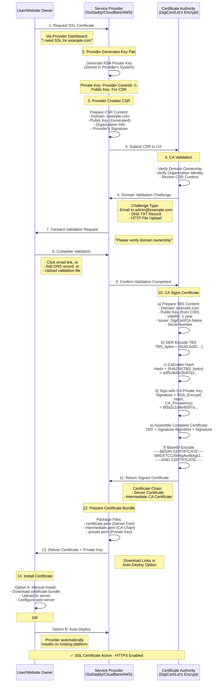
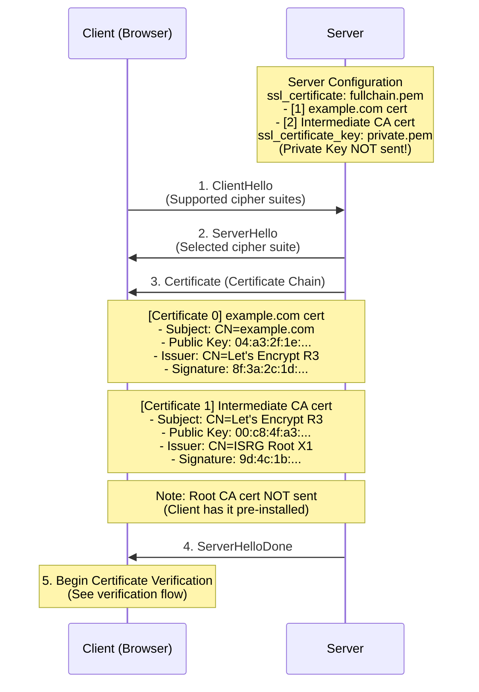

# How SSL and HTTPS Works

## 1. CA Certificate Issuance Flow

Scenario 1: Website owner submits CSR.

Scenario 2: Domain service provider submits CSR (Help generated key pair and return both cert and private key to website owner).





## 2. Server Sends Certificate to Client



## 3. Client Certificate Verification Flow

Use the specified hash algorithm to digest the certificate body part, then use the public key (either embedded to the client’s browser or operating system for CA Root Authority’s pub key, or in the chain certificate’s body part) of the upper authority to VERIFY the certificate signature (signed by upper authority) to extract the original digest. Compare the two digest values; if they are the same, then the verification passes.

```bash
Client (Browser)
    │
    │ Received Certificate Chain:
    │ ├─ [0] example.com Certificate
    │ └─ [1] Intermediate CA Certificate
    │
    ▼
┌──────────────────────────────────────┐
│ Step 1: Verify Chain Integrity       │
└──────────────────────────────────────┘
    │
    │ Check Root CA Certificate
    │ ┌────────────────────────────────┐
    │ │ Search System Root Cert Store: │
    │ │ CN=ISRG Root X1                │
    │ │ ✓ Found! Trusted Root CA       │
    │ └────────────────────────────────┘
    │
    ▼
┌──────────────────────────────────────┐
│ Step 2: Verify Intermediate CA Cert  │
└──────────────────────────────────────┘
    │
    │ a) Extract Root CA Public Key from System
    │    Root_PublicKey = getFromTrustStore("ISRG Root X1")
    │
    │ b) Extract TBS Part from Intermediate CA Certificate
    │    ┌──────────────────────────────┐
    │    │ TBS (To Be Signed) Content:  │
    │    │ - Subject: R3                │
    │    │ - Public Key: 00:c8:4f:a3... │
    │    │ - Issuer: ISRG Root X1       │
    │    │ - Validity: 2020-2025        │
    │    └──────────────────────────────┘
    │           ↓
    │    TBS_bytes = DER_encode(TBS_content)
    │
    │ c) Recalculate Hash
    │    Hash_Calculated = SHA256(TBS_bytes)
    │    = a3f5c8d9e2b4f7a1c6d8e9f0...
    │
    │ d) Extract Signature from Certificate
    │    Signature = Intermediate_CA_Cert.signature
    │    = 9d4c1b2e3f4a5b6c7d8e9f0a...
    │
    │ e) Decrypt Signature with Root CA Public Key
    │    Hash_FromSignature = RSA_Decrypt(
    │        Signature,
    │        Root_PublicKey
    │    )
    │    = a3f5c8d9e2b4f7a1c6d8e9f0...
    │
    │ f) Compare Hashes
    │    if (Hash_Calculated == Hash_FromSignature) {
    │      ✅ Intermediate CA Certificate Valid!
    │      ✅ Confirmed Issued by Root CA
    │      ✅ Content Not Tampered
    │    }
    │
    ▼
┌──────────────────────────────────────┐
│ Step 3: Verify Server Certificate    │
└──────────────────────────────────────┘
    │
    │ a) Extract Public Key from Intermediate CA Certificate
    │    Intermediate_PublicKey = 
    │        Intermediate_CA_Cert.publicKey
    │
    │ b) Extract TBS Part from Server Certificate
    │    ┌──────────────────────────────┐
    │    │ TBS (To Be Signed) Content:  │
    │    │ - Subject: example.com       │
    │    │ - Public Key: 04:a3:2f:1e... │
    │    │ - Issuer: R3                 │
    │    │ - Validity: 2024-2025        │
    │    └──────────────────────────────┘
    │           ↓
    │    TBS_bytes = DER_encode(TBS_content)
    │
    │ c) Recalculate Hash
    │    Hash_Calculated = SHA256(TBS_bytes)
    │    = 7b8c9d0e1f2a3b4c5d6e7f8a...
    │
    │ d) Extract Signature from Certificate
    │    Signature = Server_Cert.signature
    │    = 8f3a2c1d9e4b5f7a6c8d9e0f...
    │
    │ e) Decrypt Signature with Intermediate CA Public Key
    │    Hash_FromSignature = RSA_Decrypt(
    │        Signature,
    │        Intermediate_PublicKey
    │    )
    │    = 7b8c9d0e1f2a3b4c5d6e7f8a...
    │
    │ f) Compare Hashes
    │    if (Hash_Calculated == Hash_FromSignature) {
    │      ✅ Server Certificate Valid!
    │      ✅ Confirmed Issued by Intermediate CA
    │      ✅ Content Not Tampered
    │    }
    │
    ▼
┌──────────────────────────────────────┐
│ Step 4: Additional Verification      │
└──────────────────────────────────────┘
    │
    │ a) Check Certificate Validity Period
    │    ┌────────────────────────────┐
    │    │ Current Time: 2024-02-10   │
    │    │ Not Before: 2024-01-01     │
    │    │ Not After: 2025-01-01      │
    │    │ ✓ Certificate Not Expired  │
    │    └────────────────────────────┘
    │
    │ b) Verify Domain Name Match
    │    ┌────────────────────────────┐
    │    │ Visited URL: example.com   │
    │    │ Certificate CN: example.com│
    │    │ ✓ Domain Matches           │
    │    └────────────────────────────┘
    │
    │ c) Check Certificate Key Usage
    │    ┌────────────────────────────┐
    │    │ Key Usage:                 │
    │    │ - Digital Signature ✓      │
    │    │ - Key Encipherment ✓       │
    │    │ Extended Key Usage:        │
    │    │ - TLS Server Auth ✓        │
    │    └────────────────────────────┘
    │
    │ d) Check Certificate Revocation Status (Optional)
    │    ┌────────────────────────────┐
    │    │ Method 1: CRL Check        │
    │    │ Method 2: OCSP Query       │
    │    │ ✓ Certificate Not Revoked  │
    │    └────────────────────────────┘
    │
    ▼
┌──────────────────────────────────────┐
│ Verification Result                   │
└──────────────────────────────────────┘
    │
    ├─ ✅ All Checks Passed
    │    → Display Green Lock Icon
    │    → Allow HTTPS Connection
    │
    └─ ❌ Any Check Failed
         → Display "Not Secure" Warning
         → Block Connection or Warn User
```

## 4. Establishing HTTPS Encrypted Connection

Regarding step 4 shown in the graph, please refer to section 3 above.

```mermaid
sequenceDiagram
    participant Client as Client
    participant Server as Server
    
    Note over Client,Server: ═══════════════════════════════════════════════════<br/>TLS HANDSHAKE PHASE<br/>═══════════════════════════════════════════════════
    
    Client->>Server: 1. ClientHello
    Note right of Client: - TLS Version: 1.3<br/>- Random: Client_Random<br/>- Supported Cipher Suites<br/>- SNI: example.com
    
    Server->>Client: 2. ServerHello
    Note left of Server: - TLS Version: 1.3<br/>- Random: Server_Random<br/>- Selected Cipher Suite:<br/>  TLS_AES_256_GCM_SHA384
    
    Server->>Client: 3. Certificate (Certificate Chain)
    Note left of Server: - example.com certificate<br/>  (contains Server_PublicKey)<br/>- Intermediate CA certificate
    
    Note over Client: 4. Verify Certificate<br/>✓ Certificate Chain Valid<br/>✓ Signature Correct<br/>✓ Domain Matches<br/>✓ Not Expired
    
    Note over Client: 5. Generate Pre-Master Secret<br/>PreMasterSecret = Random 48 bytes<br/>= 2f3a4b5c6d7e8f9a0b1c...
    
    Note over Client,Server: ┌─────────────────────────────────────────────┐<br/>│ ASYMMETRIC ENCRYPTION (RSA)                 │<br/>│ Used ONLY for Key Exchange                  │<br/>└─────────────────────────────────────────────┘
    
    Note over Client: 6. Encrypt Pre-Master Secret<br/>🔐 ASYMMETRIC ENCRYPTION (RSA)<br/>Encrypted_PMS = RSA_Encrypt(<br/>  PreMasterSecret,<br/>  Server_PublicKey  ← From Certificate<br/>)
    
    Client->>Server: 7. ClientKeyExchange<br/>(Send Encrypted Pre-Master Secret)<br/>🔐 Encrypted with RSA
    
    Note over Server: 8. Decrypt Pre-Master Secret<br/>🔐 ASYMMETRIC DECRYPTION (RSA)<br/>PreMasterSecret = RSA_Decrypt(<br/>  Encrypted_PMS,<br/>  Server_PrivateKey  ← Server's Secret Key<br/>)
    
    Note over Client,Server: ═══════════════════════════════════════════════════<br/>KEY DERIVATION PHASE<br/>Both sides now have the same Pre-Master Secret<br/>═══════════════════════════════════════════════════
    
    par Client and Server Independently Calculate
        Note over Client: 9a. Calculate Master Secret<br/>MasterSecret = PRF(<br/>  PreMasterSecret,<br/>  "master secret",<br/>  Client_Random +<br/>  Server_Random<br/>)
    and
        Note over Server: 9b. Calculate Master Secret<br/>MasterSecret = PRF(<br/>  PreMasterSecret,<br/>  "master secret",<br/>  Client_Random +<br/>  Server_Random<br/>)
    end
    
    par Derive Session Keys (Symmetric Keys)
        Note over Client: From Master Secret, derive:<br/>- Client Write Key (AES Key)<br/>- Server Write Key (AES Key)<br/>- Client Write IV<br/>- Server Write IV
    and
        Note over Server: From Master Secret, derive:<br/>- Client Write Key (AES Key)<br/>- Server Write Key (AES Key)<br/>- Client Write IV<br/>- Server Write IV
    end
    
    Note over Client,Server: ═══════════════════════════════════════════════════<br/>Both sides now have identical symmetric keys<br/>Asymmetric encryption (RSA) is DONE<br/>═══════════════════════════════════════════════════
    
    Client->>Server: 10. ChangeCipherSpec<br/>(Client Ready to Use Symmetric Encryption)
    
    Note over Client: 🔐 SYMMETRIC ENCRYPTION (AES)
    Client->>Server: 11. Finished (Encrypted with AES)<br/>(Prove Client Has Correct Symmetric Key)
    
    Server->>Client: 12. ChangeCipherSpec<br/>(Server Ready to Use Symmetric Encryption)
    
    Note over Server: 🔐 SYMMETRIC ENCRYPTION (AES)
    Server->>Client: 13. Finished (Encrypted with AES)<br/>(Prove Server Has Correct Symmetric Key)
    
    Note over Client,Server: ✅ TLS Handshake Complete!<br/>✅ Both Have Same Symmetric Session Keys<br/>✅ All Future Communication Uses Symmetric Encryption
    
    Note over Client,Server: ═══════════════════════════════════════════════════<br/>APPLICATION DATA TRANSFER PHASE<br/>All data encrypted with SYMMETRIC encryption (AES)<br/>═══════════════════════════════════════════════════
    
    Note over Client: 🔐 SYMMETRIC ENCRYPTION (AES-256-GCM)
    Client->>Server: 14. Encrypted HTTP Request
    Note right of Client: Plaintext: GET /index.html<br/>↓<br/>AES-256-GCM Encrypt with Client Write Key<br/>↓<br/>Ciphertext: 8a9b0c1d2e3f4a5b...
    
    Note over Server: 🔐 SYMMETRIC DECRYPTION (AES-256-GCM)
    Note over Server: 15. Decrypt Request<br/>AES-256-GCM Decrypt with Client Write Key<br/>→ GET /index.html
    
    Note over Server: 16. Process Request<br/>Read index.html file
    
    Note over Server: 🔐 SYMMETRIC ENCRYPTION (AES-256-GCM)
    Server->>Client: 17. Encrypted HTTP Response
    Note left of Server: Plaintext: HTTP/1.1 200 OK<br/><html>...</html><br/>↓<br/>AES-256-GCM Encrypt with Server Write Key<br/>↓<br/>Ciphertext: 7f8e9d0c1b2a3b4c...
    
    Note over Client: 🔐 SYMMETRIC DECRYPTION (AES-256-GCM)
    Note over Client: 18. Decrypt Response<br/>AES-256-GCM Decrypt with Server Write Key<br/>→ HTTP/1.1 200 OK<br/><html>...</html>
    
    Note over Client: 19. Render Webpage<br/>🔒 https://example.com<br/>Display content to user
    
    Note over Client,Server: ═══════════════════════════════════════════════════<br/>ONGOING COMMUNICATION<br/>All encrypted with SYMMETRIC encryption (AES)<br/>Fast and efficient for large amounts of data<br/>═══════════════════════════════════════════════════
    
    Client->>Server: Subsequent Requests (AES Encrypted)
    Server->>Client: Subsequent Responses (AES Encrypted)
```


