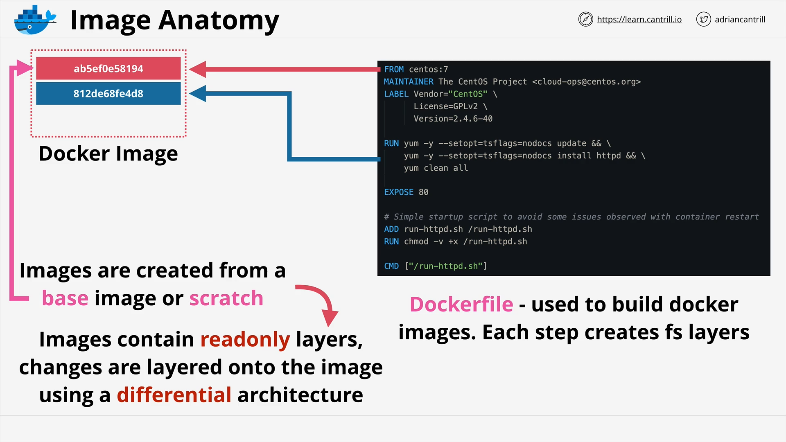
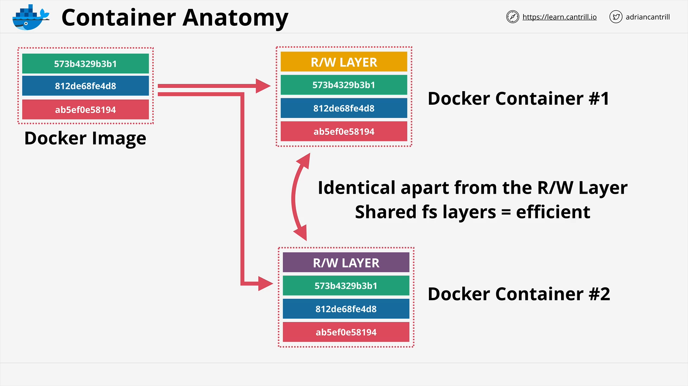

# Containers

Containers are a compute packaging and isolation model. They sit between traditional VM-style compute like [EC2](../services/ec2.md) and fully managed runtime services: the application is isolated, portable, and repeatable, but it does not boot its own full guest operating system.

The core idea: a container runs as one or more isolated processes on a host OS. It packages the application, libraries, and runtime dependencies, while the host OS kernel still does the heavy work of process scheduling, networking, and file I/O.

## Containers vs VMs

Traditional VM virtualization duplicates a full guest OS for every workload. That is powerful, but heavy: each VM has its own OS image, boot lifecycle, patch surface, and resource overhead. Containers avoid most of that duplication by sharing the host OS kernel.

| Aspect | VM virtualization | Containers |
| --- | --- | --- |
| Stack | Hardware, hypervisor, guest OSs, applications | Hardware, host OS, container engine, containers |
| Isolation boundary | Full guest OS per VM | Isolated process environment on the host OS |
| OS per application | One full guest OS each | Shared host kernel; packaged user-space dependencies |
| Resource footprint | Heavy: OS consumes disk, memory, and boot time | Lighter: app plus runtime dependencies |
| Startup speed | Slower: boot or manipulate an OS | Faster: start a process from an image |
| Density | Lower | Higher |

> [!warning] Gotcha
> A container image is not a full VM disk and does not contain its own running kernel. A Linux container image may include a minimal Linux user space such as CentOS or Alpine, but the running container still uses the host's Linux kernel. This is why containers are lighter than VMs, and also why host/kernel compatibility matters.

## Container Images and Layers

A **container image** is the template used to create containers. The useful mental model is similar to an [AMI](../services/ec2.md#ami--amazon-machine-image) launching EC2 instances, but the storage model is different: a container image is a stack of read-only filesystem layers, not one monolithic boot disk.

Images are commonly built from a **Dockerfile**. Each instruction contributes a filesystem change, and Docker stores those changes as layers:

1. `FROM centos:7` starts from a base image, or an image can start from `scratch`
2. `RUN yum ... install httpd` adds packages such as Apache and supporting libraries
3. `ADD` or later `RUN` instructions add application files, scripts, or configuration

The important property is **differential layering**. Each layer stores only the changes from the layers below it, and the final image is the combined view of all layers.

## Running Containers

A **container** is a running instance of an image. When the container starts, the engine adds a per-container read/write layer on top of the image's read-only layers.

The read/write layer is where runtime changes go: logs, temporary files, generated data, and modifications made by the application while the container runs. Two containers created from the same image can therefore share all the read-only layers and differ only in their read/write layers.

That is the efficiency win:

- The base layers are reused instead of copied for every container
- Many containers can start from one image with minimal incremental disk use
- Since the image layers are read-only, one container cannot overwrite another container's base filesystem
- Scaling from 2 containers to 200 containers is mostly about adding runtime layers and scheduling capacity, not duplicating hundreds of full OS disks

> [!warning] Gotcha
> The container read/write layer is not a good place for durable application state. Treat it like local scratch space unless the workload explicitly mounts persistent storage or writes state to an external service. For architecture design, this connects directly to [horizontal scaling](../patterns/scaling.md): stateless containers are much easier to scale, replace, and spread across hosts.

## Container Registries

A **container registry** stores and distributes images. Public registries such as Docker Hub host common base images and open-source application images. Private registries hold organization-specific images and usually require authentication.

Typical workflow:

1. Write a Dockerfile
2. Build a container image
3. Push the image to a registry
4. Pull the image onto one or more container hosts
5. Run one or more containers from that image

One image can create many containers, and many hosts can pull the same image. In AWS, this model is the foundation for services such as [ECS](../services/ecs.md), EKS, Fargate, and ECR. The service-specific details are separate, but the image, registry, host, and running-container vocabulary stays the same.

## Networking and Ports

Containers are isolated from the host and from each other, so a service inside a container must be explicitly exposed or mapped before other systems can reach it. A Dockerfile instruction such as `EXPOSE 80` documents that the application listens on TCP port 80, but actual reachability still depends on runtime configuration: port mapping, load balancer targets, [VPC](../services/vpc.md) routing, [Security Groups](../services/vpc.md#security-groups-sg), and sometimes [ENIs](networking.md#elastic-network-interfaces-enis).

For AWS architecture questions, the key distinction is:

- **Container-level exposure** says which port the application expects
- **AWS network controls** decide whether traffic can reach the task, instance, or load balancer

## Docker Terminology

Docker is the most common container tooling name, so people often use "Docker" as shorthand for "container." Keep the terms separate:

| Term | Precise meaning |
| --- | --- |
| Dockerfile | Build instructions for a Docker image |
| Docker image | One implementation of a container image |
| Docker container | One running container created from a Docker image |
| Docker host | A host running the Docker engine |
| Docker Hub | One public container registry |

Docker is not the only container engine, host model, or registry. The general concepts apply beyond Docker.

## Design Implications

Containers are useful because they combine repeatable packaging with high density:

- **Portability:** the app and its dependencies travel together, so the same image can run on compatible hosts
- **Consistency:** version drift is reduced because environments are built from the same image
- **Density:** shared image layers and shared host kernel reduce disk and memory overhead compared with VMs
- **Fast start/stop:** starting a process is faster than booting a guest OS
- **Composable systems:** multi-tier applications can be split across containers, such as an app container and a database container

The trade-off is that container platforms introduce orchestration concerns: scheduling, service discovery, networking, health checks, secret injection, image scanning, and persistent storage. AWS container services handle different parts of that operational surface. [ECS](../services/ecs.md) is AWS's managed orchestrator for this layer: it turns container images into task definitions, tasks, and services, then runs them on either EC2-backed hosts or Fargate.

## Exam Tips

> [!tip] Exam Tip
> A container runs as a process on the host OS, not as a full guest OS on a hypervisor. Image layers are read-only, and the per-container read/write layer is added only when a container runs. Portability, consistency, density, and fast startup point to containers; full OS control, per-host licensing, or direct OS administration usually points back to [EC2](../services/ec2.md#when-to-use-ec2). Production container orchestration on AWS usually points to [ECS](../services/ecs.md) rather than hand-running Docker on one EC2 instance.

## Key Takeaways

1. Containers package an app plus dependencies, but they share the host OS kernel
2. A container image is a stack of read-only filesystem layers
3. A running container adds a read/write layer on top of the image
4. Multiple containers from the same image share the read-only layers, which drives density and efficiency
5. Registries distribute images; hosts pull images and run containers from them
6. ECS is the AWS managed orchestrator that runs containerized applications as tasks and services
7. Docker is common terminology, but Docker is one implementation of container tooling, not the entire concept

## References

- [EC2 — When to Use EC2](../services/ec2.md#when-to-use-ec2)
- [Scaling — Horizontal vs Vertical](../patterns/scaling.md)
- [Networking Concepts — ENI and network controls](networking.md#elastic-network-interfaces-enis)
- Source: `raw/aws-cert-study-notes/aws-solution-architect/container_introduction.md`
- Source: `raw/aws-cert-study-notes/aws-solution-architect/ecs_101.md`
