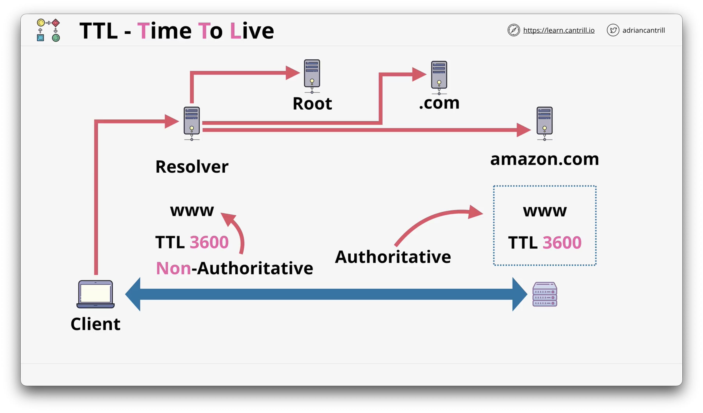
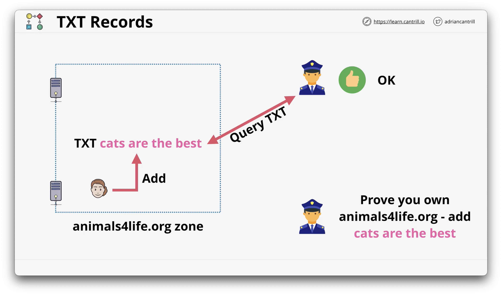

# DNS — Domain Name System

DNS translates human-readable domain names (e.g. `example.com`) into IP addresses that routers can forward to. It underpins every internet request. The AWS implementation is [Route 53](../services/route53.md).

See [Networking Concepts](networking.md) for broader networking context, and [TLS/HTTPS](tls-https.md) for how DNS and TLS work together to establish a secure connection.

## Resolution Chain

Strip away the detail and DNS does one job: you hold a **DNS name** (e.g. `www.netflix.com`) and need the **IP address(es)** that serve it. Somewhere in the world a single **zone** holds the record that answers that name. The entire challenge is **finding that one zone** so it can give you an authoritative answer. No single nameserver holds all the answers, but **every query gives you the next step** — and that end-to-end process is called **walking the tree**.

When you navigate to a domain, resolution follows a strict delegation chain — but caching short-circuits most of it in practice:

```text
Client
  │
  ├─ 1. Local cache (browser + OS)  ← checked first
  │
  ├─ 2. Recursive Resolver (ISP or custom, e.g. 8.8.8.8)
  │      └─ also has a local cache
  │
  ├─ 3. Root DNS Servers  ← ~13 logical roots, anycast globally
  │      └─ returns Top-Level Domain (TLD) nameserver for ".com", ".org", etc.
  │
  ├─ 4. TLD Server  ← e.g. Verisign for .com
  │      └─ returns the authoritative nameserver for the domain
  │
  └─ 5. Authoritative DNS Server (Nameserver)
         └─ returns the actual DNS record (A, CNAME, MX, …)
```

The recursive resolver handles steps 3–5 on behalf of the client, caches the result, and returns the answer. The client only ever talks to the recursive resolver.


### Walking the Tree, Step by Step

The diagram below traces the full walk for `www.netflix.com`: the resolver (bottom-left) does the work on your behalf, climbing the tree tier by tier. Green arrows are queries going out; pink arrows are answers coming back. The trust chain along the top (Root, then the `.com` registry, then `netflix.com`'s nameservers) is a chain of **delegations** — each tier hands control of the level below it down via NS records.


Following the numbered badges in the diagram:

1. **Client checks its local cache and hosts file.** The OS consults the [hosts file](#hosts-file-the-pre-dns-override) — a static name-to-IP mapping that **overrides DNS** — and any local cache before a query ever leaves the machine.
2. **Client queries the resolver.**
3. **Resolver checks its own cache.** A **recursive resolver** typically runs on your home router or at your ISP; it performs the walk for you and caches what it learns.
4. **Resolver asks a Root server** for `www.netflix.com`. Resolvers ship with the root server IPs **hard-coded** (the list is maintained by the OS vendor — they are not "looked up").
5. **Root returns the `.com` nameservers** (NS records). Root can't answer the query, but it **delegates `.com`** to VeriSign.
6. **Resolver asks a `.com` TLD nameserver** for `www.netflix.com`.
7. **`.com` returns the `netflix.com` nameservers** — the delegation VeriSign created when the domain was registered.
8. **Resolver asks a `netflix.com` nameserver** for `www.netflix.com`.
9. **`netflix.com` returns the record** — and it's **authoritative**, because these servers host the zone file *and* are the ones the `.com` zone points at.
10. **Resolver caches the result** for its [TTL](#caching-and-ttl).
11. **Resolver returns the result to the client.**

The resolution proper completes at **step 9**, when the authoritative answer arrives; steps 10–11 are just the resolver caching that answer and handing it back. Steps 4–9 are the tree walk itself — three query/response pairs, one per tier (Root, `.com`, `netflix.com`).

> [!tip] Exam framing
> Everything in the walk exists for one reason — **to find the correct zone**. Trigger keywords map cleanly: "static mapping that overrides DNS" → **hosts file**; "queries on your behalf, runs on a router or ISP" → **resolver**; "hard-coded IPs maintained by the OS vendor" → **root servers**; "points `.com` at VeriSign / points a domain at its nameservers" → **NS records / delegation**; "process from root down to the domain" → **walking the tree**.

#### What the tools show — every referral is an NS record

At each tier the server you ask says, in effect, *"I'm not authoritative for this and can't answer it directly, but here are the nameservers that can"* — and returns the **NS records for the next tier down**. That is what makes "every query gives you the next step" literally true: a referral *is* a set of NS records.


> [!warning] Gotcha
> **The authoritative answer is not always an IP.** Here `www.netflix.com` resolves to a **CNAME** (`www.dradis.netflix.com`) — another DNS name — so the resolver must **walk the tree all over again** for *that* name. Real queries frequently chain through several names like this, and the stacked network latency is a common reason apps feel slow. See [CNAME — Host-to-Host Alias](#cname--host-to-host-alias).

#### Hosts file: the pre-DNS override

The hosts file (`/etc/hosts` on Linux/macOS, `C:\Windows\System32\drivers\etc\hosts` on Windows) is a static name-to-IP map that the OS consults **before** sending any DNS query, so an entry there **wins over DNS entirely**. This is the classic *"why isn't my DNS change taking effect?"* culprit — and, deliberately, a quick way to test a new server by pointing a name at it locally before changing the real record.

### Inspecting DNS — `nslookup` and `dig`

Two command-line tools let you watch the walk yourself. `nslookup` ships on Windows and most Unix systems; `dig` is the richer Unix tool.

```bash
# Full recursive answer (what your resolver gives you).
# nslookup prefixes it with "Non-authoritative answer:" because it came from cache.
nslookup www.netflix.com
dig +short www.netflix.com

# Ask a specific tier directly, following the delegation by hand:
dig @a.root-servers.net com. NS        # root returns the .com nameservers (AUTHORITY section)
dig @a.gtld-servers.net netflix.com. NS # .com returns the netflix.com nameservers

# Ask the delegated nameserver itself — the answer is now authoritative
# (no "Non-authoritative" tag in nslookup; dig sets the 'aa' flag in its header).
dig @ns-81.awsdns-10.com www.netflix.com

# Walk the entire tree automatically, printing each referral:
dig +trace www.netflix.com
```

> [!tip] Reading the output
> `nslookup` tags any answer served from a resolver cache with **`Non-authoritative answer:`**; querying the delegated nameserver directly drops that line. In `dig`, an authoritative answer sets the **`aa`** flag in the `flags:` header line, delegations appear in the **AUTHORITY** section, and `dig +trace` makes the whole walk visible at once.

## Caching and TTL

Every DNS record includes a **TTL (Time To Live)** — a value in seconds that tells caches how long to hold the record before re-querying.

| Cache layer | Who controls TTL |
| --- | --- |
| Browser | TTL from the record (capped by browser) |
| OS resolver | TTL from the record |
| Recursive resolver (ISP) | TTL from the record |
| Authoritative DNS | You set it on the record |

Lowering TTL before a migration gives you faster propagation (stale records expire sooner). Raising it for stable records reduces resolver load.

### Authoritative vs Non-Authoritative Answers

TTL is what creates the distinction between the two kinds of DNS answer:

| Term | Source | Speed | Accuracy |
| --- | --- | --- | --- |
| **Authoritative** | The nameserver that is the source of truth for the domain | Slower — the resolver must "walk the tree" | Always current; the single source of truth, and the preferred answer |
| **Non-authoritative** | A **cached** copy held at a resolver | Faster — served immediately | Usually correct, but can be **stale** until the TTL expires |



The first query for a record walks the full [resolution chain](#resolution-chain) and returns an **authoritative** answer. The resolver then caches it for the record's TTL (1 hour for `TTL 3600`), so the **next** client querying the same name gets a **non-authoritative** answer served instantly from cache. A resolver **always** labels its answers non-authoritative — even when the cached value is perfectly current — because only the delegated nameserver is the source of truth; in most cases nobody cares, but the exam expects you to know the distinction. TTL is the balance: a **low** TTL means more queries against your nameservers but fast propagation when you change a record; a **high** TTL means fewer queries but stale values linger after a change.

> [!warning] Gotcha
> TTL propagation is **not instantaneous**. If you lower TTL from 86400 s (1 day) to 60 s, you must wait the full 24 hours for all resolvers to re-query before the short TTL takes effect. This is why best practice is to **lower TTLs well in advance** of any migration — sometimes days ahead. The classic failure: migrating email to a new provider while the **MX TTL is high**, so resolvers keep using the old cached MX values and mail delivery breaks until the cache expires.

> [!warning] Gotcha
> A resolver *should* honour TTL but is not forced to — its operator can override the value locally. TTL/caching behaviour is a frequent cause of real-world DNS problems precisely because you don't fully control downstream caches.

## DNS Record Types

A DNS zone stores several **record types**, each with a distinct job. The summary below is the quick reference; the subsections that follow add the detail and exam traps for the types that get tested.

| Record | Purpose | Example |
| --- | --- | --- |
| A | Domain to IPv4 | `example.com → 93.184.216.34` |
| AAAA | Domain to IPv6 | `example.com → 2606:2800:…` |
| CNAME | Alias to another domain name (subdomains only) | `www → example.com` |
| MX | Mail server for domain | `example.com → mail.example.com` |
| NS | Nameservers for a zone | points to authoritative servers |
| TXT | Free-text (SPF, DKIM, domain verification) | `"v=spf1 include:…"` |
| SOA | Start of Authority — zone metadata | one per zone, auto-created |
| PTR | Reverse DNS (IP to domain) | used for email reputation |

### NS — Delegation

**NS (Nameserver) records are what make delegation possible.** They are how one zone hands off responsibility for a child zone to another set of nameservers. The NS records live *inside the parent zone* and point outward at the servers that host the child zone — the child zone then holds the actual records (`www`, `mail`, and so on).


This is the same mechanism at every level of the [resolution chain](#resolution-chain): the root zone delegates `.com` by holding NS records for the `.com` nameservers (VeriSign), and the `.com` zone delegates `amazon.com` by holding NS records for Amazon's nameservers. Delegation works **both ways down the hierarchy** — root, then TLD, then domain.

### A and AAAA — Hostname to IP

Both map a **hostname to an IP address**; they differ only in IP version. `A` returns an **IPv4** address, `AAAA` returns an **IPv6** address.


Admins commonly create **two records with the same name** — one A and one AAAA. The client's OS or DNS software then picks the address type it supports (AAAA when IPv6-capable, otherwise A). A useful anchor: the short name `A` maps to v4, the longer name `AAAA` maps to the longer v6 address.

### CNAME — Host-to-Host Alias

A **CNAME** maps one name to **another name** — the DNS equivalent of a shortcut or alias. In the diagram below, an `A` record `server` points at an IPv4 address, and three CNAMEs (`ftp`, `mail`, `www`) all point at `server`, so all four names resolve to the same IP.


The payoff is **reduced admin overhead**: one host often runs multiple roles (FTP, mail, web). If its IP changes you update **only the A record**, and every CNAME pointing at it follows automatically.

The cost is an **extra round trip**: because a CNAME resolves to another *name*, the resolver must [walk the tree](#walking-the-tree-step-by-step) again for the target before it reaches an IP. Chains of CNAMEs stack network latency and are a common cause of sluggish-feeling apps.

> [!warning] Gotcha
> A **CNAME can only point at another name — never directly at an IP address.** This is a classic exam trick. Related trap: a **CNAME cannot be used at the zone apex** (`example.com` itself, also called the naked domain) — DNS standards forbid it; only subdomains (e.g. `www.example.com`) can have CNAMEs. [Route 53](../services/route53.md) solves the apex case with its proprietary **Alias record**.

### MX — Mail Servers

**MX (Mail Exchange) records let a sending mail server find the SMTP server for a domain** — they are how internet email is routed. Each record has two parts: `MX <priority> <value>`.


Two details carry most of the exam weight:

- **The value: host vs FQDN.** A value with **no trailing dot** (e.g. `mail`) is treated as a host *inside the same zone*, so `mail` means `mail.google.com`. A value **with a trailing dot** (e.g. `mail.other.domain.`) is a **Fully Qualified Domain Name** and can point inside *or outside* the zone — e.g. an external provider like Office 365. The host name the MX points at is arbitrary (`mail`, `apple`, `fluffy` — it does not matter to how MX works).
- **Priority: lower value wins.** `MX 10 mail` is tried before `MX 20 mail.other.domain.`; the higher number is the fallback. Equal priorities mean any may be chosen.

Delivery flow: the sending server reads the domain from the recipient address (`hi@google.com` gives `google.com`), performs an MX query through DNS, picks the record with the lowest priority number, resolves it to an IP, and connects over SMTP to deliver.

> [!tip] MX is the *receiving* side
> The MX record is published by the domain that **receives** mail — it advertises "deliver mail for me here." The description above is from the *remote sender's* lookup perspective, but the record exists for inbound delivery: no MX record, no incoming mail. There is **no DNS record for a domain's outbound/sending server** — that is client configuration. DNS's only role on the sending side is *authorization* (SPF/DKIM/DMARC in [TXT records](#txt--arbitrary-text)), not routing.

The mail pipeline is a chain of **four agents** ([RFC 5598](https://datatracker.ietf.org/doc/html/rfc5598)) — **MUA** (Mail User Agent, your client), **MSA** (Mail Submission Agent), **MTA** (Mail Transfer Agent), and **MDA** (Mail Delivery Agent) — and MX governs only the MTA-to-MTA hop. Whether you call it "three legs" or "four legs" just depends on whether you slice by *transport phase* or by *software agent*; the wire transactions are identical. The table maps the agents to the protocol, port, and DNS record each transition uses:

| Phase (agents) | What moves | Protocol | Typical port(s) | DNS record |
| --- | --- | --- | --- | --- |
| **Submission** (MUA to MSA) | client hands the message to your provider's submission server | SMTP submission | 587 (STARTTLS) / 465 (TLS) | none — client config |
| **Transfer / relay** (MTA to MTA) | sender's server relays across the internet to the recipient's server | SMTP | 25 | **MX** of recipient domain |
| **Local delivery** (MTA to MDA) | receiving server filters (spam/virus) and deposits into the mailbox store | internal / LMTP | — | none |
| **Retrieval** (mailbox to MUA) | recipient's client reads mail from its mailbox store | **IMAP** or **POP3** | IMAP 143 / 993, POP3 110 / 995 | none — client config |

There is **no MX equivalent for IMAP/POP3**: a client finds its mailbox server by manual configuration or autoconfiguration (vendor autodiscover, or optional `SRV` records), never by MX. Mental model: **SMTP + MX move mail *to* a mailbox; IMAP/POP3 read it *from* the mailbox** — the two never overlap. **IMAP** keeps mail on the server and syncs read/folder state across devices (the modern default); **POP3** historically downloads and deletes (single-device).

> [!warning] Gotcha
> The authentication records **SPF, DKIM, and DMARC** (all [TXT records](#txt--arbitrary-text)) are *verified by the **receiving** server*, not by the sender's MSA. On the way out, the sending infrastructure authenticates the user and DKIM-*signs* the message; the recipient's MTA then checks the connecting IP against SPF, validates the DKIM signature, and applies the DMARC policy.

### TXT — Arbitrary Text

**TXT records attach arbitrary text to a domain**, extending DNS with extra functionality. Two common uses:

- **Proving domain ownership** (the most common): an external system (Google Workspace, Office 365, Amazon WorkMail) asks you to add a TXT record containing a specific string. It then queries that TXT record and, if the value matches, confirms you control the domain.
- **Anti-spam (e.g. SPF):** a TXT record lists which servers are authorized to send email for the domain. Mail from unlisted servers is a strong spam signal.



## Split-Horizon DNS

**Split-horizon DNS** (also called *split-view DNS*) is the practice of returning **different answers for the same DNS name** depending on where the query originates — typically *inside* a private network vs *outside* on the public internet. One hostname works everywhere, but resolves to the appropriate address for the caller's network context.

This avoids two common problems:

- **Hairpin routing** — without split-horizon, internal callers resolve to a public IP and traffic leaves the private network only to come back in
- **Hostname duplication** — applications don't need separate "internal" and "external" hostnames; the same name works from both sides

### Where you see it in AWS

| Mechanism | Behaviour |
| --- | --- |
| **EC2 public DNS name** (e.g. `ec2-3-89-7-136.compute-1.amazonaws.com`) | Inside the VPC → resolves to the **private IPv4**; outside → resolves to the **public IPv4**. Built-in; no configuration required. See [EC2 — Network Interfaces (ENIs)](../services/ec2.md#split-horizon-dns--the-public-dns-name-resolves-differently-inside-vs-outside-the-vpc) |
| **Route 53 split-view hosted zones** | Same domain registered as both a **public hosted zone** *and* a **private hosted zone** associated with a VPC — VPC queries hit the private zone, internet queries hit the public zone. See [Route 53](../services/route53.md) |

> [!warning] Gotcha
> Route 53 split-view is **not** an overlay where the private zone overrides a few records and the rest fall through to public. Inside the VPC the private zone **replaces** the whole namespace: a name not present in the private zone returns **NXDOMAIN**, not the public answer. Any public name you still need internally must be **duplicated** into the private zone. See [Route 53 — How association and namespace resolution work](../services/route53.md#how-association-and-namespace-resolution-work).

> [!tip] Exam Tip
> When a question mentions *"connect via the public DNS name"* alongside *"VPC peering"*, *"hybrid network"*, or *"keep traffic off the internet gateway"*, the answer leans on split-horizon DNS — internal callers automatically resolve to the private address.

## Authoritative DNS and Redundancy

The **authoritative DNS server** (nameserver) is the source of truth for a domain's records. All updates happen here. Domains typically have multiple nameservers so that resolution continues if one is unreachable.

## Securing DNS — DNSSEC

Plain DNS has no way to validate the **origin** or **integrity** of an answer, which is what makes [cache poisoning](dnssec.md#why-dnssec-is-needed--cache-poisoning) possible — an attacker races a forged response into a resolver's cache during the [tree walk](#walking-the-tree-step-by-step), and every later client is served the poisoned record until its TTL expires. **[DNSSEC (DNS Security Extensions)](dnssec.md)** is the *add-on* that closes this gap: it layers digital signatures (RRSIG) over [RRSETs](dnssec.md#rrset--resource-record-set) and builds a cryptographically verifiable **chain of trust** from the root down to each record, so a validating resolver can detect and reject forged or altered data. It is additive and backward compatible — DNS-only clients never see the extra records. See the full treatment on the [DNSSEC](dnssec.md) page.

## References

- [DNSSEC](dnssec.md) — securing DNS with origin authentication + integrity (chain of trust to root)
- [Route 53](../services/route53.md) — AWS authoritative DNS service
- [Networking Concepts](networking.md)
- [TLS/HTTPS](tls-https.md)
- Source: [How Does the DNS Process Work?](https://www.linkedin.com/pulse/how-does-dns-process-work-mohamed-ayman-elshazly-/)
