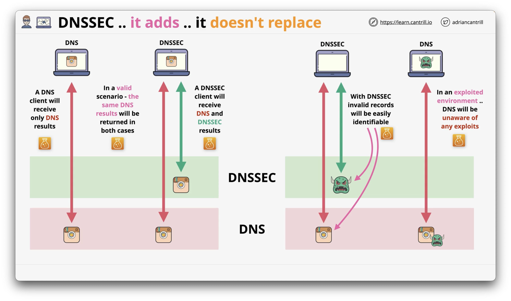
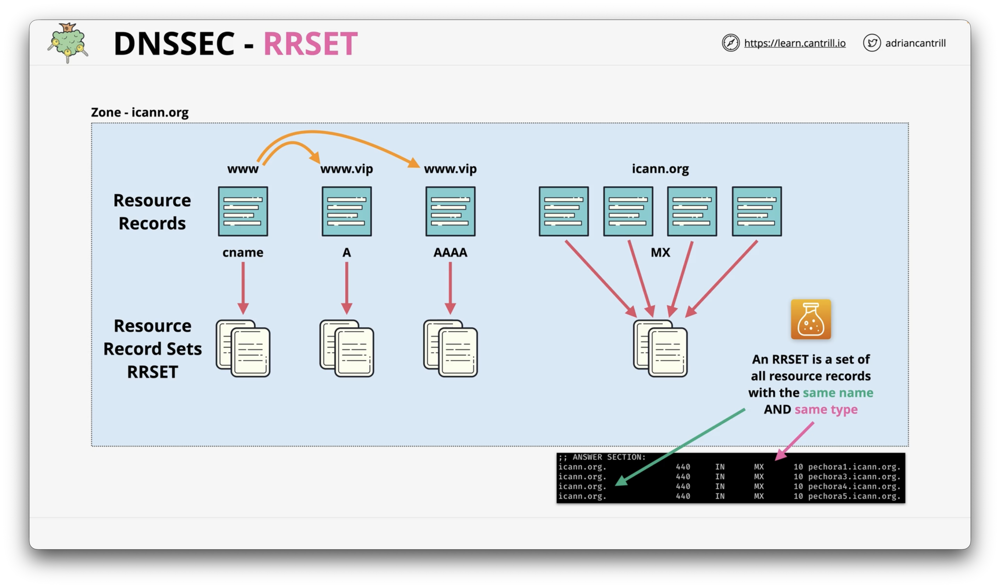
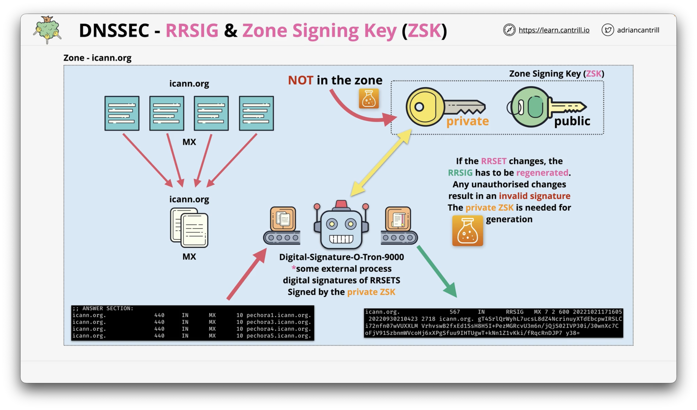
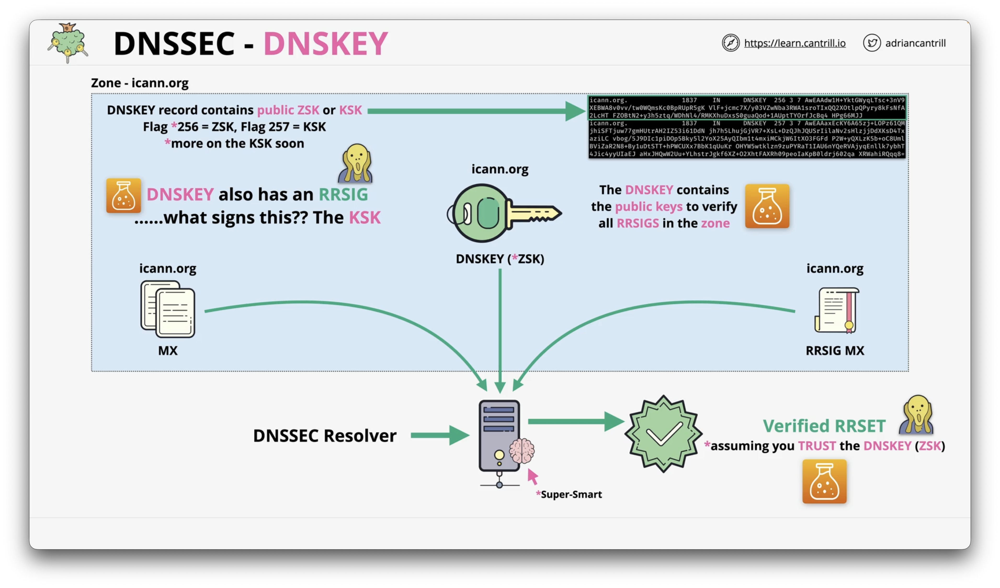
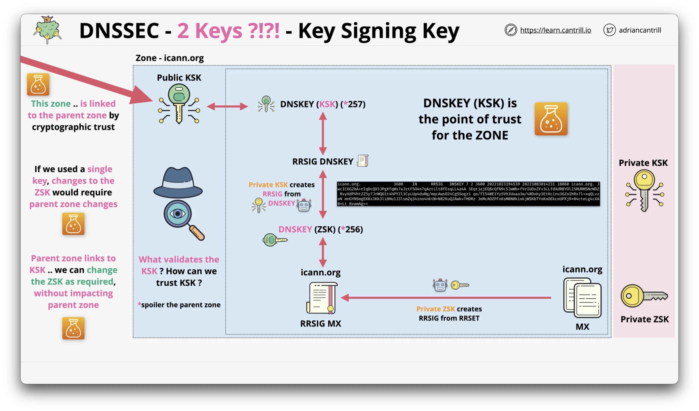
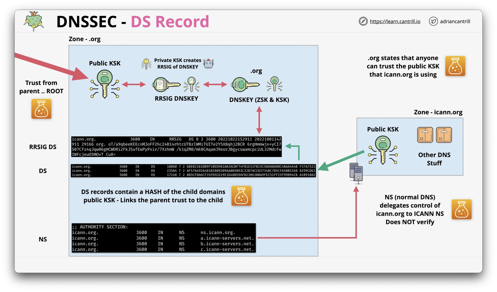
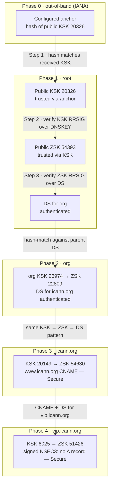
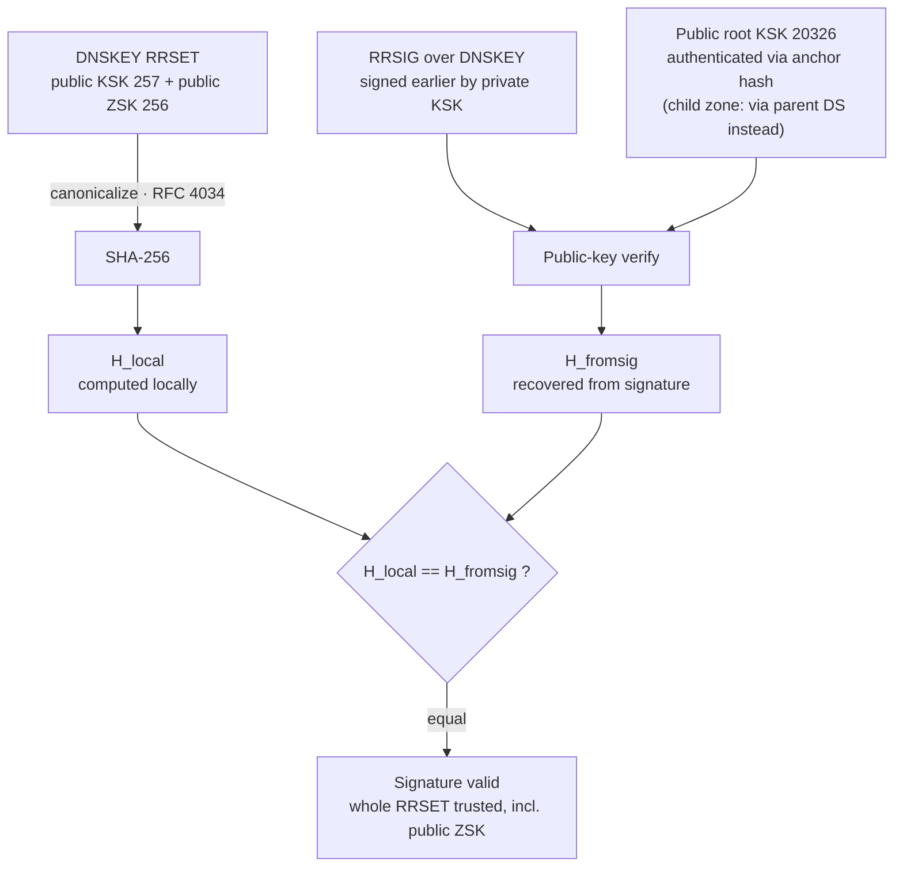
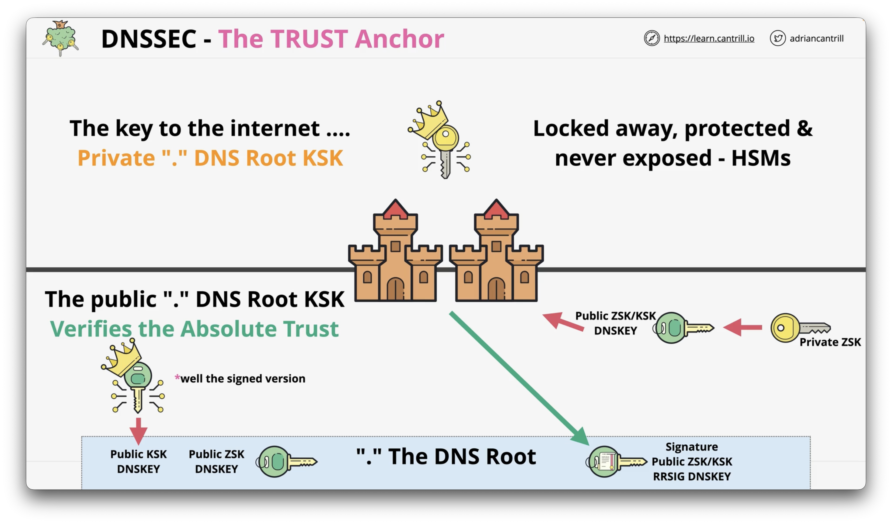
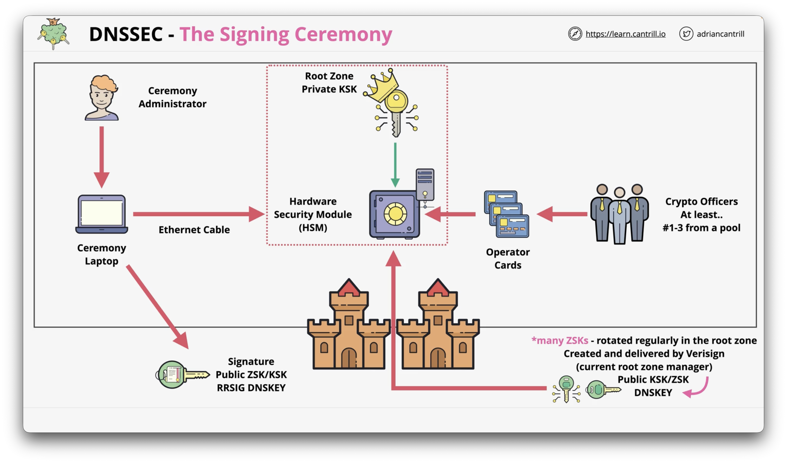

# DNSSEC — DNS Security Extensions

**DNSSEC (DNS Security Extensions)** is a secure *add-on* to [DNS](dns.md). It does **not** replace DNS — it layers on top of it. Picture plain DNS at the bottom and DNSSEC sitting above it, so every query is either *DNS on its own* or *DNS plus DNSSEC*. A DNS-only client never sees the extra records and keeps working exactly as before, which is how DNSSEC stays backward compatible.

It adds two guarantees that plain DNS lacks:

1. **Data origin authentication** — proof that records genuinely came from the zone you think they did (are these *really* `netflix.com`'s records, even when served from a cache?).
2. **Data integrity** — proof that records have not been altered since the zone administrator created them.

It delivers both by building a **cryptographically verifiable chain of trust** from the DNS root down to an individual record, using public-key cryptography — the same family of techniques that lets [TLS/HTTPS](tls-https.md) secure HTTP. See [DNS](dns.md) for the underlying resolution mechanics this builds on.

> [!warning] DNSSEC validates, it does not correct
> DNSSEC never tells you what the *right* answer should be. It only lets you **validate** whether data is authentic and unmodified. Knowing that integrity is intact (or in doubt) is enough — a validating resolver simply refuses to hand back data that fails the check.

## Why DNSSEC Is Needed — Cache Poisoning

Plain DNS was designed for a friendlier early internet and has no built-in way to validate the origin or integrity of an answer. That opens it to **cache poisoning**, where an attacker tricks a resolver into caching a forged record.


1. The attacker (Evil Bob) queries a resolver for `catagram.io`, kicking off the resolver's normal [walking-the-tree](dns.md#walking-the-tree-step-by-step) process.
2. While the resolver is still walking the tree, the attacker races a **forged response** back, impersonating the authoritative nameserver.
3. The forged answer lands in the resolver and the **cache is now poisoned**.
4. When the real user later queries `catagram.io`, the resolver serves the poisoned record straight from cache.
5. The user is silently directed to an impostor that he believes is `catagram.io`.

A poisoned entry is reused for **every** `catagram.io` query until its [TTL](dns.md#caching-and-ttl) expires. Real DNS has some mitigations (randomized query IDs and source ports), so this is a simplified illustration — but it shows the core weakness: plain DNS gives you **no way to tell whether an answer is authentic**. A DNSSEC-capable resolver would identify the poisoned data as invalid and discard it.

### Additive and Backward Compatible



- A **DNS-only** client querying the same nameservers receives **only DNS results** — it never sees DNSSEC, which is how compatibility is preserved.
- A **DNSSEC-capable** client receives **both** DNS and DNSSEC records, and uses the DNSSEC records to validate the DNS records.
- In an unexploited zone the two clients see identical answers and validation goes unnoticed. In an exploited environment the DNS-only client is none the wiser, while the DNSSEC client can flag the invalid records.

### Seeing it with `dig`

A plain query returns just an **answer section** with no way to validate it, especially against a non-authoritative resolver like `8.8.8.8`:

```bash
dig www.icann.org
```

Adding the DNSSEC flag returns the **same answer plus an `RRSIG`** (a digital signature) for each record:

```bash
dig www.icann.org +dnssec
```

## Mechanics Within a Zone — Data Integrity

This half of DNSSEC secures records *inside* a single zone. It assumes background on DNS, hashing, and digital signatures.

### RRSET — Resource Record Set



An **RRSET (Resource Record Set)** is the set of all records with the **same name AND same type**. In `icann.org`: `www` CNAME is one RRSET; `www.vip` A is another; `www.vip` AAAA another; and the four `icann.org` MX records — same name, same type — together form **one** RRSET.

> [!warning] Gotcha — DNSSEC signs RRSETs, not individual records
> DNSSEC validates **RRSETs**, never single resource records. This is a common exam trap.

### RRSIG and the Zone Signing Key (ZSK)



An **RRSIG** record holds a **digital signature of an RRSET**, produced with the **private** half of the **Zone Signing Key (ZSK)** key pair. The signature is stored under the **same name** as the RRSET but with record type `RRSIG`. Plain DNS clients see only the RRSET; DNSSEC clients see the RRSET *and* its matching RRSIG.

> [!warning] The private ZSK never lives in the zone
> Only the **public** ZSK is published (via [DNSKEY](#dnskey)). The **private** ZSK is kept offline and guarded. If an RRSET changes, its RRSIG must be regenerated — which requires the private ZSK — so any **unauthorized change without a matching re-sign produces an invalid signature**, and tampering becomes detectable.

So, *assuming the private ZSK is in safe hands*, a valid RRSIG proves the RRSET is in its administrator-created state and reveals if it later changes.

### DNSKEY



To *verify* an RRSIG a resolver needs the **public** ZSK. Public keys are not sensitive, so they are simply published in the **`DNSKEY`** record. A DNSKEY can hold two key types, distinguished by a **flag**:

- **Flag `256` = Zone Signing Key (ZSK)**
- **Flag `257` = Key Signing Key (KSK)**

**Validation inside a zone:** the resolver takes the plain-text RRSET, its RRSIG, and the public ZSK from DNSKEY, and confirms the RRSIG matches the RRSET and was made by the corresponding private ZSK. Success means a **verified RRSET**.

> [!warning] Validation is only as trustworthy as the DNSKEY
> Verifying an RRSIG proves nothing unless you also trust that the DNSKEY itself is genuine. A photo ID only proves identity if you trust the ID is real and issued by a legitimate authority — which is exactly why fake IDs exist. DNSSEC closes this gap with a chain of trust up to the root (below).

### Key Signing Key (KSK) — Why Two Keys



The DNSKEY RRSET *itself* needs an RRSIG so it can be validated — but it is signed by a **different** key, the **Key Signing Key (KSK)**, producing the **`RRSIG DNSKEY`** record.

- The **ZSK** signs everything *else* in the zone (most RRSIGs).
- The **KSK** signs *only the DNSKEY RRSET* (as its name says, it signs keys).
- The **public KSK** is also published inside the DNSKEY RRSET, and the **KSK is the zone's point of trust**.

**Why split into two keys?** It enables an admin split and efficient key rotation. Best practice is to cycle the ZSK fairly often. Because the **parent zone references only the child's KSK** (never the ZSK), you can rotate the ZSK entirely within the zone — regenerate every RRSIG, update the DNSKEY RRSET, and re-sign it with the private KSK — **without touching the parent**. A single-key design would force a parent-zone change on every rotation, which does not scale globally.

> [!tip] Chain within a zone
> Parent trusts our **KSK**; the KSK signs our **ZSK**; the ZSK signs all **RRSETs** (as RRSIGs). The open question — *how is the KSK itself trusted?* — is answered by the parent zone, next.

## Chain of Trust Between Zones

### DS Record — Delegated Signer



A **DS (Delegated Signer)** record is how a **parent** zone delegates trust to a **child**. Take parent `.org` delegating to child `icann.org`. Because DNSSEC builds on DNS, delegation starts with ordinary [NS records](dns.md#ns--delegation) — but NS records only integrate the child into DNS; they provide **no DNSSEC verification**.

For trust, the parent adds:

- A **DS record** holding a **hash of the child's public KSK**. Because the hash is one-way and unique, the DS record is the parent **explicitly stating it trusts the child's KSK**.
- A matching **`RRSIG DS`**, signing the DS RRSET with the **parent's private ZSK**, so the DS record itself can be validated.

The parent also publishes its own **DNSKEY** (its public ZSK and KSK) and an **`RRSIG DNSKEY`** signed by the parent's KSK.

> [!tip] The recursion that makes the chain work
> If you trust `.org`'s public **KSK**, you trust everything in `.org` — including its DS delegation to `icann.org`. And `.org`'s own KSK is trusted the same way: a DS record in *its* parent, the **root zone**.

### Validation Flow — Root to Record Set


Reading the chain child-to-parent:

- `icann.org` has a public **KSK**; `.org` validates it because `.org` stores a **hash of that KSK** in its DS record.
- `.org` has its own **KSK**; the **root** stores a hash of it in *its* DS record.
- The **root has no parent**, so its KSK is a **trust anchor** — explicitly trusted by every DNSSEC resolver by default.

Walking it top-down, every step is cryptographically validated:

1. The root **KSK** signed the root **ZSK**.
2. The root ZSK signed the **`.org` DS record** held in the root zone.
3. That DS matches `.org`'s public **KSK**.
4. Inside `.org`, the KSK signed the ZSK, which signed record sets including the **`icann.org` DS record**.
5. That DS contains a hash of **`icann.org`'s public KSK**.

Trust flows root, then TLDs, then domains, then individual record sets — verifiable at every step.

> [!tip] Mnemonic for the cross-zone link
> *"Parent holds a **hash** of the child's **KSK**, in a **DS** record."* — **K**SK is hashed, **D**S delegates.

## Worked Example — A Real Chain, End to End (`www.icann.org`)

The infographics above are conceptual; this walks the *same chain with real, observed values*. Key tags come from a DNSSEC debugger (VeriSign Labs / DNSViz) and are a snapshot — **ZSK tags rotate routinely**; KSK and DS are stable. The chain is signed end to end: root, then `org`, then `icann.org`, then `vip.icann.org`.

| Zone | KSK (key tag) | ZSK (key tag) | DS in parent | Algorithm |
| --- | --- | --- | --- | --- |
| `.` (root) | 20326 | 54393 | — (trust anchor) | RSASHA256 (8) |
| `org` | 26974 | 22809 | DS 26974, signed by root ZSK | RSASHA256 (8) |
| `icann.org` | 20149 | 54630 | DS 20149, signed by org ZSK | ECDSAP256SHA256 (13) |
| `vip.icann.org` | 6025 | 51426 | DS 6025, signed by icann.org ZSK | RSASHA256 (8) |

The signing algorithm can differ per zone (root and org use RSA; `icann.org` uses ECDSA P-256). Each zone picks its own — validation only needs the DS digest and the DNSKEY algorithm to line up *within* a zone. Guiding principle for the whole walk: **each zone operator signs ahead of time with private keys held in HSMs; the resolver only ever fetches and verifies the published RRSIGs.** The private key is never published — only its product, the RRSIG.

A second principle that the phases below lean on: **the DS record for a zone is held by its *parent*, not by the zone itself** (root holds the DS for `org`; `org` holds the DS for `icann.org`), and it is served from the *parent's* nameservers — typically bundled into the parent's delegation/referral response. Zones never hand records to one another. The validating **resolver** is the single place that gathers each **DS from the parent** and each **DNSKEY (public KSK) from the zone itself**, then does every compute-and-compare *locally*.

- **Phase 0 — the anchor (out-of-band).** The resolver comes **preconfigured** with one fact, baked into the software by its vendor: a **hash of the public root KSK 20326**. The delivery path is a software supply chain, not a DNS lookup — IANA *publishes* the anchor (at `data.iana.org/root-anchors/`), resolver vendors and OS packagers (BIND, Unbound, the distro maintainers) *bundle* it into their builds, and you receive it when you *install* that software. This is the single link trusted **by configuration** rather than by a signature, and deliberately arrives through a channel that is **not DNS** — which is what sidesteps the bootstrap/circularity problem. (A running resolver can later roll to a *new* KSK automatically via [RFC 5011](https://datatracker.ietf.org/doc/html/rfc5011), but the *first* anchor still arrives baked in or is configured by hand.)
- **Phase 1 — root.** Fetch the root DNSKEY RRSET *from the root zone* (this carries the live public KSK 20326), hash that key, and compare it to the **anchor held in the resolver's own configuration**. The two values have different origins on purpose — the live key comes over DNS, the anchor was preconfigured out-of-band by IANA — so a forged DNSKEY fails here (the attacker cannot change the hash sitting in your resolver). Match means the public KSK is trusted. Verify the RRSIG over the DNSKEY RRSET with that KSK, which trusts the **public ZSK 54393**. Verify the RRSIG over the **DS for `org`** (held in the root zone) with that ZSK, so the resolver now carries an authenticated DS for `org` into the next phase.
- **Phase 2 — `org`.** Fetch `org`'s public KSK 26974 from `org`'s DNSKEY RRSET, **compute its digest, and compare it to the digest stored in root's DS record for `org`** (which the resolver already holds from root's referral). A match means the KSK is trusted. The KSK validates the `org` DNSKEY RRSET (ZSK 22809 trusted), which signed the **DS for `icann.org` (20149)**.
- **Phase 3 — `icann.org`.** Same step one level down: fetch `icann.org`'s public KSK 20149, **compute its digest, and compare it to the digest in `org`'s DS record for `icann.org`** (this zone uses ECDSA P-256). The KSK validates the DNSKEY RRSET (ZSK 54630 trusted). `www.icann.org` is a **CNAME** to `www.vip.icann.org`, and the CNAME RRSET's RRSIG verifies — **Secure** so far. The zone also carries the **DS for `vip.icann.org` (6025)**.
- **Phase 4 — `vip.icann.org`: a signed proof of "no A record".** This zone is itself signed (validated via the DS from `icann.org`). Following the CNAME, the resolver asks for the target's A record — and there isn't one (a global traffic manager answers, not a static A record). Instead of an unsigned dead end, the zone returns an authenticated **NSEC3** record *proving no A record exists*, plus its RRSIG. The resolver verifies that and accepts the proof.

Result: the entire path is **Secure** and carries the **AD** (Authenticated Data) flag. There is no A RRSIG simply because there is **no A RRSET** — its absence is itself cryptographically proven. Contrast this with an *unsigned* zone, where missing signatures mean **Insecure** (see [Troubleshooting](#troubleshooting--three-reasons-you-see-no-rrsig)).



## Deep Dive — What "Verify the RRSIG" Computes

A point that is easy to get wrong: the verifier does **not** "regenerate an RRSIG with the public key and compare byte-for-byte" — a public key cannot *produce* a signature. For RSA, verification compares **two hashes**:

1. **Compute a hash locally.** Canonicalize the target RRSET per RFC 4034 (sort it, prepend the RRSIG's metadata fields), take SHA-256, giving `H_local`.
2. **Recover a hash from the signature.** Run the public-key verify operation, with the already-authenticated public key, over the RRSIG's signature value, giving `H_fromsig`.
3. **Compare.** If `H_local == H_fromsig`, the signature is valid and the whole RRSET — including any public ZSK inside a DNSKEY RRSET — is trusted.

The "both sides share one key and each recompute, then compare" model is **HMAC / symmetric** — DNSSEC is **not** that. DNSSEC is **asymmetric**: the public key cannot recompute what the private key produced; it can only verify and recover the original hash, then compare.

> [!tip] RSA vs ECDSA
> The two-hash "recover and compare" picture is the **RSA** model (the worked example's root DNSKEY uses RSASHA256). **ECDSA** signatures — used by `icann.org` above — verify differently: there is no hash to recover; the verifier runs an elliptic-curve equation that returns valid or invalid. The *outcome* is identical (signature good or bad); only the math differs.



The diagram uses the **root** as its concrete instance, so the verifying KSK is authenticated *via the anchor hash*. The same computation runs in **every** zone — only the way the KSK was authenticated differs: the **root** KSK comes from the preconfigured **anchor**, while **every other zone's** KSK is authenticated by the **parent's DS record** (a hash of the child KSK). Once the KSK is trusted, the two-hash check is identical at every level.

## The Trust Anchor and the Root Signing Ceremony

### The Trust Anchor



In a normal zone, trust comes from the parent's DS record. The **root zone has no parent** to vouch for it, so one key has to be trusted **by configuration** instead — and that key is the **trust anchor: the public root KSK 20326**. IANA distributes it preconfigured into every DNSSEC client, as a **DS-format digest** (a hash of the KSK, in `root-anchors.xml`) and also as the full KSK DNSKEY. The rigorous key-management process around the root exists precisely so this one anchor can be **absolutely trusted by every client**.

- The **private root KSK** is "the key to the internet" — never exposed, locked inside **Hardware Security Modules (HSMs)**.
- The **public root KSK** *is* the trust anchor: hard-coded into clients and trusted explicitly. With it you can verify anything signed by the private root KSK in the HSMs.
- The trust anchor is **only the KSK** — not the ZSK, and not the **`RRSIG DNSKEY`** the [signing ceremony](#the-signing-ceremony) produces. That RRSIG is what the anchor lets you *verify*, not the anchor itself: the resolver fetches the root DNSKEY RRSET (KSK + ZSKs) plus its RRSIG, confirms the KSK matches the anchor, then uses the KSK to verify the RRSIG, which transitively trusts the ZSKs.

> [!warning] Why the root still needs a ZSK
> The private root KSK's security is so tight that it is impractical to use constantly. A separate **root ZSK** handles day-to-day signing of the root zone; the KSK only signs the root DNSKEY RRSET.

### The Signing Ceremony



The ceremony's whole purpose is to **sign the root ZSK with the private root KSK** under heavily controlled conditions, producing the root **`RRSIG DNSKEY`** — the single record that makes the root zone, and therefore everything beneath it, trustworthy. More precisely, the private root KSK signs the root **DNSKEY RRSET** (which contains the public KSK plus a *bundle* of public ZSKs, enough to cover rotation until the next ceremony), so the ZSKs are signed as a set rather than individually.

**What goes in the signing ceremony and what comes out.** The input is a **Key Signing Request (KSR)** — the bundle of public ZSKs that Verisign (the root zone maintainer) generates and delivers to the ceremony. The output is the matching set of **`RRSIG DNSKEY`** signatures, packaged as a **Signed Key Response (SKR)**. Note what is *not* an output: the private KSK never leaves the HSM, and nothing secret is emitted — only the signatures, which are public by nature.

**Where the output goes.** The SKR is handed back to **Verisign**, who publishes those `RRSIG DNSKEY` records into the **root zone**, right alongside the **DNSKEY RRSET** they sign. That zone is then distributed to the **root nameservers**. So at validation time a resolver querying the root receives the **DNSKEY RRSET + its RRSIG DNSKEY** together, and checks them against the preconfigured [trust anchor](#the-trust-anchor) — which closes the loop: the ceremony's signatures are exactly what the anchor is there to verify.

- Two secure locations hold redundant copies of the root KSK — **El Segundo, CA** and **Culpeper, VA** — and ceremonies **alternate** between them.
- The private root KSK lives in **redundant HSMs** that never leave their locations; the keys never leave the HSMs.
- The HSM is driven only via a **Ceremony Laptop** over Ethernet, operated by the **Ceremony Administrator**. The laptop has **no battery and no storage** — it is stateless and retains nothing afterward.
- The HSM activates only when **Crypto Officers** insert their operator cards. There are **14 Crypto Officers** total (7 per location); **at least 3** must attend, and dates are chosen when 4 or 5 are available for resilience.
- Other roles: Internal Witness, Credentials Safe Controller, Hardware Safe Controller, plus the Ceremony Administrator.
- **Verisign** is the current **root zone maintainer**, generating and delivering the bundle of ZSKs (the key-signing request, enough to last until the next ceremony).
- The event is **public, recorded/streamed, and independently audited** by two Big Four firms unaffiliated with Verisign or ICANN.

**Cadence:** roughly **every three months**; the root KSK itself rarely changes.

> [!tip] Why you can trust the root
> The security design ensures human participants **cannot collude** to corrupt the process — formally targeting **less than a 1-in-1,000,000** chance of compromise (assuming a 5% dishonesty rate). You trust the root servers because you trust the people signing, and you trust them because of the strict, audited protocol they follow.

## DNSSEC in AWS — Route 53

The mechanics above are vendor-neutral. On AWS they map onto [Route 53](../services/route53.md) in two distinct features:

- **DNSSEC signing** (authoritative side) — Route 53 can sign a **public hosted zone**. You supply an asymmetric **[KMS](../services/kms.md) customer managed key** (ECDSA P-256, in `us-east-1`) that Route 53 uses as the **KSK**; Route 53 generates and manages the **ZSK** internally and produces the RRSIGs. To complete the chain of trust you must add the matching **DS record to the parent zone** — at your registrar (or in the parent hosted zone if the parent is also in Route 53). Without that DS record the zone is signed but not part of any validated chain.
- **DNSSEC validation** (resolver side) — **Route 53 Resolver** can be set to validate DNSSEC signatures for queries from a VPC, so workloads reject Bogus answers.

> [!warning] Enable/disable ordering
> Turning DNSSEC on or off has a strict order to avoid a broken (Bogus) zone: when **enabling**, sign the zone *before* adding the parent DS record; when **disabling**, remove the parent DS record and wait for its TTL *before* unsigning. Get the order wrong and validating resolvers return **SERVFAIL** for the whole zone.

## Troubleshooting — Three Reasons You See "No RRSIG"

`dig +dnssec` returning no RRSIG is a symptom with several distinct causes — telling them apart is most of the diagnostic work.

| Example | What you observe | Actual reason |
| --- | --- | --- |
| `netflix.com` | DNSKEY / RRSIG come back empty | The **zone is unsigned** — no DNSKEY at all, so nothing is signed (Insecure). |
| `www.icann.org` (A lookup) | No RRSIG on an address record | There is **no A record at that name**; a signed NSEC3 proves non-existence. The chain is fully Secure. |
| a CNAME into an unsigned CDN zone | CNAME has an RRSIG, the final A does not | The **CNAME target zone is unsigned**, so that leaf is Insecure. |

- **Unsigned zone (`netflix.com`).** *Unsigned* means the zone operator **has not enabled DNSSEC** for `netflix.com` — they never generated keys, so there is no DNSKEY RRSET, no RRSIGs on any record, and no DS in the `.com` parent. (This is the default state of any domain; DNSSEC is opt-in.) Ask a validating resolver for the zone's DNSKEY and nothing comes back, so no RRSIG exists for anything in it. The `.com` parent's lack of a DS for `netflix.com` is itself returned as a signed NSEC3, proving the absence. The result is a perfectly valid **Insecure**, not a failure.
- **Signed chain, but no A record (`www.icann.org`).** The chain is signed all the way down, yet a direct A lookup shows no address RRSIG — because the name is a CNAME and the final target has no A record (a global traffic manager answers). The "missing" RRSIG is replaced by a signed NSEC3 proof of non-existence (the [Worked Example](#worked-example--a-real-chain-end-to-end-wwwicannorg) walks this in full).

### The four validation outcomes

| Outcome | Meaning |
| --- | --- |
| **Secure** | Full chain verified; the resolver sets the **AD** flag. (The whole `www.icann.org` path, including the NSEC3 "no A record" proof.) |
| **Insecure** | A *proven* gap in signing (no DS, e.g. an unsigned zone); answer returned, no AD flag. (`netflix.com`.) |
| **Bogus** | Signatures present but verification fails (expired RRSIG, key mismatch, broken chain); returns **SERVFAIL**, withholds the answer. |
| **Indeterminate** | Cannot reach a trust anchor at all. |

### Useful `dig` commands

Always point `dig` at a known validating, DNSSEC-aware resolver — `8.8.8.8` (Google) or `1.1.1.1` (Cloudflare) — because some resolvers (including certain ISP defaults) do not validate, and the same query can otherwise return different results.

```bash
# Did it validate? Check for the ad flag in the response flags
dig @8.8.8.8 www.icann.org +dnssec

# Follow the CNAME and see the signed NSEC3 "no A record" proof
dig @8.8.8.8 www.icann.org A +dnssec

# Prove a zone apex really is signed (the apex returns an RRSIG)
dig @8.8.8.8 icann.org SOA +dnssec

# Compare: an unsigned zone (DNSSEC never enabled for netflix.com)
# — no DNSKEY, hence no RRSIG anywhere in it
dig @8.8.8.8 netflix.com DNSKEY +dnssec

# View the root DNSKEY (current KSK/ZSK plus their RRSIG)
dig @8.8.8.8 . DNSKEY +dnssec

# View a child zone's DS (signed by the parent)
dig @8.8.8.8 org DS +dnssec
dig @8.8.8.8 icann.org DS +dnssec
```

If `dig` is not installed: Ubuntu `apt install dnsutils`, macOS `brew install bind`.

## Exam Quick-Reference

| Concept | What it is | Trigger keywords |
| --- | --- | --- |
| **DNSSEC** | Secure *add-on* to DNS; origin auth + integrity; additive, backward-compatible | "validate DNS data", "cache poisoning protection", "chain of trust to root" |
| **RRSET** | All records with the **same name + same type** | "set of records", DNSSEC validates *sets* |
| **RRSIG** | Digital signature **of an RRSET** | created by the **private ZSK** |
| **ZSK (Zone Signing Key)** | Signs all RRSETs in the zone; private part kept **offline** | DNSKEY **flag 256** |
| **KSK (Key Signing Key)** | Signs the **DNSKEY RRSET** only; the zone's point of trust; referenced by parent | DNSKEY **flag 257** |
| **DNSKEY** | Publishes **public** ZSK/KSK to verify RRSIGs | flag 256 = ZSK, 257 = KSK |
| **DS (Delegated Signer)** | Parent record holding a **hash of the child's public KSK** | parent-to-child trust, "delegated signer" |
| **RRSIG DNSKEY** | Signature of the DNSKEY RRSET, made by the **KSK** | validates the keys themselves |
| **NSEC3** | Signed proof that a name/type **does not exist** | "no A record but still Secure", proof of non-existence |
| **Trust Anchor** | The **root KSK**, explicitly trusted (no parent) | "no parent zone", "explicitly trusted", root |
| **Root Signing Ceremony** | Signs the root ZSK with the private root KSK in HSMs | El Segundo / Culpeper, Crypto Officers, HSM, Verisign |
| **AD flag** | "Authenticated Data" — set when the chain fully verifies | "how do I know it validated?" |

## Traps and Gotchas

> [!warning] Common DNSSEC traps
>
> - DNSSEC **validates RRSETs, not individual records**.
> - DNSSEC **does not fix or correct** bad data — it only flags whether data is authentic and unmodified.
> - The **private ZSK is not stored in the zone**; only the **public** ZSK (via DNSKEY) is.
> - **ZSK** signs zone records; **KSK** signs *the DNSKEY RRSET*. Do not swap these.
> - A **DS record stores a hash of the child's KSK** — not the ZSK, not the full key.
> - The **root KSK has no parent**, so it is a **trust anchor**, trusted explicitly by default, never via a DS record.
> - DNSKEY flags: **256 = ZSK, 257 = KSK** (the KSK is the higher number — the "higher" key).
> - "No RRSIG" has three different causes: unsigned zone (Insecure), a signed NSEC3 proof of non-existence (still Secure), or a CNAME into an unsigned zone (Insecure leaf). Do not assume it means failure.

## References

- [DNS](dns.md) — resolution chain, record types, TTL, walking the tree (DNSSEC builds on all of these)
- [TLS/HTTPS](tls-https.md) — public-key chain of trust, the analogous mechanism for HTTP
- [Route 53](../services/route53.md) — AWS authoritative DNS; DNSSEC signing and Resolver validation
- [KMS](../services/kms.md) — asymmetric customer managed key used as the Route 53 KSK
- [Cloudflare — DNSSEC](https://www.cloudflare.com/learning/dns/dnssec/)
- [Cloudflare — Root Signing Ceremony](https://www.cloudflare.com/learning/dns/dnssec/root-signing-ceremony/)
- Source: `raw/aws-cert-study-notes/aws-solution-architect/dnssec.md`
