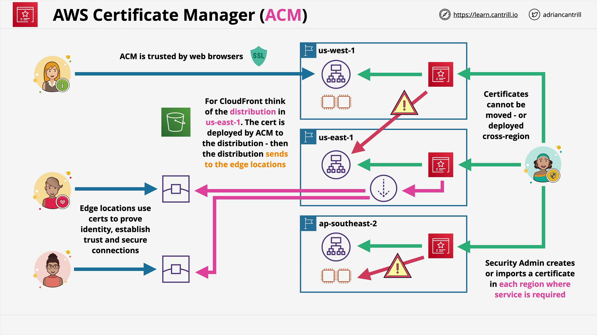

# AWS Certificate Manager (ACM)

ACM issues and manages certificates used to establish [TLS/HTTPS](../concepts/tls-https.md) identity and encrypted transport. An application still needs the matching domain name, a trustworthy certificate chain, and a correctly configured TLS listener. A certificate alone does not authorize users to access application data.

## Certificate Lifecycle

Request an ACM public certificate for your domain and prove control, usually through the **CNAME** records ACM supplies in public [DNS](../concepts/dns.md). Keep the validation records for managed renewal. DNS validation can use [Route 53](route53.md) or another DNS provider; it is not restricted to Route 53. [AWS DNS validation guide](https://docs.aws.amazon.com/acm/latest/userguide/dns-validation.html)

ACM-issued certificates can qualify for managed renewal. For an imported third-party certificate, you own external renewal and reimporting the replacement. Private certificates rely on [AWS Private CA](https://docs.aws.amazon.com/privateca/latest/userguide/PcaWelcome.html); clients must trust the private CA hierarchy, unlike public certificates trusted by ordinary browsers.

## Regional Scope and CloudFront

For [ALB](elb.md), use a certificate in the load balancer's Region. For a [CloudFront](cloudfront.md) viewer certificate, request or import it in **us-east-1**, then associate it with the distribution; AWS deploys it to the serving edges. The origin's location does not change this viewer-certificate requirement.

Read the diagram as a managed-integration placement model. Its “cannot be moved” and EC2 warning labels apply to the non-exportable managed-integration workflow. CloudFront is global; drawing its certificate association in us-east-1 does not make CloudFront a regional application.

## Non-exportable Versus Exportable Public Certificates

> [!warning] Gotcha
> Non-exportable certificates support managed service integrations; **exportable public certificates** can be exported with their private key and chain for installation on EC2, containers, or on-premises servers. Exportable public certificates carry an additional charge, and you own deployment of renewed copies. [AWS exportable certificate guide](https://docs.aws.amazon.com/acm/latest/userguide/acm-exportable-certificates.html)

An ACM certificate remains a regional resource. Exporting certificate material for a server is a separate workflow from attaching a certificate ARN directly to a managed service in another Region. Do not assume a certificate associated with the CloudFront viewer connection also configures the origin's TLS listener.

> [!tip] Exam Tip
> CloudFront viewer certificate → us-east-1. ALB certificate → ALB Region. ACM-issued versus imported determines renewal responsibility; exportable versus non-exportable determines whether you can retrieve the private key.

## References

- [ACM DNS validation](https://docs.aws.amazon.com/acm/latest/userguide/dns-validation.html)
- [ACM exportable public certificates](https://docs.aws.amazon.com/acm/latest/userguide/acm-exportable-certificates.html)
- [Imported certificate renewal](https://docs.aws.amazon.com/acm/latest/userguide/import-certificate.html)
- [CloudFront certificate requirements](https://docs.aws.amazon.com/AmazonCloudFront/latest/DeveloperGuide/cnames-and-https-requirements.html)
