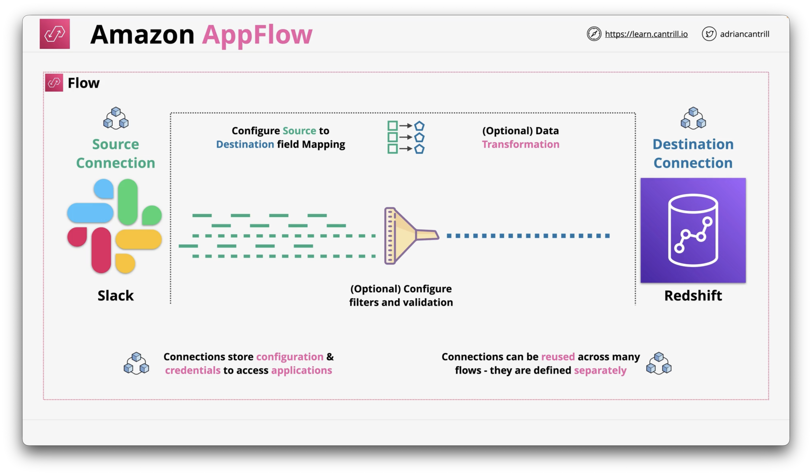

# Amazon AppFlow

## Overview

Amazon AppFlow is a **fully managed integration service** that transfers records between supported SaaS applications and AWS services. Typical uses include Salesforce contacts into [Redshift](redshift.md) and Zendesk tickets into [S3](s3.md). In a [data integration architecture](../concepts/data-integration.md), AppFlow handles connector-based ingestion with built-in field operations; [Glue](glue.md) can perform further preparation and maintain shared metadata. [AWS AppFlow overview](https://docs.aws.amazon.com/appflow/latest/userguide/what-is-appflow.html).

The useful mental model is **connector → reusable connection → flow**. A connector implements an application's integration; a connection supplies access details; a flow defines the actual transfer. Check supported source/destination directions and objects for the chosen connector rather than assuming every application pairing works both ways.

> [!warning] Gotcha
> **AppFlow does not support every application.** Start with AWS's [supported source and destination applications](https://docs.aws.amazon.com/appflow/latest/userguide/app-specific.html) and read the relevant connector's requirements. Being listed does not imply support as both a source and destination, every object or operation, or every trigger type. Confirm the specific transfer path before choosing AppFlow.

## Flow Architecture and Diagram Walkthrough

The source diagram illustrates a Slack-to-Redshift flow. The pink boundary is the configured transfer; the connections at its ends provide access, while the middle describes operations on records.

1. **Source:** select the application connection and the object or dataset to read.
2. **Mapping:** choose the source fields and their destination fields.
3. **Optional processing:** merge, mask, or truncate field values; filter records; validate selected fields and configure the response to bad data.
4. **Destination:** configure where the resulting records go.
5. **Reuse:** a separately defined connection can support several flows with different mappings, filters, and schedules.

The funnel is a conceptual illustration: filters select records, whereas validation also has a configured failure action. Do not infer that every validation failure always silently drops a record. [AWS flow configuration](https://docs.aws.amazon.com/appflow/latest/userguide/create-flow-console.html).

| Building block                 | Responsibility                                                                |
| ------------------------------ | ----------------------------------------------------------------------------- |
| Connector                      | Application-specific integration, including supported entities and operations |
| Connection / connector profile | Reusable application configuration and authentication details                 |
| Flow                           | Source, destination, mapping, optional processing, and trigger configuration  |
| Flow run                       | An execution of that configuration                                            |

**Connections are not universally two credential profiles.** SaaS endpoints typically need a connection; S3 instead uses bucket/prefix configuration and AWS permissions. AppFlow requires its S3 bucket to be in the flow's Region. Treat flows and connector profiles as [Regional resources](../concepts/resource-scope.md#regional-resources). [AWS S3 connection instructions](https://docs.aws.amazon.com/appflow/latest/userguide/s3.html).

## Triggers and Incremental Transfers

| Trigger         | Behavior                                                                                      |
| --------------- | --------------------------------------------------------------------------------------------- |
| On demand       | Run the configured transfer when requested                                                    |
| Scheduled       | Run repeatedly; supported frequency depends on the source                                     |
| Event triggered | React to supported source SaaS change events; unavailable for sources without that capability |

Scheduled flows can transfer a **full snapshot** or **incremental records since the last successful run**. The selected timestamp matters: a creation timestamp identifies new records, while a suitable modification timestamp is needed to identify edits. Incremental transfer is not a blanket promise of database replication semantics, deletion propagation, or exactly-once delivery. [AWS flow triggers](https://docs.aws.amazon.com/appflow/latest/userguide/flow-triggers.html).

## Worked Example — SaaS Records to an Analytics Dataset

This illustrative design extends the note's Zendesk-to-S3 example into the existing wiki's analytics model:

1. Create a Zendesk connection with the required access to ticket records.
2. Configure a flow to an S3 bucket/prefix in the same Region. Map the ticket identifier, status, and timestamps; exclude unnecessary fields and apply any supported masking or filters.
3. Run it on demand first and inspect the output. If using a schedule with incremental transfer, select an appropriate change timestamp and check the connector's supported behavior.
4. Enable **Glue Data Catalog registration** for eligible S3 output and supply the required [IAM role](iam.md). AppFlow can create table metadata, including partition keys, as it writes the data; a crawler is not required for this path. [AWS cataloging integration](https://docs.aws.amazon.com/appflow/latest/userguide/flows-catalog.html).
5. Use the registered dataset for analysis, or run a Glue job to join ticket data with reference data and write curated output. The [Glue worked example](glue.md#worked-example--s3-lease-records-to-shared-catalog-consumers) shows how catalog metadata supports downstream readers.

**AppFlow moves records; S3 stores them; the catalog describes them; Glue jobs transform them; query engines answer questions.** Repeated snapshots and incremental batches still require a deliberate downstream strategy for duplicates and updates. Do not assume that landing files creates a single up-to-date relational table.

## Security and Private Flows

AppFlow encrypts data in transit with TLS and protects stored connection credentials using [KMS](kms.md) and Secrets Manager. Flow encryption supports AWS managed or customer managed keys. Key selection protects stored data; TLS protects the transport. [AWS data protection](https://docs.aws.amazon.com/appflow/latest/userguide/data-protection.html).

For supported SaaS applications, **private flows use [AWS PrivateLink](vpc.md#aws-privatelink)** to carry transfer data over AWS infrastructure. AWS currently lists Salesforce, Singular, Snowflake, and Trend Micro, and the SaaS account must be enabled for PrivateLink. [AWS private-flow requirements](https://docs.aws.amazon.com/appflow/latest/userguide/private-flows.html).

> [!warning] Gotcha
> Private-flow support does not mean arbitrary private sources are reachable. Also, console metadata calls that list objects and fields use public endpoints even when the actual flow-run data travels through PrivateLink. Separate the data-transfer requirement from a requirement that every API call be private.

## Connector Extensions and Limits

If no built-in connector meets the need, the **Custom Connector SDK** for Java or Python may provide an extension path. It does **not** guarantee support for any arbitrary application: first establish whether the application's APIs, authentication, connectivity, and required operations can be implemented within the connector model. This requires development and maintenance; it is not built-in, no-code support. [AWS connector SDK links](https://docs.aws.amazon.com/appflow/latest/userguide/what-is-appflow.html).

> [!warning] Gotcha
> The source note's “up to 100 GB per flow” is not a universal connector allowance. Limits depend on the application, direction, record/file size, and run frequency. AppFlow calls also consume the application's API quota. Check the [AppFlow quotas](https://docs.aws.amazon.com/appflow/latest/userguide/service-quotas.html) and connector documentation before sizing a transfer.

## Choosing AppFlow

Use AppFlow when the central requirement is **supported SaaS record transfer with configuration-driven mapping and filtering**. Use [DMS](dms.md) for database migration/CDC, [Kinesis Data Streams](kinesis.md#kinesis-data-streams) for retained streams with independent consumers, and [Data Firehose](kinesis.md#kinesis-data-firehose-now-amazon-data-firehose) for managed streaming delivery. Glue fits broader transformation work and is not restricted to data already in AWS. The [data movement comparison](../concepts/data-integration.md#choosing-a-data-movement-service) puts these choices together.

[EventBridge](eventbridge.md) routes events to consumers. It can complement AppFlow: supported Salesforce Platform and CDC events can pass through AppFlow into an EventBridge partner event bus. A source event trigger therefore does not make AppFlow a general event router. [AWS EventBridge integration](https://docs.aws.amazon.com/appflow/latest/userguide/what-is-appflow.html).

> [!tip] Exam Tip
> SaaS records → S3/Redshift with minimal custom code suggests AppFlow. Private SaaS transfer suggests AppFlow + PrivateLink **only when the connector and SaaS account support it**. Reusable access settings belong to the connection; transfer rules belong to the flow. See [SAA AppFlow tips](../certifications/aws-saa.md#amazon-appflow).

## References

- [Source study note — Amazon AppFlow](../../raw/aws-cert-study-notes/aws-solution-architect/amazon_appflow.md) — Cantrill SAA-C03; source of the copied diagram.
- [AWS — AppFlow overview and Custom Connector SDKs](https://docs.aws.amazon.com/appflow/latest/userguide/what-is-appflow.html)
- [AWS — Supported source and destination applications](https://docs.aws.amazon.com/appflow/latest/userguide/app-specific.html)
- [AWS — Creating a flow](https://docs.aws.amazon.com/appflow/latest/userguide/create-flow-console.html)
- [AWS — Flow triggers](https://docs.aws.amazon.com/appflow/latest/userguide/flow-triggers.html)
- [AWS — Private flows](https://docs.aws.amazon.com/appflow/latest/userguide/private-flows.html)
- [AWS — Data protection](https://docs.aws.amazon.com/appflow/latest/userguide/data-protection.html)
- [AWS — Cataloging S3 output](https://docs.aws.amazon.com/appflow/latest/userguide/flows-catalog.html)
- [AWS — S3 connector](https://docs.aws.amazon.com/appflow/latest/userguide/s3.html)
- [AWS — Quotas](https://docs.aws.amazon.com/appflow/latest/userguide/service-quotas.html)
