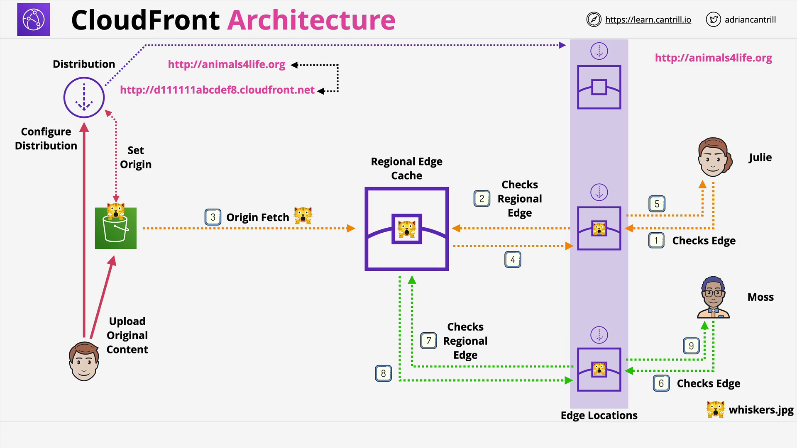
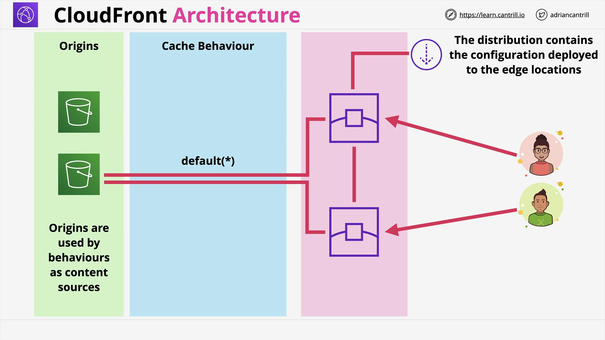
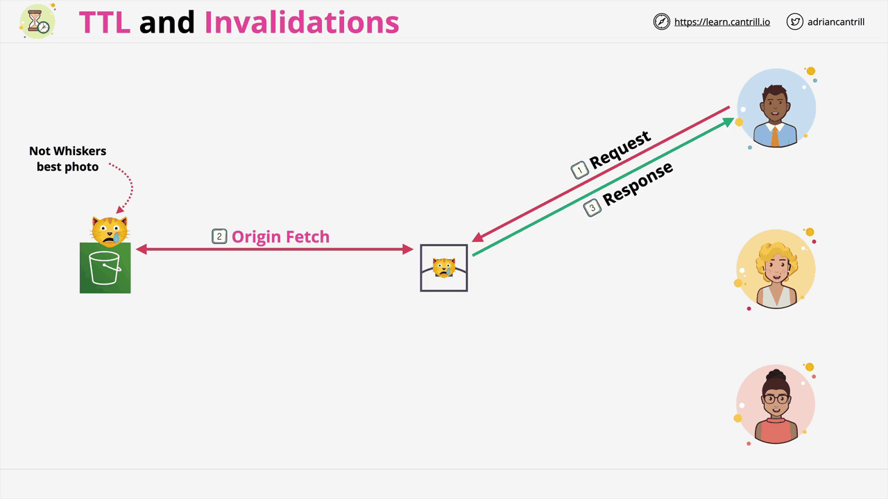
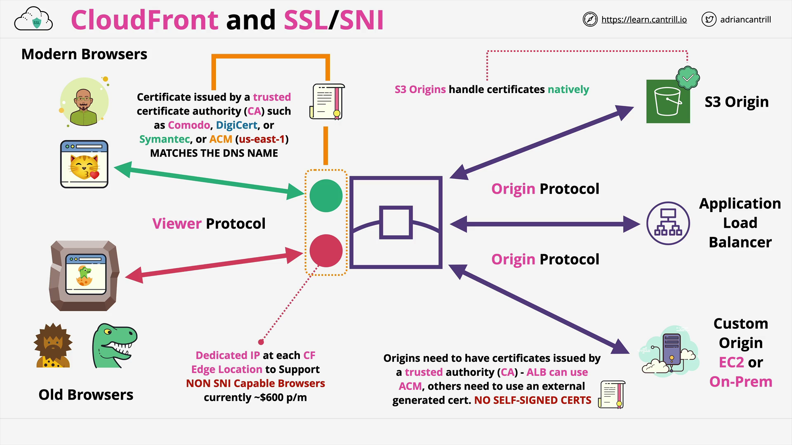
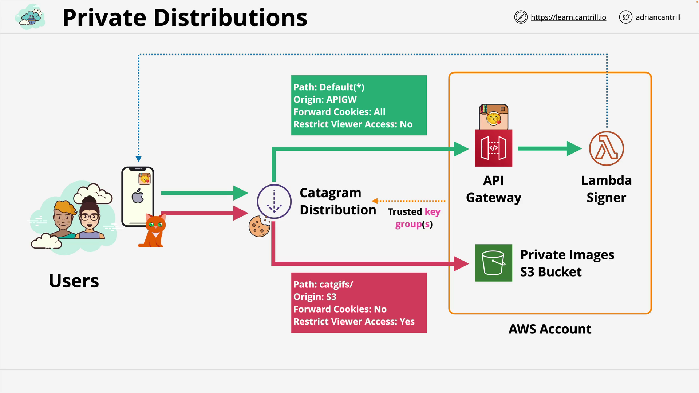
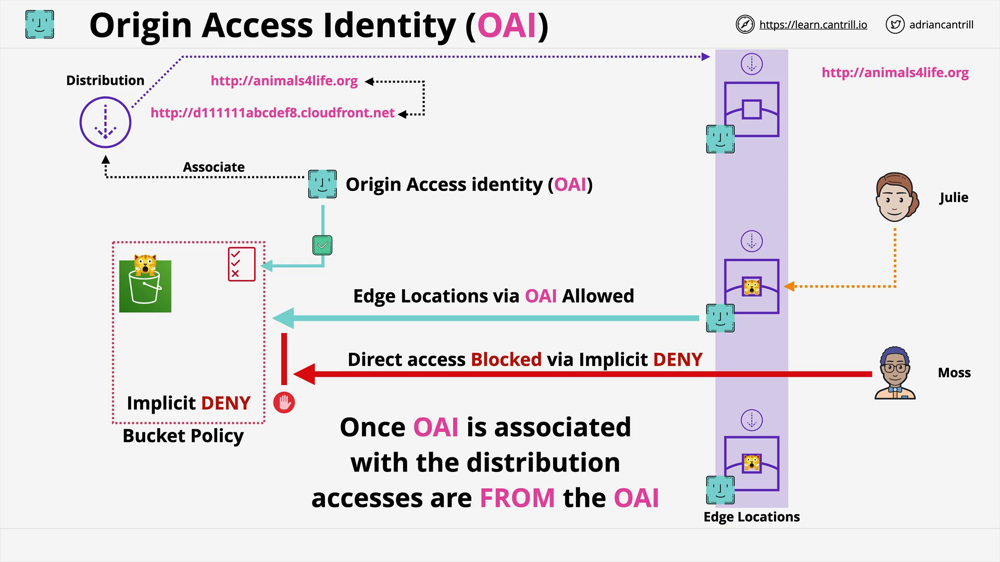
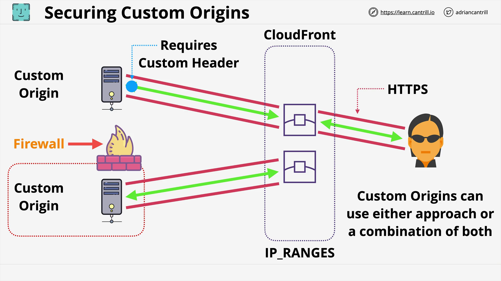

# Amazon CloudFront

CloudFront is a global content delivery network (CDN): it serves cacheable HTTP content near viewers and forwards requests toward origins when needed. It connects [DNS](../concepts/dns.md), [TLS](../concepts/tls-https.md), caching, and access control. [Edge Delivery](../concepts/edge-delivery.md) compares it with [Global Accelerator](global-accelerator.md), which accelerates TCP/UDP paths without caching content.

## Architecture: Origin, Distribution, and Caches

An **origin** is the source of content, such as an [S3](s3.md) bucket or web application. A **distribution** is the configuration deployed to the CloudFront network, with a generated `d….cloudfront.net` hostname and optional alternate domain names. A **cache behavior** selects an origin or origin group and the rules for matching requests. Edge locations/points of presence (POPs) serve viewers; larger **regional edge caches** can retain objects for several POPs.

Julie requests `whiskers.jpg` at one edge location. On a cache miss, CloudFront can check a regional edge cache and, if necessary, fetch from S3. That response fills caches along the return path. Moss uses another edge: it may miss locally but hit the shared regional cache, avoiding another origin fetch.



This is a typical cacheable-object path, not an invariant route for every request. Dynamic requests and write methods can bypass regional edge caches. Caches fill on demand; publishing a distribution does not preload every object everywhere. [AWS delivery model](https://docs.aws.amazon.com/AmazonCloudFront/latest/DeveloperGuide/HowCloudFrontWorks.html)

> [!warning] Gotcha
> Read caching and permitted traffic are separate. CloudFront can forward `POST`, `PUT`, `PATCH`, and `DELETE` when the behavior allows them. It caches `GET`/`HEAD` responses and optionally `OPTIONS`, not writes. [AWS HTTP method behavior](https://docs.aws.amazon.com/AmazonCloudFront/latest/DeveloperGuide/RequestAndResponseBehaviorCustomOrigin.html#RequestCustomHTTPMethods)

- **Allowed methods** determine which requests CloudFront accepts and forwards.
- **Cached methods** are limited to `GET`/`HEAD`, plus optionally `OPTIONS`.

## Distribution Configuration: Origins, Behaviors, and Settings

A distribution contains origins and behaviors, but their settings have different scopes. **Distribution settings apply across the distribution; behavior settings apply to matching request paths; origin settings control how CloudFront reaches a particular backend.**

### Distribution, Origin, and Behavior Relationships

A **distribution is CloudFront's configuration unit**. It contains:

- **1–N origins**: the configured sources of content.
- **1–N cache behaviors**: exactly **one default behavior** (`*`), plus **zero or more additional behaviors**.

Each behavior references **one origin or one origin group**. Multiple behaviors can reference the same origin, so the number of behaviors does not have to equal the number of origins. An origin group provides a primary/secondary pair for [origin failover](#origin-types-and-origin-paths).

For example, one distribution can define two origins and three behaviors:

```text
Distribution
├── Origins
│   ├── S3 bucket
│   └── ALB
└── Cache behaviors
    ├── /images/*    → S3 bucket
    ├── /downloads/* → S3 bucket
    └── Default (*)  → ALB
```

Here, `/images/cat.jpg` and `/downloads/guide.pdf` use the same [S3](s3.md) origin through different behaviors, which can have different cache and access rules. An unmatched path such as `/login` uses the default behavior and reaches the [ALB](elb.md) origin when an origin request is needed. **Defining an origin does not make it receive traffic automatically**: a matching behavior must reference it, directly or through an origin group. [AWS behavior-to-origin configuration](https://docs.aws.amazon.com/AmazonCloudFront/latest/DeveloperGuide/DownloadDistValuesCacheBehavior.html)



Origins are configured in the distribution and **referenced by behaviors**; the diagram's conceptual layers do not mean each behavior creates or owns a separate origin resource.

### Configuration Scopes at a Glance

| Scope          | What it controls                           | Key settings                                                                                                                                                                                                                                                           |
| -------------- | ------------------------------------------ | ---------------------------------------------------------------------------------------------------------------------------------------------------------------------------------------------------------------------------------------------------------------------- |
| Distribution   | Shared configuration across all behaviors  | Price class, viewer TLS security policy and certificate, SNI/dedicated-IP SSL support, alternate domain names, WAF association, supported viewer HTTP versions, logging                                                                                                |
| Cache behavior | Rules for requests matching a path pattern | Origin/origin-group reference, viewer protocol policy, allowed/cached methods, cache/origin-request policies, [signed viewer access](#private-distribution-behaviours-signed-urls-and-signed-cookies), compression, field-level encryption, edge-function associations |
| Origin         | Connection and access to one backend       | Domain name, origin path, origin access configuration; custom-origin protocol policy, TLS settings, ports, and custom headers                                                                                                                                          |

### Distribution-Level Settings

These settings belong to the distribution itself. **Price class and viewer TLS security policy are not nested inside individual behaviors.** Changing either affects the shared configuration used across the distribution.

Alternate names, the viewer certificate, **SNI versus dedicated-IP SSL support**, WAF association, supported viewer HTTP versions, and logging also belong at this level. The SNI/dedicated-IP choice applies to the distribution's custom viewer certificate; it cannot vary by behavior. See [SNI certificate selection](#sni-select-certificates-by-hostname-on-shared-edge-ips).

#### Price Class: Cost Versus Edge Proximity

Price class controls which geographic groups of CloudFront edge locations you pay to use. Choosing fewer groups can reduce delivery costs, but some viewers may be served from farther-away edges and experience higher latency.

For example, if you select a class focused on North America and Europe, a user in Australia can still access your distribution. Their request may be served from a more distant edge. **Price class does not block Australian users**; country-based access restrictions are a separate setting. [AWS price-class settings](https://docs.aws.amazon.com/AmazonCloudFront/latest/DeveloperGuide/DownloadDistValuesGeneral.html#DownloadDistValuesPriceClass)

#### TLS Security Policy: Security Versus Client Compatibility

The TLS security policy controls the TLS versions and encryption algorithms CloudFront accepts on the **viewer → CloudFront** connection. A client must support an allowed TLS version and at least one allowed cipher to establish HTTPS.

For example:

- Require **TLS 1.2 or newer**: a client supporting only TLS 1.0 cannot connect.
- Require **TLS 1.3**: a client supporting only TLS 1.2 cannot connect.

Check which browsers, mobile apps, and devices need access before choosing a policy that could exclude them. This viewer-side policy is separate from the TLS settings for **CloudFront → origin** connections. [AWS TLS policies](https://docs.aws.amazon.com/AmazonCloudFront/latest/DeveloperGuide/secure-connections-supported-viewer-protocols-ciphers.html)

### Behavior-Level Settings

Each behavior defines rules for a matching path: which origin or origin group to use, which HTTP methods to accept or cache, how to cache and forward request data, and whether [signed viewer access](#private-distribution-behaviours-signed-urls-and-signed-cookies) is required. Compression, field-level encryption, and edge-function associations are also configured here.

The **viewer protocol policy** is a behavior setting. It chooses whether matching requests may use HTTP/HTTPS, must redirect from HTTP to HTTPS, or must use HTTPS. It does not choose TLS versions or ciphers; those come from the distribution-level **TLS security policy**.

For example, `/images/*` can allow HTTP/HTTPS while `/private/*` requires HTTPS. Whenever either path uses HTTPS, the **same distribution-level TLS security policy** applies.

#### Behavior Evaluation Order

Every distribution has a default `*` behavior. Additional behaviors are evaluated **in configured order (not longest match wins)**, and the first matching path pattern wins; default is the fallback. Do not assume CloudFront automatically selects the longest or most specific pattern. Put restricted patterns before broader matches. [AWS behavior settings](https://docs.aws.amazon.com/AmazonCloudFront/latest/DeveloperGuide/DownloadDistValuesCacheBehavior.html)

For example, place `/private/*` → private S3 with restricted viewer access before `/*` → public application. A broadly matching public behavior placed first can bypass the intended viewer restriction.

### Origin-Level Settings

Each origin defines the backend CloudFront contacts: its domain name, optional origin path, and origin access configuration. Custom origins also have connection settings such as HTTP/HTTPS ports, origin protocol policy, TLS settings, and custom headers.

The **origin protocol policy** controls **CloudFront → origin** connections. It is independent of both the behavior's viewer protocol policy and the distribution's viewer TLS security policy. Multiple behaviors that reference the same origin use that origin's connection settings; they do not each own a separate copy of the origin.

See [Origin Types and Origin Paths](#origin-types-and-origin-paths) for the differences between S3 bucket endpoints, website endpoints, custom origins, and VPC origins.

## Origin Types and Origin Paths

| Origin choice | What changes |
| --- | --- |
| Standard S3 bucket endpoint | Native bucket integration; OAC or legacy OAI; no custom server port or installed bucket certificate |
| S3 static website endpoint | Treated as a custom origin; HTTP-only origin leg; OAC/OAI do not apply |
| Custom HTTP server | Examples: public ALB, EC2, or on-premises server; configurable origin protocol, HTTP/HTTPS ports, TLS settings, path, and headers |
| VPC origin | Current private-origin option for supported ALB/NLB/EC2 resources in private subnets |
| Origin group | Primary/secondary origin failover for supported request methods and configured failure conditions |

S3 bucket origins and custom web origins expose different configuration options. An **origin path** prepends a directory: origin path `/production` plus requested `/images/cat.jpg` fetches `/production/images/cat.jpg`. It does not automatically strip a behavior pattern from the request URI.

CloudFront supports **VPC origins** for supported private AWS resources, so an origin does not always need a publicly routable IP address. Consult the current [origin guide](https://docs.aws.amazon.com/AmazonCloudFront/latest/DeveloperGuide/DownloadDistS3AndCustomOrigins.html) for supported origin types.

An ordinary failover origin group contains **two** origins. It retries eligible `GET`/`HEAD` requests against the secondary when the primary meets configured failure criteria; `OPTIONS` failover also requires caching that method. Writes such as `POST`/`PUT` do not use this failover. This is different from Global Accelerator choosing endpoints for new network connections. [AWS origin-failover guide](https://docs.aws.amazon.com/AmazonCloudFront/latest/DeveloperGuide/high_availability_origin_failover.html)

## Cache Key and Forwarded Request Data

A cache key identifies reusable responses. A **cache policy** controls relevant headers, cookies, query strings, compression settings, and TTLs. An **origin request policy** forwards additional request data without necessarily adding it to the cache key. Cache and origin request policies are the recommended model instead of legacy cache settings. [AWS cache-policy guide](https://docs.aws.amazon.com/AmazonCloudFront/latest/DeveloperGuide/controlling-the-cache-key.html)

If the origin produces different content for `language=en` and `language=fr`, the cache key must distinguish those variants, or caching must be disabled. Conversely, adding a tracking identifier that does not change content fragments the cache for no benefit. Apply the same reasoning to [Lambda@Edge](lambda-edge.md) country/device personalization. [AWS cache-key explanation](https://docs.aws.amazon.com/AmazonCloudFront/latest/DeveloperGuide/understanding-the-cache-key.html)

## TTL, Revalidation, and Invalidations

Replacing `whiskers.jpg` in S3 does not update an already valid edge copy. While its TTL is valid, a cache hit can return the old picture. Once stale, a later request can revalidate with the origin: `304 Not Modified` reuses existing content; `200 OK` replaces it with the new representation. TTL is a freshness boundary, not a guarantee of storage residency: an object can be evicted earlier.

The animation below follows a single object from initial caching through an origin replacement and later revalidation.



The final stages show alternative revalidation outcomes: `304 Not Modified` if unchanged, or `200 OK` with replacement content if changed. They are not two responses to one request.

### CloudFront Settings: Cache Policy Attached to a Behavior

**Default TTL, Minimum TTL, and Maximum TTL are CloudFront configuration values, not origin headers.** They live in a **cache policy attached to a cache behavior**, so their effect is scoped to requests using that behavior, rather than the whole distribution. Multiple behaviors can share a cache policy; changing that policy affects every behavior using it. With legacy cache settings, these values are configured directly on the behavior. [AWS cache-policy settings](https://docs.aws.amazon.com/AmazonCloudFront/latest/DeveloperGuide/cache-key-understand-cache-policy.html)

| CloudFront setting | Purpose |
| --- | --- |
| Default TTL | Fallback freshness duration when the origin supplies no applicable freshness directive; 24 hours is the legacy default, not a universal policy value |
| Minimum TTL | Lower bound on the freshness duration CloudFront applies |
| Maximum TTL | Upper bound on freshness derived from the origin's caching headers |

For example, `/images/*` can use a long-lived cache policy while `/api/*` uses a policy that disables caching. Both behaviors can belong to the same distribution.

### Origin Response Headers: Set on Objects or by the Application

**`Cache-Control` and `Expires` are HTTP response headers supplied by the origin.** `max-age` and `s-maxage` are directives inside `Cache-Control`, not separate headers.

- **S3 bucket origin:** set the object's standard `Cache-Control` and `Expires` metadata fields; S3 emits the corresponding response headers when serving it. These are not custom `x-amz-meta-*` fields.
- **Application/web-server origin:** configure the server or application to emit these headers on its HTTP responses.

| Origin response header/directive | Purpose |
| --- | --- |
| `Cache-Control: s-maxage=N` | Shared-cache freshness, including CloudFront; takes precedence over `max-age` for CloudFront |
| `Cache-Control: max-age=N` | Freshness used by CloudFront when no `s-maxage` is present; also controls browser freshness |
| `Expires` | Absolute expiry time used when no overriding Cache-Control freshness directive applies |

CloudFront combines these per-response directives with the selected behavior's cache-policy settings. For example, an origin response containing `Cache-Control: max-age=60, s-maxage=3600` specifies 60 seconds for browser freshness and 3,600 seconds for shared-cache freshness; CloudFront still applies its configured minimum/maximum TTL bounds. [AWS expiration reference](https://docs.aws.amazon.com/AmazonCloudFront/latest/DeveloperGuide/Expiration.html)

> [!warning] Gotcha
> A positive minimum TTL can force CloudFront to cache even when the origin sends `Cache-Control: no-cache`, `no-store`, or `private`. Use a minimum TTL of zero when those directives must prevent reuse without validation or prohibit storage. Origin headers do not unconditionally override the CloudFront cache policy.

### Invalidations and Versioned Filenames

**Invalidation** removes selected cached paths before normal expiry. Examples: `/images/whiskers.jpg`, `/images/whiskers*`, `/images/*`, and `/*`. Submission propagates asynchronously; it does not instantly clear every cache. It also does not delete the origin object or clear a viewer's browser/proxy cache.

#### Triggering Invalidations: Manual or Automated

**Invalidation must be explicitly triggered, but it does not require a person to do it manually.** You can submit it through:

- **Console:** open the distribution → Invalidations → Create invalidation, then enter the paths.
- **AWS CLI:** run a command yourself or from a deployment script.
- **API/SDK:** call `CreateInvalidation` from code or a CI/CD pipeline. [AWS invalidation interfaces](https://docs.aws.amazon.com/AmazonCloudFront/latest/DeveloperGuide/Invalidation_Requests.html)

For example, a deployment pipeline can upload updated files and then invalidate an entry page whose URL stays the same:

```bash
aws cloudfront create-invalidation \
  --distribution-id YOUR_DISTRIBUTION_ID \
  --paths "/index.html"
```

Replace the distribution ID and path with your own values. Submission starts asynchronous processing; receiving a successful API/CLI response does not mean propagation has completed. [AWS CLI reference](https://docs.aws.amazon.com/cli/latest/reference/cloudfront/create-invalidation.html)

**Replacing a file in S3 does not automatically invalidate CloudFront's cached copy.** Without an explicit invalidation, existing cached copies follow their normal freshness and revalidation rules. Versioned filenames avoid the invalidation step for renamed assets, though an unchanged entry-page URL may still need invalidation or an appropriately short TTL.

#### Invalidation Costs

**Repeated invalidations can add costs.** Under CloudFront's pay-as-you-go pricing, the first **1,000 invalidation paths per month are free across all distributions in one AWS account**; additional paths cost **$0.005 each**. For example, 2,000 paths in a month incur $5 in invalidation charges. [AWS pay-as-you-go pricing](https://aws.amazon.com/cloudfront/pricing/pay-as-you-go/)

Billing counts **submitted paths, not affected objects or API requests**. `/images/*` counts as one path even if it invalidates thousands of images. Putting 100 separate paths in one API request still counts as 100 paths. A wildcard such as `/*` can reduce the path count, but clearing unrelated cached content also causes avoidable origin fetches as the cache refills. [AWS invalidation billing](https://docs.aws.amazon.com/AmazonCloudFront/latest/DeveloperGuide/PayingForInvalidation.html)

#### Why Versioned Filenames Help with Frequent Releases

For frequent releases, prefer versioned filenames such as `whiskers-v2.jpg` or a content hash. Update application references to the new URL; old cached URLs no longer matter to those new references. **Changing the filename avoids invalidating the previous URL, so it avoids repeated invalidation charges.** Normal storage, request, and delivery charges still apply.

Versioned filenames also avoid reuse of old browser/proxy cache entries, support rollback, and make access logs clearer. They are **different from S3 object versioning**, which keeps versions under the same key. Use invalidation when an existing URL must stop serving its cached representation before expiry; use new filenames for routine asset releases when you can change application references. [AWS invalidation and versioning guidance](https://docs.aws.amazon.com/AmazonCloudFront/latest/DeveloperGuide/Invalidation.html)

> [!tip] Exam Tip
> Frequent content updates plus cost efficiency → prefer **versioned filenames** over repeatedly invalidating the same URLs. Invalidation charges depend on submitted path count, not how many objects a wildcard matches.

## Custom Domain Setup: Certificate, Distribution, and DNS

To serve `https://www.example.com` through CloudFront, connect three pieces: a certificate covering that hostname, a distribution configured to accept it, and DNS routing viewers to that distribution. The **alternate domain names and viewer certificate are distribution-level settings** shared by all behaviors.

1. **Choose a hostname you control**, such as `www.example.com`, and have access to its authoritative public DNS. Your domain registrar and DNS provider can be outside AWS.
2. **Request or import a certificate in [ACM](acm.md), in `us-east-1`.** Request an ACM public certificate covering every hostname you will add. Alternatively, import an existing trusted CA certificate with its matching private key and certificate chain. A wildcard such as `*.example.com` covers `www.example.com`, but not the apex `example.com` or deeper names such as `a.b.example.com`. [AWS certificate requirements](https://docs.aws.amazon.com/AmazonCloudFront/latest/DeveloperGuide/cnames-and-https-requirements.html)
3. **Validate an ACM-issued certificate.** With DNS validation, publish the CNAME record(s) ACM provides and wait for the certificate to become **Issued**. Keep these records for automatic renewal. Imported certificates instead require you to manage renewal and reimport replacements. [ACM DNS validation](https://docs.aws.amazon.com/acm/latest/userguide/dns-validation.html)
4. **Configure the distribution.** Add `www.example.com` under **Alternate domain names (CNAMEs)** and select the matching ACM certificate. Use SNI for modern clients and choose an appropriate viewer TLS security policy. To redirect HTTP visitors to HTTPS, set **Redirect HTTP to HTTPS** on each relevant behavior. Save and wait for deployment before switching traffic. AWS deploys the associated certificate to the edges; you do not manually install it on edge servers. [AWS custom-domain setup](https://docs.aws.amazon.com/AmazonCloudFront/latest/DeveloperGuide/CNAMEs.html)
5. **Point the hostname's DNS record to the distribution**, for example `d111111abcdef8.cloudfront.net`. In [Route 53](route53.md), create an **A alias** targeting the distribution, plus an **AAAA alias** if IPv6 is enabled. These work for both subdomains and the apex. With another DNS provider, use a **CNAME** for a subdomain; an apex requires that provider's supported ALIAS/ANAME or CNAME-flattening feature, or Route 53. Target the distribution hostname, rather than copying its currently resolved IP addresses. [AWS DNS routing guide](https://docs.aws.amazon.com/Route53/latest/DeveloperGuide/routing-to-cloudfront-distribution.html)
6. **Verify the custom URL after DNS propagation.** Open `https://www.example.com`, check that the certificate covers the hostname, and confirm the expected content and HTTP-to-HTTPS redirect. Update application links to use the custom hostname.

The **ACM validation CNAME** proves domain ownership; the **traffic-routing alias/CNAME** sends users to CloudFront. They are separate DNS records with different purposes. Adding a DNS record alone does not configure CloudFront to accept the hostname, and attaching the viewer certificate does not configure HTTPS on the origin.

## TLS: Two Independent Connections

The viewer connects to CloudFront; CloudFront separately connects to the origin. Securing one connection does not automatically secure the other. The generated distribution hostname has AWS-managed HTTPS support. Custom alternate names require a matching trusted certificate; with [ACM](acm.md), the viewer certificate must be in **us-east-1**.



Dedicated-IP pricing shown in the diagram is historical. For EC2, use [ACM exportable certificates](acm.md#non-exportable-versus-exportable-public-certificates) when you need to install certificate material on the server.

The **viewer protocol policy**, per behavior, allows HTTP/HTTPS, redirects HTTP to HTTPS, or requires HTTPS. The **custom-origin protocol policy** chooses HTTP only, HTTPS only, or match viewer. Use HTTPS on both legs for transport confidentiality. With an OAC-configured S3 bucket, **always sign requests** also guarantees HTTPS on the origin leg. The S3 origin protocol therefore does not always match the viewer protocol. S3 website endpoints do not support HTTPS to the origin. [Viewer HTTPS](https://docs.aws.amazon.com/AmazonCloudFront/latest/DeveloperGuide/using-https-viewers-to-cloudfront.html), [origin HTTPS](https://docs.aws.amazon.com/AmazonCloudFront/latest/DeveloperGuide/using-https-cloudfront-to-custom-origin.html), [OAC signing](https://docs.aws.amazon.com/AmazonCloudFront/latest/DeveloperGuide/private-content-restricting-access-to-s3.html)

### SNI: Select Certificates by Hostname on Shared Edge IPs

**SNI removes the need for a dedicated edge IP solely to select the correct viewer certificate.** A client includes the requested hostname in its TLS **ClientHello**. CloudFront uses that hostname to find the distribution and return its certificate, allowing different distributions/certificates to share an edge IP.

| Certificate-selection approach | How CloudFront identifies the certificate |
| --- | --- |
| Dedicated-IP SSL for a client without SNI | Destination edge IP → associated certificate |
| SNI | ClientHello hostname → distribution → associated certificate |

```text
Shared edge IP
├── SNI: cats.example.com → cats distribution → matching certificate
└── SNI: dogs.example.com → dogs distribution → matching certificate
```

SNI replaces **IP-based certificate selection** with **hostname-based selection**; CloudFront still maintains hostname/distribution/certificate associations. A dedicated IP does not mean a dedicated physical edge server. AWS manages the edge infrastructure in both cases.

The HTTP Host header arrives after TLS negotiation, so it cannot select the initial TLS certificate. SNI is the normal modern-client choice; dedicated-IP SSL is a separately charged compatibility option for clients without SNI. [AWS SNI and dedicated-IP behavior](https://docs.aws.amazon.com/AmazonCloudFront/latest/DeveloperGuide/cnames-https-dedicated-ip-or-sni.html)

### Origin Certificate Requirements

Public custom-origin HTTPS needs a trusted certificate and chain matching the configured origin name or applicable forwarded Host name. Self-signed origin certificates are not accepted in this workflow. An ALB origin uses a certificate in the ALB's Region; S3 bucket endpoints manage their own certificates. For HTTPS failure, check the **correct leg**, hostname, chain, protocol policy, and certificate location before changing DNS.

## Private Distribution Behaviours: Signed URLs and Signed Cookies

**Viewer authorization** decides who may retrieve private content through CloudFront. Signed URLs and signed cookies let the application grant access that CloudFront can verify. [Origin protection](#origin-protection-prevent-direct-access) separately prevents users from bypassing these checks by contacting the backend directly.

### Choose Signed URLs or Signed Cookies

After authenticating a user and checking their entitlement, your application can issue temporary access through a **signed URL** or **signed cookies**. CloudFront verifies the signed authorization before serving protected content, including cache hits.

| Mechanism | What the viewer receives | When to use it |
| --- | --- | --- |
| Signed URL | A content URL with authorization parameters, including a signature | A specific download, a temporary sharing link, or a client that does not support cookies |
| Signed cookies | Cookies carrying signed authorization; content URLs stay unchanged | Several related protected resources, such as a subscriber's image collection or video segments |

Signed URLs commonly grant access to a specific object, but custom policies can cover wildcard resources. Policy scope, expiry, optional start time, and supported IP restrictions determine access. These are CloudFront signatures, distinct from S3 presigned URLs. [AWS signed URL reference](https://docs.aws.amazon.com/AmazonCloudFront/latest/DeveloperGuide/private-content-signed-urls.html)

### How Signed Cookies Work

1. **Register the public key:** upload the public key to CloudFront, include it in a **trusted key group**, and associate that group with each protected behavior using **Restrict viewer access**. Keep the corresponding private key with the application that issues access.
2. **Issue signed access:** after authenticating the user and checking permissions, the application uses its **private key to sign an access policy** and returns cookies in the format CloudFront expects. The policy describes which content the user may access and for how long; the field names and encoding are detailed below.
3. **Send the cookies:** the browser stores them and includes them on subsequent requests to the protected content URLs.
4. **Verify at CloudFront:** CloudFront uses the registered **public key** to verify the signature and checks the policy's resource scope, expiry, and any other conditions. Valid requests can be served from cache or fetched from the origin; invalid requests are rejected. [AWS signed-cookie workflow](https://docs.aws.amazon.com/AmazonCloudFront/latest/DeveloperGuide/private-content-signed-cookies.html)

The application holds the private key; CloudFront needs only the public key. Legacy trusted signer accounts use root-managed CloudFront key pairs and should not be the default for new designs. [AWS signer configuration](https://docs.aws.amazon.com/AmazonCloudFront/latest/DeveloperGuide/private-content-trusted-signers.html)

> [!warning] Gotcha
> CloudFront does not require signed URLs or cookies for `OPTIONS` requests. If the behavior allows `OPTIONS`, CloudFront can forward CORS preflight requests without a signature. Ensure the origin does not return protected content for that method. [AWS signed-cookie method exception](https://docs.aws.amazon.com/AmazonCloudFront/latest/DeveloperGuide/private-content-signed-cookies.html)

#### Application Authorization Example

In the Catagram flow, a public default behavior routes sign-in and entitlement requests to [API Gateway](api-gateway.md) and a [Lambda](lambda.md) signer. After authenticating the user and checking permissions, the application issues signed access. Requests under `/catgifs/*` use a restricted S3 behavior. CloudFront verifies the signature before returning content, whether it is cached or fetched from the protected bucket.



Implement the intended object set with an actual wildcard path pattern such as `/catgifs/*`; the diagram's `catgifs/` label is shorthand. Adding a trusted key group does not give a Lambda function its private key or authenticate users automatically. Forwarding application cookies, requiring a CloudFront signed cookie, and including cookies in the cache key are three different decisions.

### Signed-Cookie Format Expected by CloudFront

CloudFront expects **specific cookie names and signed values**, not an arbitrary session cookie or JWT. One grant has **three required name/value pairs**, issued in separate `Set-Cookie` response headers. The policy type determines the first cookie:

| Cookie name | Canned policy | Custom policy | Value |
| --- | --- | --- | --- |
| `CloudFront-Expires` | Required | Not used | Access expiry as a UTC Unix timestamp in seconds |
| `CloudFront-Policy` | Not used | Required | Encoded JSON access policy |
| `CloudFront-Signature` | Required | Required | Encoded cryptographic signature of the policy |
| `CloudFront-Key-Pair-Id` | Required | Required | **Public key ID** whose key belongs to a trusted key group on the protected behavior; not the key-group ID |
| `CloudFront-Hash-Algorithm` | Optional fourth cookie | Optional fourth cookie | `SHA1` or `SHA256`; omission defaults to `SHA1`, and SHA-256 signatures require `SHA256` here |

A canned policy sends expiry without transmitting the policy JSON. A custom policy sends the policy, supporting wildcard resource scope and optional start-time/IP conditions. [AWS canned-cookie format](https://docs.aws.amazon.com/AmazonCloudFront/latest/DeveloperGuide/private-content-setting-signed-cookie-canned-policy.html), [AWS custom-cookie format](https://docs.aws.amazon.com/AmazonCloudFront/latest/DeveloperGuide/private-content-setting-signed-cookie-custom-policy.html)

#### Response and Request Headers

For a **canned policy**, an application responding through `cdn.example.com` could issue the following. Values are illustrative placeholders, not a usable grant; the signature must be generated for the intended resource and expiry with your private key.

```http
Set-Cookie: CloudFront-Expires=EXPIRY_EPOCH_SECONDS; Path=/catgifs/; Secure; HttpOnly
Set-Cookie: CloudFront-Signature=ENCODED_SIGNATURE; Path=/catgifs/; Secure; HttpOnly
Set-Cookie: CloudFront-Key-Pair-Id=PUBLIC_KEY_ID; Path=/catgifs/; Secure; HttpOnly
Set-Cookie: CloudFront-Hash-Algorithm=SHA256; Path=/catgifs/; Secure; HttpOnly
```

For a **custom policy**, replace the first header with:

```http
Set-Cookie: CloudFront-Policy=ENCODED_POLICY; Path=/catgifs/; Secure; HttpOnly
```

The browser stores those pairs, then sends matching values together in a **`Cookie` request header**, for example:

```http
GET /catgifs/whiskers.gif HTTP/1.1
Host: cdn.example.com
Cookie: CloudFront-Policy=ENCODED_POLICY; CloudFront-Signature=ENCODED_SIGNATURE; CloudFront-Key-Pair-Id=PUBLIC_KEY_ID; CloudFront-Hash-Algorithm=SHA256
```

Cookie attributes such as `Path`, `Secure`, and `HttpOnly` are storage/transmission instructions for the browser; they do not appear in that request header. The `Path=/catgifs/` attribute scopes browser delivery; the **signed resource policy** determines CloudFront authorization. Browser cookie paths do not use CloudFront behavior-pattern wildcards. [AWS signed-cookie workflow](https://docs.aws.amazon.com/AmazonCloudFront/latest/DeveloperGuide/private-content-signed-cookies.html)

#### Policy Payload and Encoding

A custom policy can authorize a resource set with an expiry:

```json
{
  "Statement": [
    {
      "Resource": "https://cdn.example.com/catgifs/*",
      "Condition": {
        "DateLessThan": {
          "AWS:EpochTime": 1893456000
        }
      }
    }
  ]
}
```

This JSON is the **decoded payload**, not the literal cookie value. Compact it, sign the policy bytes, and encode the policy and signature as AWS specifies. CloudFront's base64 substitutions are `+` → `-`, `=` → `_`, and `/` → `~`; ordinary base64url encoding is not interchangeable. [AWS policy and signature encoding](https://docs.aws.amazon.com/AmazonCloudFront/latest/DeveloperGuide/private-content-setting-signed-cookie-custom-policy.html)

> [!warning] Gotcha
> `CloudFront-Expires` is an authorization value, distinct from the browser cookie attribute `Expires` and from the origin response's cache-expiration header. Cookie retention does not extend signed access. Issue cookies for the actual content hostname, or a permitted parent domain; an unrelated API hostname cannot set cookies for a CloudFront hostname. The examples omit `Domain`, making them host-only. Use `Secure` and `HttpOnly`, and choose browser cookie scope deliberately. [AWS cookie attributes](https://docs.aws.amazon.com/AmazonCloudFront/latest/DeveloperGuide/private-content-setting-signed-cookie-canned-policy.html)

## Origin Protection: Prevent Direct Access

Origin protection ensures users cannot bypass CloudFront and retrieve content directly from the backend. It complements [signed viewer access](#private-distribution-behaviours-signed-urls-and-signed-cookies): one controls entry through CloudFront, while the other closes the direct-origin path. Choose the mechanism based on the origin type.

### Protect the Origin: OAI and OAC

For an S3 bucket origin, use OAC (recommended) or legacy OAI to authorize CloudFront access while keeping the bucket private. An OAI provides a dedicated CloudFront identity allowed by the bucket policy while ordinary anonymous access remains denied.



OAI is a CloudFront identity, not an IAM role. It is configured for the relevant S3 origin. Removing public access is essential, but an OAI Allow statement does not cancel other valid IAM permissions: audit the complete [identity/resource policy](../concepts/resource-vs-identity-policies.md) picture before claiming only CloudFront can read objects.

For new deployments, AWS recommends **OAC**. It supports modern S3 Regions, SSE-KMS, and dynamic requests. Configure OAC signing, allow the CloudFront service principal in the bucket policy with the intended distribution's `AWS:SourceArn`, keep S3 Block Public Access, and add required [KMS](kms.md) key permissions for encrypted objects. Migrate OAI by allowing both mechanisms temporarily, deploying OAC, then removing OAI permission after verification. Neither applies to S3 website endpoints. [AWS S3 origin-access guide](https://docs.aws.amazon.com/AmazonCloudFront/latest/DeveloperGuide/private-content-restricting-access-to-s3.html)

### Protect Custom Origins

For a publicly reachable custom origin, two complementary methods help prevent viewers from bypassing CloudFront:

| Method | What it checks | Where it is configured |
| --- | --- | --- |
| Secret custom header | Does the request carry the expected secret? | CloudFront **origin settings** add the header; the origin application or ALB listener validates it |
| Source-IP restriction | Did the connection come from CloudFront's origin-facing servers? | The origin's firewall or security group permits CloudFront source ranges |

You can use either method or combine them. In the architecture below, the **upper origin** illustrates header validation; the **lower origin** illustrates firewall filtering. They are two alternatives, not two sequential hops.



#### Method 1: Require a Secret Custom Header

CloudFront adds a secret header when forwarding a request to the origin. The origin checks the expected **name and value**, serves matching requests, and rejects missing or incorrect values. With an [ALB](elb.md), a listener rule can forward matching requests to the target group while the default rule returns `403`.

Configure the header under **origin settings**, and use the origin protocol policy to require HTTPS between CloudFront and the origin. The behavior's viewer protocol policy separately controls HTTPS for viewers. Keep the header secret, prevent it from appearing in client responses, restrict configuration access, and rotate it. HTTPS protects the header in transit; a leaked secret can still be replayed. [AWS header-based origin protection](https://docs.aws.amazon.com/AmazonCloudFront/latest/DeveloperGuide/restrict-access-to-load-balancer.html)

#### Method 2: Allow Only CloudFront Source IP Ranges

The origin's firewall allows incoming connections on the required service port, typically HTTPS/443, from **CloudFront origin-facing IP ranges** and denies other sources. A direct viewer connection is blocked at the network boundary, before the application handles an HTTP request.

For an AWS origin protected by a [security group](../concepts/networking.md), use the AWS-managed prefix list `com.amazonaws.global.cloudfront.origin-facing` for IPv4; use the corresponding `com.amazonaws.global.ipv6.cloudfront.origin-facing` list when allowing IPv6 origin connections. AWS maintains these ranges. For other firewalls, maintain rules from AWS's published origin-facing ranges and keep them updated. Remove broader inbound rules that would permit bypassing the restriction. [AWS CloudFront IP ranges and managed prefix lists](https://docs.aws.amazon.com/AmazonCloudFront/latest/DeveloperGuide/LocationsOfEdgeServers.html)

This identifies **CloudFront as a service**, not your particular distribution: other customers' distributions also use these source ranges. Combining source-IP filtering with a secret unique to your distribution adds a second check. Neither method replaces [signed viewer access](#private-distribution-behaviours-signed-urls-and-signed-cookies), which controls who may retrieve content through CloudFront.

For supported private AWS resources, a **VPC origin** provides another architecture option that avoids a publicly reachable origin. The two methods above describe protection for public custom origins, rather than an exhaustive list of all origin-access options. [AWS VPC origins](https://docs.aws.amazon.com/AmazonCloudFront/latest/DeveloperGuide/private-content-vpc-origins.html)

## Practical Checks

1. Confirm hostname resolution and the viewer certificate before debugging cache behavior.
2. Request representative paths and verify the first matching behavior and selected origin.
3. Inspect response headers and origin logs across repeated requests to distinguish hits, misses, revalidation, and policy-disabled caching.
4. Replace a test object under the same name, then compare TTL expiry, invalidation completion, and a versioned filename.
5. Test private content with valid, missing, expired, and out-of-scope signatures; also try direct origin access.
6. For edge code, check [Lambda@Edge trigger position](lambda-edge.md#four-trigger-positions) and cache-key partitioning before assuming every request invokes the function.

> [!tip] Exam Tip
> Remember three boundaries: distribution versus behavior; viewer access versus origin access; viewer TLS versus origin TLS. TTL and signed-content rules are per behavior. Regional ACM rules differ between the CloudFront viewer certificate and an ALB origin certificate.

## References

- [Custom domain names](https://docs.aws.amazon.com/AmazonCloudFront/latest/DeveloperGuide/CNAMEs.html)
- [Viewer certificate requirements](https://docs.aws.amazon.com/AmazonCloudFront/latest/DeveloperGuide/cnames-and-https-requirements.html)
- [Route 53 routing to CloudFront](https://docs.aws.amazon.com/Route53/latest/DeveloperGuide/routing-to-cloudfront-distribution.html)
- [How CloudFront delivers content](https://docs.aws.amazon.com/AmazonCloudFront/latest/DeveloperGuide/HowCloudFrontWorks.html)
- [Cache behavior settings](https://docs.aws.amazon.com/AmazonCloudFront/latest/DeveloperGuide/DownloadDistValuesCacheBehavior.html)
- [Origin types](https://docs.aws.amazon.com/AmazonCloudFront/latest/DeveloperGuide/DownloadDistS3AndCustomOrigins.html)
- [Cache policies](https://docs.aws.amazon.com/AmazonCloudFront/latest/DeveloperGuide/controlling-the-cache-key.html)
- [Expiration](https://docs.aws.amazon.com/AmazonCloudFront/latest/DeveloperGuide/Expiration.html)
- [Invalidations and versioned filenames](https://docs.aws.amazon.com/AmazonCloudFront/latest/DeveloperGuide/Invalidation.html)
- [S3 origin access](https://docs.aws.amazon.com/AmazonCloudFront/latest/DeveloperGuide/private-content-restricting-access-to-s3.html)
- [Signed URLs](https://docs.aws.amazon.com/AmazonCloudFront/latest/DeveloperGuide/private-content-signed-urls.html)
- [Signed cookies](https://docs.aws.amazon.com/AmazonCloudFront/latest/DeveloperGuide/private-content-signed-cookies.html)
- [Trusted key groups](https://docs.aws.amazon.com/AmazonCloudFront/latest/DeveloperGuide/private-content-trusted-signers.html)
- [Custom-origin restrictions](https://docs.aws.amazon.com/AmazonCloudFront/latest/DeveloperGuide/restrict-access-to-load-balancer.html)
- [Origin failover](https://docs.aws.amazon.com/AmazonCloudFront/latest/DeveloperGuide/high_availability_origin_failover.html)
- [Origin TLS requirements](https://docs.aws.amazon.com/AmazonCloudFront/latest/DeveloperGuide/using-https-cloudfront-to-custom-origin.html)
