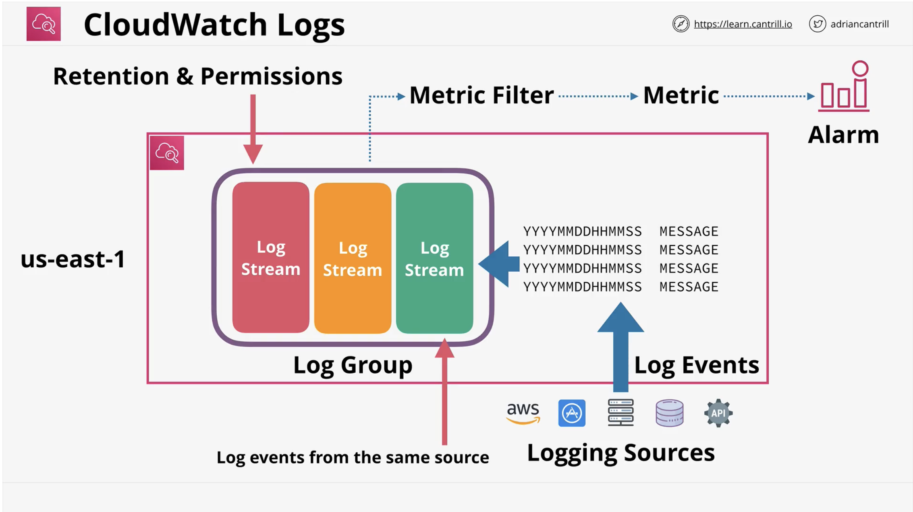

# Amazon CloudWatch

CloudWatch is AWS's native **monitoring and observability** platform. It covers two related but distinct areas: **Metrics** (numeric telemetry over time) and **Logs** (text-based event data). This page focuses on CloudWatch Logs; CloudWatch Metrics are used throughout AWS and are referenced on individual service pages.

## CloudWatch Logs

CloudWatch Logs is a **public AWS service** — it is hosted in the AWS public zone and is accessible via public endpoints from:

- Within [VPCs](vpc.md) (with appropriate routing),
- On-premises environments (with network connectivity and [IAM](iam.md) permissions),
- Other cloud platforms.

The service's primary function is to **store, monitor, and access logging data**.

### Log Data Model

Every log entry is a **log event**, which consists of:

- A **timestamp** (year, month, day, hour, minute, second, timezone)
- A **message block** — raw, unstructured data; CloudWatch Logs does not interpret the content

Log events are organized in a hierarchy:

**Log Streams** — an ordered sequence of log events from a single source (e.g. one EC2 instance writing `/var/log/messages`). Multiple instances each get their own stream.

**Log Groups** — containers for multiple log streams of the same type. All configuration lives at the group level and applies to every stream within it:

- **Retention policies** — how long log events are kept (default: never expire)
- **Permissions** — [IAM](iam.md) resource policies controlling who can read/write the group
- **Metric filters** — pattern-matching rules that generate CloudWatch Metrics from log data

### Ingestion Methods

| Method | When to use |
| --- | --- |
| Native AWS service integration | [EC2](ec2.md), [VPC](vpc.md) Flow Logs, Lambda, [CloudTrail](cloudtrail.md), Route 53 — zero config, logs flow automatically via service/IAM roles |
| **Unified CloudWatch Agent** | Custom OS logs (e.g. `/var/log/messages` on EC2), on-premises servers, non-AWS compute |
| AWS SDK | Application-level logging from any language — call `PutLogEvents` directly |

Security for native integrations is managed via **IAM service roles** attached to the originating service (e.g. a Lambda execution role that includes `logs:CreateLogGroup`, `logs:PutLogEvents`).

### Metric Filters and Alarms

Metric filters let you **generate numeric metrics from log content**:

1. Define a filter pattern on a log group (e.g. match the string `"Failed password"` in sshd logs)
2. Each match increments a custom CloudWatch Metric
3. Set an **alarm** on that metric to notify (SNS) or trigger automated responses (Lambda, Auto Scaling, EC2 Actions)

This pipeline is how AWS converts unstructured logs into actionable telemetry without exporting data to a separate tool.

The canonical example of the alarm + **EC2 action** pipeline is the [EC2 Status Check Alarm](ec2.md#status-checks-and-auto-recovery) — a built-in alarm on either of EC2's two instance status checks that can notify via SNS and optionally **Reboot / Stop / Terminate / Recover** the instance (the **Recover** action triggers [EC2 auto recovery](ec2.md#ec2-auto-recovery)).

## CloudWatch Logs as the Logging Backbone

CloudWatch Logs is the default log destination for most AWS services. Key integrations:

| Service | What it logs |
| --- | --- |
| [CloudTrail](cloudtrail.md) | API call history — who called what, when, from where |
| Lambda | Function execution output (stdout/stderr) |
| [VPC](vpc.md) Flow Logs | Network traffic flow records (accepted/rejected) |
| [EC2](ec2.md) | OS and application logs (via CloudWatch Agent) |
| Route 53 | DNS query logs |

## Resilience and Scope

CloudWatch is a **regional service** — log groups and their data are region-scoped. Cross-region log aggregation requires explicit forwarding (e.g. Kinesis Data Firehose or Lambda subscription filters to a central region).

> [!tip] Exam Tip
> **Log Group = unit of configuration.** Retention, permissions, and metric filters all attach to the log group and inherit down to every stream it contains. Stream-level configuration does not exist.

> [!warning] Gotcha
> The Unified CloudWatch Agent is required for **any log source that isn't a native AWS service** — including OS-level logs from EC2 instances. EC2 does not automatically send logs to CloudWatch; only metrics like CPU are available without the agent.

## References

- [IAM](iam.md) — roles and permissions for log access
- [VPC](vpc.md) — VPC Flow Logs sent to CloudWatch Logs
- [EC2](ec2.md) — OS and app logs via CloudWatch Agent
- [CloudTrail](cloudtrail.md) — API/account-activity audit; delivers events to CloudWatch Logs for search + alarms
- [Organizations](organizations.md) — CloudTrail integration context
