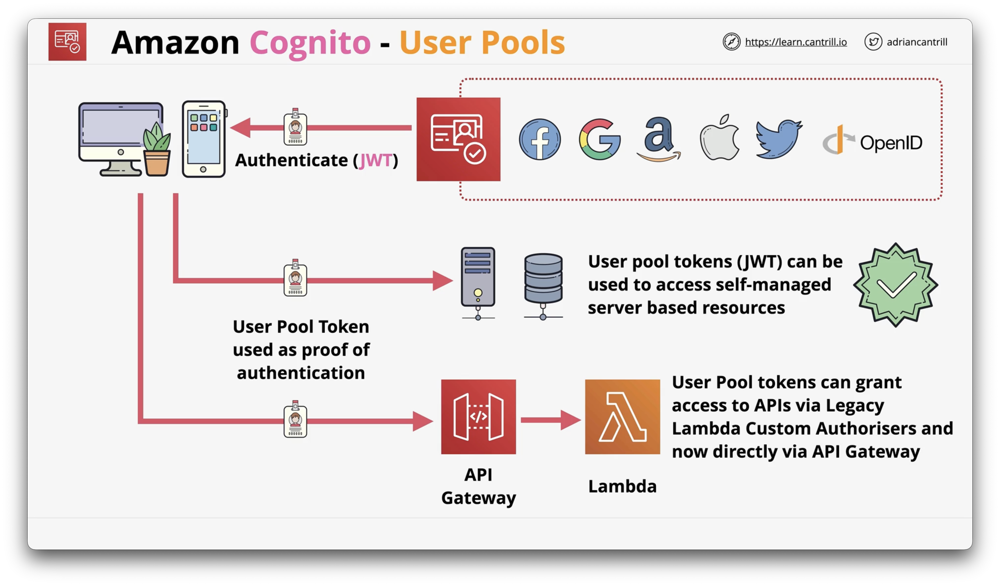
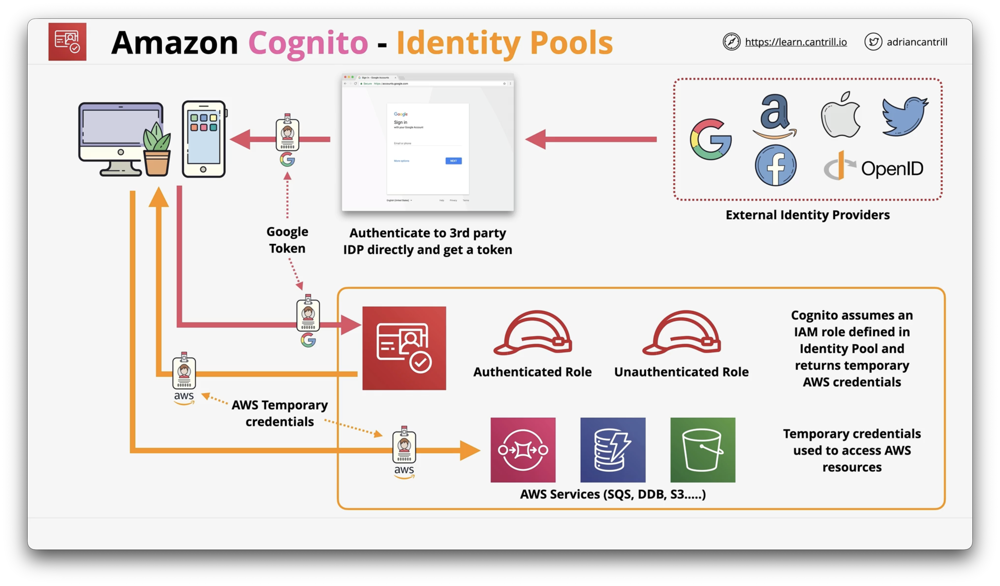
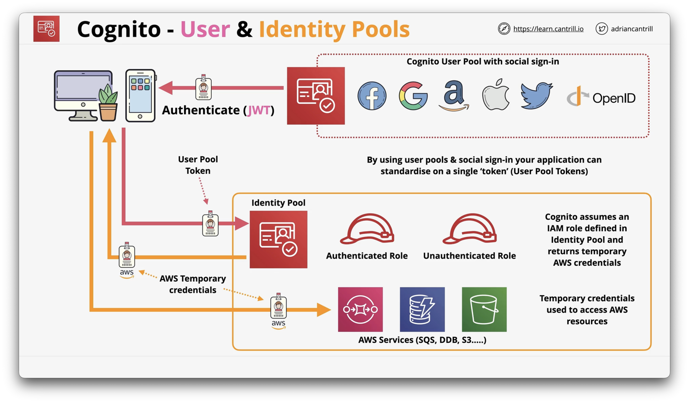

# Amazon Cognito — User and Identity Pools

## Overview

Amazon Cognito manages application identities for web and mobile apps. It connects two distinct parts of [identity and access](../concepts/identity-and-access.md): signing users in to an application, and granting those users permission to call AWS APIs through [IAM roles](iam.md#iam-roles).

| Component | Responsibility | Result for the application |
| --- | --- | --- |
| **User pool** | User directory, sign-up/sign-in, and federation with external identity providers | User pool tokens: ID and access JWTs; refresh tokens in supported flows |
| **Identity pool** | Map authenticated or guest identities to AWS access | Temporary AWS credentials associated with an IAM role |

Both can be used independently. A user pool can protect an API without an identity pool; an identity pool can accept an external provider directly without a user pool. Combine them when an application needs both managed sign-in and direct AWS API access. [AWS Cognito overview](https://docs.aws.amazon.com/cognito/latest/developerguide/what-is-amazon-cognito.html).

> [!warning] Gotcha
> A **JWT is not an AWS access key**. A user pool token can authorize an application API configured to trust it, but cannot itself sign an authenticated request to [S3](s3.md), DynamoDB, or [SQS](sqs.md). An identity pool supplies credentials for that direct-access path; alternatively, a backend can access AWS with its own role.

## User Pools — Application Sign-In

A user pool is an AWS-managed directory that supports registration, sign-in, account recovery, email/phone verification, MFA, and custom workflows through [Lambda](lambda.md) triggers. An **app client** configures how an application uses the directory, including enabled sign-in flows and callback URLs. Browser/mobile public clients cannot keep a secret and should use an app client without one. [AWS app clients](https://docs.aws.amazon.com/cognito/latest/developerguide/user-pool-settings-client-apps.html).

### Local and federated users

The same pool can contain users who sign in locally and users who authenticate through an external identity provider (IdP).

| Aspect | Local user | Federated user |
| --- | --- | --- |
| Who authenticates the user? | Cognito, using the configured local sign-in method | External IdP; its password stays with that provider |
| What does the user pool retain? | User profile and local authentication information | A user profile with attributes mapped from the IdP |
| What tokens does the app receive? | Cognito user pool tokens | Cognito user pool tokens, regardless of the upstream provider |

Built-in social providers are **Google, Facebook, Login with Amazon, and Sign in with Apple**. User pools also federate with SAML 2.0 and OIDC providers. Attribute mapping normalizes provider-specific claims, and mapped profile values are updated on sign-in. [AWS social providers](https://docs.aws.amazon.com/cognito/latest/developerguide/cognito-user-pools-social-idp.html), [attribute mapping](https://docs.aws.amazon.com/cognito/latest/developerguide/cognito-user-pools-specifying-attribute-mapping.html).

### Tokens and their consumers

**ID tokens** describe the signed-in user; **access tokens** carry authorization information such as scopes. Refresh tokens obtain replacement tokens in flows that issue them. Treating all of these as one interchangeable “JWT” hides which token a consumer expects. In particular, the identity-pool integration uses the user pool **ID token**. [AWS ID tokens](https://docs.aws.amazon.com/cognito/latest/developerguide/amazon-cognito-user-pools-using-the-id-token.html), [identity-pool authentication artifacts](https://docs.aws.amazon.com/cognito/latest/developerguide/authentication-flow.html).

The course diagram shows sign-in returning a JWT, followed by two application-access paths: a self-managed backend or [API Gateway](api-gateway.md) in front of Lambda.

- **Your backend:** validate the signature with the pool's public signing keys, expiration, issuer, intended app client, and token type; then enforce the permissions needed for the operation. Decoding a JWT is not validation. The database icon represents an application-controlled resource, not universal JWT support in databases. [AWS token verification](https://docs.aws.amazon.com/cognito/latest/developerguide/amazon-cognito-user-pools-using-tokens-verifying-a-jwt.html).
- **API Gateway REST API:** use a `COGNITO_USER_POOLS` authorizer. ID tokens support identity-based checks; access tokens support authorization with OAuth scopes. [AWS REST authorizers](https://docs.aws.amazon.com/apigateway/latest/developerguide/apigateway-integrate-with-cognito.html).
- **API Gateway HTTP API:** use a JWT authorizer configured with the user pool issuer and app audience. Require route scopes when the API should accept access tokens for scoped authorization. [AWS HTTP JWT authorizers](https://docs.aws.amazon.com/apigateway/latest/developerguide/http-api-jwt-authorizer.html).
- **Application Load Balancer:** an [ALB](elb.md#rules--the-core-of-alb-flexibility) HTTPS listener can use `authenticate-cognito` to handle browser sign-in before forwarding to the application. It uses a user pool, not an identity pool. [AWS ALB authentication](https://docs.aws.amazon.com/elasticloadbalancing/latest/application/listener-authenticate-users.html).

> [!warning] Gotcha
> The slide's Twitter logo is not evidence of built-in **user pool** support. Its built-in social-provider list has four providers; other federation requires a compatible SAML/OIDC provider or intermediary. The **identity pool** API separately lists `api.twitter.com` as a supported login-provider key. The slide's “legacy Lambda custom authorizers” wording also does not mean Lambda authorizers are deprecated; they remain useful for custom authorization logic. [AWS identity pool API](https://docs.aws.amazon.com/cognitoidentity/latest/APIReference/API_CreateIdentityPool.html).

### Feature plans

Current user pool plans distinguish baseline authentication from newer login and security features:

| Plan | Relevant capabilities |
| --- | --- |
| **Lite** | Core sign-up/sign-in, federation, classic hosted UI |
| **Essentials** | Default for new pools; adds managed login and newer authentication capabilities |
| **Plus** | Essentials plus threat protection, including compromised-credential detection and adaptive authentication |

The classic hosted UI remains available across plans; managed login requires Essentials or Plus. Do not read the course's account-takeover-protection bullet as a feature included in every pool. [AWS feature plans](https://docs.aws.amazon.com/cognito/latest/developerguide/cognito-sign-in-feature-plans.html).

## Identity Pools — Temporary AWS Credentials

An identity pool stores **identity identifiers and provider associations**, rather than acting as a password directory. It accepts a configured provider's proof of authentication, or a guest request when guest access is enabled, and brokers access to AWS. Providers can include a Cognito user pool, social providers, SAML, or OIDC. [AWS identity pools](https://docs.aws.amazon.com/cognito/latest/developerguide/identity-pools.html), [external providers](https://docs.aws.amazon.com/cognito/latest/developerguide/external-identity-providers.html).

The direct-federation diagram separates **red identity-token arrows** from **orange AWS-credential arrows**. The identity pool must trust each provider used along the red path.

### Credential exchange

In the **enhanced (simplified) flow**:

1. The user signs in with a trusted provider, and the app obtains the appropriate token or assertion.
2. The app calls `GetId` with that proof and receives an identity ID.
3. It calls `GetCredentialsForIdentity` with the identity ID and proof.
4. Cognito selects the role and obtains temporary credentials through STS.
5. The app uses the access key ID, secret access key, and session token to sign AWS API requests with **Signature Version 4 (SigV4)**.

Enhanced-flow credentials last **one hour**. The app or its credential provider obtains replacements as needed; refreshing the upstream login token and refreshing AWS credentials are separate operations. The **basic (classic) flow** instead returns an identity-pool token with `GetOpenIdToken`, and the app calls `sts:AssumeRoleWithWebIdentity` itself. [AWS authentication flows](https://docs.aws.amazon.com/cognito/latest/developerguide/authentication-flow.html).

### Roles, guests, and access boundaries

Configure an authenticated role for signed-in users and an unauthenticated role **if guest access is enabled**. An identity pool can support authenticated access, guest access, or both; the notes' “at least two roles” rule is not universal. Rules or token claims can also select among multiple authenticated roles. [AWS identity pool configuration](https://docs.aws.amazon.com/cognito/latest/developerguide/identity-pools.html).

The role's **trust policy** controls who can assume it; its **permissions policy** controls which AWS operations the resulting session can perform. Trust `cognito-identity.amazonaws.com`, restrict `cognito-identity.amazonaws.com:aud` to the intended identity pool, and constrain `amr` to the appropriate authenticated/unauthenticated state. Permissions should grant only the needed operations and resources, such as a user's own S3 prefix. Other applicable policies can further restrict access. [AWS Cognito IAM roles](https://docs.aws.amazon.com/cognito/latest/developerguide/iam-roles.html).

> [!warning] Gotcha
> “Guest” means no user sign-in, not no authorization. A guest still receives temporary credentials and is limited by the guest role. Giving guests permission to write a leaderboard does not establish that their submitted scores are trustworthy; application validation is a separate concern.

**Developer-authenticated identities** let an existing backend authenticate users and vouch for their identities to Cognito. The privileged `GetOpenIdTokenForDeveloperIdentity` operation belongs on that backend. This supports an existing custom login system without converting it into a user pool directory. [AWS developer-authenticated identities](https://docs.aws.amazon.com/cognito/latest/developerguide/developer-authenticated-identities.html).

## Combining User and Identity Pools

Use both when the application needs a managed directory or several sign-in providers **and** client-side access to AWS resources. The combined diagram replaces the provider-specific token entering the identity pool with a Cognito user pool ID token.

1. The user signs in locally or through an external provider configured in the user pool.
2. The application receives user pool tokens with a consistent issuer and claim format.
3. The app presents the **ID token** to an identity pool configured to trust that user pool and app client.
4. The identity pool returns temporary AWS credentials for the selected role.
5. The app signs requests to permitted AWS resources.

The benefit is a consistent application-facing token format and one user-pool integration at the identity-pool boundary. **Each external provider still needs configuration in the user pool.** “One IdP” describes the identity pool's configuration in this design, not the entire system. [AWS social federation](https://docs.aws.amazon.com/cognito/latest/developerguide/cognito-user-pools-social-idp.html).

The [PetTube serverless pattern](../patterns/serverless-architecture.md#the-cognito-role-critical-exam-concept) uses the simpler direct-provider path: Google token → identity pool → temporary credentials → S3 upload. Adding a user pool would centralize sign-in and profiles; it is not required merely to exchange a supported external identity for AWS access.

## Choosing an Architecture

| Requirement | Design | Where authorization happens |
| --- | --- | --- |
| Managed registration and sign-in; clients call an application API | User pool → API Gateway authorizer or application backend | Token validation, scopes, and application permissions; backend uses its own AWS role |
| Browser sign-in for an application behind a load balancer | User pool + ALB `authenticate-cognito` | ALB handles authentication; application enforces business permissions |
| Existing external login; clients call AWS APIs directly | External IdP → identity pool | IAM policies on temporary role sessions |
| Managed sign-in plus direct AWS access | User pool → identity pool | User pool authenticates; identity pool maps to roles; IAM authorizes AWS calls |
| Direct AWS access without registration | Identity pool with guest access | Restricted guest role |

An identity pool can also supply credentials to invoke an API Gateway API using **IAM/SigV4 authentication**. That is a different configuration from a user pool/JWT authorizer.

> [!tip] Exam Tip
> **Sign-up/sign-in/MFA/directory → user pool. Temporary AWS credentials/direct S3 or DynamoDB access/guests → identity pool. Both requirements → both pools.** Millions of app users should not become millions of IAM users: IAM has a non-adjustable **5,000 users per account** quota. [AWS IAM quotas](https://docs.aws.amazon.com/general/latest/gr/iam-service.html). See the [SAA Cognito notes](../certifications/aws-saa.md#amazon-cognito) for the decision table.

## References

- [Source study notes — Cognito](../../raw/aws-cert-study-notes/aws-solution-architect/cognito.md) — Cantrill SAA-C03; source for the three copied diagrams.
- [AWS — Amazon Cognito overview](https://docs.aws.amazon.com/cognito/latest/developerguide/what-is-amazon-cognito.html)
- [AWS — User pool feature plans](https://docs.aws.amazon.com/cognito/latest/developerguide/cognito-sign-in-feature-plans.html)
- [AWS — Verifying user pool JWTs](https://docs.aws.amazon.com/cognito/latest/developerguide/amazon-cognito-user-pools-using-tokens-verifying-a-jwt.html)
- [AWS — Identity pool authentication flows](https://docs.aws.amazon.com/cognito/latest/developerguide/authentication-flow.html)
- [AWS — Identity pool IAM roles](https://docs.aws.amazon.com/cognito/latest/developerguide/iam-roles.html)
