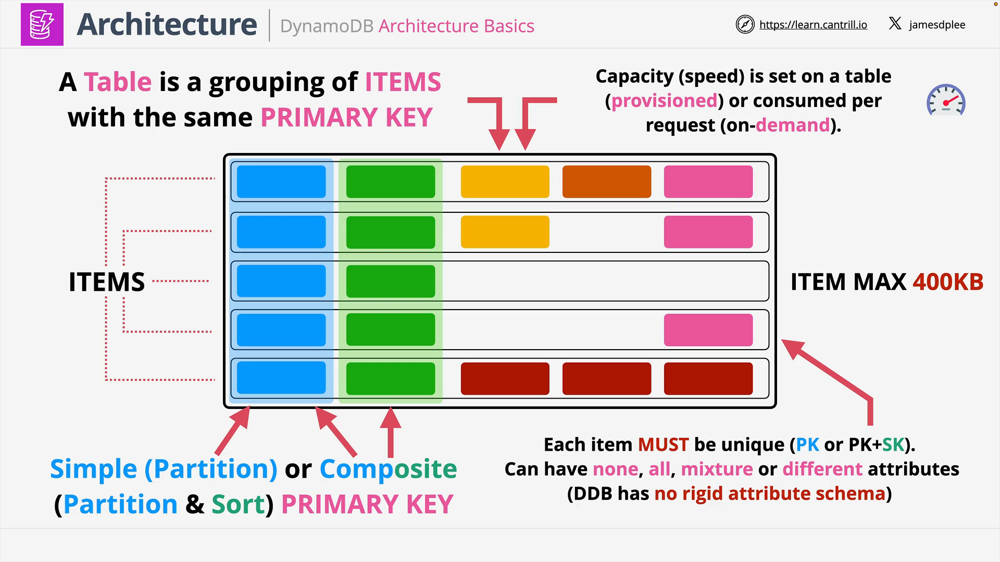
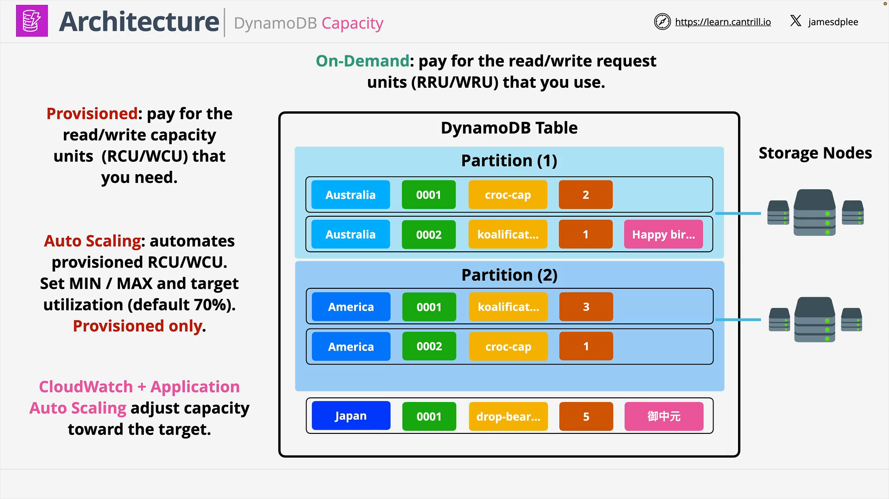
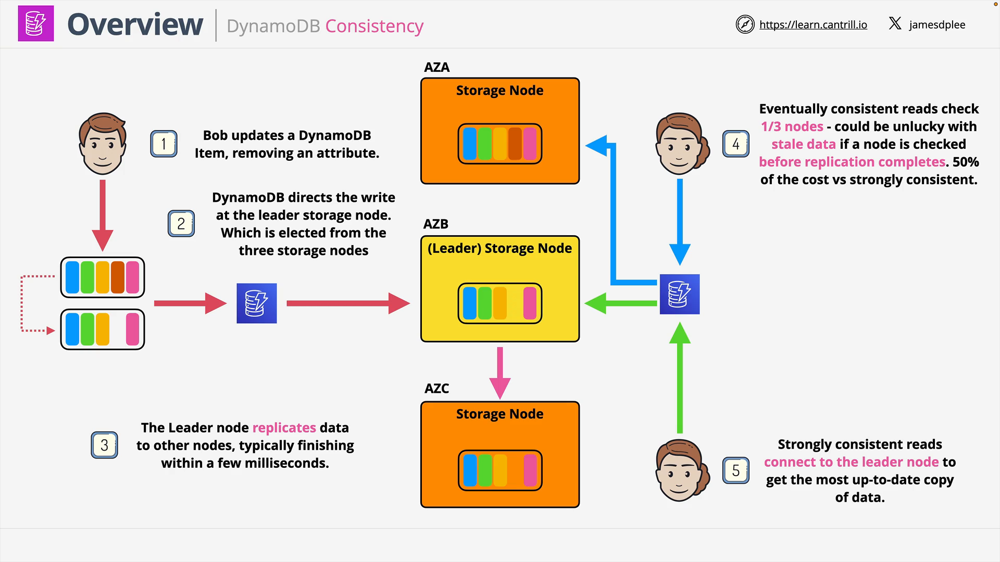
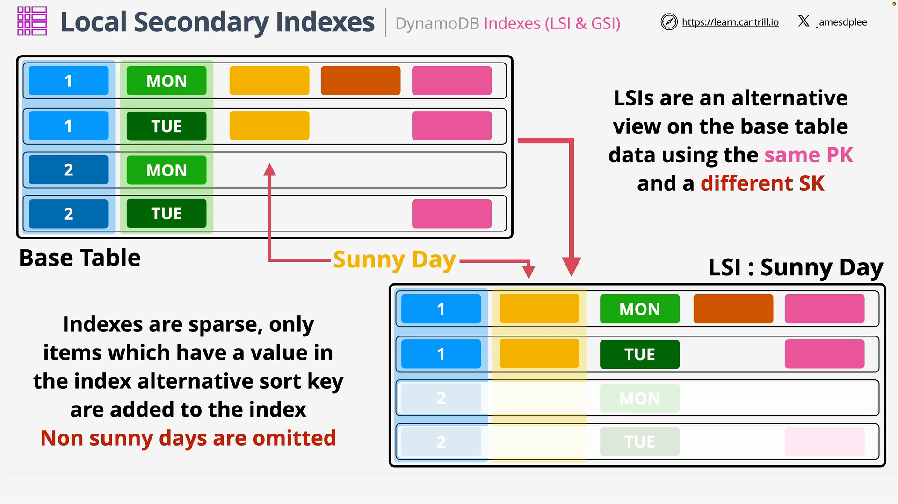
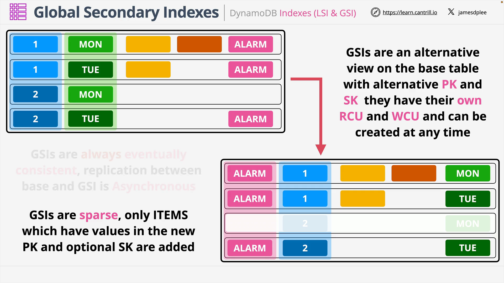
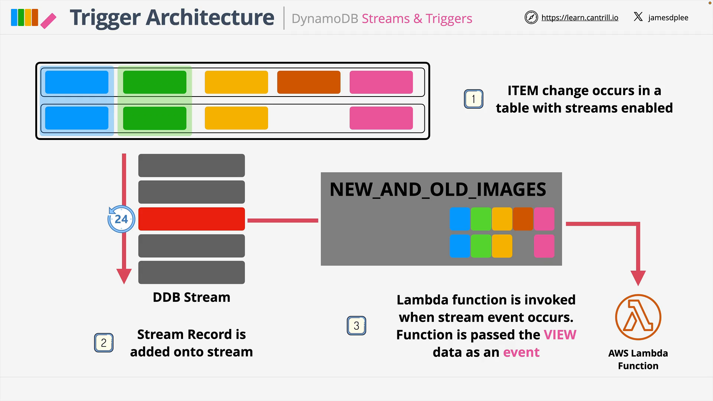
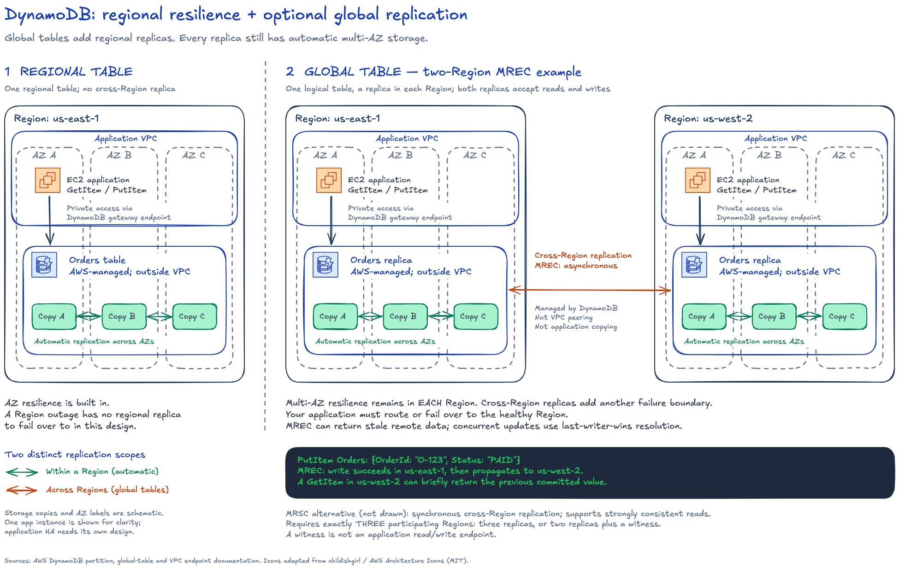
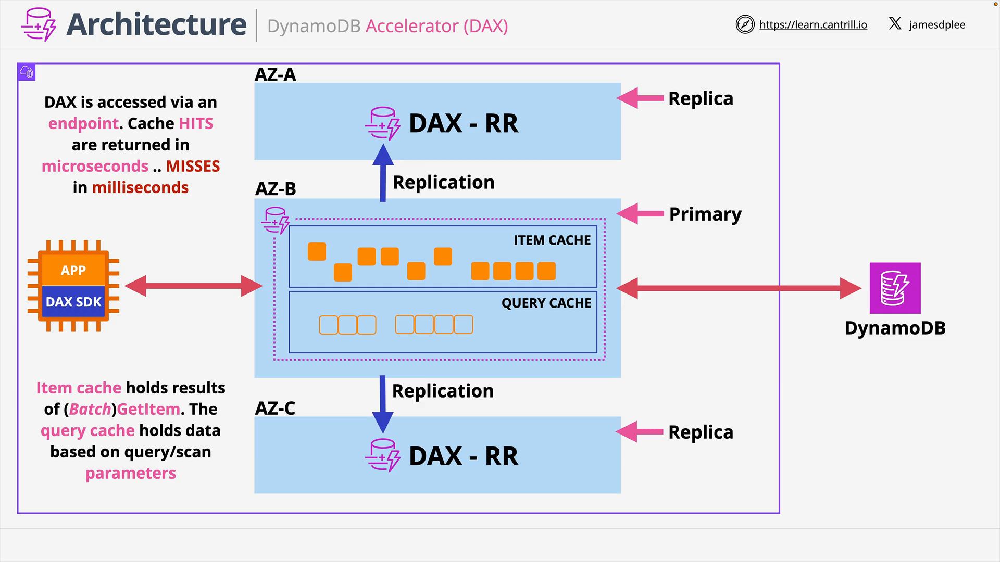
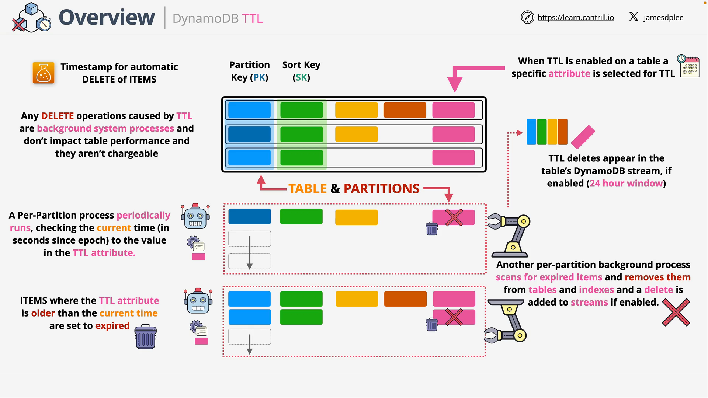

# Amazon DynamoDB

DynamoDB is a managed key-value and document database. You work with **tables and API operations**, without selecting a database server, patching an operating system, or managing storage replicas. It fits [serverless applications](../patterns/serverless-architecture.md) that need predictable, low-latency access to items through known keys. [Access-pattern design](../concepts/nosql-access-patterns.md) determines whether those reads stay efficient as the dataset grows.

Unlike a relational engine in [RDS](rds.md) or [Aurora](aurora.md), DynamoDB does not provide relational joins and foreign-key enforcement. That does **not** mean it lacks transactions or can never represent relationships: it supports [ACID transactions](../concepts/db-transaction-model.md), and applications can model related entities through their keys. It also supports a subset of [PartiQL, a SQL-compatible language](https://docs.aws.amazon.com/amazondynamodb/latest/developerguide/ql-reference.html); SQL-like syntax does not remove DynamoDB’s underlying access-pattern constraints: efficient reads still depend on keys and indexes, and selecting fewer attributes with PartiQL does not reduce the read capacity consumed for the items read. See [PartiQL SELECT behavior](https://docs.aws.amazon.com/amazondynamodb/latest/developerguide/ql-reference.select.html) and [projection capacity rules](https://docs.aws.amazon.com/amazondynamodb/latest/developerguide/Expressions.ProjectionExpressions.html).

## Tables, Items, and Keys

A table contains **items**; each item contains **attributes**. All items follow the same primary-key **schema**, but each primary-key **value** uniquely identifies one item. Other attributes can vary between items. The item-size limit is **400 KB**, including attribute names and values.



| Primary-key design | Uniqueness | Example |
| --- | --- | --- |
| Simple: partition key only | Partition-key value must be unique | `OrderId = order-123` |
| Composite: partition key plus sort key | The pair must be unique | `StationId = station-1`, `ObservedAt = 2026-11-11T10:00:00Z` |

The **partition key** is hashed to locate data. The **sort key** orders items sharing a partition-key value and supports range-based retrieval. A weather station can therefore have many observations without giving every observation a different station ID. Use actual timestamps rather than repeating weekday names if the table must retain multiple weeks.

Non-key attributes can include strings, numbers, lists, and maps. Primary-key attributes must be scalar String, Number, or Binary values. Keep large media objects in [S3](s3.md), with their identifiers and metadata in the table. See [AWS core components](https://docs.aws.amazon.com/amazondynamodb/latest/developerguide/HowItWorks.CoreComponents.html) and [constraints](https://docs.aws.amazon.com/amazondynamodb/latest/developerguide/Constraints.html).

## Regional Architecture and Access

A table is [Regional](../concepts/resource-scope.md), with data replicated across multiple Availability Zones automatically. AWS manages the physical **partitions** and splits data as storage or throughput requirements grow. A partition can hold several partition-key values; a logical key is not a dedicated server or necessarily an entire physical partition.



The service is outside your [VPC](vpc.md), accessible through authenticated regional endpoints. **Public endpoint** describes reachability, not public permission to read a table. [IAM](iam.md) governs API access; [gateway endpoints](vpc-gateway-endpoints.md) provide private same-Region access from VPC workloads. [Interface endpoints](vpc-interface-endpoints.md#gateway-endpoint-vs-interface-endpoint) address different connectivity requirements. Data is encrypted at rest, with AWS-owned, AWS-managed, or customer-managed [KMS](kms.md) key options. See [AWS encryption at rest](https://docs.aws.amazon.com/amazondynamodb/latest/developerguide/EncryptionAtRest.html).

Partition-key distribution matters in **both** capacity modes. A country or a single `ACTIVE` value can concentrate most traffic on one key. Adaptive capacity helps uneven workloads, but a physical partition is designed for at most **3,000 read units/second and 1,000 write units/second**; these are capacity units, not arbitrary-size item counts. Increasing total table capacity cannot make one hot item accept unlimited traffic. See [partition-key design](https://docs.aws.amazon.com/amazondynamodb/latest/developerguide/bp-partition-key-design.html).

## Read Consistency and Transactions

**Eventually consistent** reads are the default and can return a previously committed version after a recent write. **Strongly consistent** reads reflect successful prior writes within the applicable consistency scope. Request them with `ConsistentRead=true`; choose this per read operation, rather than treating it as a global switch for ordinary tables.

The replicated-storage model explains the difference: a reader may reach a replica that has not yet received a change. The diagram illustrates that timing; applications depend on the consistency contract, not on selecting a storage node or assuming replication always finishes within a fixed number of milliseconds.



| Read target | Eventually consistent reads | Strongly consistent reads |
| --- | --- | --- |
| Base table | Yes, default | Yes |
| Local secondary index | Yes | Yes |
| Global secondary index | Yes | No |
| DynamoDB Streams | Yes | No |

An eventually consistent read costs half as much read capacity as the equivalent strongly consistent read. Both return committed data; eventual consistency is not permission to expose failed, uncommitted writes. See [AWS read consistency](https://docs.aws.amazon.com/amazondynamodb/latest/developerguide/HowItWorks.ReadConsistency.html).

**A fresh read is not a transaction.** Another writer can change the item immediately afterward. Use conditional writes for requirements such as “update only if the version still equals the value I read,” and transactions for multiple changes that must succeed together. `TransactWriteItems` supports up to **100 distinct items**, totaling at most **4 MB**, across tables in the same account and Region. `BatchWriteItem` does not provide that all-or-nothing guarantee. Transactional reads consume twice the units of strongly consistent reads; transactional writes consume twice the units of ordinary writes. See [transaction behavior](https://docs.aws.amazon.com/amazondynamodb/latest/developerguide/transaction-apis.html).

## Capacity Modes

Here, **capacity means throughput**, not allocated disk space. Storage is billed separately.

| Mode | What you configure | What you pay for | Useful when |
| --- | --- | --- | --- |
| On-demand | No provisioned RCU/WCU target; optional maximum throughput controls | Read request units (RRU) and write request units (WRU) consumed | Demand is unknown, intermittent, or variable |
| Provisioned | Read capacity units (RCU) and write capacity units (WCU) per table, plus separate settings for each GSI | Allocated capacity, including unused capacity | Sustained, predictable utilization makes provisioning worthwhile |
| Provisioned with auto scaling | Minimum, maximum, and target utilization | Provisioned capacity as it changes | Load varies within a planned operating range |

**Provisioned capacity is configured per table, with separate RCU/WCU settings for each global secondary index (GSI).** Local secondary indexes (LSIs) share the base table's capacity. These are throughput allocations, not a separate allowance for each item. See the [index comparison](#secondary-indexes-lsi-and-gsi).

**On-demand mode has no provisioned RCU/WCU allocation to configure.** Instead, actual operations consume **RRU/WRU** for billing. The same item-size rounding and read-consistency rules still apply; an operation can consume multiple request units. Optional maximum-throughput settings cap request units per second rather than reserve capacity. See [AWS provisioned mode](https://docs.aws.amazon.com/amazondynamodb/latest/developerguide/provisioned-capacity-mode.html) and [on-demand mode](https://docs.aws.amazon.com/amazondynamodb/latest/developerguide/on-demand-capacity-mode.html).

On-demand is AWS's recommended starting point for most workloads. Provisioned auto scaling uses [CloudWatch](cloudwatch.md) metrics and Application Auto Scaling; it is reactive and does not guarantee that a sudden spike cannot throttle. Provisioned-to-on-demand switches are limited to **four in a rolling 24-hour window**. See [capacity modes](https://docs.aws.amazon.com/amazondynamodb/latest/developerguide/capacity-mode.html) and [switching modes](https://docs.aws.amazon.com/amazondynamodb/latest/developerguide/bp-switching-capacity-modes.html).

> [!warning] Gotcha
> On-demand does not mean unlimited instantaneous throughput. Previous traffic peaks, partition hot spots, service quotas, and any configured maximum throughput still matter. Provisioned tables can retain up to **300 seconds of unused capacity** for bursts, but that reserve is not guaranteed capacity to build a steady workload around. Retry throttled requests with backoff and inspect the affected table/index and key distribution. See [on-demand scaling](https://docs.aws.amazon.com/amazondynamodb/latest/developerguide/on-demand-capacity-mode.html) and [burst/adaptive capacity](https://docs.aws.amazon.com/amazondynamodb/latest/developerguide/burst-adaptive-capacity.html).

## Capacity Calculations

For ordinary, individual-item operations:

| Operation | Units consumed for one item |
| --- | --- |
| Write | Round item size up to a multiple of **1 KB** |
| Strongly consistent read | Round item size up to a multiple of **4 KB** |
| Eventually consistent read | Half the units of a strongly consistent read |
| Transactional read/write | Twice the units of a strongly consistent read or ordinary write, respectively |

Multiply units per operation by operations **per second** to calculate provisioned throughput. On-demand uses the same size rounding, but bills request units consumed rather than a provisioned per-second allowance. A small eventually consistent read can consume **0.5 read unit**; “every operation consumes at least one RCU” is too broad. See [read/write consumption](https://docs.aws.amazon.com/amazondynamodb/latest/developerguide/read-write-operations.html).

### Worked Example: Store Orders

Assume every order item is **2.5 KB**, with **10 writes/second** and **10 separate reads/second**. In **provisioned mode**, the required throughput is:

```text
Writes:                     ceil(2.5 / 1) × 10 = 30 WCU
Strongly consistent reads:  ceil(2.5 / 4) × 10 = 10 RCU
Eventually consistent reads:             10 / 2 = 5 RCU
```

In **on-demand mode**, one such write consumes **3 WRU**; one strongly consistent read consumes **1 RRU**, or **0.5 RRU** for an eventually consistent read. Therefore, ten writes consume **30 WRU**, and ten reads consume **10 RRU** or **5 RRU**, respectively. If those operations occur every second, those are the request units consumed each second—not provisioned RCU/WCU settings. Billing accumulates the request units actually consumed.

These are base-table demand estimates, before index writes, transactions, replicated writes, and operational headroom. With varied sizes, sum each item's rounded cost: rounding an average can underestimate demand. Convert per-minute rates to per-second rates, and account for peaks rather than assuming an hourly average is adequate.

### Operation Boundaries Matter

`GetItem` rounds each item; `BatchGetItem` also rounds each requested item separately. `Query` and `Scan` aggregate the data read **within a request** before rounding to the next 4 KB. Thus one strongly consistent `Query` reading a 2.5 KB item and a 1.5 KB item uses 1 read unit, while two separate strongly consistent `GetItem` calls use 2. Pagination introduces further request boundaries. This is why “round each item” is not a universal rule for every read API.

`UpdateItem` can change selected attributes, but write charging uses the larger of the item's before/after sizes, not just the changed bytes. Fetching fewer attributes likewise does not automatically reduce read capacity.

## Query, Scan, and Filtering

| Operation | How it finds data | Main consequence |
| --- | --- | --- |
| `GetItem` | Exact complete base-table primary key | Retrieves one item |
| `Query` | Equality on one partition-key value, optionally narrowed by sort-key conditions | Reads the selected key range |
| `Scan` | Reads through a table or index | Pays for evaluated data, including rejected items |

The table describes the conventional single-attribute partition/sort-key design used in these examples. Multi-attribute GSI keys extend the key-condition syntax, described below.

A **key condition** narrows which items DynamoDB reads. A **filter expression** discards items after that read. A **projection expression** selects which attributes to return. Filters and response projections reduce returned data, but do not reduce capacity consumed for the items already evaluated. See [Query behavior](https://docs.aws.amazon.com/amazondynamodb/latest/developerguide/Query.Other.html).

For example, a station query reading 4 KB still consumes 1 strongly consistent read unit if a filter discards half its results. A scan evaluating items of 5, 4, 2, and 3 KB reads 14 KB and consumes 4 strongly consistent read units, even if only the first two items match. Eventually consistent reads halve these amounts.

`Query` and `Scan` process at most **1 MB per request before filtering**, or stop earlier at an evaluation limit. Follow `LastEvaluatedKey` using `ExclusiveStartKey` until no continuation key remains. A page can contain **zero returned items and still have more data to evaluate**. A strongly consistent scan also does not create a point-in-time snapshot of the whole table. Parallel scans can finish sooner while consuming capacity more aggressively; they do not make filters free. See [Scan and pagination](https://docs.aws.amazon.com/amazondynamodb/latest/developerguide/Scan.html).

## Secondary Indexes: LSI and GSI

An index is an AWS-maintained alternative organization of selected table attributes. It enables another query pattern without making the application maintain a separate copy itself.

| Property                         | Local secondary index (LSI)                                   | Global secondary index (GSI)                                        |
| -------------------------------- | ------------------------------------------------------------- | ------------------------------------------------------------------- |
| Key design                       | Same partition key, different sort key                        | Alternative partition key and optional sort key                     |
| Creation/deletion                | Created with the table; cannot independently add/remove later | Can add/remove after table creation                                 |
| Read consistency                 | Eventually consistent or strongly consistent                  | Eventually consistent only                                          |
| Provisioned capacity             | Shares base-table capacity                                    | Separate index read/write capacity                                  |
| Index count                      | Up to 5 per table                                             | Default quota of 20 per table                                       |
| Request an unprojected attribute | Can fetch from base table, with extra read cost/latency       | Cannot fetch automatically; application needs a separate table read |

**Projection** is the data physically copied into an index: `KEYS_ONLY`, `INCLUDE` selected attributes, or `ALL`. Base-table primary keys are included so the original item remains identifiable. This differs from a response projection: a smaller stored index entry can reduce index read/storage costs. Index maintenance adds write work; an underprovisioned GSI can throttle writes to the base table. See [index comparison](https://docs.aws.amazon.com/amazondynamodb/latest/developerguide/SecondaryIndexes.html).

### LSI: Another Ordering Within One Station

A weather table keyed by station and observation date can have an LSI keyed by the **same station** and an alternate attribute, such as a sunny-day marker. Only observations containing the alternate sort-key attribute enter that index, making it **sparse**. Use a String or Number marker, not a Boolean index key. Multiple items can share an index key; index keys do not have the base table's uniqueness requirement.



With an LSI, an **item collection**—base-table items and LSI entries sharing one partition-key value—has a **10 GB limit**. Plan for that before table creation. Strongly consistent alternate sorting can justify an LSI, but its lifecycle and size constraints matter. See [local secondary indexes](https://docs.aws.amazon.com/amazondynamodb/latest/developerguide/LSI.html).

### GSI: Find Alarms Across Stations

A sparse GSI can use `AlarmState` as its partition key and `StationId` as its sort key. Add `AlarmState = ALARM` only to affected observations. A query for `ALARM` then reads alarm entries across stations, instead of scanning every observation.



This is a teaching example, not automatically a scalable production key: one popular alarm value can become a hot GSI key. Use the [access-pattern checklist](../concepts/nosql-access-patterns.md) to assess traffic and any sharding tradeoff. Index updates propagate asynchronously, so a successful base-table write does not guarantee an immediate GSI query will find it.

Current GSIs also support **multi-attribute keys**, with up to four partition-key attributes and four sort-key attributes. Queries must supply equality for every partition-key component and constrain sort-key components in their defined left-to-right order. The simple examples above remain valid; they are not the only supported schema. See [GSI design and multi-attribute keys](https://docs.aws.amazon.com/amazondynamodb/latest/developerguide/GSI.html).

> [!warning] Gotcha
> “Global” in **global secondary index** does not mean multi-Region replication. A GSI is an alternate access path; **global tables** replicate table data across Regions.

## Streams and Lambda Triggers

**DynamoDB Streams** records item changes for a **24-hour rolling window**. Enable it per table and select the stream view that supplies the data the consumer needs. Ordering is guaranteed **for each item's changes**, not as one total order across the whole table.

| Stream view | Data available alongside the changed item's keys |
| --- | --- |
| `KEYS_ONLY` | Keys only |
| `NEW_IMAGE` | Item after the change |
| `OLD_IMAGE` | Item before the change |
| `NEW_AND_OLD_IMAGES` | Both versions |

An insert has no old image; a delete has no new image. To compare the precise before/after versions of one update, select both images. Reading the table later might return a subsequent version, so `OLD_IMAGE` plus a later lookup is not an equivalent change record. See [DynamoDB Streams](https://docs.aws.amazon.com/amazondynamodb/latest/developerguide/Streams.html).

Combine the stream with a [Lambda event source mapping](lambda.md#event-source-mapping-esm): Lambda polls shards, invokes the function with batches, and advances processing after success. This supports [event-driven architecture](../patterns/architecture-evolution.md), such as updating a low-stock view or publishing a restock notification through [SNS](sns.md).



The arrow to Lambda represents a polled event source mapping, not a direct asynchronous push from the table. Consumers process records **at least once**, so make side effects idempotent and configure failure/retry handling. A record appearing once in the stream does not guarantee one function execution. Monitor processing lag against the retention window. See [Lambda integration](https://docs.aws.amazon.com/lambda/latest/dg/with-ddb.html).

Streams is a native database change log, separate from [Kinesis Data Streams](kinesis.md). Do not assume Kinesis retention settings apply to DynamoDB Streams.

## Global Tables

Global tables add **multi-active, cross-Region replication**: applications can read and write replica tables in multiple Regions. Each replica retains regional multi-AZ resilience. This supports [global application architectures](../patterns/global-regional-architecture.md), but application routing and regional failover still need design.

### Regional versus Global Architecture

A regional table automatically replicates its storage across AZs within one Region. A global table adds regional replicas, each with that same multi-AZ resilience. The example below compares a single regional table with a **two-Region MREC global table**; green arrows show replication within a Region, while the orange arrow shows asynchronous replication between Regions.



[Edit the architecture in Excalidraw](../assets/dynamodb-regional-vs-global.excalidraw) · [Full-size image](../assets/dynamodb-regional-vs-global.png)

The rectangles describe different scopes: each **Region** contains multiple **AZs**, and the application **VPC** spans AZs. DynamoDB is an AWS-managed regional service **outside the application VPC**; its storage copies are schematic, not separate tables or nodes that you place in subnets. The application uses a [DynamoDB gateway endpoint](vpc-gateway-endpoints.md) for private access to its same-Region table. Cross-Region replication is managed by DynamoDB and does not require VPC peering or application code to copy items. See [partition replication](https://docs.aws.amazon.com/amazondynamodb/latest/developerguide/HowItWorks.Partitions.html) and [global-table core concepts](https://docs.aws.amazon.com/amazondynamodb/latest/developerguide/globaltables-CoreConcepts.html).

For example, a successful `PutItem` in `us-east-1` can briefly be followed by a `GetItem` in `us-west-2` that returns the previous value while MREC replication catches up. During a Region outage, the application must route requests to a healthy replica; global tables do not switch the application's endpoint automatically. Only one application instance is drawn per Region for clarity—application availability needs its own design. **MRSC is a different topology:** it requires three participating Regions, using three replicas or two replicas plus a witness, as described below.

### How the Application Selects a Replica

The application selects the target Region through its **DynamoDB SDK client configuration**. Normally, configure `region` and let the SDK resolve the endpoint; manually configuring a DNS hostname is unnecessary. The endpoint selects the regional service, and the request's `TableName` selects the table in that Region, under the applicable account and permissions. All replicas in a global table share the same table name. See [SDK Region configuration](https://docs.aws.amazon.com/sdk-for-javascript/v3/developer-guide/setting-region.html).

For example, assume an existing `Orders` global table with replicas in `us-east-1` and `us-west-2`, using `OrderId` as its partition key. With AWS SDK for JavaScript v3 and credentials authorized for both replicas:

```javascript
import {
  DynamoDBClient,
  PutItemCommand,
  GetItemCommand,
} from "@aws-sdk/client-dynamodb";

const east = new DynamoDBClient({ region: "us-east-1" });
const west = new DynamoDBClient({ region: "us-west-2" });

// Write to the Orders replica in us-east-1.
await east.send(new PutItemCommand({
  TableName: "Orders",
  Item: { OrderId: { S: "O-123" }, Status: { S: "PAID" } },
}));

// Read from the Orders replica in us-west-2.
const result = await west.send(new GetItemCommand({
  TableName: "Orders",
  Key: { OrderId: { S: "O-123" } },
}));
```

With MREC, the west-side read can return an older value—or no item if it was just created—while replication catches up. Using `west` for a `PutItem` would instead write to the west-side replica. Neither operation has a separate Region parameter; the client used to send it determines the target Region.

For example, `dynamodb.us-east-1.amazonaws.com` is a **regional service endpoint**, not a DNS name unique to the `Orders` table or its replica. Newer SDKs can also use account-based endpoints whose hostnames include an account ID; they still target a specific Region. See [DynamoDB endpoints](https://docs.aws.amazon.com/general/latest/gr/ddb.html).

**DynamoDB manages replication; the application architecture manages request routing and regional failover.** A common deployment runs an application in each Region with its client configured for the local replica, then shifts application traffic to a healthy Region during an outage. An application can also implement explicit selection between regional clients. Global tables do not automatically redirect requests sent to an impaired Region to another replica. This choice is separate from which AZ storage copy serves a request, which DynamoDB manages internally.

### Consistency Modes

| Mode | Replication and reads | Concurrent writes |
| --- | --- | --- |
| MREC: multi-Region eventual consistency, default | Asynchronous; strongly consistent reads reflect local writes but may miss recent writes in other Regions | Last-writer-wins resolution per item |
| MRSC: multi-Region strong consistency | Synchronous acknowledgment across Regions; strongly consistent reads can observe the latest item globally | Conflicting simultaneous writes can fail and require retry |

The mode is fixed at creation. MREC's typically fast replication is not a zero-data-loss guarantee; replication delay defines potential loss on failover. MRSC trades cross-Region coordination latency for zero RPO. Neither choice makes every default read strongly consistent: callers must request strongly consistent reads where needed.

**MRSC constraints:** exactly three participating Regions, using three replicas or two replicas plus a witness; only supported Regions; no TTL, LSIs, or transaction APIs. GSIs remain eventually consistent. MREC transactions are atomic in their originating Region, not replicated as a transaction across Regions. See [global table behavior](https://docs.aws.amazon.com/amazondynamodb/latest/developerguide/V2globaltables_HowItWorks.html).

For current-version MREC, add replicas through DynamoDB's global-table configuration; do not interpret the architecture as an instruction to merge independently populated regional tables. MREC uses Streams for replication; MRSC does not require Streams for that purpose. See [global-table core concepts](https://docs.aws.amazon.com/amazondynamodb/latest/developerguide/globaltables-CoreConcepts.html).

## DynamoDB Accelerator (DAX)

DAX is a managed in-memory cache for repeated DynamoDB reads. A **DAX-aware client** sends supported requests to a cluster endpoint. A cache hit can return in microseconds; on a miss DAX reads DynamoDB and populates its cache. This removes the application's separate cache-lookup/database-read/cache-populate flow.

DAX runs **inside a VPC**, with a primary and optional read replicas. Place at least three nodes across AZs for high availability; a replica can replace a failed primary. Scale with larger nodes or more nodes. Applications need network access and appropriate permissions to the cluster; attaching DAX is not a table setting that transparently accelerates every existing SDK call.



| Cache | Stores |
| --- | --- |
| Item cache | Individual items retrieved with `GetItem` or `BatchGetItem` |
| Query cache | `Query`/`Scan` results associated with the request parameters |

Strongly consistent reads pass through to DynamoDB and are **not cached**. See [DAX request processing](https://docs.aws.amazon.com/amazondynamodb/latest/developerguide/DAX.concepts.html).

For ordinary writes through DAX, DynamoDB commits first, then DAX updates its item cache. A failed backing write is not treated as a successful cached write. Writes that **bypass DAX** can leave cached items stale until expiry. Updating an item through DAX also does **not invalidate cached query results**; the two caches operate independently. These freshness rules are separate from DynamoDB's own replication delay. See [DAX consistency](https://docs.aws.amazon.com/amazondynamodb/latest/developerguide/DAX.consistency.html).

DAX fits read-heavy, repetitive workloads that tolerate stale data. It does not accelerate writes or strongly consistent reads through cache hits. Include cluster costs when comparing savings from fewer DynamoDB reads; lower total cost is workload-dependent.

## Time to Live (TTL)

Enable TTL on a table and name one attribute, such as `ExpiresAt`. Put a **Number containing Unix epoch seconds** in that attribute on items that should expire. For a one-week lifetime, calculate `current_epoch_seconds + 604800`; do not store milliseconds or a date string.

Expiration makes an item eligible for background deletion, **typically within a few days**. Until deletion, it may still be read or updated and still occupies storage. An application enforcing session expiry must check the timestamp itself; a query filter can hide expired items but still incurs the read cost.



The initial TTL deletion consumes no write capacity. In MREC global tables, replicated TTL deletions **do incur write charges in replica Regions**; MRSC does not support TTL. Deletions remove index entries and can produce stream records. See [AWS TTL behavior](https://docs.aws.amazon.com/amazondynamodb/latest/developerguide/TTL.html).

> [!warning] Gotcha
> TTL is asynchronous cleanup, not an exact deletion deadline or an access-control mechanism. The diagram's no-charge statement applies to the original TTL deletion, not every replicated deletion. DAX cache TTL and DynamoDB item TTL are separate features.

## Backups and Recovery

**On-demand backups** capture table data for later restoration and remain until deleted, unless managed retention applies through a service such as [AWS Backup](aws-backup.md). A restore creates a new table; it can support same-Region recovery or cross-Region copying. Backups protect against logical mistakes that replication would copy too. See [on-demand backup and restore](https://docs.aws.amazon.com/amazondynamodb/latest/developerguide/backuprestore_HowItWorks.html).

**Point-in-time recovery (PITR)** is an opt-in continuous-backup feature. Configure a **1–35 day** recovery period and restore to a chosen second within the available window. The latest restorable point is typically about **five minutes behind now**, and restoration creates a **new table**. Plan to verify table settings and redirect the application after restoration. See [PITR behavior](https://docs.aws.amazon.com/amazondynamodb/latest/developerguide/PointInTimeRecovery_Howitworks.html).

## Practical Design Walkthrough

For a weather-observation application:

1. List the required reads: one observation, station history by date, and alarms across stations. Choose a station/time base key and an alarm index rather than making the UI scan the table.
2. Estimate item sizes and peak request rates; use the capacity calculations to size provisioned mode or estimate on-demand consumption.
3. Decide which reads can be stale. Use strongly consistent table reads when necessary and conditional writes when modifying contested state; do not expect strongly consistent GSI reads.
4. Use Streams with both images when a function must compare exact changes. Make any notification or aggregate update safe to retry.
5. Apply TTL to old observations only if delayed deletion is acceptable. Enable PITR for recovery from accidental updates or deletes.
6. Add DAX only after identifying repeated cacheable reads. Add global replicas only when regional latency or continuity requirements justify their replication and consistency tradeoffs.

> [!tip] Exam Tip
> Key-value/document store with minimal server management → DynamoDB. Alternative sort key plus strongly consistent reads → consider an LSI. Alternate partition key or index added later → GSI. Microsecond repeated eventually consistent reads → DAX. Item-change processing → Streams plus Lambda. Cross-Region writes → global tables, with the required consistency mode. See the [SAA checklist](../certifications/aws-saa.md#dynamodb).

## References

- Adrian Cantrill, AWS Solutions Architect Associate lectures: *DynamoDB Architecture Basics*, *Capacity*, *Consistency*, *Capacity Planning*, *Query and Scan*, *Indexes LSI and GSI*, *Streams and Triggers*, *Global Tables*, *Accelerator DAX*, and *Time-To-Live TTL*. Narration and selected diagrams synthesized for personal study; original recordings preserved privately. [Course provider](https://learn.cantrill.io/).
- [AWS — Core components](https://docs.aws.amazon.com/amazondynamodb/latest/developerguide/HowItWorks.CoreComponents.html)
- [AWS — Read/write capacity consumption](https://docs.aws.amazon.com/amazondynamodb/latest/developerguide/read-write-operations.html)
- [AWS — Read consistency](https://docs.aws.amazon.com/amazondynamodb/latest/developerguide/HowItWorks.ReadConsistency.html)
- [AWS — Secondary indexes](https://docs.aws.amazon.com/amazondynamodb/latest/developerguide/SecondaryIndexes.html)
- [AWS — Global tables](https://docs.aws.amazon.com/amazondynamodb/latest/developerguide/V2globaltables_HowItWorks.html)
- [AWS — SDK for JavaScript v3 Region configuration](https://docs.aws.amazon.com/sdk-for-javascript/v3/developer-guide/setting-region.html)
- [AWS — DynamoDB endpoints and quotas](https://docs.aws.amazon.com/general/latest/gr/ddb.html)
- [AWS — Partitions and data distribution](https://docs.aws.amazon.com/amazondynamodb/latest/developerguide/HowItWorks.Partitions.html)
- [AWS — Gateway endpoints for DynamoDB](https://docs.aws.amazon.com/vpc/latest/privatelink/vpc-endpoints-ddb.html)
- [childishgirl — AWS Architecture Icons for Excalidraw](https://libraries.excalidraw.com/?theme=light&sort=default#childishgirl-aws-architecture-icons), adapted for the regional/global comparison; [MIT license and attribution](../assets/dynamodb-regional-vs-global.LICENSE.txt).
- [AWS — DynamoDB Streams](https://docs.aws.amazon.com/amazondynamodb/latest/developerguide/Streams.html)
- [AWS — DAX consistency](https://docs.aws.amazon.com/amazondynamodb/latest/developerguide/DAX.consistency.html)
- [AWS — TTL](https://docs.aws.amazon.com/amazondynamodb/latest/developerguide/TTL.html)
