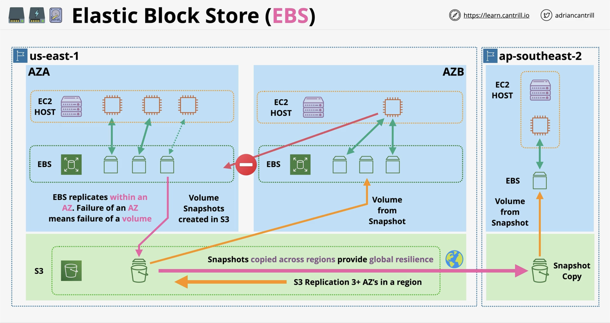
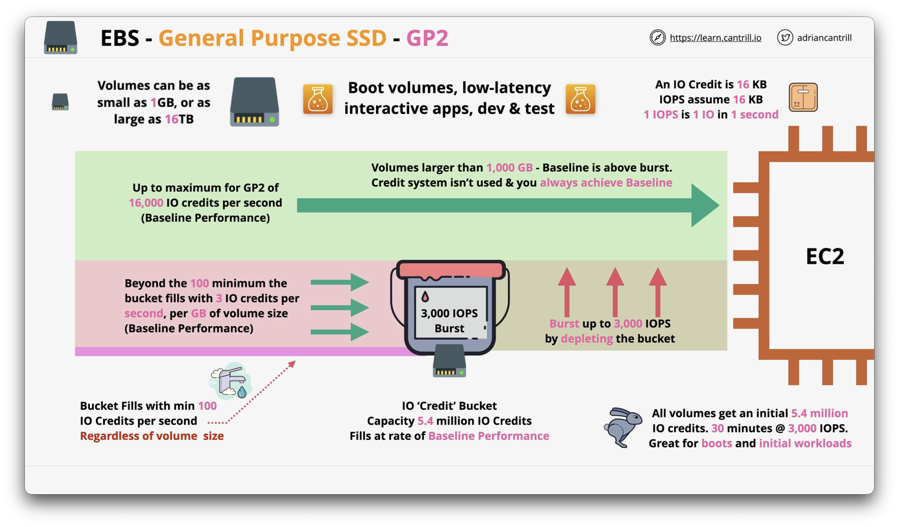
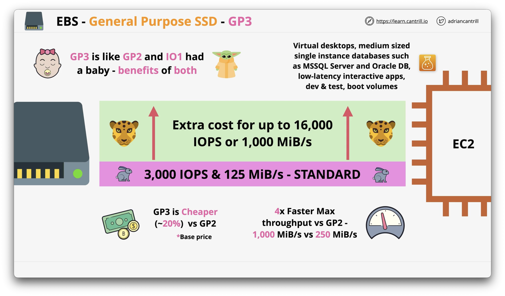

# EBS — Elastic Block Store

EBS provides **network-attached block storage** for EC2. Volumes are created independently of any instance and persist independently — surviving stop/start cycles, instance replacement, and even instance termination (unless `DeleteOnTermination` is set). Every EBS volume is **AZ-scoped**: it can only attach to instances in the same AZ.

For the broader vocabulary (direct-attached vs network-attached, ephemeral vs persistent, block vs file vs object, the IOPS/throughput/block-size triangle) see [Storage Fundamentals](../concepts/storage.md). For instance store (the ephemeral alternative) and when to choose EBS see [EC2 — Storage Options](../services/ec2.md#storage-options).

## Service Architecture

### What EBS Volumes Are

EBS takes allocations of physical disks and presents them to EC2 as **raw block devices** — indistinguishable from a locally attached disk. The EC2 instance's OS is then responsible for putting a **file system** on top:

| OS | Common file systems |
| --- | --- |
| Linux | EXT3, EXT4, XFS |
| Windows | NTFS |

> [!warning] Gotcha
> EBS provides the *raw disk*. The file system (EXT4, NTFS) comes from the **instance's OS**, not from EBS.

### AZ Boundary — The Central Constraint

**EBS is an Availability Zone–scoped service.** Every architectural decision about EBS follows from this single fact.

- A volume lives in **exactly one AZ** and cannot be moved directly.
- EBS in AZ-A and EBS in AZ-B are **completely separate deployments** — and both are separate from any other region.
- Within its AZ, EBS **replicates data across multiple physical devices** — a single disk failure does not destroy the volume.
- If the **entire AZ fails**, volumes in that AZ fail with it.

**Attachment rules:**

- A volume can normally be **attached to one EC2 instance at a time**.
- It can be detached from one instance and **reattached to another — but only within the same AZ**.
- An instance in AZ-B **cannot attach to a volume in AZ-A**. No exceptions.

> [!tip] Exam Tip
> If a question asks how to give an instance access to data in a volume in a different AZ, the answer is always: **snapshot the volume → restore in the target AZ**. Direct cross-AZ attachment is impossible.

### Volume Lifecycle — Persistence Independent of Instances

EBS volumes exist independently of any EC2 instance.

| EC2 instance event | Effect on attached EBS volume |
| --- | --- |
| Stop & start | Volume persists, stays attached |
| Restart (reboot) | Volume persists, stays attached |
| Move to another host (after stop/start) | Volume follows the instance |
| Terminated | Volume persists **unless** `DeleteOnTermination` was set |
| Detached | Volume persists; can be reattached to another instance in the same AZ |

> [!tip] Exam Tip
> EBS volumes **keep billing** even when the EC2 instance is stopped. Storage charges accrue against the volume, not the instance state.

### Snapshots — Crossing the AZ and Region Boundaries

Because EBS cannot cross AZs directly, **snapshots** are the bridge:

- A snapshot is stored in an **AWS-managed area of S3** — regionally resilient (replicated across 3+ AZs automatically).
- A snapshot from AZ-A can restore a new volume in **AZ-B** → cross-AZ data migration and recovery.
- A snapshot can be **copied to another region**, then restored there → cross-region DR.

### Resilience Hierarchy

| Tier | Mechanism | Protects against |
| --- | --- | --- |
| 1 | EBS internal replication within the AZ | Individual disk failure |
| 2 | Snapshot to S3 | AZ-level failure → restore to another AZ |
| 3 | Snapshot copy across regions | Region-level failure → restore in another region |

### Multi-Attach

Certain volume types support **multi-attach** — simultaneous attachment to multiple instances within the same AZ.

- Requires **cluster-aware application software** to coordinate writes; without it, concurrent writes can corrupt the volume.
- Not a default behavior — must be explicitly enabled on the volume.

### Billing Model

EBS bills by **GB-per-month**:

- Billing is continuous: it doesn't matter whether an instance is running, stopped, or the volume is detached.
- 1 GB for 1 month = 2 GB for half a month — same charge.
- High-performance volume types (Provisioned IOPS) add **separate line items** for provisioned IOPS.

## Volume Types Overview

EBS offers multiple volume types across two media families:

| Family | Types | Primary use |
| --- | --- | --- |
| **General Purpose SSD** | GP2, GP3 | Most workloads; default choice |
| **Provisioned IOPS SSD** | io1, io2, io2 Block Express | High-throughput databases; latency-critical |
| **Throughput Optimised HDD** | st1 | Big data, log processing; sequential reads |
| **Cold HDD** | sc1 | Archival; infrequent access |

This page covers the **General Purpose SSD** types and the **Provisioned IOPS SSD** types in depth.

## GP2 — General Purpose SSD (Credit-Bucket Model)

### Reading the GP2 Diagram

The GP2 diagram is built around one central metaphor: an **I/O credit bucket** sitting between the EBS volume (storage icon, left) and the EC2 instance (chip icon, right). Every read or write the instance performs costs credits drawn from this bucket.

**Context bar (top row):**

- **Top-left — size range annotation:** "Volumes can be as small as 1 GB, or as large as 16 TB." Size matters here because, unlike GP3, GP2 performance is directly tied to volume size.
- **Top-middle — use cases:** "Boot volumes, low-latency interactive apps, dev & test." GP2 was the AWS default until AWS switched to GP3.
- **Top-right — unit definitions (exam-critical):** "An IO Credit is 16 KB / IOPS assume 16 KB / 1 IOPS is 1 IO in 1 second." A 160 KB transfer in one second = 10 IOPS = 10 credits consumed.

**The bucket (centre):**

The bucket is labelled "3,000 IOPS Burst" and has a **red lid** representing the burst ceiling — credits flow out at up to 3,000 IOPS, no faster. Key facts attached to the bucket:

- **Capacity: 5.4 million IO credits**, refilling continuously at the baseline rate.
- **Starts full on creation** — enough for 30 minutes at 3,000 IOPS, which is why fresh instances boot quickly and handle initial spike workloads well.

**Left side — credit accumulation (how the bucket fills):**

Three stacked bands reading bottom-to-top, each representing a progressively higher refill rate:

- **Bottom thin band** — minimum floor: every GP2 volume, regardless of size, refills at least **100 credits/second**.
- **Pink middle band** — size-scaled formula: **3 credits/second per GB of volume size**. This formula beats the floor above 33.33 GB and is the normal operating range.
- **Green top band** — hard ceiling: refill rate is capped at **16,000 credits/second** regardless of volume size. Reached at ~5.33 TB (`16,000 ÷ 3 ≈ 5,333 GB`).
- **Note on the green band** — volumes larger than 1 TB have a baseline (3 × 1,000 = 3,000) that already equals or exceeds the burst rate, so the bucket is never fully depleted and the credit system becomes irrelevant.

**Right side — credit consumption (how the bucket drains):**

Red arrows flow upward from the bucket toward the EC2 instance. When the workload demands more IOPS than the refill rate, the difference is covered by drawing from the bucket — this is **bursting**. If consumption consistently exceeds refill, the bucket drains to zero and performance collapses to the baseline refill rate until credits rebuild.

**Mental model:** GP2 = a piggy bank that fills slowly based on how large your volume is. Small volumes have a slow drip but start full, so they can burst hard for a while. Large volumes (> 1 TB) have such a fast drip that the piggy bank never empties.

**Size range:** 1 GB – 16 TB

**Use cases:** boot volumes, low-latency interactive apps, dev/test. GP2 was the AWS default for new volumes until AWS switched the default to GP3.

### The I/O Credit System

GP2 performance is governed by an **I/O credit bucket** that sits between the volume and the instance. Every read and write costs credits from this bucket.

**Unit definitions (exam-critical vocabulary):**

- 1 I/O credit = 16 KB of data
- 1 IOPS = one 16 KB I/O operation per second = 1 credit/second
- A 160 KB transfer in one second = 10 IOPS = 10 credits consumed that second

**The bucket itself:**

- Capacity: **5.4 million credits**
- New volumes start **full** → enough for **30 minutes at 3,000 IOPS** straight out of the gate (great for boot and initial workloads)
- Refills continuously at the volume's **baseline performance rate**
- Burst ceiling: **3,000 IOPS** — credits can drain no faster than this

> [!warning] Gotcha — Credit Exhaustion
> If a workload consistently demands more IOPS than the baseline refill rate, the bucket eventually drains to zero and performance collapses to the baseline rate. You are responsible for monitoring credit balance across all GP2 volumes.

### Baseline Performance (Refill Rate)

The bucket refills at the volume's baseline rate, which is size-dependent:

| Volume size | Baseline IOPS |
| --- | --- |
| < 33.33 GB | **100 IOPS** (floor — minimum regardless of size) |
| 33.33 GB – 1 TB | **3 IOPS/GB** (formula beats floor above 33.33 GB) |
| 1 TB – 5.33 TB | **3,000 IOPS** (baseline = burst; credit system irrelevant) |
| ≥ 5.33 TB | **16,000 IOPS** (hard ceiling; constant regardless of further size increase) |

**Key crossover points:**

- **33.33 GB** — where `3 × GB = 100`; above this, the formula wins
- **1 TB** — where `3 × 1,000 = 3,000 IOPS`; baseline equals the burst rate, so the bucket never depletes and never matters
- **5.33 TB** — where `3 × 5,333 ≈ 16,000`; maximum IOPS reached; adding more size buys nothing

### Burst Performance

Any GP2 volume can **burst to 3,000 IOPS** by drawing down the credit bucket faster than it refills. This is what allows small volumes to handle short, heavy workloads — but it is finite.

**Throughput ceiling:** 250 MB/s (hard cap regardless of volume size or IOPS)

### GP2 Summary

| Attribute | Value |
| --- | --- |
| Performance model | Credit bucket — size-dependent |
| Baseline IOPS | 3 IOPS/GB (min 100, max 16,000) |
| Burst IOPS | 3,000 (via credit bucket) |
| Credit bucket capacity | 5.4 million credits |
| Initial credit balance | Full (5.4 M = 30 min @ 3,000 IOPS) |
| Max throughput | 250 MB/s |

## GP3 — General Purpose SSD (Flat-Rate Model)

### Reading the GP3 Diagram

GP3 drops the credit bucket entirely — no such element appears. Instead the diagram shows a flat **two-tier performance model** between the EBS volume (left) and the EC2 instance (right).

**Context bar (top row):**

- **Top-left — "GP2 and IO1 had a baby" metaphor:** GP3 inherits GP2's affordability and IO1's (Provisioned IOPS SSD) higher, more predictable performance profile.
- **Top-right — use cases:** "Virtual desktops, medium-sized single-instance databases such as MSSQL Server and Oracle DB, low-latency interactive apps, dev & test, boot volumes."

**Middle — the two-tier model (read bottom-to-top):**

- **Pink band (bottom layer) with rabbit icons — labelled "STANDARD":** every GP3 volume, regardless of size, gets **3,000 IOPS and 125 MB/s** included in the base price. No formula, no bucket, no crossover arithmetic.
- **Green band (upper layer) with leopard icons and red upward arrows — labelled "Extra cost":** if you need more, you pay separately for up to **16,000 IOPS** and up to **1,000 MB/s** throughput. The leopards signal faster-than-standard speed; the arrows show these are additive upgrades on top of the standard tier, not replacements for it.

The critical design point the diagram illustrates: the IOPS dial and the throughput dial are **completely independent**. You can add extra IOPS without extra throughput, or vice versa. GP2 tied performance to volume size — you couldn't separate them.

**Footer (bottom row):**

- **Left — "~20% cheaper vs GP2 base price":** at the same capacity, GP3 undercuts GP2 at the baseline.
- **Right — "4× faster max throughput vs GP2 — 1,000 MB/s vs 250 MB/s":** the throughput ceiling improvement is the most exam-tested headline difference.

**Mental model:** GP3 = a flat-rate broadband plan. Everyone gets the same baseline speed; if you want more, you pay for an upgrade — no credit accounting, no surprises.

**Size range:** 1 GB – 16 TB (same as GP2)

**Use cases:** virtual desktops, medium-sized single-instance databases (MSSQL Server, Oracle DB), low-latency interactive apps, dev/test, boot volumes. **Current AWS default** for new EBS volumes.

### The Two-Tier Performance Model

GP3 eliminates the credit bucket entirely. Instead it uses a simple **standard + provisioned** model:

**Standard tier (included in base price, every volume, every size):**

- **3,000 IOPS**
- **125 MB/s** throughput

No formula, no bucket, no crossover points. A 1 GB GP3 volume and a 16 TB GP3 volume both get exactly 3,000 IOPS and 125 MB/s.

**Provisioned extras (extra cost, independently configurable):**

- Up to **16,000 IOPS**
- Up to **1,000 MB/s** throughput

> [!tip] Key Insight
> The IOPS dial and the throughput dial are **independent on GP3**. You can pay for extra IOPS without extra throughput, or vice versa. On GP2, performance was bundled with size — you couldn't separate them.

### GP3 Advantages Over GP2

- **~20% cheaper** base price at the same capacity
- **4× the max throughput** — 1,000 MB/s vs 250 MB/s
- **Size-independent baseline** — a 1 GB volume gets the same 3,000 IOPS baseline as a 1 TB volume; no need to over-provision size just to hit a performance target

### GP3 Summary

| Attribute | Value |
| --- | --- |
| Performance model | Flat standard + paid extras (size-independent) |
| Standard IOPS | 3,000 (all volumes, all sizes) |
| Standard throughput | 125 MB/s (all volumes, all sizes) |
| Max IOPS (provisioned) | 16,000 |
| Max throughput (provisioned) | 1,000 MB/s |
| Base price vs GP2 | ~20% cheaper |

## GP2 vs GP3 — Side-by-Side

| Attribute              | GP2                                   | GP3                         |
| ---------------------- | ------------------------------------- | --------------------------- |
| Performance model      | Credit bucket — size-dependent        | Flat standard + paid extras |
| Baseline IOPS (= credit refill rate for GP2) | 3 IOPS/GB (min 100, max 16,000) | 3,000 for all volumes |
| Burst IOPS             | Up to 3,000 (via credits)             | N/A — no bursting concept   |
| Max IOPS               | 16,000 (at ≥ 5.33 TB)                 | 16,000 (paid extra)         |
| Standard throughput    | Scales with size                      | 125 MB/s for all volumes    |
| Max throughput         | **250 MB/s**                          | **1,000 MB/s** — 4× GP2     |
| Initial credit balance | 5.4 M credits (≈ 30 min @ 3,000 IOPS) | N/A                         |
| Base price             | Higher                                | **~20% cheaper than GP2**   |
| AWS default today      | No (was default; AWS switched to GP3) | **Yes — current default**   |

## Migration and Elastic Volumes

You can **change volume type on the fly** (GP2 → GP3 and vice versa) using the **Elastic Volumes** feature — no downtime required.

> [!warning] Gotcha — GP2 → GP3 Migration
> When migrating from GP2 to GP3, performance **does not auto-scale with volume size** anymore. GP2 gave you `3 × GB` IOPS automatically; on GP3, anything above the 3,000 IOPS standard must be **explicitly provisioned** (and paid for). Check your workload's actual IOPS requirements before migrating and provision accordingly.

Despite this, GP3 typically remains cheaper than the equivalent GP2 configuration even after provisioning the needed extras.

## Key Takeaways

- **GP2 is credit-based; GP3 is flat-rate.** This is the single most important conceptual difference.
- **GP2 baseline = 3 IOPS/GB**, minimum 100, max 16,000. Crossover with floor at **33.33 GB**; baseline equals burst at **1 TB**; max IOPS reached at **5.33 TB**.
- **GP2 burst = 3,000 IOPS**, fuelled by a **5.4 million credit bucket** that starts full.
- **GP3 standard = 3,000 IOPS + 125 MB/s** for every volume, regardless of size.
- **GP3 max = 16,000 IOPS + 1,000 MB/s** (paid extras, independently provisioned).
- **GP3 is ~20% cheaper** at base price and has **4× the max throughput** of GP2.
- **Both** support boot volumes, dev/test, low-latency workloads.
- Use **Elastic Volumes** to swap GP2 ↔ GP3 live — but remember to explicitly provision the IOPS/throughput GP3 needs after migrating from GP2.

## Provisioned IOPS SSD — IO1, IO2, IO2 Block Express

When the GP2/GP3 ceiling of 16,000 IOPS isn't enough — or when you need *consistently* low, jitter-free latency regardless of burst credits — you reach for the **Provisioned IOPS SSD** family. Unlike GP2/GP3, IOPS are **completely decoupled from volume size**: you set the size and the IOPS independently, subject only to a per-GB ratio cap.

### Reading the IO1/IO2 Diagram

The infographic lays out the IO1/IO2/Block Express family across three zones reading top-to-bottom.

**Context bar (top row):**

- **Top-left — F1 car icon + per-volume performance numbers:** the F1 car signals "extreme speed." Four bullets state the maximum a single volume can deliver:
  - **Up to 64,000 IOPS per volume** — shared by IO1 and IO2; four times the GP2/GP3 ceiling.
  - **Up to 256,000 IOPS per volume (Block Express only)** — four times the IO1/IO2 ceiling.
  - **Up to 1,000 MB/s throughput** — shared by IO1 and IO2.
  - **Up to 4,000 MB/s throughput (Block Express only)** — four times IO1/IO2.
- **Top-right — flat wavy line + "Consistent Low Latency & Jitter":** the flat, green wavy line is the visual cue. It's not just that latency is low — it stays low and predictable over time. Low jitter (small variation between requests) is the whole reason you pay extra for these volumes. Databases and latency-sensitive apps need *predictable* response times, not just fast averages.

**Middle — Per-Instance Performance panel (the most important concept):**

The pink panel in the middle, labelled "Per Instance Performance," calls out a ceiling that exists *separately* from the per-volume ceilings above.

- **Stacked SSD icons on the left:** four disk icons stacked vertically symbolise that reaching the per-instance ceiling almost always requires *multiple* volumes attached to one instance. A single volume cannot saturate it.
- **Three per-instance limits listed:**
  - **io1 — 260,000 IOPS & 7,500 MB/s** — to saturate this with IO1 volumes (64,000 IOPS each), you need just over four volumes at maximum.
  - **io2 — 160,000 IOPS & 4,750 MB/s** — lower than IO1, which seems counterintuitive. AWS placed the extra headroom into Block Express rather than standard IO2.
  - **io2 Block Express — 260,000 IOPS & 7,500 MB/s** — matches IO1's per-instance ceiling, and because Block Express volumes individually reach 256,000 IOPS, far fewer volumes are needed to get there.
- **Right side of the panel — use case callout:** "High performance, latency sensitive workloads. I/O-intensive NoSQL & relational databases."

> [!warning] Why per-instance matters
> The per-instance ceiling is also gated by the **EC2 instance type and size** — only the newest, largest instances support these peak numbers. Three things must align for maximum performance: **volume type**, **instance type**, and **instance size**.

**Footer (bottom row):**

- **Bottom-left — slider icon + "IOPS can be adjusted independently of size":** unlike GP2 (where IOPS scaled with size) and GP3 (where the standard tier is fixed), here the IOPS dial is fully decoupled from the size dial. You can have a small disk with massive performance.
- **Middle — speedometer + IOPS/GB ratio ceilings (in red — these are upper bounds, not defaults):**
  - io1: **50 IOPS/GB MAX**
  - io2: **500 IOPS/GB MAX** (10× IO1)
  - Block Express: **1,000 IOPS/GB MAX** (2× IO2)
- **Bottom-right — volume size ranges:**
  - **4 GB – 16 TB** for IO1 and IO2 (note: minimum is 4 GB, not 1 GB like GP2/GP3).
  - **4 GB – 64 TB** for Block Express.

### The Three Variants

| Attribute | IO1 | IO2 | IO2 Block Express |
| --- | --- | --- | --- |
| Release status | GA | GA | Preview (at time of notes) |
| Size range | 4 GB – 16 TB | 4 GB – 16 TB | 4 GB – **64 TB** |
| Max IOPS per volume | 64,000 | 64,000 | **256,000** |
| Max throughput per volume | 1,000 MB/s | 1,000 MB/s | **4,000 MB/s** |
| Max IOPS/GB ratio | 50 | 500 | 1,000 |
| Per-instance max IOPS | 260,000 | 160,000 | 260,000 |
| Per-instance max throughput | 7,500 MB/s | 4,750 MB/s | 7,500 MB/s |

**Common to all three:**

- SSD-backed.
- IOPS configurable **independently of volume size** (subject to the IOPS/GB ratio cap).
- Designed for **consistent, sub-millisecond, low-jitter latency** — the defining benefit over GP2/GP3.
- Pricing: **separate line items** for storage size and provisioned IOPS.
- Minimum size is **4 GB** (GP2/GP3 start at 1 GB).

### IOPS/GB Ratio Caps

IOPS are decoupled from size, but there is a ceiling on how aggressively you can dial performance up relative to how small the disk is:

| Volume type | Max IOPS/GB |
| --- | --- |
| IO1 | 50 (16× GP2's 3 IOPS/GB) |
| IO2 | 500 (10× IO1) |
| IO2 Block Express | 1,000 (2× IO2) |

> [!tip] Exam Tip
> "MAX" is a hard upper bound, not a default. A 10 GB IO2 volume can be provisioned with up to 5,000 IOPS (500 × 10), not the full 64,000 — to reach 64,000 IOPS you need at least 128 GB.

### The Two-Ceiling Rule

This is the concept most likely to appear as an exam trick. There are **two independent ceilings** that both apply simultaneously:

- **Per-volume ceiling**: the maximum IOPS a single volume can deliver (IO1/IO2 = 64,000 IOPS; Block Express = 256,000 IOPS).
- **Per-instance ceiling**: the maximum IOPS that can flow from the EBS service into a **single EC2 instance**, regardless of how many volumes are attached.

To reach the per-instance ceiling you almost always need multiple volumes working in parallel:

| Volume type | Per-instance IOPS | Per-instance throughput | Volumes needed to saturate (IO1 example) |
| --- | --- | --- | --- |
| IO1 | 260,000 | 7,500 MB/s | ~4+ volumes at max |
| IO2 | 160,000 | 4,750 MB/s | ~3+ volumes at max |
| IO2 Block Express | 260,000 | 7,500 MB/s | ~2 volumes (256,000 per volume) |

> [!warning] Gotcha — Three things must align for top performance
> The per-instance ceiling is also gated by **EC2 instance type and size** — only the newest, largest instances support these peak numbers. The formula for maximum performance: **volume type + instance type + instance size** must all be at the top tier simultaneously.

### EBS Volume Type Selection Guide

| Need | Pick |
| --- | --- |
| Default, general-purpose boot/app volume | **GP3** |
| Up to 16,000 IOPS, cost-effective | **GP3** |
| Up to 64,000 IOPS, consistent low latency | **IO1** or **IO2** |
| Small volume with extreme IOPS (size-independent dial) | **IO1/IO2** |
| Up to 256,000 IOPS, up to 64 TB | **IO2 Block Express** |
| Maximum possible performance, persistence not required | [Instance Store](../services/ec2.md#storage-options) |

> [!tip] Exam Tip
> Instance store can exceed even Block Express performance numbers, but the storage is **ephemeral** — it lives and dies with the instance. Provisioned IOPS SSD is the top choice when you need both extreme performance **and** durability.

### IO1/IO2 Use Cases

- I/O-intensive relational databases (Oracle, MSSQL, PostgreSQL under heavy OLTP load).
- I/O-intensive NoSQL databases (Cassandra, MongoDB with strict SLAs).
- Any workload where **jitter** (variation in latency) is unacceptable, not just average latency.
- Small volumes that need disproportionately high performance — the decoupled IOPS dial is the key capability.

### IO1/IO2 Key Takeaways

- IO1/IO2 IOPS are **fully decoupled from volume size** — but capped by the ratio: **50 / 500 / 1,000 IOPS/GB** for IO1 / IO2 / Block Express.
- Per-volume IOPS ceiling: **64,000** (IO1/IO2), **256,000** (Block Express).
- Per-volume throughput ceiling: **1,000 MB/s** (IO1/IO2), **4,000 MB/s** (Block Express).
- Per-instance ceilings exist **separately** and require multiple volumes: **260,000 IOPS** (IO1/Block Express), **160,000 IOPS** (IO2).
- Size ranges: **4 GB – 16 TB** (IO1/IO2), **4 GB – 64 TB** (Block Express).
- Pay for **size** and **provisioned IOPS** as separate line items.
- Three things must align for maximum performance: **volume type**, **instance type**, **instance size**.

## References

- Source: `raw/aws-cert-study-notes/aws-solution-architect/ebs_service_architecture.md`
- Source: `raw/aws-cert-study-notes/aws-solution-architect/ebs_gp2_and_gp3.md`
- Source: `raw/aws-cert-study-notes/aws-solution-architect/eb2_io1_and_io2.md`
- [EC2 — Storage Options](../services/ec2.md#storage-options)
- [Storage Fundamentals](../concepts/storage.md)
