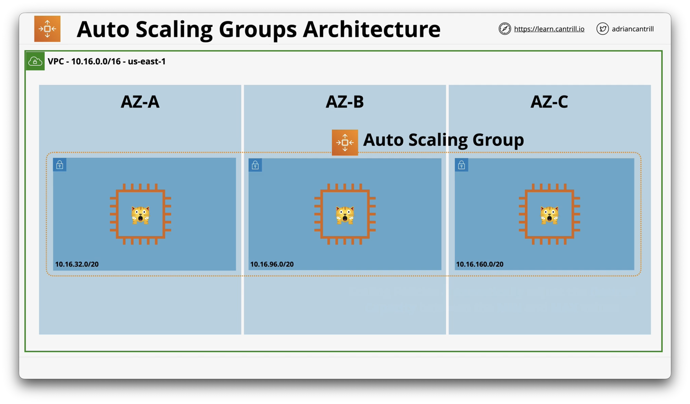

# EC2 Auto Scaling (Auto Scaling Groups)

**Amazon EC2 Auto Scaling** is the service; the **Auto Scaling group (ASG)** is its central resource — like bucket is to S3. An ASG does one core thing: it provides **automatic scaling** for [EC2](ec2.md) instances. It can also be used — as part of scaling, or entirely on its own — to implement a **self-healing architecture** in which failed instances are automatically replaced.

An ASG does not know how to build instances itself. It delegates that to a **[launch template](ec2.md#launch-configurations--launch-templates)** (or, on older exam questions, a launch configuration) — 1 specific document, 1 specific version, linked to the group at any given time. You can change which template, version, or configuration is linked, but only 1 is active at a time, so every instance the ASG launches comes from that single definition.

> [!tip] Exam Tip — the division of labour
> **The ASG controls the _when_ and the _where_** (when instances launch, and which subnets/AZs they land in). **The launch template controls the _what_** (which AMI, instance type, and bootstrap configuration is used).

> [!warning] Gotcha — three different "Auto Scaling" services
> AWS has 3 distinct auto-scaling offerings: **Amazon EC2 Auto Scaling** (ASGs of EC2 instances — this page), **Application Auto Scaling** (scales other resources: DynamoDB throughput, ECS service counts, Aurora replicas), and **AWS Auto Scaling scaling plans** (an umbrella over both). When a question scales _EC2 instances_, the answer lives here.

An ASG is the automation engine that makes [horizontal scaling](../patterns/scaling.md) real: [ELB](elb.md) distributes the traffic, the ASG adjusts the fleet size, and stateless application design is the precondition that lets both work.

## Architecture — VPC, Subnets, AZ Balance

- ASGs are linked to a **[VPC](vpc.md)**, and you configure **which subnets** the ASG can use. Instances are only ever launched into those configured subnets.
- The ASG is not tied to a single subnet or AZ — it is configured with a _set_ of subnets (typically 1 per AZ) and provisions instances across them. This is the mechanism that gives ASGs **Multi-AZ resilience "for free."**
- When provisioning, the ASG attempts to **keep the instance count balanced across AZs** — with 3 subnets and a desired capacity of 3, you would probably (not guaranteed) get 1 instance per AZ. It is a best-effort leveling behaviour, not a hard guarantee.

## Min, Desired, Max — the Three Core Values

Every ASG has three defining values, often shorthanded as **X, Y, Z** (for example "1, 2, 4" means min 1, desired 2, max 4):

| Value | Meaning |
| --- | --- |
| **Minimum size** | The floor — the ASG never lets the running instance count drop below this |
| **Desired capacity** | The target — the ASG actively works to keep the _actual_ running instance count equal to this |
| **Maximum size** | The ceiling — the ASG never scales above this |

**The ASG's one foundational job**: keep the number of running instances equal to desired capacity, by provisioning or terminating instances as needed.

- Desired capacity must always be at least the minimum and at most the maximum.
- Desired capacity 2 with only 1 running: the ASG launches a new instance.
- Desired capacity 2 with 3 running: the ASG terminates 1 instance.

You can run an ASG **fully manually** (no automation — you edit the values yourself and the ASG reconciles), or pair it with **scaling policies** that adjust desired capacity automatically.

> [!warning] Gotcha — min/max always win
> However extreme a scaling policy's calculation, the resulting desired capacity is **clamped between min and max**. A policy that says "remove 3" when the group is already at min 1 removes nothing. This is an AWS-documented guarantee, not just a convention ([Dynamic scaling for Amazon EC2 Auto Scaling](https://docs.aws.amazon.com/autoscaling/ec2/userguide/as-scale-based-on-demand.html)).

> [!warning] Gotcha — scaling policies are optional
> An ASG created with **no scaling policies works perfectly well** — it simply holds static min/max/desired values. "Scaling policies are required" is a false exam statement.

## Scaling Methods

There are three broad ways to scale an ASG:

### Manual scaling

Not really a policy — you directly edit min/desired/max and the ASG reconciles. Useful for testing, urgent situations, or pinning capacity at a fixed number as a **cost control** measure.

### Scheduled scaling

Adjusts desired capacity on a **time-based schedule**. Ideal for predictable demand — sales events, or scaling in outside business hours.

> [!tip] Exam Tip
> "Known periods of high/low usage," "predictable traffic pattern," "every day at 9am" all point to **scheduled scaling**.

### Dynamic scaling

Rules that **react to a metric** and adjust desired capacity. Every dynamic type ultimately does one thing: adjust the desired capacity based on some criteria. The metric is an **aggregate across the whole group** — an ASG with one instance at 60% CPU and one at 40% averages to 50% ([Dynamic scaling docs](https://docs.aws.amazon.com/autoscaling/ec2/userguide/as-scale-based-on-demand.html)). The metric is not limited to CPU: memory or disk I/O (some need the [CloudWatch agent](cloudwatch.md#cloudwatch-agent) installed), SQS queue length, or a custom application metric such as response time all work.

#### Simple scaling

A pair of rules reacting to a single [CloudWatch](cloudwatch.md) alarm threshold — for example "CPU above 50%: add 2 instances; CPU below 50%: remove 2 instances." The adjustment is **static**: whether the metric is 1% over the threshold or 50% over, the same 2 instances are added. Simple, but inflexible — and it is the **legacy** policy type, still associated with the classic **cooldown period** (see [Cooldown vs Instance Warmup](#cooldown-vs-instance-warmup) below).

The diagram's lesson: the adjustment is **always the same fixed amount**, regardless of how severe the breach is. Note the metric name shown, `ASGAverageCPUUtilization`, is the real AWS metric identifier.

#### Step scaling

Like simple scaling, but with **graduated responses based on the size of the alarm breach**. You define upper and lower bounds per step — for example: 50–59% do nothing; 60–69% add 1; 70–79% add 2; 80–100% add 3, with a mirrored set for scale-in. The more extreme the deviation, the more aggressive the response. Generally preferable to simple scaling except when simplicity is the only priority.

Two things the diagram hammers home:

1. **Min/max override the policy's arithmetic** — panels reading "remove 3 or MIN 1" show the policy _wanting_ to remove 3 while the minimum of 1 is what actually governs.
2. The two "do nothing" bands (40–49% and 50–59%) together form a **dead zone around the 50% target**. That gap is deliberate — AWS advises an adequate margin between scale-out and scale-in thresholds to prevent **flapping** ([Step and simple scaling policies](https://docs.aws.amazon.com/autoscaling/ec2/userguide/as-scaling-simple-step.html)).

> [!tip] Exam Tip
> "Flapping" or "thrashing" in a question usually means the answer is a **wider dead band** between scale-out and scale-in thresholds.

#### Target tracking

A different model entirely: you pick a metric and an **ideal target value** (for example "keep average CPU at 40%"), and the ASG calculates the scaling adjustments itself to hold that target. AWS describes it as working like a home **thermostat** — you select a temperature and the thermostat does the rest ([Target tracking scaling policies](https://docs.aws.amazon.com/autoscaling/ec2/userguide/as-scaling-target-tracking.html)). The further the actual metric is from the target, the more extreme the action.

Only 4 **predefined metrics** are supported out of the box ([Target tracking docs](https://docs.aws.amazon.com/autoscaling/ec2/userguide/as-scaling-target-tracking.html)):

- `ASGAverageCPUUtilization` — average CPU utilization of the group
- `ASGAverageNetworkIn` — average bytes received on all network interfaces
- `ASGAverageNetworkOut` — average bytes sent on all network interfaces
- `ALBRequestCountPerTarget` — average [ALB](elb.md#alb-deep-dive--a-true-layer-7-load-balancer) request count per target; requires the `ResourceLabel` parameter identifying the ALB target group, and works with **ALB only** — not NLB, not CLB

Anything else requires a **custom metric specification** on a custom [CloudWatch](cloudwatch.md) metric, including high-resolution metrics published at finer intervals ([PredefinedMetricSpecification API reference](https://docs.aws.amazon.com/autoscaling/ec2/APIReference/API_PredefinedMetricSpecification.html)).

> [!warning] Gotcha — do not touch target tracking's alarms
> AWS **creates and manages** the CloudWatch alarms behind a target tracking policy and may edit, replace, or delete them; you must not create, edit, or delete them yourself ([Target tracking docs](https://docs.aws.amazon.com/autoscaling/ec2/userguide/as-scaling-target-tracking.html)). With **simple and step scaling, _you_ own the alarms**. "Who owns the alarm?" is a clean exam discriminator: you means simple/step; AWS means target tracking.

Target tracking also **prioritizes availability**: it scales in more gradually when traffic decreases. If a question demands precise, granular control over scaling behaviour, **step scaling** is the better answer ([Target tracking docs](https://docs.aws.amazon.com/autoscaling/ec2/userguide/as-scaling-target-tracking.html)).

#### Scaling based on SQS

Scale on **`ApproximateNumberOfMessagesVisible`** in an [SQS](sqs.md) queue — the classic **worker pool** architecture (see [Architecture Evolution — Queue-Decoupled (Worker Fleet)](../patterns/architecture-evolution.md#stage-4--queue-decoupled-worker-fleet) for how the queue decouples the producer and lets this fleet scale from zero). As messages pile up the ASG scales out to process them; as the queue drains it scales back in to reduce cost.

> [!tip] Exam Tip
> "Worker pool," "queue depth," "process backlog," "decoupled" all point to **SQS-based scaling**.

### Which policy does AWS actually recommend?

The course-era framing ("AWS recommends step over simple") is outdated in two ways:

1. **Target tracking is now the strongly recommended default** — AWS recommends choosing a metric that changes inversely proportionally to capacity, such as average CPU or request count per target ([Dynamic scaling docs](https://docs.aws.amazon.com/autoscaling/ec2/userguide/as-scale-based-on-demand.html)). Step scaling's positioned role today is as an **additional** policy for advanced configurations, such as a more aggressive response when demand crosses a specific level.
2. **Simple scaling is effectively legacy.** It was EC2 Auto Scaling's original policy type — a policy created before target tracking and step scaling existed is treated as a simple scaling policy — and AWS keeps it documented mainly as a reference ([Simple scaling policies](https://docs.aws.amazon.com/autoscaling/ec2/userguide/simple-scaling-policies.html)).

The **real mechanical difference** between simple and step (not covered in the course) is **cooldown blocking**: after a simple scaling activity starts, the policy must wait for that activity **and the cooldown period** to finish before responding to further alarms. A step scaling policy keeps responding to additional alarms even while a scaling activity is in progress ([Step and simple scaling policies](https://docs.aws.amazon.com/autoscaling/ec2/userguide/as-scaling-simple-step.html)). This is why AWS recommends step over simple **even for a single scaling adjustment**.

Know the whole hierarchy for the exam: **target tracking first, then step, then simple** — and pick based on what the question offers. Multiple policies can coexist on one ASG (target tracking and step together are allowed), but AWS advises caution because conflicting policies can cause undesirable behaviour ([Dynamic scaling docs](https://docs.aws.amazon.com/autoscaling/ec2/userguide/as-scale-based-on-demand.html)).

## Cooldown vs Instance Warmup

The course frames the **cooldown period** as a single universal ASG setting: a value in seconds controlling how long to wait after a scaling action before allowing another, to avoid chaotic rapid scaling and the cost of minimum billable periods. That was accurate historically, but current AWS documentation narrows it significantly:

- The **default cooldown** (300 seconds) now applies **specifically to simple scaling policies** ([Scaling cooldowns](https://docs.aws.amazon.com/autoscaling/ec2/userguide/ec2-auto-scaling-scaling-cooldowns.html)).
- For **target tracking and step scaling**, the modern equivalent is the **default instance warmup** — the time until a new instance is considered initialized and its resource consumption stable after entering `InService` ([Set default values for instance warmup or scaling cooldown](https://docs.aws.amazon.com/autoscaling/ec2/userguide/set-default-values-for-instance-warmup-or-scaling-cooldown.html)). It also stops brand-new instances from skewing the CloudWatch metrics used for scaling decisions, and these policies can start a scale-out immediately without waiting for any cooldown.
- If no default instance warmup is configured, target tracking and step scaling **fall back to the default cooldown value** as their warm-up time; predictive scaling has no default warm-up at all ([Available warm-up and cooldown settings](https://docs.aws.amazon.com/autoscaling/ec2/userguide/consolidated-view-of-warm-up-and-cooldown-settings.html)).

> [!tip] Exam Tip
> A legacy-styled question saying "cooldown period" generically means the delay-between-scaling-actions concept. But if the question involves **target tracking or step scaling** and asks about a warm-up delay before an instance contributes to metrics, the correct term is **default instance warmup**, not cooldown.

## Health Checks & Self-Healing

By default, ASGs monitor instance health using **[EC2 status checks](ec2.md#status-checks-and-auto-recovery)**. If EC2 reports a failed instance, the ASG:

1. Terminates the failed instance.
2. Provisions a replacement.

This is **self-healing** — and it also applies if you manually terminate an instance; the ASG simply replaces it to restore desired capacity.

### The "cheap HA trick": min, desired, and max all set to 1

If you configure a launch template that can fully bootstrap an instance, give the ASG **multiple subnets in different AZs**, and set min, desired, and max all to **1**, you get simple, low-cost **instance recovery**. If the instance fails or its AZ is impaired, the ASG relaunches it — potentially in a _different_ AZ. High availability without a load balancer or multiple concurrent instances.

> [!tip] Exam Tip
> "Cheapest way to add high availability to a single EC2 instance" means an ASG with min, desired, and max all set to 1 across multiple AZs. Contrast with [EC2 auto recovery](ec2.md#status-checks-and-auto-recovery), which is same-AZ only.

### ELB health checks instead of EC2 status checks

When an ASG is attached to a load balancer's target group, it can use **[ELB health checks](elb.md)** instead of (or alongside) EC2 status checks. ELB health checks are **application-aware** — they validate HTTP/HTTPS response codes, not just infrastructure-level status.

> [!warning] Gotcha — health check choice cuts both ways
>
> - A health check that only pings a static page can report **healthy while the application logic underneath is broken**.
> - A health check that depends on a downstream dependency (for example a database call) means a **database outage fails every instance's health check** — the ASG then terminates and replaces a fleet of otherwise-healthy instances while the real problem (the DB) goes unaddressed.

## ASG + Load Balancer Integration

When an ASG is linked to an [ELB](elb.md) target group:

- Instances the ASG provisions are **automatically registered** as targets; instances it terminates are **automatically deregistered**. You never manually manage target group membership.
- Users connect via the load balancer and are abstracted from the individual instances — this fluid, automatic add/remove behaviour is what makes the architecture **elastic**.
- The ASG can consume the **load balancer's health check results** rather than relying purely on EC2 status checks (the "application awareness" callout in the diagram).

This ASG plus ALB combination is the standard pattern for elastic, self-scaling web applications — the concrete realization of [horizontal scaling](../patterns/scaling.md), and the reason [boot-time optimization](../patterns/boot-time-optimization.md) matters: how fast an instance goes from launch to in-service is how fast the group can track demand.

## Lifecycle Hooks

**Lifecycle hooks let you run custom actions during ASG instance launch or terminate transitions.** Normally, once the ASG decides to provision or terminate an instance, that process runs to completion with no ability for you to influence it. A hook inserts a **pause**: the instance enters a wait state and stays there until either a **configurable timeout expires** (default **3600 seconds**) or you **explicitly resume** the process by calling **`CompleteLifecycleAction`**.

There are exactly 2 hookable transitions:

| Transition | API value | Fires on |
| --- | --- | --- |
| Instance **launch** | `autoscaling:EC2_INSTANCE_LAUNCHING` | Scale out |
| Instance **terminate** | `autoscaling:EC2_INSTANCE_TERMINATING` | Scale in |

![ASG lifecycle hooks state machine: the scale-out half shows Pending diverting to Pending:Wait (with a callout for custom work such as loading or indexing data), then Pending:Proceed, then InService; the mirrored scale-in half shows Terminating diverting to Terminating:Wait (callout: back up data or logs), then Terminating:Proceed, then Terminated; a central stopwatch callout notes the state advances when the 3600-second default timeout expires or CompleteLifecycleAction is called; SNS and EventBridge icons below the ASG boundary receive notifications from the wait states](../assets/asg-lifecycle-hooks.png)

### The state sequences

With a launch hook, an instance moves through these states in order:

1. `Pending`
2. `Pending:Wait` — the pause where your custom action runs (for example, load or index data)
3. `Pending:Proceed`
4. `InService`

With a terminate hook:

1. `Terminating`
2. `Terminating:Wait` — the pause (for example, back up data or logs before the instance dies)
3. `Terminating:Proceed`
4. `Terminated`

Without a hook, the intermediate `Wait` and `Proceed` states do not occur — the instance goes straight from `Pending` to `InService`, or from `Terminating` to `Terminated`. It is the `Wait` plus `Proceed` **pair** that creates the window for custom actions; remembering that both hook states exist (not just `Wait`) is a common gap.

### Resolving the wait

| Mechanism | What happens |
| --- | --- |
| **`CompleteLifecycleAction`** | You explicitly signal done, passing `CONTINUE` or `ABANDON`; the instance moves to `Proceed` immediately |
| **Timeout expires** | The ASG performs the action set in **`DefaultResult`** |
| **`RecordLifecycleActionHeartbeat`** | Restarts the timeout clock — buys more time without completing the action |

### `DefaultResult` — CONTINUE vs ABANDON

Per the [lifecycle hooks docs](https://docs.aws.amazon.com/autoscaling/ec2/userguide/lifecycle-hooks.html): on launch, `CONTINUE` means your actions succeeded and the instance is put into service, while `ABANDON` means they failed and the instance is **terminated and replaced**. On terminate, **both** results still terminate the instance — `ABANDON` skips any remaining hooks, `CONTINUE` lets other hooks complete.

| Result | On launch | On terminate |
| --- | --- | --- |
| `CONTINUE` | Instance enters `InService` | Instance terminates; other hooks still run |
| `ABANDON` | Instance **terminated and replaced** | Instance terminates; remaining hooks skipped |

> [!warning] Gotcha — ABANDON never rescues an instance
> The asymmetry is the trap: on launch, `ABANDON` kills the instance; on terminate, `ABANDON` still terminates — it just stops other hooks. And the **API-level default for `DefaultResult` is `ABANDON`** ([LifecycleHook API reference](https://docs.aws.amazon.com/autoscaling/ec2/APIReference/API_LifecycleHook.html)) — so if you define a launch hook and forget to call `CompleteLifecycleAction`, after an hour your instances get destroyed and replaced in a loop, not left running. (The AWS CDK's `BasicLifecycleHookProps` defaults to `CONTINUE` instead — treat `ABANDON` as the exam answer.)

### Timeouts — two ceilings, easily conflated

| Concept | Value | Source |
| --- | --- | --- |
| **Default** heartbeat timeout | **3600 seconds** (1 hour) | [LifecycleHook API reference](https://docs.aws.amazon.com/autoscaling/ec2/APIReference/API_LifecycleHook.html) |
| **`HeartbeatTimeout`** parameter range | **30 to 7200 seconds** (max 2 hours per window) | Same |
| **Global timeout** (total wait including heartbeats) | **172800 seconds (48 hours) or 100 times the heartbeat timeout, whichever is smaller** | [Lifecycle hooks docs](https://docs.aws.amazon.com/autoscaling/ec2/userguide/lifecycle-hooks.html) |

These are not the same number. `HeartbeatTimeout` caps a _single_ window; the **global timeout** caps the _total_ time an instance can sit in a wait state across repeated `RecordLifecycleActionHeartbeat` calls. Worked example: at the default 3600-second heartbeat, 100 times 3600 is about 100 hours, which is larger than 48 hours, so the 48-hour cap wins. At a 60-second heartbeat, 100 times 60 is 6000 seconds (about 1.67 hours), which is smaller than 48 hours, so 6000 seconds wins — the "whichever is smaller" clause does real work at low heartbeat values.

### Notifications and event-driven integration

| Target | Use |
| --- | --- |
| **[SNS](sns.md) topic** | Transition notifications — the message carries instance info **and a token** used to control the lifecycle action |
| **[SQS](sqs.md) queue** | Also a valid `NotificationTargetARN` — the target can be an SNS topic or an SQS queue ([LifecycleHook API reference](https://docs.aws.amazon.com/autoscaling/ec2/APIReference/API_LifecycleHook.html)); the course only names SNS |
| **EventBridge** | Event-driven initiation of other processes (for example, invoke Lambda). Older material may say "CloudWatch Events" — same service, renamed |
| **A script on the instance itself** | The instance can call `CompleteLifecycleAction` for itself using its own instance ID |

Entering a wait state **is** the event that triggers the notification.

Two more doc-verified details worth knowing:

- **Failing hooks are rate-limited**: EC2 Auto Scaling limits the rate at which instances can launch if lifecycle hooks fail consistently ([Lifecycle hooks docs](https://docs.aws.amazon.com/autoscaling/ec2/userguide/lifecycle-hooks.html)) — a broken hook does not just slow scaling, it throttles it.
- **Warm pools** (not covered in the course) add further lifecycle states such as `Warmed:Stopped` and can also have hooks. If a question mentions pre-initialized instances kept stopped and ready, that is warm pools, not lifecycle hooks alone.

> [!warning] Gotcha — hooks vs health checks vs user data
> **Health checks** decide _whether to replace_ an unhealthy instance. **Lifecycle hooks** pause a _transition already in progress_. **[User data / cfn-init](ec2.md#bootstrapping)** run at boot with no ASG coordination — a hook actually **holds the ASG state machine** until you signal. Hooks are defined **on the ASG**, not on the launch template. To make a CloudFormation stack wait until an ASG's instances finish bootstrapping, use a [creation policy with cfn-signal](cloudformation.md#example-an-auto-scaling-group-that-must-report-in).

## Scaling Processes (Suspend / Resume) and Standby

An ASG runs several distinct internal processes, each individually **suspendable** and **resumable**:

| Process | What suspending it does |
| --- | --- |
| **Launch** | ASG will not scale out, even if alarms or scheduled actions fire |
| **Terminate** | ASG will not terminate any instances |
| **AddToLoadBalancer** | Stops new instances being registered to the load balancer |
| **AlarmNotification** | Stops the ASG reacting to CloudWatch alarms |
| **AZRebalance** | Stops the ASG redistributing instances evenly across AZs |
| **HealthCheck** | Turns instance health checking on or off for the whole group |
| **ReplaceUnhealthy** | Stops unhealthy instances being replaced |
| **ScheduledActions** | Stops scheduled scaling actions running |

Additionally, an **individual instance** can be set to **Standby** — temporarily exempt from all ASG activity — and later back to **InService**.

> [!tip] Exam Tip
> "Perform maintenance on one instance in an ASG without it being terminated or affecting scaling" means set that instance to **Standby**.

## Cost

- **ASGs themselves are free** — you pay only for the resources (EC2 instances and so on) the ASG provisions.
- Cooldowns (simple scaling) and instance warmup (target tracking and step) exist partly to avoid rapid, chaotic scaling that racks up cost — instances have a **minimum billable period** regardless of how briefly they run.
- **Favour more, smaller instances over fewer, larger ones.** Adding 1 instance to a fleet of 20 small ones is a much smaller cost and capacity jump than adding 1 of 2 large ones — granularity is a recurring SAA cost-optimization theme, the same argument made in [Scaling — Horizontal vs Vertical](../patterns/scaling.md).

## Quick Reference

| Concept | Summary |
| --- | --- |
| ASG's one job | Keep running instance count equal to desired capacity |
| Min / Desired / Max | Floor / target / ceiling for instance count |
| ASG controls | **When** and **where** instances launch |
| Launch template controls | **What** gets launched (AMI, instance type, bootstrap) |
| Manual scaling | Edit min/desired/max directly; cost-control pinning |
| Scheduled scaling | Time-based desired-capacity changes for predictable demand |
| Simple scaling | Single threshold, fixed adjustment; legacy; uses **cooldown**, which blocks further response mid-activity |
| Step scaling | Graduated adjustments by breach size; uses **instance warmup**; keeps responding during activities |
| Target tracking | Hold a metric at a target value ("thermostat"); AWS manages the alarms; 4 predefined metrics; today's recommended default |
| SQS-based scaling | Worker pool scaling on `ApproximateNumberOfMessagesVisible` |
| Cooldown period | Simple-scaling-specific, default 300 seconds |
| Default instance warmup | Modern equivalent for target tracking/step — delay before a new instance counts toward metrics |
| Self-healing | Failed or terminated instances automatically replaced |
| Min = Desired = Max = 1 across AZs | Cheap single-instance HA/recovery pattern |
| ELB health checks vs EC2 status checks | ELB checks are application-aware (HTTP/HTTPS); EC2 checks are infrastructure-only |
| ASG + target group | Instances auto-registered and auto-deregistered |
| Lifecycle hook transitions | `EC2_INSTANCE_LAUNCHING`, `EC2_INSTANCE_TERMINATING` — the only 2 |
| Hook timeout | Default 3600 s; `HeartbeatTimeout` range 30 to 7200 s; global cap 48 h or 100 times heartbeat, whichever is smaller |
| Hook `DefaultResult` | API default **`ABANDON`**; `ABANDON` never rescues an instance |
| Complete a hook early / extend it | `CompleteLifecycleAction` / `RecordLifecycleActionHeartbeat` |
| Hook notification targets | SNS topic or SQS queue; EventBridge for event-driven automation |
| Standby | Removes 1 instance from ASG management (maintenance) |
| ASG cost | The group is free; pay only for provisioned resources |

## References

- Source notes: `raw/aws-cert-study-notes/aws-solution-architect/ec2_auto_scaling_group.md`, `ec2_auto_scaling_group_scaling_policies.md`, `ec2_auto_scaling_group_lifecycle_hooks.md` (Adrian Cantrill SAA-C03 course, [learn.cantrill.io](https://learn.cantrill.io/))
- [Dynamic scaling for Amazon EC2 Auto Scaling](https://docs.aws.amazon.com/autoscaling/ec2/userguide/as-scale-based-on-demand.html)
- [Step and simple scaling policies](https://docs.aws.amazon.com/autoscaling/ec2/userguide/as-scaling-simple-step.html)
- [Simple scaling policies](https://docs.aws.amazon.com/autoscaling/ec2/userguide/simple-scaling-policies.html)
- [Target tracking scaling policies](https://docs.aws.amazon.com/autoscaling/ec2/userguide/as-scaling-target-tracking.html)
- [Scaling cooldowns](https://docs.aws.amazon.com/autoscaling/ec2/userguide/ec2-auto-scaling-scaling-cooldowns.html)
- [Set default values for instance warmup or scaling cooldown](https://docs.aws.amazon.com/autoscaling/ec2/userguide/set-default-values-for-instance-warmup-or-scaling-cooldown.html)
- [Available warm-up and cooldown settings](https://docs.aws.amazon.com/autoscaling/ec2/userguide/consolidated-view-of-warm-up-and-cooldown-settings.html)
- [Amazon EC2 Auto Scaling lifecycle hooks](https://docs.aws.amazon.com/autoscaling/ec2/userguide/lifecycle-hooks.html)
- [LifecycleHook — EC2 Auto Scaling API Reference](https://docs.aws.amazon.com/autoscaling/ec2/APIReference/API_LifecycleHook.html)
- [Delay the termination of unhealthy EC2 instances — AWS re:Post](https://repost.aws/knowledge-center/auto-scaling-delay-termination)
- Related wiki pages: [EC2](ec2.md), [ELB](elb.md), [CloudWatch](cloudwatch.md), [Scaling — Horizontal vs Vertical](../patterns/scaling.md), [Boot Time to Service Time](../patterns/boot-time-optimization.md), [AWS SAA exam notes](../certifications/aws-saa.md#ec2-auto-scaling--auto-scaling-groups-asg)
