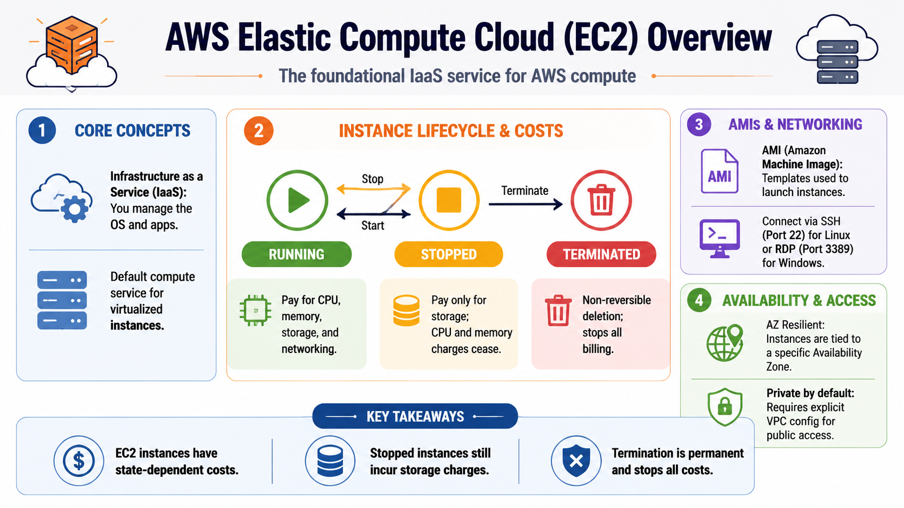

# EC2 — Elastic Compute Cloud

EC2 is AWS's default and most essential compute service. It provides virtual machines — **instances** — and is the starting point for almost any compute requirement in AWS. Every EC2 instance runs inside a [VPC](vpc.md) subnet and is associated with at least one [ENI](../concepts/networking.md) (Elastic Network Interface).

This page covers the foundations — what an instance is, how it's billed, the lifecycle state machine, AMIs, and how you connect to running instances. Deeper topics (instance types, EBS volumes, Auto Scaling, ELB) will follow as separate sections or pages.

## EC2 at a Glance



Four pillars structure everything that follows: **core concepts (IaaS)**, **instance lifecycle & costs**, **AMIs & networking**, and **availability & access**.

## Foundations

EC2 is **Infrastructure as a Service (IaaS)** — AWS gives you a virtualized OS in a virtualized network; you bring everything from the OS up.

- **Unit of consumption:** the **instance** — an operating system configured with allocated CPU, memory, storage, and networking
- **Reach for EC2 when** you need an OS, a runtime environment, database dependencies, applications, or application interfaces you want to manage yourself
- **Private by default** — every instance launches into one specific [VPC](vpc.md) subnet in the private AWS zone. Public reachability is opt-in and explicit (see [How EC2 Fits Into the AWS Architecture](#how-ec2-fits-into-the-aws-architecture) below). The **default VPC** wires this up automatically; **custom VPCs** require manual configuration ([IGW](vpc.md#internet-gateway-igw), public subnet, route, public IP / EIP)
- **AZ resilient, not AZ fault-tolerant** — because a subnet lives in a single [Availability Zone](../concepts/networking.md), and an instance lives in a subnet, **if the AZ fails, the instance fails**. HA requires running across multiple AZs (a topic for the patterns layer, not a property of a single instance)
- **Customizable at launch** — CPU, memory, optional GPUs, advanced storage and networking, special-purpose processors. Some properties can be changed after launch (e.g. instance type via stop → modify → start); others are fixed at launch (e.g. AZ, AMI lineage)

> [!tip] Mental model
> Resilience tier in AWS is always determined by the **smallest scope you depend on**. An EC2 instance depends on a subnet, which depends on an AZ — so the instance inherits AZ scope. To climb the resilience ladder (regional), you don't make one instance more resilient; you run a **fleet across multiple AZs** and put a load balancer in front. See [Overview — Resilience Tiers](../overview.md#resilience-tiers).

### Shared responsibility (IaaS line)

EC2 sits on the **IaaS** side of the shared responsibility model. AWS is responsible for the virtualization layer and below; you are responsible for the OS and above.

| You manage | AWS manages |
| --- | --- |
| Operating system (patches, hardening) | Hypervisor / virtualization |
| Runtime, applications, dependencies | Physical hardware |
| Data on the volumes | Physical networking |
| OS-level configuration (users, services, firewall inside the guest) | Storage infrastructure (EBS service, durability) |
| In-guest security | Facilities (data centres, power, cooling) |

> [!warning] Gotcha
> "AWS patches my EC2 instance" is **false**. AWS patches the hypervisor; the guest OS, security updates, and middleware are entirely on you. Managed compute (Lambda, Fargate) is what shifts that line upward — EC2 does not.

## How EC2 Fits Into the AWS Architecture

- **Networking:** instances live in [VPC](vpc.md) subnets; traffic is controlled by [Security Groups](vpc.md#security-groups-sg) (attached to the ENI) and [NACLs](vpc.md#network-acl-nacl) (attached to the subnet)
- **Identity:** instances access other AWS services via [IAM roles](iam.md#iam-roles) — never embed access keys directly in an instance
- **Internet access:** public instances route through an [IGW](vpc.md#internet-gateway-igw); private instances route through a [NAT Gateway](vpc.md#nat--nat-gateway)
- **Storage:** the boot volume is typically [EBS](#storage-options) (a separate AWS service exposing network-attached block volumes); some instance types also offer **instance store** volumes physically on the host

## Billing Model

EC2 uses **on-demand billing** — you pay only for what you consume — with three independently-billed components:

1. **Compute charge** — CPU + memory, while the instance is **running**
2. **Storage charge** — disks attached to the instance (notably [EBS](#storage-options)), **regardless of whether the instance is running or stopped**
3. **Extras** — commercial software licensing (Windows, RHEL, etc.) bundled into the rate when applicable

Billing granularity is **per second** or **per hour**, depending on the software running on the instance (Linux/most Windows AMIs bill per second with a 60-second minimum; some commercial licenses bill per hour).

For multi-year predictable workloads, EC2 is the canonical target of the [Cost Optimization](../patterns/cost-optimization.md) commitment ladder — Compute Savings Plans, EC2 Instance Savings Plans, Reserved Instances, and Spot.

### Storage options

- **Instance store (local host storage)** — ephemeral block volumes physically on the EC2 host. Fast, free with the instance, **lost on stop or terminate**. Available only on certain instance types
- **EBS (Elastic Block Store)** — network-attached block storage, a separate AWS service. Volumes persist independently of the instance and survive stop/start. Charged by provisioned size (and IOPS/throughput on some types), not by usage. EBS is the source of the "stopped instance still costs money" trap below

## Instance Lifecycle and State-Based Costs

Three states matter most: **Running**, **Stopped**, and **Terminated**.

```text
   ┌──────────┐    Stop      ┌──────────┐   Terminate    ┌────────────┐
   │ RUNNING  │ ────────────►│ STOPPED  │ ──────────────►│ TERMINATED │
   │          │◄──────────── │          │                │ (one-way!) │
   └──────────┘    Start     └──────────┘                └────────────┘
```

Intermediate states exist (`pending`, `stopping`, `shutting-down`) but rarely appear on the exam. **Stop ↔ Start** is bidirectional; **Terminate** is a one-way arrow.

### What changes when the state changes

| Component | Running | Stopped | Terminated |
| --- | :-: | :-: | :-: |
| CPU | 💰 Charged | ✅ Free | ✅ Free |
| Memory | 💰 Charged | ✅ Free | ✅ Free |
| Networking | 💰 Charged | ✅ Free | ✅ Free |
| [EBS](#storage-options) storage | 💰 Charged | 💰 **Still charged** | ✅ Free (volumes deleted) |
| Public IPv4 (auto-assigned) | Assigned | Released | Released |
| Instance store data | Present | **Lost** | Lost |
| Elastic IP (if attached) | Free while attached to running instance | **Small hourly charge** while detached/idle | Charge continues until released |

> [!warning] Gotcha — "Stopped is not free"
> A **stopped** instance still incurs **EBS storage charges**. The disks remain allocated and billable; the only way to eliminate all costs from an instance is to **terminate** it (which deletes its EBS volumes by default — see termination protection / `DeleteOnTermination` for nuance). "We stopped it overnight to save money" only saves the compute portion; the storage line item keeps ticking.

> [!warning] Gotcha — "Terminate is permanent"
> Termination is **non-reversible**. Root EBS volumes are deleted by default; instance-store data is lost; the instance ID is gone. There is no undelete. If the data matters, snapshot the EBS volume(s) **before** terminating, or detach them first and re-attach to a new instance.

## AMI — Amazon Machine Image

An **AMI** is the template used to launch an EC2 instance. Mental models: a server image (on-prem virtualization), or a USB installer for an operating system.

AMIs are **region-specific** — an AMI created in `us-east-1` does not appear in `eu-west-1` unless you **copy** it to that region. This is an exam favourite.

### Two-way relationship with instances

- An **AMI is used to launch** an EC2 instance
- An **existing EC2 instance can be captured** into a new AMI (for example, after configuring it the way you want — the resulting AMI bakes in that configuration)

### What an AMI contains

**1. Permissions** — who can launch from this AMI:

| Permission | Who can use it |
| --- | --- |
| **Public** | Everyone — e.g. AWS-provided Amazon Linux / Ubuntu / Windows base images |
| **Owner** | Only the AMI owner (implicit) |
| **Explicit** | Specific AWS account IDs the owner has granted launch permission to |

**2. Boot volume(s)** — at minimum the root volume (C: on Windows; `/` on Linux), plus optional additional data volumes. Every AMI has **at least one** volume: the boot volume.

**3. Block device mapping** — the configuration that links each volume to a device ID the OS expects (e.g. `/dev/sda1` is the boot volume; `/dev/sdb` is a data volume). The OS uses this mapping to know which volume to boot from and where to mount the rest.

### AMI lifecycle considerations (for later expansion)

- AMIs are backed by **EBS snapshots** in S3 (you don't pay for the AMI itself; you pay for the snapshots underneath)
- **Copying an AMI across regions** copies the snapshots — useful for multi-region DR; subject to data-transfer costs
- **Encrypted AMIs** require [KMS](kms.md) grants for services like Auto Scaling to launch from them
- Hardening / golden-image pipelines typically build AMIs with EC2 Image Builder or Packer — out of scope here, will be its own page

## Connecting to Instances

Two protocols cover ~all cases on the exam:

| OS | Protocol | Port | Authentication |
| --- | --- | :-: | --- |
| **Linux** | SSH | **22** | SSH key pair — private key authenticates you directly |
| **Windows** | RDP | **3389** | SSH key pair → decrypt local Administrator password → RDP login with that password |

### SSH key pair mechanics

When you create an EC2 key pair, AWS generates two halves:

- **Private key** — *you* download this **once and only once**, at the moment the key pair is created. Keep it safe; AWS does not retain a copy. **Losing the private key means losing access to instances that depend on it** (you can recover by detaching the root volume and attaching it to a different instance, but it's painful)
- **Public key** — AWS retains this and places it on any instance launched with that key pair selected (in `~/.ssh/authorized_keys` for Linux)

### How authentication actually works

- **Linux:** SSH performs a public-key challenge against the public key already on the instance. Your local SSH client signs the challenge with the private key; if it verifies against the public key, you're in. **No password is involved.**
- **Windows:** AWS encrypts the local Administrator account password with the public key at first boot. You use the private key to **decrypt** that password (in the console: *Get Windows Password*), then connect over RDP using `Administrator` + the decrypted password. The SSH key never touches the RDP session itself.

> [!tip] Exam Tip
> "I can't SSH to my instance" troubleshooting checklist: (1) **Security Group** allows inbound TCP 22 from your source IP, (2) the **subnet's route table** has a route to an [IGW](vpc.md#internet-gateway-igw) and the instance has a public IPv4, (3) the [NACL](vpc.md#network-acl-nacl) allows TCP 22 inbound **and** the ephemeral return range outbound (NACLs are stateless), (4) the right **key pair** is selected and the OS user is correct (`ec2-user` on Amazon Linux, `ubuntu` on Ubuntu, `admin`/`ec2-user` varies by distro), (5) the OS-level firewall inside the instance isn't blocking 22.

> [!warning] Gotcha
> The **private key is downloadable once**. Re-launching the wizard for the same key pair does **not** let you re-download it. If you lose it, create a new key pair; you cannot recover the original.

## Key Takeaways

1. **EC2 = IaaS** — you manage OS and above; AWS manages everything below
2. **EC2 is the default compute service** in AWS — start here unless a managed option (Lambda, Fargate, Beanstalk) fits better
3. **Private by default** — public access is explicit (public subnet + IGW + public IP + SG rule)
4. **AZ resilient, not fault-tolerant** — an instance dies with its AZ; HA needs multiple AZs and a load balancer
5. **Three key states:** Running, Stopped, Terminated
6. **Stopped ≠ free** — you still pay for attached [EBS](#storage-options) storage; only **Terminated** ends all charges
7. **Terminated is permanent** — root volumes deleted by default, instance-store data lost, no undelete
8. **AMI = launch template** — carries permissions, boot + data volumes, and the block-device mapping; region-specific
9. **Linux: SSH on 22**; **Windows: RDP on 3389** (private key decrypts the admin password, then RDP)
10. **Private key downloads once** — lose it and you've lost the easy path back in

## Quick Reference

| Concept | Detail |
| --- | --- |
| Service category | IaaS — Infrastructure as a Service |
| Resilience tier | AZ-specific (single-AZ failure = instance failure) |
| Default network posture | Private (in a [VPC](vpc.md) subnet) |
| Billing granularity | Per second (most) or per hour (some commercial licenses) |
| Free state | **Terminated only** (volumes deleted, instance gone) |
| Hidden cost trap | **Stopped** instances still pay for [EBS](#storage-options) |
| Template object | AMI (Amazon Machine Image) — region-specific |
| AMI permission modes | Public / Owner / Explicit |
| Linux access | SSH on port 22 + private key |
| Windows access | RDP on port 3389 + private key (used to decrypt admin password) |
| Key-pair download policy | Private key downloadable **once** only |
| AMI mandatory content | ≥ 1 volume (boot), permissions, block device mapping |

## References

- [VPC — networking, SG, NACL, IGW, NAT GW](vpc.md)
- [IAM — roles for EC2](iam.md)
- [Networking Concepts — ENI, OSI layers, ephemeral ports](../concepts/networking.md)
- [Identity & Access — auth vs authz, credential types](../concepts/identity-and-access.md)
- [Cost Optimization — Savings Plans, RIs, Spot](../patterns/cost-optimization.md)
- [AWS SAA Exam Notes — EC2](../certifications/aws-saa.md#ec2)
- Source: `raw/aws-cert-study-notes/aws-solution-architect/ec2_101.md`
