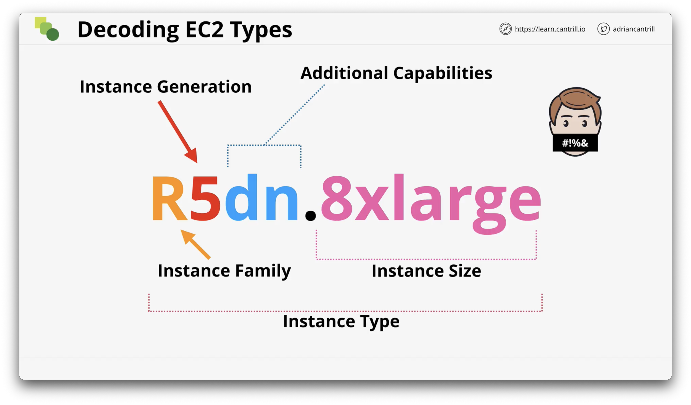
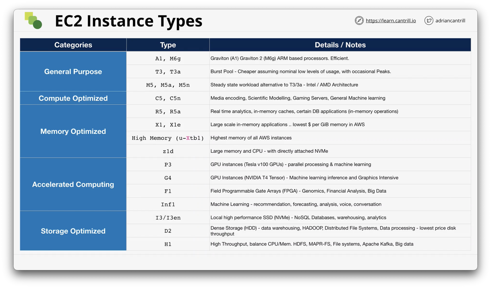

# EC2 — Elastic Compute Cloud

EC2 is AWS's default and most essential compute service. It provides virtual machines — **instances** — running on AWS-managed physical servers called **hosts**, and is the starting point for almost any compute requirement in AWS. Every EC2 instance runs inside a [VPC](vpc.md) subnet and is associated with at least one [ENI](../concepts/networking.md) (Elastic Network Interface).

This page covers the foundations — what an instance is, the host vs. instance distinction and its AZ implications, how it's billed, the lifecycle state machine, AMIs, when to choose EC2, and how you connect to running instances. Deeper topics (instance types, EBS volumes, Auto Scaling, ELB) will follow as separate sections or pages.

## EC2 at a Glance


Four pillars structure everything that follows: **core concepts (IaaS)**, **instance lifecycle & costs**, **AMIs & networking**, and **availability & access**.

## Foundations

EC2 is **Infrastructure as a Service (IaaS)** — AWS gives you a virtualized OS in a virtualized network; you bring everything from the OS up.

- **Unit of consumption:** the **instance** — an operating system configured with allocated CPU, memory, storage, and networking
- **Reach for EC2 when** you need an OS, a runtime environment, database dependencies, applications, or application interfaces you want to manage yourself
- **Private by default** — every instance launches into one specific [VPC](vpc.md) subnet in the private AWS zone. Public reachability is opt-in and explicit (see [How EC2 Fits Into the AWS Architecture](#how-ec2-fits-into-the-aws-architecture) below). The **default VPC** wires this up automatically; **custom VPCs** require manual configuration ([IGW](vpc.md#internet-gateway-igw), public subnet, route, public IP / EIP)
- **AZ resilient, not AZ fault-tolerant** — because a subnet lives in a single [Availability Zone](../concepts/networking.md), and an instance lives in a subnet, **if the AZ fails, the instance fails**. HA requires running across multiple AZs (a topic for the patterns layer, not a property of a single instance)
- **Customizable at launch** — CPU, memory, optional GPUs, advanced storage and networking, special-purpose processors. Some properties can be changed after launch (e.g. instance type via stop → modify → start); others are fixed at launch (e.g. AZ, AMI lineage)

> [!tip] Mental model
> Resilience tier in AWS is always determined by the **smallest scope you depend on**. An EC2 instance depends on a subnet, which depends on an AZ — so the instance inherits AZ scope. To climb the resilience ladder (regional), you don't make one instance more resilient; you run a **fleet across multiple AZs** and put a load balancer in front. See [Overview — Resilience Tiers](../overview.md#resilience-tiers).

### Shared responsibility (IaaS line)

EC2 sits on the **IaaS** side of the shared responsibility model. AWS is responsible for the virtualization layer and below; you are responsible for the OS and above.

| You manage | AWS manages |
| --- | --- |
| Operating system (patches, hardening) | Hypervisor / virtualization |
| Runtime, applications, dependencies | Physical hardware |
| Data on the volumes | Physical networking |
| OS-level configuration (users, services, firewall inside the guest) | Storage infrastructure (EBS service, durability) |
| In-guest security | Facilities (data centres, power, cooling) |

> [!warning] Gotcha
> "AWS patches my EC2 instance" is **false**. AWS patches the hypervisor; the guest OS, security updates, and middleware are entirely on you. Managed compute (Lambda, Fargate) is what shifts that line upward — EC2 does not.

## How EC2 Fits Into the AWS Architecture

- **Networking:** instances live in [VPC](vpc.md) subnets; traffic is controlled by [Security Groups](vpc.md#security-groups-sg) (attached to the ENI) and [NACLs](vpc.md#network-acl-nacl) (attached to the subnet)
- **Identity:** instances access other AWS services via [IAM roles](iam.md#iam-roles) — never embed access keys directly in an instance
- **Internet access:** public instances route through an [IGW](vpc.md#internet-gateway-igw); private instances route through a [NAT Gateway](vpc.md#nat--nat-gateway)
- **Storage:** the boot volume is typically [EBS](#storage-options) (a separate AWS service exposing network-attached block volumes); some instance types also offer **instance store** volumes physically on the host

## Hosts vs Instances

EC2 separates the **physical layer** (hosts) from the **virtual layer** (instances). The distinction is the conceptual core of the service — easy to gloss over and frequently tested.

| Aspect | **EC2 Host** | **EC2 Instance** |
| --- | --- | --- |
| What it is | Physical server hardware owned and maintained by AWS | Virtual machine running on a host |
| Manages | AWS (hardware, firmware, hypervisor) | Customer (OS and above — see [Shared responsibility](#shared-responsibility-iaas-line)) |
| Tenancy options | **Shared** (default — multiple AWS customers' instances coexist, hypervisor-isolated) **or Dedicated** (entire host reserved to one account) | Always single-tenant *inside* the OS; runs on a shared or dedicated host |
| Billing model | Billed per host (full hardware) on a **Dedicated Host**; transparent under Shared tenancy | Per-instance, based on runtime + allocated resources — see [Billing Model](#billing-model) |
| Local resources | Provides CPU, memory, **instance store** (host-local NVMe/SSD), storage networking, data networking | Consumes a slice of the host's resources |
| Lifecycle | Long-lived hardware; AWS retires, repairs, or takes down for maintenance | Customer creates, stops, starts, terminates |
| Location | One specific [Availability Zone](../concepts/networking.md) | Same AZ as its host — cannot natively cross AZs |
| Movement | Doesn't move | Stays on its host through restarts; **moves to a new host on stop-then-start, or if the host fails / is retired** — always within the same AZ |
| Co-tenants | Typically many instances from many customers (Shared), or many of your own instances (Dedicated) | Multiple instances coexist; same instance family/generation usually co-locates on hardware built for that profile |

> [!tip] Mental model
> A **host** is an apartment building AWS owns; an **instance** is a tenant's apartment unit. **Restart** = the tenant sleeping and waking up in the same apartment. **Stop/Start** = moving out and being re-housed — usually in a different unit, always in the same neighbourhood (AZ).

### Tenancy: Shared vs Dedicated

| Mode | Hardware sharing | Billing | Typical use case |
| --- | --- | --- | --- |
| **Shared** (default) | Many customers' instances coexist on the same host, isolated by the hypervisor | Per-instance (see [Billing Model](#billing-model)) | Almost everything |
| **Dedicated Instance** | Hardware not shared with other customers, but you cannot address or target the host itself | Per-instance, with a small dedicated-tenancy premium | Compliance scenarios that forbid hardware co-tenancy but don't require host targeting |
| **Dedicated Host** | One account allocates the entire host; you can see and target it | **Per host**, regardless of how many instances run on it | Hardware-bound BYOL licensing (per-socket / per-core Windows, Oracle, SQL Server), strict isolation, host-affinity workloads |

> [!warning] Gotcha — "Dedicated" is two things
> AWS uses *Dedicated* in two adjacent ways: **Dedicated Instance** (no hardware co-tenancy, host opaque) vs **Dedicated Host** (you allocate and target the host, pay per host). They look similar in question stems — the Dedicated Host adds **per-socket licensing**, **host affinity**, and **per-host billing**.

### AZ Resilience — everything is AZ-bound

Almost every component an instance depends on is locked to a single AZ:

- **Host** lives in one AZ
- **Subnet** belongs to one AZ ([VPC](vpc.md) primitive)
- The instance's primary [ENI](../concepts/networking.md) is provisioned in that subnet
- **Additional ENIs** can attach in *different subnets*, but **only if those subnets are in the same AZ**
- **[EBS](#storage-options) volumes** are AZ-scoped — they can only attach to instances in the **same AZ**
- **Instance store** is host-local, so by definition AZ-scoped

**Consequence:** if an AZ fails, **assume all instances, ENIs, and EBS volumes in that AZ are impacted**. You cannot attach an EBS volume or ENI from one AZ to an instance in another AZ to mitigate.

The only path to relocate a workload across AZs is to **snapshot the EBS volume(s) or capture an [AMI](#ami--amazon-machine-image), then launch a new instance in the target AZ** — see [Moving an instance across AZs](#moving-an-instance-across-azs) below.

> [!tip] Why this is a strength, not a limitation
> Because the blast radius of a failure is always one AZ, you can design AZ-fault-tolerance predictably: deploy across multiple AZs, put a load balancer in front, fail over deterministically. **Predictable isolation = controllable design.** See [Overview — Resilience Tiers](../overview.md#resilience-tiers).

## Billing Model

EC2 uses **on-demand billing** — you pay only for what you consume — with three independently-billed components:

1. **Compute charge** — CPU + memory, while the instance is **running**
2. **Storage charge** — disks attached to the instance (notably [EBS](#storage-options)), **regardless of whether the instance is running or stopped**
3. **Extras** — commercial software licensing (Windows, RHEL, etc.) bundled into the rate when applicable

Billing granularity is **per second** or **per hour**, depending on the software running on the instance (Linux/most Windows AMIs bill per second with a 60-second minimum; some commercial licenses bill per hour).

For multi-year predictable workloads, EC2 is the canonical target of the [Cost Optimization](../patterns/cost-optimization.md) commitment ladder — Compute Savings Plans, EC2 Instance Savings Plans, Reserved Instances, and Spot.

### Storage options

For the general storage vocabulary (direct-attached vs network-attached, ephemeral vs persistent, block vs file vs object, IOPS / throughput / block size), see [Storage Fundamentals](../concepts/storage.md).

- **Instance store (local host storage)** — ephemeral block volumes physically on the EC2 host. Fast, free with the instance, **lost on stop or terminate**. Available only on certain instance types
- **EBS (Elastic Block Store)** — network-attached block storage, a separate AWS service. Volumes persist independently of the instance and survive stop/start. Charged by provisioned size (and IOPS/throughput on some types), not by usage. EBS is the source of the "stopped instance still costs money" trap below. See [EBS](../services/ebs.md) for volume type details (GP2 vs GP3, Provisioned IOPS, HDD types)

## Instance Lifecycle and State-Based Costs

Three states matter most: **Running**, **Stopped**, and **Terminated**.

```text
   ┌──────────┐    Stop      ┌──────────┐   Terminate    ┌────────────┐
   │ RUNNING  │ ────────────►│ STOPPED  │ ──────────────►│ TERMINATED │
   │          │◄──────────── │          │                │ (one-way!) │
   └──────────┘    Start     └──────────┘                └────────────┘
```

Intermediate states exist (`pending`, `stopping`, `shutting-down`) but rarely appear on the exam. **Stop ↔ Start** is bidirectional; **Terminate** is a one-way arrow.

### What changes when the state changes

| Component | Running | Stopped | Terminated |
| --- | :-: | :-: | :-: |
| CPU | 💰 Charged | ✅ Free | ✅ Free |
| Memory | 💰 Charged | ✅ Free | ✅ Free |
| Networking | 💰 Charged | ✅ Free | ✅ Free |
| [EBS](#storage-options) storage | 💰 Charged | 💰 **Still charged** | ✅ Free (volumes deleted) |
| Public IPv4 (auto-assigned) | Assigned | Released | Released |
| Instance store data | Present | **Lost** | Lost |
| Elastic IP (if attached) | Free while attached to running instance | **Small hourly charge** while detached/idle | Charge continues until released |

> [!warning] Gotcha — "Stopped is not free"
> A **stopped** instance still incurs **EBS storage charges**. The disks remain allocated and billable; the only way to eliminate all costs from an instance is to **terminate** it (which deletes its EBS volumes by default — see termination protection / `DeleteOnTermination` for nuance). "We stopped it overnight to save money" only saves the compute portion; the storage line item keeps ticking.

> [!warning] Gotcha — "Terminate is permanent"
> Termination is **non-reversible**. Root EBS volumes are deleted by default; instance-store data is lost; the instance ID is gone. There is no undelete. If the data matters, snapshot the EBS volume(s) **before** terminating, or detach them first and re-attach to a new instance.

### Stop/Start vs Restart — these are not the same

Both preserve the instance ID, the EBS root-volume contents, the private IPv4, and the security configuration. The difference is **what happens to the underlying host** — which is the source of several exam traps.

| Operation | Host | Instance store | Auto-assigned public IPv4 | EBS bill |
| --- | --- | --- | --- | --- |
| **Restart (reboot)** | **Same host** — quick OS reboot, no host swap | Preserved | Preserved (same IP) | No change |
| **Stop → Start** | **May land on a new host** in the same AZ | **Lost** (host changed) | **Released; new IP on start** | Same |

> [!warning] Gotcha — "I rebooted and lost my instance-store data"
> A **restart** preserves instance-store contents because the instance never leaves its host. A **stop/start** does *not*, because the instance can land on a new host — the old host's local disks belong to whoever lands there next. If a scenario describes losing scratch data after a "reboot", check whether the action was really a **stop/start** in disguise.

> [!warning] Gotcha — "Why did my public IP change?"
> The auto-assigned public IPv4 is released on **Stop** and a new one is assigned on **Start**. A plain **Restart** keeps the same public IP. If a stable public address is required across stop/start cycles, attach an **Elastic IP** (and remember it bills hourly while not attached to a running instance — see the cost table above).

### Moving an instance across AZs

Instances **cannot natively cross AZ boundaries** — they're tied to their host, which is tied to its AZ. To relocate:

1. Stop the instance, or take a live [EBS](#storage-options) snapshot
2. Capture an [AMI](#ami--amazon-machine-image) from the instance, or snapshot the EBS volume(s) directly
3. Launch a new instance in the target AZ from the AMI / from a new volume created from the snapshot in the target AZ
4. Update any DNS, load balancer, or [Security Group](vpc.md#security-groups-sg) references to point at the new instance

This is the only path. For multi-AZ high availability the architectural answer is not "make one instance cross AZs"; it is "**run a fleet across multiple AZs and load-balance**" — see [Overview — Resilience Tiers](../overview.md#resilience-tiers).

## AMI — Amazon Machine Image

An **AMI** is the template used to launch an EC2 instance. Mental models: a server image (on-prem virtualization), or a USB installer for an operating system.

AMIs are **region-specific** — an AMI created in `us-east-1` does not appear in `eu-west-1` unless you **copy** it to that region. This is an exam favourite.

### Two-way relationship with instances

- An **AMI is used to launch** an EC2 instance
- An **existing EC2 instance can be captured** into a new AMI (for example, after configuring it the way you want — the resulting AMI bakes in that configuration)

### What an AMI contains

**1. Permissions** — who can launch from this AMI:

| Permission | Who can use it |
| --- | --- |
| **Public** | Everyone — e.g. AWS-provided Amazon Linux / Ubuntu / Windows base images |
| **Owner** | Only the AMI owner (implicit) |
| **Explicit** | Specific AWS account IDs the owner has granted launch permission to |

**2. Boot volume(s)** — at minimum the root volume (C: on Windows; `/` on Linux), plus optional additional data volumes. Every AMI has **at least one** volume: the boot volume.

**3. Block device mapping** — the configuration that links each volume to a device ID the OS expects (e.g. `/dev/sda1` is the boot volume; `/dev/sdb` is a data volume). The OS uses this mapping to know which volume to boot from and where to mount the rest.

### AMI lifecycle considerations (for later expansion)

- AMIs are backed by **EBS snapshots** in S3 (you don't pay for the AMI itself; you pay for the snapshots underneath)
- **Copying an AMI across regions** copies the snapshots — useful for multi-region DR; subject to data-transfer costs
- **Encrypted AMIs** require [KMS](kms.md) grants for services like Auto Scaling to launch from them
- Hardening / golden-image pipelines typically build AMIs with EC2 Image Builder or Packer — out of scope here, will be its own page

## Connecting to Instances

Two protocols cover ~all cases on the exam:

| OS | Protocol | Port | Authentication |
| --- | --- | :-: | --- |
| **Linux** | SSH | **22** | SSH key pair — private key authenticates you directly |
| **Windows** | RDP | **3389** | SSH key pair → decrypt local Administrator password → RDP login with that password |

### SSH key pair mechanics

When you create an EC2 key pair, AWS generates two halves:

- **Private key** — *you* download this **once and only once**, at the moment the key pair is created. Keep it safe; AWS does not retain a copy. **Losing the private key means losing access to instances that depend on it** (you can recover by detaching the root volume and attaching it to a different instance, but it's painful)
- **Public key** — AWS retains this and places it on any instance launched with that key pair selected (in `~/.ssh/authorized_keys` for Linux)

### How authentication actually works

- **Linux:** SSH performs a public-key challenge against the public key already on the instance. Your local SSH client signs the challenge with the private key; if it verifies against the public key, you're in. **No password is involved.**
- **Windows:** AWS encrypts the local Administrator account password with the public key at first boot. You use the private key to **decrypt** that password (in the console: *Get Windows Password*), then connect over RDP using `Administrator` + the decrypted password. The SSH key never touches the RDP session itself.

> [!tip] Exam Tip
> "I can't SSH to my instance" troubleshooting checklist: (1) **Security Group** allows inbound TCP 22 from your source IP, (2) the **subnet's route table** has a route to an [IGW](vpc.md#internet-gateway-igw) and the instance has a public IPv4, (3) the [NACL](vpc.md#network-acl-nacl) allows TCP 22 inbound **and** the ephemeral return range outbound (NACLs are stateless), (4) the right **key pair** is selected and the OS user is correct (`ec2-user` on Amazon Linux, `ubuntu` on Ubuntu, `admin`/`ec2-user` varies by distro), (5) the OS-level firewall inside the instance isn't blocking 22.

> [!warning] Gotcha
> The **private key is downloadable once**. Re-launching the wizard for the same key pair does **not** let you re-download it. If you lose it, create a new key pair; you cannot recover the original.

## When to Use EC2

EC2 is the **default compute service** in AWS. Reach for it first; deviate only when a specific requirement clearly favours a managed alternative.

| Pattern | Why EC2 fits |
| --- | --- |
| **Traditional OS + application stack** | You need a specific OS, vendor-supported runtime, or per-host licensing — Lambda / Fargate can't host these |
| **Long-running compute (24/7/365)** | EC2 has no runtime cap, unlike Lambda's 15-minute limit |
| **Server-style applications** waiting for inbound connections inside an OS | Web servers, databases, application servers, queue workers |
| **Burst or steady-state CPU/memory workloads** | Burstable (`t` family), compute-optimised (`c`), memory-optimised (`r` / `x`), and many specialised instance types cover both shapes |
| **Monolithic application stacks** (app + DB + middleware on one host) | A single OS hosts everything; no need to decompose first |
| **Workload migrations from on-prem VMs** | Lift-and-shift maps naturally — same OS, same boot artefacts (via [AMI](#ami--amazon-machine-image)) |
| **Disaster-recovery environments** for traditional server-based systems | Cold/warm DR instances + EBS snapshots + cross-region AMI copy give a familiar restoration shape |

Move *away from* EC2 when a niche requirement clearly favours another service:

- **Event-driven, short-lived, sporadic** → Lambda
- **Containerised microservices without OS management** → ECS / EKS (with Fargate for the no-host case)
- **Fully managed runtime / PaaS** → Elastic Beanstalk, App Runner
- **Specialised workload primitives** (queues, streams, data warehouses) → use the managed primitive, not a VM hosting it

> [!tip] Exam framing
> When a question lists a generic "VM / OS / runtime / per-socket license / long-running server" requirement, the answer is almost always **EC2**. The question shifts to a managed compute service only when it explicitly names an event-driven, container, or no-OS-management constraint. Justify deviations; don't volunteer them.

## Instance Types

Every EC2 instance has an **instance type** — a code like `R5dn.8xlarge` — that determines its vCPU count, memory, local storage presence, network bandwidth, and any specialised hardware (GPUs, FPGAs). Picking the right type is the difference between a well-tuned workload and a performance problem.

### The Five Categories

| Category | Family examples | Best for |
| --- | --- | --- |
| **General Purpose** | T3, T3a, M5, M5a, M5n, A1, M6g | Default starting point — even CPU-to-memory ratio |
| **Compute Optimized** | C5, C5n | More CPU than memory per dollar — media encoding, HPC, scientific modelling, ML training, gaming servers |
| **Memory Optimized** | R5, R5a, X1, X1e, High Memory (u-Xtb1), z1d | Large memory per dollar — in-memory databases, caches, real-time analytics |
| **Accelerated Computing** | P3, G4, F1, Inf1 | GPUs (ML training/inference, graphics) or FPGAs (genomics, financial analysis) |
| **Storage Optimized** | I3/I3en, D2, H1 | Fast local storage — NoSQL, data warehousing, Elasticsearch, Hadoop |

### Decoding an Instance Type Name

Instance type names follow a strict pattern. The **full string** is the instance type — use it in full when communicating with operations teams.



**Example: `R5dn.8xlarge`**

| Component | Example | Meaning |
| --- | --- | --- |
| **Family** | `R` | Letter identifying the family — `R` = RAM / memory |
| **Generation** | `5` | Higher = newer. Pick the newest generation available |
| **Additional capabilities** | `dn` | Optional letters between generation and size: `a` = AMD CPUs, `d` = NVMe local storage, `n` = network optimised, `e` = extra capacity (RAM/storage), `g` = Graviton (ARM) |
| **Size** | `8xlarge` | Scales CPU and memory: nano → micro → small → medium → large → xlarge → 2xlarge → 4xlarge → 8xlarge → … |
| **Full type string** | `R5dn.8xlarge` | The precise, unambiguous identifier |

### Family Reference



### Letter Mnemonics

| Letter | Mnemonic |
| --- | --- |
| **T** | **T**urbo / burstable — cheap for mostly-idle with occasional peaks |
| **M** | "**M**ain" — general purpose steady state |
| **C** | **C**ompute |
| **R** | **R**AM / memory |
| **I** | **I**/O (local NVMe SSD) |
| **D** | **D**ense storage (high-throughput HDD) |
| **G** | **G**PU |
| **P** | **P**arallel processing (larger GPU configurations) |

### Instance Type Selection Guide

Start in **General Purpose (T3/M5)**. Only move out when there is a clear workload bottleneck:

- Bottleneck is **CPU** → Compute Optimized (C5, C5n)
- Bottleneck is **memory / large in-memory dataset** → Memory Optimized (R5, X1, High Memory, z1d)
- Workload needs **GPUs, FPGAs, or ML accelerators** → Accelerated Computing (P3, G4, F1, Inf1)
- Workload needs **fast local storage or very high local IOPS** → Storage Optimized (I3/I3en, D2, H1)
- Workload is **mostly idle with occasional bursts** → T3 / T3a (burstable) — cheaper per hour, limited by CPU credit balance
- Workload is **sustained steady-state** → M5 / M5a / M5n (non-burstable)
- Workload runs **ARM-compatible code** and you want cost efficiency → A1 or M6g (Graviton)
- Workload is **EBS-heavy** → verify the instance has sufficient storage network bandwidth — the **instance**, not just the EBS volume, can be the limiting factor. See [EBS and storage options](#storage-options)

> [!tip] Exam Tip
> SAA instance-type questions typically describe a performance symptom: high CPU, high memory, I/O saturation, or GPU requirement. The core skill is **category selection**: C = more CPU per dollar, R = more RAM per dollar, I/D = more local storage throughput. Specific family generation numbers matter less than getting the letter right.

> [!warning] Gotcha — burstable T3 under sustained load
> **T3** instances earn CPU credits at idle and spend them during bursts. Under sustained high CPU load, credits are exhausted and the instance throttles to its baseline rate (often well below peak). The exam trap: *"T3 performance degraded over time under consistent load"* → CPU credit exhaustion. Move to **M5** for sustained CPU workloads.

> [!warning] Gotcha — prefer newer generations
> Within a family, higher generation number = better price-to-performance. Reasons to stay on an older generation: it is not yet available in your region, or internal testing/approval processes still require it. These are the only legitimate exceptions.

## Key Takeaways

1. **EC2 = IaaS** — you manage OS and above; AWS manages everything below
2. **EC2 is the default compute service** in AWS — start here unless a managed option (Lambda, Fargate, Beanstalk) fits better
3. **Host = physical, AZ-bound; instance = virtual, AZ-bound through its host.** Hosts, subnets, ENIs, and EBS are all AZ-scoped — no cross-AZ attachment
4. **Tenancy: Shared (default) vs Dedicated Host (per-host billing, host targeting, BYOL licensing) vs Dedicated Instance (no co-tenancy, host opaque)**
5. **Private by default** — public access is explicit (public subnet + IGW + public IP + SG rule)
6. **AZ resilient, not fault-tolerant** — an instance dies with its AZ; HA needs multiple AZs and a load balancer; cross-AZ moves require snapshot/AMI
7. **Three key states:** Running, Stopped, Terminated. **Stop/Start ≠ Restart** — Stop/Start can move the instance to a new host (losing instance-store data and auto-public-IP); Restart cannot
8. **Stopped ≠ free** — you still pay for attached [EBS](#storage-options) storage; only **Terminated** ends all charges
9. **Terminated is permanent** — root volumes deleted by default, instance-store data lost, no undelete
10. **AMI = launch template** — carries permissions, boot + data volumes, and the block-device mapping; region-specific
11. **Linux: SSH on 22**; **Windows: RDP on 3389** (private key decrypts the admin password, then RDP)
12. **Private key downloads once** — lose it and you've lost the easy path back in
13. **Instance types:** five categories (General Purpose / Compute / Memory / Accelerated / Storage). Start in General Purpose; deviate when a bottleneck is clear. **T3 is burstable** (credit-based); **M5 is steady-state**. Full type string = family + generation + optional capability letters + size

## Quick Reference

| Concept | Detail |
| --- | --- |
| Service category | IaaS — Infrastructure as a Service |
| Physical layer | **Host** — AWS-managed physical server, lives in one AZ |
| Virtual layer | **Instance** — VM on a host, AZ-bound through that host |
| Tenancy modes | Shared (default) / Dedicated Instance / Dedicated Host |
| Resilience tier | AZ-specific (single-AZ failure = instance failure) |
| AZ-scoped components | Host, subnet, ENI, EBS volume, instance store |
| Cross-AZ movement | Not native — requires snapshot or [AMI](#ami--amazon-machine-image) launch in target AZ |
| Default network posture | Private (in a [VPC](vpc.md) subnet) |
| Billing granularity | Per second (most) or per hour (some commercial licenses) |
| Free state | **Terminated only** (volumes deleted, instance gone) |
| Hidden cost trap | **Stopped** instances still pay for [EBS](#storage-options) |
| Restart vs Stop/Start | Restart = same host (IP + instance store preserved); Stop/Start = may land on a new host (auto public IP + instance store **lost**) |
| Template object | AMI (Amazon Machine Image) — region-specific |
| AMI permission modes | Public / Owner / Explicit |
| Linux access | SSH on port 22 + private key |
| Windows access | RDP on port 3389 + private key (used to decrypt admin password) |
| Key-pair download policy | Private key downloadable **once** only |
| AMI mandatory content | ≥ 1 volume (boot), permissions, block device mapping |

## References

- [VPC — networking, SG, NACL, IGW, NAT GW](vpc.md)
- [IAM — roles for EC2](iam.md)
- [Networking Concepts — ENI, OSI layers, ephemeral ports](../concepts/networking.md)
- [Identity & Access — auth vs authz, credential types](../concepts/identity-and-access.md)
- [Cost Optimization — Savings Plans, RIs, Spot](../patterns/cost-optimization.md)
- [AWS SAA Exam Notes — EC2](../certifications/aws-saa.md#ec2)
- Source: `raw/aws-cert-study-notes/aws-solution-architect/ec2_101.md`
- Source: `raw/aws-cert-study-notes/aws-solution-architect/ec2_architecture_and_resilience.md`
- Source: `raw/aws-cert-study-notes/aws-solution-architect/ec2_instance_type.md`
- [EC2 Instance Types — official AWS docs](https://aws.amazon.com/ec2/instance-types/)
- [ec2instances.info (Vantage)](https://instances.vantage.sh/) — sortable reference with pricing
