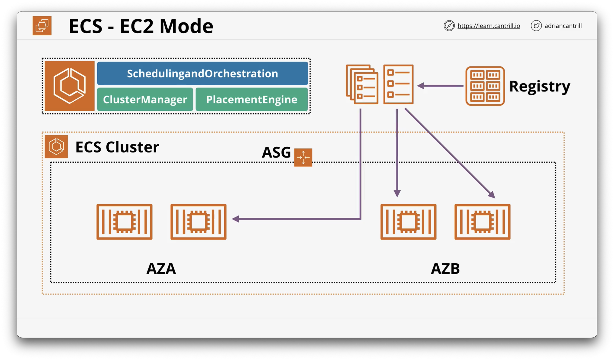
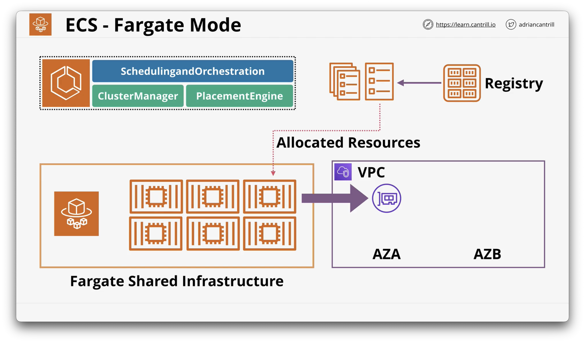

# Amazon ECS

Amazon Elastic Container Service (ECS) is AWS's managed container orchestrator. It runs container images as tasks, keeps long-running workloads healthy through services, and lets you choose whether the underlying compute is your [EC2](ec2.md) fleet or AWS-managed [Fargate](#fargate-launch-type) capacity.

The mental model: ECS is to [containers](../concepts/containers.md) what EC2 is to virtual machines. With EC2 you launch instances from AMIs; with ECS you launch tasks from task definitions that point at container images in a registry such as [ECR](#container-registries-and-ecr) or Docker Hub.

ECS is AWS's **proprietary** orchestrator. Its main alternative is [EKS](eks.md), AWS's managed [Kubernetes](../concepts/kubernetes.md) — pick EKS when you specifically want the cloud-agnostic open standard or already run Kubernetes elsewhere; pick ECS when an AWS-native orchestrator with no control-plane fee is enough.

## Core Hierarchy

ECS has a small vocabulary, but the nesting matters:

```text
Cluster
└── Service
    └── Task(s)
        └── Container(s)
```

| ECS object | Mental model | What it defines or manages |
| --- | --- | --- |
| **Cluster** | Scheduling boundary | Where ECS runs tasks and services; backed by EC2 capacity, Fargate capacity, or both through launch types / capacity providers |
| **Container definition** | One module | Image, ports, environment, logging, health checks, and container-level resource settings |
| **Task definition** | One application template | One or more container definitions plus CPU, memory, network mode, compatibility, volumes, and IAM roles |
| **Task** | One running application copy | A running instantiation of a task definition |
| **Service** | Distributed application manager | Desired task count, replacement of failed tasks, rolling deployments, scaling, load balancer attachment |

> [!warning] Gotcha
> A task definition and a container definition are not the same object. The console often creates them together, and many tasks contain only one container, but a task can contain multiple containers that form one application unit.

## Task Definitions and Task Roles

A **container definition** tells ECS which image to run and how that container behaves. At minimum, associate-level questions usually care about the image location and exposed ports, but real definitions also include environment variables, secrets, log configuration, health checks, command overrides, and resource settings.

A **task definition** wraps one or more container definitions into a deployable application. It also defines task-level settings such as:

- CPU and memory
- Network mode, commonly `awsvpc` for Fargate and modern ECS networking
- Launch compatibility, such as EC2, Fargate, or both
- Volumes and mount points
- **Task role**, which is the application role used by code running inside the containers
- **Task execution role**, which lets ECS perform platform actions such as pulling images and writing logs

The **task role** is the important security boundary for application permissions. It is an [IAM role](iam.md#iam-roles) assumed by the task, and ECS vends temporary credentials to the containers in that task. Use it when application code needs to call AWS APIs such as S3, DynamoDB, SQS, or KMS.

> [!tip] Exam Tip
> If a containerized application running on ECS needs AWS permissions, use an ECS **task role**. Do not bake access keys into the image, environment, or user data.

> [!warning] Gotcha
> Do not confuse the task role with the task execution role. The task role is for the application code. The execution role is for the ECS agent / Fargate platform to do setup work such as pulling from ECR and sending logs to CloudWatch.

## Services and Standalone Tasks

A **task** by itself is just one running copy. That is fine for one-off jobs, manual tests, demos, or batch-style work launched on demand, but it is not enough for a production web application.

An ECS **service** keeps a desired number of task copies running. If a task fails, the service starts a replacement. If you connect the service to an Elastic Load Balancer, traffic is spread across the healthy task copies. This is the ECS expression of [horizontal scaling](../patterns/scaling.md): multiple stateless task copies behind a load balancer, with failed copies replaced automatically.

Use a service for:

- Long-running applications
- Business-critical workloads
- Applications that need multiple copies for high availability
- Workloads that need load balancing and rolling deployments
- Workloads whose desired count should scale with demand

## Container Registries and ECR

ECS does not build your application by itself. It runs images from a **container registry**.

[Amazon ECR](ecr.md) is AWS's managed container registry. It fits naturally with ECS because [IAM](iam.md) controls image access, ECS can pull private images through the [task execution role](#task-definitions-and-task-roles), and the registry lives inside the AWS operational model. Docker Hub and other registries can also be used when appropriate.

## Launch Types and Capacity Providers

ECS separates the control plane from the compute that actually runs containers. The traditional exam framing is **EC2 launch type vs Fargate launch type**:

| Choice | Container hosts | Who manages host capacity | Billing shape | Best fit |
| --- | --- | --- | --- | --- |
| **EC2 launch type** | EC2 instances in your account | You, usually with an Auto Scaling group / capacity provider | Pay for EC2 instances while running, even if idle | Large, steady, price-sensitive workloads; host control; Spot / Reserved strategy |
| **Fargate launch type** | AWS-managed Fargate infrastructure | AWS | Pay for configured task resources while tasks run | Minimal operations, small or bursty workloads, batch / periodic jobs |

Modern ECS also uses **capacity providers** to connect services to compute capacity. Capacity providers can represent EC2 Auto Scaling groups or Fargate / Fargate Spot capacity. For SAA-level reasoning, the architectural choice is still the same: do you want to manage EC2 hosts, or do you want AWS to supply the host layer?

## EC2 Launch Type



With the EC2 launch type, ECS schedules containers onto EC2 instances registered to the cluster. These instances are real EC2 instances in your account and [VPC](vpc.md). You can see them, patch them, connect to them, size them, and pay for them.

Key properties:

- The cluster capacity is an EC2 fleet, commonly managed by an Auto Scaling group and an ECS capacity provider
- You manage instance type choice, patching, scaling, capacity, and host-level faults
- You pay for the EC2 instances whenever they are running, even if no ECS tasks are currently placed on them
- You can use EC2 pricing tools such as [Reserved Instances, Savings Plans, and Spot Instances](../patterns/ec2-purchase-options.md)
- ECS can manage service desired count, task placement, and failed-task replacement, but it does not make the host fleet serverless

EC2 launch type is a middle ground. It removes much of the container orchestration work, but it keeps host-level control and the operational responsibilities that come with that control.

## Fargate Launch Type



With the Fargate launch type, you do not manage EC2 container hosts. ECS and Fargate run tasks on AWS-managed infrastructure, while each task is still attached to your VPC through an [ENI](../concepts/networking.md#elastic-network-interfaces-enis).

Key properties:

- No EC2 host fleet to provision, patch, scale, or replace
- Tasks receive VPC networking through ENIs, security groups, and subnet placement
- A task can receive public internet reachability if it is placed in a public subnet with the right public-IP and routing configuration
- Billing is based on configured task resources while tasks run, such as vCPU, memory, operating system, CPU architecture, and ephemeral storage; it is not "free while idle" based on live CPU utilization
- Fargate is the low-operations default for bursty, small, periodic, or batch workloads

> [!warning] Gotcha
> Fargate is serverless from the host-management perspective, not from the networking perspective. The task still lands in your VPC with an ENI, subnet, route-table path, and security group controls.

## Choosing ECS, EC2, or Fargate

Use the question's operational and cost signals:

| Scenario | Better fit | Reason |
| --- | --- | --- |
| App is not containerized and needs a full OS | EC2 | VM-style control is the point |
| Quick local-style container test on one host | EC2 with Docker can work | Simple edge case, not a production pattern |
| Production container workload | ECS | Managed orchestration beats hand-running Docker on EC2 |
| Large, steady, price-sensitive container workload | ECS on EC2 | Better packing economics; can use Spot, Reserved Instances, and EC2 host control |
| Minimize operations and host management | ECS on Fargate | AWS owns the host layer |
| Small, bursty, periodic, or batch container work | ECS on Fargate | Avoid paying for idle EC2 fleet capacity |

> [!tip] Exam Tip
> Large and steady plus price-sensitive usually points to ECS on EC2. Bursty, periodic, small, or "no servers to manage" points to ECS on Fargate.

> [!tip] Exam Tip — ECS vs EKS
> The launch-type choice (EC2 vs Fargate) is separate from the orchestrator choice (ECS vs [EKS](eks.md)). Both ECS and EKS can run on either EC2 or Fargate. Choose **EKS** when the scenario wants [Kubernetes](../concepts/kubernetes.md) specifically — cloud-agnostic, open standard, avoid lock-in, or an existing Kubernetes workload. Choose **ECS** when an AWS-native orchestrator is fine and you want to avoid EKS's per-cluster control-plane fee.

## Key Takeaways

1. ECS runs containers from task definitions; it is the managed orchestrator, not the image registry.
2. The core hierarchy is cluster, service, task, container.
3. A task definition is the application template; a container definition is one container inside it.
4. A service gives tasks scaling, replacement, deployments, and load balancer integration.
5. Use the ECS task role for application AWS permissions.
6. EC2 launch type means you manage and pay for EC2 container hosts.
7. Fargate launch type means AWS manages the hosts, but tasks still attach to your VPC through ENIs.
8. Choose EC2 launch type for steady, price-sensitive, host-controlled workloads; choose Fargate for lower operations and bursty or periodic workloads.

## References

- Source: `raw/aws-cert-study-notes/aws-solution-architect/ecs_101.md`
- [Amazon ECS launch types and capacity providers — AWS docs](https://docs.aws.amazon.com/AmazonECS/latest/developerguide/capacity-launch-type-comparison.html)
- [Amazon ECS task definitions — AWS docs](https://docs.aws.amazon.com/AmazonECS/latest/userguide/task_definitions.html)
- [Amazon ECS task IAM role — AWS docs](https://docs.aws.amazon.com/AmazonECS/latest/developerguide/task-iam-roles.html)
- [Amazon ECS service definition parameters — AWS docs](https://docs.aws.amazon.com/AmazonECS/latest/developerguide/service_definition_parameters.html)
