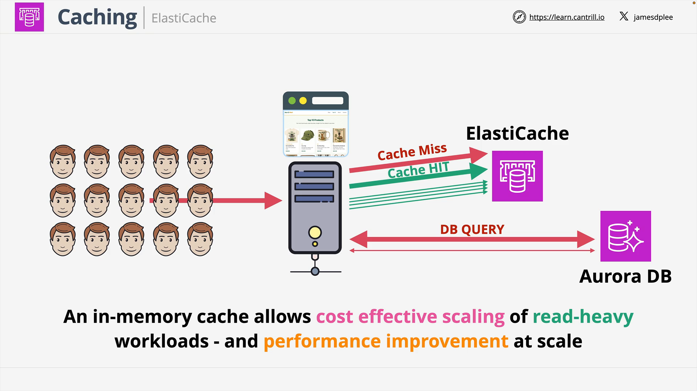
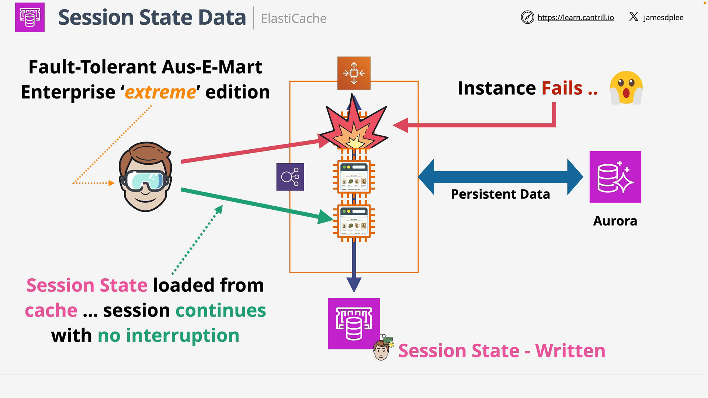

# Amazon ElastiCache

ElastiCache is a managed **in-memory** data store. Databases such as [RDS](rds.md) and [Aurora](aurora.md) keep their data persistently on disk, and even fast disks limit throughput and latency. Memory is orders of magnitude faster on both measures, but a cache is not a persistent system of record by default, so it mostly holds **temporary copies** of data that also lives somewhere durable.

ElastiCache offers three engines as a service: **Valkey**, **Redis OSS**, and **Memcached**. Valkey is an open-source fork of Redis that is compatible with Redis clients and data structures. AWS recommends it for new deployments and prices it lower than the other engines: [20% lower for node-based clusters and 33% lower for serverless](https://aws.amazon.com/about-aws/whats-new/2024/10/amazon-elasticache-valkey). In the engine comparisons below, "Valkey/Redis OSS" behaves as one family.

## When ElastiCache Fits

| Use | Why it helps |
| --- | --- |
| **Read-heavy** workloads | Repeated reads are served from memory instead of the database, reducing database load and cost |
| **Low-latency** access requirements | In-memory reads return in sub-millisecond time, avoiding disk-bound database latency |
| **Session state** for web or application servers | Sessions live off-host, so the servers become [stateless](../patterns/scaling.md#the-critical-consideration--sessions) and any instance can serve any user |

Databases, and relational databases in particular, are relatively hard to scale. They are also expensive relative to the data they hold and the performance they deliver. Offloading heavy reads to a cache is therefore a cost tool as well as a performance tool, which is why it appears as the [caching tier](../patterns/global-regional-architecture.md#caching-tier) of a regional architecture.

> [!warning] Gotcha: ElastiCache requires application changes
> ElastiCache is not a transparent accelerator. The application must check the cache first, fall back to the database on a miss, write results into the cache, and handle stale or invalidated entries. If an exam scenario says **no application changes are allowed**, ElastiCache is probably not the answer.

## Read Caching Architecture

The application, not ElastiCache, decides when to read and write the cache.

1. **Cache miss:** The application checks ElastiCache, finds nothing, and queries the database. The database query is slower and more expensive. The application then writes the result into the cache.
2. **Cache hit:** A later request for the same data is answered directly from the cache, with no database read.

With one user the benefit is hard to see. With many users who request similar data, most of the added load lands on the cache, and the number of database reads grows much more slowly than the user count. That is what makes scaling a read-heavy workload cost-effective.

### Caching Strategies

The lecture describes the most common pattern. The [AWS caching-strategy guide](https://docs.aws.amazon.com/AmazonElastiCache/latest/dg/Strategies.html) names it and compares it with alternatives:

| Strategy | How it works | Advantages | Disadvantages |
| --- | --- | --- | --- |
| **Lazy loading** (cache-aside) | Read from the cache; on a miss, read the database and populate the cache | Only requested data is cached; a failed, empty node only adds latency while it refills | Every miss costs three trips (cache check, database query, cache write); cached data can become **stale** because database writes do not update it |
| **Write-through** | Whenever the application writes the database, it also writes the cache | Cached data is never stale; users usually tolerate write latency better than read latency | A new or replacement node is **missing data** until those items are written again; **cache churn** from storing data that is never read |
| **Adding TTL** | Give each cached key an expiry time in seconds (Valkey/Redis OSS also accept milliseconds) | Limits staleness for lazy loading and wasted space for write-through | Does not guarantee freshness; expired keys must be reloaded from the database |

Production designs often combine lazy loading, write-through, and TTL. See [AWS caching strategies](https://docs.aws.amazon.com/AmazonElastiCache/latest/dg/Strategies.html).

> [!tip] Exam Tip
> "Data must never be stale in the cache" points to **write-through**. "Cache only what is actually requested" or "tolerate node failure" points to **lazy loading**. "Stop the cache filling with unused data" or "bound staleness" points to adding a **TTL**.

## Session State for Stateless Servers

In the lecture's fault-tolerant web store, an Auto Scaling group runs three EC2 instances behind a load balancer, with Aurora holding persistent data.

1. When a user first connects to any instance, that instance writes the user's session into ElastiCache and keeps it updated (for example, when an item is added to the cart).
2. If that instance fails, the load balancer sends the user's next request to another instance.
3. The new instance loads the session from ElastiCache, so the session continues without interruption.

Without this design, the failed instance's sessions would be lost and users would be disrupted. Externalizing session state moves the application beyond simple high availability toward **fault tolerance**: users do not notice a component failure. This is the well-architected alternative to [ALB sticky sessions](elb.md#session-stickiness). Stickiness pins a user to one instance, so the session is lost if that instance fails. Off-host sessions make every instance interchangeable, which [EC2 Auto Scaling](ec2-auto-scaling.md) needs anyway. The general principle is covered in [Scaling: Horizontal vs Vertical](../patterns/scaling.md#the-critical-consideration--sessions).

> [!warning] Gotcha: off-host sessions still need a resilient cache
> The lecture's design survives a **web-instance** failure. The cache itself is still a component that can fail. A node-based Memcached cluster has no replication, so a failed node loses its share of sessions. For session stores that must survive cache-node failure, use Valkey/Redis OSS with replicas and Multi-AZ automatic failover, or ElastiCache Serverless, which [replicates data across multiple AZs](https://docs.aws.amazon.com/AmazonElastiCache/latest/dg/WhatIs.corecomponents.html). If sessions must survive anything, store them in a durable service such as [DynamoDB](dynamodb.md).

## Engine Comparison: Memcached vs Valkey/Redis OSS

All three engines offer sub-millisecond access and support a wide range of programming languages. They differ in data structures, resilience, and recovery. The table follows the lecture's comparison and updates it where current AWS documentation differs. Unless noted, rows describe **node-based clusters**; [serverless caches](#deployment-options-serverless-vs-node-based) differ.

| Feature | Memcached | Valkey / Redis OSS |
| --- | --- | --- |
| Data structures | **Simple**: strings and objects | **Advanced**: strings, lists, sets, sorted sets, hashes, bitmaps, HyperLogLog, geospatial indexes |
| Replication and high availability | **No replication** | **Replication** with up to five read replicas per shard to **scale reads**; **Multi-AZ** with automatic failover |
| Partitioning (sharding) | **Multiple nodes**; data is split across them, for example some usernames on one node and the rest on another | Also supported, in **cluster mode enabled**: 1 to 500 shards |
| Backup and restore | **None** for node-based clusters, so no persistence; supported for **serverless** Memcached caches | **Backup and restore** to a previous state after a failure |
| Threading | **Multi-threaded**; uses multiple cores on large nodes | AWS lists the engine as not multi-threaded, though recent Valkey versions add I/O threading |
| Transactions | No | **Transactions** (`MULTI`/`EXEC`) |
| Pub/Sub, sorted sets, geospatial | No | Yes |

Sources: [engine comparison](https://docs.aws.amazon.com/AmazonElastiCache/latest/dg/SelectEngine.html) and [cluster mode limits](https://docs.aws.amazon.com/AmazonElastiCache/latest/dg/Replication.Redis-RedisCluster.html).

Advanced data structures move work out of the application. A game leaderboard kept in a Valkey/Redis OSS **sorted set** stays ordered by rank as scores change, so application instances read it ready-sorted instead of sorting it themselves.

Node size matters for every engine. Instance types with more memory or faster memory improve cache performance; the exam does not test specific node types.

> [!warning] Gotcha: sharding is not Memcached-only
> The lecture lists "multiple nodes (sharding)" under Memcached only. Valkey/Redis OSS also shards when **cluster mode is enabled**, with online resharding. The distinction that matters for the exam is **replication**: Memcached spreads data without copies, while Valkey/Redis OSS keeps replicas for failover and read scaling.

> [!warning] Gotcha: Valkey/Redis transactions do not roll back
> The lecture describes transactions as all-or-nothing: either every operation works or none does. That is only partly true. A Valkey/Redis OSS transaction runs its queued commands in order, and no other client's command runs in the middle. If a command is rejected while being queued (for example, a syntax error), the whole transaction is discarded. But there is **no rollback**: if one command fails at execution time, the others [still run](https://valkey.io/topics/transactions/). For the exam, "transactions" is still a reason to choose Valkey/Redis OSS over Memcached. Compare the [ACID and BASE models](../concepts/db-transaction-model.md).

> [!tip] Exam Tip: choosing an engine
> Pick **Memcached** when the scenario wants the simplest cache, simple values, large multi-threaded nodes, or scaling by adding and removing nodes. Pick **Valkey/Redis OSS** for anything that mentions **Multi-AZ**, **replication**, **failover**, **backup/restore**, **persistence**, **advanced data structures** (sorted-set leaderboards, pub/sub, geospatial), or **transactions**. For a new design with no engine constraint, AWS recommends **Valkey**.

## Deployment Options: Serverless vs Node-Based

ElastiCache offers [two deployment options](https://docs.aws.amazon.com/AmazonElastiCache/latest/dg/WhatIs.corecomponents.html):

| | ElastiCache Serverless | Node-based cluster |
| --- | --- | --- |
| Capacity | No capacity planning; scales vertically and horizontally automatically | You choose node family, size, number of shards, and replicas per shard |
| Endpoint | One endpoint behind a proxy layer, so clients do not track topology changes | Cluster endpoints; cluster-aware clients for cluster mode enabled |
| Availability | Replicates data across multiple AZs; 99.99% availability SLA | Single-AZ or multi-AZ placement is your choice |
| Encryption | Always in transit and at rest | Configurable |
| Billing | Data stored (GB-hours) plus ElastiCache Processing Units (ECPUs) | Per node-hour; reserved nodes available |

Node-based Valkey/Redis OSS clusters run in one of two modes ([limits](https://docs.aws.amazon.com/AmazonElastiCache/latest/dg/Replication.Redis-RedisCluster.html)):

- **Cluster mode disabled:** one shard containing a primary and up to five read replicas. Reads scale by adding replicas, and capacity scales by moving to a larger node. Without replicas, a node failure loses all data.
- **Cluster mode enabled:** 1 to 500 shards, each with up to five replicas. Data is partitioned, so both writes and dataset size scale across shards.

### Global Datastore

[Global Datastore](https://docs.aws.amazon.com/AmazonElastiCache/latest/dg/Redis-Global-Datastore.html) replicates a node-based Valkey/Redis OSS cluster to secondary clusters in **up to two other Regions**. The primary cluster accepts writes, secondary clusters serve local reads, and replication is asynchronous. It supports low-latency reads near users and disaster recovery. Cross-Region failover is **manual**: you promote a secondary cluster. It is not available for serverless caches. See the [Global Datastore prerequisites](https://docs.aws.amazon.com/AmazonElastiCache/latest/dg/Redis-Global-Datastores-Getting-Started.html) and [Global vs Regional Architecture](../patterns/global-regional-architecture.md).

## ElastiCache vs DAX

Both put an in-memory cache in front of a database, but they differ in scope and in how much code changes.

| | ElastiCache | [DAX](dynamodb.md#dynamodb-accelerator-dax) |
| --- | --- | --- |
| Backing database | Any: [RDS](rds.md), [Aurora](aurora.md), DynamoDB, APIs, computed results | [DynamoDB](dynamodb.md) only |
| Application changes | Cache logic in the application: check, fall back, populate, and invalidate | Replace the DynamoDB client with a DAX-aware client; DAX handles misses |
| Other uses | Session store, leaderboards, pub/sub, rate limiting | DynamoDB read caching only |

> [!tip] Exam Tip
> "Cache DynamoDB reads with minimal code change" points to **DAX**. "Cache RDS/Aurora query results", "store user sessions", or "a general-purpose in-memory store" points to **ElastiCache**.

## Cost Notes

- Valkey is priced [20% lower (node-based) and 33% lower (serverless)](https://aws.amazon.com/about-aws/whats-new/2024/10/amazon-elasticache-valkey) than Redis OSS and Memcached.
- Steady node-based usage can use **reserved cache nodes**. ElastiCache is also covered by [Database Savings Plans](https://aws.amazon.com/about-aws/whats-new/2025/12/database-savings-plans-savings/) (1-year commitment, up to 35%). See [Cost Optimization](../patterns/cost-optimization.md#reserved-instances-still-essential-for-non-ec2-compute).
- Total cost is workload-dependent: a cache saves money only if hit rates are high enough to remove meaningful database load.

## Exam Quick Reference

| Scenario wording | Answer |
| --- | --- |
| Read-heavy, low-latency, reduce database load or cost | ElastiCache in front of the database |
| Users logged out or carts emptied behind a load balancer; make servers stateless | Store sessions in ElastiCache (or DynamoDB) |
| "No application changes allowed" | Probably **not** ElastiCache |
| Multi-AZ, failover, backups, persistence, advanced data types | Valkey / Redis OSS |
| Simplest cache, multi-threaded, simple values | Memcached |
| Cross-Region low-latency reads or cache disaster recovery | Global Datastore (Valkey/Redis OSS, node-based) |
| Cache must never be stale | Write-through, usually with TTL |
| DynamoDB-only cache with minimal code change | DAX |

## References

- Adrian Cantrill, *AWS Certified Solutions Architect – Associate* course: ElastiCache theory and architecture lecture
- [AWS: How ElastiCache works (serverless and node-based)](https://docs.aws.amazon.com/AmazonElastiCache/latest/dg/WhatIs.corecomponents.html)
- [AWS: Comparing Valkey, Memcached, and Redis OSS](https://docs.aws.amazon.com/AmazonElastiCache/latest/dg/SelectEngine.html)
- [AWS: Cluster mode disabled vs enabled](https://docs.aws.amazon.com/AmazonElastiCache/latest/dg/Replication.Redis-RedisCluster.html)
- [AWS: Caching strategies](https://docs.aws.amazon.com/AmazonElastiCache/latest/dg/Strategies.html)
- [AWS: Global Datastore](https://docs.aws.amazon.com/AmazonElastiCache/latest/dg/Redis-Global-Datastore.html) and [prerequisites](https://docs.aws.amazon.com/AmazonElastiCache/latest/dg/Redis-Global-Datastores-Getting-Started.html)
- [AWS What's New: ElastiCache for Valkey (Oct 2024)](https://aws.amazon.com/about-aws/whats-new/2024/10/amazon-elasticache-valkey)
- [AWS What's New: Database Savings Plans (Dec 2025)](https://aws.amazon.com/about-aws/whats-new/2025/12/database-savings-plans-savings/)
- [Valkey: Transactions](https://valkey.io/topics/transactions/)
