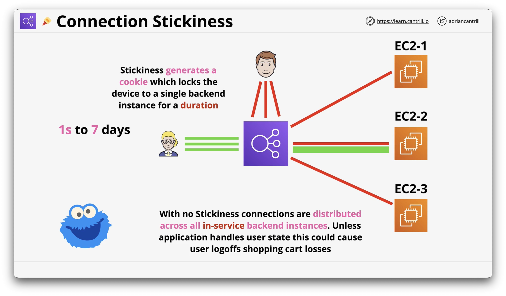

# Elastic Load Balancer (ELB)

An **Elastic Load Balancer (ELB)** accepts connections from clients and distributes them across registered backend compute. Its core value is **abstraction**: clients are decoupled from the physical infrastructure, so backend capacity can scale up or down, and instances can fail and be replaced, all without the client being aware. This abstraction is exactly what makes [horizontal scaling](../patterns/scaling.md) possible, and it is the standard entry point of the web tier in the [regional architecture model](../patterns/global-regional-architecture.md).

## The ELB Family

"ELB" refers to the whole family, which has three course-covered types split across two versions:

| Version | Type                                | Layer / Protocols                                    | Notes                                                                                                          |
| ------- | ----------------------------------- | ---------------------------------------------------- | -------------------------------------------------------------------------------------------------------------- |
| v1      | **Classic Load Balancer (CLB)**     | HTTP, HTTPS plus lower-level; *not a true L7 device* | Introduced 2009. Legacy — avoid for new deployments; migrate off. One SSL certificate per CLB. More expensive. |
| v2      | **Application Load Balancer (ALB)** | True Layer 7: HTTP, HTTPS, WebSocket                 | Preferred for HTTP/S workloads.                                                                                |
| v2      | **Network Load Balancer (NLB)**     | Layer 4: TCP, TLS, UDP                               | For non-HTTP/S workloads: email, SSH, gaming and other custom protocols.                                       |

v2 load balancers are faster and support **target groups and rules**, so one load balancer can serve many purposes (for example, routing by customer).

> [!tip] Exam Tip
> There is **no scenario** where a v1 CLB is the right answer for a new deployment. The real exam skill is **picking ALB vs NLB** for a given protocol: HTTP/HTTPS/WebSocket means ALB; TCP/TLS/UDP (email, SSH, gaming, anything non-HTTP) means NLB.

There is also a fourth member: the **Gateway Load Balancer (GWLB)**, introduced at re:Invent 2020, which operates at Layer 3 using the **GENEVE protocol on port 6081** and is used to insert fleets of third-party security/inspection appliances (firewalls, IDS/IPS, deep-packet inspection) into the traffic path as a transparent "bump-in-the-wire" ([GWLB docs](https://docs.aws.amazon.com/elasticloadbalancing/latest/gateway/introduction.html)). It is a different beast from the other three — it steers packets *through* appliances rather than balancing connections *to* backends — and gets its own full treatment in [Gateway Load Balancer (GWLB) — Deep Dive](#gateway-load-balancer-gwlb--deep-dive) below. The complete family: **ALB (L7), NLB (L4), GWLB (L3), CLB (legacy)**.

## Architecture — It's Nodes, Not a Box

What you provision as a "single load balancer object" is actually **multiple load balancer nodes** living in the subnets you selected. When you create a load balancer, you select **one subnet per enabled AZ**. ALB requires at least two AZs; NLB can technically run in one AZ, but is normally deployed across 2+ AZs for HA. In each enabled AZ, ELB deploys **one or more nodes** in the selected subnet.

- A single **A record** is created for the load balancer. It resolves to **all** active nodes (see [DNS](../concepts/dns.md) for record mechanics).
- Across many clients, DNS resolution tends to spread requests across nodes; the effect is statistical rather than per-request.
- Nodes are **highly available** (a failed node is replaced) and **auto-scale** within their subnet as load rises.

> [!note] The node spread is AWS-managed, not user-configurable — and statistical, not guaranteed
> The node spread is delivered at the **DNS layer**: the A record returns the node IPs with a **60-second TTL**, so clients re-resolve as AWS adds, removes, or replaces nodes ([How Elastic Load Balancing works](https://docs.aws.amazon.com/elasticloadbalancing/latest/userguide/how-elastic-load-balancing-works.html)). There is **no setting** for per-node weighting; your only levers are indirect: **which subnets/AZs you enable** (determining where nodes exist at all) and **cross-zone load balancing** (which changes only what a node does with traffic *after* receiving it — node-to-target, never client-to-node). The evenness is **statistical**: it relies on clients resolving fresh and picking among the returned IPs. A client that caches a resolved IP (the JVM's default indefinite DNS cache is the classic case) pins itself to one node for its lifetime — the same connection-level DNS behavior as the [Aurora reader endpoint](aurora.md#how-the-reader-endpoint-balances-load). Across many independent clients it evens out; a few heavy, long-lived clients can skew it.

### Internet-facing vs internal

This choice controls **the IP addressing of the nodes only** — nothing else about the nodes or features differs:

| Scheme              | Node IPs               | Use                                            |
| ------------------- | ---------------------- | ---------------------------------------------- |
| **Internet-facing** | Public **and** private | Reachable from the internet                    |
| **Internal**        | Private only           | Separating application tiers / private routing |

> [!warning] Gotcha — internet-facing does not force public instances
> An **internet-facing load balancer can forward to both public and private [EC2](../services/ec2.md) instances.** Backend targets do **not** need public addressing — the only requirement is that the **load balancer nodes can reach the targets** (via their private IPs). This matters for "how many subnets/tiers are required" questions: an internet-facing load balancer does not force the instances behind it to be public.

### Listeners

Client-side behavior is set by the **listener configuration**: the protocol and port the load balancer accepts on its front side. Nodes then communicate with **targets** on a (possibly different) port and protocol. Listeners get a dedicated lesson later; this page only introduces them.

### Subnet selection rules

The following provisioning rules are verified against current AWS documentation ([ALB docs](https://docs.aws.amazon.com/elasticloadbalancing/latest/application/application-load-balancers.html), [NLB availability zones](https://docs.aws.amazon.com/elasticloadbalancing/latest/network/availability-zones.html), [CLB subnets](https://docs.aws.amazon.com/elasticloadbalancing/latest/classic/elb-manage-subnets.html)):

- You choose **subnets** when provisioning; selecting a subnet is what enables that AZ — "to enable a zone, specify a subnet in the zone," and ELB creates a node in each zone you specify.
- **At most one subnet per AZ** for a single load balancer.
- **Internet-facing** load balancers must use **public subnets** (route to an [IGW](../services/vpc.md)) so nodes can get public IPs; backend **targets can stay in private subnets**.
- **ALB requires at least two subnets in two different AZs.**
- **NLB** can technically be deployed to a **single subnet/AZ** (you enable AZs one subnet at a time at the API level), but the console create flow and AWS best practice still push **two or more AZs** — default to "2+ AZs" on the exam unless a question specifically probes the single-AZ NLB capability.
- **Static IPs are NLB-specific**: an internet-facing NLB supports one **Elastic IP** per subnet/node (or AWS assigns one), and an internal NLB can take an assignable private IP per subnet. **ALB and CLB have no static IPs** — you always use their DNS name.

### IP addressing and subnet sizing

- Load balancer nodes need **8+ free IPs per subnet** to function and scale.
- Strictly, a **/28** ($2^{(32 - 28)}$, i.e., 16 total addresses minus [5 AWS-reserved](../services/vpc.md) leaves 11 free) technically satisfies "8 free."
- AWS **recommends /27 or larger** so the load balancer has room to scale alongside backend instances — the docs say to "verify that each Availability Zone subnet for your load balancer has a CIDR block with at least a /27 bitmask and at least eight free IP addresses per subnet" ([ALB docs](https://docs.aws.amazon.com/elasticloadbalancing/latest/application/application-load-balancers.html), [ELB scaling strategies blog](https://aws.amazon.com/blogs/networking-and-content-delivery/scaling-strategies-for-elastic-load-balancing/)).

> [!warning] Gotcha — /27 vs /28 on the exam
> Both can be "correct" depending on the options shown. If `/27` is an option, pick **/27** (the AWS-recommended value; remember it as the default). If you only see `/28` and not `/27`, then **/28** is probably the intended answer (it does satisfy the 8-free-IP rule).

## Multi-Tier Abstraction

Internal load balancers are what let **each tier scale independently**. In the three-tier picture (WEB, APP, DB across two AZs):

1. The user connects to the **internet-facing load balancer**, which forwards to a web instance in the WEB [Auto Scaling group](ec2-auto-scaling.md).
2. The web instance talks to an **internal load balancer**, which forwards to an app instance in the APP Auto Scaling group — possibly in a different AZ.
3. The app instance talks to the DB tier ([Aurora](aurora.md)) for persistent storage.

Without load balancers, every tier is tightly coupled: the user would talk to a *specific* web instance, which talks to a *specific* app instance, and any failure or scaling event disrupts the chain. Inserting load balancers between tiers **loosens the coupling**: the APP tier can grow from 2 to 4 instances and the WEB tier keeps using it with **no reconfiguration**, because it only ever talks to the internal load balancer's DNS name. This is the same session-independence story as [stateless design in horizontal scaling](../patterns/scaling.md#the-critical-consideration--sessions) — the load balancer abstracts *which* instance serves a request.

## Cross-Zone Load Balancing

### The problem (historic default — disabled)

Originally each load balancer node could **only** distribute to instances **in its own AZ**. With 4 instances in AZ A and 1 in AZ B:

- DNS distribution tends to split load across **nodes**: in the idealized two-node example, each node gets 50% (100% divided by 2 nodes).
- Node A splits its 50% across 4 local instances, so each gets 12.5%.
- Node B sends its entire 50% to the single local instance.

The result is badly uneven: one instance carries 50% of all traffic while the others carry 12.5% each.

### The fix — cross-zone load balancing (enabled)

Cross-zone load balancing lets **every node distribute across all registered instances in all AZs**. Node A can send to the AZ B instance and vice versa, producing an even distribution across all 5 instances.

> [!tip] Exam Tip — defaults and triggers
>
> - **ALB:** cross-zone is **enabled by default and cannot be changed at the load balancer level**; target groups can override that inherited setting ([ALB target group attributes](https://docs.aws.amazon.com/elasticloadbalancing/latest/application/edit-target-group-attributes.html#modify-target-group-attributes)).
> - **Classic and others** were historically **disabled** by default.
> - The typical exam scenario is "**uneven load distribution**" across AZs — the answer is to **enable cross-zone load balancing**.

> [!warning] Gotcha — node distribution vs instance distribution
> DNS responses tend to distribute clients across **nodes**; over many clients, that approximates an even split. Cross-zone only changes what each node does **after** it receives its share — whether it can reach instances in other AZs.

## ALB vs NLB — Why v2 Exists: Consolidation

The original CLB pain point that motivated v2: **CLBs do not support SNI** (Server Name Indication, see [TLS/HTTPS](../concepts/tls-https.md)), and **a single CLB cannot hold multiple SSL certificates**. Every unique HTTPS application therefore needs its own CLB — two HTTPS apps (`catagram.io` and `dogagram.io`) means two CLBs; 100 legacy apps means 100 load balancers.

A single ALB can front both applications instead:

- **Listener rules**, each able to carry its own SSL certificate (via SNI), handle HTTPS for both domains.
- **Host-header rules** direct connections to **multiple target groups**, each forwarding to its own Auto Scaling group.

That is a 2:1 consolidation for two apps, and the savings compound dramatically across a large legacy estate. **Consolidation is one of the headline advantages of moving from v1 (CLB) to v2 (ALB).**

## ALB Deep Dive — a True Layer 7 Load Balancer

An ALB listens on **HTTP or HTTPS only**, and because it understands those protocols it can inspect and make decisions on **content type, cookies, custom headers, user location, and application behaviour** — none of which an NLB can see.

> [!warning] Gotcha — HTTP/HTTPS only
> The flip side of being a true L7 device: an ALB understands *only* HTTP/HTTPS. It **cannot** handle other Layer 7 protocols (SMTP, SSH, custom gaming protocols), and it **cannot** listen directly on TCP, UDP, or TLS. A non-web protocol in the scenario rules the ALB out.

### SSL/TLS is always terminated on the ALB

Any incoming HTTPS connection is **terminated on the ALB**, and a **new, separate connection** is made from the ALB to the backend targets (which can itself be HTTPS, but it is still a different connection — hop-by-hop, never unbroken). In the vocabulary of the [SSL/TLS connection modes](#ssltls-connection-modes--bridging-pass-through-offload) below: an ALB always operates in **bridging** mode (backend leg re-encrypted) or **offload** mode (backend leg plain HTTP) — never pass-through.

> [!warning] Gotcha — no unbroken end-to-end encryption through an ALB
> You **cannot** have an unbroken end-to-end SSL/TLS connection from client through to the application instances with an ALB. This matters to strict security teams and can, on its own, exclude the ALB from consideration. Consequence: **every HTTPS ALB must have an SSL certificate installed on the load balancer**, because the connection terminates there. The canonical unbroken-encryption answer is an [NLB with a TCP listener](#unbroken-end-to-end-encryption-tcp-pass-through).

### Performance and health checks

ALBs are **slower than NLBs** — more layers of the networking stack must be processed, and more layers means more latency. In exchange, ALB health checks are **application-aware**: the ALB can make an actual application-layer request and confirm the app responds correctly, not merely that a network connection succeeds.

### Rules — the core of ALB flexibility

Connections arriving at a listener are handled according to **rules**, processed in **priority order**; the last rule is always the **default rule** (a catch-all), and you add higher-priority rules above it.

Rule **conditions** can match on:

- Host header (which domain)
- HTTP headers
- HTTP request method
- Path pattern (for example `/images` vs `/api`)
- Query string
- **Source IP**

Rule **actions** can:

- **Forward** to a target group
- **Redirect** elsewhere (for example to another domain)
- Return a **fixed HTTP response** (a specific status code)
- **Authenticate** — using **OpenID Connect** or **[Amazon Cognito user pools](cognito.md#tokens-and-their-consumers)**. Cognito authentication uses the `authenticate-cognito` action on an HTTPS listener; an identity pool is not required. [AWS ALB authentication](https://docs.aws.amazon.com/elasticloadbalancing/latest/application/listener-authenticate-users.html).

Worked examples: a host-header rule forwards `catagram.io` traffic to the Catagram target group; a source-IP rule sends one corporate client (say `1.3.3.7`) to a dedicated target group running an alternative version; a host-header rule for `dogagram.io` **redirects** to `catagram.io` instead of forwarding.

> [!tip] Exam Tip
> Routing decisions based on **path, headers, cookies, host, HTTP redirects, or built-in authentication** are **ALB** territory — an NLB can do none of these.

## NLB Deep Dive — Layer 4

An NLB operates at **Layer 4**, interpreting **TCP, TLS, and UDP** (plus the combined `TCP_UDP` listener). It has **no visibility into HTTP/HTTPS**: it cannot interpret headers or cookies, and has no concept of HTTP [session stickiness](#session-stickiness) (which relies on cookies at Layer 7).

- **Extremely fast** — NLBs can handle **millions of requests per second** with roughly **25% of the latency of an ALB** (the course's "about 4 times lower latency" framing; AWS no longer publishes a hard number), because they skip the computationally heavy upper layers.
- **Ideal for non-HTTP(S) protocols** — SMTP email, SSH, game servers on custom protocols, financial applications not using HTTP/HTTPS. Protocol-agnostic at Layer 4.
- **Shallower health checks** — the course frames NLB health checks as ICMP and basic TCP handshaking only, not application-aware. (Current AWS docs actually allow **HTTP/HTTPS health check protocols on NLB target groups** ([NLB health checks](https://docs.aws.amazon.com/elasticloadbalancing/latest/network/target-group-health-checks.html)), but the exam-level contrast stands: the ALB is the application-aware option.)
- **Static IP addresses** — one Elastic IP per subnet/AZ, extremely useful for **whitelisting** through corporate firewalls (see [subnet selection rules](#subnet-selection-rules) above; ALB and CLB have no static IPs).

### Unbroken end-to-end encryption (TCP pass-through)

Because an NLB does not understand HTTP/HTTPS, a **TCP listener** forwards TCP **straight through** to the instances. Anything layered on top of TCP — TLS, and therefore HTTPS — is **never terminated** on the load balancer.

> [!tip] Exam Tip — the canonical end-to-end encryption answer
> **Unbroken, end-to-end encryption from client to instance means an NLB with a TCP listener** — never an ALB. If a question requires forwarding encrypted connections to instances *without terminating them on the load balancer*, the answer is NLB.

> [!warning] Gotcha — TCP listener vs TLS listener
> An NLB *also* supports a **TLS listener**, which **does terminate** TLS on the NLB (and therefore needs a certificate) — useful for TLS offload. The unbroken end-to-end behaviour is specific to the **TCP listener**, where the NLB never decrypts. Don't conflate the two ([NLB listeners](https://docs.aws.amazon.com/elasticloadbalancing/latest/network/load-balancer-listeners.html)).

### PrivateLink

NLBs are the load balancer used with **[AWS PrivateLink](vpc.md)** to expose a service to other VPCs.

> [!tip] Exam Tip
> Any scenario involving **PrivateLink** means **NLB**. This is a common, high-value exam fact.

## SSL/TLS Connection Modes — Bridging, Pass-Through, Offload

There are three ways an ELB can handle encrypted connections, and the exam tests them at the **architecture level**: *who holds the certificate*, *who does the crypto work*, and *what the load balancer can see*. (Certificate mechanics — chains of trust, SNI, ACM — are covered in [TLS/HTTPS](../concepts/tls-https.md).)

### Bridging (ALB default)

- Client to ELB: **HTTPS listener** — the connection is **terminated** (decrypted) on the ELB, which therefore needs a certificate for the domain.
- ELB to instances: **new, separate HTTPS connections**, so **every instance also needs a certificate** plus the CPU for crypto.

Bridging is the ALB default because terminating the connection strips the SSL wrapper off the HTTP inside, letting the ALB **see and act on the HTTP** — the entire basis of the [L7 rules](#rules--the-core-of-alb-flexibility) above. An ALB cannot route on content it cannot read.

| Pros                                                   | Cons                                                                        |
| ------------------------------------------------------ | --------------------------------------------------------------------------- |
| ELB sees plaintext HTTP, enabling L7 routing decisions | Certificate stored on the ELB, so **AWS has some level of access** to it    |
|                                                        | Certs must be distributed and maintained on every instance (admin overhead) |
|                                                        | Every instance performs crypto — CPU overhead, significant at high volume   |

### Pass-through (NLB, TCP listener)

- **NLB with a TCP listener**: the NLB **never decrypts anything** — one encrypted tunnel from client to backend instance, end to end (the same behaviour described under [unbroken end-to-end encryption](#unbroken-end-to-end-encryption-tcp-pass-through) above).
- Certificate lives on the **instances only** — never on the load balancer, **never exposed to AWS**. For stronger key control, the instances can keep the private key in **[CloudHSM](cloudhsm.md#ssltls-offload-for-web-servers)**, which performs the handshake's private-key operation so the key never sits on the instance disk.
- The NLB balances on what it *can* see: source/destination IP and port.

| Pros                                                    | Cons                                                              |
| ------------------------------------------------------- | ----------------------------------------------------------------- |
| **No certificate exposure to AWS** — fully self-managed | **No HTTP-based load balancing** — the L7 data is never decrypted |
| Can pair with **CloudHSM** for stronger key control     | Instances still need certs **and** the compute for crypto         |

The security-framework angle is why this mode matters on the exam: pass-through is the only one of the three where **AWS never touches your private key**.

### SSL offload

- Client to ELB: **HTTPS listener**, terminated on the ELB — **certificate required on the ELB**.
- ELB to instances: **plain HTTP**, never re-encrypted.

| Pros                                                                                                     | Cons                                          |
| -------------------------------------------------------------------------------------------------------- | --------------------------------------------- |
| **No certificates on instances**                                                                         | Data crosses the **AWS network in plaintext** |
| **No crypto compute on instances** — lower per-instance overhead, potentially **smaller instance types** | Cert still stored on the ELB (AWS access)     |
| Encrypted across the public internet, where it matters most                                              |                                               |

### Connection modes quick reference

|                           | **Bridging**      | **Pass-through**      | **Offload**                    |
| ------------------------- | ----------------- | --------------------- | ------------------------------ |
| Typical LB                | **ALB (default)** | **NLB**               | ALB (or NLB with TLS listener) |
| Listener protocol         | HTTPS             | **TCP**               | HTTPS                          |
| Terminated on LB?         | Yes               | No                    | Yes                            |
| Cert on LB?               | Yes               | No                    | Yes                            |
| Cert on instances?        | Yes               | Yes                   | No                             |
| Crypto on instances?      | Yes               | Yes                   | No                             |
| LB can see HTTP?          | Yes               | No                    | Yes                            |
| Cert exposed to AWS?      | Yes               | No                    | Yes                            |
| Encrypted LB to instance? | Yes               | Yes (never decrypted) | No — **plaintext**             |

> [!warning] Gotcha — the listener protocol determines the mode, not the load balancer type
> The course presents NLB as *the* pass-through option, but NLB has supported **TLS termination since January 2019**, with ACM integration and optional re-encryption to targets ([AWS What's New](https://aws.amazon.com/about-aws/whats-new/2019/01/network-load-balancer-now-supports-tls-termination/)). So: **NLB + TCP listener = pass-through; NLB + TLS listener (or any HTTPS listener) = terminated on the LB.** Pass-through is a choice, not a limitation.

> [!tip] Exam Tip — connection mode traps
>
> - **Bridging requires certs in *two* places** — the ELB *and* every instance. Easy to forget the second half.
> - **"Certificate must not be exposed to AWS"** (or regulatory control of private keys, or **CloudHSM** in the scenario) means **pass-through**, always — the only mode where the private key stays entirely yours.
> - **Offload's cost is plaintext on the AWS network.** If compliance requires encryption in transit *end-to-end* or *at all times*, offload is wrong.
> - **"Reduce instance CPU / use smaller instances" plus HTTPS** means **offload** — removing crypto from the backend is its headline benefit.

## Session Stickiness

By default there is **no stickiness**: every request is routed independently across all **in-service** (health-checked) targets — a fair, even spread. That is fine *only* if the application is **stateless**. If session state lives on the instance itself, every hop to a new instance looks like a fresh start: re-login, empty shopping cart (see [sessions in horizontal scaling](../patterns/scaling.md#the-critical-consideration--sessions)).

**With stickiness enabled:**

1. On the first request, the load balancer picks a target and returns a cookie named **`AWSALB`**.
2. Subsequent requests carry the cookie, and the load balancer routes them to **the same instance** every time.
3. Stickiness is enabled at the **target group** level — not the listener, not the load balancer.
4. The duration is configurable from **1 second to 7 days**.

**Stickiness breaks when one of two things happens:**

- **Instance failure** — the target fails health checks and the user is moved to a different instance. The load balancer then **keeps the session on the new target even if the original recovers** ([sticky sessions docs](https://docs.aws.amazon.com/elasticloadbalancing/latest/application/sticky-sessions.html)).
- **Cookie expiry** — the cookie lapses; the process restarts with a new cookie and a possibly different instance.

> [!warning] Gotcha — stickiness causes uneven backend load
> A single heavy user is pinned to one server for the duration. Stickiness undermines the fair balancing you deployed a load balancer to get — on the exam, "uneven load across backend instances" with stickiness in the scenario points at stickiness as the **cause**.

**The architect's answer:** design **stateless instances** and externalise session state — DynamoDB (the course's canonical example) or [ElastiCache](elasticache.md#session-state-for-stateless-servers). Then there are no cookies, no pinning, fully fair balancing, and instances become disposable, which is what [Auto Scaling](ec2-auto-scaling.md) needs anyway. This is the same conclusion as the [scaling pattern page](../patterns/scaling.md): sticky sessions are a migration aid, not the proper fix.

### Two stickiness types, not one

The course covers only the load-balancer-generated cookie, but the ALB supports **two types**, mixable across target groups ([sticky sessions docs](https://docs.aws.amazon.com/elasticloadbalancing/latest/application/sticky-sessions.html)):

- **Duration-based** — the `AWSALB` cookie, LB-generated, 1 second to 7 days. This is the course's version.
- **Application-based** — added February 2021; the ALB tracks a **custom cookie set by your application**, with the cookie name configured per target group, allowing stickiness to survive **chained load balancers** ([AWS What's New](https://aws.amazon.com/about-aws/whats-new/2021/02/application-load-balancer-supports-application-cookie-stickiness/)). The client-visible cookie is named **`AWSALBAPP-`** plus a fragment number.
- **CLB** uses a different cookie name: **`AWSELB`** ([CLB sticky sessions docs](https://docs.aws.amazon.com/elasticloadbalancing/latest/classic/elb-sticky-sessions.html)).

> [!warning] Gotcha — the "1 second to 7 days" number is the stickiness *duration*, not the cookie's expiry
> The `AWSALB` cookie itself has a **non-configurable 7-day expiry**; your configured duration controls how long the load balancer keeps routing to the same target ([sticky sessions docs](https://docs.aws.amazon.com/elasticloadbalancing/latest/application/sticky-sessions.html)). The exam almost certainly wants "1 second to 7 days" — answer that; just don't be surprised by a 7-day `Expires` header in the real world.

Other current-reality footnotes ([sticky sessions docs](https://docs.aws.amazon.com/elasticloadbalancing/latest/application/sticky-sessions.html)):

- **Enabling stickiness fails if cross-zone load balancing is disabled.**
- **Application-based stickiness does not work with weighted target groups.**
- **WebSocket connections are inherently sticky.**

> [!tip] Exam Tip — lost carts have two answers
> A question describing **lost shopping carts or repeated logins** has two possible answers: **stickiness** is the *quick fix*; **externalising state** (DynamoDB / ElastiCache) is the *well-architected* answer. Read for which one the question wants — "best practice", "scalable", or "even load distribution" wording points to stateless.

## The Decision Framework (Memorise This)

Memorise the short list of **reasons to choose an NLB**. If the scenario matches none of them, **default to ALB**.

Choose an **NLB** when you need:

1. **Unbroken / end-to-end encryption** between client and instances (TCP listener pass-through).
2. **Static IPs** for whitelisting.
3. **Absolute best performance** — millions of requests per second, lowest latency.
4. **Protocols that are not HTTP or HTTPS** (SMTP, SSH, game/financial protocols).
5. **PrivateLink** — exposing a service to other VPCs.

Otherwise choose an **ALB**: its Layer 7 features (rules, host/path routing, header/cookie awareness, redirects, authentication, application-aware health checks, certificate consolidation) win in most web scenarios.

> [!warning] Gotcha — you can't have both
> Don't be fooled by "performance-critical" wording *and* "path-based routing" in the same question — path routing forces **ALB**; you cannot have NLB speed and Layer 7 routing on one load balancer.

### ALB vs NLB quick comparison

| Attribute                                        | ALB                                             | NLB                                                                       |
| ------------------------------------------------ | ----------------------------------------------- | ------------------------------------------------------------------------- |
| OSI layer                                        | **Layer 7** (application)                       | **Layer 4** (transport)                                                   |
| Listener protocols                               | **HTTP, HTTPS** only                            | **TCP, UDP, TCP_UDP, TLS**                                                |
| Understands HTTP / headers / cookies             | Yes                                             | No                                                                        |
| Host / path / header / query / source-IP routing | Yes (rules)                                     | No                                                                        |
| SSL/TLS behaviour                                | **Always terminated** on the LB (cert required) | **TCP listener = pass-through** (unbroken); **TLS listener = terminates** |
| Unbroken end-to-end encryption to instances      | No                                              | Yes (TCP listener)                                                        |
| Performance / latency                            | Higher latency                                  | Much lower latency; millions of requests/sec                              |
| Static IP addresses                              | No (DNS name only)                              | Yes (Elastic IP; whitelisting)                                            |
| Health checks                                    | **Application-aware** (L7 request)              | Basic (course framing; HTTP/HTTPS checks exist today)                     |
| Redirects, fixed responses, OIDC/Cognito auth    | Yes                                             | No                                                                        |
| PrivateLink support                              | No                                              | **Yes**                                                                   |
| Non-HTTP protocols (SMTP, SSH, game, finance)    | No                                              | Yes                                                                       |
| Certificate consolidation (SNI, many domains)    | Yes                                             | N/A (no L7)                                                               |

### Course vs current AWS

- **NLBs support security groups since 10 Aug 2023** ([announcement](https://aws.amazon.com/about-aws/whats-new/2023/08/network-load-balancer-supports-security-groups/)). Older material claiming "NLBs have no security group — control access at the instance level" is outdated. Quirk: security groups can only be associated **at NLB creation time**; an NLB created without them cannot have them added later (you would have to replace the NLB).
- NLB target-group **health checks support HTTP/HTTPS protocols today**, not just TCP (noted above).

## Gateway Load Balancer (GWLB) — Deep Dive

A **Gateway Load Balancer (GWLB)** lets you run and scale **third-party network security appliances** — firewalls, IDS/IPS, deep packet inspection, data-analysis tools — transparently, horizontally, and decoupled from the application it protects. The problem it solves is architectural, not functional. You can already put a security appliance inline by running it on an [EC2](ec2.md) instance; what you *can't* easily do is make that arrangement elastic. Once your application scales in and out you need a matching, independently scaling fleet of appliances, and hand-wiring that fleet into the traffic path is complex and failure-prone. The naive design is **tightly coupled** — application and security instances are tied together, and the failure of one impacts the other. GWLB breaks that coupling.

Two components make it work:

| Component                                  | Lives in                                                | Role                                                                                                  |
| ------------------------------------------ | ------------------------------------------------------- | ----------------------------------------------------------------------------------------------------- |
| **Gateway Load Balancer Endpoint (GWLBE)** | The VPC whose traffic you want inspected (consumer VPC) | A VPC endpoint that **can be used as a route table target**, so it can be injected into traffic flows |
| **Gateway Load Balancer (GWLB)**           | The VPC hosting the appliances (provider/security VPC)  | Load balances packets across backend appliance instances, encapsulating with GENEVE                   |

Per AWS, GWLB operates at layer 3 of the OSI model, listens for all IP packets across all ports, forwards traffic to the target group specified in the listener rule, maintains flow stickiness to a specific target appliance using 5-tuple (default), 3-tuple, or 2-tuple, and exchanges application traffic with its registered appliance instances using the GENEVE protocol on port 6081 ([ELB — What is a Gateway Load Balancer?](https://docs.aws.amazon.com/elasticloadbalancing/latest/gateway/introduction.html)).

> [!warning] Gotcha — layer classification (course vs reality)
> The course describes GWLB as "layer three and four devices, similar in many ways to a network load balancer." Current AWS ELB documentation states GWLB operates at the third layer, the network layer. However, [AWS Prescriptive Guidance](https://docs.aws.amazon.com/prescriptive-guidance/latest/inline-traffic-inspection-third-party-appliances/welcome.html) takes the course's position: GWLBs work at layer 3 and layer 4 — at layer 3 transparently routing the packet from source to third-party appliances before sending it to the destination symmetrically, and at layer 4 providing highly-available and scalable load balancing to the endpoints plus health checks. Both framings appear in AWS's own material. **For exam purposes, "Layer 3" is the safer single answer** (it is what the primary [ELB service doc](https://docs.aws.amazon.com/elasticloadbalancing/latest/gateway/introduction.html) says), but understand the L4 claim refers to the load-balancing/health-check plane, not packet routing.

> [!warning] Gotcha — flow stickiness tuple options (course vs reality)
> The course says only that "one flow of data will always use one appliance." Current AWS docs specify this is configurable: 5-tuple (default), 3-tuple, or 2-tuple. The 2-tuple option is a later addition not present when the course was recorded ([ELB — Introduction](https://docs.aws.amazon.com/elasticloadbalancing/latest/gateway/introduction.html)).

### GWLB Diagram Walkthrough

**How to read this diagram.** The layout is not a left-to-right flow — it is two VPC containers side by side with a numbered packet trace (1 through 16) weaving between them. Read it in three passes.

**Context bar (top).** Outside both VPCs sits the client laptop and the internet gateway, joined by arrows `1` (inbound, pink) and `16` (outbound, blue). **Pink arrows are the inbound/request direction; blue arrows are the return/response direction** — this colour coding holds throughout the diagram and is the fastest way to orient yourself in the middle of the trace. To the right of the IGW is the **ingress (gateway) route table** — three rows, with `10.16.0.0/16 → LOCAL`, `10.16.32.0/20 → GWLBE1`, and `10.16.96.0/20 → GWLBE2`. The callout beside it states the rule this table implements: traffic destined for the ALB subnets is directed to the Gateway Endpoint **in the same AZ**. This table is attached to the IGW, not to a subnet — that is what makes it a *gateway* route table.

**Main objects (middle band).** Two VPC boxes:

- **catagramVPC** (left, larger) contains two AZ columns. Each column is a vertical stack of three subnets, colour-coded: **green = public, blue = private**. Top to bottom in each column: the GWLBE subnet, the ALB subnet, the application instance subnet. The left column is AZ-A (GWLBE1 `10.16.48.0/20`, ALB `10.16.32.0/20`, app `10.16.80.0/20`); the right column is AZ-B (GWLBE2 `10.16.112.0/20`, ALB `10.16.96.0/20`, app `10.16.144.0/20`). Note the diagram draws the ALB icon in *both* columns — that is one ALB spanning two AZs, not two load balancers.
- **securityVPC** (right) contains the GWLB icon at top and, below it, a pair of subnets holding the appliance instances. The **pink/salmon triangle** fanning down from the GWLB to the appliances represents the GENEVE tunnels — the callout beside it reads "Packets are encapsulated through to the appliances," and "Original SRC and DST are maintained."

Three route tables float in the middle of the catagramVPC box, each a two-row table. Match each to its subnet by position, not by proximity alone:

- Far left (`10.16.0.0/16 → LOCAL`, `0.0.0.0/0 → IGW`) and the one to its right in the second AZ column: **the GWLBE subnet route tables** — default route points at the **IGW**.
- The lower table (`10.16.0.0/16 → LOCAL`, `0.0.0.0/0 → GWLBE1` / `GWLBE2`): **the ALB subnet route tables** — default route points at the **GWLB endpoint in the same AZ**. The callout on the far left spells this out: any outbound return traffic from the ALB is sent via default route to the Gateway LB endpoint.

#### The numbered trace: steps 1–16

The whole diagram is one request/response pair for a single client. Steps **1 through 8 are the inbound request** (pink arrows); steps **9 through 16 are the response** (blue arrows). Everything happens in the AZ-B column — the AZ-A column (GWLBE1, `10.16.32.0/20`) is drawn to show the architecture is multi-AZ, but this particular flow never touches it.

Before starting, fix three addresses in mind: the **client's public IP** (source), the **ALB's public IP** (original destination), and the **ALB's private IP** in `10.16.96.0/20` (the destination after the IGW's NAT).

**Inbound: request (pink).**

**Step 1 — Client to Internet Gateway.** The client browses `catagram.io`. DNS resolves to the ALB's public IP, so the packet leaves the laptop with SRC = client public IP, DST = ALB public IP, and arrives at the IGW. Nothing AWS-specific has happened yet.

**Step 2 — Internet Gateway to GWLBE2.** Two things happen at the IGW, **in this order**:

1. First, the IGW performs its normal destination NAT: DST is rewritten from the ALB's public IP to the ALB's **private** IP inside `10.16.96.0/20`.
2. Then the **ingress (gateway) route table** — the three-row table drawn to the right of the IGW — is consulted against that now-private destination. `10.16.96.0/20 → GWLBE2` is a more specific match than `10.16.0.0/16 → LOCAL`, so it wins.

> [!tip] The NAT precedes the route lookup
> This is why the ingress table lists private subnet CIDRs rather than public IPs, and it is the single most commonly misread step in this diagram. The packet is now heading to the GWLB endpoint in the **same AZ** as the ALB subnet it was destined for.

**Step 3 — GWLBE2 to GWLB.** The endpoint hands the packet across the VPC boundary into securityVPC. Note what does *not* happen here: **no route table is consulted**. This hop is [PrivateLink](vpc.md) — a bound association between the endpoint and the GWLB's endpoint service. The packet still carries its original SRC (client public IP) and DST (ALB private IP), which is why the callout on the right reads "Original SRC and DST are maintained."

**Step 4 — GWLB to appliance (encapsulated).** The GWLB selects an appliance from its target group using flow stickiness (5-tuple by default), wraps the original packet in a **GENEVE header (UDP 6081)**, and sends it down the tunnel. This is the pink side of the salmon triangle in the diagram. Encapsulation is what allows a packet addressed `client-public-IP → 10.16.96.x` to traverse securityVPC, whose CIDR may be entirely different or even overlapping.

**Step 5 — Appliance to GWLB (inspected, re-encapsulated).** The appliance decapsulates, inspects the *original* packet — firewall rules, IDS signatures, whatever the vendor does — and decides to allow or drop. Assuming allow, it re-wraps the packet in GENEVE and returns it. The GWLB strips the outer header.

> [!warning] Steps 4 and 5 are where a drop would occur
> The diagram only depicts the allow path; a blocked packet simply never produces a step 6.

**Step 6 — GWLB to GWLBE2.** The packet goes back to the endpoint it came from. Critically, the GWLB knows *which* endpoint that is from **GENEVE header metadata**, not from a routing decision. There is no lookup here that could send it somewhere wrong.

**Step 7 — GWLBE2 to ALB.** Now the packet is back in catagramVPC, decapsulated, and exposed to normal VPC routing for the first time since step 2. It consults the **GWLBE subnet's own route table** (`10.16.0.0/16 → LOCAL`, `0.0.0.0/0 → IGW`). DST is `10.16.96.x`, inside the VPC CIDR, so the **LOCAL** route matches and the packet moves to the ALB subnet.

> [!tip] This is the loop-prevention step
> That table contains **no route pointing at GWLBE2** — the route that sent traffic *to* the endpoint lives in the IGW's ingress table, a different table entirely. The packet cannot be re-captured.

**Step 8 — ALB to application instance.** Standard ALB behaviour: it terminates the connection, picks a target from its target group, and forwards to the app instance in `10.16.144.0/20`. Everything from here down is ordinary application architecture — GWLB is finished with the inbound leg.

**Outbound: response (blue).**

**Step 9 — Application instance to ALB.** The app generates its response and sends it back to the ALB, which is the only thing it ever talked to. The instance has no idea inspection occurred.

**Step 10 — ALB to GWLBE2.** The ALB's subnet route table (`10.16.0.0/16 → LOCAL`, `0.0.0.0/0 → GWLBE2`) is consulted. The response is headed for the client's **public** IP, which is outside the VPC CIDR, so the **default route** matches and sends it to the GWLB endpoint. This is the callout on the far left of the diagram: outbound return traffic from the ALB goes via default route to the Gateway LB endpoint.

> [!warning] Asymmetric steering, symmetric path
> Inbound was captured by a **specific** route in the IGW's ingress table; outbound is captured by the **default** route in the ALB subnet's table. The *how* differs even though the *path* is symmetric.

**Step 11 — GWLBE2 to GWLB.** PrivateLink again, no route lookup. Same as step 3, opposite direction.

**Step 12 — GWLB to appliance (encapsulated).** The GWLB matches this packet to the existing flow and sends it to **the same appliance** that handled steps 4 and 5. This is flow stickiness doing its job.

> [!tip] This is the reason stickiness exists
> A stateful firewall that saw only the response half of a TCP conversation would drop it as an unsolicited packet. Both directions must land on the same appliance.

**Step 13 — Appliance to GWLB.** Outbound inspection — data exfiltration checks, DLP, C2 beaconing detection. The course's phrase for this is filtering traffic on the way back out, for example detecting and preventing information leakage. Re-encapsulated and returned; GWLB strips the header.

**Step 14 — GWLB to GWLBE2.** Return to the originating endpoint via GENEVE metadata, as in step 6.

**Step 15 — GWLBE2 to Internet Gateway.** Decapsulated, the packet consults the **GWLBE subnet route table** — the same table used at step 7, but this time producing a different result. DST is the client's public IP, outside the VPC CIDR, so `0.0.0.0/0 → IGW` matches. This is the "GWLBE subnet uses IGW as default outbound target" callout.

> [!note] Steps 7 and 15 are the same table consulted twice with opposite outcomes
> The table does not know or care whether a packet has been inspected — it just does longest-prefix matching. Inbound-after-inspection matches LOCAL; outbound-after-inspection matches the default route. **Nothing in this design tracks inspection state; correctness comes purely from the fact that the endpoint is never a target in its own table.**

**Step 16 — Internet Gateway to client.** The IGW performs source NAT in reverse: SRC is rewritten from the ALB's private IP back to its public IP, and the response reaches the client. The client has no idea any of steps 2 through 15 happened.

**What the trace teaches:**

- **Symmetry is the headline.** Steps 1 through 8 and 9 through 16 are mirror images, and the same appliance handles both — that is what makes stateful inspection possible.
- **Four VPC boundary crossings** for one request/response pair (steps 3, 6, 11, 14). This is not inefficiency: each crossing is a PrivateLink hop over the AWS backbone, never the public internet.
- **Only three routing decisions in the whole trace** — steps 2, 7/15, and 10. Every other hop is either PrivateLink, GENEVE metadata, or ordinary ALB target selection. If you can name which table is consulted at each of those three points, you understand GWLB routing.

### GENEVE Encapsulation and Why It's Necessary

The whole architecture rests on one requirement: **the appliance must see the packet exactly as it was sent**. Source IP, destination IP, source port, destination port, payload — all unaltered. Otherwise the appliance cannot make meaningful security decisions.

But the packet has to travel from the consumer VPC into the security VPC, which may use a different or even overlapping CIDR range. Routing an unmodified packet with a foreign IP into that VPC would be nonsense.

GENEVE solves this by **encapsulation**: the original packet is wrapped intact inside a new outer packet addressed within the security VPC. GWLB encapsulates the original packets using GENEVE, and the GENEVE header uses a Type-Length-Value (TLV) format (Option Class 0x0108); appliances must decapsulate the TLV pairs to process the original packets. The appliance strips the outer wrapper, inspects the real packet, then re-wraps it and sends it back.

Key operational facts:

- Protocol **GENEVE**, port **6081** — security groups for appliance instances must allow UDP traffic on port 6081.
- Target group protocol must be **GENEVE on port 6081**; target type is `instance` or `ip`.
- A maximum transmission unit (MTU) size of 8500 bytes is supported.

### The GWLB Endpoint: What Makes It Special

A standard interface endpoint is a *destination*: you resolve a DNS name to it and send traffic there deliberately. A GWLB endpoint is a **next hop**: traffic to and from a Gateway Load Balancer endpoint is configured using route tables, and it can be named as the target of a route. That means traffic gets steered through it **without the sender knowing or cooperating** — which is exactly what "transparent" inspection requires.

A structural constraint follows directly: you must create the GWLB endpoint and the application servers in **different subnets**, which is what enables you to configure the endpoint as the next hop in the route table for the application subnet.

> [!tip] Why the subnet-separation requirement exists
> If the GWLBE and the application shared a subnet they would share a route table, and the route pointing at the endpoint would apply to the endpoint's own traffic — an infinite loop. The requirement *is* the loop prevention (see [How GWLB Avoids Routing Loops](#how-gwlb-avoids-routing-loops)).

### Ingress Routing (Gateway Route Tables)

The inbound leg depends on a feature separate from GWLB itself: **VPC ingress routing**, which lets you associate a route table with the **internet gateway** rather than with a subnet. This is the table drawn top-right in the diagram. It answers the question "as traffic arrives at this VPC from outside, where should it go first?" — and the answer is: to the GWLBE, before it reaches anything else.

Order of operations at the IGW on the inbound leg:

1. IGW performs its normal public-to-private destination NAT (public IP of the ALB to private IP in `10.16.96.0/20`).
2. *Then* the ingress route table is consulted against that now-private destination.
3. Most specific match (`10.16.96.0/20 → GWLBE2`) wins over `10.16.0.0/16 → LOCAL`.

> [!tip] The NAT happens before the ingress route lookup
> This is why the ingress route table contains private subnet CIDRs rather than public IPs.

### GWLB vs WAF — Complementary, Not Substitutes

A useful intuition: **WAF is the security guard at the building's front door**, checking only the people arriving to browse the website; **GWLB plus a third-party appliance is the full-body scanner in the basement**, through which every package and person — inbound *and* outbound, web or not — must pass. They inspect different things at different layers, and they are not alternatives.

|                          | **[AWS WAF](waf.md)**                                                                | **Gateway Load Balancer**                                           |
| ------------------------ | ------------------------------------------------------------------------------------ | ------------------------------------------------------------------- |
| **What it is**           | A managed AWS service (a rule engine)                                                | A traffic-steering mechanism for *your* appliances                  |
| **OSI layer**            | Layer 7 — HTTP/HTTPS                                                                 | Layer 3 (packet level)                                              |
| **What it inspects**     | Request URI, headers, body, query strings, cookies                                   | Every IP packet, all ports, all protocols                           |
| **What it understands**  | Web requests                                                                         | Nothing — it delegates understanding to the appliance               |
| **Who writes the logic** | You (rules) or AWS/vendors (managed rule groups)                                     | The third-party vendor (Palo Alto, Fortinet, Check Point, etc.)     |
| **Where it attaches**    | CloudFront, ALB, API Gateway, AppSync, Cognito, App Runner, Verified Access, Amplify | A route table, as a next hop                                        |
| **Protocol coverage**    | HTTP/HTTPS only                                                                      | Any IP traffic — SSH, RDP, SMTP, database protocols, custom TCP/UDP |
| **Traffic direction**    | Inbound requests to the protected resource                                           | Both directions, inbound and outbound                               |

Unlike traditional network firewalls that operate at the network layer, WAF operates at the application layer (Layer 7), providing granular control over HTTP and HTTPS traffic, using customizable rules that inspect IP addresses, HTTP headers, HTTP body, URI strings, SQL injection patterns, and cross-site scripting ([AWS WAF FAQs](https://aws.amazon.com/waf/faqs/)).

Concretely: a bank running an online portal plus an SFTP batch flow to a clearing house needs **both**. WAF on the ALB catches a `' OR '1'='1` SQL-injection login POST before it reaches the targets — GWLB could never do that cleanly, since at layer 3 the request is just opaque (often encrypted) TCP segments. But WAF structurally *cannot* help with the three things GWLB is for: (1) the **SFTP flow is not HTTP**, so WAF has nothing to attach to; (2) **compliance mandates a specific vendor** (regulator-approved Palo Alto rule set, audit evidence, runbooks) that "we used AWS WAF instead" does not satisfy; and (3) **egress inspection** — catching a compromised instance beaconing out to a command-and-control server on an arbitrary port, which WAF is not in the path for at all.

> [!tip] Exam Tip — WAF vs GWLB
> They are complementary layers of defence in depth. A question about **SQL injection or XSS** wants **WAF**. A question about a **third-party firewall vendor, IDS/IPS, non-HTTP protocols, or egress inspection** wants **GWLB**.

**Why not just run the appliance on an inline EC2 instance?** You can, and it degrades predictably: **scaling mismatch** (ten app instances become a hundred; appliance capacity must be wired in manually), **tight coupling** (appliance dies and the application behind it is unreachable), **route table churn** (steering means pointing routes at specific ENIs, edited every time the fleet changes), and **impractical multi-tenancy** (sharing one appliance fleet across many application VPCs needs a stable, VPC-crossing insertion point — precisely what GWLBE plus PrivateLink provides). GWLB replaces per-instance wiring with a stable endpoint that never changes, while the fleet behind it scales freely in an [Auto Scaling group](ec2-auto-scaling.md).

### What GWLB Inspects: Ingress, Egress, and East-West

The [16-step trace](#the-numbered-trace-steps-116) above is a **north-south ingress** flow (internet to application), but the GWLBE-as-next-hop trick works for **any traffic you can route**. The same endpoint mechanism handles three directions:

- **North-south ingress** — inbound internet traffic, captured by the IGW ingress route table (the diagram).
- **Egress** — outbound traffic to the internet, captured by a `0.0.0.0/0 → GWLBE` default route in the workload subnet.
- **East-west** — traffic between VPCs (or between subnets/tiers), captured by routing the inter-VPC path through a GWLBE. Centralising this across many VPCs is the classic **appliance/inspection-VPC behind a Transit Gateway** pattern.

Two worked examples show why an appliance behind GWLB catches what port/IP firewalls and WAF cannot:

**East-west — cross-VPC traffic audit (the port-allow-list trap).** A bank runs a front-office VPC (mobile-banking app tier) and an isolated core-data VPC (databases). Compliance forbids letting the app tier reach the DB on a simple "allow port 3306" rule, because a **compromised app server can tunnel an attack over the very port you allowed** — a [security group](vpc.md) or NACL only ever sees the 5-tuple, never the payload. So all front-to-data traffic is routed through a GWLBE to a Palo Alto appliance, which does **application-layer identification (App-ID)**: a genuine SQL query is allowed; a packet on port 3306 carrying an exploit is dropped and alerted. The app and DB never know the firewall was in the path.

> [!tip] Why GWLB and not just a security group
> Security groups and NACLs filter on **IP and port only**. The moment the requirement is "inspect the *content* of otherwise-allowed traffic" — malware signatures, exploit payloads, App-ID — you need an appliance in the path, and GWLB is how you insert one transparently and at scale.

**Egress — patch-download antivirus (supply-chain defence).** A fleet of 100 Linux servers runs `yum update` / `apt-get upgrade` weekly against public repos, where a poisoned upstream package is a real supply-chain risk. A `0.0.0.0/0 → GWLBE` route sends all outbound traffic to a Fortinet FortiGate appliance whose AV and IPS engines scan the download; a payload matching a known malicious signature has its TCP connection reset (the server sees "connection reset", the download fails) before anything reaches the workload. This is the same **non-HTTP, arbitrary-port egress** case that WAF cannot touch at all.

> [!tip] High availability is a headline GWLB reason, not a footnote
> GWLB **health-checks the appliance fleet** and reroutes flows away from an unhealthy appliance automatically. The alternative — hardcoding one appliance's ENI as a route-table next hop — means that single appliance's failure takes out inspection (or connectivity) for everything behind it. GWLB turns a fragile single box into an [Auto Scaling](ec2-auto-scaling.md) fleet reachable through one stable endpoint.

### How GWLB Avoids Routing Loops

The sharpest question about GWLB is why inspected traffic is not simply re-captured and sent back to the GWLBE forever. Two independent mechanisms do the work, plus a third fact (stickiness) that keeps stateful inspection viable.

**Mechanism 1 — The GWLB-to-GWLBE path is not routed traffic.** The hop from the endpoint to the GWLB and back is not a VPC route table decision at all. GWLB endpoints provide private connectivity between the appliances in the provider VPC and the application servers in the consumer VPC — this is **[PrivateLink](vpc.md)**, a bound, bidirectional association, not a routing lookup. When the packet returns from the appliance, the GWLB removes the GENEVE header and forwards it to the appropriate endpoint using **metadata in the GENEVE headers** to find the matching endpoint the traffic was sourced from ([AWS Networking Blog — Scaling network traffic inspection using AWS GWLB](https://aws.amazon.com/blogs/networking-and-content-delivery/scaling-network-traffic-inspection-using-aws-gateway-load-balancer/)). There is no lookup that could send it somewhere wrong.

**Mechanism 2 — The endpoint consults a *different* route table on the way out.** Once back at the GWLBE, decapsulated and re-exposed to normal VPC routing, the packet uses the route table **of the GWLBE's own subnet** — `10.16.0.0/16 → LOCAL`, `0.0.0.0/0 → IGW` — which has no route pointing at the GWLBE. The route that sent traffic *to* the endpoint lives in a completely different table (the IGW's ingress table inbound, or the ALB subnet's table outbound).

> [!tip] The endpoint is never a target in its own subnet's route table
> This is the whole reason the subnet-separation requirement exists. If the GWLBE and ALB shared a subnet, they would share a table containing `0.0.0.0/0 → GWLBE`; post-inspection traffic sitting at the endpoint would match that default route and be sent back to the endpoint — an infinite loop.

Trace it with the diagram's numbering:

| Step | Packet at             | Table consulted                   | Result                                |
| ---- | --------------------- | --------------------------------- | ------------------------------------- |
| 2    | IGW, inbound          | **Ingress (gateway) route table** | `10.16.96.0/20 → GWLBE2`              |
| 3    | GWLBE2                | *none — PrivateLink*              | to GWLB                               |
| 6    | GWLB, post-inspection | *none — GENEVE metadata*          | to GWLBE2                             |
| 7    | GWLBE2, decapsulated  | **GWLBE subnet route table**      | `10.16.0.0/16 → LOCAL`, to ALB subnet |
| 10   | ALB subnet, outbound  | **ALB subnet route table**        | `0.0.0.0/0 → GWLBE2`                  |
| 11   | GWLBE2                | *none — PrivateLink*              | to GWLB                               |
| 14   | GWLB, post-inspection | *none — GENEVE metadata*          | to GWLBE2                             |
| 15   | GWLBE2, decapsulated  | **GWLBE subnet route table**      | `0.0.0.0/0 → IGW`                     |

At step 7 the destination is the ALB's private IP (inside the VPC CIDR) so **LOCAL** matches; at step 15 it is the client's public IP so the **default route to the IGW** matches. In neither case is the GWLBE a candidate target — it does not appear in that table.

**Mechanism 3 — Flow stickiness and symmetry.** Not loop prevention, but the other half of "why does this not break." Because GWLB maintains flow stickiness (5-tuple by default), both directions of a conversation land on the **same** appliance. Since firewalls are stateful, the source-to-destination flow and its return must stay on the same appliance — a firewall that saw only the response half of a TCP conversation would drop it as unsolicited.

### GWLB Exam Traps

> [!warning] Trap — GWLB vs NLB
> Both are low-layer and both use target groups. The distinguishing signal is **third-party appliance** or **transparent inspection**. [NLB](#nlb-deep-dive--layer-4) terminates flows and load balances *to* targets; GWLB passes packets *through* targets and gets them back.

> [!warning] Trap — "Which endpoint type can be a route table target?"
> Gateway endpoints (S3/DynamoDB) are route table targets too, but they use a **prefix list** destination and are not a next hop for arbitrary traffic. The **GWLB endpoint** is the one that can be a next hop for any destination. Interface endpoints cannot be route table targets at all (see [VPC / PrivateLink](vpc.md)).

> [!warning] Trap — Where does the GWLB live?
> The GWLB and its appliances live in the **security/provider VPC**. Only the **endpoint** lives in the consumer VPC. A question describing "load balancer deployed in the application VPC" alongside GWLB is likely wrong.

> [!warning] Trap — GENEVE port 6081/UDP
> If a question shows a security group on the appliances that omits UDP 6081, that is the fault.

> [!warning] Trap — source IP preservation
> GWLB preserves original source and destination IP. But NLB client IP preservation is **not** supported when traffic is routed through a GWLB endpoint, even if the target is in the same VPC as the NLB ([PrivateLink — GWLB endpoints](https://docs.aws.amazon.com/vpc/latest/privatelink/gateway-load-balancer-endpoints.html)).

> [!warning] Trap — IPv6 with egress-only IGW
> If you use a GWLB with an egress-only internet gateway, the IPv6 traffic is dropped — use an internet gateway and inbound firewall rules instead ([PrivateLink — GWLB endpoints](https://docs.aws.amazon.com/vpc/latest/privatelink/gateway-load-balancer-endpoints.html)).

> [!warning] Trap — same-AZ endpoint selection
> Route to the GWLBE **in the same AZ** as the traffic. Cross-AZ hops cost money and add latency; the diagram's ingress route table exists specifically to enforce this.

### GWLB Quick Reference

| Attribute             | Value                                                                         |
| --------------------- | ----------------------------------------------------------------------------- |
| OSI layer             | 3 (ELB docs); L3+L4 per Prescriptive Guidance — see gotcha above              |
| Protocol to targets   | GENEVE, UDP **6081**                                                          |
| MTU                   | 8500 bytes                                                                    |
| Flow stickiness       | 5-tuple (default), 3-tuple, or 2-tuple                                        |
| Target types          | `instance` or `ip` (private IPs)                                              |
| Target group protocol | GENEVE / port 6081                                                            |
| Listener              | Single default action, forwards to one target group                           |
| Endpoint type         | Gateway Load Balancer Endpoint (PrivateLink), usable as route table next hop  |
| Subnet constraint     | GWLBE and application servers must be in **different subnets**                |
| Packet alteration     | None — original SRC/DST IP and ports preserved                                |
| Access logs           | Not produced by GWLB (transparent); enable on appliances or use VPC Flow Logs |
| Primary use case      | Scaling third-party inline security appliances                                |
| Typical vendors       | Palo Alto, Fortinet, Check Point, Cisco, Trend Micro                          |

## Quick Reference

| Topic             | Key fact                                                                                                                                                                                                                                |
| ----------------- | --------------------------------------------------------------------------------------------------------------------------------------------------------------------------------------------------------------------------------------- |
| Family            | CLB (v1), ALB + NLB (v2). Prefer v2 always.                                                                                                                                                                                             |
| ALB               | L7; HTTP/HTTPS/WebSocket; cross-zone **on** by default at the LB level; target groups can override                                                                                                                                      |
| NLB               | L4; TCP/TLS/UDP; static IPs (Elastic IP); can technically run in 1 AZ                                                                                                                                                                   |
| CLB               | v1 legacy; 1 SSL certificate per LB; avoid                                                                                                                                                                                              |
| GWLB              | L3; **GENEVE / UDP 6081**; steers packets *through* third-party appliances via a route-table-target endpoint; see [GWLB Deep Dive](#gateway-load-balancer-gwlb--deep-dive)                                                              |
| Real object       | Multiple **nodes** in each chosen subnet, auto-scaling                                                                                                                                                                                  |
| DNS               | Single **A record** resolving to **all** nodes                                                                                                                                                                                          |
| Node distribution | DNS tends to spread clients statistically across nodes; heavy client-side DNS caching can skew traffic                                                                                                                                  |
| Internet-facing   | Nodes get **public + private** IPs; can reach **public and private** targets                                                                                                                                                            |
| Internal          | Nodes get **private** IPs only; used to separate tiers                                                                                                                                                                                  |
| Listener          | Front-side configuration: protocol + port the LB accepts on                                                                                                                                                                             |
| Subnet count      | **One subnet per AZ**, **2+ AZs** (ALB requires it)                                                                                                                                                                                     |
| Subnet size       | **8+ free IPs**; recommend **/27 or larger**; /28 is the strict minimum                                                                                                                                                                 |
| Cross-zone        | Fixes uneven load; distributes across **all** instances in **all** AZs                                                                                                                                                                  |
| ALB SSL/TLS       | **Always terminated** on the LB; cert required on the LB; never unbroken end-to-end                                                                                                                                                     |
| NLB TCP listener  | **Pass-through** — the unbroken end-to-end encryption answer                                                                                                                                                                            |
| SSL modes         | **Bridging** = terminate + re-encrypt (certs on LB **and** instances); **pass-through** = never decrypted (certs on instances only, no AWS exposure); **offload** = terminate + plain HTTP behind (cert on LB only, no instance crypto) |
| Mode selector     | The **listener protocol** decides: TCP listener = pass-through; HTTPS/TLS listener = terminated                                                                                                                                         |
| Stickiness        | **Target-group** setting; `AWSALB` cookie; duration **1 second to 7 days**; breaks on instance failure or cookie expiry; causes uneven load — stateless + external state is the proper fix                                              |
| PrivateLink       | **NLB only**                                                                                                                                                                                                                            |
| Decision rule     | Memorise the 5 NLB reasons (E2E encryption, static IPs, performance, non-HTTP, PrivateLink); otherwise **ALB**                                                                                                                          |

## References

- [Scaling — Horizontal vs Vertical](../patterns/scaling.md) — why a load balancer is the price of admission for horizontal scaling
- [Global & Regional AWS Architecture](../patterns/global-regional-architecture.md) — the load balancer as the web-tier regional entry point
- [VPC](vpc.md) — subnets, reserved IPs, public vs private subnet mechanics, PrivateLink
- [Networking](../concepts/networking.md) — ENIs, firewall layers
- [TLS/HTTPS](../concepts/tls-https.md) — certificates, SNI, TLS termination
- [VPC / PrivateLink](vpc.md) — GWLB endpoints, VPC ingress routing, route tables, IGW and NAT mechanics
- AWS docs: [Application Load Balancers](https://docs.aws.amazon.com/elasticloadbalancing/latest/application/application-load-balancers.html) · [NLB availability zones](https://docs.aws.amazon.com/elasticloadbalancing/latest/network/availability-zones.html) · [NLB listeners](https://docs.aws.amazon.com/elasticloadbalancing/latest/network/load-balancer-listeners.html) · [NLB health checks](https://docs.aws.amazon.com/elasticloadbalancing/latest/network/target-group-health-checks.html) · [CLB subnets](https://docs.aws.amazon.com/elasticloadbalancing/latest/classic/elb-manage-subnets.html) · [ALB target group attributes](https://docs.aws.amazon.com/elasticloadbalancing/latest/application/edit-target-group-attributes.html#modify-target-group-attributes) · [ALB sticky sessions](https://docs.aws.amazon.com/elasticloadbalancing/latest/application/sticky-sessions.html) · [ELB scaling strategies blog](https://aws.amazon.com/blogs/networking-and-content-delivery/scaling-strategies-for-elastic-load-balancing/)
- GWLB docs: [What is a Gateway Load Balancer?](https://docs.aws.amazon.com/elasticloadbalancing/latest/gateway/introduction.html) · [AWS Prescriptive Guidance — Inline traffic inspection](https://docs.aws.amazon.com/prescriptive-guidance/latest/inline-traffic-inspection-third-party-appliances/welcome.html) · [PrivateLink — GWLB endpoints](https://docs.aws.amazon.com/vpc/latest/privatelink/gateway-load-balancer-endpoints.html) · [Networking Blog — Scaling network traffic inspection using AWS GWLB](https://aws.amazon.com/blogs/networking-and-content-delivery/scaling-network-traffic-inspection-using-aws-gateway-load-balancer/) · [AWS WAF FAQs](https://aws.amazon.com/waf/faqs/)
- Source: `raw/aws-cert-study-notes/aws-solution-architect/elb_architecture.md` (Adrian Cantrill AWS SAA — "Evolution of the ELB", "ELB Architecture Part 1 & 2"; diagrams © learn.cantrill.io)
- Source: `raw/aws-cert-study-notes/aws-solution-architect/alb_vs_nlb.md` (Adrian Cantrill AWS SAA — "Application Load Balancing (ALB) vs Network Load Balancing (NLB)")
- Source: `raw/aws-cert-study-notes/aws-solution-architect/elb_ssl_offload_and_session_stickiness.md` (Adrian Cantrill AWS SAA — "SSL Offload & Session Stickiness"; diagrams © learn.cantrill.io)
- Source: `raw/aws-cert-study-notes/aws-solution-architect/gateway_load_balancer.md` (Adrian Cantrill AWS SAA — "Gateway Load Balancer"; diagram © learn.cantrill.io)
