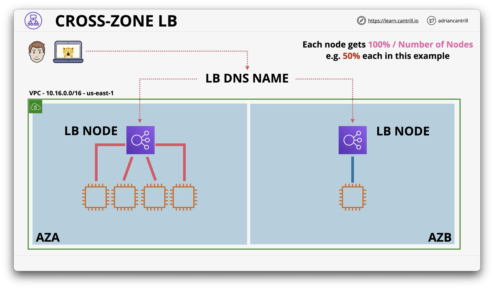

# Elastic Load Balancer (ELB)

An **Elastic Load Balancer (ELB)** accepts connections from clients and distributes them across registered backend compute. Its core value is **abstraction**: clients are decoupled from the physical infrastructure, so backend capacity can scale up or down, and instances can fail and be replaced, all without the client being aware. This abstraction is exactly what makes [horizontal scaling](../patterns/scaling.md) possible, and it is the standard entry point of the web tier in the [regional architecture model](../patterns/global-regional-architecture.md).

## The ELB Family

"ELB" refers to the whole family, which has three course-covered types split across two versions:

| Version | Type | Layer / Protocols | Notes |
| --- | --- | --- | --- |
| v1 | **Classic Load Balancer (CLB)** | HTTP, HTTPS plus lower-level; *not a true L7 device* | Introduced 2009. Legacy — avoid for new deployments; migrate off. One SSL certificate per CLB. More expensive. |
| v2 | **Application Load Balancer (ALB)** | True Layer 7: HTTP, HTTPS, WebSocket | Preferred for HTTP/S workloads. |
| v2 | **Network Load Balancer (NLB)** | Layer 4: TCP, TLS, UDP | For non-HTTP/S workloads: email, SSH, gaming and other custom protocols. |

v2 load balancers are faster and support **target groups and rules**, so one load balancer can serve many purposes (for example, routing by customer).

> [!tip] Exam Tip
> There is **no scenario** where a v1 CLB is the right answer for a new deployment. The real exam skill is **picking ALB vs NLB** for a given protocol: HTTP/HTTPS/WebSocket means ALB; TCP/TLS/UDP (email, SSH, gaming, anything non-HTTP) means NLB.

There is also a fourth member the course does not cover: the **Gateway Load Balancer (GWLB)**, which operates at Layer 3 and is used to insert fleets of third-party security/inspection appliances into the traffic path ([GWLB docs](https://docs.aws.amazon.com/elasticloadbalancing/latest/gateway/introduction.html)). It appears occasionally in SAA-adjacent questions but is out of scope for this page.

## Architecture — It's Nodes, Not a Box

What you provision as a "single load balancer object" is actually **multiple load balancer nodes** living in the subnets you selected. When you create a load balancer, you select **one subnet per enabled AZ**. ALB requires at least two AZs; NLB can technically run in one AZ, but is normally deployed across 2+ AZs for HA. In each enabled AZ, ELB deploys **one or more nodes** in the selected subnet.

- A single **A record** is created for the load balancer. It resolves to **all** active nodes (see [DNS](../concepts/dns.md) for record mechanics).
- Across many clients, DNS resolution tends to spread requests across nodes; the effect is statistical rather than per-request.
- Nodes are **highly available** (a failed node is replaced) and **auto-scale** within their subnet as load rises.

> [!note] The node spread is AWS-managed, not user-configurable — and statistical, not guaranteed
> The node spread is delivered at the **DNS layer**: the A record returns the node IPs with a **60-second TTL**, so clients re-resolve as AWS adds, removes, or replaces nodes ([How Elastic Load Balancing works](https://docs.aws.amazon.com/elasticloadbalancing/latest/userguide/how-elastic-load-balancing-works.html)). There is **no setting** for per-node weighting; your only levers are indirect: **which subnets/AZs you enable** (determining where nodes exist at all) and **cross-zone load balancing** (which changes only what a node does with traffic *after* receiving it — node-to-target, never client-to-node). The evenness is **statistical**: it relies on clients resolving fresh and picking among the returned IPs. A client that caches a resolved IP (the JVM's default indefinite DNS cache is the classic case) pins itself to one node for its lifetime — the same connection-level DNS behavior as the [Aurora reader endpoint](aurora.md#how-the-reader-endpoint-balances-load). Across many independent clients it evens out; a few heavy, long-lived clients can skew it.

### Internet-facing vs internal

This choice controls **the IP addressing of the nodes only** — nothing else about the nodes or features differs:

| Scheme | Node IPs | Use |
| --- | --- | --- |
| **Internet-facing** | Public **and** private | Reachable from the internet |
| **Internal** | Private only | Separating application tiers / private routing |

> [!warning] Gotcha — internet-facing does not force public instances
> An **internet-facing load balancer can forward to both public and private [EC2](../services/ec2.md) instances.** Backend targets do **not** need public addressing — the only requirement is that the **load balancer nodes can reach the targets** (via their private IPs). This matters for "how many subnets/tiers are required" questions: an internet-facing load balancer does not force the instances behind it to be public.

### Listeners

Client-side behavior is set by the **listener configuration**: the protocol and port the load balancer accepts on its front side. Nodes then communicate with **targets** on a (possibly different) port and protocol. Listeners get a dedicated lesson later; this page only introduces them.

### Subnet selection rules

The following provisioning rules are verified against current AWS documentation ([ALB docs](https://docs.aws.amazon.com/elasticloadbalancing/latest/application/application-load-balancers.html), [NLB availability zones](https://docs.aws.amazon.com/elasticloadbalancing/latest/network/availability-zones.html), [CLB subnets](https://docs.aws.amazon.com/elasticloadbalancing/latest/classic/elb-manage-subnets.html)):

- You choose **subnets** when provisioning; selecting a subnet is what enables that AZ — "to enable a zone, specify a subnet in the zone," and ELB creates a node in each zone you specify.
- **At most one subnet per AZ** for a single load balancer.
- **Internet-facing** load balancers must use **public subnets** (route to an [IGW](../services/vpc.md)) so nodes can get public IPs; backend **targets can stay in private subnets**.
- **ALB requires at least two subnets in two different AZs.**
- **NLB** can technically be deployed to a **single subnet/AZ** (you enable AZs one subnet at a time at the API level), but the console create flow and AWS best practice still push **two or more AZs** — default to "2+ AZs" on the exam unless a question specifically probes the single-AZ NLB capability.
- **Static IPs are NLB-specific**: an internet-facing NLB supports one **Elastic IP** per subnet/node (or AWS assigns one), and an internal NLB can take an assignable private IP per subnet. **ALB and CLB have no static IPs** — you always use their DNS name.

### IP addressing and subnet sizing

- Load balancer nodes need **8+ free IPs per subnet** to function and scale.
- Strictly, a **/28** ($2^{(32 - 28)}$, i.e., 16 total addresses minus [5 AWS-reserved](../services/vpc.md) leaves 11 free) technically satisfies "8 free."
- AWS **recommends /27 or larger** so the load balancer has room to scale alongside backend instances — the docs say to "verify that each Availability Zone subnet for your load balancer has a CIDR block with at least a /27 bitmask and at least eight free IP addresses per subnet" ([ALB docs](https://docs.aws.amazon.com/elasticloadbalancing/latest/application/application-load-balancers.html), [ELB scaling strategies blog](https://aws.amazon.com/blogs/networking-and-content-delivery/scaling-strategies-for-elastic-load-balancing/)).

> [!warning] Gotcha — /27 vs /28 on the exam
> Both can be "correct" depending on the options shown. If `/27` is an option, pick **/27** (the AWS-recommended value; remember it as the default). If you only see `/28` and not `/27`, then **/28** is probably the intended answer (it does satisfy the 8-free-IP rule).

## Multi-Tier Abstraction

Internal load balancers are what let **each tier scale independently**. In the three-tier picture (WEB, APP, DB across two AZs):

1. The user connects to the **internet-facing load balancer**, which forwards to a web instance in the WEB Auto Scaling group.
2. The web instance talks to an **internal load balancer**, which forwards to an app instance in the APP Auto Scaling group — possibly in a different AZ.
3. The app instance talks to the DB tier ([Aurora](aurora.md)) for persistent storage.

Without load balancers, every tier is tightly coupled: the user would talk to a *specific* web instance, which talks to a *specific* app instance, and any failure or scaling event disrupts the chain. Inserting load balancers between tiers **loosens the coupling**: the APP tier can grow from 2 to 4 instances and the WEB tier keeps using it with **no reconfiguration**, because it only ever talks to the internal load balancer's DNS name. This is the same session-independence story as [stateless design in horizontal scaling](../patterns/scaling.md#the-critical-consideration--sessions) — the load balancer abstracts *which* instance serves a request.

## Cross-Zone Load Balancing

### The problem (historic default — disabled)

Originally each load balancer node could **only** distribute to instances **in its own AZ**. With 4 instances in AZ A and 1 in AZ B:

- DNS distribution tends to split load across **nodes**: in the idealized two-node example, each node gets 50% (100% divided by 2 nodes).
- Node A splits its 50% across 4 local instances, so each gets 12.5%.
- Node B sends its entire 50% to the single local instance.

The result is badly uneven: one instance carries 50% of all traffic while the others carry 12.5% each.

### The fix — cross-zone load balancing (enabled)

Cross-zone load balancing lets **every node distribute across all registered instances in all AZs**. Node A can send to the AZ B instance and vice versa, producing an even distribution across all 5 instances.

> [!tip] Exam Tip — defaults and triggers
>
> - **ALB:** cross-zone is **enabled by default and cannot be changed at the load balancer level**; target groups can override that inherited setting ([ALB target group attributes](https://docs.aws.amazon.com/elasticloadbalancing/latest/application/edit-target-group-attributes.html#modify-target-group-attributes)).
> - **Classic and others** were historically **disabled** by default.
> - The typical exam scenario is "**uneven load distribution**" across AZs — the answer is to **enable cross-zone load balancing**.

> [!warning] Gotcha — node distribution vs instance distribution
> DNS responses tend to distribute clients across **nodes**; over many clients, that approximates an even split. Cross-zone only changes what each node does **after** it receives its share — whether it can reach instances in other AZs.

## Quick Reference

| Topic | Key fact |
| --- | --- |
| Family | CLB (v1), ALB + NLB (v2). Prefer v2 always. |
| ALB | L7; HTTP/HTTPS/WebSocket; cross-zone **on** by default at the LB level; target groups can override |
| NLB | L4; TCP/TLS/UDP; static IPs (Elastic IP); can technically run in 1 AZ |
| CLB | v1 legacy; 1 SSL certificate per LB; avoid |
| Real object | Multiple **nodes** in each chosen subnet, auto-scaling |
| DNS | Single **A record** resolving to **all** nodes |
| Node distribution | Traffic split evenly across nodes: 100% divided by the number of nodes |
| Internet-facing | Nodes get **public + private** IPs; can reach **public and private** targets |
| Internal | Nodes get **private** IPs only; used to separate tiers |
| Listener | Front-side configuration: protocol + port the LB accepts on |
| Subnet count | **One subnet per AZ**, **2+ AZs** (ALB requires it) |
| Subnet size | **8+ free IPs**; recommend **/27 or larger**; /28 is the strict minimum |
| Cross-zone | Fixes uneven load; distributes across **all** instances in **all** AZs |

## References

- [Scaling — Horizontal vs Vertical](../patterns/scaling.md) — why a load balancer is the price of admission for horizontal scaling
- [Global & Regional AWS Architecture](../patterns/global-regional-architecture.md) — the load balancer as the web-tier regional entry point
- [VPC](vpc.md) — subnets, reserved IPs, public vs private subnet mechanics
- [Networking](../concepts/networking.md) — ENIs, firewall layers
- AWS docs: [Application Load Balancers](https://docs.aws.amazon.com/elasticloadbalancing/latest/application/application-load-balancers.html) · [NLB availability zones](https://docs.aws.amazon.com/elasticloadbalancing/latest/network/availability-zones.html) · [CLB subnets](https://docs.aws.amazon.com/elasticloadbalancing/latest/classic/elb-manage-subnets.html) · [ALB target group attributes](https://docs.aws.amazon.com/elasticloadbalancing/latest/application/edit-target-group-attributes.html#modify-target-group-attributes) · [ELB scaling strategies blog](https://aws.amazon.com/blogs/networking-and-content-delivery/scaling-strategies-for-elastic-load-balancing/)
- Source: `raw/aws-cert-study-notes/aws-solution-architect/elb_architecture.md` (Adrian Cantrill AWS SAA — "Evolution of the ELB", "ELB Architecture Part 1 & 2"; diagrams © learn.cantrill.io)
