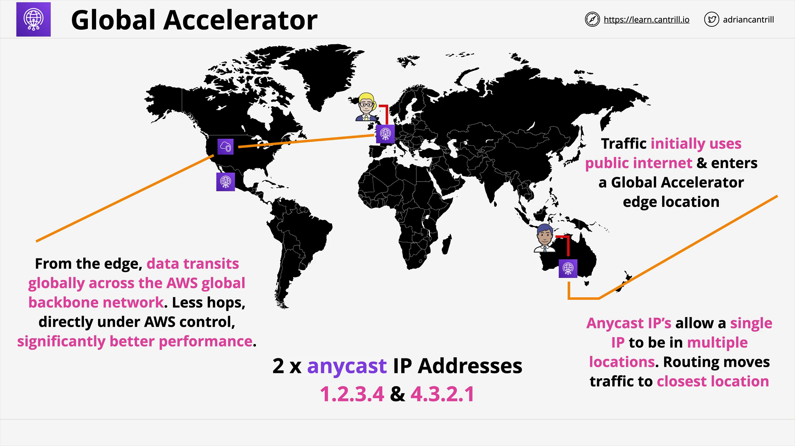

# AWS Global Accelerator

Global Accelerator brings clients onto the AWS backbone through nearby edge entry points, then carries traffic to regional application endpoints. This is a [networking](../concepts/networking.md) service for TCP/UDP applications, including web applications. Unlike [CloudFront](cloudfront.md), it does not cache objects or apply HTTP content rules. See [Edge Delivery](../concepts/edge-delivery.md) for the service-selection model.

## Why Use It?

Consider an application hosted in North America gaining customers in Europe and Australia. Long public-internet routes add variable latency and performance. Global Accelerator shortens that public segment: clients reach an AWS edge, then use the AWS network toward the application. It can help even with one application Region; multiple Regions add endpoint-selection and resilience options.



The addresses shown in the diagram are illustrative, not addresses to configure. “Closest” describes network routing and service selection, not a guarantee of the shortest geographic distance. Public-internet conditions still affect the client-to-edge segment.

## Does AWS Assign the Anycast IPs?

**Yes.** By default, creation assigns two static IPv4 addresses. A dual-stack standard accelerator gets two IPv4 and two IPv6 addresses. Standard accelerators also support bringing your own IPv4 address space. These are accelerator entry addresses, not replacement private addresses for your [EC2](ec2.md) instances or [load balancers](elb.md). Each address family has addresses in two isolated network zones. [AWS component reference](https://docs.aws.amazon.com/global-accelerator/latest/dg/introduction-components.html)

Anycast means the same destination IP is advertised from multiple locations. Internet routing delivers a connection toward an available edge; you do not assign a different accelerator IP to each Region. AWS also provides an accelerator DNS name. The addresses remain assigned when the accelerator is disabled, but deletion releases them.

## What Happens After I Receive the IPs?

Receiving IPs gives you entry points. You still configure where traffic goes:

1. Prepare a working regional application, such as an ALB serving an EC2 target group.
2. Add an accelerator listener for the application protocol and port, for example TCP/443.
3. Add an endpoint group for each participating Region.
4. Register supported endpoints: ALBs, NLBs, EC2 instances, or Elastic IP addresses. Configure health and endpoint access permissions.
5. Wait for the accelerator to become active and verify endpoint health. Test traffic before changing production DNS.
6. Point your application hostname to the accelerator. With [Route 53](route53.md), use an alias to its DNS name; another DNS provider can publish address records for the assigned IPs or an appropriate CNAME to its DNS name. Publish the IPv6 records when using dual-stack. Clients can also use the assigned IPs directly where the application supports it. [AWS setup guide](https://docs.aws.amazon.com/global-accelerator/latest/dg/getting-started-standard.html), [custom-domain guide](https://docs.aws.amazon.com/global-accelerator/latest/dg/dns-addressing-custom-domains.mapping-your-custom-domain.html)

For HTTPS, continue using the application's hostname and a matching certificate on the TLS endpoint, such as an ALB with [ACM](acm.md). Global Accelerator is not an HTTPS certificate termination service. A browser pointed at the bare IP will generally not match a hostname certificate.

The runtime flow is:

```text
api.example.com → DNS answer: accelerator entry IPs
Client → public internet → nearby AWS edge accepting an anycast IP
       → accelerator listener → AWS backbone → chosen regional endpoint
       → application (for example ALB → EC2)
```

[DNS](../concepts/dns.md) helps the client discover the entry addresses; it does not carry application traffic. You register endpoints on the accelerator rather than attaching its anycast IPs to server ENIs. Region or endpoint changes happen behind those stable entry addresses.

An illustrative pre-DNS HTTPS test preserves the hostname, Host header, and TLS SNI while forcing one entry IP:

```bash
# Replace both the hostname and documentation-only IP with your own values.
curl --resolve api.example.com:443:198.51.100.10 https://api.example.com/health
```

Test both IPv4 entry addresses, successful application responses, and new connections during controlled endpoint failover. Do not infer that a working ICMP response proves the application is healthy.

## Routing Controls and Failover

A standard accelerator chooses endpoints using location, health, and configured controls. An endpoint-group **traffic dial** adjusts traffic otherwise destined for that Region; an endpoint **weight** adjusts distribution within the group. A 50% dial does not mean that Region gets half of all global requests. Load-balancer endpoints use their load-balancer health checks; EC2/EIP endpoints need suitable accelerator health checks. [AWS routing overview](https://docs.aws.amazon.com/global-accelerator/latest/dg/introduction-how-it-works.html)

Failover selects another endpoint for **new connections**. It does not migrate an established TCP session or replicate application state. Design [global and regional architecture](../patterns/global-regional-architecture.md) with data availability, retries, and regional capacity in mind.

Custom routing accelerators serve a different requirement: deterministic mappings to particular EC2 destinations in VPC subnets, for example game sessions. They do not provide the standard accelerator's health-based failover and support IPv4 only.

> [!tip] Exam Tip
> Global TCP/UDP acceleration, stable entry IPs, and regional endpoint failover suggest Global Accelerator. HTTP object caching, signed content access, and request transformation suggest [CloudFront](cloudfront.md).

## References

- [AWS Global Accelerator components](https://docs.aws.amazon.com/global-accelerator/latest/dg/introduction-components.html)
- [How Global Accelerator works](https://docs.aws.amazon.com/global-accelerator/latest/dg/introduction-how-it-works.html)
- [Getting started with a standard accelerator](https://docs.aws.amazon.com/global-accelerator/latest/dg/getting-started-standard.html)
- [Route custom domain traffic](https://docs.aws.amazon.com/global-accelerator/latest/dg/dns-addressing-custom-domains.mapping-your-custom-domain.html)
