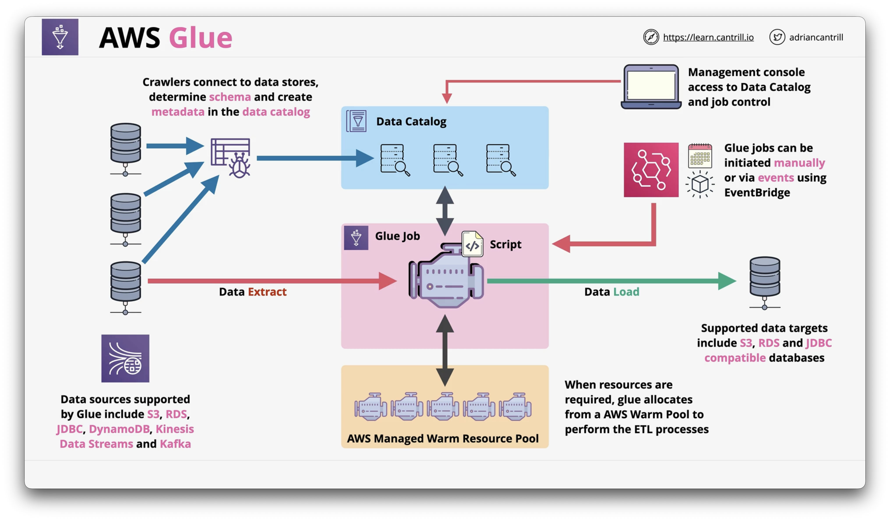

# AWS Glue

## Overview

AWS Glue is a **serverless data integration service** for discovering, preparing, and moving data. Its two central responsibilities are **cataloging metadata** and **running transformations**. These fit into a larger [data integration architecture](../concepts/data-integration.md), where storage, metadata, processing, queries, and orchestration have separate jobs.

| Component | Responsibility | Result |
| --- | --- | --- |
| **Crawler** | Inspect supported stores and infer schemas | Table and partition metadata |
| **Data Catalog** | Persist and share metadata such as schemas and locations | Definitions that jobs and query engines can use |
| **Glue job** | Execute extraction, transformation, and loading logic | Prepared data in a destination store |

For example, a crawler can describe JSON files in [S3](s3.md), while a job cleans their records and writes Parquet files for analysis. Creating a catalog entry does **not** copy the underlying dataset or transform its contents. Glue Studio can generate job code from a visual workflow, and developers can also author scripts directly. [AWS Glue overview](https://docs.aws.amazon.com/glue/latest/dg/what-is-glue.html).

[AppFlow](appflow.md) complements Glue when records originate in supported SaaS applications: a configured flow can transfer them to S3 and register output metadata directly in the Data Catalog. A Glue job can then perform further transformations. This path does not require a crawler merely to populate the catalog. See the [data movement comparison](../concepts/data-integration.md#choosing-a-data-movement-service). [AWS AppFlow catalog integration](https://docs.aws.amazon.com/appflow/latest/userguide/flows-catalog.html).

## Architecture and Diagram Walkthrough

Read the diagram as two flows: **blue arrows discover metadata**, while **red and green arrows move data through a transformation**. The catalog connects the flows but does not sit in the path as a repository for the source records.



1. **Discovery:** a crawler inspects a supported store, infers its schema, and creates or updates catalog metadata.
2. **Extraction:** a Glue job reads records from its source. It can use catalog definitions to locate and interpret the data.
3. **Transformation and loading:** job code cleans, restructures, joins, or enriches the records, then writes the output. Jobs can also update catalog metadata when configured to do so.
4. **Compute:** the orange resource pool illustrates AWS-managed execution capacity. It is a conceptual explanation of serverless operation, not a promise of instant startup or a guarantee that no networking resources appear in your account.
5. **Control:** the console manages definitions and runs; schedules, events, and orchestrators can initiate processing.

> [!warning] Gotcha
> The source list in the slide applies to **Glue jobs**, not uniformly to crawlers. Glue can process Kinesis and Kafka streams, but **crawlers do not crawl data streams**. The streaming-source catalog table can be defined manually. [AWS crawler sources](https://docs.aws.amazon.com/glue/latest/dg/crawler-data-stores.html), [streaming ETL setup](https://docs.aws.amazon.com/glue/latest/dg/add-job-streaming.html).

## Data Catalog and Crawlers

The catalog contains **metadata**, including table schemas, storage locations, and partitions. A catalog database is a logical grouping of tables, not a provisioned [RDS](rds.md) database containing application rows. Crawlers automate discovery, but they are optional: definitions can also be created manually, through APIs, or with an Athena `CREATE EXTERNAL TABLE` statement. The [Athena page](athena.md#real-world-examples-of-how-to-use-athena) compares that DDL path with a crawler. [AWS cataloging](https://docs.aws.amazon.com/glue/latest/dg/catalog-and-crawler.html).

### Scope and organization

The default Data Catalog is scoped to an **AWS account and Region** and uses the account ID as its catalog ID. It is not a global catalog automatically replicated across Regions. See [Resource Scope](../concepts/resource-scope.md#regional-resources).

> [!warning] Gotcha
> “One Data Catalog per account per Region” describes the **default/root catalog**. Current Glue also supports a catalog hierarchy, including nested and federated catalogs. Do not interpret the course shorthand as a prohibition on multiple catalog objects. [AWS catalog hierarchy](https://docs.aws.amazon.com/lake-formation/latest/dg/populating-catalog.html), [GetCatalogs API](https://docs.aws.amazon.com/glue/latest/webapi/API_GetCatalogs.html).

### Discovery and access

Configure the crawler's source locations, [IAM role](iam.md#iam-roles), and any required connection credentials and network access. Crawlers can inspect S3, DynamoDB, and supported databases through JDBC, among other sources. Inferring a schema makes data easier to discover; it does not validate every business rule or grant another team permission to read the underlying data. [AWS crawler sources](https://docs.aws.amazon.com/glue/latest/dg/crawler-data-stores.html).

### Consumers of catalog metadata

| Consumer | How it uses the catalog |
| --- | --- |
| **Glue jobs** | Locate datasets and use their schemas during processing |
| **[Athena](athena.md)** | Use table definitions to query S3 data with SQL ([schema-on-read](athena.md#schema-on-read-architecture)) |
| **Redshift Spectrum** | Use external table definitions when querying S3 |
| **EMR** | Use a shared metastore for compatible processing engines |
| **Lake Formation** | Apply governance and fine-grained permissions to cataloged resources and data |

This shared metadata layer helps teams reuse datasets without rebuilding every definition. **Discovery and authorization remain separate**: catalog visibility alone does not confer access to records. [AWS catalog integrations](https://docs.aws.amazon.com/glue/latest/dg/catalog-and-crawler.html).

## Worked Example — S3 Lease Records to Shared Catalog Consumers

This illustrative example follows the updated source note. Operations produces monthly lease records; finance queries them with Athena, data engineering prepares them with Glue, and analytics uses Redshift Spectrum or EMR. Names and inferred types below are examples, not guaranteed crawler output.

### 1. Land the CSV files in S3

Use a consistent prefix layout, with separate partitions for each month:

```text
s3://company-data/leases/year=2026/month=10/leases_01.csv
s3://company-data/leases/year=2026/month=11/leases_01.csv
```

A representative October record is:

```csv
lease_id,property,unit,monthly_rent,start_date
L1001,Sunset Apts,204,2450.00,2026-10-01
```

S3 stores the bytes and object metadata; uploading the files does not create an analytics table. The producer may know the schema already, but query engines still need a usable table definition. The single row above illustrates the format rather than a complete crawler test dataset.

### 2. Configure discovery and inspect the inferred schema

| You configure | The crawler infers or populates |
| --- | --- |
| Source prefix `s3://company-data/leases/` | File format, such as CSV |
| IAM role with source and catalog permissions | Columns and candidate data types |
| Target catalog database `raw` | Table definitions and partition metadata |
| Crawl schedule or initiation mechanism, classifiers, and grouping settings as needed | Grouping of compatible files into tables |

You do not have to hand-author every column before crawling. Glue tries configured **custom classifiers before built-in classifiers**; use a custom classifier when the default parsing needs adjustment, such as an unusual delimiter or format. Review the results: inference can leave dates as strings or interpret an identifier such as `unit` as a number. Changing a catalog type alone does not rewrite stored values. [AWS classifiers](https://docs.aws.amazon.com/glue/latest/dg/add-classifier.html).

For Hive-style prefixes such as `year=2026/month=10/`, the crawler derives partition names **`year` and `month`**. For plain prefixes such as `2026/10/`, default names are **`partition_0` and `partition_1`**; these can be renamed in the catalog, with partition-index handling if indexes already exist. Inconsistent layouts or incompatible schemas can produce separate tables rather than the intended single partitioned table. [AWS partition discovery](https://docs.aws.amazon.com/glue/latest/dg/aws-glue-programming-etl-partitions.html).

### 3. Inspect the catalog table

Assume discovery produces a table named `raw.leases`, and its reviewed definition is:

| Property | Illustrative value |
| --- | --- |
| Columns | `lease_id string`, `property string`, `unit bigint`, `monthly_rent double`, `start_date string` |
| Partition keys | `year string`, `month string` — values derived from prefixes, not CSV columns |
| Location | `s3://company-data/leases/` |
| Classification and parsing | CSV; a compatible SerDe (serializer/deserializer), delimiter, and header-handling configuration |
| Registered partitions | `year=2026/month=10` and `year=2026/month=11`, each with its S3 location |

The catalog holds this **description**, while the records remain in S3. Ensure the CSV header is handled correctly by each consuming engine; schema inference is not a substitute for inspecting a sample query. For curated financial data, an explicit decimal rent type and a string unit identifier may be more appropriate than the raw inferred types.

### 4. Keep new partitions discoverable

Suppose the first crawl ran when only October existed. Uploading November files under a **new prefix** does not, by itself, register November in a table that relies on catalog partition metadata. Options include:

- Re-run the crawler, optionally configured to crawl only new folders.
- Run `MSCK REPAIR TABLE raw.leases;` in Athena to discover missing **Hive-style** partitions. It adds missing metadata; it does not remove stale partitions.
- Register partitions explicitly with `ALTER TABLE ADD PARTITION` or a catalog API, including for non-Hive layouts.
- Configure **Athena partition projection**: Athena computes partition values and locations from table rules rather than fetching registered partitions.

> [!warning] Gotcha
> Partition projection is an **Athena query feature**, not a catalog-registration mechanism for Glue jobs, Redshift Spectrum, or EMR. Those consumers still need appropriate partition metadata or their own discovery method. Also distinguish **a new partition** from **new files under an already registered partition location**: the latter do not normally require a new partition entry.

See [AWS MSCK behavior](https://docs.aws.amazon.com/athena/latest/ug/msck-repair-table.html) and [Athena partition projection](https://docs.aws.amazon.com/athena/latest/ug/partition-projection.html).

### 5. Reuse the definition across consumers

**Athena — query the raw files without loading them into a warehouse.** With the reviewed column types and string partition keys above:

```sql
SELECT property, AVG(monthly_rent) AS average_monthly_rent
FROM raw.leases
WHERE year = '2026' AND month = '10'
GROUP BY property;
```

The partition predicate selects October 2026 and excludes November's files from the scan. This is **partition pruning**: it reduces data scanned and can reduce scan-based query charges. Filtering only on the CSV's `start_date` field is not the same as explicitly filtering the partition keys. [AWS Athena partitioning](https://docs.aws.amazon.com/athena/latest/ug/partitions.html).

**Glue — read the cataloged source and prepare curated output.** Inside a job with an initialized `glueContext`:

```python
leases = glueContext.create_dynamic_frame.from_catalog(
    database="raw",
    table_name="leases",
)
```

The returned object is a **DynamicFrame**. Its source location and schema come from the catalog, so this read does not hard-code an S3 path. It reads the table's registered partitions unless a filter such as `push_down_predicate` is supplied; the preceding Athena query does not filter this independent job. [AWS DynamicFrameReader](https://docs.aws.amazon.com/glue/latest/dg/aws-glue-api-crawler-pyspark-extensions-dynamic-frame-reader.html).

A typical next step is to validate values, fix types, convert CSV to Parquet, and write to `s3://company-data/curated/leases/`. Then crawl that output or update its catalog definition from the job. Keep the curated prefix outside the raw table's root so discovery does not mix both datasets. This implements the [raw-to-curated integration pattern](../concepts/data-integration.md#worked-example--raw-files-to-a-shared-dataset).

**Redshift Spectrum — join external and warehouse data.** Configure an external schema referencing the Glue database and grant access to both metadata and S3. Spectrum can join the external lease table with warehouse tables without first loading the lease records into Redshift. [AWS external schemas](https://docs.aws.amazon.com/redshift/latest/dg/c-spectrum-external-schemas.html).

**EMR — reuse a persistent metastore.** Configure Spark to use Glue as its Hive metastore; it can then resolve a table with `spark.table("raw.leases")`. Definitions persist independently of a particular EMR cluster. [AWS EMR metastore integration](https://docs.aws.amazon.com/emr/latest/ReleaseGuide/emr-spark-glue.html).

The shared definition is what breaks the data silo: several authorized teams can discover and interpret the same source dataset, while choosing different query or transformation engines.

## Jobs, Sources, and Targets

A job defines the processing logic and execution settings; a **job run** is one execution. Apache Spark jobs support distributed transformations, while streaming ETL jobs continuously consume sources such as [Kinesis Data Streams](kinesis.md#kinesis-data-streams) and [Kafka/MSK](../concepts/streaming-vs-messaging.md#kinesis-vs-kafka-and-amazon-msk).

| Path | Examples | Important distinction |
| --- | --- | --- |
| Batch input | S3, RDS/JDBC databases, DynamoDB | Connector and permissions determine what can be read |
| Streaming input | Kinesis Data Streams, Kafka, MSK | Continuous jobs; no crawler support for the stream itself |
| Output | S3, JDBC databases, DynamoDB through its writer connector | The course's target list is illustrative, not exhaustive |

Glue has supported **writing to DynamoDB since Glue 1.0**. It can also write to Kinesis Data Streams from scripts. Do not memorize the note's source/target asymmetry as a service restriction. [AWS DynamoDB connector](https://docs.aws.amazon.com/glue/latest/dg/aws-glue-programming-etl-connect-dynamodb-home.html), [AWS streaming ETL](https://docs.aws.amazon.com/glue/latest/dg/add-job-streaming.html).

Streaming jobs use **checkpoints** to track progress, rather than batch job bookmarks. They continue consuming compute while running; serverless does not imply zero cost when a stream has no new records. [AWS streaming behavior and billing](https://docs.aws.amazon.com/glue/latest/dg/add-job-streaming.html).

### What serverless does and does not remove

AWS operates the execution infrastructure. You still own transformation correctness, worker/capacity settings, IAM permissions, and connectivity. For private JDBC sources, Glue needs [VPC](vpc.md) subnet and security-group configuration and creates **elastic network interfaces** to reach them. The slide's warm-pool model therefore does not mean “nothing exists in my account.” [AWS Glue VPC connectivity](https://docs.aws.amazon.com/glue/latest/dg/connection-JDBC-VPC.html).

## Starting and Coordinating Work

Glue jobs can start manually, through APIs, or through Glue triggers:

| Trigger type | Purpose |
| --- | --- |
| `ON_DEMAND` | Start the configured actions when explicitly requested |
| `SCHEDULED` | Run on a cron schedule |
| `CONDITIONAL` | React to specified completion states of preceding jobs or crawlers |
| `EVENT` | Start a workflow from EventBridge events, optionally collected into batches |

These are Glue trigger types; scheduling does **not** require EventBridge. A conditional trigger's dependencies must have been started through triggers; manually running an upstream job is not equivalent to starting its trigger chain. [AWS trigger API](https://docs.aws.amazon.com/glue/latest/dg/aws-glue-api-jobs-trigger.html), [trigger dependency rules](https://docs.aws.amazon.com/glue/latest/dg/about-triggers.html).

[EventBridge](eventbridge.md) can route an arriving-data event to a **Glue workflow** with an event trigger. This makes the event arrow in the slide concrete; an EventBridge rule targeting a workflow is different from simply labeling a job “event driven.” [AWS EventBridge workflow integration](https://docs.aws.amazon.com/glue/latest/dg/starting-workflow-eventbridge.html).

For a process spanning multiple AWS services, [Step Functions](step-functions.md) can start a Glue job and wait for it with `arn:aws:states:::glue:startJobRun.sync` in a Standard workflow. **Step Functions coordinates; Glue transforms the records.** [AWS Glue integration](https://docs.aws.amazon.com/step-functions/latest/dg/connect-glue.html).

## Billing Model

Keep three meters separate rather than reading “pay for jobs” as the entire bill:

| Meter | Billing basis |
| --- | --- |
| ETL jobs | DPU-hours (Data Processing Unit capacity × runtime), billed per second; Spark jobs on Glue 2.0+ have a one-minute minimum |
| Crawlers | Compute runtime, billed per second with a ten-minute minimum per crawl |
| Data Catalog | Metadata storage and requests; the first million stored objects and first million requests per month are free |

The one-minute job minimum does not apply to every Glue feature. Storage, query-engine usage, and optional catalog optimization can add separate charges. Use the current regional rates when estimating cost; the useful design lesson is to budget for **discovery, processing, metadata, and storage separately**. [AWS cost-modeling guidance](https://docs.aws.amazon.com/whitepapers/latest/cost-modeling-data-lakes/cost-optimization-in-analytics-services.html), [AWS Glue pricing](https://aws.amazon.com/glue/pricing/).

## Glue vs AWS Data Pipeline

AWS Data Pipeline is a legacy workflow service that can schedule activities on **EC2 instances or EMR clusters**, with task runners performing the work. Its compute model is broader than “always creates EMR.” Glue supplies managed ETL execution, while Data Pipeline coordinates work on provisioned resources. [AWS Data Pipeline overview](https://docs.aws.amazon.com/datapipeline/latest/DeveloperGuide/what-is-datapipeline.html).

> [!warning] Gotcha
> Data Pipeline **closed to new customers on July 25, 2024** and is in maintenance mode. Existing customers can continue using it. This is not an announced shutdown of existing pipelines. AWS identifies Glue, Step Functions, and Amazon MWAA (managed Airflow) as migration options, depending on whether the workload primarily needs ETL, service orchestration, or Airflow compatibility. [AWS migration announcement](https://aws.amazon.com/blogs/big-data/migrate-workloads-from-aws-data-pipeline/).

> [!tip] Exam Tip
> **Serverless ETL and data preparation → Glue. Automatic schema discovery → crawler. Shared metadata → Data Catalog. Multi-service coordination → Step Functions.** “Ad hoc” or “cost-effective” alone is insufficient: an ad hoc SQL question over S3 may call for Athena rather than an ETL job. See [SAA Glue notes](../certifications/aws-saa.md#aws-glue) for the decision table.

## References

- [Source study note — AWS Glue](../../raw/aws-cert-study-notes/aws-solution-architect/aws_glue.md) — Cantrill AWS Glue 101; source of the copied diagram.
- [AWS — What is AWS Glue?](https://docs.aws.amazon.com/glue/latest/dg/what-is-glue.html)
- [AWS — Data discovery and cataloging](https://docs.aws.amazon.com/glue/latest/dg/catalog-and-crawler.html)
- [AWS — Supported crawler sources](https://docs.aws.amazon.com/glue/latest/dg/crawler-data-stores.html)
- [AWS — Streaming ETL jobs](https://docs.aws.amazon.com/glue/latest/dg/add-job-streaming.html)
- [AWS — Glue pricing](https://aws.amazon.com/glue/pricing/)
- [AWS — Migrate workloads from Data Pipeline](https://aws.amazon.com/blogs/big-data/migrate-workloads-from-aws-data-pipeline/)
