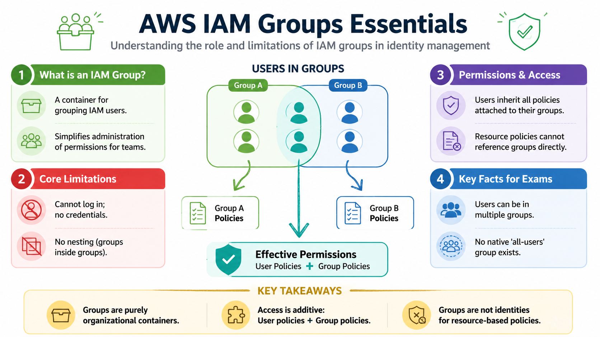
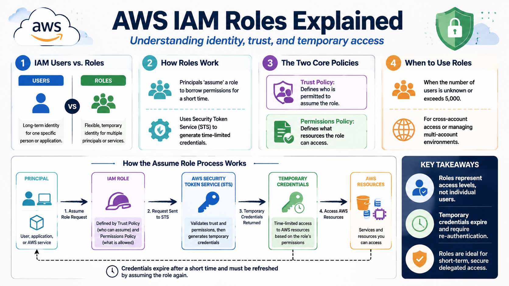
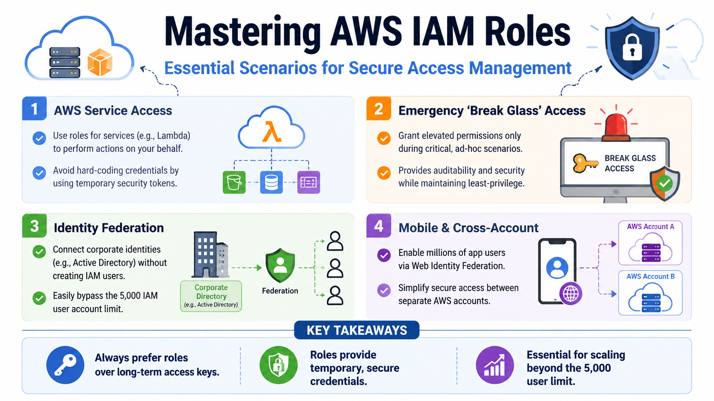
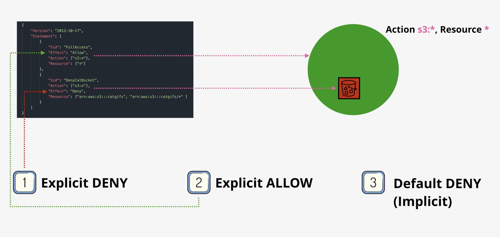

# IAM — Identity and Access Management

IAM is AWS's **Identity Provider (IDP)**: it handles [authentication and authorization](../concepts/identity-and-access.md) — who you are and what you can do. It is a **global** service, not region-specific.

## Core Concepts

- IAM manages: **users**, **groups**, **roles**, and **policies**.
- IAM sits above the network layer — it controls *what actions* are permitted on *which resources*, independent of [VPC](vpc.md) or region boundaries.

## IAM Users

- Represent a **long-term identity**: a human, application, or service account that needs persistent AWS access.
- Username is required; password is optional (some users only need CLI access via access keys, not console access).
- **Access Keys** are the CLI/API equivalent of a username+password:
  - Access Key ID = username
  - Secret Access Key = password (never share this)
- Use **named profiles** in the AWS CLI to manage multiple IAM users across accounts:

  ```shell
  aws configure --profile iamadmin-general
  aws configure --profile iamadmin-production
  aws s3 ls --profile iamadmin-general
  ```

> [!tip] Users vs Roles
> IAM Users = long-term credentials (humans, service accounts). IAM Roles = short-lived temporary credentials — the right choice for [EC2](ec2.md) instances, Lambda functions, and cross-account access. Prefer roles over embedding access keys in code. See [IAM Roles](#iam-roles) below for the full model.

## IAM Groups

An **IAM Group** is a **container of IAM users** that exists purely to simplify permission management — attach a policy once to the group and every member inherits it. A group is **not an identity**: it has no credentials, cannot be logged into, and cannot be referenced by [resource-based policies](#policy-evaluation--priority) (only users and roles can).



### Effective Permissions

A user's effective permissions are the **union** of:

- The user's own attached policies (managed + inline)
- Every policy attached to **every group** the user belongs to
- Any applicable resource-based policies

All of these go through the same [evaluation order](#policy-evaluation--priority) — any explicit Deny still wins.

### Limits and Rules

| Limit / Rule | Value |
| --- | --- |
| IAM users per account | **5,000** (hard limit) |
| Groups a user can belong to | **10** (hard limit) |
| Users per group | No limit |
| Groups per account | Default **300**, increase via support ticket |
| Nesting (groups inside groups) | **Not allowed** |
| Built-in "all users" group | **Does not exist** — create one yourself if needed |
| Resource policy can reference a group? | **No** — only IAM users and roles |
| Group can be logged into? | **No** — groups have no credentials |

> [!warning] Gotcha
> Common exam traps: (1) "Add the group to the S3 bucket policy" — **impossible**, resource policies cannot name a group. (2) "Nest the Admins group inside the Engineering group" — **not supported**. (3) "Log in as the DevOps group" — groups have no credentials. (4) Hitting the 10-group-per-user ceiling on accounts with many fine-grained groups.

> [!tip] Exam Tip
> Groups solve **user-management** scale, not identity scale. When the question describes thousands of external users, federation with [roles](#iam-roles) is the answer — groups still don't help past the 5,000-user limit, since each member must be a real IAM user.

## IAM Roles

An **IAM Role** is an AWS identity designed to be **assumed temporarily** by one or more **unknown or numerous principals** — humans, applications, AWS services, or external identities. Roles do not represent a specific person; they represent a *level of access* that a principal can borrow for a limited time.



### Roles vs Users

| | IAM User | IAM Role |
| --- | --- | --- |
| Intended principal | Single, identifiable | Multiple or unknown |
| Lifetime | Long-term (persistent) | Short-term (temporary STS credentials) |
| Credentials | Password / access keys | Generated on assume — expire automatically |
| Scale ceiling | Hard limit of **5,000 users per account** | No equivalent per-account ceiling — fits federation, large user bases |
| Mental model | "This is *me*" | "I am *borrowing* this access right now" |

When you assume a role, you **become** that role for the credential's lifetime — you do not log in as a user with the role's permissions attached. After the credentials expire, the principal must re-assume the role to get new ones.

### Trust Policy vs Permissions Policy

A role is governed by **two distinct policies**:

| Policy | Question it answers | Examples of what it lists |
| --- | --- | --- |
| **Trust policy** | *Who* is allowed to assume this role? | IAM users, other roles, AWS services (e.g. `lambda.amazonaws.com`, `ec2.amazonaws.com`), other AWS accounts, federated identity providers (SAML, OIDC, Google/Facebook/Twitter) |
| **Permissions policy** | *What* can the role do once assumed? | Standard IAM policy: `Action`, `Resource`, `Effect`. Same evaluation rules as for users — see [Policy Evaluation & Priority](#policy-evaluation--priority). |

A principal not listed in the trust policy is denied at the **AssumeRole** step — they never get credentials at all, regardless of what the permissions policy says.

### How AssumeRole Works (STS)

When a role is assumed, AWS's **Security Token Service (STS)** issues short-lived credentials via the `sts:AssumeRole` API:

1. Principal calls `sts:AssumeRole` (or a variant: `AssumeRoleWithSAML`, `AssumeRoleWithWebIdentity`).
2. STS evaluates the role's **trust policy** — is this principal allowed?
3. If allowed, STS returns three values: **Access Key ID**, **Secret Access Key**, and **Session Token**.
4. The principal uses those credentials to call AWS APIs. Every request is authorized against the role's **permissions policy** at call time — so permission changes take effect immediately on in-flight sessions.
5. Credentials expire (typically 15 min – 12 h). To continue, re-assume the role.

Because roles are identities, they can also be referenced in **resource policies** (e.g. an S3 bucket policy that grants access to a specific role ARN). Both the role's permissions policy and the resource's policy are evaluated together.

### When to Use Roles



#### AWS service access (e.g. Lambda execution role)

AWS services like Lambda and [EC2](ec2.md) are **not IAM identities** — they have no default permissions of their own. To act on your behalf, the service assumes a role you create:

- The role's **trust policy** trusts the service principal (e.g. `lambda.amazonaws.com`).
- The role's **permissions policy** grants the AWS API actions the workload needs.
- At runtime, the service calls `sts:AssumeRole`, gets temporary credentials, and the workload uses them — no static access keys in code.

This pattern handles unknown-number-of-principals naturally: Lambda might spin up thousands of concurrent execution environments, each assuming the same role independently.

> [!warning] Gotcha
> Never bake long-term IAM user access keys into Lambda code, EC2 user-data, or container images. Use a role instead — temporary credentials, automatic rotation, no secret leakage if code is exposed.

#### Break-glass / emergency access

A **break-glass role** grants elevated permissions for rare emergency situations (3 a.m. incident, service-desk escalation). The principal's day-to-day identity stays read-only or low-privilege; in an emergency they assume the role, the act is logged in [CloudTrail](cloudtrail.md), and credentials expire automatically.

This is far safer than granting permanent admin: privilege escalation becomes a deliberate, auditable event rather than the default state.

#### Identity Federation — corporate IdP

Organizations with an existing identity provider (e.g. Microsoft Active Directory, Okta) integrate it with AWS via roles. Staff log in with their corporate credentials; the IdP issues a SAML assertion; the user (or the console) calls `sts:AssumeRoleWithSAML` to get AWS credentials for a mapped role.

This is essential at scale: the **5,000 IAM users per account** hard limit makes per-employee IAM users impractical for large organizations. With federation, a handful of roles serves an arbitrarily large workforce.

#### Web Identity Federation — mobile/web apps

Apps with millions of end users (ride-share, photo apps) cannot create an IAM user per customer. Instead:

- Users authenticate against Google / Facebook / Apple / Cognito.
- The app exchanges that token for AWS credentials via `sts:AssumeRoleWithWebIdentity`.
- The role's permissions are typically narrow (e.g. read/write only the user's own DynamoDB rows or S3 prefix).

No AWS credentials are ever stored in the app, and the design scales beyond the 5,000-user limit.

#### Cross-account access

Roles are the canonical mechanism for granting access between AWS accounts:

- An IAM role lives in account B with a trust policy that trusts account A.
- A user in account A calls `sts:AssumeRole` against the account B role.
- They get credentials that act as identities **inside account B** — resource ownership and billing stay with account B.

This is also how [AWS Organizations](organizations.md) moves users between accounts (the management account assumes an `OrganizationAccountAccessRole` in each member account) — a single sign-in covers many accounts without per-account IAM users.

> [!tip] Exam Tip
> External identities — Active Directory users, Google/Facebook accounts, users in other AWS accounts — **cannot directly access AWS resources**. They must assume a role to obtain temporary credentials. Pattern-match this in exam questions: "company has existing AD" or "millions of mobile users" → IAM role + federation, not IAM users.

## ARNs (Amazon Resource Names)

- Uniquely identify **any resource** in any AWS account.
- Format: `arn:partition:service:region:account-id:resource`
- Examples:
  - `arn:aws:s3:::my-bucket` (S3 is global, no region/account needed)
  - `arn:aws:iam::123456789012:user/alice`
  - `arn:aws:ec2:us-east-1:123456789012:instance/i-1234567890abcdef0`

## IAM Identity Policies

An **identity policy** attaches to an IAM user, group, or role and answers *"what can this identity do?"*. It has no `Principal` element — the identity *is* the implicit principal. AWS's other major policy family — **resource policies** like [S3 bucket policies](s3.md#bucket-policies) and [role trust policies](#trust-policy-vs-permissions-policy) — attach to the *resource* and name the principal explicitly. See [Resource Policies vs Identity Policies](../concepts/resource-vs-identity-policies.md) for how the two combine, including the same-account-union / cross-account-intersection rule.

Every policy is a **JSON document** with one or more statements:

```json
{
  "Version": "2012-10-17",
  "Statement": [
    {
      "Sid": "FullS3Access",
      "Effect": "Allow",
      "Action": ["s3:*"],
      "Resource": ["*"]
    },
    {
      "Sid": "DenySpecificBucket",
      "Effect": "Deny",
      "Action": ["s3:*"],
      "Resource": ["arn:aws:s3:::catgrifs", "arn:aws:s3:::catgrifs/*"]
    }
  ]
}
```

### Statement Fields

| Field | Description |
| --- | --- |
| `Sid` | Optional statement identifier (recommended) |
| `Effect` | `Allow` or `Deny` |
| `Action` | Single string or array of actions (e.g. `s3:GetObject`) |
| `Resource` | ARN(s) the action applies to |

### Policy JSON — Case Sensitivity

Identity policies and [resource policies](../concepts/resource-vs-identity-policies.md) share the same JSON grammar, so these rules apply to both. Different parts of a policy follow different rules — it is **not** uniformly case-sensitive.

**Case-sensitive — must match exactly:**

| Element | Required casing | Examples |
| --- | --- | --- |
| Top-level policy keys | PascalCase | `Version`, `Statement`, `Sid`, `Effect`, `Principal`, `NotPrincipal`, `Action`, `NotAction`, `Resource`, `NotResource`, `Condition` |
| `Effect` **values** | PascalCase | `Allow`, `Deny` — `"allow"` is rejected |
| `Principal` sub-keys | Specific casing | `AWS`, `Service`, `Federated`, `CanonicalUser` |
| Condition **operators** | PascalCase | `StringEquals`, `StringEqualsIgnoreCase`, `IpAddress`, `DateGreaterThan`, `Bool`, `ArnLike`, … |

If you write `"effect": "allow"` or `"stringequals": …`, IAM rejects the policy as malformed.

**Case-insensitive at evaluation time, but write in documented casing:**

| Element | Behaviour |
| --- | --- |
| **Action names** (`s3:GetObject`) | Matching is case-insensitive — `s3:getobject` evaluates the same — but always write the documented `service:ActionName` form |
| **Condition key names** (`aws:SourceIp`, `s3:prefix`) | The *name* of the key matches case-insensitively; stick to the documented casing |

**Depends on the operator / value:**

| Element | Behaviour |
| --- | --- |
| **Condition values** | `StringEquals` is case-sensitive; `StringEqualsIgnoreCase` is not. Choose the operator that matches your intent. |
| **ARNs and resource names** | Mostly case-sensitive — S3 bucket names are lowercase-only anyway, but object keys, IAM user/role names, KMS aliases, etc. are case-sensitive in the ARN |
| **Tag keys / values in conditions** | Tags are case-sensitive in AWS; pair them with `StringEquals` vs `StringEqualsIgnoreCase` deliberately |

> [!tip] Exam Tip
> If you see a policy snippet in a question with lowercase `effect`, `allow`, or `stringequals`, the policy is invalid — IAM will not accept it. Element keys and condition operators are PascalCase. Action names and condition-key names *match* case-insensitively, but follow the documented casing in real policies.

## Policy Evaluation & Priority

When multiple statements or policies apply, AWS evaluates them all together:

1. **Explicit Deny** — always wins, regardless of any Allow
2. **Explicit Allow** — grants access if no explicit Deny
3. **Implicit Deny** — default; if nothing explicitly allows, access is denied



This applies across all policy sources: user policies, group policies, [resource-based policies](../concepts/resource-vs-identity-policies.md). When a user (e.g. Sally) has multiple policies attached — directly, via a group, or via a resource-based policy — AWS collects all of them and applies the same priority rules across the combined set.


See [Identity and Access Concepts](../concepts/identity-and-access.md) for how evaluation works across identity types and SCPs.

> [!tip] Exam Tip
> "Deny overrides Allow" — if any policy in scope has an explicit Deny for an action, the request is denied, full stop.

## Managed vs Inline Policies

### Managed Policies (preferred)

- Reusable — attach to multiple identities
- Update in one place; change propagates to all attached identities
- Two subtypes: **AWS managed** (provided by AWS) and **Customer managed** (you create)

### Inline Policies

- Embedded directly on a single user/group/role
- Used for exceptional, one-off permissions
- Higher management overhead

## IAM vs Network Security

IAM controls *what* you can do (API-level authorization). [VPC](vpc.md) security controls (Security Groups, NACLs) control *network traffic* to your resources. They are complementary, not interchangeable — a resource can be network-reachable but IAM-denied, or IAM-allowed but network-blocked.

## References

- [Identity and Access Concepts](../concepts/identity-and-access.md)
- [Resource Policies vs Identity Policies](../concepts/resource-vs-identity-policies.md)
- [S3 — Bucket Policies](s3.md)
- [VPC — Security Groups & NACLs](vpc.md)
- [EC2 — IAM Roles for instances](ec2.md)
- [AWS IAM Documentation](https://docs.aws.amazon.com/iam/)
- [AWS Well-Architected: Break-glass procedures](https://docs.aws.amazon.com/wellarchitected/latest/devops-guidance/ag.sad.5-implement-break-glass-procedures.html)
- [AWS cross-account break-glass example](https://github.com/aws-samples/aws-cross-account-break-glass-example#the-break-glass-user)
- Source: `raw/aws-cert-study-notes/aws-solution-architect/iam.md`
- Source: `raw/aws-cert-study-notes/aws-solution-architect/iam_users_and_arns.md`
- Source: `raw/aws-cert-study-notes/aws-solution-architect/iam_groups.md`
- Source: `raw/aws-cert-study-notes/aws-solution-architect/iam_identity_policies.md`
- Source: `raw/aws-cert-study-notes/aws-solution-architect/iam_roles.md`
- Source: `raw/aws-cert-study-notes/aws-solution-architect/fundamentals.md`
