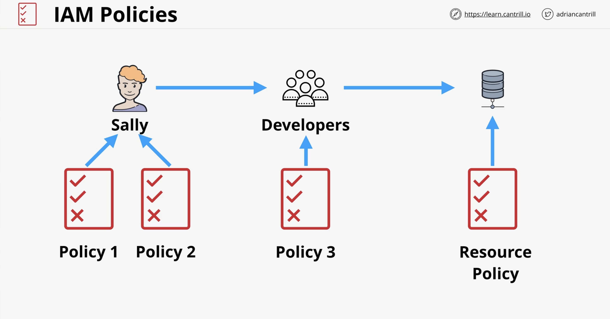

# IAM — Identity and Access Management

IAM is AWS's **Identity Provider (IDP)**: it handles [authentication and authorization](../concepts/identity-and-access.md) — who you are and what you can do. It is a **global** service, not region-specific.

## Core Concepts

- IAM manages: **users**, **groups**, **roles**, and **policies**.
- IAM sits above the network layer — it controls *what actions* are permitted on *which resources*, independent of [VPC](vpc.md) or region boundaries.

## IAM Users

- Represent a **long-term identity**: a human, application, or service account that needs persistent AWS access.
- Username is required; password is optional (some users only need CLI access via access keys, not console access).
- **Access Keys** are the CLI/API equivalent of a username+password:
  - Access Key ID = username
  - Secret Access Key = password (never share this)
- Use **named profiles** in the AWS CLI to manage multiple IAM users across accounts:

  ```shell
  aws configure --profile iamadmin-general
  aws configure --profile iamadmin-production
  aws s3 ls --profile iamadmin-general
  ```

> [!tip] Users vs Roles
> IAM Users = long-term credentials (humans, service accounts). IAM Roles = short-lived temporary credentials — the right choice for [EC2](ec2.md) instances, Lambda functions, and cross-account access. Prefer roles over embedding access keys in code.

## ARNs (Amazon Resource Names)

- Uniquely identify **any resource** in any AWS account.
- Format: `arn:partition:service:region:account-id:resource`
- Examples:
  - `arn:aws:s3:::my-bucket` (S3 is global, no region/account needed)
  - `arn:aws:iam::123456789012:user/alice`
  - `arn:aws:ec2:us-east-1:123456789012:instance/i-1234567890abcdef0`

## IAM Identity Policies

Every policy is a **JSON document** with one or more statements:

```json
{
  "Version": "2012-10-17",
  "Statement": [
    {
      "Sid": "FullS3Access",
      "Effect": "Allow",
      "Action": ["s3:*"],
      "Resource": ["*"]
    },
    {
      "Sid": "DenySpecificBucket",
      "Effect": "Deny",
      "Action": ["s3:*"],
      "Resource": ["arn:aws:s3:::catgrifs", "arn:aws:s3:::catgrifs/*"]
    }
  ]
}
```

### Statement Fields

| Field | Description |
| --- | --- |
| `Sid` | Optional statement identifier (recommended) |
| `Effect` | `Allow` or `Deny` |
| `Action` | Single string or array of actions (e.g. `s3:GetObject`) |
| `Resource` | ARN(s) the action applies to |

## Policy Evaluation & Priority

When multiple statements or policies apply, AWS evaluates them all together:

1. **Explicit Deny** — always wins, regardless of any Allow
2. **Explicit Allow** — grants access if no explicit Deny
3. **Implicit Deny** — default; if nothing explicitly allows, access is denied


This applies across all policy sources: user policies, group policies, resource-based policies. When a user (e.g. Sally) has multiple policies attached — directly, via a group, or via a resource-based policy — AWS collects all of them and applies the same priority rules across the combined set.



See [Identity and Access Concepts](../concepts/identity-and-access.md) for how evaluation works across identity types and SCPs.

> [!tip] Exam Tip
> "Deny overrides Allow" — if any policy in scope has an explicit Deny for an action, the request is denied, full stop.

## Managed vs Inline Policies

### Managed Policies (preferred)

- Reusable — attach to multiple identities
- Update in one place; change propagates to all attached identities
- Two subtypes: **AWS managed** (provided by AWS) and **Customer managed** (you create)

### Inline Policies

- Embedded directly on a single user/group/role
- Used for exceptional, one-off permissions
- Higher management overhead

## IAM vs Network Security

IAM controls *what* you can do (API-level authorization). [VPC](vpc.md) security controls (Security Groups, NACLs) control *network traffic* to your resources. They are complementary, not interchangeable — a resource can be network-reachable but IAM-denied, or IAM-allowed but network-blocked.

## References

- [Identity and Access Concepts](../concepts/identity-and-access.md)
- [VPC — Security Groups & NACLs](vpc.md)
- [EC2 — IAM Roles for instances](ec2.md)
- [AWS IAM Documentation](https://docs.aws.amazon.com/iam/)
- Source: `raw/aws-cert-study-notes/aws-solution-architect/iam.md`
- Source: `raw/aws-cert-study-notes/aws-solution-architect/fundamentals.md`
