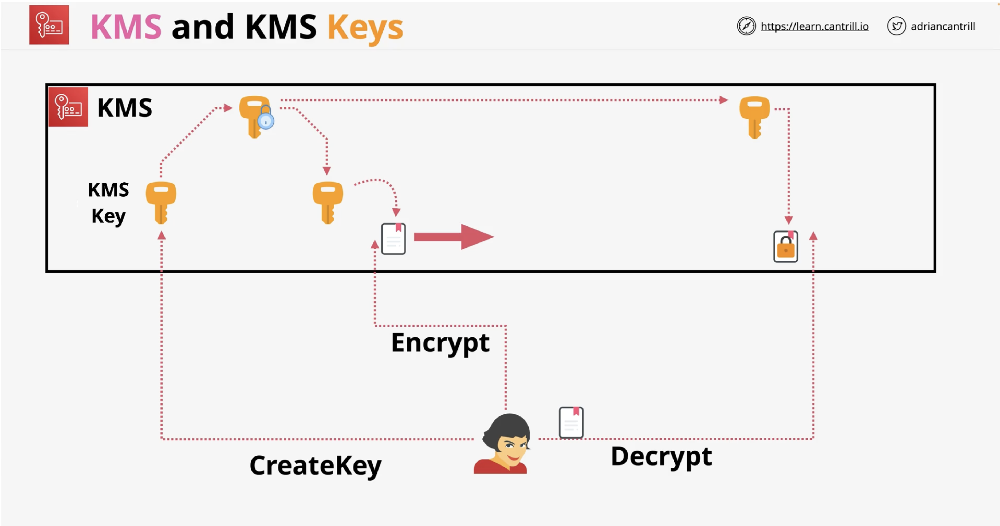
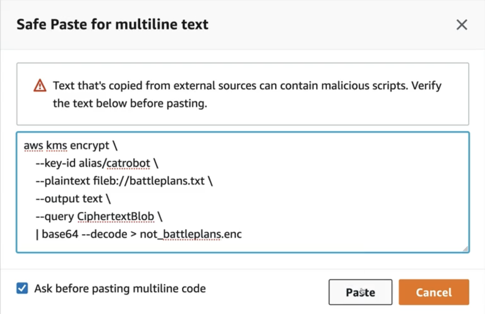
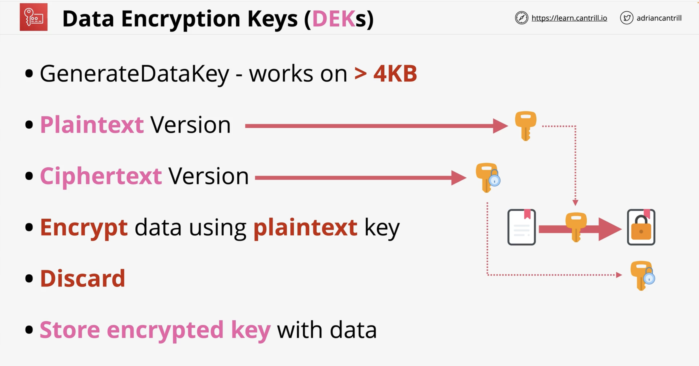
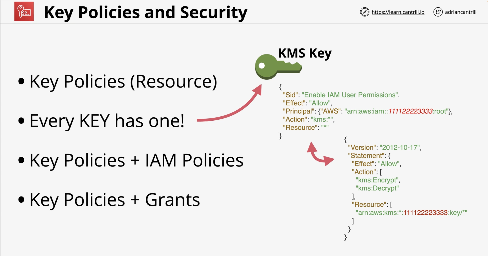

# KMS — Key Management Service

AWS KMS is the **encryption root of trust** for almost every other AWS service that offers server-side encryption (S3, EBS, RDS, Secrets Manager, …). It creates, stores, and uses cryptographic keys on your behalf, and never lets the backing key material leave the service.

## Service Characteristics

- **Regional + public endpoint** — every region has an isolated KMS endpoint; a key created in `us-west-2` exists only in `us-west-2`. (Cross-region availability is a separate feature: **multi-region keys**, which work by replicating key material into peer regions.)
- **Public service** — reachable from anywhere with [IAM](iam.md) credentials plus network access; it is not VPC-bound.
- **FIPS 140-2 Level 2** validated at the service level. Some operations inside the underlying HSMs meet Level 3, but the headline compliance claim is L2.
- Supports both **symmetric** and **asymmetric** keys.
- Performs the cryptographic operations itself: `Encrypt`, `Decrypt`, `Sign`, `Verify`, `GenerateDataKey`, and friends. The caller sends data **in** and gets ciphertext (or signature, etc.) **out** — they never see the raw key.
- **Keys never leave KMS.** Backing key material is generated inside, used inside, and destroyed inside. This is the property the entire trust model depends on.

## KMS Keys

A **KMS Key** (the resource formerly called a "CMK" / Customer Master Key) is a **logical container** holding metadata: ID, ARN, creation date, description, state, and an attached [key policy](#key-policies). That logical key is **backed by physical key material** — the actual bytes used for crypto. The two are conceptually distinct: rotation, for instance, generates new backing key material while keeping the same logical key ID.

Key material is either:

- **Generated** by KMS (the default), or
- **Imported** (BYOK — bring your own key material).

A KMS Key can **directly encrypt/decrypt up to 4 KB of data per call**. For anything larger, you must use [data encryption keys](#data-encryption-keys-deks) — KMS never moves bulk data through itself.



The diagram makes three properties explicit:

- The plaintext key never crosses the KMS boundary; only the encrypted artifacts do.
- The caller never sees the raw key — they send data in, get ciphertext out.
- `Encrypt` and `Decrypt` are separate API calls against the same KMS Key ID.

### Key ownership and management

KMS distinguishes who **owns** the key from who **manages** it. Three categories:

| Category | Owner | Managed by | Visibility | Configurability |
| --- | --- | --- | --- | --- |
| **AWS Owned** | AWS | AWS | Invisible to you; shared across many accounts | None — no cost, no control |
| **AWS Managed** | Your account | AWS (creates, rotates) | Visible (e.g. `aws/s3`, `aws/rds`) | Limited — cannot edit policy or rotation |
| **Customer Managed** | Your account | **You** | Visible | **Full** — key policy, rotation, alias, grants, disable, delete |

Only **Customer Managed** keys give you the full surface area for compliance and incident response (custom key policy, manual rotation control, deletion windows, grants, etc.). If an exam question requires editing the key policy, controlling rotation, or sharing across accounts, the answer is a **Customer Managed key** — never an AWS Managed one.

### Rotation

KMS Keys support rotation. When a key is rotated, KMS generates **new backing key material** and starts using it for new encrypt operations; the **previous backing keys are retained** so old ciphertexts can still be decrypted under the **same logical key ID**. Callers don't need to track which backing key encrypted which blob — KMS picks the right one from metadata in the ciphertext.

### Aliases

An **alias** (e.g. `alias/unitpulse-prod-s3`) is a friendly, repointable name for a Key ID. The CLI and SDK accept either. Aliases are valuable because they decouple callers from the underlying key UUID — you can repoint an alias at a brand-new key without touching application code.

## Cryptographic Operations

### Direct encrypt / decrypt (≤ 4 KB)

For small payloads (passwords, config secrets, short tokens), call `Encrypt` and `Decrypt` directly against a KMS Key:

```bash
aws kms encrypt \
    --key-id alias/catrobot \
    --plaintext fileb://battleplans.txt \
    --output text \
    --query CiphertextBlob \
    | base64 --decode > not_battleplans.enc
```



What each piece does:

| Flag / Step | Purpose |
| --- | --- |
| `--key-id alias/catrobot` | Reference the KMS Key by **alias** instead of the raw UUID. |
| `--plaintext fileb://battleplans.txt` | `fileb://` reads the file as **raw binary**; `file://` would treat it as text. |
| `--output text --query CiphertextBlob` | Strip the JSON envelope and emit only the ciphertext field. |
| `\| base64 --decode` | KMS returns ciphertext **base64-encoded** by default; decode back to raw bytes. |
| `> not_battleplans.enc` | Write the encrypted blob to disk. |

Symmetric decrypt is the mirror call:

```bash
aws kms decrypt \
    --ciphertext-blob fileb://not_battleplans.enc \
    --output text --query Plaintext \
    | base64 --decode > battleplans.txt
```

> [!tip] Symmetric decrypt does not take `--key-id`
> For symmetric keys you don't pass `--key-id` on decrypt — KMS reads the Key ID from metadata embedded in the ciphertext blob and looks it up automatically. (Asymmetric decrypt does need the key ID and algorithm because the public material doesn't uniquely identify a private key in the same way.)

> [!warning] Gotcha
> This direct-encrypt pattern only works because the file is **≤ 4 KB**. There is no chunking option on `Encrypt` — for larger payloads you must switch to [DEKs](#data-encryption-keys-deks).

### Data Encryption Keys (DEKs)

The 4 KB ceiling is fundamental: KMS will not move bulk data through itself. The pattern AWS uses everywhere to get around this is **envelope encryption** with **Data Encryption Keys (DEKs)**, generated via `GenerateDataKey`.



The envelope flow:

1. Call `GenerateDataKey` on a KMS Key.
2. KMS returns **two versions of the same DEK**:
   - **Plaintext DEK** — the actual key bytes, returned for one-time use.
   - **Ciphertext DEK** — the same DEK encrypted under the KMS Key.
3. **Encrypt your data locally** with the plaintext DEK (AES-GCM etc., done outside KMS).
4. **Discard the plaintext DEK** from memory the moment encryption finishes.
5. **Store the ciphertext DEK alongside the encrypted data**.

To decrypt later:

- Send the ciphertext DEK to KMS → `Decrypt` returns the plaintext DEK in memory.
- Use it to decrypt the data locally.
- Discard the plaintext DEK again.

> [!warning] KMS does not store DEKs
> KMS only **generates** DEKs; it does not retain them. Persisting the ciphertext DEK with the data is the caller's responsibility. This is exactly why services like **S3 SSE-KMS embed the encrypted DEK in object metadata** and **EBS keeps it in the volume metadata** — the encrypted DEK travels with the data so the service can re-fetch the plaintext from KMS when needed.

### Symmetric vs asymmetric

| Use | Symmetric (AES-256) | Asymmetric (RSA / ECC) |
| --- | --- | --- |
| `Encrypt` / `Decrypt` | Yes — same key both ways | Yes — encrypt with public, decrypt with private |
| `Sign` / `Verify` | HMAC-style only | RSA / ECDSA signing |
| `GenerateDataKey` (envelope encryption) | Yes | No — DEKs are always symmetric |
| Key material leaves KMS? | Never | Only the **public** half can be downloaded |

For most "encrypt my data at rest" workloads the answer is a **symmetric key**. Asymmetric keys are for signing artifacts, code-signing, or interoperating with external parties who hold the public half.

## Key Policies

KMS has **three layers of access control** that compose together: **key policies**, **IAM policies**, and **grants**. Understanding how they interact is the most exam-worthy piece of KMS.



> Mental model: **the key policy is the gate, IAM is the in-account rulebook, grants are temporary side passes.**

### Key policy (the resource policy)

Every KMS Key has **exactly one key policy**, and it is **mandatory** — there is no such thing as a KMS key without one. The key policy is a [resource policy](../concepts/resource-vs-identity-policies.md) attached to the key itself, much like an S3 bucket policy is attached to a bucket.

The critical difference from [S3](s3.md): **IAM permissions alone are not enough** to access a KMS key. The key policy must **explicitly trust the account** before any IAM policy in that account can grant access. Without that trust statement, even an account admin with `kms:*` cannot use the key.

The "trust my own account" statement that almost every key policy starts with:

```json
{
  "Sid": "Enable IAM User Permissions",
  "Effect": "Allow",
  "Principal": { "AWS": "arn:aws:iam::111122223333:root" },
  "Action": "kms:*",
  "Resource": "*"
}
```

This says: *"Allow account `111122223333` (via IAM) to govern this key."* Once that exists, normal IAM policies in the account can decide which principals get which KMS actions.

### Key policy + IAM policies

After the key policy delegates to the account root, IAM identity policies decide which principals (users, roles) inside the account get which KMS actions. A typical encrypt/decrypt grant:

```json
{
  "Version": "2012-10-17",
  "Statement": {
    "Effect": "Allow",
    "Action": ["kms:Encrypt", "kms:Decrypt"],
    "Resource": ["arn:aws:kms:*:111122223333:key/*"]
  }
}
```

The standard same-account [policy evaluation](../concepts/resource-vs-identity-policies.md) applies — but the **gate** (the key policy) must allow the account first.

### Key policy + grants

**Grants** are a third mechanism — temporary, programmatic permission delegations created via the KMS API (`CreateGrant`). They are how AWS services get short-lived, scoped access to use a key on a principal's behalf. Examples:

- **EBS** receives a grant when it attaches an encrypted volume, so it can decrypt the DEK while the volume is mounted.
- **Lambda** receives a grant from a customer-managed key to decrypt environment variables.
- **Auto Scaling** receives a grant to decrypt encrypted AMIs during instance launch.

Grants are the right answer when you need a service to use a key on demand without permanently widening the key policy.

### Cross-account access to a KMS key

Cross-account KMS access works just like [cross-account S3 access](s3.md#cross-account-access): both sides must allow the action.

1. **On the key's account**: the key policy must allow the external account (or a specific role in it) — e.g. `"Principal": { "AWS": "arn:aws:iam::444455556666:root" }`.
2. **On the external account**: an IAM policy on the calling identity must grant the KMS action (`kms:Decrypt`, `kms:GenerateDataKey`, …) against the external key's ARN.

Either side missing = access denied. This is the same intersection rule from [Resource Policies vs Identity Policies](../concepts/resource-vs-identity-policies.md).

## Common Integration Patterns

- **[S3 SSE-KMS](s3.md#sse-kms--kms-managed-keys)** — when you upload, S3 calls `GenerateDataKey` against your KMS Key, encrypts the object with the plaintext DEK, and stores the encrypted DEK in object metadata. Downloads do the reverse. Enables **role separation** — a bucket admin without KMS permissions cannot read object contents. For buckets with very high object counts, **[S3 Bucket Keys](s3.md#s3-bucket-keys--sse-kms-cost-optimization)** dramatically reduce KMS request volume by caching a short-lived bucket-level key inside S3 and deriving per-object DEKs locally — note that the **encryption context switches from object ARN to bucket ARN**, which breaks any `kms:EncryptionContext` conditions that named object ARNs.
- **EBS volumes** — at volume create time, EBS calls `GenerateDataKey`, encrypts blocks with the DEK, and stores the encrypted DEK in volume metadata. Snapshots and AMIs inherit the encryption.
- **Secrets Manager / SSM Parameter Store SecureString** — encrypts secret values under a KMS Key.
- **RDS / Aurora storage encryption** — must be enabled at instance creation; uses KMS for the storage-layer DEK.

In all these cases, the actual bulk data encryption happens **inside the service** with a DEK; KMS only manages the key and the wrapping.

## Quick Reference

- KMS = **regional**, **public**, **FIPS 140-2 L2**, keys **never leave** the service.
- Direct `Encrypt`/`Decrypt` is **≤ 4 KB**; larger payloads use **`GenerateDataKey`** + envelope encryption.
- `GenerateDataKey` returns **plaintext + ciphertext** versions of the DEK; use plaintext, discard, store ciphertext with the data. KMS does **not** store DEKs.
- **AWS Owned vs AWS Managed vs Customer Managed** — only **Customer Managed** gives full control (policy, rotation, aliases, grants, deletion).
- Rotation produces new backing key material; old backing keys are retained so old ciphertexts remain decryptable under the same logical Key ID.
- **Every key has a key policy, and it is required.** IAM alone cannot grant access — the key policy must trust the account first.
- Three access layers compose: **Key Policy + IAM Policies + Grants**.
- Cross-account access requires Allow on **both** sides (key policy on the key's account, IAM policy on the caller's account).

## References

- [Resource Policies vs Identity Policies](../concepts/resource-vs-identity-policies.md) — key policy is the canonical example after S3 bucket policies
- [IAM](iam.md) — identity policies that complement the key policy
- [S3](s3.md) — heaviest KMS integration (SSE-KMS)
- [AWS SAA Exam Notes — KMS](../certifications/aws-saa.md#kms)
- Source: `raw/aws-cert-study-notes/aws-solution-architect/kms_101.md`
- [AWS KMS Developer Guide](https://docs.aws.amazon.com/kms/latest/developerguide/overview.html)
