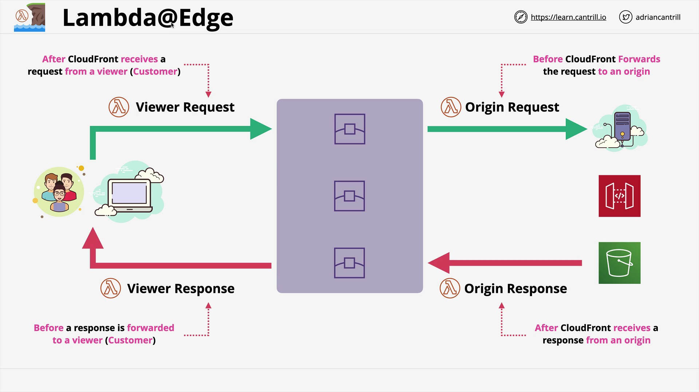

# Lambda@Edge

Lambda@Edge runs [Lambda](lambda.md) code on the [CloudFront](cloudfront.md) request/response path. It can rewrite requests, select origins, generate responses, and adjust response headers close to viewers. Its key design decision is **when the code runs relative to the cache**; see [Edge Delivery](../concepts/edge-delivery.md) for how caching, authorization, and routing fit together.

## Four Trigger Positions

The viewer-to-edge and edge-to-origin legs are separate. A cache hit omits the origin round trip, so origin triggers do not run for that cached response.



| Trigger | Position | Typical purpose |
| --- | --- | --- |
| Viewer request | Before cache lookup | Check viewer access; rewrite URI before cache-key construction |
| Origin request | When CloudFront forwards to the origin | Choose a backend; generate a cacheable response |
| Origin response | After the origin reply, before caching | Transform origin errors or response metadata |
| Viewer response | Before returning to the viewer | Adjust eligible outgoing response headers |

These hooks block request progress while the function executes, so keep processing short. Viewer response has exceptions: it does not run for origin responses with status 400 or higher, custom error pages, viewer-request generated responses, or CloudFront's automatic HTTP-to-HTTPS redirects. It also cannot change the HTTP status code. [AWS trigger reference](https://docs.aws.amazon.com/AmazonCloudFront/latest/DeveloperGuide/lambda-cloudfront-trigger-events.html), [restrictions](https://docs.aws.amazon.com/AmazonCloudFront/latest/DeveloperGuide/lambda-at-edge-function-restrictions.html)

## Use Cases and Cache Implications

**A/B testing:** a viewer-request function can choose a variant and rewrite the URI before cache lookup. Keep the cohort stable with validated application state or a suitable cookie; choosing randomly on every request does not provide a stable experiment assignment.

**Migration between origins:** an origin-request function can move origin fetches gradually between buckets. This affects origin-bound requests, not a fixed fraction of every viewer request: existing cache hits keep serving the cached object. A distribution update or cache expiry may therefore be relevant to rollout timing.

**Device and country variants:** origin-request logic can choose content based on CloudFront-supplied headers. Include the relevant variation in the cache key or disable caching; merely forwarding a distinguishing header can allow the first response to be reused for other viewers. CloudFront adds its computed country/device headers after viewer request. [AWS example catalog](https://docs.aws.amazon.com/AmazonCloudFront/latest/DeveloperGuide/lambda-examples.html)

## AWS Example Functions

The AWS example catalog includes redirects under **Generate responses**, plus a separate sign-in redirect under **Query strings**.

| Example family | Practical lesson |
| --- | --- |
| A/B testing and response headers | Rewrite a URI or change selected metadata |
| Static generated response and redirect | Return content or a `302` with a `Location` header |
| Query-string processing | Move parameters into headers or normalize ordering/case |
| Sign-in redirect | Redirect a viewer missing session state |
| Country/device personalization | Vary responses and partition cache entries accordingly |
| Dynamic origin selection | Choose S3/custom origins or migrate between buckets |
| Origin error transformation | Replace an error body/status or redirect to a fallback path |
| POST body processing | Enable Include Body to read or modify form input |

These are demonstrations, not complete authentication systems. In particular, a client-supplied session cookie's **presence** does not validate its signature, expiry, or permissions. Validate real session state before authorizing private content. Normalize parameters only when the application's semantics allow it; lowercasing a case-sensitive token changes its meaning. [AWS examples](https://docs.aws.amazon.com/AmazonCloudFront/latest/DeveloperGuide/lambda-examples.html)

### Redirect Versus Rewrite

A rewrite changes the internal request while leaving the browser URL unchanged. A redirect sends a response instructing the client to make another request. For example, an original minimal viewer-request handler can redirect only an old documentation path and pass everything else through:

```python
def lambda_handler(event, context):
    request = event["Records"][0]["cf"]["request"]
    if request["uri"] != "/old-guide":
        return request
    return {
        "status": "302",
        "statusDescription": "Found",
        "headers": {
            "location": [{"key": "Location", "value": "https://docs.example.com/guide"}],
            "cache-control": [{"key": "Cache-Control", "value": "no-store"}],
        },
    }
```

This example deliberately uses a fixed destination and no user-provided return URL. It is illustrative and has not been deployed to AWS. Configure a real destination before use, and avoid redirecting the destination back to the source path.

Viewer-request generated responses bypass CloudFront caching. Origin-request generated responses can be cached and reused without rerunning the function. For personalized redirects, assess cache scope and TTL explicitly; otherwise one user's redirect can be served to another. [AWS generated-response behavior](https://docs.aws.amazon.com/AmazonCloudFront/latest/DeveloperGuide/lambda-generating-http-responses.html)

## Deployment and Limitations

Create the function in **us-east-1**, publish a **numbered version**, and associate that version with a distribution cache behavior and trigger. AWS replicates it to execution locations. An alias or `$LATEST` is not a valid association. [AWS setup overview](https://docs.aws.amazon.com/AmazonCloudFront/latest/DeveloperGuide/lambda-edge-how-it-works.html)

Use a supported Node.js or Python runtime. The execution role must trust both `lambda.amazonaws.com` and `edgelambda.amazonaws.com`. Lambda@Edge does not support VPC attachment, layers, ordinary custom environment variables, container images, arm64, or provisioned concurrency. No VPC attachment does not mean no network calls: reachable regional public endpoints can still be called, subject to permissions and timeout. [AWS restrictions](https://docs.aws.amazon.com/AmazonCloudFront/latest/DeveloperGuide/lambda-at-edge-function-restrictions.html)

> [!warning] Gotcha
> The AWS quota table lists Lambda-equivalent function memory and a 30-second function timeout. Generated responses remain event-dependent: 40 KB for viewer events and 1 MB for origin events. Recheck the [live quotas](https://docs.aws.amazon.com/AmazonCloudFront/latest/DeveloperGuide/cloudfront-limits.html#limits-lambda-at-edge) before implementation.

For Include Body, CloudFront base64-encodes exposed request data and can truncate it: 40 KB at viewer request, 1 MB at origin request. Read-only access still forwards the original complete body. Do not mistake the truncated view for the complete upload.

> [!warning] Gotcha
> AWS's dynamic S3-origin examples include OAI workflows. Do not mechanically substitute OAC: AWS documents that OAC does not support origin redirection using Lambda@Edge. Check the chosen origin/access combination before applying a sample. [S3 origin access restrictions](https://docs.aws.amazon.com/AmazonCloudFront/latest/DeveloperGuide/private-content-restricting-access-to-s3.html)

> [!tip] Exam Tip
> Viewer request influences cache lookup; origin request handles origin-bound traffic. A/B URI rewriting, device/country variants, and controlled origin migration are core Lambda@Edge use cases. Keep viewer authorization before cache lookup when it must apply on hits too.

## References

- [AWS Lambda@Edge example catalog](https://docs.aws.amazon.com/AmazonCloudFront/latest/DeveloperGuide/lambda-examples.html#lambda-examples-redirecting-examples)
- [Trigger behavior and exceptions](https://docs.aws.amazon.com/AmazonCloudFront/latest/DeveloperGuide/lambda-cloudfront-trigger-events.html)
- [Generated HTTP responses](https://docs.aws.amazon.com/AmazonCloudFront/latest/DeveloperGuide/lambda-generating-http-responses.html)
- [Deployment overview](https://docs.aws.amazon.com/AmazonCloudFront/latest/DeveloperGuide/lambda-edge-how-it-works.html)
- [Restrictions](https://docs.aws.amazon.com/AmazonCloudFront/latest/DeveloperGuide/lambda-at-edge-function-restrictions.html)
- [Quotas](https://docs.aws.amazon.com/AmazonCloudFront/latest/DeveloperGuide/cloudfront-limits.html#limits-lambda-at-edge)
