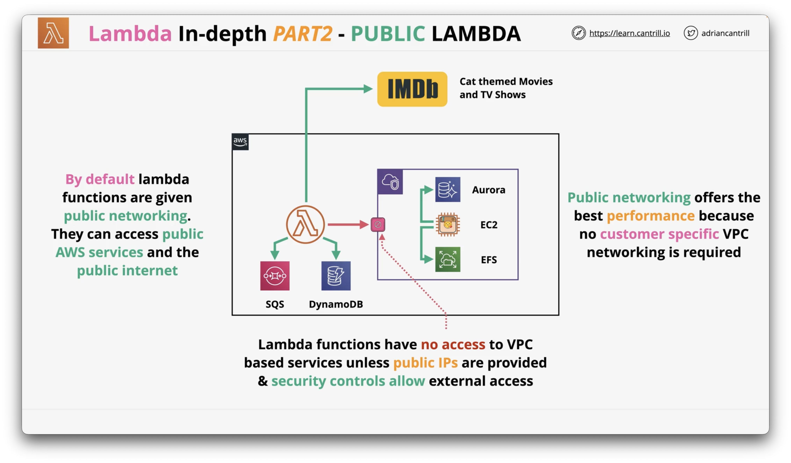
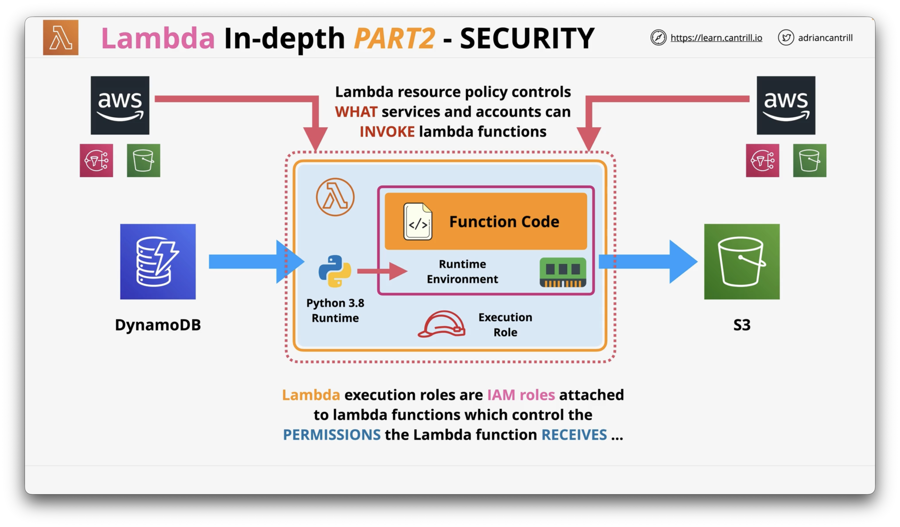
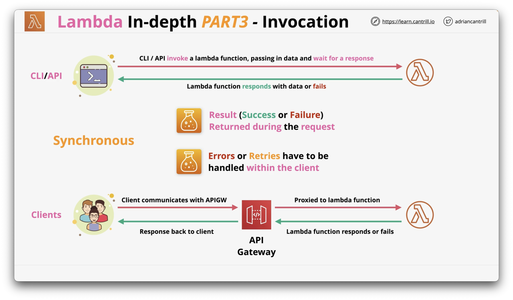
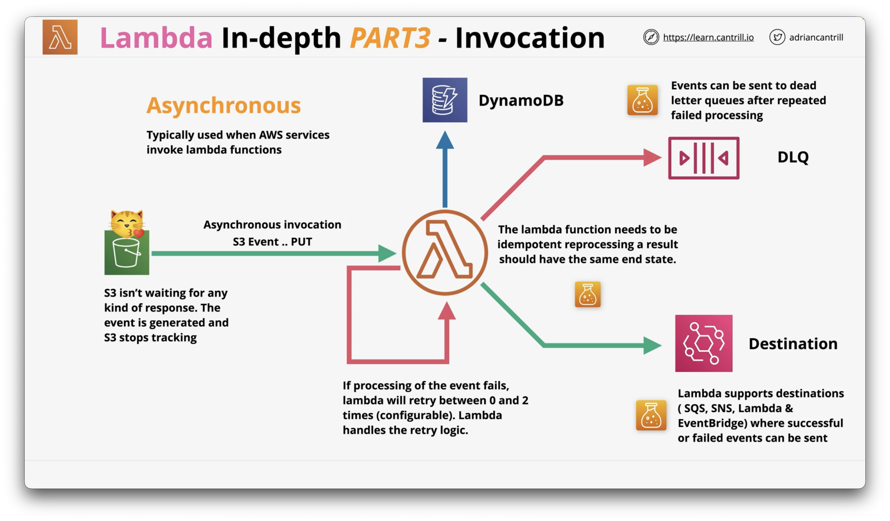

# AWS Lambda

**Lambda** is AWS's **Function as a Service (FaaS)** product: you supply short-running, focused code, and Lambda runs it and bills you only for the duration it executes. It is a core building block of **serverless and event-driven architectures** (see [Architecture Evolution](../patterns/architecture-evolution.md)) — the "consume resources only while working" compute primitive.

A **Lambda function** is a piece of code that Lambda runs using a supported **runtime** (e.g. Python 3.8). Think of a function as a *unit of configuration* — the code plus its wrappings: the runtime language, the deployment package, resource allocations, and security configuration. When invoked, the deployment package is loaded into and executed within a **runtime environment** (also called an **execution context**) purpose-built for that runtime. You directly allocate memory; virtual CPU is allocated *indirectly* in proportion to memory. Billing is allocated resource multiplied by execution duration, per invocation.

> [!tip] Exam Tip
> Trigger keywords that point at Lambda: *serverless*, *event-driven*, *function as a service / FaaS*, *only pay for what you use*, *short-running focused compute*.

## Diagram Walkthrough — Architecture 101

**How to read it:** the center box is the **runtime environment**. The Python logo on its left feeds in the runtime, and the memory stick on its right represents allocated resource. **Function Code** sits inside, and the hard-hat icon underneath is the **execution role**. Everything flowing *into* the box (deployment package, timeout, memory scaling) are the configuration levers you set.

- **Deployment package:** 50 MB zipped / 250 MB unzipped for direct upload (container images support up to 10 GB uncompressed).
- **Function timeout:** 900 s (15 min) — the hard maximum for a single invocation.
- **Common runtimes:** Python, Ruby, Java, Go, C#, Node.js. Custom runtimes (e.g. Rust) are possible via **layers**.
- **Memory-to-vCPU scaling:** 128 MB up to 10240 MB in 1 MB steps; **1769 MB yields 1 vCPU**, scaling linearly.
- **`/tmp` storage:** 512 MB default, up to 10240 MB.

## Mechanics

### Runtimes

- Supported runtimes include multiple versions of **Python, Node.js, Ruby, Java, Go, and C#**.
- **Custom runtimes** (e.g. Rust) can be added via **Lambda layers**, many community-built.

> [!warning] Gotcha — "Docker" is an exam signal
> If a question uses the bare term **"Docker"**, read it as **NOT Lambda** — it points to traditional containerized compute (e.g. [ECS](ecs.md)). This is distinct from Lambda's *container image* support: you can build [container images](../concepts/containers.md) for Lambda using your existing Docker build process, but those images are purpose-built to run *inside the Lambda environment*, not as standalone Docker containers. Don't conflate the two.

### Resource allocation

- **Memory:** directly set, 128 MB to 10240 MB in 1 MB steps.
- **vCPU:** allocated indirectly; **1769 MB yields the equivalent of one vCPU**, scaling linearly (less memory means fractional vCPU; more memory means multiple vCPUs, up to ~6 vCPUs at 10240 MB).
- **`/tmp` disk:** 512 MB mounted at `/tmp` by default, scalable to 10240 MB. Treat as **temporary scratch space** — assume it may be blank on any invocation.

### Timeout

- Maximum **900 seconds / 15 minutes** per invocation — the **function timeout**. One of the few figures worth memorizing for the exam.
- For workloads exceeding 15 minutes, Lambda can't be used directly; use **Step Functions** to orchestrate longer workflows across multiple functions.

### Statelessness

- By default, assume **every invocation runs in a brand-new, clean runtime environment** with no leftover state. Your code must work 100% of the time on the assumption of a fresh environment.
- Execution contexts *can* be reused (warm starts — see [Cold Starts, Warm Starts & Provisioned Concurrency](#startup-cold-starts-warm-starts--provisioned-concurrency)), but you must never *depend* on reuse.

### Common use cases

- **Serverless applications:** [S3](s3.md) plus API Gateway plus Lambda.
- **File processing:** an [S3](s3.md#event-notifications) upload fires an S3 event that invokes Lambda (classic example: watermarking images).
- **Database triggers:** DynamoDB plus DynamoDB Streams plus Lambda (fires on insert/modify/delete).
- **Serverless cron:** EventBridge / CloudWatch Events invokes Lambda on a schedule.
- **Real-time stream processing:** a Kinesis stream feeds Lambda, scaling with data volume.

## Networking

Lambda has **two networking modes**. Know both for the exam.

### Public networking (default)

- By default, Lambda runs in the **public AWS network** and can reach **public-space AWS services** and the **public internet** (assuming valid auth).
- It has **no access to [VPC](vpc.md)-based services** ([Aurora](aurora.md), [EC2](ec2.md), [EFS](efs.md)) *unless* those services are given public addressing and security rules allowing external access.
- **Best performance** — no customer-specific networking is required, so functions run on shared hardware and networking.

### VPC networking

- **Golden rule:** a Lambda function in a [VPC](vpc.md) **obeys all normal VPC networking rules** — treat it exactly like any other VPC resource.
- It can **freely reach other VPC resources** (subject to [NACLs](vpc.md#network-acl-nacl) and [security groups](vpc.md#security-groups-sg)).
- It **cannot reach outside the VPC** (public AWS services, internet) unless the VPC provides the path: a **[gateway endpoint](vpc.md#aws-privatelink)** for DynamoDB, or a **[NAT gateway](vpc.md#nat--nat-gateway) plus [internet gateway](vpc.md#internet-gateway-igw)** for public/internet access.

> [!warning] Gotcha — execution role needs EC2 network permissions
> A VPC function's **execution role needs EC2 network permissions**, because the Lambda service must create **network interfaces** in your VPC. A common exam scenario: a VPC Lambda failing because it lacks these EC2 networking permissions.

#### Old vs. new ENI architecture

VPC Lambdas don't literally run in your VPC — the model resembles Fargate, with a **Lambda service VPC** connecting into your **customer VPC** via [elastic network interfaces (ENIs)](../concepts/networking.md).

- **Old way:** each function created **one ENI per function, per invocation**. This added invocation delay and scaled badly — high concurrency meant many ENIs and VPC capacity pressure, making VPC Lambdas a performance liability.
- **New way:** AWS analyzes all functions in a region/account and builds **one ENI per unique combination of security groups plus subnets**. Functions sharing the same SG-and-subnet combo share a single ENI. These ENIs are created **once**, when you configure/update the function (typically ~90 seconds), **not per invocation** — so there's **no per-invocation delay**, and private networking now scales without ENI sprawl.

> [!note] Diagram labels are illustrative
> The diagram labels the new architecture "A4LVPC" (Adrian's *Animals4Life* demo VPC name) and "AWS Lambda Service VPC." These are illustrative container names, not exam terms — the exam-relevant concept is *shared ENIs per unique SG-plus-subnet combination*.

## Security

Lambda has a **two-part permissions model**, and the exam tests both halves. This maps cleanly onto the [resource-policy vs identity-policy](../concepts/resource-vs-identity-policies.md) distinction: inbound "who can invoke me" is a resource policy; outbound "what can I do" is an identity policy attached to the execution role.

**How to read it:** the dotted box is the function's permission boundary. Two arrows come *in* from the top — the **resource policy** controlling *who can invoke*. The arrows across the bottom go *out* to DynamoDB (read) and S3 (write) — what the **execution role** lets the function *do*. Read top-down: inbound is the resource policy (invoke control); outbound is the execution role (action permissions).

### Execution role (well-known, associate-level)

- An **[IAM role](iam.md#iam-roles) assumed by Lambda**, providing the temporary credentials the function uses to interact with other AWS services.
- Has a **trust policy** trusting Lambda and a **permissions policy** defining what the function can do (e.g. read DynamoDB, write S3).
- Conceptually **identical to an [EC2 instance role](ec2.md#instance-roles--instance-profiles)**.

### Resource policy (less commonly known)

- Analogous to an **[S3 bucket policy](s3.md#bucket-policies)** — controls **who can invoke** a specific function (external accounts, or services like SNS / S3).
- Automatically modified when you integrate other services with Lambda.

> [!warning] Gotcha — resource policy is editable in the console
> Older course material claims the resource policy can *only* be changed via CLI/API and **cannot** be edited in the console. **This is outdated.** Per current AWS docs you can view and edit a function's resource-based policy in the console under **Configuration → Permissions → Resource-based policy** ([AWS Lambda docs](https://docs.aws.amazon.com/lambda/latest/dg/access-control-resource-based.html); the console-view capability dates to a [2017 access-control update](https://aws.amazon.com/about-aws/whats-new/2017/03/aws-lambda-introduces-access-control-enhancements)). CLI/API editing remains fully valid.

### Logging & monitoring

- **[CloudWatch Logs](cloudwatch.md):** function output, log messages, errors, and execution-duration details.
- **[CloudWatch](cloudwatch.md) (metrics):** invocation counts, successes/failures, retries, latency.
- **X-Ray:** distributed tracing — trace a user/session path through a serverless app. Remember the pairing *X-Ray = distributed tracing*.

> [!warning] Gotcha — no logs means a missing permission
> For Lambda to write to CloudWatch Logs, the **execution role must grant the permissions** (there's a prebuilt basic-execution policy, `AWSLambdaBasicExecutionRole`). A classic diagnostic scenario: "function isn't working, nothing in CloudWatch Logs" points to a missing execution-role permission.

## Invocation

There are three ways to invoke a Lambda function: **synchronous**, **asynchronous**, and **event source mapping**.

### Synchronous invocation

- Caller (CLI/API, or clients via **API Gateway**) invokes the function and **waits** for the result during the request.
- The function runs once and returns **success or failure** synchronously.
- **Errors and retries must be handled by the client** — Lambda does not retry.
- Typically used when a **human**, directly or indirectly, invokes the function.

### Asynchronous invocation

- Typically used when **AWS services invoke Lambda** on your behalf (e.g. [S3 events](s3.md#event-notifications)).
- The source (e.g. S3) generates the event and **stops tracking** — it doesn't wait for a response.
- **Lambda owns reprocessing** on failure: retries are **configurable between 0 and 2 times**.
- **Dead-letter queue (DLQ):** events that still fail after retries can be routed to a DLQ for diagnostics.
- **Destinations (newer feature):** processed events can be delivered to **SQS, SNS, another Lambda, or EventBridge**, with **separate destinations for success vs. failure**.

> [!tip] Exam Tip — async requires idempotency
> Because Lambda re-runs the *same* event with no extra context, the function must be **idempotent** — reprocessing should yield the same end state. Analogy: *set* the balance to $20, don't *add* $10. A "set" is safe to re-run; an "add" is not. Design functions to make a desired state *true* rather than performing additive/subtractive operations.

### Event source mapping (ESM)

- Used for **streams/queues that don't natively generate events** and require **polling**: **Kinesis, DynamoDB Streams, SQS**, and **Amazon MSK** (Managed Streaming for Apache Kafka).
- A hidden **event source mapping** component polls the source, retrieves **source batches**, splits them by configured **batch size**, and delivers **event batches** to the function.
- A single invocation may receive **hundreds of events** in a batch — tune batch size carefully so processing completes within the **15-minute timeout**.
- Persistently failing batches can be sent to an **SQS queue or SNS topic**.

> [!tip] Exam Tip — the key ESM permissions fact
> The source does **not** deliver the event; the ESM **reads** from the source using the **function's execution role permissions**. So even though the function code never directly calls Kinesis, **the execution role still needs Kinesis (source) permissions** because the ESM uses them on the function's behalf. Contrast with async: there the source *delivers* the event, so the function only needs source permissions if it wants to *read additional data* (e.g. fetching the actual S3 object).

## Versions & Aliases

- A **version** is the function's **code plus configuration** (resources, environment variables, all config).
- A **published version is immutable** and gets its **own ARN** — it never changes once published.
- **`$LATEST`** points at the most recent version and is **mutable** (changes as you publish).
- **Aliases** (e.g. `dev`, `stage`, `prod`) point at specific versions and are **mutable** (can be repointed).
- Typical pattern: publish immutable versions for major changes; use aliases so app components target specific version numbers.

## Startup: Cold Starts, Warm Starts & Provisioned Concurrency

- **Execution context** is the environment (a small container with allocated resource) the function runs in.
- **Cold start:** the first invocation must **create and configure** the environment, download/install the runtime, and download/install the deployment package — **~100 ms or more** before code runs.
- **Warm start:** a subsequent invocation soon after can **reuse** the existing context, skipping setup — code runs in **~1–2 ms**.
- Contexts are deleted after too long between invocations, causing another cold start. **One invocation runs per context at a time**, so 20 simultaneous invocations can mean 20 cold starts.

### Provisioned concurrency

- Tell AWS in advance to **pre-create and keep X contexts warm**, improving start speed. Use for known high-load periods or ahead of a production release.

### Code-level optimization

Always assume a fresh, clean context — never *require* reuse — but you *can* optimize for it:

- Pre-download reusable assets to `/tmp`; a later invocation in the same context can reuse them.
- Declare reusable objects (e.g. **database connections**) **outside the function handler** — these persist for future invocations in the same context. Anything **inside the handler** is scoped to that single invocation only.

> [!tip] Related pattern
> The "reuse a database connection across invocations" problem is exactly what [RDS Proxy](rds-proxy.md) solves at the infrastructure level — pooling and multiplexing connections so a burst of Lambda invocations doesn't exhaust the database's connection limit.

## Course-vs-Reality Discrepancies

| # | Topic | Course says | Current AWS reality | Source |
| --- | --- | --- | --- | --- |
| 1 | Resource policy editing | CLI/API only; **not** editable in console | Viewable **and editable** in console (Configuration → Permissions) | [AWS docs](https://docs.aws.amazon.com/lambda/latest/dg/access-control-resource-based.html) |
| 2 | Old VPC ENI model | Presented as current-ish "old way" | Superseded by shared-ENI (per SG-plus-subnet) model | AWS Lambda VPC docs |

## Quick Reference

| Attribute | Value | Notes |
| --- | --- | --- |
| Runtimes | Python, Node.js, Ruby, Java, Go, C# | Custom via layers (e.g. Rust) |
| Memory | 128 MB – 10240 MB, 1 MB steps | Directly set |
| vCPU | Indirect; **1769 MB = 1 vCPU** | Linear; ~6 vCPUs at 10240 MB |
| `/tmp` storage | 512 MB default to 10240 MB | Ephemeral scratch only |
| Timeout | **900 s / 15 min** max | Use Step Functions beyond this |
| Deployment package | 50 MB zipped / 250 MB unzipped | Container images up to 10 GB uncompressed |
| Cold start | ~100 ms | Full context creation |
| Warm start | ~1–2 ms | Context reused |
| Async retries | 0–2 (configurable) | Lambda handles retry |
| Invocation types | Sync / Async / ESM | See [Invocation](#invocation) |

## Exam Traps (consolidated)

- **"Docker"** in a question means **NOT Lambda** (traditional containers point to [ECS](ecs.md)). Lambda *container images* are a separate thing.
- **>15 minutes** of work means not a single Lambda invocation; use **Step Functions**.
- **VPC Lambda is a normal VPC resource** — needs endpoints/NAT/IGW for outside access, plus **EC2 network permissions** on the execution role.
- **No CloudWatch Logs output** means suspect a **missing execution-role permission**.
- **ESM permissions:** the execution role needs **source-service permissions** (e.g. Kinesis) even though the code doesn't directly read the source.
- **Async invocation requires idempotency** (retries re-run the same event).
- **Published versions are immutable**; `$LATEST` and **aliases are mutable**.
- **Sync means the client handles retries; async means Lambda handles retries.**

## References

- Adrian Cantrill, AWS Solutions Architect Associate (SAA-C03), *"AWS Lambda"* (Parts 1–3) — [learn.cantrill.io](https://learn.cantrill.io/)
- [AWS Lambda Developer Guide — Memory and computing power](https://docs.aws.amazon.com/lambda/latest/dg/configuration-memory.html) (128–10240 MB, 1769 MB = 1 vCPU)
- [AWS Lambda Developer Guide — Resource-based policies](https://docs.aws.amazon.com/lambda/latest/dg/access-control-resource-based.html) (console-editable resource policy)
- [Configuring a Lambda function to access resources in a VPC](https://docs.aws.amazon.com/lambda/latest/dg/configuration-vpc.html) (shared-ENI Hyperplane model)
- [Lambda quotas](https://docs.aws.amazon.com/lambda/latest/dg/gettingstarted-limits.html) (deployment package, timeout, /tmp)
