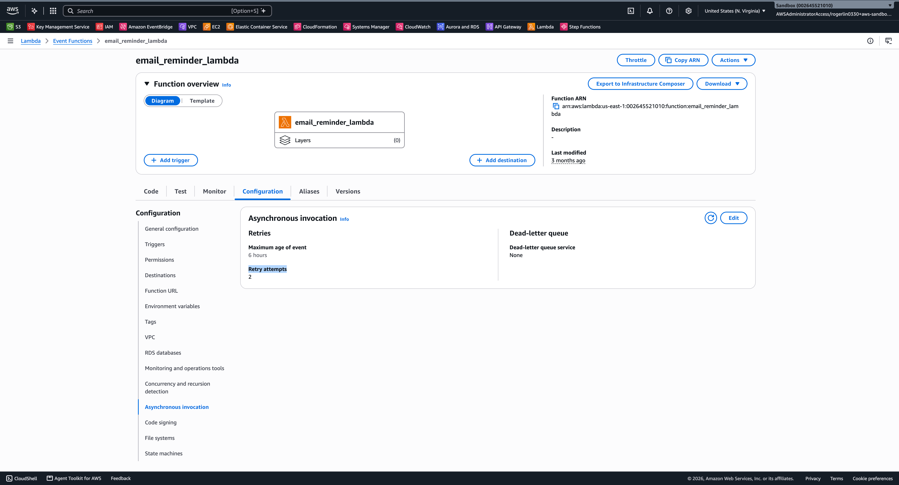
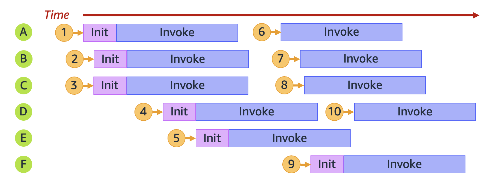
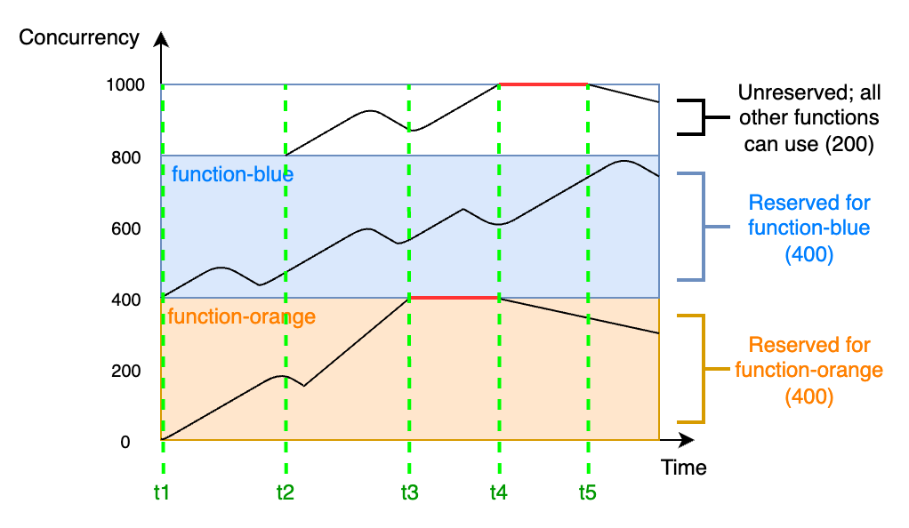

# AWS Lambda

**Lambda** is AWS's **Function as a Service (FaaS)** product: you supply short-running, focused code, and Lambda runs it and bills you only for the duration it executes. It is a core building block of **serverless and event-driven architectures** (see [Architecture Evolution](../patterns/architecture-evolution.md)) — the "consume resources only while working" compute primitive.

A **Lambda function** is a piece of code that Lambda runs using a supported **runtime** (e.g. Python 3.8). Think of a function as a *unit of configuration* — the code plus its wrappings: the runtime language, the deployment package, resource allocations, and security configuration. When invoked, the deployment package is loaded into and executed within a **runtime environment** (also called an **execution context**) purpose-built for that runtime. You directly allocate memory; virtual CPU is allocated *indirectly* in proportion to memory. Billing is allocated resource multiplied by execution duration, per invocation.

> [!tip] Exam Tip
> Trigger keywords that point at Lambda: *serverless*, *event-driven*, *function as a service / FaaS*, *only pay for what you use*, *short-running focused compute*.

## Diagram Walkthrough — Architecture 101

**How to read it:** the center box is the **runtime environment**. The Python logo on its left feeds in the runtime, and the memory stick on its right represents allocated resource. **Function Code** sits inside, and the hard-hat icon underneath is the **execution role**. Everything flowing *into* the box (deployment package, timeout, memory scaling) are the configuration levers you set.

- **Deployment package:** 50 MB zipped / 250 MB unzipped for direct upload (container images support up to 10 GB uncompressed).
- **Function timeout:** 900 s (15 min) — the hard maximum for a single invocation.
- **Common runtimes:** Python, Ruby, Java, Go, C#, Node.js. Custom runtimes (e.g. Rust) are possible via **layers**.
- **Memory-to-vCPU scaling:** 128 MB up to 10240 MB in 1 MB steps; **1769 MB yields 1 vCPU**, scaling linearly.
- **`/tmp` storage:** 512 MB default, up to 10240 MB.

## Mechanics

### Runtimes

- Supported runtimes include multiple versions of **Python, Node.js, Ruby, Java, Go, and C#**.
- **Custom runtimes** (e.g. Rust) can be added via **Lambda layers**, many community-built.

> [!warning] Gotcha — "Docker" is an exam signal
> If a question uses the bare term **"Docker"**, read it as **NOT Lambda** — it points to traditional containerized compute (e.g. [ECS](ecs.md)). This is distinct from Lambda's *container image* support: you can build [container images](../concepts/containers.md) for Lambda using your existing Docker build process, but those images are purpose-built to run *inside the Lambda environment*, not as standalone Docker containers. Don't conflate the two.

### Resource allocation

- **Memory:** directly set, 128 MB to 10240 MB in 1 MB steps.
- **vCPU:** allocated indirectly; **1769 MB yields the equivalent of one vCPU**, scaling linearly (less memory means fractional vCPU; more memory means multiple vCPUs, up to ~6 vCPUs at 10240 MB).
- **`/tmp` disk:** 512 MB mounted at `/tmp` by default, scalable to 10240 MB. Treat as **temporary scratch space** — assume it may be blank on any invocation.

### Timeout

- Maximum **900 seconds / 15 minutes** per invocation — the **function timeout**. One of the few figures worth memorizing for the exam.
- For workloads exceeding 15 minutes, Lambda can't be used directly; use **[Step Functions](step-functions.md)** to orchestrate longer workflows across multiple functions.

### Statelessness

- By default, assume **every invocation runs in a brand-new, clean runtime environment** with no leftover state. Your code must work 100% of the time on the assumption of a fresh environment.
- Execution contexts *can* be reused (warm starts — see [Cold Starts, Warm Starts & Concurrency](#startup-cold-starts-warm-starts--concurrency)), but you must never *depend* on reuse.

### Common use cases

- **Serverless applications:** [S3](s3.md) plus [API Gateway](api-gateway.md) plus Lambda — see the [Serverless Architecture](../patterns/serverless-architecture.md) pattern for a full worked example (the PetTube transcoding flow, with Lambda at steps 5 and 9).
- **File processing:** an [S3](s3.md#event-notifications) upload fires an S3 event that invokes Lambda (classic example: watermarking images).
- **Database triggers:** [DynamoDB](dynamodb.md) plus [DynamoDB Streams](dynamodb.md#streams-and-lambda-triggers) plus Lambda (fires on insert/modify/delete).
- **Serverless cron:** EventBridge / CloudWatch Events invokes Lambda on a schedule.
- **Real-time stream processing:** a [Kinesis](kinesis.md) stream feeds Lambda, scaling with data volume.

## Networking

Lambda has **two networking modes**. Know both for the exam.

### Public networking (default)

- By default, Lambda runs in the **public AWS network** and can reach **public-space AWS services** and the **public internet** (assuming valid auth).
- It has **no access to [VPC](vpc.md)-based services** ([Aurora](aurora.md), [EC2](ec2.md), [EFS](efs.md)) *unless* those services are given public addressing and security rules allowing external access.
- **Best performance** — no customer-specific networking is required, so functions run on shared hardware and networking.

### VPC networking

- **Golden rule:** a Lambda function in a [VPC](vpc.md) **obeys all normal VPC networking rules** — treat it exactly like any other VPC resource.
- It can **freely reach other VPC resources** (subject to [NACLs](vpc.md#network-acl-nacl) and [security groups](vpc.md#security-groups-sg)).
- It **cannot reach outside the VPC** (public AWS services, internet) unless the VPC provides the path: a **[gateway endpoint](vpc.md#aws-privatelink)** for DynamoDB, or a **[NAT gateway](vpc.md#nat--nat-gateway) plus [internet gateway](vpc.md#internet-gateway-igw)** for public/internet access.

> [!warning] Gotcha — execution role needs EC2 network permissions
> A VPC function's **execution role needs EC2 network permissions**, because the Lambda service must create **network interfaces** in your VPC. A common exam scenario: a VPC Lambda failing because it lacks these EC2 networking permissions.

#### Old vs. new ENI architecture

VPC Lambdas don't literally run in your VPC — the model resembles Fargate, with a **Lambda service VPC** connecting into your **customer VPC** via [elastic network interfaces (ENIs)](../concepts/networking.md).

- **Old way:** each function created **one ENI per function, per invocation**. This added invocation delay and scaled badly — high concurrency meant many ENIs and VPC capacity pressure, making VPC Lambdas a performance liability.
- **New way:** AWS analyzes all functions in a region/account and builds **one ENI per unique combination of security groups plus subnets**. Functions sharing the same SG-and-subnet combo share a single ENI. These ENIs are created **once**, when you configure/update the function (typically ~90 seconds), **not per invocation** — so there's **no per-invocation delay**, and private networking now scales without ENI sprawl.

> [!note] Diagram labels are illustrative
> The diagram labels the new architecture "A4LVPC" (Adrian's *Animals4Life* demo VPC name) and "AWS Lambda Service VPC." These are illustrative container names, not exam terms — the exam-relevant concept is *shared ENIs per unique SG-plus-subnet combination*.

## Security

Lambda has a **two-part permissions model**, and the exam tests both halves. This maps cleanly onto the [resource-policy vs identity-policy](../concepts/resource-vs-identity-policies.md) distinction: inbound "who can invoke me" is a resource policy; outbound "what can I do" is an identity policy attached to the execution role.

**How to read it:** the dotted box is the function's permission boundary. Two arrows come *in* from the top — the **resource policy** controlling *who can invoke*. The arrows across the bottom go *out* to DynamoDB (read) and S3 (write) — what the **execution role** lets the function *do*. Read top-down: inbound is the resource policy (invoke control); outbound is the execution role (action permissions).

### Execution role (well-known, associate-level)

- An **[IAM role](iam.md#iam-roles) assumed by Lambda**, providing the temporary credentials the function uses to interact with other AWS services.
- Has a **trust policy** trusting Lambda and a **permissions policy** defining what the function can do (e.g. read DynamoDB, write S3).
- Conceptually **identical to an [EC2 instance role](ec2.md#instance-roles--instance-profiles)**.

### Resource policy (less commonly known)

- Analogous to an **[S3 bucket policy](s3.md#bucket-policies)** — controls **who can invoke** a specific function (external accounts, or services like SNS / S3, API Gateway).
- Automatically modified when you integrate other services with Lambda.

> [!warning] Gotcha — resource policy is editable in the console
> Older course material claims the resource policy can *only* be changed via CLI/API and **cannot** be edited in the console. **This is outdated.** Per current AWS docs you can view and edit a function's resource-based policy in the console under **Configuration → Permissions → Resource-based policy** ([AWS Lambda docs](https://docs.aws.amazon.com/lambda/latest/dg/access-control-resource-based.html); the console-view capability dates to a [2017 access-control update](https://aws.amazon.com/about-aws/whats-new/2017/03/aws-lambda-introduces-access-control-enhancements)). CLI/API editing remains fully valid.

### Logging & monitoring

- **[CloudWatch Logs](cloudwatch.md):** function output, log messages, errors, and execution-duration details.
- **[CloudWatch](cloudwatch.md) (metrics):** invocation counts, successes/failures, retries, latency.
- **X-Ray:** distributed tracing — trace a user/session path through a serverless app. Remember the pairing *X-Ray = distributed tracing*.

> [!warning] Gotcha — no logs means a missing permission
> For Lambda to write to CloudWatch Logs, the **execution role must grant the permissions** (there's a prebuilt basic-execution policy, `AWSLambdaBasicExecutionRole`). A classic diagnostic scenario: "function isn't working, nothing in CloudWatch Logs" points to a missing execution-role permission.

## Invocation

There are three ways to invoke a Lambda function: **synchronous**, **asynchronous**, and **event source mapping**.

### Synchronous invocation

- Caller (CLI/API, or clients via **[API Gateway](api-gateway.md)**) invokes the function and **waits** for the result during the request.
- The function runs once and returns **success or failure** synchronously.
- **Errors and retries must be handled by the client** — Lambda does not retry.
- Typically used when a **human**, directly or indirectly, invokes the function.

### Asynchronous invocation

- Typically used when **AWS services invoke Lambda** on your behalf (e.g. [S3 events](s3.md#event-notifications)).
- The source (e.g. S3) generates the event and **stops tracking** — it doesn't wait for a response.
- **Lambda owns reprocessing** on failure: retries are **configurable between 0 and 2 times**.
- **Dead-letter queue (DLQ):** events that still fail after retries can be routed to a DLQ for diagnostics.
- **Destinations (newer feature):** processed events can be delivered to **[SQS](sqs.md), [SNS](sns.md), another Lambda, or EventBridge**, with **separate destinations for success vs. failure**.

> [!tip] Exam Tip — async requires idempotency
> Because Lambda re-runs the *same* event with no extra context, the function must be **idempotent** — reprocessing should yield the same end state. Analogy: *set* the balance to $20, don't *add* $10. A "set" is safe to re-run; an "add" is not. Design functions to make a desired state *true* rather than performing additive/subtractive operations.

### Event source mapping (ESM)

**Direct service triggers versus ESM:** [S3](s3.md#event-notifications) and [SNS](sns.md) push events to Lambda asynchronously; [API Gateway](api-gateway.md) normally invokes it synchronously for an API request. Their integration configuration lives in the invoking service. These direct invocations do not use an ESM.

An **event source mapping** is a Lambda-managed resource that polls a stream or queue and invokes the function with batches of records. The [AWS ESM guide](https://docs.aws.amazon.com/lambda/latest/dg/invocation-eventsourcemapping.html) distinguishes these polling integrations from direct service triggers.

Supported ESM sources include:

- [Amazon DocumentDB change streams](https://docs.aws.amazon.com/lambda/latest/dg/with-documentdb.html)
- [DynamoDB Streams](https://docs.aws.amazon.com/lambda/latest/dg/with-ddb.html)
- [Kinesis Data Streams](kinesis.md)
- [Amazon MQ](https://docs.aws.amazon.com/lambda/latest/dg/with-mq.html)
- [Amazon MSK and self-managed Apache Kafka](../concepts/streaming-vs-messaging.md#kinesis-vs-kafka-and-amazon-msk)
- [Amazon SQS](sqs.md)

- Used for **streams/queues that don't natively generate events** and require **polling**: **[Kinesis](kinesis.md), DynamoDB Streams, [SQS](sqs.md)**, and **Amazon MSK** ([Managed Streaming for Apache Kafka](../concepts/streaming-vs-messaging.md#kinesis-vs-kafka-and-amazon-msk)).
- A hidden **event source mapping** component polls the source, retrieves **source batches**, splits them by configured **batch size**, and delivers **event batches** to the function.
- A single invocation may receive **hundreds of events** in a batch — tune batch size carefully so processing completes within the **15-minute timeout**.
- Persistently failing batches can be sent to an **[SQS queue](sqs.md#dead-letter-queues-dlq) or SNS topic**.

> [!tip] Exam Tip — the key ESM permissions fact
> The source does **not** deliver the event; the ESM **reads** from the source using the **function's execution role permissions**. So even though the function code never directly calls Kinesis, **the execution role still needs [Kinesis](kinesis.md) (source) permissions** because the ESM uses them on the function's behalf. Contrast with async: there the source *delivers* the event, so the function only needs source permissions if it wants to *read additional data* (e.g. fetching the actual S3 object).

### Retry ownership: synchronous, asynchronous, and ESM

Both **asynchronous invocation and ESM provide automatic reprocessing**, but they use different mechanisms and configuration:

| Invocation path | Who retries after a function error? | Where to configure it |
| :--- | :--- | :--- |
| Direct synchronous invocation (`RequestResponse`) | The caller checks the result and decides whether to invoke again. Lambda does not automatically retry function errors. | Caller application or invoking service; SDK retry settings cover eligible request failures such as throttling or network errors, rather than function-code errors. |
| Asynchronous invocation (`Event`) | Lambda's internal asynchronous queue; function errors are retried twice by default. | Function/version/alias **Asynchronous invocation** settings; **Retry attempts** is configurable from 0 to 2. |
| ESM: [Kinesis](kinesis.md) / DynamoDB Streams | The ESM reprocesses failed batches. | The **event source mapping**, including `MaximumRetryAttempts` and `MaximumRecordAgeInSeconds`; by default, failed records are retried until they expire in the source. |
| ESM: [SQS](sqs.md) | By default, all messages in a failed batch become visible again after the visibility timeout, and the ESM reads them again. | The **SQS queue's** visibility timeout and redrive policy (`maxReceiveCount` / [DLQ](sqs.md#dead-letter-queues-dlq)); `maxReceiveCount` counts receives, rather than additional retries. |

The async **0–2 Retry attempts** setting applies to function errors. Throttling and service errors use separate queue retries, with backoff, for up to six hours by default; see [AWS async error handling](https://docs.aws.amazon.com/lambda/latest/dg/invocation-async-error-handling.html). For SQS, [partial batch responses](https://docs.aws.amazon.com/lambda/latest/dg/services-sqs-errorhandling.html) let your handler identify failed messages so successfully processed messages are not retried with them.

**ESM invokes the function synchronously, and the ESM itself acts as the caller responsible for retries.** The rule “the caller handles retries for synchronous invocation” still holds: with ESM, that caller is an AWS-managed component. AWS describes this synchronous invocation model in [Event source mappings with durable functions](https://docs.aws.amazon.com/lambda/latest/dg/durable-invoking-esm.html).

> [!warning] Gotcha — asynchronous retry settings do not apply to ESM
> The function's **Asynchronous invocation → Retry attempts** (shown in screenshot) setting does not affect ESM invocations. Configure retry behavior for the specific event source, using the mapping settings or source queue settings as shown above.

For configuration details, see [asynchronous error handling settings](https://docs.aws.amazon.com/lambda/latest/dg/invocation-async-configuring.html), [ESM configuration](https://docs.aws.amazon.com/lambda/latest/api/API_EventSourceMappingConfiguration.html), and [SQS queue and ESM configuration](https://docs.aws.amazon.com/lambda/latest/dg/services-sqs-configure.html). Both async and ESM consumers must handle duplicate processing safely through **idempotency**.

## Versions & Aliases

- A **version** is the function's **code plus configuration** (resources, environment variables, all config).
- A **published version is immutable** and gets its **own ARN** — it never changes once published.
- **`$LATEST`** points at the most recent version and is **mutable** (changes as you publish).
- **Aliases** (e.g. `dev`, `stage`, `prod`) point at specific versions and are **mutable** (can be repointed).
- Typical pattern: publish immutable versions for major changes; use aliases so app components target specific version numbers.

## Startup: Cold Starts, Warm Starts & Concurrency

- **Execution context** is the environment (a small container with allocated resource) the function runs in.
- **Cold start:** the first invocation must **create and configure** the environment, download/install the runtime, and download/install the deployment package — **~100 ms or more** before code runs.
- **Warm start:** a subsequent invocation soon after can **reuse** the existing context, skipping setup — code runs in **~1–2 ms**.
- Contexts are deleted after too long between invocations, causing another cold start. **In default Lambda, one invocation runs per context at a time**: 20 concurrent invocations require 20 environments; cold starts depend on how many warm environments are available.

### Concurrency walkthrough: 10 requests across six environments

In default Lambda, an environment handles one invocation at a time, including time spent waiting for I/O. It can serve later requests after completion. In this AWS example, rows A–F are environments; circles identify requests; **Init** marks initialization and **Invoke** marks handler execution.

| Request | Environment action | Why? |
| :--- | :--- | :--- |
| 1 | Create A | No environment exists yet. |
| 2 | Create B | A is occupied. |
| 3 | Create C | A–B are occupied. |
| 4 | Create D | A–C are occupied. |
| 5 | Create E | A–D are occupied. |
| 6 | Reuse A | Request 1 has completed. |
| 7 | Reuse B | Request 2 has completed. |
| 8 | Reuse C | Request 3 has completed. |
| 9 | Create F | A–E are occupied. |
| 10 | Reuse D | Request 4 has completed. |

Ten total requests use six environments, with six cold starts and four warm invocations. **Concurrency counts overlapping requests**, rather than all requests received. Source: [AWS concurrency walkthrough](https://docs.aws.amazon.com/lambda/latest/dg/lambda-concurrency.html), with the table paraphrased above.

> [!warning] Gotcha — scope of the one-invocation rule
> This example describes **default Lambda**. **Lambda Managed Instances** can run multiple invocations concurrently within one execution environment; see [AWS concurrency model comparison](https://docs.aws.amazon.com/lambda/latest/dg/lambda-managed-instances.html).

## Understanding Reserved Concurrency and Provisioned Concurrency

Functions in an account share a Regional concurrency quota, commonly 1,000 concurrent executions; check your account's quota because it can differ. Exhausting available concurrency causes throttling. Whether a request is returned as an error, queued, or retried depends on the [invocation path](#retry-ownership-synchronous-asynchronous-and-esm).

Some of your Event Functions might be more critical than others. As a result, you might want to configure concurrency settings to ensure that critical Event Functions get the concurrency that they need. There are two types of concurrency controls available: reserved concurrency and provisioned concurrency.

- Use **[reserved concurrency](#reserved-concurrency)** to reserve a portion of the account's concurrency quota exclusively for a function and set its concurrency cap. It protects capacity from other functions without keeping environments running.
- Use **[provisioned concurrency](#provisioned-concurrency)** to pre-initialize a number of environment instances for an Event Function. This is useful for reducing cold start latencies.

### Reserved concurrency

**Reserved concurrency reserves part of the account's Regional concurrency quota exclusively for a function and caps that function at the same number.** It does not keep a minimum number of environments running or initialize them in advance. Other functions cannot use the reserved capacity, even while it is idle.

**Unused reserved capacity cannot be borrowed by other functions.** See the [AWS reserved concurrency walkthrough](https://docs.aws.amazon.com/lambda/latest/dg/lambda-concurrency.html).

For example, reserving 20 means the function can run at most 20 invocations concurrently, and other functions cannot consume those 20 slots. It can still scale down to zero active invocations. Reserved concurrency has no additional charge; see [AWS reserved concurrency configuration](https://docs.aws.amazon.com/lambda/latest/dg/configuration-concurrency.html).

Let's explore further using the following chart:

In this diagram, your account concurrency limit for all the Event Functions in this Region is at the default limit of 1,000. Suppose you have two critical Event Functions, `function-blue` and `function-orange`, that routinely expect to get high invocation volumes. You decide to give 400 units of reserved concurrency to `function-blue`, and 400 units of reserved concurrency to `function-orange`. In this example, all other Event Functions in your account must share the remaining 200 units of unreserved concurrency.

The diagram has five points of interest:

- At `t1`, both `function-orange` and `function-blue` begin receiving requests. Each Event Function begins to use up its allocated portion of reserved concurrency units.
- At `t2`, `function-orange` and `function-blue` steadily receive more requests. At the same time, you deploy some other Lambda Event Functions, which begin receiving requests. You don't allocate reserved concurrency to these other Event Functions. They begin using the remaining 200 units of unreserved concurrency.
- At `t3`, `function-orange` hits the max concurrency of 400. Although there is unused concurrency elsewhere in your account, `function-orange` cannot access it. The red line indicates that `function-orange` is experiencing throttling, and Lambda might drop requests.
- At `t4`, `function-orange` starts to receive fewer requests and is no longer throttling. However, your other Event Functions experience a spike in traffic and begin throttling. Although there is unused concurrency elsewhere in your account, these other Event Functions cannot access it. The red line indicates that your other Event Functions are experiencing throttling.
- At `t5`, other Event Functions start to receive fewer requests and are no longer throttling.

### Provisioned concurrency

**Provisioned concurrency pre-initializes a configured number of execution environments** to reduce cold-start latency, with additional charges. Use it for latency-sensitive workloads with predictable traffic.

It can be configured independently of [reserved concurrency](#reserved-concurrency). Requests beyond the provisioned allocation can use on-demand environments, subject to concurrency limits, and may experience cold starts. If both are configured, the provisioned allocation cannot exceed the function's reserved concurrency. See [AWS provisioned concurrency configuration](https://docs.aws.amazon.com/lambda/latest/dg/provisioned-concurrency.html).

### Code-level optimization

Always assume a fresh, clean context — never *require* reuse — but you *can* optimize for it:

- Pre-download reusable assets to `/tmp`; a later invocation in the same context can reuse them.
- Declare reusable objects (e.g. **database connections**) **outside the function handler** — these persist for future invocations in the same context. Anything **inside the handler** is scoped to that single invocation only.

> [!tip] Related pattern
> The "reuse a database connection across invocations" problem is exactly what [RDS Proxy](rds-proxy.md) solves at the infrastructure level — pooling and multiplexing connections so a burst of Lambda invocations doesn't exhaust the database's connection limit.

## Course-vs-Reality Discrepancies

| # | Topic | Course says | Current AWS reality | Source |
| --- | --- | --- | --- | --- |
| 1 | Resource policy editing | CLI/API only; **not** editable in console | Viewable **and editable** in console (Configuration → Permissions) | [AWS docs](https://docs.aws.amazon.com/lambda/latest/dg/access-control-resource-based.html) |
| 2 | Old VPC ENI model | Presented as current-ish "old way" | Superseded by shared-ENI (per SG-plus-subnet) model | AWS Lambda VPC docs |

## Quick Reference

| Attribute | Value | Notes |
| --- | --- | --- |
| Runtimes | Python, Node.js, Ruby, Java, Go, C# | Custom via layers (e.g. Rust) |
| Memory | 128 MB – 10240 MB, 1 MB steps | Directly set |
| vCPU | Indirect; **1769 MB = 1 vCPU** | Linear; ~6 vCPUs at 10240 MB |
| `/tmp` storage | 512 MB default to 10240 MB | Ephemeral scratch only |
| Timeout | **900 s / 15 min** max | Use [Step Functions](step-functions.md) beyond this |
| Deployment package | 50 MB zipped / 250 MB unzipped | Container images up to 10 GB uncompressed |
| Cold start | ~100 ms | Full context creation |
| Warm start | ~1–2 ms | Context reused |
| Async retries | 0–2 (configurable) | Lambda handles retry |
| Invocation types | Sync / Async / ESM | See [Invocation](#invocation) |

## Exam Traps (consolidated)

- **"Docker"** in a question means **NOT Lambda** (traditional containers point to [ECS](ecs.md)). Lambda *container images* are a separate thing.
- **>15 minutes** of work means not a single Lambda invocation; use **[Step Functions](step-functions.md)**.
- **VPC Lambda is a normal VPC resource** — needs endpoints/NAT/IGW for outside access, plus **EC2 network permissions** on the execution role.
- **No CloudWatch Logs output** means suspect a **missing execution-role permission**.
- **ESM permissions:** the execution role needs **source-service permissions** (e.g. Kinesis) even though the code doesn't directly read the source.
- **Async invocation requires idempotency** (retries re-run the same event).
- **Published versions are immutable**; `$LATEST` and **aliases are mutable**.
- **Sync means the caller handles retries; async means Lambda handles retries. For ESM, the mapping is the synchronous caller and manages reprocessing according to the event source.**

## CloudFront Edge Execution

[Lambda@Edge](lambda-edge.md) executes published function versions on the [CloudFront](cloudfront.md) path rather than through the ordinary regional invocation architecture. Viewer and origin triggers have different relationships to cache lookup; deployment starts in us-east-1 and excludes features such as VPC attachment, layers, and provisioned concurrency. Use the dedicated guide for the four trigger positions, redirect examples, and current quotas.

## References

- Adrian Cantrill, AWS Solutions Architect Associate (SAA-C03), *"AWS Lambda"* (Parts 1–3) — [learn.cantrill.io](https://learn.cantrill.io/)
- [AWS Lambda Developer Guide — Memory and computing power](https://docs.aws.amazon.com/lambda/latest/dg/configuration-memory.html) (128–10240 MB, 1769 MB = 1 vCPU)
- [AWS Lambda Developer Guide — Resource-based policies](https://docs.aws.amazon.com/lambda/latest/dg/access-control-resource-based.html) (console-editable resource policy)
- [Configuring a Lambda function to access resources in a VPC](https://docs.aws.amazon.com/lambda/latest/dg/configuration-vpc.html) (shared-ENI Hyperplane model)
- [Lambda quotas](https://docs.aws.amazon.com/lambda/latest/dg/gettingstarted-limits.html) (deployment package, timeout, /tmp)
- [Lambda event source mappings](https://docs.aws.amazon.com/lambda/latest/dg/invocation-eventsourcemapping.html)
- [Understanding retry behavior in Lambda](https://docs.aws.amazon.com/lambda/latest/dg/invocation-retries.html)
- [Invoke a Lambda function synchronously](https://docs.aws.amazon.com/lambda/latest/dg/invocation-sync.html)
- [Configuring asynchronous error handling](https://docs.aws.amazon.com/lambda/latest/dg/invocation-async-configuring.html)
- [Event source mapping configuration](https://docs.aws.amazon.com/lambda/latest/api/API_EventSourceMappingConfiguration.html)
- [Creating and configuring an SQS event source mapping](https://docs.aws.amazon.com/lambda/latest/dg/services-sqs-configure.html)
- [Event source mappings with durable functions](https://docs.aws.amazon.com/lambda/latest/dg/durable-invoking-esm.html) — synchronous ESM invocation model
- [Understanding Lambda concurrency and scaling](https://docs.aws.amazon.com/lambda/latest/dg/lambda-concurrency.html) — ten-request diagram and accompanying table
- [Lambda Managed Instances](https://docs.aws.amazon.com/lambda/latest/dg/lambda-managed-instances.html) — concurrency model differences
- [Asynchronous invocation errors and retries](https://docs.aws.amazon.com/lambda/latest/dg/invocation-async-error-handling.html)
- [SQS partial batch responses](https://docs.aws.amazon.com/lambda/latest/dg/services-sqs-errorhandling.html)
- [Configuring reserved concurrency](https://docs.aws.amazon.com/lambda/latest/dg/configuration-concurrency.html)
- [Configuring provisioned concurrency](https://docs.aws.amazon.com/lambda/latest/dg/provisioned-concurrency.html)
