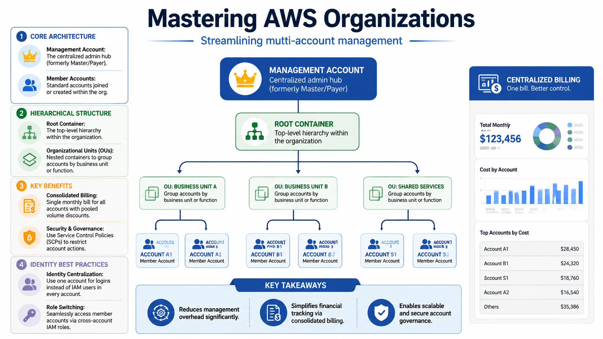
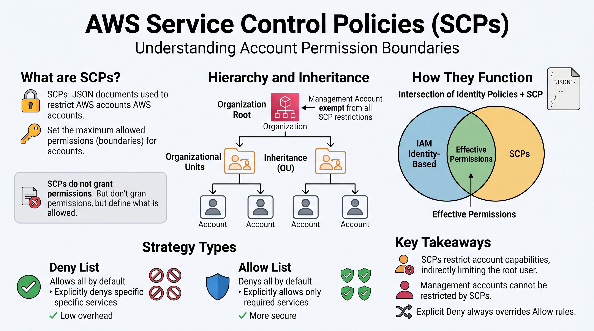

# AWS Organizations

AWS Organizations lets an enterprise manage **many AWS accounts as a single unit**: one consolidated bill, shared volume discounts and [Savings Plan / Reserved Instance benefits](../patterns/cost-optimization.md), centralized policy guardrails, and a single sign-in path that uses [IAM roles](iam.md#iam-roles) to switch between accounts. It is the answer to almost every SAA exam question about "we have many AWS accounts and want to…".

When a question wants the *whole* well-architected multi-account environment stood up automatically — landing zone, foundational accounts, SSO, guardrails, and account provisioning — the answer is [AWS Control Tower](control-tower.md), which orchestrates Organizations (and turns SCPs into preventative guardrails) on top of this foundation.

## Core Architecture



| Element | What it is |
| --- | --- |
| **Standard account** | An AWS account not part of any organization |
| **Management account** | The account that *creates* the organization. Pays all bills (a.k.a. **payer account**). Formerly called "master." |
| **Member account** | Any other account in the org — either invited (and accepted) or created directly within the org |
| **Root container** | The top-level container holding all accounts and OUs. Not the same as the AWS account root user |
| **Organizational Unit (OU)** | A nested container of accounts and/or other OUs — groups accounts by business unit, function, or environment (prod/dev/shared services) |

> [!warning] Gotcha
> "Root" is overloaded in AWS. The **Organizations root** is a container at the top of the org tree. The **account root user** is the email-based super-admin of a single AWS account. They are unrelated.

## Hierarchy

```text
Organization
└── Root container
    ├── OU: Production
    │   ├── Account A (member)
    │   └── Account B (member)
    ├── OU: Development
    │   └── Account C (member)
    └── Account M (management — payer)
```

OUs can be nested, allowing complex structures (per-business-unit OU containing per-environment sub-OUs, etc.). [Service Control Policies](#service-control-policies-scps) attach at the root, OU, or account level and apply down the tree.

## Consolidated Billing

The most-tested benefit:

- **Single monthly bill** to the management account; member accounts lose their individual billing methods.
- **Volume discounts** on tiered services (S3 storage, data transfer) aggregate across all accounts — 10 accounts each using 10 TB get billed as one 100 TB customer.
- **Reserved Instance and Savings Plan benefits** are **pooled and shared** across the organization by default (the management account can disable RI/SP sharing per account if desired). An unused RI in account A automatically applies to matching usage in account B.
- See [Cost Optimization](../patterns/cost-optimization.md) for the full SP/RI/Spot picture.

> [!tip] Exam Tip
> When a question describes multiple AWS accounts needing to **maximize Reserved Instance / Savings Plan utilization** or hit higher volume-discount tiers, the answer is **AWS Organizations with consolidated billing** — even if SCPs and governance never come up.

## Account Management

| Action | How it works |
| --- | --- |
| **Invite an existing account** | Org sends an invite; the invited account must accept. Useful for absorbing acquisitions or pre-existing accounts. |
| **Create a new account in the org** | Just provide a unique email — no invite/accept step. New accounts are members from creation. |
| **Move an account between OUs** | Drag-and-drop in console or `move-account` API call. Account is unaffected; only its SCP inheritance changes. |
| **Remove a member account** | Account becomes standard again. Must have its own payment method and tax/contact info before leaving. |

## Identity Workflow — Role Switching

Member accounts should generally **not have their own IAM users**. Best practice:

1. Designate a single **login account** — typically the management account or a dedicated "identity" member account.
2. Users log in there using IAM users or — at scale — [identity federation](../concepts/identity-and-access.md#identity-federation) (SAML / corporate IdP).
3. To work in a member account, the user **assumes a [cross-account role](iam.md#when-to-use-roles)** in that account using `sts:AssumeRole`.
4. The console exposes this as a one-click **"Switch Role"** experience.

When you create a new account inside an organization, AWS automatically provisions an **`OrganizationAccountAccessRole`** in it, trusting the management account. The management account can role-switch in immediately — no extra setup.

See [IAM Roles → Cross-account access](iam.md#cross-account-access) for the underlying mechanics.

## Service Control Policies (SCPs)

SCPs are **JSON policy documents** that define **permission boundaries** on AWS accounts. They are AWS Organizations' primary governance lever — used to enforce things like "no one in this OU can disable [CloudTrail](cloudtrail.md)" or "production accounts may only operate in `us-east-1` and `eu-west-1`."



### The Cardinal Rule: SCPs Restrict, They Never Grant

This is the single most-tested SCP fact:

- An SCP **defines the maximum** of what an account/identity *can* do.
- It does **not** grant permissions on its own, it is for controlling what permission can be granted to an AWS account — to grant permissions, a principal still needs an IAM identity policy that explicitly allows the action.
- **Effective permissions = intersection of (SCP allows) ∩ (Identity policy allows)**.

A user with `AdministratorAccess` in an account whose SCP forbids `s3:*` cannot use S3. The SCP ceiling wins.


The two failure modes the diagram makes explicit:

- **Identity policy allows, SCP doesn't** → denied (the SCP ceiling).
- **SCP allows, no identity policy grants it** → denied (SCPs never grant).

### Attachment Hierarchy and Inheritance

SCPs can attach at three levels and **inherit downward**:

| Attachment | Affects |
| --- | --- |
| **Organization root** | Every account in the organization (except the management account) |
| **Organizational Unit (OU)** | Every account in that OU plus all nested OUs |
| **Individual account** | Only that account |

The effective SCP at any account is the **stack of every SCP along the path** from the root down to (and including) the account.

### Management Account Is Exempt

> [!warning] Gotcha
> **SCPs do not apply to the management account, ever.** A `Deny *` attached at the root has no effect on it. This is by design — AWS guarantees the management account remains able to administer the organization — but it means you cannot use SCPs to lock down the payer.
>
> The practical consequence: **never run production workloads in the management account.** Keep it for billing and org administration; deploy real resources in member accounts where SCPs actually take effect.

### Effect on the Root User

The account **root user** is a special principal that **cannot be restricted by IAM identity policies**. But SCPs **can** indirectly limit it — because SCPs restrict the *account's* allowed actions, the root user can only do things the SCP still permits. This is one of the few mechanisms in AWS that bounds the root user at all.

### Deny List vs Allow List

Two ways to structure SCPs:

| Model | How it works | Trade-off |
| --- | --- | --- |
| **Deny list (default, recommended)** | Keep the default **`FullAWSAccess`** SCP that allows everything; add explicit `Deny` statements to block specific services or conditions | Low admin overhead; new AWS services are automatically permitted as they launch |
| **Allow list** | Remove `FullAWSAccess`; attach explicit `Allow` statements naming each permitted service | More secure but high overhead — every new AWS service has to be added; easy to accidentally block needed access |

When you enable SCPs, AWS automatically attaches a default SCP named **`FullAWSAccess`** to the root, every OU, and every account. This is what makes the org default-permissive — remove it (selectively, at one level) to switch to an allow-list at that scope.

### SCP Policy Evaluation

Same three-tier evaluation as IAM, applied to the SCP-stack:

1. **Explicit Deny anywhere → denied.**
2. **Explicit Allow + no Deny → allowed by the SCP layer.**
3. **No matching Allow → implicit deny.**

Then the result is **intersected with the identity policy's allow set** for the final effective permission.

> [!tip] Exam Tip
> Memorize the **intersection diagram**: effective permissions are the overlap between what the **IAM identity policy allows** and what the **SCP allows**. Anything outside that overlap is denied — whether the SCP says nothing or the identity policy says nothing.

### Typical Uses

- Restrict member accounts to one or more **specific regions** (compliance / data residency)
- Forbid disabling **CloudTrail**, **GuardDuty**, **Config**
- Block **IAM user creation** to force federation
- Cap **EC2 instance sizes** in non-prod OUs
- Deny use of **root user access keys**, root login outside MFA, etc.

## Resilience and Scope

- AWS Organizations is a **global** service tied to the management account.
- The organization itself has no regional component; SCPs and account structure apply everywhere automatically.

## Common Exam Patterns

| Symptom in question | Answer |
| --- | --- |
| "Many accounts, want one bill" | Consolidated billing via Organizations |
| "Maximize RI / Savings Plan utilization across accounts" | Organizations (benefits pool automatically) |
| "Centralize identity, avoid IAM users in every account" | Login account + cross-account role assumption + federation |
| "Prevent accounts from using a forbidden region / disabling CloudTrail" | SCP attached at the OU |
| "Restrict the management account itself" | **Trick** — SCPs do not apply to the management account; move workloads to a member account |

## References

- [IAM Roles — Cross-account access](iam.md#cross-account-access)
- [Identity and Access — Identity Federation](../concepts/identity-and-access.md#identity-federation)
- [Cost Optimization patterns](../patterns/cost-optimization.md)
- [AWS Organizations Documentation](https://docs.aws.amazon.com/organizations/)
- Source: `raw/aws-cert-study-notes/aws-solution-architect/organization.md`
- Source: `raw/aws-cert-study-notes/aws-solution-architect/organization_scp.md`
