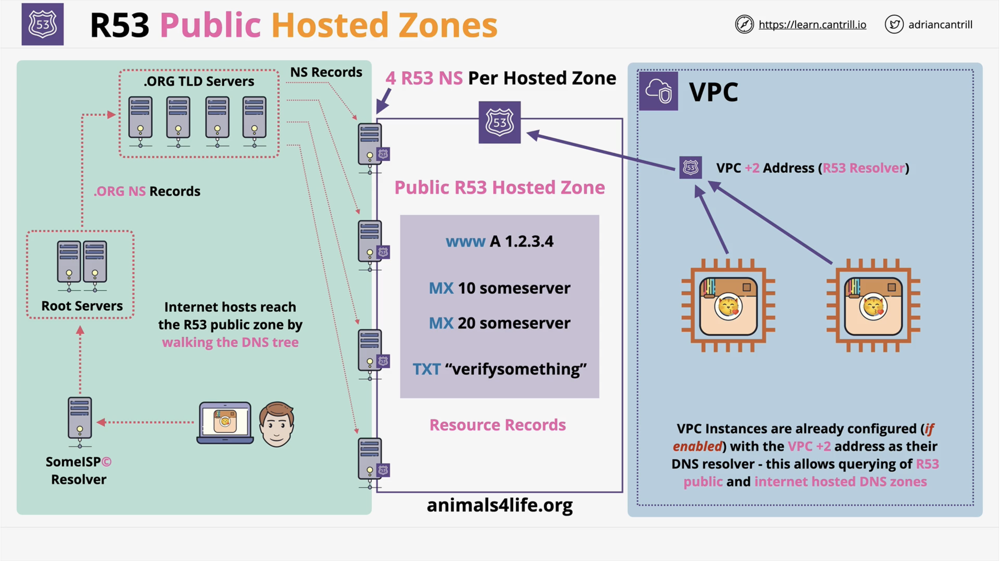
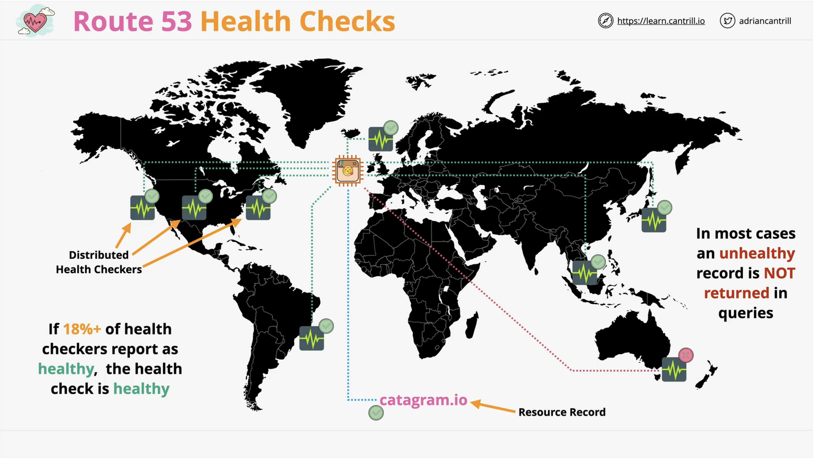

# Route 53

Route 53 is AWS's **authoritative DNS service** and domain registrar. It is **globally resilient** — name servers are distributed across multiple regions and share the same dataset, so the service remains available even during regional failures. See [DNS Concepts](../concepts/dns.md) for the underlying DNS fundamentals.

Route 53 integrates tightly with [TLS/HTTPS](../concepts/tls-https.md) (ACM certificate validation uses DNS TXT records) and with [VPC](vpc.md) (private hosted zones and the built-in Resolver).

## Hosted Zones

A **hosted zone** is a DNS database for a specific domain — the container for all its DNS records.

### Public Hosted Zone

Accessible from the public internet and from any VPC via the Route 53 Resolver.

- Route 53 allocates **4 public name servers** per hosted zone
- To make Route 53 authoritative for a domain, update the **NS records at the registrar** (or TLD) to point to these 4 servers
- Works with domains registered externally (GoDaddy, Hover, etc.) — update NS at the registrar, Route 53 handles the rest
- VPC resources resolve public zone records via the **VPC +2 resolver** (see Route 53 Resolver below)

**Cost:** monthly per hosted zone + small per-query fee; Alias records pointing to AWS resources are **free**

### Private Hosted Zone

Accessible **only from explicitly associated VPCs** — never from the public internet.

- Must be associated with one or more VPCs (same or different AWS accounts)
- **Cross-account association**: supported, but **CLI/API only** — not available in the AWS Console
- Requires the VPC to have `enableDnsSupport` = `true` (see [VPC](vpc.md#dns-in-vpc))

> [!tip] Exam Tip
> Private hosted zones are the right answer for **internal service discovery** — microservices resolving each other by name within a VPC without exposing anything publicly.

### Split-View (Split-Horizon) DNS

You can create both a **public** and a **private** hosted zone for the **same domain name**:

- Queries from inside an associated VPC → private zone records (internal content)
- Queries from the public internet → public zone records (public content only)

> [!tip] Exam Tip
> If a question describes needing **different DNS answers for the same domain depending on whether the query comes from inside or outside a VPC**, the answer is Split-View DNS.

## Alias Records vs CNAME

The CNAME restriction at the zone apex (naked domain) is a DNS standard limitation. Route 53 solves it with its proprietary **Alias record**.

| | CNAME | Alias |
| --- | --- | --- |
| Works at zone apex? | No | Yes |
| Standard DNS? | Yes | No — Route 53 proprietary |
| Points to | Any domain name | AWS resource DNS name |
| Query charges | Normal TTL-based billing | **Free** for AWS resource targets |
| TTL | Set on the record | Managed by Route 53 |

**Alias type must match the target resource's record type:**

| Target resource | Alias type |
| --- | --- |
| ELB | A Alias |
| CloudFront distribution | A Alias |
| S3 static website endpoint | A Alias |
| API Gateway | A Alias |
| Global Accelerator | A Alias |
| Elastic Beanstalk | A Alias |
| Another Route 53 record | Match the target record type |

> [!warning] Gotcha
> Alias type and target record type must match — e.g. ELBs return A records, so create an **A Alias**, not a CNAME Alias.

> [!tip] Exam Tip
> **Always prefer Alias over CNAME** for AWS resource targets: works at apex, free, integrates with Route 53 health checks.

## Routing Policies

Route 53 can make routing decisions based on health, geography, and load — going well beyond basic DNS.

| Policy | Behaviour |
| --- | --- |
| Simple | Single record; no health checks |
| Weighted | Split traffic by percentage (A/B testing, gradual migration) |
| Latency | Route to the AWS region with lowest latency for the client |
| Failover | Active/passive; switch to secondary when primary health check fails |
| Geolocation | Route based on client's country/continent |
| Geoproximity | Route based on geographic distance; adjustable bias |
| Multi-value | Return multiple IPs; basic load distribution (not a true load balancer) |

> [!tip] Exam Tip
> **Failover** requires a Route 53 **health check** on the primary record. Health checks can monitor an endpoint (HTTP/HTTPS/TCP), a CloudWatch alarm, or other health checks (calculated health check). See [Health Checks](#health-checks) below.

## Health Checks

Route 53 health checks monitor the availability of endpoints and feed the result back into DNS routing decisions. They are the engine behind **Failover** routing and a useful filter for **Multi-value** and **Weighted** policies, where unhealthy records are excluded from query responses.

### Key properties

- **Independent objects**: health checks are created in the Route 53 console under **Health Checks**, *not* inside a hosted zone. A single health check can be referenced by many DNS records.
- **Not limited to AWS**: any publicly reachable IP or DNS name can be monitored — useful for hybrid or multi-cloud setups.
- **Globally distributed checkers**: AWS runs a fleet of health checkers across many regions. Each checker probes the target independently and reports back.
- **Default interval 30 s; fast mode 10 s** (extra cost). **Failure threshold** = number of consecutive failed probes before status flips.

> [!warning] Gotcha
> Your firewall ([Security Group](vpc.md#security-groups-sg)/[NACL](vpc.md#network-acl-nacl)) must **allow inbound traffic from Route 53 health checker IP ranges**. Blocking them by accident causes false alarms — endpoints look unhealthy even though real traffic is fine. AWS publishes the IP ranges and lets you scope checks to specific checker regions.

### Quorum: the 18 % rule

Each checker probes the endpoint independently. Route 53 aggregates the results:

- If **more than 18 %** of checkers report **healthy** → overall status is **healthy**
- Otherwise → **unhealthy**, and the record is normally excluded from DNS responses

> [!tip] Exam Tip
> The 18 % aggregation makes Route 53 health checks resilient to localised network failures — a checker in one region failing to reach your endpoint will not, on its own, mark you down.

### Endpoint check types

A single endpoint health check uses one of three probe types:

| Probe | What passes | Timing | Notes |
| --- | --- | --- | --- |
| **TCP** | TCP handshake completes | within 10 s | Basic L4 reachability — does not validate application |
| **HTTP / HTTPS** | TCP within 4 s, then HTTP status `200–399` within 2 s | 4 s + 2 s | Validates that the web server actually responds |
| **HTTP/HTTPS + string match** | Above, plus a specified string appears in the **first 5,120 bytes** of the response body, matched within 2 s | 4 s + 2 s + 2 s | Most accurate — confirms the app is returning real content |

> [!tip] Exam Tip
> **String matching** is the most accurate signal of application health: it catches the case where the web server returns 200 OK but the app behind it is broken (e.g. database down → error page rendered with HTTP 200). Use string matching whenever the question describes verifying that the application is *actually working*, not just reachable.

### Health check categories (by input source)

Endpoint checks are only one of three types — the others compose existing signals:

| Category | Input | Use case |
| --- | --- | --- |
| **Endpoint** | IP / domain probed directly with TCP / HTTP / HTTPS | Most common — monitor a web endpoint |
| **CloudWatch Alarm** | An existing CloudWatch alarm state | Use any metric or in-app signal the CloudWatch agent can collect (CPU, queue depth, custom metric) |
| **Calculated** | Boolean of multiple other health checks | Aggregate component checks into an overall application health status |

A **calculated** health check is the building block for monitoring multi-component apps — e.g. "healthy only if both `web` and `db` checks pass."

### Console options worth knowing

- **Host header** — needed when one IP serves multiple virtual hosts
- **Request path** — point HTTP checks at `/health` rather than `/` to avoid scraping homepages
- **Invert status** — flips healthy/unhealthy (rarely useful; mostly for inverse failover patterns)
- **Disable** — pause a check during planned maintenance instead of deleting it
- **Checker regions** — restrict to a subset of regions (cost / compliance / locality)
- **Latency graph** — Route 53 records and graphs probe latency from each checker region

### Integration with SNS

Health checks can publish state changes to an **SNS topic** — fan them out to email, SMS, Lambda, or downstream incident systems for alerting. This is independent of how DNS routing uses the same check.

### Architectural role

Health checks are the link between *monitoring* and *traffic steering*:

- **Failover routing** uses them to flip from primary to secondary
- **Multi-value / Weighted** policies use them to drop unhealthy records from responses
- **CloudWatch + calculated** checks let DNS respond to *application-level* signals, not just network reachability

Combined with **ELB target group health checks** (load-balancer-level — exclude bad targets) and **Auto Scaling health checks** (instance replacement), Route 53 health checks form the **outermost layer** of AWS availability monitoring — the one that decides what IP a client even gets in its DNS answer.

## Route 53 Resolver

Every VPC has a built-in DNS resolver reachable at **VPC base IP + 2** (e.g. `10.0.0.2` for a `10.0.0.0/16` VPC). It handles:

- Local VPC hostnames (`ec2-….compute.amazonaws.com`)
- Records in associated private hosted zones
- Recursive public DNS lookups (root → TLD → authoritative)

For hybrid environments, **Resolver Endpoints** (inbound/outbound) allow on-premises networks to resolve Route 53 private zones, and VPCs to resolve on-premises DNS.

## References

- [DNS Concepts](../concepts/dns.md)
- [VPC](vpc.md)
- [TLS/HTTPS](../concepts/tls-https.md)
- Source: `raw/aws-cert-study-notes/aws-solution-architect/route53_public_hosted_zone.md`
- Source: `raw/aws-cert-study-notes/aws-solution-architect/route53_private_hosted_zone.md`
- Source: `raw/aws-cert-study-notes/aws-solution-architect/route53_alias_vs_cname.md`
- Source: `raw/aws-cert-study-notes/aws-solution-architect/route53_health_check.md`
