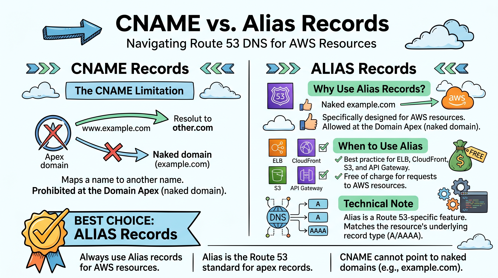
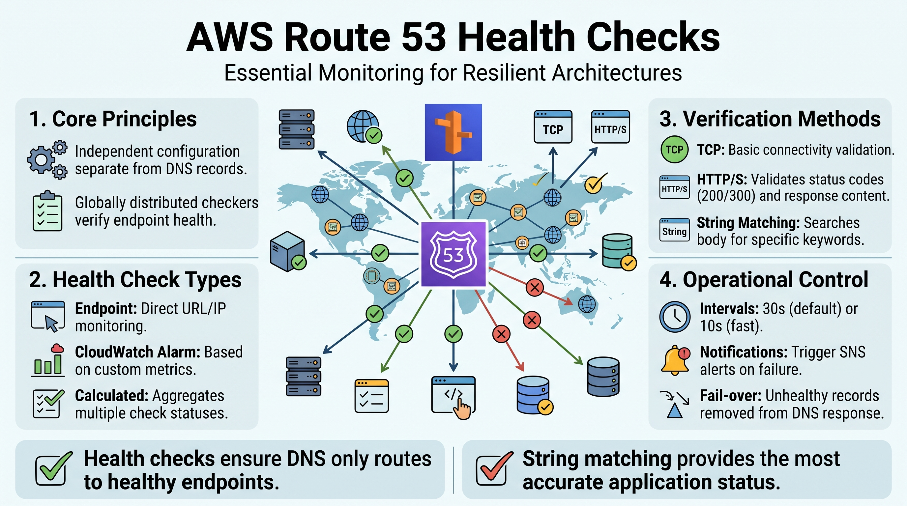

# Route 53

Route 53 is AWS's **authoritative DNS service** and domain registrar. It is **globally resilient** — name servers are distributed across multiple regions and share the same dataset, so the service remains available even during regional failures. See [DNS Concepts](../concepts/dns.md) for the underlying DNS fundamentals.

Route 53 integrates tightly with [TLS/HTTPS](../concepts/tls-https.md) (ACM certificate validation uses DNS TXT records) and with [VPC](vpc.md) (private hosted zones and the built-in Resolver).

## Hosted Zones

A **hosted zone** is a DNS database for a specific domain — the container for all its DNS records.

### Public Hosted Zone

Accessible from the public internet and from any VPC via the Route 53 Resolver.

- Route 53 allocates **4 public name servers** per hosted zone
- To make Route 53 authoritative for a domain, update the **NS records at the registrar** (or TLD) to point to these 4 servers
- Works with domains registered externally (GoDaddy, Hover, etc.) — update NS at the registrar, Route 53 handles the rest
- VPC resources resolve public zone records via the **VPC +2 resolver** (see Route 53 Resolver below)

**Cost:** monthly per hosted zone + small per-query fee; Alias records pointing to AWS resources are **free**

### Private Hosted Zone

Accessible **only from explicitly associated VPCs** — never from the public internet.

- Must be associated with one or more VPCs (same or different AWS accounts)
- **Cross-account association**: supported, but **CLI/API only** — not available in the AWS Console
- Requires the VPC to have `enableDnsSupport` = `true` (see [VPC](vpc.md#dns-in-vpc))

> [!tip] Exam Tip
> Private hosted zones are the right answer for **internal service discovery** — microservices resolving each other by name within a VPC without exposing anything publicly.

### Split-View (Split-Horizon) DNS

You can create both a **public** and a **private** hosted zone for the **same domain name**:

- Queries from inside an associated VPC → private zone records (internal content)
- Queries from the public internet → public zone records (public content only)

> [!tip] Exam Tip
> If a question describes needing **different DNS answers for the same domain depending on whether the query comes from inside or outside a VPC**, the answer is Split-View DNS.

## Alias Records vs CNAME

The CNAME restriction at the zone apex (naked domain) is a DNS standard limitation. Route 53 solves it with its proprietary **Alias record**.

| | CNAME | Alias |
| --- | --- | --- |
| Works at zone apex? | No | Yes |
| Standard DNS? | Yes | No — Route 53 proprietary |
| Points to | Any domain name | AWS resource DNS name |
| Query charges | Normal TTL-based billing | **Free** for AWS resource targets |
| TTL | Set on the record | Managed by Route 53 |

**Alias type must match the target resource's record type:**

| Target resource | Alias type |
| --- | --- |
| ELB | A Alias |
| CloudFront distribution | A Alias |
| S3 static website endpoint | A Alias |
| API Gateway | A Alias |
| Global Accelerator | A Alias |
| Elastic Beanstalk | A Alias |
| Another Route 53 record | Match the target record type |

> [!warning] Gotcha
> Alias type and target record type must match — e.g. ELBs return A records, so create an **A Alias**, not a CNAME Alias.

> [!tip] Exam Tip
> **Always prefer Alias over CNAME** for AWS resource targets: works at apex, free, integrates with Route 53 health checks.

## Routing Policies

Route 53 can make routing decisions based on health, geography, and load — going well beyond basic DNS.

| Policy | Behaviour | Health checks |
| --- | --- | --- |
| Simple | Single record | **Not supported** — a simple record can't be associated with a health check |
| Weighted | Split traffic by percentage (A/B testing, gradual migration) | **Optional** — an unhealthy record is skipped and the draw repeats (the total weight is unchanged) |
| Latency | Route to the AWS region with lowest latency for the client | **Optional** — if the lowest-latency record is unhealthy, the next-lowest healthy one is returned |
| Failover | Active/passive; switch to secondary when primary health check fails | **Required on the primary** — the health check *is* the switching mechanism |
| Geolocation | Route based on client's state/country/continent | **Optional** — an unhealthy record falls through as if it didn't exist, continuing the specificity search |
| Geoproximity | Route based on geographic distance; adjustable bias | **Optional** — an unhealthy record is excluded and traffic shifts to the next-closest |
| Multi-value | Return multiple IPs; basic load distribution (not a true load balancer) | **Optional, per record** — each record is independently checked when a check is attached; a record with no check is always treated as healthy. Per-record checking is the whole point of multi-value, so it's almost always used |

Every policy starts the same way: a hosted zone holding **multiple records of the same name**. What differs is how Route 53 chooses which value(s) to return — by weight, by latency, by health, or by location. The three location-aware policies are easy to confuse, so keep them straight: **geolocation** matches on tagged location (relevance, never distance), **latency** picks the lowest estimated latency, and **geoproximity** picks the lowest physical distance with an adjustable bias.

Health checks are **optional** on every policy except **Failover** (and unsupported on **Simple**). Where optional, a record with **no health check attached is always treated as healthy** — so don't mix checked and unchecked records in one same-name group, or the unchecked ones can never drop out. See [Health Checks](#health-checks) for the full mechanics.

## Weighted Routing

Weighted routing controls **how often each of several same-name records is returned**. That makes it the policy for **simple load balancing** across resources, and for **controlled rollout / testing of a new software version** — send a small slice of traffic (say 5 %) to the record running the new build.

You assign each same-name record a **weight**. Route 53 sums all the weights for that name into a **total weight**, then returns each record with probability `record weight ÷ total weight`. Weights do **not** have to add up to 100: three `www` records weighted 40, 40, and 20 total 100 and so happen to read directly as 40 %, 40 %, and 20 %, but the same formula applies for any values.

### Zero weight and health checks

- A weight of **0** means the record is **never returned** — useful for temporarily pulling a record out of rotation. The one exception: if **every** record for the name is 0, Route 53 considers them all, so resolution can never break.
- Weighted records can carry **health checks**, and the interaction is a classic trap. A record is first selected by the weight calculation; if the selected record is **unhealthy** it is **skipped** and the draw **repeats** until a healthy record is chosen. Health checks do **not** remove a record from the calculation, so the **total weight (the denominator) never changes** — an unhealthy record is skipped over, not subtracted.

> [!warning] Gotcha
> Health checks don't re-balance weights. People expect an unhealthy record's share to be redistributed proportionally, but Route 53 just re-draws until it lands on a healthy record — the denominator stays the same.

## Latency-Based Routing

Latency-based routing returns the record expected to give the user the **lowest latency**, so it's the policy for **performance / user-experience optimization** of a global application.

Each same-name record is tagged with the **AWS region** where its infrastructure lives — you get **one record per name per region**. AWS maintains a **latency database** of the latency between user locations and AWS regions. At resolution time Route 53:

1. Determines the user's approximate location with an **IP-geolocation lookup** (see note below).
2. Looks up the modelled latency from that location to each tagged region.
3. Returns the record for the region with the **lowest estimated latency that is also healthy**. If the lowest-latency record is unhealthy, the **next-lowest** healthy record is returned instead.

> [!warning] What "IP lookup" means — and whose IP
> The IP lookup is **not a separate service**. It's an internal **geo-IP** lookup: Route 53 maps the **source IP of the incoming DNS query** to an approximate location using a built-in IP-to-location database. The same mechanism drives [Geolocation Routing](#geolocation-routing) below.
> Crucially, the IP Route 53 sees is usually the user's **DNS resolver** (their ISP's resolver, `8.8.8.8`, etc.), **not the end-user device** — DNS is recursive, so the resolver is what queries Route 53. Route 53 geolocates the resolver on the assumption it sits near the user. If the resolver supports **EDNS Client Subnet (ECS)** — an EDNS0 extension that forwards a truncated slice of the client's IP — Route 53 uses that client subnet for a far more accurate location. Public resolvers (Google, OpenDNS) support ECS; many ISP resolvers don't. This is why the result is always *approximate*.

> [!warning] Gotcha
> The latency database is an **estimate** — updated in the background, **not real-time**, and blind to local network conditions. It's a strong performance aid, not a live measurement. Don't confuse it with **geoproximity**, which routes by physical distance plus an adjustable bias (a different mechanism even though both feel location-aware).

> [!tip] Exam Tip
> **Failover** requires a Route 53 **health check** on the primary record. Health checks can monitor an endpoint (HTTP/HTTPS/TCP), a CloudWatch alarm, or other health checks (calculated health check). See [Health Checks](#health-checks) below.

## Failover Routing

Failover routing implements **active/passive failover**: one DNS name normally resolves to a primary resource, and automatically falls back to a backup resource when the primary becomes unavailable.

You create **two records of the same name** in the hosted zone, each tagged with a failover role:

- A **Primary** record pointing at the main resource (e.g. an EC2 instance).
- A **Secondary** record of the same name pointing at a different resource (e.g. an S3 bucket).

A [health check](#health-checks) — generally attached to the **primary** record — decides which value is returned:

- Primary health check **healthy**: the name resolves to the **primary** record's value.
- Primary health check **unhealthy**: the name resolves to the **secondary** record's value.

In the diagram, two `www` records share a name inside the hosted zone. A health check probes the EC2 instance and is wired to the primary record. While it reports **healthy**, the client's `www` query follows the orange path to the **EC2 instance** running the app. When it reports **unhealthy**, the same query follows the pink path to the **S3 bucket** instead.

### Out-of-band failure / maintenance pattern

The canonical use is an **"out-of-band" failure or maintenance architecture**: the primary and secondary deliberately point at *different, independent services* (EC2 primary, S3 static-site secondary). Because the backup runs on a separate platform, it can still serve a maintenance page or static fallback even when the primary's underlying platform is the thing that has failed — the failure path does not depend on the same infrastructure that broke.

> [!warning] Gotcha
> Don't confuse failover with **weighted** or **multi-value** routing. Failover is strictly *active/passive* — one resource serves at a time, chosen by health. Weighted and multi-value **distribute** traffic across multiple healthy resources at once; they are not a primary/backup mechanism.

## Geolocation Routing

Geolocation routing makes decisions from the **location of the user** and the **location tagged on each record**. Use it to **restrict content** to a market, serve **language-specific** content, or **load balance across regional endpoints** by customer location. It resembles latency routing but keys off location rather than latency.

> [!warning] Gotcha
> The single most important point (and a repeated exam trap): geolocation returns **relevant (location-matching) records only — never the closest record as a fallback**. A user in the UK will *not* receive a Canadian record just because no nearer record exists. The outcome is always a matching record, the default record, or "no answer" — never a proximity-chosen "nearest".

You tag each record with one of four location types, most specific to least:

1. **Subdivision** — a US state (the most specific)
2. **Country** — ISO country code
3. **Continent** — ISO continent code (e.g. `SA` for South America)
4. **Default** — an optional catch-all

At resolution, the same **geo-IP lookup** described under [Latency-Based Routing](#latency-based-routing) determines the location — geolocating the source IP of the DNS query, which is normally the user's resolver unless EDNS Client Subnet is in play. Route 53 then checks for matching records in specificity order, **stopping at the first level that produces a match**: state, then country, then continent, then default. It returns the **most specific** relevant record. If nothing matches and there is **no default record**, Route 53 returns **"no answer"**.

## Geoproximity Routing

Geoproximity routing answers with the resource that is **physically closest** to the user by **distance**, and adds an adjustable **bias** so you can deliberately shift that boundary to send more or less traffic to a resource.

You define **rules**, each specifying where a resource lives:

- For an **AWS resource**: its **AWS region** (e.g. `us-east-1`, `ap-southeast-2`).
- For an **external (non-AWS) resource**: **latitude/longitude coordinates**.

Each rule also takes a **bias** that changes how the distance calculation is performed rather than using raw distance:

- A **positive (`+`) bias grows** a resource's effective service area, pulling in more surrounding traffic — and correspondingly **shrinks neighbouring** regions.
- A **negative (`-`) bias shrinks** it.

**Worked example from the diagram:** a user in Saudi Arabia has no local resource and sits roughly 6,700 km from a UK resource and 10,000 km from an Australian one, so by raw distance the **UK** would win. Applying a large **`+` bias to the Australian resource** expands its service area across the Middle East, routing the Saudi user to **Australia instead of the UK** despite the greater distance.

> [!tip] Exam Tip
> Keep the location-aware trio distinct: **geolocation** = relevance by tagged location (no concept of distance or bias); **latency** = lowest *estimated latency* (no bias); **geoproximity** = lowest *physical distance* plus an adjustable bias. Only geoproximity lets you tune how much traffic a resource attracts.

## Multi-Value Routing

Multi-value routing behaves like a blend of **simple** and **failover** routing: it returns **multiple same-name records at once**, each **independently health-checkable**, and lets the client pick one — an active/active approach to DNS.

- Route 53 returns **up to 8 healthy records** per query; if more than 8 healthy records exist, **8 are chosen at random**.
- Each record can have its **own health check** (optional, but the reason to use multi-value). A record failing its check is **excluded** from responses; a record with **no** check attached is always treated as healthy.
- The **client selects one value** from the set it receives and connects to that resource directly.

This positions it between the simpler policies — it adds per-record health checking that **simple** routing lacks, while returning many records at once rather than the strict primary/backup of **failover**:

| Policy | Health checks? | Typical use |
| --- | --- | --- |
| Simple | No | A single resource (e.g. one web server) |
| Failover | Yes | Active/backup architectures (e.g. EC2 primary, S3 backup) |
| Multi-value | Optional, per record | Many resources that can all serve requests; health-checked and returned at random |

> [!warning] Gotcha
> Multi-value routing is **not a load balancer**. It improves **availability** by returning several health-checked addresses over DNS, but it does **not** manage connections at the network level — the client does the choosing and connecting. When a question needs true load balancing, the answer is an **ELB**, not multi-value routing.

## Health Checks

Route 53 health checks monitor the availability of endpoints and feed the result back into DNS routing decisions. They are the engine behind **Failover** routing and a useful filter for **Multi-value** and **Weighted** policies, where unhealthy records are excluded from query responses.

### Key properties

- **Independent objects**: health checks are created in the Route 53 console under **Health Checks**, *not* inside a hosted zone. A single health check can be referenced by many DNS records.
- **Not limited to AWS**: any publicly reachable IP or DNS name can be monitored — useful for hybrid or multi-cloud setups.
- **Globally distributed checkers**: AWS runs a fleet of health checkers across many regions. Each checker probes the target independently and reports back.
- **Default interval 30 s; fast mode 10 s** (extra cost). **Failure threshold** = number of consecutive failed probes before status flips.

- **No check means "healthy"**: a record with **no health check associated** is always treated as **healthy** and stays eligible to be returned. This is why health checks are *optional* on every policy except **Failover** (where the primary's check is the switching mechanism). For [Alias records](#alias-records-vs-cname) the equivalent switch is **Evaluate Target Health** — left off, the alias is always healthy; turned on, the alias inherits the health of its target (e.g. the ELB's own target health).

> [!warning] Gotcha
> Your firewall ([Security Group](vpc.md#security-groups-sg)/[NACL](vpc.md#network-acl-nacl)) must **allow inbound traffic from Route 53 health checker IP ranges**. Blocking them by accident causes false alarms — endpoints look unhealthy even though real traffic is fine. AWS publishes the IP ranges and lets you scope checks to specific checker regions.

> [!warning] Gotcha
> **Don't mix checked and unchecked records in the same same-name group.** Because a record with no health check is permanently "healthy", a record you forgot to attach a check to can **never drop out** of responses — it keeps receiving traffic even when its endpoint is down. Attach checks to **all** records in a group, or none.

### Quorum: the 18 % rule

Each checker probes the endpoint independently. Route 53 aggregates the results:

- If **more than 18 %** of checkers report **healthy** → overall status is **healthy**
- Otherwise → **unhealthy**, and the record is normally excluded from DNS responses

> [!tip] Exam Tip
> The 18 % aggregation makes Route 53 health checks resilient to localised network failures — a checker in one region failing to reach your endpoint will not, on its own, mark you down.

### Endpoint check types

A single endpoint health check uses one of three probe types:

| Probe | What passes | Timing | Notes |
| --- | --- | --- | --- |
| **TCP** | TCP handshake completes | within 10 s | Basic L4 reachability — does not validate application |
| **HTTP / HTTPS** | TCP within 4 s, then HTTP status `200–399` within 2 s | 4 s + 2 s | Validates that the web server actually responds |
| **HTTP/HTTPS + string match** | Above, plus a specified string appears in the **first 5,120 bytes** of the response body, matched within 2 s | 4 s + 2 s + 2 s | Most accurate — confirms the app is returning real content |

> [!tip] Exam Tip
> **String matching** is the most accurate signal of application health: it catches the case where the web server returns 200 OK but the app behind it is broken (e.g. database down → error page rendered with HTTP 200). Use string matching whenever the question describes verifying that the application is *actually working*, not just reachable.

### Health check categories (by input source)

Endpoint checks are only one of three types — the others compose existing signals:

| Category | Input | Use case |
| --- | --- | --- |
| **Endpoint** | IP / domain probed directly with TCP / HTTP / HTTPS | Most common — monitor a web endpoint |
| **CloudWatch Alarm** | An existing CloudWatch alarm state | Use any metric or in-app signal the CloudWatch agent can collect (CPU, queue depth, custom metric) |
| **Calculated** | Boolean of multiple other health checks | Aggregate component checks into an overall application health status |

A **calculated** health check is the building block for monitoring multi-component apps — e.g. "healthy only if both `web` and `db` checks pass."

### Console options worth knowing

- **Host header** — needed when one IP serves multiple virtual hosts
- **Request path** — point HTTP checks at `/health` rather than `/` to avoid scraping homepages
- **Invert status** — flips healthy/unhealthy (rarely useful; mostly for inverse failover patterns)
- **Disable** — pause a check during planned maintenance instead of deleting it
- **Checker regions** — restrict to a subset of regions (cost / compliance / locality)
- **Latency graph** — Route 53 records and graphs probe latency from each checker region

### Integration with SNS

Health checks can publish state changes to an **SNS topic** — fan them out to email, SMS, Lambda, or downstream incident systems for alerting. This is independent of how DNS routing uses the same check.

### Architectural role

Health checks are the link between *monitoring* and *traffic steering*:

- **Failover routing** uses them to flip from primary to secondary
- **Multi-value / Weighted** policies use them to drop unhealthy records from responses
- **CloudWatch + calculated** checks let DNS respond to *application-level* signals, not just network reachability

Combined with **ELB target group health checks** (load-balancer-level — exclude bad targets) and **Auto Scaling health checks** (instance replacement), Route 53 health checks form the **outermost layer** of AWS availability monitoring — the one that decides what IP a client even gets in its DNS answer.

## Route 53 Resolver

Every VPC has a built-in DNS resolver reachable at **VPC base IP + 2** (e.g. `10.0.0.2` for a `10.0.0.0/16` VPC). It handles:

- Local VPC hostnames (`ec2-….compute.amazonaws.com`)
- Records in associated private hosted zones
- Recursive public DNS lookups (root → TLD → authoritative)

For hybrid environments, **Resolver Endpoints** (inbound/outbound) allow on-premises networks to resolve Route 53 private zones, and VPCs to resolve on-premises DNS.

## References

- [DNS Concepts](../concepts/dns.md)
- [VPC](vpc.md)
- [TLS/HTTPS](../concepts/tls-https.md)
- Source: `raw/aws-cert-study-notes/aws-solution-architect/route53_public_hosted_zone.md`
- Source: `raw/aws-cert-study-notes/aws-solution-architect/route53_private_hosted_zone.md`
- Source: `raw/aws-cert-study-notes/aws-solution-architect/route53_alias_vs_cname.md`
- Source: `raw/aws-cert-study-notes/aws-solution-architect/route53_health_check.md`
- Source: `raw/aws-cert-study-notes/aws-solution-architect/route53_failover_routing.md`
- Source: `raw/aws-cert-study-notes/aws-solution-architect/route53_weighted_routing.md`
- Source: `raw/aws-cert-study-notes/aws-solution-architect/route53_latency_based_routing.md`
- Source: `raw/aws-cert-study-notes/aws-solution-architect/route53_geolocation_routing.md`
- Source: `raw/aws-cert-study-notes/aws-solution-architect/route53_geoproximity_routing.md`
- Source: `raw/aws-cert-study-notes/aws-solution-architect/route53_multi_value_routing.md`
