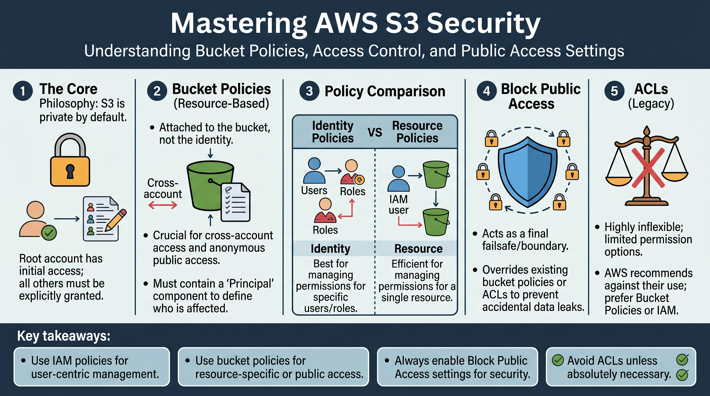

# S3 — Simple Storage Service

Amazon S3 is AWS's **object storage** service. Objects live in **buckets**; buckets are **regional** but have a **globally unique** name. This page covers two orthogonal concerns: **access control** (buckets start private; grants must be explicit) and **data protection** ([Versioning and MFA Delete](#versioning-and-mfa-delete)). For the conceptual frame on grant mechanisms, see [Resource Policies vs Identity Policies](../concepts/resource-vs-identity-policies.md).



## The "Private by Default" Baseline

Every new S3 bucket starts in a fully locked-down state:

- The **account root user** of the bucket's owning account has access. Nobody else does.
- Every other principal — IAM users/roles in the same account, identities in other accounts, anonymous requesters — must be **explicitly granted** access.

There are four mechanisms that can grant that access. The first three are the ones in active use today:

1. **[IAM identity policies](iam.md#iam-identity-policies)** — attach to a user/group/role; works only for identities in the bucket's own account.
2. **Bucket policies** — a [resource policy](../concepts/resource-vs-identity-policies.md) attached directly to the bucket.
3. **Block Public Access** — not a grant, but a hard *override* that blocks public exposure regardless of what the policies say.
4. **ACLs** — a legacy mechanism, kept for backward compatibility. AWS recommends not using them.

## Bucket Policies

A **bucket policy** is a [resource policy](../concepts/resource-vs-identity-policies.md) attached to one S3 bucket. Like every resource policy it must contain a `Principal` element on every statement — that's how the policy says *who* is being granted (or denied) what.

A bucket policy is the right tool when:

- Many identities need the same access to **one bucket** — one policy on the bucket beats N policies on N identities.
- The grant has to cross an **AWS account boundary** — bucket policies are how account B opts in to access from account A.
- The grant has to allow **anonymous / public** access — `Principal: "*"` is the only way to express "anyone", and [identity policies cannot do this](../concepts/resource-vs-identity-policies.md) because there is no identity to attach them to.
- The grant needs a **condition** beyond what IAM identity policies normally express — see [Advanced Conditions](#advanced-conditions).

### Anatomy

A minimal "public read" bucket policy:

```json
{
  "Version": "2012-10-17",
  "Statement": [
    {
      "Sid": "AllowPublicRead",
      "Effect": "Allow",
      "Principal": "*",
      "Action": "s3:GetObject",
      "Resource": "arn:aws:s3:::my-public-bucket/*"
    }
  ]
}
```

Important field-level details:

- **`Principal`** — must be present (the marker that distinguishes a resource policy from an identity policy). `"*"` means *any* principal including anonymous requesters.
- **`Resource`** — the bucket itself is `arn:aws:s3:::name`; objects inside are `arn:aws:s3:::name/*`. List operations target the bucket; object operations target the object ARN. Many policies need both.
- A bucket policy is a **single document** — multiple grants and denies are combined as additional statements rather than as multiple policies.

### Same-account vs Cross-account vs Anonymous

How a bucket policy combines with identity policies depends on where the requester lives:

| Requester | Identity policy needed? | Bucket policy needed? |
| --- | --- | --- |
| IAM user/role in **same account** | An **Allow in either** is sufficient | An **Allow in either** is sufficient |
| IAM user/role in **another AWS account** | Yes — their admin must grant the action | Yes — your bucket policy must name them |
| **Anonymous** (no AWS identity) | N/A — there is no identity | Yes — only the bucket policy can grant |

See [Resource Policies vs Identity Policies — How the two combine](../concepts/resource-vs-identity-policies.md#how-the-two-combine) for the underlying evaluation model. Cross-account is the only case where the policies form a genuine **intersection** (both sides must allow).

### Advanced Conditions

Bucket policies support **`Condition`** blocks, which gives them expressive power that ACLs do not have. Two common patterns:

#### Lock a bucket to a single source IP

```json
{
  "Version": "2012-10-17",
  "Id": "BlockUnLeet",
  "Statement": [
    {
      "Sid": "DenyAllExceptCorporateIP",
      "Effect": "Deny",
      "Principal": "*",
      "Action": "s3:*",
      "Resource": "arn:aws:s3:::secretcatproject/*",
      "Condition": {
        "NotIpAddress": { "aws:SourceIp": "1.3.3.7/32" }
      }
    }
  ]
}
```

A blanket `Deny` against everything *not* matching the corporate IP. Because [explicit Deny always wins](iam.md#policy-evaluation--priority), this overrides any Allow elsewhere.

#### Require MFA on a sensitive prefix

```json
{
  "Version": "2012-10-17",
  "Id": "protectboris",
  "Statement": [
    {
      "Sid": "DenyNonMFAOnBoris",
      "Effect": "Deny",
      "Principal": "*",
      "Action": "s3:*",
      "Resource": "arn:aws:s3:::secretcatproject/boris/*",
      "Condition": { "Null": { "aws:MultiFactorAuthAge": true } }
    },
    {
      "Sid": "AllowRestPublicRead",
      "Effect": "Allow",
      "Principal": "*",
      "Action": ["s3:GetObject"],
      "Resource": "arn:aws:s3:::secretcatproject/*"
    }
  ]
}
```

The `Null` condition with `aws:MultiFactorAuthAge: true` matches requests where the MFA context key is **absent** — i.e. the requester did *not* authenticate with MFA. Combined with `Deny`, this means "no MFA → no access to the `boris/` prefix", while the rest of the bucket stays public-readable.

> [!tip] Exam Tip
> Conditional access patterns (IP allow-list, MFA-required, VPC endpoint-only) are *bucket-policy-only* features. ACLs cannot express conditions, and identity policies cannot express anonymous principals — only bucket policies cover both axes.

## Access Control Lists (ACLs) — Legacy

ACLs predate IAM and bucket policies. They are sub-resources attached to a bucket or to an individual object, and they support exactly **five** permission types:

| Permission | Bucket | Object |
| --- | --- | --- |
| **READ** | List objects in the bucket | Read the object data and metadata |
| **WRITE** | Create, overwrite, and delete any object in the bucket | Not applicable |
| **READ_ACP** | Read the bucket's ACL | Read the object's ACL |
| **WRITE_ACP** | Modify the bucket's ACL | Modify the object's ACL |
| **FULL_CONTROL** | All of the above on the bucket | READ + READ_ACP + WRITE_ACP on the object |

ACL limitations vs bucket policies:

- No `Condition` support — cannot express IP / MFA / VPC-endpoint rules.
- Coarse — applied per-bucket or per-object, with no way to target groups of objects by prefix.
- No deny semantics — only grants.
- No cross-account-via-account-id model, no anonymous wildcard equivalent of `Principal: "*"`.

> [!warning] Gotcha
> AWS now defaults new buckets to **ACLs disabled** (Object Ownership = Bucket owner enforced). Once ACLs are disabled, the bucket owner owns every object and access is controlled entirely by [bucket policy](#bucket-policies) and [IAM](iam.md). Re-enabling ACLs is only correct for unusual legacy interop — pattern-match this as the *wrong* answer on the exam unless the question specifically describes a legacy ACL workflow.

When AWS recommends ACLs:

- *Almost never* on new designs. The official guidance is to use [bucket policies](#bucket-policies) or [IAM identity policies](iam.md#iam-identity-policies) instead.
- A few legacy edge cases remain — e.g. an uploader in account A writes an object that account B's bucket should own; canned ACLs like `bucket-owner-full-control` were the historical fix. Object Ownership settings have largely replaced even that use case.

## Block Public Access

**Block Public Access** is a separate setting (per-bucket *and* account-wide) that was introduced after a string of high-profile data leaks caused by misconfigured bucket policies. It is **not** a grant or a policy — it is a hard override that blocks public exposure regardless of any bucket policy, ACL, or future change.

> [!warning] Disabling Block Public Access ≠ making the bucket public
> The two switches are independent. Buckets are [private by default](#the-private-by-default-baseline) — disabling Block Public Access only *removes the failsafe*. The bucket stays private until a **bucket policy** (or ACL) explicitly grants `Principal: "*"`. Conversely, leaving Block Public Access on while attaching a public policy yields a 403 to anonymous requesters. Both pieces have to line up: a grant *and* the absence of an override.

Key behaviour:

- Applies **only to anonymous / public** access. Authenticated IAM principals (same-account and cross-account) are unaffected.
- Sits **above** bucket policies and ACLs in the evaluation chain. A bucket policy that says `Principal: "*"` is silently rendered inert if Block Public Access is on.
- Can be set at bucket creation or toggled later. New buckets get all four switches enabled by default.

The four independent switches:

| Switch | Blocks |
| --- | --- |
| `BlockPublicAcls` | New ACLs that grant public access |
| `IgnorePublicAcls` | Existing public ACLs are ignored at request time |
| `BlockPublicPolicy` | New bucket policies that grant public access |
| `RestrictPublicBuckets` | Existing public bucket policies are ignored at request time |

> [!tip] Exam Tip
> Block Public Access is a **failsafe**, not a grant mechanism. If a question describes a bucket "configured with a public-read policy" but "still returning 403 to anonymous requests", the answer is almost always Block Public Access blocking it at the account or bucket level. Disabling Block Public Access is a deliberate, audited action.

## Versioning and MFA Delete

The features above govern *who can reach the data*. Versioning and MFA Delete govern *whether the data survives mistakes* — accidental overwrites, accidental deletes, and rogue or compromised credentials. They are configured at the **bucket** level and apply to every object inside.

![[wiki/assets/s3-bucket-versioning-infographic.png]]

### Object Versioning

Without versioning, an object's identity is its **key** (e.g. `images/winkie.jpg`). A `PUT` to that key overwrites the previous bytes; a `DELETE` removes them. With versioning enabled each write generates a new **version ID** and old versions are kept side-by-side under the same key.


Read semantics:

- A `GetObject` without a version ID returns the **current** (latest) version.
- A `GetObject` with an explicit `versionId` returns that specific version. Older versions are first-class objects — they have full ARNs and can be read, copied, and lifecycled.

#### State machine — one-way door

Versioning has three states with one critical asymmetry:


| State | Allowed transition | Notes |
| --- | --- | --- |
| **Disabled** | → Enabled | The default on new buckets. Writes overwrite; no version IDs assigned. |
| **Enabled** | → Suspended (only) | Every write generates a new version. |
| **Suspended** | → Enabled (only) | New writes use a `null` version ID; **existing versions are retained**. |

> [!warning] Gotcha
> **Enabled is a one-way door.** Once versioning has been turned on, a bucket can only be **Suspended** — never returned to the original Disabled state. The only way back to a truly version-free bucket is to delete the bucket and recreate it.

#### Deletion behaviour — delete markers

With versioning on, `DELETE object` is not a destructive operation by default. S3 inserts a special zero-byte version called a **delete marker** on top of the version stack; subsequent `GetObject` calls without a `versionId` return `404`, making the object appear deleted.


Two distinct delete operations:

- **`DELETE object`** (no `versionId`) — adds a delete marker. Reversible: deleting the delete marker restores visibility of the previous current version. This is the **soft delete**.
- **`DELETE object?versionId=…`** — permanently removes that specific version. **Irreversible.** If the deleted version was the current one, the next-newest version becomes current. If it was the last remaining version, the object is gone.


In the S3 console, the **Show versions** toggle is required to see delete markers and per-version IDs — without it, soft-deleted objects look gone.

#### Storage cost implications

Every version is a billable object at its full size — there is no diff/dedup storage:

- 5 versions of a 5 GB object = **25 GB** charged at the bucket's storage class.
- **Suspending versioning does not free space.** Existing versions remain until explicitly deleted.
- The standard cost-control pattern is a [lifecycle policy](https://docs.aws.amazon.com/AmazonS3/latest/userguide/lifecycle-configuration-examples.html) that transitions or expires **noncurrent versions** after N days.

### MFA Delete

**MFA Delete** is an additional safety lock layered on top of versioning. It can only be enabled on a bucket that already has versioning enabled. Once active, two operations require **MFA**:

1. Changing the bucket's versioning state (Enabled ↔ Suspended).
2. Permanently deleting a specific object **version** (a `DELETE` with a `versionId`).

What MFA Delete does **not** gate: ordinary deletes (which create delete markers), normal reads and writes, and lifecycle-driven expirations are unaffected — the protection is targeted at the two operations that can destroy data irrecoverably.

API mechanics: requests that perform a gated operation must carry both the **MFA device serial number** and the **current one-time code**, supplied via the `x-amz-mfa` header (or the `--mfa` flag in the CLI). The request is signed by the **bucket owner's root credentials** — MFA Delete can only be enabled/disabled by the root user of the owning account, not by IAM users or roles. That root-only requirement is itself part of the protection: an attacker who compromises an IAM admin still cannot turn MFA Delete off.

> [!tip] Exam Tip
> If a scenario calls for "protect against accidental *and* malicious permanent deletion of S3 objects", the answer combines **versioning + MFA Delete**. Versioning alone protects against the *accidental* case (soft deletes, restore from history); MFA Delete adds the second factor that a compromised IAM credential cannot satisfy.

> [!warning] Gotcha
> MFA Delete cannot be enabled from the AWS Console — it requires the CLI/API and root credentials. And because only the root user can toggle it, automating it through normal IAM-based pipelines is not possible. This is by design but trips people up in practice.

## Choosing the Right Mechanism

| Situation | Best tool |
| --- | --- |
| One identity, many buckets in the same account | [IAM identity policy](iam.md#iam-identity-policies) |
| Many identities, one bucket | [Bucket policy](#bucket-policies) |
| Cross-account access | [Bucket policy](#bucket-policies) on the resource side + identity policy on the consumer side |
| Anonymous / public-read | [Bucket policy](#bucket-policies) + Block Public Access disabled (deliberately) |
| Conditional access (IP / MFA / VPC endpoint) | [Bucket policy](#bucket-policies) with `Condition` |
| Legacy interop with pre-IAM ACL workflows | [ACL](#access-control-lists-acls--legacy) — last resort |
| Defence-in-depth against accidental public exposure | [Block Public Access](#block-public-access) — always on unless you have a reason |

> [!tip] Exam Tip
> Pattern-match: *"grant access to another AWS account"* → bucket policy. *"website hosts public images"* → bucket policy with `Principal: "*"` + Block Public Access switches off. *"deny access unless from corporate IP"* → bucket policy with `Condition` + explicit Deny. *"protect a sensitive prefix with MFA"* → bucket policy with `Null/aws:MultiFactorAuthAge` Deny. *"users in many accounts upload to a central bucket but the bucket owner keeps owning the objects"* → enable Object Ownership = Bucket owner enforced (ACLs disabled).

## References

- [Resource Policies vs Identity Policies](../concepts/resource-vs-identity-policies.md)
- [IAM](iam.md)
- [Identity and Access Concepts](../concepts/identity-and-access.md)
- [AWS S3 Documentation — Access management](https://docs.aws.amazon.com/AmazonS3/latest/userguide/s3-access-control.html)
- [AWS S3 — Block Public Access](https://docs.aws.amazon.com/AmazonS3/latest/userguide/access-control-block-public-access.html)
- [AWS S3 — Using versioning in S3 buckets](https://docs.aws.amazon.com/AmazonS3/latest/userguide/Versioning.html)
- [AWS S3 — Configuring MFA delete](https://docs.aws.amazon.com/AmazonS3/latest/userguide/MultiFactorAuthenticationDelete.html)
- Sources: `raw/aws-cert-study-notes/aws-solution-architect/s3_resource_policies_and_acl.md`, `raw/aws-cert-study-notes/aws-solution-architect/s3_bucket_versioning.md`
