# S3 — Simple Storage Service

Amazon S3 is AWS's **object storage** service. Objects live in **buckets**; buckets are **regional**, and general-purpose bucket names have traditionally lived in a **shared global namespace** unless you deliberately choose an account-scoped regional namespace at bucket creation. Start with [Foundations](#foundations) for the platform model, object/bucket primitives, naming + limits, the general-purpose flat-namespace prefix model, and where S3 fits against EFS / FSx / EBS. Beyond foundations, this page covers five orthogonal concerns: **access control** (buckets start private; grants are explicit — bucket policies, ACLs, [Block Public Access](#block-public-access), and ad-hoc [Pre-Signed URLs](#pre-signed-urls)), **data protection** ([Versioning and MFA Delete](#versioning-and-mfa-delete) for accidental-loss protection, and [Object Lock](#object-lock) for write-once-read-many immutability), **encryption at rest** ([SSE and CSE](#object-encryption--sse-and-cse)), **upload performance** ([Multipart Upload and Transfer Acceleration](#upload-performance)), and **cost-vs-access trade-offs** ([Storage Classes](#storage-classes)) — plus [Lifecycle Configuration](#lifecycle-configuration), the time-based automation layer that ties storage classes, versioning, and multipart uploads together, [Replication](#replication), the cross-bucket copy mechanism that supports resilience, latency, log aggregation, and sovereignty patterns, and [Server-Side Filtering](#server-side-filtering--s3-select--glacier-select) (S3 Select / Glacier Select), which pushes SQL-like row/column filtering into the storage service for supported customers and objects, and [Event Notifications](#event-notifications), which turn the bucket into the source of an event-driven workflow by emitting messages to Lambda / SQS / SNS (or EventBridge) when objects change, and [Access Logging](#access-logging), the async, best-effort request-level audit log delivered as Apache-style records into a target bucket, and [Access Points and Multi-Region Access Points](#access-points-and-multi-region-access-points), the scoped-doorway layer that fronts a bucket with named DNS endpoints (regular APs) or fronts a *set* of replicated buckets in different regions with a single global endpoint (MRAP). For the conceptual frame on grant mechanisms, see [Resource Policies vs Identity Policies](../concepts/resource-vs-identity-policies.md).


## Foundations

Before any security or feature topic, four foundational facts shape every other section on this page: S3 is a **global service surfaced via regional buckets**, the core primitives are **objects** and **buckets**, the namespace inside a **general-purpose bucket** is **flat** (no real folders), and S3 is **object storage** — distinct from file and block storage in ways that determine which workloads fit.

### Global platform, regional data

S3 is accessible from anywhere with an internet connection (its endpoints live in the AWS public zone), but every bucket is **pinned to one home region at creation**. That region is the bucket's blast radius — data **never leaves it** unless you explicitly turn on [cross-region Replication](#replication) or front it with a [Multi-Region Access Point](#multi-region-access-points-mrap--single-global-endpoint-over-a-replicated-bucket-fleet). Picking the region is therefore a **data-sovereignty** decision (which jurisdiction's laws govern the data) as much as a latency decision.


**Resilience model:** within the home region, S3 replicates each object across multiple **Availability Zones**. An AZ failure is transparent; you don't configure it. A region-wide catastrophe, however, is *not* transparent — that's the explicit opt-in for [CRR](#replication) or [MRAP](#multi-region-access-points-mrap--single-global-endpoint-over-a-replicated-bucket-fleet). See [Resource Scope](../concepts/resource-scope.md) for the global / regional / AZ mental model; the same regional-resilience-with-opt-in-cross-region tier applies broadly across AWS.

**Access methods:** Console (GUI), AWS CLI, AWS SDKs/APIs, and direct HTTPS — S3 is fundamentally an HTTP API, which is why patterns like [Pre-Signed URLs](#pre-signed-urls) and direct browser ↔ S3 transfers work at all.

> [!tip] Mental model
> S3 is the **default storage choice in AWS** unless a specific requirement rules it out (filesystem semantics, block-level access, sub-millisecond latency, mounted drive letters). Nearly every other AWS service uses S3 as either an input source or an output sink — Athena queries it, Glue catalogs it, EMR processes it, SageMaker trains from it, CloudTrail logs into it, [Kinesis Firehose](kinesis.md#kinesis-data-firehose-now-amazon-data-firehose) lands into it.

### Objects and buckets — the only two primitives

S3 exposes exactly two things: **objects** (the data) and **buckets** (region-scoped containers that hold objects). Everything else (versions, ACLs, tags, lifecycle, encryption settings) is configuration *on* one of these two.

**Object anatomy:**

| Component         | Description                                                                                                                      |
| ----------------- | -------------------------------------------------------------------------------------------------------------------------------- |
| **Key**           | The object's name; uniquely identifies the object **within a bucket**. Bucket + key globally addresses the object.               |
| **Value**         | The bytes. **0 B → 5 TB** per object. A single PUT caps at 5 GB; reaching 5 TB requires [multipart upload](#upload-performance). |
| **Version ID**    | Present when [versioning](#versioning-and-mfa-delete) is enabled; how multiple versions coexist under the same key.              |
| **Metadata**      | System metadata (size, encryption headers, storage class) and user-defined headers (`x-amz-meta-*`).                             |
| **ACL**           | Per-object [legacy ACL](#access-control-lists-acls--legacy); now usually disabled.                                               |
| **Sub-resources** | Object-scoped configuration (legal hold, retention, tagging, ACL).                                                               |

The **0 B → 5 TB** range is why S3 covers every shape of data, from empty marker objects (used by some "folder" tooling) to multi-terabyte media files and ML datasets.

**Bucket essentials:**

- **Name uniqueness depends on the namespace selected at creation** — the classic/default mental model is a **shared global namespace** across every AWS account and region, so creation can fail because another account already took the name. AWS also supports an **account-scoped regional namespace** for general-purpose buckets when you choose that mode at creation.
- **Region-pinned at creation** — sets the data sovereignty and the blast radius.
- **Unlimited objects** per bucket. Object *count* is never a reason to need more buckets.
- **Bucket count is account-scoped, not region-scoped** — see [Bucket limits](#bucket-limits) below.

### Bucket naming rules

Bucket names share a DNS-compatible namespace. The rules matter for the exam *and* for real provisioning failures:

- **Unique within the selected namespace**. The classic exam rule is **globally unique across all AWS accounts and all regions**; newer bucket-creation flows can instead use an account-scoped regional namespace.
- **3–63 characters**.
- **Lowercase letters, numbers, hyphens, and periods only** — no uppercase, no underscores. Periods are valid for general-purpose bucket names, but avoid them when you need virtual-hosted-style TLS simplicity or [Transfer Acceleration](#s3-transfer-acceleration), which does not support periods in bucket names.
- Must **start with a lowercase letter or number**.
- **Cannot be formatted like an IP address** (e.g. `10.0.0.1` is rejected).

> [!warning] Gotcha
> The two most common naming traps: **underscores are invalid** (hyphens and periods are allowed), and a name like `192.168.1.1` is rejected by the IP-address rule even though the characters are otherwise legal. On the exam, a bucket name with `_` or one shaped like an IPv4 address is the wrong answer.

### Bucket limits

| Limit                                    | Value                                                               |
| ---------------------------------------- | ------------------------------------------------------------------- |
| General-purpose bucket quota per account | **10,000 buckets** by default; adjustable with a quota increase     |
| Objects per bucket                       | **Unlimited**                                                       |
| Object size range                        | **0 B – 5 TB**                                                      |
| Single-PUT object size                   | 5 GB (use [multipart](#upload-performance) above this)              |

The bucket quota is **per account, not per region** — an architectural constraint that still rules out "one bucket per user" at large scale. Older notes and older exam material often quote **100 default / 1,000 via Support**; that was the historical quota, not the current general-purpose bucket default. See [Decision guidance](#decision-guidance) below.

### Flat namespace — there are no folders

The most-tested conceptual point about general-purpose S3 buckets: **buckets have a flat namespace.** Every object in a general-purpose bucket sits at the same level. There is no directory entity in the underlying storage; the AWS console parses object keys and *renders* a folder UI on top.

When you see a folder `old/` in the console containing `Koala1.jpg`, the actual storage holds three flat objects with these keys:

```text
/old/Koala1.jpg
/old/Koala2.jpg
/old/Koala3.jpg
```

The leading `/old/` is just part of the **key**. These pseudo-folders are called **prefixes** because they prefix the key.

Why this matters:

- **Listing** by prefix is how you simulate "browse a folder" (`ListObjectsV2` with `Prefix=old/`).
- **Permissions** ([bucket policies](#bucket-policies), [access point policies](#access-points-and-multi-region-access-points)), **lifecycle rules**, and **replication rules** all target prefixes — the prefix is the standard partitioning unit inside a bucket.
- **There is no rename-a-directory.** "Moving" a folder means rewriting every object's key one by one. This is one of the headline reasons S3 is not a filesystem — see [Object vs file vs block](#object-vs-file-vs-block-storage) next.
- **Tenant isolation by prefix** is the canonical scaling pattern (`s3://app-data/users/<user-id>/...`) — the alternative of one bucket per user collides with the bucket limit above.

> [!warning] Gotcha — directory buckets are different
> S3 Express One Zone **directory buckets** are a newer S3 bucket type with a hierarchical namespace and different naming/feature rules. Unless a question explicitly says "directory bucket" or "S3 Express One Zone", assume the classic general-purpose bucket model above.

### Object vs file vs block storage

S3 is **object storage**. Two other AWS storage families exist, and the exam frequently tests *which family fits which workload*. The access pattern is the deciding factor, not the kind of data being stored. For a full treatment of storage categories, delivery modes, and performance mechanics, see [Storage Fundamentals](../concepts/storage.md).

| Storage type | Access pattern | AWS service | Use S3? |
| --- | --- | --- | --- |
| **Object** | Whole-entity read/write over HTTP API (PUT / GET an entire object) | **S3** | Yes — this is S3 |
| **File** | Network file system semantics (NFS, SMB), shared mount, partial reads, POSIX-ish | **[EFS](efs.md)** (Linux NFS), **FSx** (Windows / Lustre / NetApp / OpenZFS) | No |
| **Block** | Mounted as a volume / disk, single-instance attach, partial reads and writes | **EBS** | No |

**S3 fits well when:**

- You're storing large-scale data for distribution — media, backups, datasets, IoT telemetry, log archives.
- You're offloading static assets (images, video, audio) from a web app, shrinking the compute footprint.
- The bytes are an input source or output destination for **other AWS services** (Athena, Glue, EMR, SageMaker, CloudTrail, [Kinesis Firehose](kinesis.md#kinesis-data-firehose-now-amazon-data-firehose), …). S3 is the default integration point.
- The workload reads or writes **whole objects** rather than ranges within them.
- The audience is many concurrent readers (millions of users hitting static content).

**S3 is the wrong tool when:**

- The OS needs a **mounted drive** (drive letter on Windows, mount point on Linux) — use [EBS](ebs.md) (block) or EFS/FSx (file). Third-party tools and Mountpoint for S3 exist but with caveats; if a question says "mount", it's not S3.
- Multiple instances need a **shared network file share** — use EFS (Linux) or FSx (Windows / Lustre / NetApp).
- The workload needs **partial-byte writes** to a single object at low latency (databases on disk, transactional file edits) — that's block storage.
- The workload requires **true POSIX filesystem semantics** (atomic rename, hardlinks, file locking).

> [!tip] Exam Tip
> Translate the question's verbs into the access pattern: *"mount"*, *"drive"*, *"volume"*, *"format the filesystem"* → not S3. *"share between EC2 instances"* → EFS or FSx, not S3. *"store and serve static assets"*, *"data lake"*, *"durable backup target"*, *"land output from \<AWS service\>"* → S3. The exam loves to put S3 next to EFS/FSx/EBS in a multiple-choice list and let the access verb pick the winner.

### Decision guidance

A few recurring shape-of-design questions have canonical answers that drop out of the foundations above:

- *"Should I use one bucket per user?"* — **Almost never.** Even with the current 10,000-bucket default quota and adjustable higher quotas, bucket-per-user creates quota, policy, lifecycle, and operations sprawl. Use **one bucket, partitioned by prefix** (`users/<user-id>/...`). Per-user scoping is handled with [bucket-policy conditions](#advanced-conditions), [access points](#regular-access-points--a-scoped-view-onto-one-bucket), or [pre-signed URLs](#pre-signed-urls), not by spawning buckets.
- *"Where should the output of \<AWS service\> go?"* — **Default to S3** unless the requirement explicitly demands file or block semantics. Most exam questions with multiple storage options resolve to S3 for bulk service input/output.
- *"Object vs file vs block?"* — Ask how the workload **accesses** the data: whole-object HTTP/API → **S3**, network file share → **EFS/FSx**, single-instance mounted volume → **EBS**. See [the table above](#object-vs-file-vs-block-storage).
- *"Can I mount an S3 bucket as a drive?"* — **Not natively.** Mountpoint for S3 and third-party tools exist with caveats. If the requirement is "mount" or "drive letter", the answer is not S3.
- *"Data accidentally leaves the region?"* — **No.** Data only leaves the home region if you explicitly configure [Replication](#replication) or use an [MRAP](#multi-region-access-points-mrap--single-global-endpoint-over-a-replicated-bucket-fleet).

### Foundations quick reference

| Property                  | Value                                                                                   |
| ------------------------- | --------------------------------------------------------------------------------------- |
| Storage type              | **Object** (not file, not block)                                                        |
| Bucket scope              | Region-pinned; classic shared-global name namespace or account-regional namespace       |
| Resilience                | Multi-AZ within the home region                                                         |
| Blast radius              | **The region** the bucket was created in                                                |
| Data leaves the region?   | **Only with explicit Replication / MRAP**                                               |
| Min object size           | **0 bytes**                                                                             |
| Max object size           | **5 TB** (multipart required above 5 GB)                                                |
| Max objects per bucket    | **Unlimited**                                                                           |
| Default bucket quota      | **10,000 general-purpose buckets / account**; adjustable                                |
| Bucket name characters    | lowercase letters, digits, hyphens, periods — **no underscores, no IP-address shape**   |
| Bucket name length        | 3–63                                                                                    |
| "Folders" inside a bucket | **Prefixes** — flat namespace underneath; no rename-a-folder operation                  |

## The "Private by Default" Baseline

Every new S3 bucket starts in a fully locked-down state:

- The **account root user** of the bucket's owning account has access. Nobody else does.
- Every other principal — IAM users/roles in the same account, identities in other accounts, anonymous requesters — must be **explicitly granted** access.

There are four mechanisms that can grant that access. The first three are the ones in active use today:

1. **[IAM identity policies](iam.md#iam-identity-policies)** — attach to a user/group/role; works only for identities in the bucket's own account.
2. **Bucket policies** — a [resource policy](../concepts/resource-vs-identity-policies.md) attached directly to the bucket.
3. **Block Public Access** — not a grant, but a hard *override* that blocks public exposure regardless of what the policies say.
4. **ACLs** — a legacy mechanism, kept for backward compatibility. AWS recommends not using them.

## Bucket Policies

A **bucket policy** is a [resource policy](../concepts/resource-vs-identity-policies.md) attached to one S3 bucket. Like every resource policy it must contain a `Principal` element on every statement — that's how the policy says *who* is being granted (or denied) what.

A bucket policy is the right tool when:

- Many identities need the same access to **one bucket** — one policy on the bucket beats N policies on N identities.
- The grant has to cross an **AWS account boundary** — bucket policies are how account B opts in to access from account A.
- The grant has to allow **anonymous / public** access — `Principal: "*"` is the only way to express "anyone", and [identity policies cannot do this](../concepts/resource-vs-identity-policies.md) because there is no identity to attach them to.
- The grant needs a **condition** beyond what IAM identity policies normally express — see [Advanced Conditions](#advanced-conditions).

### Anatomy

A minimal "public read" bucket policy:

```json
{
  "Version": "2012-10-17",
  "Statement": [
    {
      "Sid": "AllowPublicRead",
      "Effect": "Allow",
      "Principal": "*",
      "Action": "s3:GetObject",
      "Resource": "arn:aws:s3:::my-public-bucket/*"
    }
  ]
}
```

Important field-level details:

- **`Principal`** — must be present (the marker that distinguishes a resource policy from an identity policy). `"*"` means *any* principal including anonymous requesters.
- **`Resource`** — the bucket itself is `arn:aws:s3:::name`; objects inside are `arn:aws:s3:::name/*`. List operations target the bucket; object operations target the object ARN. Many policies need both.
- A bucket policy is a **single document** — multiple grants and denies are combined as additional statements rather than as multiple policies.

### Same-account vs Cross-account vs Anonymous

How a bucket policy combines with identity policies depends on where the requester lives:

| Requester                                | Identity policy needed?                 | Bucket policy needed?                   |
| ---------------------------------------- | --------------------------------------- | --------------------------------------- |
| IAM user/role in **same account**        | An **Allow in either** is sufficient    | An **Allow in either** is sufficient    |
| IAM user/role in **another AWS account** | Yes — their admin must grant the action | Yes — your bucket policy must name them |
| **Anonymous** (no AWS identity)          | N/A — there is no identity              | Yes — only the bucket policy can grant  |

See [Resource Policies vs Identity Policies — How the two combine](../concepts/resource-vs-identity-policies.md#how-the-two-combine) for the underlying evaluation model. Cross-account is the only case where the policies form a genuine **intersection** (both sides must allow).

### Advanced Conditions

Bucket policies support **`Condition`** blocks, which gives them expressive power that ACLs do not have. Two common patterns:

#### Lock a bucket to a single source IP

```json
{
  "Version": "2012-10-17",
  "Id": "BlockUnLeet",
  "Statement": [
    {
      "Sid": "DenyAllExceptCorporateIP",
      "Effect": "Deny",
      "Principal": "*",
      "Action": "s3:*",
      "Resource": "arn:aws:s3:::secretcatproject/*",
      "Condition": {
        "NotIpAddress": { "aws:SourceIp": "1.3.3.7/32" }
      }
    }
  ]
}
```

A blanket `Deny` against everything *not* matching the corporate IP. Because [explicit Deny always wins](iam.md#policy-evaluation--priority), this overrides any Allow elsewhere.

#### Require MFA on a sensitive prefix

```json
{
  "Version": "2012-10-17",
  "Id": "protectboris",
  "Statement": [
    {
      "Sid": "DenyNonMFAOnBoris",
      "Effect": "Deny",
      "Principal": "*",
      "Action": "s3:*",
      "Resource": "arn:aws:s3:::secretcatproject/boris/*",
      "Condition": { "Null": { "aws:MultiFactorAuthAge": true } }
    },
    {
      "Sid": "AllowRestPublicRead",
      "Effect": "Allow",
      "Principal": "*",
      "Action": ["s3:GetObject"],
      "Resource": "arn:aws:s3:::secretcatproject/*"
    }
  ]
}
```

The `Null` condition with `aws:MultiFactorAuthAge: true` matches requests where the MFA context key is **absent** — i.e. the requester did *not* authenticate with MFA. Combined with `Deny`, this means "no MFA → no access to the `boris/` prefix", while the rest of the bucket stays public-readable.

> [!tip] Exam Tip
> For bucket-wide IP allow-lists, MFA requirements, or VPC-endpoint restrictions, use a bucket policy. ACLs cannot express conditions. Identity policies can also use supported condition keys, but govern that identity rather than every caller to the bucket.

### Require an Approved VPC Endpoint

[VPC gateway endpoints](vpc-gateway-endpoints.md) let private workloads reach same-Region S3 through a service-prefix-list route without NAT or an internet gateway. The **endpoint policy** can restrict which buckets/actions that path permits. A **bucket policy** using an explicit `Deny` with `StringNotEquals` on `aws:SourceVpce` can reject requests for the selected actions unless the approved endpoint was used; see the [worked policy and architecture](vpc-gateway-endpoints.md#endpoint-policy-vs-bucket-policy).

A conditional Allow alone does not necessarily exclude grants from other applicable policies. “Private by default” means no automatic anonymous access, not “only reachable through a VPC endpoint.” Endpoint-only restrictions can also deny console object access and service integrations that do not use the endpoint, so choose the action/resource scope deliberately. ([AWS bucket-policy examples](https://docs.aws.amazon.com/vpc/latest/privatelink/vpc-endpoints-s3.html))

## Access Control Lists (ACLs) — Legacy

ACLs predate IAM and bucket policies. They are sub-resources attached to a bucket or to an individual object, and they support exactly **five** permission types:

| Permission       | Bucket                                                 | Object                                    |
| ---------------- | ------------------------------------------------------ | ----------------------------------------- |
| **READ**         | List objects in the bucket                             | Read the object data and metadata         |
| **WRITE**        | Create, overwrite, and delete any object in the bucket | Not applicable                            |
| **READ_ACP**     | Read the bucket's ACL                                  | Read the object's ACL                     |
| **WRITE_ACP**    | Modify the bucket's ACL                                | Modify the object's ACL                   |
| **FULL_CONTROL** | All of the above on the bucket                         | READ + READ_ACP + WRITE_ACP on the object |

ACL limitations vs bucket policies:

- No `Condition` support — cannot express IP / MFA / VPC-endpoint rules.
- Coarse — applied per-bucket or per-object, with no way to target groups of objects by prefix.
- No deny semantics — only grants.
- No cross-account-via-account-id model, no anonymous wildcard equivalent of `Principal: "*"`.

> [!warning] Gotcha
> AWS now defaults new buckets to **ACLs disabled** (Object Ownership = Bucket owner enforced). Once ACLs are disabled, the bucket owner owns every object and access is controlled entirely by [bucket policy](#bucket-policies) and [IAM](iam.md). Re-enabling ACLs is only correct for unusual legacy interop — pattern-match this as the *wrong* answer on the exam unless the question specifically describes a legacy ACL workflow.

When AWS recommends ACLs:

- *Almost never* on new designs. The official guidance is to use [bucket policies](#bucket-policies) or [IAM identity policies](iam.md#iam-identity-policies) instead.
- A few legacy edge cases remain — e.g. an uploader in account A writes an object that account B's bucket should own; canned ACLs like `bucket-owner-full-control` were the historical fix. Object Ownership settings have largely replaced even that use case.

## Block Public Access

**Block Public Access** is a separate setting (per-bucket *and* account-wide) that was introduced after a string of high-profile data leaks caused by misconfigured bucket policies. It is **not** a grant or a policy — it is a hard override that blocks public exposure regardless of any bucket policy, ACL, or future change.

> [!warning] Disabling Block Public Access ≠ making the bucket public
> The two switches are independent. Buckets are [private by default](#the-private-by-default-baseline) — disabling Block Public Access only *removes the failsafe*. The bucket stays private until a **bucket policy** (or ACL) explicitly grants `Principal: "*"`. Conversely, leaving Block Public Access on while attaching a public policy yields a 403 to anonymous requesters. Both pieces have to line up: a grant *and* the absence of an override.

Key behaviour:

- Applies **only to anonymous / public** access. Authenticated IAM principals (same-account and cross-account) are unaffected.
- Sits **above** bucket policies and ACLs in the evaluation chain. A bucket policy that says `Principal: "*"` is silently rendered inert if Block Public Access is on.
- Can be set at bucket creation or toggled later. New buckets get all four switches enabled by default.

The four independent switches:

| Switch                  | Blocks                                                      |
| ----------------------- | ----------------------------------------------------------- |
| `BlockPublicAcls`       | New ACLs that grant public access                           |
| `IgnorePublicAcls`      | Existing public ACLs are ignored at request time            |
| `BlockPublicPolicy`     | New bucket policies that grant public access                |
| `RestrictPublicBuckets` | Existing public bucket policies are ignored at request time |

> [!tip] Exam Tip
> Block Public Access is a **failsafe**, not a grant mechanism. If a question describes a bucket "configured with a public-read policy" but "still returning 403 to anonymous requests", the answer is almost always Block Public Access blocking it at the account or bucket level. Disabling Block Public Access is a deliberate, audited action.

## Pre-Signed URLs

The mechanisms above grant access by configuring the bucket — they answer *"who, in the persistent sense, can reach this resource?"* **Pre-signed URLs** solve a different shape of problem: granting **one external caller** **time-limited** access to **one specific object**, without configuring the bucket at all and without giving the caller an AWS identity. The URL itself *is* the credential.

### The problem space

By default, an S3 object is private and the requester must (1) have an AWS identity, (2) authenticate, (3) be authorized via a [bucket policy](#bucket-policies) or [identity policy](iam.md#iam-identity-policies). For an external user without AWS credentials, the three naive workarounds are all bad:

| Workaround                                      | Problem                                                                                                    |
| ----------------------------------------------- | ---------------------------------------------------------------------------------------------------------- |
| Create an IAM user/role for the external caller | Overkill for one-off / short-lived access; an [IAM user](iam.md#iam-users) is for fixed, small populations |
| Share AWS credentials directly                  | Security anti-pattern; the credential can't be scoped or expired narrowly                                  |
| Make the object/bucket public                   | Exposes data to everyone, not just the intended caller                                                     |

A pre-signed URL collapses all three: **the URL carries pre-authorized, time-limited, object-scoped access** that the holder can use without an AWS identity, while the bucket stays private.

### Mechanics

To **generate** a pre-signed URL, an identity supplies:

- Its own AWS credentials (the **generator's** credentials — the URL inherits these)
- Bucket name + object key
- Expiry date/time
- HTTP method — **`GET`** (download) or **`PUT`** (upload)

S3 returns a URL with all of this encoded plus a signature. When the holder uses the URL, **S3 treats the request as if it came from the generating identity** for that one object until expiry. No separate credentials are transmitted — the URL is self-contained.

> [!tip] Mental model
> Think of a pre-signed URL as a **single-use, single-object IAM session** baked into a string. The holder of the string acts as the generator for one object, for a bounded window. The bucket doesn't have to know about them; no identity policy or bucket policy mentions them.

### The canonical pattern — direct browser ↔ S3

This is the architecture pattern that almost every exam scenario maps to: an application server brokers access to private objects in S3 without proxying the bytes itself.


| Step                | What happens                                                                                                                 |
| ------------------- | ---------------------------------------------------------------------------------------------------------------------------- |
| **1. Request**      | Browser requests a page from the application server (e.g. an article that embeds a video)                                    |
| **2. presignedURL** | App server, authenticated as IAM user `iamapp1`, calls S3 to generate a pre-signed URL for the requested object              |
| **3. CreateURL**    | S3 returns the URL — encoded with `iamapp1`'s identity, scoped to the specific object, with a short expiry (often 2–3 hours) |
| **4. URL to User**  | App server sends the URL to the browser alongside the rest of the page                                                       |
| **5. Download**     | Browser uses the URL to fetch the object **directly from S3**, bypassing the app server                                      |

Why it matters architecturally:

- **Bucket stays private** — no `Principal: "*"`, no [Block Public Access](#block-public-access) toggle disabled
- **No per-user IAM identity** — the application owns one IAM user (`iamapp1`); the user population can be arbitrarily large and non-AWS
- **App server offloads the bytes** — large media transfers go browser ↔ S3, not browser ↔ app ↔ S3, freeing app-server bandwidth
- **Natural fit for serverless** — when there is no thick app tier, a [Lambda](lambda.md) + [API Gateway](api-gateway.md) pair can mint URLs on demand without ever touching the object data

The same pattern works for **uploads** — instead of `GET`, the URL is signed for `PUT` and the browser uploads directly to S3. This is how most direct-to-S3 upload widgets work.

### IAM user vs IAM role — why long-lived credentials matter

The generator's credentials are baked into the URL. If they expire, the URL stops working **even if its own expiry timestamp hasn't been reached**.

[IAM roles](iam.md#iam-roles) hand out **temporary** credentials via STS — typically valid for one hour to a few hours. A pre-signed URL generated by an assumed role inherits *that* expiration, on top of its own:

```text
Role temporary credentials lifetime:  ──────[expires]──────────────
Pre-signed URL validity:              ──────────────────────[expires]
                                              ^
                                              URL stops working here —
                                              long before its own expiry
```

The fix is to generate pre-signed URLs from a long-lived [IAM user](iam.md#iam-users) — a service account with stable credentials whose permissions change rarely. This is one of the few production patterns where "one application = one IAM user" is the recommended shape.

> [!tip] Exam Tip
> *"Pre-signed URL works briefly then returns AccessDenied"* → the generating role's STS credentials expired. The fix is **use an IAM user, not a role**, for the generating identity — or shorten the URL's expiry to fit inside the role's session window (less reliable).

### Subtle behaviours

These are the gotchas the exam tests on most directly.

#### 1. You can generate a URL for an object you have no access to

The only inputs S3 requires to *generate* a URL are bucket, key, expiry, and method. S3 will produce a perfectly-formed URL regardless of whether the generating identity has permission to the object. **The URL just won't work** when used — it inherits the generator's (non-)permissions.

There are very few legitimate uses for this, but the exam may bait it: a URL exists, looks valid, and still returns 403.

#### 2. Permissions are evaluated *at use time*, not generation time

This is the most important nuance. When the URL is used, S3 evaluates the **current** permissions of the generator — not whatever the permissions were when the URL was minted.

`AccessDenied` on a previously-working URL has four common causes:

| Cause                                            | Diagnosis                                                                             |
| ------------------------------------------------ | ------------------------------------------------------------------------------------- |
| URL has expired                                  | Compare current time against the URL's encoded expiry                                 |
| Generator's permissions were revoked             | Check whether the generator's identity policy / bucket policy still allows the action |
| Generator's permissions never existed            | URL was issued by an identity that couldn't have used it directly either (see #1)     |
| Generator was a role and STS credentials expired | Check the role session's expiry; switch to an IAM user as in the previous section     |

For a stable IAM user with stable permissions, this nuance rarely matters in practice — exactly why long-lived users are the recommended generator.

#### 3. The URL *is* the credential

All authentication data is encoded **inside** the URL — signature, identity hint, expiry, method, resource. No headers, no separate credentials, no cookies. Treat pre-signed URLs as sensitive secrets and avoid logging them in clear text on systems that don't need them.

### Quick reference

| Question                                                                       | Answer                                                                 |
| ------------------------------------------------------------------------------ | ---------------------------------------------------------------------- |
| Time-limited access to one S3 object for an external caller without AWS creds? | **Pre-signed URL**                                                     |
| Private S3 bucket, need to share one object without making it public?          | **Pre-signed URL**                                                     |
| Direct browser ↔ S3 upload/download from a web app?                            | **Pre-signed URL** (`PUT` for upload, `GET` for download)              |
| Should I use an IAM user or role to generate the URL?                          | **IAM user** (long-lived credentials)                                  |
| Can I generate a URL for an object I don't have access to?                     | **Yes** — generation succeeds, the URL won't work when used            |
| When are permissions evaluated?                                                | At **use time**, against the **current** permissions of the generator  |
| What's encoded in the URL?                                                     | Bucket, object key, generator identity, expiry, HTTP method, signature |
| Supported operations                                                           | **`GET`** (download), **`PUT`** (upload)                               |

> [!tip] Exam Tip
> Pattern-match: *"give an external user time-limited access to a single object"* → **pre-signed URL**, not a bucket policy (which is persistent and ill-fitting for one-off / per-user access). *"users upload directly to S3 from the browser"* → pre-signed URL signed for `PUT`. *"app server can't keep up with serving large videos"* → use pre-signed URLs for the media so the bytes go browser ↔ S3 directly. *"works briefly then 403s"* → role-as-generator + STS expiry; switch to an IAM user.

## Versioning and MFA Delete

The features above govern *who can reach the data*. Versioning and MFA Delete govern *whether the data survives mistakes* — accidental overwrites, accidental deletes, and rogue or compromised credentials. They are configured at the **bucket** level and apply to every object inside.

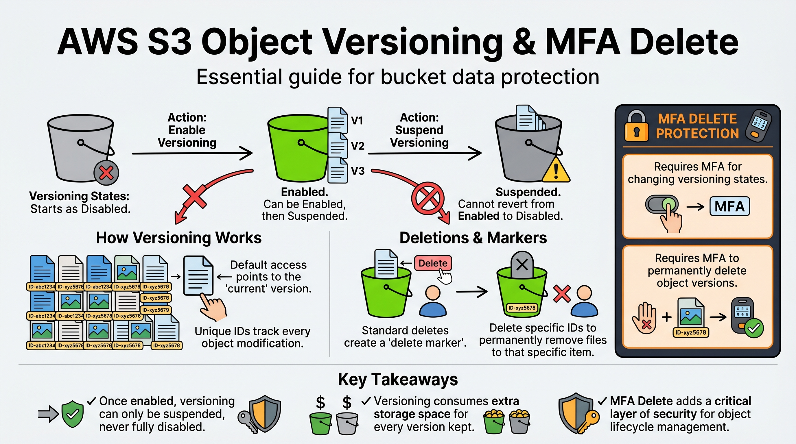

### Object Versioning

Without versioning, an object's identity is its **key** (e.g. `images/winkie.jpg`). A `PUT` to that key overwrites the previous bytes; a `DELETE` removes them. With versioning enabled each write generates a new **version ID** and old versions are kept side-by-side under the same key.


Read semantics:

- A `GetObject` without a version ID returns the **current** (latest) version.
- A `GetObject` with an explicit `versionId` returns that specific version. Older versions are first-class objects — they have full ARNs and can be read, copied, and lifecycled.

#### State machine — one-way door

Versioning has three states with one critical asymmetry:

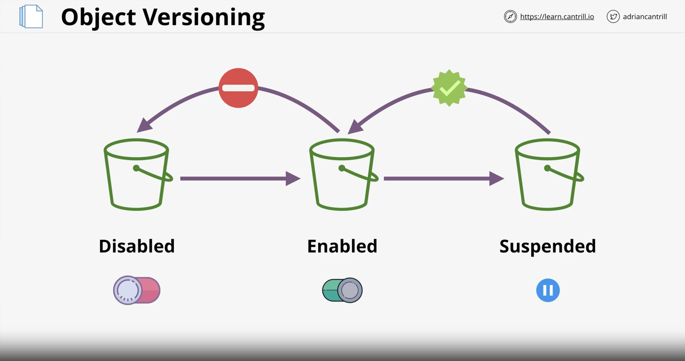

| State         | Allowed transition | Notes                                                                   |
| ------------- | ------------------ | ----------------------------------------------------------------------- |
| **Disabled**  | → Enabled          | The default on new buckets. Writes overwrite; no version IDs assigned.  |
| **Enabled**   | → Suspended (only) | Every write generates a new version.                                    |
| **Suspended** | → Enabled (only)   | New writes use a `null` version ID; **existing versions are retained**. |

> [!warning] Gotcha
> **Enabled is a one-way door.** Once versioning has been turned on, a bucket can only be **Suspended** — never returned to the original Disabled state. The only way back to a truly version-free bucket is to delete the bucket and recreate it.

#### Deletion behaviour — delete markers

With versioning on, `DELETE object` is not a destructive operation by default. S3 inserts a special zero-byte version called a **delete marker** on top of the version stack; subsequent `GetObject` calls without a `versionId` return `404`, making the object appear deleted.

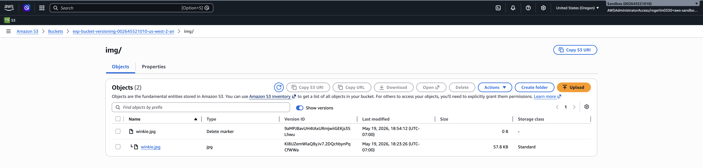

Two distinct delete operations:

- **`DELETE object`** (no `versionId`) — adds a delete marker. Reversible: deleting the delete marker restores visibility of the previous current version. This is the **soft delete**.
- **`DELETE object?versionId=…`** — permanently removes that specific version. **Irreversible.** If the deleted version was the current one, the next-newest version becomes current. If it was the last remaining version, the object is gone.


In the S3 console, the **Show versions** toggle is required to see delete markers and per-version IDs — without it, soft-deleted objects look gone.

#### Storage cost implications

Every version is a billable object at its full size — there is no diff/dedup storage:

- 5 versions of a 5 GB object = **25 GB** charged at the bucket's storage class.
- **Suspending versioning does not free space.** Existing versions remain until explicitly deleted.
- The standard cost-control pattern is a [lifecycle policy](https://docs.aws.amazon.com/AmazonS3/latest/userguide/lifecycle-configuration-examples.html) that transitions or expires **noncurrent versions** after N days.

### MFA Delete

**MFA Delete** is an additional safety lock layered on top of versioning. It can only be enabled on a bucket that already has versioning enabled. Once active, two operations require **MFA**:

1. Changing the bucket's versioning state (Enabled ↔ Suspended).
2. Permanently deleting a specific object **version** (a `DELETE` with a `versionId`).

What MFA Delete does **not** gate: ordinary deletes (which create delete markers), normal reads and writes, and lifecycle-driven expirations are unaffected — the protection is targeted at the two operations that can destroy data irrecoverably.

API mechanics: requests that perform a gated operation must carry both the **MFA device serial number** and the **current one-time code**, supplied via the `x-amz-mfa` header (or the `--mfa` flag in the CLI). The request is signed by the **bucket owner's root credentials** — MFA Delete can only be enabled/disabled by the root user of the owning account, not by IAM users or roles. That root-only requirement is itself part of the protection: an attacker who compromises an IAM admin still cannot turn MFA Delete off.

> [!tip] Exam Tip
> If a scenario calls for "protect against accidental *and* malicious permanent deletion of S3 objects", the answer combines **versioning + MFA Delete**. Versioning alone protects against the *accidental* case (soft deletes, restore from history); MFA Delete adds the second factor that a compromised IAM credential cannot satisfy. If the scenario goes further — *"data must remain unmodifiable for a regulatory retention period, even by the account root user"* — that's no longer MFA Delete; it's **[Object Lock](#object-lock) in Compliance mode**.

> [!warning] Gotcha
> MFA Delete cannot be enabled from the AWS Console — it requires the CLI/API and root credentials. And because only the root user can toggle it, automating it through normal IAM-based pipelines is not possible. This is by design but trips people up in practice.

## Object Lock

Versioning + MFA Delete protect against **accidental** and **credential-compromise** deletion. **Object Lock** is the next rung on the same ladder: a **Write-Once-Read-Many (WORM)** layer that prevents object versions from being deleted or overwritten *at all* for a defined retention period — in its strictest form, **not even by the account root user**. It's the answer to regulatory scenarios where data must demonstrably remain unmodified (SEC 17a-4, HIPAA, FINRA, GDPR-retention, internal anti-tampering).

Object Lock is **a feature built on top of [Versioning](#versioning-and-mfa-delete)**, not a replacement for it. The two are wired together permanently — enabling Object Lock auto-enables versioning, and versioning cannot be suspended on an Object-Lock-enabled bucket. Because the protection target is the **version**, locks apply to specific `versionId`s, not to "the object" as a key.

> [!warning] Gotcha — three different WORM features
> **S3 Object Lock**, **S3 Glacier Vault Lock**, and **[AWS Backup Vault Lock](aws-backup.md#backup-vault-lock-worm)** are three separate features. Object Lock protects **S3 object versions**; Glacier Vault Lock protects an individual **S3 Glacier vault**; Backup Vault Lock protects **recovery points in an AWS Backup vault** (and mirrors Object Lock's Governance/Compliance mode split). Match the feature to the resource the question names.

### The immutability ladder

| Layer                                    | Protects against                                                                                           | Reversible by                                                     |
| ---------------------------------------- | ---------------------------------------------------------------------------------------------------------- | ----------------------------------------------------------------- |
| [Versioning](#versioning-and-mfa-delete) | Accidental overwrite or delete (delete markers are soft deletes)                                           | Anyone with `s3:DeleteObjectVersion`                              |
| [Versioning + MFA Delete](#mfa-delete)   | Compromised IAM admin permanently deleting a version                                                       | Bucket owner's root user (with MFA)                               |
| **Object Lock — Governance mode**        | Routine deletes by anyone *without* an explicit bypass permission                                          | Identities holding `s3:BypassGovernanceRetention` + bypass header |
| **Object Lock — Compliance mode**        | Deletion by *any* identity in the account, **including the root user**, until the retention period expires | **No one** — only retention expiry                                |
| **Object Lock — Legal Hold**             | Deletion while the hold flag is ON (no time bound)                                                         | Identities holding `s3:PutObjectLegalHold`                        |

Each rung increases the strength of the immutability guarantee at the cost of operational flexibility — Compliance mode in particular is a one-way door: a misconfigured retention period of 10 years means **10 years**, with no escape hatch.

### Enablement is permanent

Object Lock has a few hard rules around lifecycle that are exam-favourite material:

- **Can be enabled on new or existing buckets** — Object Lock is commonly set at bucket creation, but current S3 supports enabling it on an **existing bucket** through the console, CLI, API, or SDK.
- **Enabling Object Lock auto-enables [versioning](#versioning-and-mfa-delete)** — there's no "Object Lock without versioning" option.
- **You cannot disable Object Lock** once enabled on a bucket. It is a one-way switch at the bucket level (independent of any locks on individual versions).
- **You cannot suspend versioning** on an Object-Lock-enabled bucket. Suspending versioning would break the per-version protection model.

> [!warning] Gotcha
> Both Object Lock enablement *and* versioning are **one-way doors** on an Object-Lock-enabled bucket. The only path back to a non-Object-Lock bucket is to **create a new bucket** and migrate the objects you still want — and even then, any compliance-locked versions on the old bucket cannot be deleted until their retention expires.

### Two retention methods

Object Lock manages immutability through **two independent mechanisms** that can be combined on the same object version:

1. **Retention period** — a duration (in days and/or years) during which the version cannot be deleted or overwritten. Pick **Governance** or **Compliance** mode per lock.
2. **Legal hold** — a binary on/off flag with no time bound. While ON, the version cannot be deleted; toggle it OFF and ordinary permissions apply.

Both can be set per object version *or* configured as **bucket defaults** (in the same pattern as [bucket default encryption](#bucket-vs-object--the-framing-trap)). A version with **both** a retention period and a legal hold is protected if **either** restriction blocks the action — they compose as an OR, not an AND.


### Retention modes — Compliance vs Governance

The two retention modes share the same wire-level protection (no delete, no overwrite, no shortened retention) — they differ entirely in **whether the lock has an escape hatch**.

| Action during retention | Governance | Compliance |
| --- | --- | --- |
| Delete the version | No | No |
| Overwrite the version | No | No |
| Shorten the retention period | No | No |
| Change retention mode | No | No |
| Bypass with the right [IAM](iam.md) permission | Yes: `s3:BypassGovernanceRetention` + `x-amz-bypass-governance-retention: true` header | **No bypass — not even the account root user** |

**Governance mode** is the right default when you want a strong *procedural* lock but reserve an escape hatch for authorized admins (e.g. "no developer can delete this audit log, but the security team can after appropriate review"). Bypass requires **both**:

- The IAM permission `s3:BypassGovernanceRetention` attached to the calling identity
- The HTTP header `x-amz-bypass-governance-retention: true` on the delete/overwrite request

> [!warning] The bypass header is set by default in the AWS Console
> A console user who *also* has `s3:BypassGovernanceRetention` will silently override Governance locks without manually adding any header — because the console adds it for them. This makes scoping `s3:BypassGovernanceRetention` carefully (separate role, justification trail, CloudTrail audit) more important than the permission name suggests.

**Compliance mode** is the strictest setting AWS offers on S3. During the retention period:

- No identity in the AWS account can delete, overwrite, shorten, or change the mode.
- **The account root user cannot override it either** — this is the property that makes Compliance mode the canonical answer to "regulator requires immutable storage demonstrably out of administrative reach".
- The only way the lock lifts is **retention expiry**. There is no AWS Support escalation, no break-glass, no root override.

> [!warning] Compliance mode is a one-way door
> A retention period of 7 years in Compliance mode means **7 years**, full stop. The Object Lock feature is deliberately built so that nobody — including the bucket owner — can shorten it. The only recourse for genuine mistakes is **storage cost for the full retention period**; you cannot escape, you can only wait.

### Legal Hold

A **legal hold** is a binary flag (ON / OFF) with no duration. While ON, the object version cannot be deleted or overwritten. It is the right mechanism for **indefinite holds with no predefined end date** — typically:

- An active legal case requiring preservation of specific evidence
- A project-specific "do not touch" flag on individual versions
- A second layer on top of a retention period, for object versions that need extra protection beyond the period

Toggling a legal hold requires the `s3:PutObjectLegalHold` permission. Crucially, **legal hold and retention period are independent** — removing the hold does **not** unlock a version that's still inside a Compliance or Governance retention window, and vice versa. They compose as an OR: the version is locked if *either* mechanism says so.

### Required permissions

| Action                                                | Permission                                                                        |
| ----------------------------------------------------- | --------------------------------------------------------------------------------- |
| Configure Object Lock on a bucket                     | `s3:PutBucketObjectLockConfiguration`                                             |
| Set or change a retention period on an object version | `s3:PutObjectRetention`                                                           |
| Bypass Governance mode                                | `s3:BypassGovernanceRetention` + `x-amz-bypass-governance-retention: true` header |
| Add or remove a legal hold                            | `s3:PutObjectLegalHold`                                                           |

Standard pattern in production: scope `s3:PutObjectRetention`, `s3:PutObjectLegalHold`, and `s3:BypassGovernanceRetention` to **separate IAM roles** with explicit assume-role audit trails. Don't bundle them with general bucket-admin permissions, or you collapse the role-separation guarantee that Object Lock exists to provide.

### Decision guide

| Situation                                                                                                | Recommended mode                                                           |
| -------------------------------------------------------------------------------------------------------- | -------------------------------------------------------------------------- |
| Regulatory mandate to retain unmodified for N years (SEC 17a-4, HIPAA, FINRA, medical/financial records) | **Compliance** retention                                                   |
| Internal anti-tampering on audit logs / billing records, but admins need an authorized escape hatch      | **Governance** retention                                                   |
| Testing Object Lock behaviour before committing to Compliance                                            | **Governance** (always test here first; Compliance mistakes are permanent) |
| Active legal case — preserve specific versions indefinitely until resolved                               | **Legal Hold**                                                             |
| Mandatory minimum retention **plus** ability to flag specific versions for a case                        | **Compliance / Governance + Legal Hold** combined                          |

### Object Lock quick reference

| Question                                                                 | Answer                                       |
| ------------------------------------------------------------------------ | -------------------------------------------- |
| Write-Once-Read-Many on S3                                               | **Object Lock**                              |
| How do you enable Object Lock on an existing bucket?                     | **Console, CLI, API, or SDK**                |
| Prerequisite for Object Lock                                             | **Versioning** (auto-enabled)                |
| Object Lock applies to…                                                  | **Individual object versions**               |
| Cannot be deleted or modified, **even by root**, until retention expires | **Compliance mode**                          |
| Can be bypassed with the right IAM permission                            | **Governance mode**                          |
| Permission to override Governance                                        | `s3:BypassGovernanceRetention`               |
| Header required to override Governance                                   | `x-amz-bypass-governance-retention: true`    |
| Is the bypass header set by default in the console?                      | **Yes**                                      |
| Binary on/off lock with no retention period                              | **Legal Hold**                               |
| Permission to toggle legal hold                                          | `s3:PutObjectLegalHold`                      |
| Retention period units                                                   | **Days and/or years**                        |
| Can Object Lock be disabled after enablement?                            | **No**                                       |
| Can versioning be suspended on an Object-Lock bucket?                    | **No**                                       |
| Can retention + legal hold coexist on one version?                       | **Yes** — composed as an OR                  |
| Can Object Lock be configured as a bucket default?                       | **Yes** (same pattern as default encryption) |

> [!tip] Exam Tip
> Pattern-match: *"WORM" / "immutable storage" / "regulatory retention"* → **Object Lock**. *"no one, including the root user, may delete or modify the data for N years"* → **Compliance mode** (the "even root" phrase is the giveaway). *"admins must be able to override the lock in an emergency"* → **Governance mode** + scoped `s3:BypassGovernanceRetention`. *"indefinite hold with no defined end date — a legal case"* → **Legal Hold**. *"need to enable Object Lock on an existing bucket"* → current answer is **use the console, CLI, API, or SDK**; older "contact AWS Support" notes are outdated. *"Object Lock applies to objects or versions?"* → **versions** (because versioning is required).

> [!warning] Common Gotchas
>
> - **Compliance mode is irreversible during retention.** Test patterns in Governance mode first.
> - **Locks are on versions, not keys.** A new `PutObject` to the same key creates a fresh, unlocked version (unless the bucket default Object Lock configuration applies to new uploads).
> - **Retention and legal hold are independent.** Removing one does not unlock the other.
> - **The bypass header is default in the console.** Console-based deletes by users with `s3:BypassGovernanceRetention` may succeed unexpectedly — scope this permission tightly and audit it via CloudTrail.
> - **Enabling Object Lock locks you in.** You cannot turn it off, and you cannot suspend the auto-enabled versioning — both are one-way doors.

## Object Encryption — SSE and CSE

The features above protect data from accidental deletion and unauthorised reads at the API layer. Encryption protects the bytes **on disk** — if someone bypassed S3 entirely and physically stole the storage media, encryption at rest is the layer that keeps the contents unreadable. Heavily integrated with [KMS](kms.md) and built on the same envelope-encryption pattern.

### Bucket vs object — the framing trap

Encryption is defined **at the object level**, not the bucket level. The "bucket default encryption" setting is a *separate feature* that just sets the default behaviour for newly-uploaded objects in that bucket — different objects in the same bucket can use entirely different encryption settings.

In practice this almost never matters: AWS made **server-side encryption mandatory** on S3 (since 2023, every PUT is encrypted before it lands on disk; there is no opt-out). The question is only **which** SSE method, not *whether* to encrypt.

### Encryption at rest vs in transit

Two layers that both happen, but solve different problems:

| Layer          | Mechanism                                                              | What it protects against                              |
| -------------- | ---------------------------------------------------------------------- | ----------------------------------------------------- |
| **In transit** | HTTPS tunnel between client and the S3 endpoint (automatic, always on) | Network eavesdroppers between you and AWS             |
| **At rest**    | SSE / CSE encrypts the stored bytes                                    | An attacker with physical access to the storage media |

This section is about **at rest**. In transit is handled transparently by HTTPS and is not a configurable concern.

### Client-side vs server-side — the trust boundary


The fundamental split is **who does the encryption** — which determines **whether AWS ever sees plaintext**.

| Dimension                            | Client-Side Encryption (CSE)    | Server-Side Encryption (SSE)   |
| ------------------------------------ | ------------------------------- | ------------------------------ |
| Who encrypts?                        | You, before upload              | S3, after receipt              |
| What S3 sees inside the HTTPS tunnel | Ciphertext only                 | Plaintext (still inside HTTPS) |
| Who manages the keys?                | You                             | Varies by SSE flavour          |
| CPU cost of encryption               | Your client                     | AWS                            |
| Trust model                          | Zero trust in AWS for plaintext | Some trust required            |

Both still use HTTPS in transit — the question is whether the bytes *inside* that tunnel are already ciphertext (CSE) or still plaintext (SSE).

> [!warning] CSE is **not** the same as SSE-C
> SSE-C is still **server-side** encryption — S3 performs the crypto, you just provide the key per request. CSE means S3 never touches plaintext, ever. The names are confusingly close; the trust models are opposite.

### The three SSE methods

Every SSE method splits into two questions: **who manages the keys** and **who performs the encryption**. S3 always does the encryption in SSE; the methods differ in key management.

| Method      | Full Name                                              | Key management              | Encryption     |
| ----------- | ------------------------------------------------------ | --------------------------- | -------------- |
| **SSE-S3**  | Server-Side Encryption with **S3**-managed keys        | S3 (invisible)              | S3             |
| **SSE-KMS** | Server-Side Encryption with **KMS** keys               | You + KMS                   | S3 (calls KMS) |
| **SSE-C**   | Server-Side Encryption with **C**ustomer-provided keys | You (sent on every request) | S3             |

#### SSE-S3 — S3-managed keys (AES-256 default)

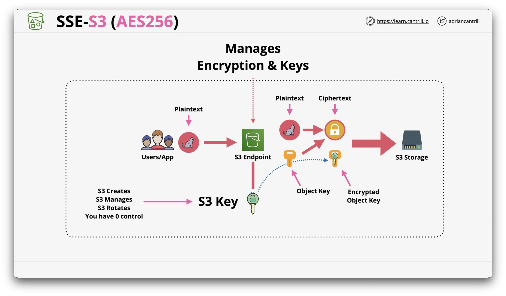


The lowest-overhead option. S3 handles **everything** — keys, rotation, algorithm — and surfaces nothing.

Flow under the hood (it's just envelope encryption, see [KMS DEKs](kms.md#data-encryption-keys-deks)):

1. You upload plaintext to S3.
2. S3 generates a unique **per-object DEK**.
3. S3 encrypts the object with that DEK using **AES-256**.
4. S3 encrypts the DEK with an internal, service-managed **S3 master key**.
5. The plaintext DEK is discarded; the ciphertext object + encrypted DEK are stored.

Three things you give up by picking SSE-S3:

1. ❌ **No key control** — you can't view, choose, or import the key.
2. ❌ **No rotation control** — rotation happens on S3's schedule, opaque to you.
3. ❌ **No role separation** — anyone with full S3 admin permissions can read the object data. There is no way to grant "manage the bucket" without also granting "read the objects".

> [!tip] Exam Tip
> *"AES-256"* in a question almost always points at **SSE-S3**. Other SSE flavours also use AES-256 under the hood, but the exam uses "AES-256" as shorthand for the S3-managed-keys option specifically.

#### SSE-KMS — KMS-managed keys

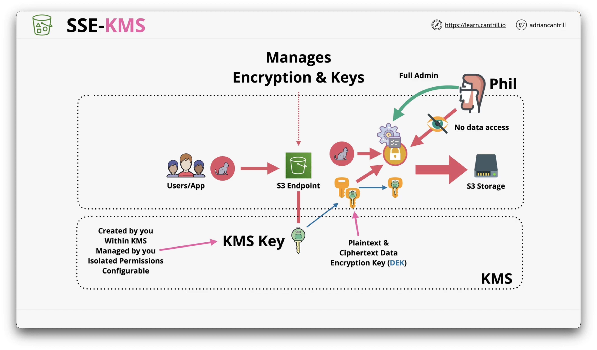

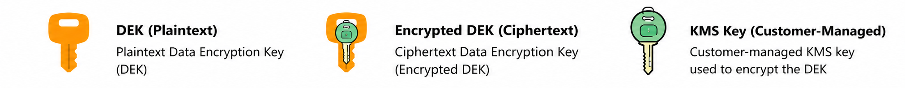

The default choice for any workload that needs **role separation, key-rotation control, or audited key usage**. Mechanically, SSE-KMS is just the [generic KMS envelope-encryption pattern](kms.md#data-encryption-keys-deks) applied per-object:

1. You create (or pick) a **Customer Managed KMS key** in the bucket's region.
2. On PUT, S3 calls `GenerateDataKey` against your KMS key.
3. KMS returns **two versions of the same DEK** — plaintext (for one-time use) and ciphertext (encrypted under the KMS key).
4. S3 uses the plaintext DEK to encrypt the object, then discards the plaintext.
5. Stored on disk: **ciphertext object + ciphertext DEK** (in object metadata).

This is necessary because [KMS keys can only directly encrypt ≤ 4 KB](kms.md#cryptographic-operations) — DEKs are how S3 gets around that limit, regardless of object size.

What SSE-KMS gives you that SSE-S3 cannot:

- ✅ **Key rotation control** — set the rotation policy on your KMS key.
- ✅ **Fine-grained access control** — the [KMS key policy](kms.md#key-policies) is independent of the bucket policy.
- ✅ **CloudTrail auditing** — every `Encrypt`/`Decrypt`/`GenerateDataKey` call is logged with the calling principal.
- ✅ **Role separation** — the killer feature; see below.

> [!tip] Role separation — the SSE-KMS killer feature
> Imagine **Phil**, an **S3 full administrator** — full control over the bucket, lifecycle, policies, the lot. Phil has **zero permissions on the KMS key**. Result: Phil can manage the bucket *but cannot read object contents*, because he can't decrypt the DEK without the KMS key. Impossible to achieve with SSE-S3. Essential in regulated industries (finance, healthcare) where infrastructure admins must not see customer data.

#### S3 Bucket Keys for SSE-KMS cost and throttling

Vanilla SSE-KMS has the same scaling problem on *both* the read and the write side: **every PUT and every GET calls KMS**. That hits two ceilings at scale:

1. **💰 KMS request cost.** KMS charges per API request. With billions of objects under heavy traffic, you can pay more for KMS requests than for S3 storage itself.
2. **🚦 KMS throughput throttling.** `GenerateDataKey` and `Decrypt` share a **per-region, per-account** request quota — historically **5,500 / 10,000 / 50,000 RPS** depending on the region tier, **shared across the region for a given KMS key**. Past the cap, KMS returns `ThrottlingException`. For a workload doing hundreds of thousands of PUTs/sec into SSE-KMS buckets, KMS — not S3 — becomes the throughput cap.


**S3 Bucket Keys** are an opt-in feature that addresses both problems simultaneously: AWS quotes up to **99% reduction in KMS requests** (and therefore both KMS cost *and* KMS throttle pressure), without changing the trust model or the client API.


> [!tip] Quick mental model
> **Without Bucket Keys:** KMS is on the critical path for every single object operation.
> **With Bucket Keys:** KMS is on the critical path only when the cached bucket-level key needs (re)fetching. Everything in between is handled inside S3.

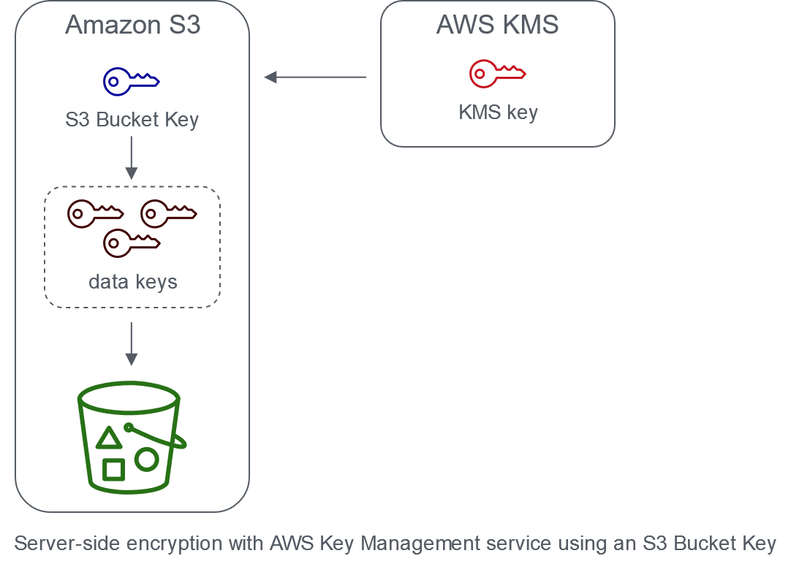

"data keys" in the diagram means "DEK (data encryption key)".

##### The three-layer key hierarchy

Bucket Keys add **one extra wrapping layer** between the KMS CMK and the per-object DEK. (**CMK** = **Customer Master Key**, AWS's legacy name for what's now formally just called a [KMS key](kms.md#kms-keys) — the customer-managed key you create in [KMS](kms.md). Used as a shorthand throughout this section.) The mental model that the AWS docs gloss over is a three-tier chain of KEKs (Key Encryption Keys):

```text
KMS CMK              ← lives only inside KMS, never leaves
  │ encrypts         (KMS-side; this is the only step KMS ever sees)
  ▼
Bucket-level key     ← plaintext form cached briefly inside S3
  │ encrypts         (S3-side; pure local AES, no network)
  ▼
Per-object DEK       ← unique per object, random at upload time
  │ encrypts         (AES-GCM, local)
  ▼
Object ciphertext
```

Each arrow is encryption. Each decryption step needs the plaintext key one layer above it. Critically, **KMS only ever participates in the top arrow** — it never sees the per-object DEK and never knows the object exists.

> [!tip] Terminology — "wrap" and "ciphertext form"
> Throughout this section, **"wrap a key K under key K₁"** means **"encrypt the bytes of K using K₁, producing a ciphertext blob."** The **"ciphertext form of K"** (sometimes called the "wrapped form" in AWS docs) is exactly that blob — the bytes of K, encrypted under the next-higher key. Examples in concrete terms:
>
> - **Ciphertext form of a per-object DEK** = the per-object DEK's raw bytes, encrypted under the bucket-level key with AES. Stored in object metadata.
> - **Ciphertext form of a bucket-level key** = the bucket-level key's raw bytes, encrypted under your KMS CMK. Stored in S3-internal durable state. KMS `Decrypt` is what recovers the plaintext bucket-level key from this blob.
>
> "Unwrap" = the reverse: decrypt the ciphertext blob with the parent key to get the plaintext bytes back.

What S3 actually stores on disk:

| Artifact stored                                                         | Concretely, what it is                                                                                                                         | Stored where                                                       |
| ----------------------------------------------------------------------- | ---------------------------------------------------------------------------------------------------------------------------------------------- | ------------------------------------------------------------------ |
| Object ciphertext                                                       | Object bytes encrypted under the per-object DEK (AES-GCM)                                                                                      | Object data                                                        |
| Ciphertext form of the per-object DEK + a bucket-level-key-ID           | Per-object DEK bytes encrypted under *some specific* bucket-level key, plus an identifier saying *which* bucket-level key                      | Object metadata                                                    |
| Map of `bucket-level-key-ID → ciphertext form of that bucket-level key` | **One entry per bucket-level key ever used by this bucket.** Each ciphertext form is that bucket-level key's bytes encrypted under the KMS CMK | S3-internal durable state (AWS doesn't publish the exact location) |

> [!warning] Many bucket-level keys accumulate over time
> A single bucket does **not** have one bucket-level key — it has a sequence of them (`bk-001`, `bk-002`, …) that get rotated out as each one's "active-for-encryption" window ends. **Every** historical bucket-level key remains in the durable map for as long as objects it wrapped exist, because those objects' decryption depends on recovering its specific plaintext via KMS `Decrypt`. The "ciphertext form of the bucket-level key" phrasing used throughout this section is always *that-specific-one*, not the one. See [What "expires" actually means](#what-the-bucket-level-key-expires-actually-means) below.

##### Encrypt and decrypt walks — the one KMS call per cold cache

The cache works **symmetrically for both PUTs and GETs**. Cold-cache operations of either direction pay exactly one KMS request to warm the cache; subsequent operations of either direction during the same cache window pay nothing. Two parallel walks below; the warm-cache version of each is "cache hit, no KMS call, do the rest locally."

**Encryption walk — cold cache (cold PUT)**:

1. S3 doesn't have a usable plaintext bucket-level key in memory.
2. **→ Calls KMS `GenerateDataKey`** against your CMK. KMS returns **two artifacts** — (a) the **plaintext bucket-level key** (the raw key bytes, for immediate use), and (b) the **ciphertext bucket-level key** (those same bytes encrypted under your CMK, for durable storage). This is the standard envelope output documented at [KMS DEKs](kms.md#data-encryption-keys-deks). *This is the only KMS call.*
3. S3 caches the plaintext bucket-level key in memory (keyed by its bucket-level-key-ID) and **adds a new entry to the durable map** of bucket-level keys (`bucket-level-key-ID → ciphertext form`). The map already contains entries for every previously-used bucket-level key in this bucket; this is a new entry appended to it. Future GETs against objects encrypted by this specific bucket-level key can recover the plaintext via `Decrypt` on its ciphertext form.
4. S3 generates a random **per-object DEK** locally. (The bucket-level key is not yet involved — that comes in step 5.)
5. S3 encrypts the per-object DEK bytes under the bucket-level key with AES, producing the **ciphertext form of the per-object DEK**. Pure local AES inside S3 — no KMS call.
6. S3 encrypts the object bytes with the plaintext per-object DEK (AES-GCM).
7. S3 writes to disk: object ciphertext (the data) + ciphertext form of the per-object DEK + the **bucket-level-key-ID** that identifies which bucket-level key wrapped this DEK (the latter two stored in object metadata; the ID is the lookup key future GETs use to find the right entry in the durable map).


**Decryption walk — cold cache (cold GET)**:

1. S3 reads the object's metadata → finds the **ciphertext form of the per-object DEK** (per-object DEK bytes encrypted under *some specific* bucket-level key) and the **bucket-level-key-ID** identifying *which* bucket-level key wrapped it.
2. S3 looks up that bucket-level-key-ID in its durable map of bucket-level keys → finds the **ciphertext form of that specific bucket-level key** (bucket-level key bytes encrypted under the CMK). The map may contain many entries — one per historical bucket-level key for this bucket — and this lookup picks out the exact one that matches the object's ID.
3. **→ Calls KMS `Decrypt`** with that ciphertext blob as input, under your CMK. KMS returns the plaintext bucket-level key. *This is the only KMS call.*
4. S3 caches the plaintext bucket-level key in memory.
5. S3 decrypts the ciphertext form of the per-object DEK using the plaintext bucket-level key — pure local AES, no KMS. Now S3 has the plaintext per-object DEK.
6. S3 decrypts the object ciphertext with the plaintext per-object DEK (AES-GCM).

Once the cache is warm, any subsequent PUT or GET against an object that uses the same bucket-level key skips the KMS call entirely. A burst of 10,000 PUTs in the cache window costs **1** `GenerateDataKey` call instead of 10,000; the same holds for reads.

**Which KMS API gets called on a cold operation**:

The two verbs line up cleanly with the direction of the operation:

| Operation              | KMS API           | Why                                                                                                                                                                                                  |
| ---------------------- | ----------------- | ---------------------------------------------------------------------------------------------------------------------------------------------------------------------------------------------------- |
| **Cold PUT** (encrypt) | `GenerateDataKey` | The PUT needs *new* key material to encrypt with — S3 mints a fresh bucket-level key (KMS returns plaintext + ciphertext forms; the ciphertext is persisted for future GETs)                         |
| **Cold GET** (decrypt) | `Decrypt`         | The object was encrypted under some prior bucket-level key whose ciphertext form is already in S3's durable state — S3 passes that blob to KMS to recover the plaintext (KMS returns plaintext only) |

The intuition: `GenerateDataKey` is for creating new material (encrypt path); `Decrypt` is for recovering existing material (decrypt path). PUTs only ever call `GenerateDataKey`; GETs only ever call `Decrypt`.

The AWS docs use "fetched" loosely to cover both `GenerateDataKey` (fresh mint) and `Decrypt` (re-warm). From a CloudTrail and billing perspective they're equivalent — **one billable KMS request per cold cache miss per requester**.

> [!warning] The bucket-level key encrypts per-object DEKs; KMS does **not**
> A common confusion: people assume KMS decrypts (or generates) the per-object DEK. It doesn't. KMS only ever sees the bucket-level key — specifically, it produces or consumes the **ciphertext form of the bucket-level key** (bucket-level key bytes encrypted under the CMK). The per-object DEK is generated locally in S3, encrypted with the plaintext bucket-level key to produce its ciphertext form (stored in object metadata), and later decrypted with the plaintext bucket-level key — **all inside S3 with pure AES, no KMS call**. The CMK is the KEK for bucket-level keys; the bucket-level key is the KEK for per-object DEKs. This is what makes the savings symmetric across encrypt and decrypt — neither direction needs KMS for the per-object key.

> [!tip] Where the savings dominate
> **Encrypt-side wins**: high-volume log/metric/event ingestion (millions of small PUTs per hour), bulk data migrations (DataSync, S3 Transfer Family). **Decrypt-side wins**: CDN-origin asset buckets serving heavy read fanout, analytics scans (Athena, Spark/EMR, Glue) reading raw layers. Data-lake landing zones and feature stores typically benefit on both sides of every operation.

##### What "the bucket-level key expires" actually means

Over a bucket's history, **many bucket-level keys accumulate** — each persisted as its own entry in the durable `bucket-level-key-ID → ciphertext form` map. Each one has **two distinct phases of life**, and the word "expires" only ever refers to the transition between them:

| Phase                       | Duration                                                                                         | What's true during this phase                                                                                                                                                          |
| --------------------------- | ------------------------------------------------------------------------------------------------ | -------------------------------------------------------------------------------------------------------------------------------------------------------------------------------------- |
| **Active for encryption**   | Limited time window after the bucket-level key was minted (AWS doesn't publish the exact window) | This is the *current* bucket-level key. New PUTs wrap their per-object DEK under it. There is exactly one active bucket-level key at a time per (bucket, requester scope).             |
| **Retired but recoverable** | Effectively forever — until the CMK is deleted or the last object it wrapped is deleted          | This bucket-level key no longer wraps new DEKs, but its ciphertext form remains in the durable map. Any GET against an object it wrapped will recover its plaintext via KMS `Decrypt`. |

When AWS docs say a bucket-level key "expires," they mean it **transitions from active to retired**. It is **still fully recoverable for decryption** — only `GenerateDataKey`-for-new-PUTs stops. The next cold PUT mints a fresh bucket-level key via `GenerateDataKey` and that new key becomes the active one; the old one keeps sitting in the durable map and is used on demand by GETs against old objects.

```text
Bucket lifetime: ────────────────────────────────────────────────►

  ┌─ bk-001 ──┐
  │  ACTIVE   │
  │  for enc  ├───── retired but recoverable for GET (forever) ─────►
  └───────────┘  ↑
                 │ any GET against an object wrapped by bk-001 pays
                 │ one KMS Decrypt if its plaintext isn't cached
                 ▼
                 ┌─ bk-002 ──┐
                 │  ACTIVE   │
                 │  for enc  ├───── retired but recoverable ─────────►
                 └───────────┘
                                ┌─ bk-003 ──┐
                                │  ACTIVE   │ ◄── current; wraps new
                                │  for enc  │     PUTs' DEKs
                                └───────────┘

S3's durable map grows monotonically over the bucket's lifetime:

   bk-001 ──► ciphertext form (recoverable forever)
   bk-002 ──► ciphertext form (recoverable forever)
   bk-003 ──► ciphertext form (recoverable forever; currently active)
   ⋯
```

**The cache (in-memory plaintext of bucket-level keys) is orthogonal to the active/retired phase.** Any bucket-level key — currently active or long retired — can be cached or not at any moment. A cold-cache GET against an object wrapped by *any* bucket-level key pays exactly one KMS `Decrypt` on that specific bucket-level key's ciphertext form to re-warm it; once warm, subsequent GETs against any other object wrapped by the same bucket-level key are free until eviction.

The **only** way to make any bucket-level key truly unrecoverable is to **delete the CMK itself** — at which point every entry in the durable map becomes unusable garbage (the standard KMS [crypto-shred](kms.md#rotation) property) and every object in the bucket is permanently undecryptable. This composes correctly with KMS key rotation: KMS retains all previous backing key material under the same logical Key ID, so a bucket-level key whose ciphertext form was produced under a rotation-old backing key still decrypts.

##### Trust model preservation

The bucket-level key is short-lived, never written to disk in plaintext, and S3 still fetches it from KMS **at least once per requester** so that access is captured in a CloudTrail `kms:Decrypt` / `kms:GenerateDataKey` event. AWS treats different IAM roles, different accounts, and even the same role with different scoping policies as different requesters — so a compromised principal can't read objects without leaving a KMS audit trail on the bucket-level key fetch.

The security property "only holders of `kms:Decrypt` on the CMK can read your data" is preserved end-to-end: no CMK access → no plaintext bucket-level key → no unwrapped per-object DEK → no object plaintext.

##### Behaviour changes to understand before enabling

| Aspect                             | Without Bucket Keys (default)                        | With Bucket Keys enabled                  |
| ---------------------------------- | ---------------------------------------------------- | ----------------------------------------- |
| KMS calls per object               | One `GenerateDataKey` per PUT, one `Decrypt` per GET | Amortised — many objects per KMS call     |
| Encryption context in KMS requests | **Object ARN**                                       | **Bucket ARN**                            |
| CloudTrail KMS events              | One per object operation                             | One per requester per bucket-key lifetime |
| Cost                               | Standard KMS request pricing                         | Up to ~99% lower KMS request bill         |
| Trust / data confidentiality       | Unchanged                                            | Unchanged                                 |

Enabling is a per-bucket setting (`PutBucketEncryption` with `BucketKeyEnabled: true`, or the matching console toggle, or the CloudFormation property of the same name on `AWS::S3::Bucket`). It can also be overridden per-request via the `x-amz-server-side-encryption-bucket-key-enabled` header on `PutObject`/`CopyObject`/`CreateMultipartUpload`.

In the S3 console it appears on the bucket's **Default encryption** panel as a simple "Bucket Key — Enabled / Disabled" line right under the encryption type and key ARN:

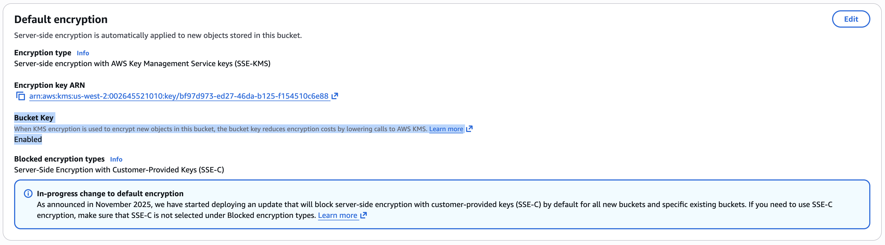

> [!warning] SSE-C is blocked by default for many buckets
> The same Default encryption panel shows a **Blocked encryption types** row. Starting in April 2026, AWS disables server-side encryption with customer-provided keys (SSE-C) by default for all new general-purpose buckets and for existing buckets in accounts with no SSE-C objects. To keep using [SSE-C](#sse-c--customer-provided-keys), you have to explicitly un-block it under "Blocked encryption types". This is a separate axis from Bucket Keys — but it's the same console surface. Older notes that mention a November 2025 rollout date are outdated.

> [!warning] Gotcha — encryption context changes from object ARN to bucket ARN
> If any [IAM policy](iam.md) or [KMS key policy](kms.md#key-policies) uses a `kms:EncryptionContext:aws:s3:arn` condition to scope access to specific object ARNs, those conditions **stop matching** once Bucket Keys are on, because S3 starts passing the bucket ARN instead. Update the conditions to use bucket ARN **before** flipping the switch, or you'll lock yourself out of decrypts.

> [!warning] Gotcha — only new objects
> Enabling Bucket Keys on an existing bucket doesn't retroactively migrate any objects. Existing objects keep their original per-object encryption metadata and continue to incur per-object KMS calls on GET. To migrate, **re-write them** (`CopyObject` onto themselves with the same key) — this is the standard pattern.

> [!warning] Gotcha — replication ETags
> S3 Bucket Keys are compatible with both Same-Region and Cross-Region Replication. The subtle case: if the **source object is unencrypted** but the destination bucket has Bucket Keys + SSE-KMS as its default, the replica gets re-encrypted on arrival — and the replica's **`ETag` differs from the source's**. Any application logic that uses ETag for source/replica equality checks needs to handle this.

> [!warning] Gotcha — not supported on DSSE-KMS
> Bucket Keys are an **SSE-KMS** optimization only. They aren't available for DSSE-KMS (dual-layer SSE-KMS), and they're a no-op for SSE-S3, SSE-C, and CSE — those don't call KMS per object in the first place.

> [!tip] Exam Tip
> Pattern-match: *"SSE-KMS costs are very high on a bucket with millions of objects, how do you reduce them without weakening encryption?"* → **Enable S3 Bucket Keys**. Cost reduction is on **KMS request charges**, not storage or S3 request charges; trust model and SSE-KMS guarantees are unchanged.

#### SSE-C — customer-provided keys


The niche option: **you own the keys end-to-end**, but you let S3 do the crypto.

Upload flow:

1. You send **plaintext object + your encryption key** to S3 over HTTPS.
2. S3 encrypts the object with your key.
3. S3 stores the ciphertext **plus a one-way hash of your key** alongside it.
4. S3 **destroys the key** from memory — it is never persisted.

Download flow:

1. You re-supply the **same key** with the GET request.
2. S3 hashes it and compares against the stored hash — wrong key → 403.
3. If valid, S3 decrypts and returns plaintext over HTTPS, discarding the key again.

The one-way hash is the clever piece: it lets S3 **verify** a key without **storing** one. Lose your key and the data is unrecoverable — by design.

> [!warning] Gotcha
> SSE-C still requires AWS to handle plaintext in memory during the encrypt step. If your compliance posture says "AWS must never see plaintext, even transiently", **SSE-C is not enough — you need CSE**.

#### CSE — client-side encryption (for completeness)

CSE isn't really an S3 feature — S3 just stores whatever bytes you upload, including bytes you encrypted client-side. Typically implemented via the **AWS Encryption SDK** (which can call KMS to wrap your local DEK, mirroring the envelope pattern but with the boundary on your side). Use when zero-trust-in-AWS is a hard requirement. CSE and SSE can be **combined** — nothing stops the bytes from being encrypted on the way in (CSE) *and* re-encrypted at rest by S3 (SSE).

### Summary and decision guide

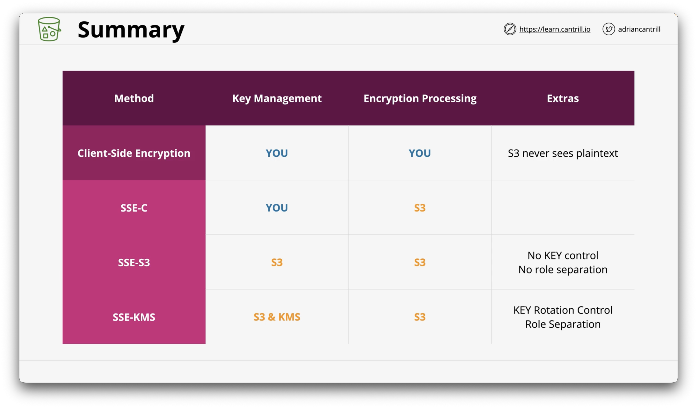

| Method      | Key management | Encryption | Notable property                                              |
| ----------- | -------------- | ---------- | ------------------------------------------------------------- |
| **CSE**     | YOU            | YOU        | S3 never sees plaintext                                       |
| **SSE-C**   | YOU            | S3         | You supply key per request; S3 stores only a hash             |
| **SSE-S3**  | S3             | S3         | AES-256; zero key control; **no role separation**             |
| **SSE-KMS** | You + KMS      | S3         | Key rotation control + **role separation** + CloudTrail audit |

Pick by the constraint that matters most:

- **CSE** — you cannot trust AWS with plaintext, ever. Accept the client-side CPU cost and key-management burden.
- **SSE-C** — *you* must own the keys (compliance) but want AWS to do the heavy crypto. Trust AWS to discard keys after each request.
- **SSE-S3** — sensible default if you don't need key control, rotation control, or role separation.
- **SSE-KMS** — standard for regulated workloads. Required if **anyone with S3 admin must not read the data**, or if you need rotation/audit.

> [!tip] Exam Tip
> Pattern-match: *"AES-256"* → **SSE-S3**. *"Role separation / S3 admin must not read the data"* → **SSE-KMS**. *"Audit key usage in CloudTrail / control rotation"* → **SSE-KMS**. *"Customer provides key on every request, S3 stores only a hash"* → **SSE-C**. *"AWS must never see plaintext"* → **CSE** (not really an S3 feature).

> [!warning] Gotcha
> "Buckets are encrypted" is **wrong**. Objects are encrypted; *bucket default encryption* is a per-bucket setting that determines what SSE flavour newly-uploaded objects get if the client doesn't specify one. Two objects in the same bucket can be under different SSE methods.

## Upload Performance

The features above govern access and durability. This section governs **throughput and reliability of the bytes-in transfer itself** — how a client gets a large object into S3 without wasting bandwidth or restarting from scratch on a flaky link. Two mechanisms cover it: **multipart upload** (a client-side strategy that splits a single object across many parallel HTTP requests) and **Transfer Acceleration** (a network-path optimization that routes the request through AWS edge infrastructure instead of the public internet).


### Single PUT vs Multipart Upload

A vanilla `PutObject` uploads the entire object in **one HTTP request as a single byte stream**. It is simple but has two fundamental weaknesses:

- **All-or-nothing failure.** If the connection drops at 4.5 GB of a 5 GB upload, the entire 4.5 GB is wasted — the client must restart from byte 0.
- **Bound by single-stream throughput.** A single TCP connection is rate-limited by per-flow congestion control and the slowest hop on the route. Even on a fat pipe, one stream often leaves capacity on the table; parallel streams can saturate it.

AWS caps a single `PutObject` at **5 GB**. For anything larger, multipart upload is mandatory; for anything reasonably large, it's also the better choice on reliability and throughput.

| Mechanism                    | Max object size              | Reliability on failure     | Throughput               |
| ---------------------------- | ---------------------------- | -------------------------- | ------------------------ |
| **Single PUT** (`PutObject`) | 5 GB hard limit              | Restart entire upload      | One TCP stream           |
| **Multipart upload**         | ~5 TB (10,000 parts × 5 GiB) | Retry only the failed part | Parts upload in parallel |

#### Multipart upload API flow

Multipart upload is not a single API call — it is a **sequence** of four operations:

1. **`CreateMultipartUpload`** — initiates the upload; returns an `UploadId` that ties subsequent calls together.
2. **`UploadPart`** — called once per part (5 MiB–5 GiB per part, except the last which may be smaller; max **10,000 parts**), each referencing the `UploadId`. Each call returns an `ETag` for that part.
3. **`CompleteMultipartUpload`** — sent with the ordered list of `(partNumber, ETag)` pairs; S3 assembles the parts into the final object server-side.
4. **`AbortMultipartUpload`** — cancels and cleans up if something goes wrong.

Two helper APIs are common in practice: `ListParts` (which parts of an upload have been received) and `ListMultipartUploads` (in-progress uploads on a bucket — useful for finding orphans).

> [!warning] Gotcha
> **Incomplete multipart uploads keep accruing storage charges** until they are either completed or aborted — even though the partial object is invisible to normal reads. The standard remedy is a lifecycle rule with `AbortIncompleteMultipartUpload` that auto-cleans after N days. On any bucket that sees programmatic uploads, this should be considered table stakes.

#### When multipart kicks in

The 5 GB cap is the **hard** boundary. The **practical** threshold is much lower:

- AWS guidance: use multipart for objects **≥ 100 MB**, because that's where the parallelism and per-part-retry benefits start clearly outweighing the small protocol overhead.
- The high-level transfer clients in the AWS SDKs (boto3's `upload_file`, the Java v2 transfer manager, etc.) and the AWS CLI (`aws s3 cp`) handle the choice automatically — they pick single PUT vs multipart based on file size, parallelise part uploads, and retry failed parts transparently. The default threshold in the CLI is around 8 MB, well below the 100 MB recommendation.
- You typically only call the low-level multipart APIs directly when you need fine-grained control — resumable uploads across processes, custom parallelism, or server-side composition of independently-produced parts.

### S3 Transfer Acceleration

Multipart upload optimizes how the bytes are *packaged*. Transfer Acceleration (TA) optimizes the **network path** they travel over. It addresses a different root cause: when the client and the bucket region are far apart, the public internet path between them goes through unpredictable, often suboptimal routes, and end-to-end throughput suffers.

How TA works:

- The client uploads to a **CloudFront edge location** near them (using the special endpoint `<bucket>.s3-accelerate.amazonaws.com`) instead of directly to the bucket's regional endpoint.
- From the edge, the bytes traverse the **AWS global backbone** — a private high-speed network with optimized, AWS-controlled routes — the rest of the way to the bucket's home region.

The trick is that the slow, lossy, congested segment of the trip — the public-internet long-haul — is replaced by a short hop to the nearest edge plus a long hop over AWS's own optimized network.

| Property    | Public internet path                     | TA via AWS backbone           |
| ----------- | ---------------------------------------- | ----------------------------- |
| Routing     | Multi-hop, decided by ISPs               | Direct, AWS-controlled        |
| Performance | Variable, often poor over long distances | Consistent, high throughput   |
| Design goal | Flexibility & resilience                 | Speed & reliability           |
| Loss/jitter | Worst on long international links        | Engineered for predictability |

Benefits scale with distance and with how degraded the baseline internet path is — a client uploading from Sydney to a London bucket sees a much bigger speedup than one uploading within the same continent. TA is **bidirectional** — it accelerates downloads as well as uploads — though uploads from far-flung clients are the canonical use case.

#### Requirements and trade-offs

- **Bucket-level opt-in**, disabled by default. Enable per-bucket; the regional endpoint still works after enabling.
- **Bucket name must be DNS-compatible and contain no periods** — TA uses the virtual-hosted–style endpoint, which can't validly include a `.` in the bucket name without breaking TLS hostname matching.
- **Extra cost per GB transferred** on top of normal S3 request and transfer charges. AWS provides a [Transfer Acceleration Speed Comparison tool](https://s3-accelerate-speedtest.s3-accelerate.amazonaws.com/en/accelerate-speed-comparsion.html) to measure whether your specific client→region pair actually benefits before enabling it.

#### TA vs multipart — orthogonal, often combined

The two features answer different questions and **compose**:

- **Multipart** answers "how do I move a large object reliably and use all my client bandwidth?" — it's client-side, free, and applies to any upload above the threshold.
- **Transfer Acceleration** answers "how do I avoid the public-internet long-haul?" — it's a bucket setting, costs extra, and pays off when client and bucket are geographically far apart.

A globally distributed team uploading large datasets to a centralised bucket typically wants **both** — multipart to parallelize each upload and survive part failures, plus TA to shrink the long-haul distance.

> [!tip] Exam Tip
> Pattern-match: *"large file, unreliable connection"* → **multipart upload**. *"globally distributed users, central bucket, slow uploads"* → **Transfer Acceleration**. *"object > 5 GB"* → **multipart is required** (not a choice). *"need to upload from on-prem datacenter to S3 in another region, lots of data"* → multipart + TA (or, for genuinely huge bulk transfers, AWS DataSync / Snowball — out of scope here).

## Storage Classes

The features above govern **how** data is stored, encrypted, and uploaded. Storage classes govern **what tier** the bytes physically live in — and that choice trades off **cost vs. access speed vs. durability guarantees**. The same object key can sit in any class; the class is a per-object property, set at upload time or transitioned later via [lifecycle rules](#lifecycle-transitions). All classes share the same API, the same [versioning](#versioning-and-mfa-delete) behaviour, and the same [encryption](#object-encryption--sse-and-cse) options — only the cost and access semantics change.

The three questions to ask when picking a class:

1. **How often is the data accessed?** Frequent → Standard. Monthly → Standard-IA. Quarterly → Glacier Instant. Yearly or never → Glacier Flexible / Deep Archive.
2. **How fast do I need it back?** Milliseconds → Standard, IA, or Glacier Instant. Hours OK → Glacier Flexible. Up to 48 hours OK → Glacier Deep Archive.
3. **Can I tolerate losing it?** If it's the only copy → multi-AZ (Standard, Standard-IA, Glacier classes). If it's a replica or regenerable → One Zone-IA is fine.

### Durability — the 11 nines claim

Every S3 class except One Zone-IA is **designed for 99.999999999% (11 nines) durability** across **≥ 3 Availability Zones**. The framing matters:

- **11 nines literally**: the annual probability of *not* losing a given object is 99.999999999%. Flipped — the probability of losing one specific object in a year is **1 in 100 billion** (10⁻¹¹).
- **The canonical AWS phrasing** — "store 10 million objects, lose one every 10,000 years" — is just that number scaled: 10⁷ objects × 10⁻¹¹ failures = 10⁻⁴ losses/year, inverse = 10,000 years between losses. The math scales linearly: 10 billion objects → ~10 years between losses; 100 billion → ~1 year.
- **It's modeled, not measured.** AWS hasn't been running long enough to observe 11 nines empirically. The figure comes from a probabilistic model of independent disk failures, AZ events, and continuous checksum / CRC self-healing across the ≥ 3 replicas. AWS calls it *"designed for"* 99.999999999% — a design target, not a measured SLA.

> [!warning] Durability ≠ availability
> Standard's durability is **11 nines (99.999999999%)** — the data still exists. Standard's availability is only **4 nines (99.99%)** — you can reach it right now. Durability is the much stronger guarantee. An AZ outage can briefly take availability down while durability is unaffected.

**One Zone-IA's 11 nines is conditional**: the durability math assumes the single AZ doesn't fail. The headline number matches the multi-AZ classes, but the underlying risk model is genuinely weaker — an AZ-level loss event takes the data with it. The number is honest, but read the asterisk.

### Billing components

Every class is priced from some combination of these axes:

- **Storage** ($/GB/month) — gets cheaper as you move down the tiers
- **Requests** (per 1,000 PUT/GET/etc.)
- **Data transfer out** ($/GB) — transfer in is always free
- **Retrieval fee** ($/GB retrieved) — only IA and Glacier classes
- **Minimum billable object size** — penalizes storing tiny files
- **Minimum billable duration** — penalizes short-term storage in archival tiers
- **Monitoring/automation fee** — only Intelligent-Tiering

**S3 Standard is the only class with no retrieval fee, no minimum size, and no minimum duration.** Every other class adds at least one of these as a trade-off for cheaper storage.

### Comparison table

| Metric                        | Standard                       | Standard-IA                              | One Zone-IA                | Glacier Instant Retrieval                 | Glacier Flexible Retrieval                             | Glacier Deep Archive                                 | Intelligent-Tiering                          |
| ----------------------------- | ------------------------------ | ---------------------------------------- | -------------------------- | ----------------------------------------- | ------------------------------------------------------ | ---------------------------------------------------- | -------------------------------------------- |
| **AZs replicated**            | ≥ 3                            | ≥ 3                                      | **1 only**                 | ≥ 3                                       | ≥ 3                                                    | ≥ 3                                                  | ≥ 3 (across tiers)                           |
| **Durability**                | 11 nines                       | 11 nines                                 | 11 nines\*                 | 11 nines                                  | 11 nines                                               | 11 nines                                             | 11 nines                                     |
| **First-byte latency**        | ms                             | ms                                       | ms                         | ms                                        | minutes–hours                                          | hours                                                | varies by tier                               |
| **Retrieval job required?**   | No                             | No                                       | No                         | No                                        | **Yes**                                                | **Yes**                                              | Only for archive-access / deep-archive tiers |
| **Retrieval options**         | N/A                            | N/A                                      | N/A                        | N/A                                       | Expedited (1–5 min), Standard (3–5 hr), Bulk (5–12 hr) | Standard (12 hr), Bulk (≤ 48 hr)                     | Mirrors underlying tier                      |
| **Min. billable duration**    | None                           | 30 days                                  | 30 days                    | 90 days                                   | 90 days                                                | 180 days                                             | None (90d for archive-instant tier)          |
| **Min. billable object size** | None                           | 128 KB                                   | 128 KB                     | 128 KB                                    | 40 KB                                                  | 40 KB                                                | None                                         |
| **Retrieval fee**             | None                           | $0.01/GB                                 | $0.01/GB                   | $0.03/GB                                  | Expedited $0.03/GB, Standard $0.01/GB, **Bulk free**   | Standard $0.02/GB, Bulk $0.0025/GB                   | None (replaced by monitoring fee)            |
| **Can be made public?**       | Yes                            | Yes                                      | Yes                        | Yes                                       | **No**                                                 | **No**                                               | Yes (for accessible tiers)                   |
| **Storage cost vs. Standard** | 1× (baseline)                  | ~½×                                      | ~½× × ~0.8                 | cheaper than Standard-IA                  | ~⅙×                                                    | cheapest of all                                      | Underlying tier + monitoring fee             |
| **Best for**                  | Frequently accessed, only copy | Long-lived, accessed ~monthly            | Replicas, regenerable data | Long-lived, ~quarterly but instant access | Archive, yearly access, hours OK                       | Deep archive, regulatory retention, up-to-48-hour OK | Unknown / changing access patterns           |
| **Avoid for**                 | (it's the safe default)        | Small files, short-term, frequent access | Only copy of critical data | Frequently accessed data                  | Public objects, instant-access needs                   | Primary backups (restore too slow)                   | Static known patterns (use class directly)   |

\*One Zone-IA durability is conditional on the single AZ not failing.

### Standard vs. Standard-IA vs. One Zone-IA — the not-Glacier tier

Standard and Standard-IA are **architecturally identical** (≥ 3 AZs, 11 nines, ms latency, can be public). IA cuts storage cost roughly in half but adds:

- **30-day minimum billable duration** — delete after 5 days and you still pay for 30
- **128 KB minimum billable size** — a 10 KB object is billed as 128 KB
- **$0.01/GB retrieval fee** — every GET costs

Use IA only when access is **genuinely infrequent** (think monthly or less). For frequently-touched data, the retrieval fees alone will erase the storage savings.

**One Zone-IA** is Standard-IA's one-AZ sibling. Identical in every cost dimension *except* storage price — same retrieval fee, same 30-day minimum, same 128 KB minimum. The differences are narrow but consequential:

| Dimension        | Standard-IA              | One Zone-IA                   |
| ---------------- | ------------------------ | ----------------------------- |
| AZ replication   | ≥ 3                      | **1**                         |
| Storage cost     | $0.0125/GB-month         | $0.01/GB-month (~20% cheaper) |
| Availability SLA | 99.9%                    | 99.5%                         |
| Durability       | 11 nines (unconditional) | 11 nines (conditional on AZ)  |

Because retrieval costs are identical, the choice is purely: **can I tolerate AZ-level data loss in exchange for 20% storage savings?** Right for **replicas, regenerable intermediates, derived/cached data**. Wrong for **the only copy of anything important**.

### Glacier Instant Retrieval — "Standard-IA, extended"

GIR is the bridge between hot and cold tiers. Mental model: **Standard-IA with cheaper storage, more expensive retrievals, and a longer minimum**. Specifically:

- Still **millisecond first-byte latency** — no retrieval job, direct `GetObject`
- **90-day minimum duration** (vs. IA's 30) and 128 KB minimum size
- **$0.03/GB retrieval fee** — same as Glacier Flexible's Expedited tier, but you get the bytes instantly

GIR is the right answer when access is roughly *quarterly* and the application can't tolerate a job-based retrieval — e.g. an audit pull that happens once a quarter but needs to return immediately when it does.

### The Glacier retrieval-job model

For **Glacier Flexible Retrieval** and **Glacier Deep Archive**, you cannot just `GET` an object. The object is **visible but unreadable in place** — the key shows up in bucket listings, but its storage class field tells you it's frozen. To read it, you must **explicitly thaw a copy** via a job.

#### How a restore works

1. **Initiate the job** with `RestoreObject`, specifying the **tier** (speed) and **how many days** the restored copy should remain available.
2. **S3 stages a temporary copy into Standard-IA storage** for the requested availability window. The **original Glacier object is not moved** — it stays put in cold storage.
3. **You access the temporary copy** via normal GETs during the availability window.
4. **The temporary copy is deleted** when the window expires. The original remains in Glacier.
5. **To "un-Glacier" permanently**, change the storage class back to Standard or IA — a *separate* operation from the retrieval job.

#### Retrieval tiers

**Glacier Flexible Retrieval** offers three speeds:

| Tier          | Restore time | Retrieval fee | Use case                                |
| ------------- | ------------ | ------------- | --------------------------------------- |
| **Expedited** | 1–5 minutes  | $0.03/GB      | Urgent occasional pulls; most expensive |
| **Standard**  | 3–5 hours    | $0.01/GB      | Default; balanced cost                  |
| **Bulk**      | 5–12 hours   | **Free**      | Large-volume restores                   |

Bulk being **free of per-GB charges** is unique among Glacier classes — you only pay per-request fees.

**Glacier Deep Archive** offers only two speeds, both much slower:

| Tier         | Restore time    | Retrieval fee | Use case                        |
| ------------ | --------------- | ------------- | ------------------------------- |
| **Standard** | within 12 hours | $0.02/GB      | Default                         |
| **Bulk**     | up to 48 hours  | $0.0025/GB    | Cheapest; bulk archive restores |

Deep Archive has **no Expedited option** — that's the trade-off for its rock-bottom storage price.

> [!warning] Gotcha — "Bulk" is just the name of a speed/price tier
> "Bulk" does not indicate this is the only tier that can retrieve objects in bulk — all tiers support bulk retrieval. Each `RestoreObject` request targets exactly one object regardless of tier; restoring many objects means many requests, or an **S3 Batch Operations** Restore job.

#### Public access — only the hot classes

Glacier Flexible Retrieval and Glacier Deep Archive **cannot be made publicly accessible** and don't work with static website hosting. There's no way to serve an object on demand when accessing it requires a multi-hour job. GIR, by contrast, *can* be public — its first-byte latency is still milliseconds, just at $0.03/GB per GET.

> [!tip] First-byte latency vs. retrieval time — same word, different meaning
> **First-byte latency** for Standard / IA / GIR = **milliseconds** — issue a GET, bytes start flowing immediately. **First-byte latency** for Glacier Flexible / Deep Archive = **minutes to hours** — because the GET *requires* a prior retrieval job, and the "latency" effectively includes the job runtime.

#### Restore cost math — a worked example

Restoring 10 TB (10,000 GB):

| Tier                         | Per-GB fee | Cost for 10 TB | Wait         |
| ---------------------------- | ---------- | -------------- | ------------ |
| Glacier Flexible — Expedited | $0.03/GB   | $300           | 1–5 min      |
| Glacier Flexible — Standard  | $0.01/GB   | $100           | 3–5 hr       |
| Glacier Flexible — Bulk      | Free       | $0             | 5–12 hr      |
| Deep Archive — Standard      | $0.02/GB   | $200           | within 12 hr |
| Deep Archive — Bulk          | $0.0025/GB | $25            | up to 48 hr  |
| GIR (no job, per-GET)        | $0.03/GB   | $300           | ms           |

The Deep Archive **Bulk vs. Standard gap is an 87% discount for waiting an extra ~36 hours**. This is why Glacier tiers only make sense for data you **rarely** touch — a single Expedited restore of a 10 TB archive can exceed an entire year of Glacier Flexible storage on the same data (~$432/yr at $0.0036/GB-month).

### Intelligent-Tiering — when access patterns are unknown

Intelligent-Tiering (IT) is **not a single class** — it's a wrapper that auto-moves objects across **five tiers** based on observed access:

| Tier                      | Latency | Job required? | Trigger to move here                   |
| ------------------------- | ------- | ------------- | -------------------------------------- |
| Frequent Access           | ms      | No            | Default on upload                      |
| Infrequent Access         | ms      | No            | No access for 30 days                  |
| Archive Instant Access    | ms      | No            | No access for 90 days                  |
| Archive Access (optional) | hours   | **Yes**       | No access for ≥ 90 days, configurable  |
| Deep Archive (optional)   | hours   | **Yes**       | No access for ≥ 180 days, configurable |

Mechanics:

- The first three tiers are **automatic and require no application changes** — they all support direct GETs.
- The bottom two tiers are **opt-in** and require app support, because retrieval is asynchronous (same job model as standalone Glacier Flexible / Deep Archive).
- Instead of retrieval fees, IT charges a **small monitoring/automation fee per 1,000 objects**.
- Promotion back up is automatic on access (for the synchronous tiers) — no manual transitions needed.

> [!tip] Exam Tip
> Use Intelligent-Tiering only when access patterns are **unknown or genuinely changing over time**. For static, predictable patterns, pick the underlying class directly — the monitoring fee eats your savings if you don't actually need the automation. Pattern-match: *"data lake landing zone where some objects are read constantly and others go cold"* → IT. *"backup snapshots accessed exactly once per quarter"* → GIR directly.

### Lifecycle transitions

Storage classes are typically not chosen once at upload — they're **transitioned over time** by **lifecycle rules** on the bucket. Lifecycle is the same engine already used for [noncurrent-version cleanup](#storage-cost-implications) and [orphaned-multipart cleanup](#multipart-upload-api-flow); the transition action is one family of rules among several. See the dedicated [Lifecycle Configuration](#lifecycle-configuration) section below for the full waterfall table, the three time-based restrictions to memorize, and common rule patterns.

### Quick exam-style mental model

| Workload description                               | Best storage class             |
| -------------------------------------------------- | ------------------------------ |
| Frequently accessed, can't lose it                 | **Standard**                   |
| Important, accessed ~monthly                       | **Standard-IA**                |
| Replica / regenerable / secondary copy             | **One Zone-IA**                |
| Accessed ~quarterly but must be instant            | **Glacier Instant Retrieval**  |
| Archive, yearly access, hours OK to retrieve       | **Glacier Flexible Retrieval** |
| Compliance archive, rarely touched, up-to-48 hr OK | **Glacier Deep Archive**       |
| Access pattern unknown or shifting                 | **Intelligent-Tiering**        |

> [!tip] Exam Tip
> **Default to S3 Standard** unless the question gives a specific reason to move elsewhere — and the "reason" almost always boils down to (a) access frequency, (b) tolerable retrieval delay, or (c) whether the data is replaceable. Class names like "Glacier" are tempting bait when a question mentions "archive" — but if the same question also requires *instant retrieval* or *public hosting*, the answer is GIR or Standard-IA, not Flexible/Deep.

> [!warning] Gotcha
> Glacier Flexible Retrieval and Glacier Deep Archive **cannot serve objects directly** — no public access, no static website hosting, no direct GET. If a question describes "archival storage for objects that must remain publicly downloadable", the answer is **Glacier Instant Retrieval**, not Flexible or Deep.

> [!warning] Gotcha
> A restored Glacier object lives in **temporary Standard-IA storage** for the chosen availability window — both retrieval fee *and* IA storage are billed during the window. The original Glacier copy is **not** moved; "restoring" doesn't change the storage class. To permanently un-Glacier, change the class via `CopyObject` after restoring.

## Lifecycle Configuration

**Lifecycle configuration** is the automation layer that ties together [storage classes](#storage-classes), [versioning](#versioning-and-mfa-delete), and [multipart upload](#upload-performance). A bucket's lifecycle is a set of **time-based rules** following a simple pattern — *do X if Y is true* — that S3 applies asynchronously without further input from the application. The same engine handles everything from cost-tier transitions to old-version cleanup to orphaned-multipart cleanup; only the action type changes.

**Rule scope** — a rule can target:

- The whole bucket
- A subset of objects filtered by **prefix** (e.g. `logs/`) or **object tag**
- Optionally, **object versions** on a version-enabled bucket — powerful but adds complexity; plan carefully

### Two action types

| Action         | Effect                                                        | Typical use                                                                                                                                              |
| -------------- | ------------------------------------------------------------- | -------------------------------------------------------------------------------------------------------------------------------------------------------- |
| **Transition** | Move objects to a different [storage class](#storage-classes) | Cost-tier cool-down (Standard → IA → Glacier)                                                                                                            |
| **Expiration** | Delete objects (or specific versions) after a defined period  | Bucket cleanup, retention compliance, [orphaned-multipart cleanup](#multipart-upload-api-flow), [noncurrent-version pruning](#storage-cost-implications) |

> [!warning] Lifecycle is time-based, not access-based
> Lifecycle rules fire on the calendar — "X days after upload", "Y days after becoming noncurrent". They do **not** observe how often an object is accessed. If you want movement driven by access patterns, that's a different feature — [S3 Intelligent-Tiering](#intelligent-tiering--when-access-patterns-are-unknown). Pick lifecycle for **predictable cool-down**; pick Intelligent-Tiering for **unknown or changing access patterns**. Don't conflate them.

### The transition waterfall

Lifecycle transitions only flow **downward through the cost ladder** — you can never use a lifecycle rule to transition an object *back up* to a warmer class. To do that, you must `CopyObject` it (which counts as a fresh upload at the destination class).

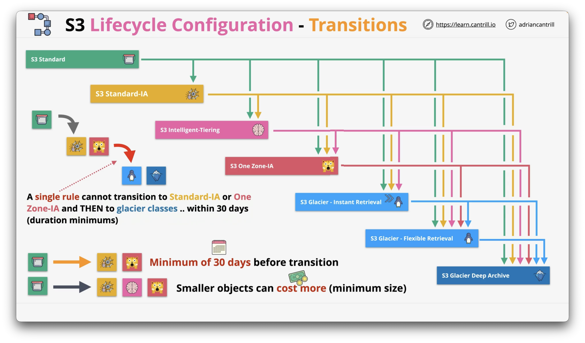

| From | Can transition to |
| --- | --- |
| **S3 Standard** | All other classes |
| **Standard-IA** | Intelligent-Tiering, One Zone-IA, Glacier Instant Retrieval, Glacier Flexible Retrieval, Glacier Deep Archive |
| **Intelligent-Tiering** | One Zone-IA, Glacier Instant Retrieval, Glacier Flexible Retrieval, Glacier Deep Archive (narrows as the current IT access tier gets colder — see breakdown below) |
| **One Zone-IA** | Glacier Flexible Retrieval, Glacier Deep Archive (**not** Glacier Instant Retrieval) |
| **Glacier Instant Retrieval** | Glacier Flexible Retrieval, Glacier Deep Archive |
| **Glacier Flexible Retrieval** | Glacier Deep Archive |
| **Glacier Deep Archive** | (terminal — no transitions out) |

Most multi-step pipelines mirror access-decay patterns (e.g. Standard → Standard-IA → Glacier Flexible → Deep Archive), but a rule can jump several classes at once if the access curve justifies it.

> [!warning] Gotcha — One Zone-IA cannot transition to Glacier Instant Retrieval
> Every other class can reach Glacier Instant Retrieval directly via lifecycle; One Zone-IA is the lone exception. To get One Zone-IA objects into Glacier Instant Retrieval you would have to round-trip via `CopyObject` to a hot tier first. Memorize this single asymmetry — it's exam bait.

#### Intelligent-Tiering source — the per-tier breakdown

When the source class is Intelligent-Tiering, the allowed destinations depend on which **internal access tier** the object currently sits in. The colder the source tier, the narrower the allowed destinations:

| IT access tier                              | Can transition to                                            |
| ------------------------------------------- | ------------------------------------------------------------ |
| **Frequent Access** / **Infrequent Access** | One Zone-IA, GIR, Glacier Flexible, Glacier Deep Archive     |
| **Archive Instant Access**                  | GIR, Glacier Flexible, Glacier Deep Archive (no One Zone-IA) |
| **Archive Access** (opt-in)                 | Glacier Flexible, Glacier Deep Archive                       |
| **Deep Archive Access** (opt-in)            | Glacier Deep Archive only                                    |

The implicit rule: an Intelligent-Tiering object can only be transitioned to a class **at least as cold** as its current tier. The optional Archive Access and Deep Archive Access tiers are the most restricted because they're already deep in the cold zone.

> [!warning] Versioning + replication transition restriction
> On **versioning-enabled or versioning-suspended buckets**, objects with a `Pending` or `Failed` replication status are **not transitioned** by lifecycle rules. Wait for replication to complete (or fix the failure) before lifecycle moves them — otherwise the rule silently skips those objects.

### Three time-based restrictions

These are the three constraints that catch people out (and the SAA exam loves them).

#### 1. The 30-day Standard minimum

An object must live in **S3 Standard for at least 30 days** before a lifecycle rule can transition it to Standard-IA or One Zone-IA. This is a guardrail against billing churn on freshly-uploaded data — IA's [30-day minimum billable duration](#comparison-table) would otherwise apply on top of an already-charged Standard week.

| Operation | Allowed before 30 days? |
| --- | --- |
| Direct upload into Standard-IA / One Zone-IA at PUT time | Yes |
| Manual storage-class change via CLI/console (`CopyObject` onto itself) | Yes |
| Lifecycle-driven transition out of Standard | No |

**Same rule applies to noncurrent versions.** On versioned buckets, a noncurrent version must have been noncurrent for at least **30 days** before a lifecycle rule can transition it to Standard-IA or One Zone-IA. The clock starts when the version becomes noncurrent (i.e. when a new version is written or a delete marker is added), not at original upload.

#### 2. The "single-rule" minimum-duration gap

Within a **single lifecycle rule**, consecutive transitions must respect the **destination class's minimum storage duration**. AWS docs phrase it as:

> "You can't create a single Lifecycle rule that transitions objects from one storage class to another before the minimum storage duration period has passed."

The IA-to-Glacier case is the most common instance — Standard-IA's minimum is 30 days, so a single rule that says `Standard → Standard-IA → Glacier` must wait at least 30 days at the IA stage. But the rule generalizes to every intermediate class's minimum. Per AWS's own example, **Glacier Instant Retrieval has a 90-day minimum**, so a single rule that says "transition to GIR after 4 days, then transition to Glacier Deep Archive after 20 days" is **rejected** — the Deep Archive transition must occur at least **94 days** (4 + 90) after upload within the same rule.

**Workaround:** split the chain across **two separate rules**. The constraint applies *within* a rule, not across rules. (You will, however, still pay the destination class's minimum-duration charge for the time the object was supposed to spend there — the workaround sidesteps the rule, not the billing.)

#### 3. Objects smaller than 128 KB don't transition by default

Since **September 2024**, S3 applies a default behavior that prevents objects smaller than **128 KB** from being transitioned to **any** storage class via lifecycle. AWS's reasoning: every transition incurs a per-object **transition request** charge — for very small objects, the request cost plus the destination class's 128 KB minimum-billable size frequently exceeds the storage savings, so the default is to skip the transition entirely.

This is a hard automatic block, not a soft warning. The lifecycle rule silently doesn't apply to those objects.

| Era                        | Default behavior for objects < 128 KB                                                                       |
| -------------------------- | ----------------------------------------------------------------------------------------------------------- |
| **Before September 2024**  | Could transition to **Glacier Flexible Retrieval or Glacier Deep Archive only** (other transitions skipped) |
| **September 2024 onwards** | **Cannot transition to any storage class** by default                                                       |

Pre-Sept-2024 configurations retain the old behavior **until you edit them** — any create / edit / delete on the rule flips the configuration to the new default.

**Overrides:**

- Add an explicit **`ObjectSizeGreaterThan`** (or `ObjectSizeLessThan`) filter on the lifecycle rule to define your own minimum-size threshold.
- At the bucket level, pass the `x-amz-transition-default-minimum-object-size` header on `PutBucketLifecycleConfiguration` to set a custom default threshold for the entire configuration.

> [!warning] Glacier storage overhead matters too
> Every object transitioned to Glacier Flexible Retrieval or Glacier Deep Archive carries **two metadata bands** beyond the object itself:
>
> - **8 KB** at **S3 Standard** rates — object name + metadata for the real-time `ListObjects` API
> - **32 KB** at **Glacier** rates — index data needed for restoration
>
> For very small objects, this 40 KB overhead alone can dominate the storage cost. The standard pattern is to **aggregate many small objects into fewer large objects** (tarballs, columnar blobs) before archiving.

### Common rule patterns

- **Age-based cool-down for compliance archives**: `Standard → Standard-IA @ 30 days → Glacier Flexible @ 90 days → Deep Archive @ 365 days` (split across two rules if any intermediate destination's minimum-duration constraint is violated within a single rule)
- **Derived / replicable data**: `Standard → One Zone-IA @ 30 days` (AZ-level loss is acceptable)
- **Version history cost control**: `Noncurrent versions → Glacier @ N days → expire @ M days` (pairs with [versioning](#versioning-and-mfa-delete))
- **Orphaned-multipart cleanup**: `AbortIncompleteMultipartUpload @ 7 days` (pairs with [multipart upload](#single-put-vs-multipart-upload); should be table-stakes on any bucket that sees programmatic uploads)
- **Bucket retention compliance**: `Expire @ N days` on a prefix or tag filter

### Hard rules to remember

- **One-way down by default** — to move objects *back up* to a warmer class, use `CopyObject`, not a lifecycle rule.
- **30-day Standard minimum** before any transition to Standard-IA or One Zone-IA (applies to both current objects since upload and noncurrent versions since becoming noncurrent).
- **Single-rule minimum-duration gap** — within one rule, the next transition must respect the destination class's minimum duration (e.g. GIR → Deep Archive can't happen until 90 days after the GIR transition). Workaround: split into two rules.
- **One Zone-IA cannot transition to Glacier Instant Retrieval** — every other source class can.
- **Objects < 128 KB don't transition by default (since Sept 2024)** — override with an `ObjectSizeGreaterThan` filter or the `x-amz-transition-default-minimum-object-size` header.
- **Destination-class minimum durations apply.** An object transitioned into Standard-IA is billed for at least 30 days *in IA*, even if a later rule moves it again sooner.
- **Pending / Failed replication objects are skipped** on versioned buckets — fix replication first.
- **Lifecycle moves are silent and asynchronous** — no "moving" status, just a class change on the next list/get.

> [!tip] Exam Tip
> Pattern-match: *"transition objects automatically as they age"* → **lifecycle transition**. *"delete old objects automatically"* → **lifecycle expiration**. *"move data to a cheaper tier based on access frequency"* → **Intelligent-Tiering** (lifecycle is time-based, not access-based). *"can we transition Standard objects to Glacier on day 5?"* → **No**, the 30-day Standard minimum blocks it. *"single rule transitions to GIR @ 4 days then Deep Archive @ 20 days — why is it rejected?"* → **GIR's 90-day minimum** — within one rule, Deep Archive transition must be on day 94 or later; **split into two rules**. *"why won't this One Zone-IA → Glacier Instant Retrieval rule fire?"* → that specific transition is **blocked**; route via a hot tier with `CopyObject` first. *"lots of tiny log files in my bucket but lifecycle isn't moving them"* → since Sept 2024, **objects < 128 KB don't transition by default**; add `ObjectSizeGreaterThan` or set the default-minimum-object-size header.

### Mental model

**Lifecycle = scheduled, time-based automation.** **Intelligent-Tiering = reactive, access-based automation.** They solve different problems — don't conflate them. A bucket can absolutely use *both*: lifecycle rules to handle versioning cleanup and multipart cleanup, with Intelligent-Tiering as the storage class for the current-version objects whose access patterns you can't predict.

## Replication

**S3 Replication** copies objects from a **source bucket** to one or more **destination buckets**. There are two flavours that differ only in *where the destination lives*:

- **Cross-Region Replication (CRR)** — source and destination buckets are in **different** AWS regions. The older, longer-available form.
- **Same-Region Replication (SRR)** — source and destination buckets are in the **same** AWS region. A more recent addition.

Both CRR and SRR work either **same-account** or **cross-account**. The mechanism, configuration model, and gotchas are otherwise identical — the region split and the account split are the two orthogonal axes that define every use case.

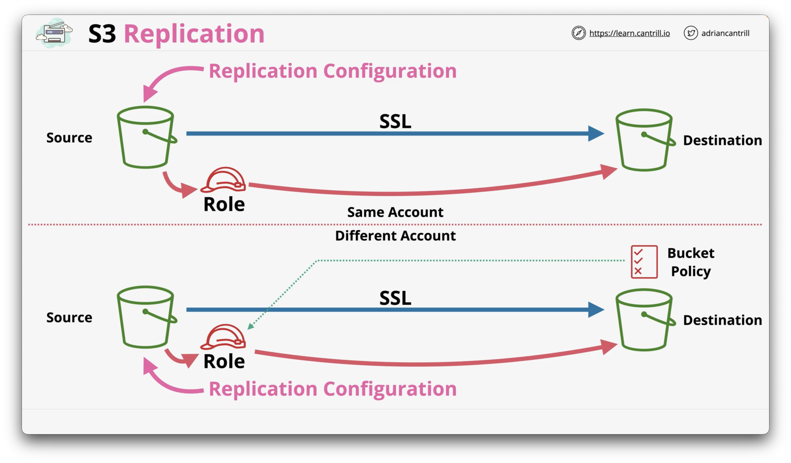

### How replication is configured

The configuration always lives on the **source bucket**, plus an IAM role that S3 assumes to do the work:

- **Replication configuration** on the source bucket — names the destination bucket(s) and the IAM role to use, plus optional rules (filters, storage-class overrides, ownership overrides, [RTC](#replication-time-control-rtc)).
- **IAM role** with two policies:
  - **Trust policy** — allows the **S3 service principal** (`s3.amazonaws.com`) to assume it. Same pattern as any other [service role](iam.md#iam-roles).
  - **Permissions policy** — grants `s3:GetObject…` on the source bucket and `s3:ReplicateObject` / `s3:ReplicateDelete` / `s3:ReplicateTags` on the destination bucket.
- **Encryption in transit** — replication traffic is **always** SSL/HTTPS, no opt-in needed.

#### Same-account vs cross-account — the only meaningful structural difference

Within a single AWS account, both source and destination buckets implicitly trust the account (and therefore the IAM role). The role's permissions policy alone is sufficient — **no bucket policy needed**.

Cross-account is where it gets interesting. The destination bucket lives in a **different** AWS account that does **not** implicitly trust the source account's IAM role. To bridge that trust gap, you must attach a **[bucket policy](#bucket-policies)** (a [resource policy](../concepts/resource-vs-identity-policies.md)) on the destination bucket that explicitly names the source-account role and allows it to replicate objects in. This is the same cross-account [intersection](../concepts/resource-vs-identity-policies.md#how-the-two-combine) pattern as any cross-account S3 access: both sides must allow.

> [!tip] Mental shortcut
> **Same account** → IAM role is enough. **Different account** → IAM role **plus** a destination bucket policy.

### Configuration options

A replication rule has four knobs worth knowing for the exam.

| Option                             | Default                 | Why you'd override                                                                                                                                                                                    |
| ---------------------------------- | ----------------------- | ----------------------------------------------------------------------------------------------------------------------------------------------------------------------------------------------------- |
| **Scope**                          | Entire source bucket    | Filter by **prefix**, **object tag**, or both — replicate only `logs/` or only `tag=replicate-to-eu`                                                                                                  |
| **Destination storage class**      | Same as source          | Save cost on a secondary copy — e.g. **One Zone-IA** in the destination because the source already provides the durable copy                                                                          |
| **Object ownership**               | Source bucket's account | **Cross-account trap**: replicated objects stay owned by the source account, so the destination account can't read its own bucket. **Override** the setting to make the destination account the owner |
| **Replication Time Control (RTC)** | Off (best-effort)       | Add a **15-minute SLA** + per-object replication metrics. Costs extra                                                                                                                                 |

#### Replication Time Control (RTC)

Without RTC, replication is **best-effort** — most objects arrive within minutes, but there's no guarantee and no easy way to see what's queued. RTC layers two things on top:

1. **A 15-minute SLA** — AWS guarantees that 99.99% of new objects replicate within 15 minutes (and is on the hook for credits if not).
2. **Replication metrics + CloudWatch events** — you can see per-object replication status and detect failed/delayed replications in real time.

> [!tip] Exam shortcut
> If a question mentions "**15 minutes**" anywhere near replication, the answer involves **RTC**. Vanilla replication has no SLA and no "X minutes" guarantee.

### Considerations and gotchas

Replication has several non-obvious behaviours that turn into exam traps:

#### 1. Not retroactive by default

Enabling replication only replicates **new** objects from that point forward. Pre-existing objects in the source bucket are **not** copied.

- **Backfill path**: **S3 Batch Replication** — a separate, explicitly-configured job that replicates a snapshot of existing objects. Pattern-match: "I just turned on replication, the destination is empty, what backfills the existing data?" → **S3 Batch Replication**.

#### 2. Versioning is required to be "on" both buckets

Both source and destination buckets must have **[versioning](#versioning-and-mfa-delete) enabled** before replication can be configured. The console wizard offers to turn it on as part of the setup if it isn't already.

This is non-negotiable — replication relies on per-version IDs to identify what to copy and to maintain ordering guarantees across the pair.

#### 3. One-way by default

Objects flow **source → destination**. Direct writes to the destination bucket are **not** replicated back to the source. **Bidirectional replication** is possible — you set up *two* replication configurations, one on each bucket pointing at the other — but it must be configured explicitly.

#### 4. Encryption support

All SSE flavours are now supported, but with caveats:

| Encryption type                                        | Replication support                                                                                                                                                                                                                                       |
| ------------------------------------------------------ | --------------------------------------------------------------------------------------------------------------------------------------------------------------------------------------------------------------------------------------------------------- |
| **Unencrypted**                                        | Supported by default                                                                                                                                                                                                                                      |
| **[SSE-S3](#sse-s3--s3-managed-keys-aes-256-default)** | Supported by default                                                                                                                                                                                                                                      |
| **[SSE-KMS](#sse-kms--kms-managed-keys)**              | Supported, but requires **extra configuration** — KMS key permissions on both sides, and the destination KMS key must be specified in the replication rule. CloudTrail will show `kms:Encrypt` calls in the destination region on every replicated object |
| **[SSE-C](#sse-c--customer-provided-keys)**            | Supported only recently — historically incompatible with CRR/SRR. Even today, treat as the *least* exam-supported case                                                                                                                                    |

#### 5. Source-account ownership requirement

Replication only replicates objects whose **owner is the source bucket's account**. If a third party has written objects into the source bucket (via a permissive [bucket policy](#bucket-policies) granting cross-account writes without taking ownership), those objects are **silently skipped** by replication.

The fix is the same as the [Object Ownership = Bucket owner enforced](#access-control-lists-acls--legacy) pattern used elsewhere: ensure incoming objects are re-owned by the source account on write.

#### 6. System events are not replicated

Changes made by S3 itself — specifically **[lifecycle](#lifecycle-configuration) transitions and expirations** — are **not** replicated. Only **user-driven** events are. If a lifecycle rule expires an object in the source, the destination's copy is **not** auto-deleted. If you want symmetric lifecycle behaviour, configure the same lifecycle rule on **both** buckets independently.

#### 7. Already-archived source objects are excluded

Objects already stored in **[Glacier Flexible Retrieval](#the-glacier-retrieval-job-model)**, **Glacier Deep Archive**, or the Intelligent-Tiering archive tiers are **not live-replicated from the source**. Restore them and copy them into a non-archive class first if you need replication to pick them up.

This does **not** mean replication can never produce archive-class replicas. A replication rule can write destination replicas directly into Glacier Flexible Retrieval, Glacier Deep Archive, or another supported destination storage class. **Glacier Instant Retrieval** is also replicable as a source class because it behaves like a regular hot-tier class with millisecond access.

#### 8. Deletes are not replicated by default

This is the subtlest one. With [versioning](#versioning-and-mfa-delete) on, a `DELETE object` (no `versionId`) creates a **delete marker** rather than removing data. By default, **delete markers are not replicated** — so the source appears to delete the object while the destination still has it as the current version.

- You can **opt in** to delete-marker replication, but it must be turned on explicitly per rule.
- **Versioned deletes** (`DELETE object?versionId=…`) — the permanent kind — are **never** replicated, regardless of settings. This is by design: replication is a *resilience* mechanism, not a synchronized destruction mechanism. If you accidentally hard-delete a version in the source, the destination's copy survives.

> [!warning] Gotcha
> Replication is designed to make data **survive** failures, not to mirror destructive actions. Permanent (versioned) deletes deliberately don't replicate. If you need symmetric delete behaviour for compliance, the standard pattern is to **not** rely on replication for it — use independent lifecycle rules on each side, or a custom application-level workflow.

### When to use SRR vs CRR

The two flavours target different use cases:

| Flavour                            | Typical use cases                                                                                                                                                                                                                                                                                                                                  |
| ---------------------------------- | -------------------------------------------------------------------------------------------------------------------------------------------------------------------------------------------------------------------------------------------------------------------------------------------------------------------------------------------------- |
| **SRR — Same-Region Replication**  | **Log aggregation** — centralize logs from many buckets into one analysis bucket in the same region; **Prod ↔ test sync** — periodically push prod data into test (or vice versa); **Sovereignty-bound resilience** — data must remain in one region for legal/regulatory reasons, with cross-account replication inside that region for isolation |
| **CRR — Cross-Region Replication** | **Global resilience / DR** — survive a region-wide failure by keeping a copy in another region; **Latency reduction** — serve reads to a remote user base from a region close to them; **Cross-region compliance** — copies in multiple regions to satisfy data-locality requirements                                                              |

### Quick recall

| Concept                  | Key point                                                                                                                         |
| ------------------------ | --------------------------------------------------------------------------------------------------------------------------------- |
| CRR vs SRR               | Different regions vs same region. Both work same-account or cross-account                                                         |
| What configures it       | **Replication configuration on the source bucket** + IAM role (S3 trust policy + cross-bucket permissions)                        |
| Cross-account extra step | **Bucket policy on the destination** allowing the source-account role                                                             |
| Versioning               | **Required** on both buckets                                                                                                      |
| Retroactive?             | **No** — use **S3 Batch Replication** to backfill                                                                                 |
| Direction                | **One-way** by default; bidirectional is opt-in (two configurations)                                                              |
| Storage class            | Same as source by default; override to a cheaper class on the destination if desired                                              |
| Object ownership         | **Source account** by default; **override** in cross-account setups so the destination account owns its own bytes                 |
| RTC                      | **15-minute SLA** + per-object metrics. *"15 minutes"* in a question → **RTC**                                                    |
| Encryption               | Unencrypted, SSE-S3 default; SSE-KMS needs extra config; SSE-C only recently supported                                            |
| Not replicated           | **Lifecycle** (system) events, **Glacier / Deep Archive** objects, **delete markers** (by default), **versioned deletes** (never) |

> [!tip] Exam Tip
> Pattern-match: *"copy objects to another region for DR"* → **CRR**. *"aggregate logs from many buckets into one"* → **SRR**. *"backfill existing objects after enabling replication"* → **S3 Batch Replication**. *"replication must complete within 15 minutes"* → **RTC**. *"replicated objects in the destination account can't be read by that account's IAM users"* → **object ownership wasn't overridden** in the replication rule. *"replication is on but lifecycle expirations don't propagate"* → **by design** — system events aren't replicated; configure the same lifecycle rule on both buckets.

## Access Points and Multi-Region Access Points

The mechanisms covered so far govern access to a bucket through its **default endpoint** — `bucket-name.s3.amazonaws.com` plus a [bucket policy](#bucket-policies) capped at 20 KB and (optionally) [identity policies](iam.md#iam-identity-policies). That model breaks down in two distinct ways:

1. **One bucket, many use cases** — a single 20 KB bucket policy becomes unmaintainable when dozens of teams and applications need different scoped views into the same data.
2. **One bucket, one region** — a bucket is permanently bound to its creation region. There is no native way to expose a single global endpoint that transparently routes to the closest bucket in a multi-region fleet.

**S3 Access Points** and **Multi-Region Access Points (MRAP)** are sibling features that solve these two problems. Both live in the `aws s3control` API namespace and share a mental model — they are **named doorways**, not new permissions systems — but they target different shapes of problem:

- **Regular Access Points** sit in front of **one bucket** and provide many independently-scoped DNS endpoints, each with its own resource policy and (optionally) a VPC-restricted network origin. They solve the **manageability** problem.
- **Multi-Region Access Points (MRAP)** sit in front of **2+ buckets in different regions** and expose a **single global endpoint** that latency-routes each request to the closest backing bucket. They solve the **routing/DR** problem.

> [!tip] Mental model
> Both flavours behave like a **DNS CNAME** with an attached policy — they re-address access to the underlying bucket(s) but do not grant access on their own. The bucket(s) must still permit the request. Regular APs are a "doorway"; MRAP is a "router".

### Regular Access Points — a scoped view onto one bucket


A heavily-shared bucket — billions of objects, many teams, mixed Internet/VPC clients — runs out of room in a 20 KB bucket policy long before it runs out of storage. Regular Access Points fix this by letting you attach **many independently-configured DNS endpoints** to one bucket, each with its own resource policy:

| Access point attribute                                                   | What it controls                                                                                                                                             | Mutability                                  |
| ------------------------------------------------------------------------ | ------------------------------------------------------------------------------------------------------------------------------------------------------------ | ------------------------------------------- |
| **DNS endpoint** (`<name>-<hash>.s3-accesspoint.<region>.amazonaws.com`) | The URL clients use instead of the bucket endpoint                                                                                                           | Immutable (derived from the name)           |
| **Access point policy** (≤ 20 KB)                                        | A [resource policy](../concepts/resource-vs-identity-policies.md) functionally equivalent to a bucket policy, scoped to requests through *this* access point | Mutable                                     |
| **Network origin** — `Internet` or `VPC`                                 | Whether requests can come from the public Internet or only from one specific VPC                                                                             | **Immutable after creation**                |
| **Block Public Access settings**                                         | Same four switches as [bucket-level BPA](#block-public-access)                                                                                               | **Immutable after creation**                |
| **Associated bucket**                                                    | The single bucket this AP fronts                                                                                                                             | **Immutable** (delete + recreate to change) |

Every access point is **regional** — it must live in the same region as its bucket — and its name must be unique **within an account + region**, not globally.

#### Access point ARN format

This is the critical wire-level detail that distinguishes AP grants from bucket grants:

```text
arn:aws:s3:<region>:<account-id>:accesspoint/<access-point-name>           ← the AP itself (e.g. for s3:ListBucket)
arn:aws:s3:<region>:<account-id>:accesspoint/<access-point-name>/object/*  ← objects accessed through it
```

Compare to a bucket ARN: `arn:aws:s3:::bucket-name/key` — regionless and account-less. Access point ARNs are **region- and account-qualified** because the AP itself is a regional account-owned resource.

#### Access point policy capabilities

An AP policy can scope identities in the usual ways:

- By **prefix** — `arn:…:accesspoint/<name>/object/finance/*` only matches the `finance/` prefix
- By **object tag** — `Condition: {StringEquals: {s3:ExistingObjectTag/department: finance}}`
- By **action** — `s3:GetObject`, `s3:PutObject`, `s3:ListBucket`, etc.
- By **condition** — IP, MFA, source VPC, plus AP-specific condition keys (below)

#### The two-layer permissions rule

This is the most-tested operational point. **An access point policy is only effective if the underlying bucket policy *also* permits the same access.** Restrictions in an AP policy apply *only* to requests through that AP — they do not change how the bucket behaves for direct requests. There are two ways to satisfy the rule:

| Pattern                                | Bucket policy                                                                         | Access point policies | Where the real grant lives |
| -------------------------------------- | ------------------------------------------------------------------------------------- | --------------------- | -------------------------- |
| **A — Matching permissions** (tedious) | Mirror every AP's grants                                                              | Granular              | Everywhere                 |
| **B — Delegation** (AWS-recommended)   | One permissive grant scoped to "any AP in my account" via `s3:DataAccessPointAccount` | Granular              | In the AP policies         |

The delegation bucket policy is the architectural pattern worth memorising:

```json
{
  "Version": "2012-10-17",
  "Statement": [{
    "Effect": "Allow",
    "Principal": { "AWS": "*" },
    "Action": "*",
    "Resource": [
      "arn:aws:s3:::amzn-s3-demo-bucket",
      "arn:aws:s3:::amzn-s3-demo-bucket/*"
    ],
    "Condition": {
      "StringEquals": { "s3:DataAccessPointAccount": "111122223333" }
    }
  }]
}
```

The `s3:DataAccessPointAccount` condition is the linchpin — it scopes the wide-open `Allow` to requests routed through access points **owned by the specified account**, pushing all real per-team granularity into the AP policies.

#### AP-specific condition keys

| Condition key                 | Matches on                                             |
| ----------------------------- | ------------------------------------------------------ |
| `s3:DataAccessPointArn`       | The access point ARN (supports `StringLike` wildcards) |
| `s3:DataAccessPointAccount`   | The AWS account that owns the access point             |
| `s3:AccessPointNetworkOrigin` | `Internet` or `VPC`                                    |

#### VPC-origin access points

When `--vpc-configuration VpcId=vpc-xxxxxxxx` is passed at creation, the AP is **bound to that one VPC** and S3 rejects any request not originating from it. The end-to-end path requires three pieces to line up:

1. A **[VPC endpoint for S3](vpc.md#aws-privatelink)** (Gateway or Interface) on the VPC.
2. The **VPC endpoint policy** must allow access to **both** the AP ARN **and** the underlying bucket ARN — missing either side fails.
3. (Optional but recommended) **`enableDnsHostnames` and `enableDnsSupport`** on the VPC, plus a private hosted zone so the AP DNS resolves only inside the VPC.

```json
{
  "Version": "2012-10-17",
  "Statement": [{
    "Principal": "*",
    "Effect": "Allow",
    "Action": ["s3:GetObject"],
    "Resource": [
      "arn:aws:s3:::amzn-s3-demo-bucket/*",
      "arn:aws:s3:us-west-2:123456789012:accesspoint/example-vpc-ap/object/*"
    ]
  }]
}
```

> [!tip] End-to-end VPC-only S3 pattern
> The exam-pattern phrase *"this bucket is only reachable from this VPC via this access point"* combines three layers: a **VPC-origin AP**, a **VPC endpoint policy** referencing both ARNs, and a **bucket policy that denies any request whose `s3:AccessPointNetworkOrigin` is not `VPC`**. The SCP variant — `Deny s3:CreateAccessPoint` unless `s3:AccessPointNetworkOrigin == VPC` — pushes the guardrail to the org level for Control Tower-managed accounts.

#### Cross-account access points

An access point can live in **your** account and target a bucket owned by **another** account. The wrinkles:

- Creating the AP does **not** grant access to the data — the bucket owner must still update their bucket policy to trust your account (typically via the delegation pattern + `s3:DataAccessPointAccount`).
- The bucket owner retains ultimate control. Their bucket policy is still the final arbiter.
- AP **management** API calls (`PutAccessPoint`, `GetAccessPointPolicy`, etc.) **do not support cross-account calls** — only data-plane calls through the AP do.
- Cross-account APs are **only supported for S3 buckets**, not for FSx volumes (which are the other resource type that supports access points).

#### Limits and constraints

| Limit / constraint | Value |
| --- | --- |
| Access points per account per region | **10,000** (soft limit, raisable via Service Quotas) |
| Access point policy size | **20 KB** |
| Same-region rule | AP must be in the **same region** as its bucket |
| Network origin after creation | **Immutable** |
| BPA settings after creation | **Immutable** |
| Bucket association after creation | **Immutable** |
| Protocol | **HTTPS only** (HTTP auto-redirected) |
| Signing | **SigV4 only** |
| Anonymous access | **Not supported** |
| Addressing style | Virtual-host only |
| Can be a [Replication](#replication) **destination** | **No** |
| Management API calls | **No cross-account support** |

> [!warning] Replication caveat — access points cannot be replication destinations
> If you lock a bucket down to *VPC-only access points* via the deny-non-VPC pattern above, you also lock out [Replication](#replication) — because replication writes to the bucket directly, not through an access point, and there's no way to route it through one. The fix is to allow-list the replication role's principal ARN as an exception in the bucket policy.

### Multi-Region Access Points (MRAP) — single global endpoint over a replicated bucket fleet

MRAP solves a different problem. A regular AP gives you many doorways into **one** bucket; MRAP gives you **one doorway** into **many** buckets that span multiple regions, with **latency-based routing** to the closest one. It's the S3 analogue of [Route 53 latency routing](route53.md) — but built into the storage layer.

```text
                       ┌─────────────────────────┐
        Client A ───►  │   MRAP global endpoint  │  ◄─── Client B
        (in TYO)       │   (latency-based route) │       (in IAD)
                       └────────────┬────────────┘
                                    │
                ┌───────────────────┴───────────────────┐
                ▼                                       ▼
        ┌───────────────┐   ◄── async CRR (mesh) ──►   ┌───────────────┐
        │ bucket-sydney │                              │ bucket-canada │
        │  (ap-se-2)    │   ◄────────────────────►     │ (ca-central-1)│
        └───────────────┘                              └───────────────┘
              versioning ON                                  versioning ON
              active                                         active
```

#### MRAP anatomy

| Attribute                               | Value                                                                                                                                                                  |
| --------------------------------------- | ---------------------------------------------------------------------------------------------------------------------------------------------------------------------- |
| **Endpoint**                            | A single **global** alias and ARN (regionless)                                                                                                                         |
| **ARN format**                          | `arn:aws:s3::<account-id>:accesspoint/<alias>` — note the **empty region segment**                                                                                     |
| **Backing buckets**                     | **2+** S3 buckets, in **different regions**. **Fixed at creation** — cannot be added or removed later                                                                  |
| **Versioning**                          | **Required** on every backing bucket (because [CRR](#replication) requires it)                                                                                         |
| **Failover state** (per backing bucket) | `active` or `passive`                                                                                                                                                  |
| **Failover mode**                       | `active–active` (default — any active bucket can be picked) or `active–passive` (passives only used when no actives available)                                         |
| **Replication**                         | **Not provided by MRAP itself** — you configure CRR between the backing buckets separately, typically with the "Replicate among all specified buckets" (mesh) template |
| **Network origin**                      | **Internet only** — MRAP does not support VPC origin (regular APs do)                                                                                                  |
| **Creation latency**                    | Typically 10–30 minutes; AWS quotes **up to 24 hours** worst-case. Cannot be used until status = `ready`                                                               |

#### Routing behaviour

A request from region X is routed to the backing bucket **closest to X** by latency — similar in spirit to [Route 53 latency routing](route53.md), but at the S3 control-plane layer:

- **Writes** — the object lands directly in the closest bucket, then **asynchronously replicates** outward via the CRR rules you configured.
- **Reads** — served from the closest bucket. If the object hasn't replicated there yet, the read **fails with `NoSuchKey`** — this is the **consistency lag** failure mode (see below).

> [!warning] The consistency-lag failure mode
> MRAP routing is **regional/latency-based**, not content-aware — it has no idea which bucket holds the latest copy of a given object. Combined with CRR's **asynchronous** default, this means: a client in region A writes through the MRAP (lands in bucket A), then a client in region B reads through the MRAP for the same key *before replication finishes* — MRAP routes the read to bucket B, where the object doesn't yet exist, and the read returns `NoSuchKey`. Regular S3 has strong read-after-write consistency; **MRAP gives that up** in exchange for cross-region routing.

#### Mitigating the consistency lag

Two patterns, depending on how strict the requirement is:

1. **Enable [Replication Time Control (RTC)](#replication-time-control-rtc)** when configuring the mesh CRR rule. RTC's **99.9%-within-15-minutes** SLA narrows the window, with a per-object cost. It does **not** eliminate the failure mode — it just bounds it.
2. **Read from the same region you wrote to** — bypass the MRAP for the read path on objects you just wrote, or build region-affinity into the application. This eliminates the lag entirely at the cost of giving up the MRAP's routing convenience for that workflow.

#### Active–active vs active–passive

The failover configuration on each backing bucket determines what the routing engine is allowed to do:

| Mode                          | Behaviour                                                                  | Use case                                                                                                                 |
| ----------------------------- | -------------------------------------------------------------------------- | ------------------------------------------------------------------------------------------------------------------------ |
| **`active–active`** (default) | Traffic can be routed to **any** active bucket based on latency            | Multi-region read/write fanout with mesh CRR — global low-latency access                                                 |
| **`active–passive`**          | `passive` buckets are **only** used when no `active` buckets are available | **DR / cold standby** — primary region active, secondary region passive, failover flips automatically on regional outage |

A "cold-standby" DR pattern looks like: primary bucket = `active`, secondary bucket = `passive`, mesh CRR keeps them in sync, MRAP routes everything to primary until the primary becomes unhealthy — at which point traffic shifts to the secondary automatically.

#### MRAP cost layer

MRAP charges a **per-GB data routing fee** on every request that traverses it, **on top of**:

- Standard S3 storage and request charges on each backing bucket
- CRR data-transfer charges between backing buckets
- (Optional) RTC charges per replicated object

This makes MRAP one of the more expensive S3 access patterns — use it deliberately, not as a default.

#### CLI invocation

The MRAP-related CLI commands live in the same `aws s3control` namespace as regular access points, but the resource is `multi-region-access-point`:

```bash
# Create — fixes the backing bucket set
aws s3control create-multi-region-access-point \
  --account-id 111122223333 \
  --details '{"Name":"really-critical-cat-data","Regions":[{"Bucket":"bucket-sydney"},{"Bucket":"bucket-canada"}]}'

# Upload through the MRAP (note: ARN, not bucket name)
aws s3 cp file.bin s3://arn:aws:s3::111122223333:accesspoint/<alias>/key
```

> [!warning] Gotcha — CLI uses the MRAP **ARN**, not a bucket name
> Unlike regular S3 commands (`s3://bucket-name/key`), MRAP operations use the **full MRAP ARN** in place of the bucket name: `s3://<MRAP-ARN>/key`. There is no shorter "MRAP alias as bucket name" form.

### Regular Access Points vs MRAP — side-by-side

The two features are siblings in the same product family but solve different problems. **They are not nested** — an MRAP does *not* sit on top of a set of regular access points.

| | **S3 Access Points** | **S3 Multi-Region Access Points** |
| --- | --- | --- |
| **Purpose** | Manageability — split one bucket's policy into many scoped views | Routing + DR — single global endpoint over many regional buckets |
| **Backing storage** | **One** bucket | **2+** buckets in **different regions** (fixed at creation) |
| **Endpoint scope** | Regional (same region as the bucket) | **Global** (latency-routed; regionless ARN) |
| **CLI verb** | `aws s3control create-access-point` | `aws s3control create-multi-region-access-point` |
| **Name uniqueness** | Account + region | Account-wide |
| **Network origin** — Internet vs VPC | Configurable (immutable after creation) | **Internet only** |
| **Failover routing** | No | Active/active or active/passive per backing bucket |
| **Replication relationship** | **Cannot be a replication destination** | Almost always paired with **mesh CRR** between backing buckets |
| **Consistency model** | Inherits S3 strong read-after-write | Subject to **cross-region replication lag** (mitigated, not eliminated, by RTC) |
| **Per-AP policy** | Up to 20 KB | Up to 20 KB |
| **Creation latency** | Seconds | Typically 10–30 min, up to 24 h |
| **Cost layer** | Negligible (just request charges) | **Per-GB routing fee** on top of S3 + CRR (+ optional RTC) |
| **Mental model** | A "doorway" or "view" into one bucket | A "router" in front of a set of buckets |

#### Shared properties

Both flavours sit in the same product family and inherit the same family-level rules:

- **Naming/routing layer, not a permissions system** — neither grants access on its own. The DNS-CNAME mental model applies to both; the underlying bucket policies must still allow the request.
- **`aws s3control` CLI namespace** — not `aws s3` or `aws s3api`.
- **Account-unique names** — neither is globally unique like bucket names (which collide across all AWS accounts).
- **Two-layer permissions rule** — the same `s3:DataAccessPointAccount` and `s3:DataAccessPointArn` condition keys delegate trust from the bucket policy to the AP policy for both.
- **Immutable post-creation properties** — regular APs lock network origin and BPA; MRAPs lock the backing bucket set.

#### Where they diverge sharply

- **Single-region vs cross-region.** Regular APs are bound to one bucket in one region; MRAP exists specifically to span regions.
- **Replication relationship is inverted.** Regular APs **cannot be replication destinations** (a gotcha when locking a bucket to VPC-only APs). MRAP **requires** replication between its backing buckets to be useful at all — otherwise its regional routing returns inconsistent data.
- **Consistency.** Regular APs inherit S3's strong read-after-write. MRAP introduces a **replication lag window** because routing is regional but writes are asynchronously replicated.
- **No VPC origin for MRAP.** That's a regular-AP-only feature. If you need both VPC-restricted access *and* multi-region routing, you'll layer the application differently — typically regional VPC-origin APs per region with application-level routing on top.
- **Failover semantics.** Only MRAP has the active/passive routing concept. Regular APs have no analogue.

### Exam disambiguation

| Keyword / scenario                                                     | Answer                                                                                                                                     |
| ---------------------------------------------------------------------- | ------------------------------------------------------------------------------------------------------------------------------------------ |
| "Bucket policy is too large / complex / hitting the 20 KB cap"         | **S3 Access Points**                                                                                                                       |
| "Many teams need different scoped access to the same bucket"           | **S3 Access Points**                                                                                                                       |
| "Restrict bucket access to one specific VPC"                           | **S3 Access Points** with **VPC origin** + VPC endpoint policy referencing both bucket and AP ARNs (+ optional deny-non-VPC bucket policy) |
| "Single global S3 endpoint" / "lowest-latency S3 bucket from anywhere" | **MRAP**                                                                                                                                   |
| "Active/active S3 across regions behind one endpoint"                  | **MRAP** + mesh CRR                                                                                                                        |
| "DR for S3 with automatic regional failover"                           | **MRAP** with **active/passive** failover configuration                                                                                    |
| "Add another bucket to the MRAP after creation"                        | **Not supported** — backing buckets are fixed at MRAP creation; recreate the MRAP                                                          |
| "Object not found right after writing through the MRAP"                | **Consistency lag** — replication hasn't propagated to the read region yet; mitigate with **RTC** or read-from-write-region                |
| "Cross-region replication requires…"                                   | **Versioning** enabled on every source and destination bucket                                                                              |
| "Guaranteed 15-minute replication SLA"                                 | **[Replication Time Control (RTC)](#replication-time-control-rtc)** — paid feature, 99.9% within 15 minutes, 99.99% SLA                    |
| "MRAP name uniqueness"                                                 | **Account-scoped** (unlike bucket names which are **globally** unique)                                                                     |
| "CLI to use an MRAP"                                                   | `s3://<MRAP-ARN>/key` — use the **ARN**, not a bucket name                                                                                 |
| "Which IAM role does cross-region replication use?"                    | The **auto-generated S3 replication role** (or one you create with `s3.amazonaws.com` trust + per-bucket replicate permissions)            |
| "Replicate every bucket to every other bucket in an MRAP"              | "Replicate among all specified buckets" template (mesh)                                                                                    |
| "Access point cannot be used as a…"                                    | **Replication destination** (regular APs; MRAP's backing buckets *are* replicated, just not via the AP itself)                             |
| "SCP to force all new access points to be VPC-only"                    | `Deny s3:CreateAccessPoint` when `s3:AccessPointNetworkOrigin != VPC`                                                                      |

> [!tip] Pattern-match shortcuts
> *"Bucket policy is too large / many teams / scoped DNS endpoints into one bucket"* → **regular S3 Access Points** + **delegation** (`s3:DataAccessPointAccount` in the bucket policy). *"VPC-only S3"* → **regular AP with VPC origin** + VPC endpoint policy on both ARNs. *"Single global S3 endpoint / latency-route to closest bucket / multi-region S3 DR"* → **MRAP** + **mesh CRR** (+ **RTC** if the question stresses consistency or 15 minutes). *"Object not found right after writing through MRAP"* → **consistency lag** from async replication; RTC narrows the window but doesn't eliminate it.

## Server-Side Filtering — S3 Select & Glacier Select

The features above govern how objects are stored, encrypted, copied, and tiered. **S3 Select** and **Glacier Select** govern how objects are *read* — specifically, how to retrieve only the bytes the application actually needs from a large structured object, instead of pulling the whole thing and filtering client-side. They are the **read-side** complement to [Multipart Upload and Transfer Acceleration](#upload-performance), which optimize the **write-side**.

> [!warning] Availability note
> **S3 Select is no longer available to new customers.** Existing customers can continue using it, and older SAA material may still test the concept. Treat this section as legacy/current-for-existing-customers rather than a recommendation for new designs. For new multi-object analytics, the usual answer is [Athena](#when-to-use-when-not-to).

### The problem they solve

A vanilla `GetObject` returns the **entire** object. S3 has no native partial-read filter on the storage side, and objects can be up to **5 TB**. When the application only needs a slice (a few columns, a few rows) of a large CSV / JSON / Parquet object, the naive approach is:

1. Download the full object.
2. Parse and filter it in the application.
3. Throw away the bytes you didn't need.

This wastes money and time on **two** axes:

- **Cost** — you've already paid for full-object data transfer by the time the application sees it. Client-side filtering doesn't refund anything; it just discards bytes you've already been billed for.
- **Time** — the full object must stream across the wire and load before the application can begin filtering.

For supported customers and object formats, **S3 Select** and **Glacier Select** push the filter **into the storage service itself** — only the matching subset ever crosses the wire. AWS quotes up to **400% faster** retrieval and up to **80% cheaper** data transfer in the favourable cases.


### How it works

The application supplies a **cut-down SQL-like expression** to the `SelectObjectContent` (S3 Select) or `RestoreObject` with a `SELECT` parameter (Glacier Select) API. The service evaluates the expression against the raw object data and streams back only the matching rows / columns. The expression is restricted compared to full SQL — it operates on a single object at a time, no joins, no aggregations across objects.

**Supported formats:**

- **CSV**
- **JSON**
- **Parquet** (S3 Select only)
- **BZIP2** compression is supported for **CSV** and **JSON**

### Architectural difference at a glance

| Aspect                         | Plain `GetObject` + client-side filter | S3 Select / Glacier Select        |
| ------------------------------ | -------------------------------------- | --------------------------------- |
| Where filtering happens        | In the application (client-side)       | Inside S3 / Glacier (server-side) |
| Data transferred over the wire | Entire object                          | Pre-filtered subset only          |
| Data billed for transfer       | Entire object                          | Pre-filtered subset only          |
| Time to first usable result    | Full download + parse + filter         | Filtered stream only              |
| Performance ceiling            | Limited by full-object transfer        | Up to **400% faster**             |
| Cost ceiling                   | Full-object retrieval cost             | Up to **80% cheaper**             |

### S3 Select vs Glacier Select

The two features are mechanically the same; the difference is **where the source object lives** and therefore how the request is shaped:

| Feature            | Source storage class                                                          | API shape                                                                                         | Latency                                                       |
| ------------------ | ----------------------------------------------------------------------------- | ------------------------------------------------------------------------------------------------- | ------------------------------------------------------------- |
| **S3 Select**      | Any hot tier (Standard, IA, One Zone-IA, GIR)                                 | Synchronous — `SelectObjectContent` streams results back immediately                              | Milliseconds                                                  |
| **Glacier Select** | [Glacier Flexible Retrieval / Deep Archive](#the-glacier-retrieval-job-model) | **Retrieval job** — `RestoreObject` with a `SELECT` parameter; results materialize asynchronously | Inherits the source class's retrieval tier (minutes to hours) |

Glacier Select inherits all the [retrieval-tier semantics](#retrieval-tiers) of a normal Glacier restore — Expedited / Standard / Bulk for Flexible Retrieval; Standard / Bulk for Deep Archive. It is **not** an instant query; it is a normal retrieval job that happens to filter as it produces its output. The win is that the materialized result is far smaller than a full restore, which cuts both the retrieval fee and the staged-IA storage cost during the availability window.

### When to use, when not to

**Reach for S3 Select / Glacier Select when:**

- You are an **existing S3 Select customer** or you are working with legacy exam/source material that explicitly names the feature.
- The application only needs a subset of rows or columns from large structured objects.
- The object format is **CSV, JSON, or Parquet** — no schema-on-write or query-engine setup required.
- Data transfer cost or latency on full-object retrieval is a meaningful constraint.
- The objects are large enough that filtering client-side is wasteful (multi-GB CSV/JSON exports where the consumer uses one column).

**Don't reach for S3 Select / Glacier Select when:**

- The application genuinely needs the full object (image, video, archive, full backup restore).
- The objects are small enough that the per-request overhead dominates the savings.
- You need **joins, aggregations across many objects, or a real query layer** — that is **Athena**'s job. S3 Select operates on **one object at a time**; it is not a query engine. The **[Glue Data Catalog](glue.md#data-catalog-and-crawlers)** supplies table metadata for S3 analytics; **Glue jobs** prepare or transform datasets. These are distinct roles in [data integration](../concepts/data-integration.md).
- The object format isn't supported (arbitrary binary, proprietary formats).

> [!warning] Gotcha — one object at a time
> The single biggest exam trap is treating S3 Select as a general-purpose query interface. It isn't. Every `SelectObjectContent` call targets exactly **one** object. Workloads that scan thousands of files, JOIN across them, or compute aggregates belong on **Athena** (or Redshift Spectrum / EMR / Glue). The decision boundary is sharper than it looks: *one object* → S3 Select; *many objects* → Athena.

> [!tip] Exam Tip
> Pattern-match: *"retrieve part of an object" / "filter at the source" / "reduce data transferred from S3"* → **S3 Select**. Same scenario but the source is in **Glacier** → **Glacier Select** (and it's still a retrieval job, with the usual Expedited / Standard / Bulk choice). *"SQL-like expression on a single object"* → **S3 Select / Glacier Select**. *"query across many objects, joins, aggregations, schema catalog"* → **Athena**, not S3 Select. *"app downloads the whole object then filters in memory"* → that's the **anti-pattern** S3 Select fixes. *"400% faster / 80% cheaper"* → S3 Select / Glacier Select marketing numbers.

### S3 Select key takeaway

S3 Select moves the filter **from the application to the service**. The architectural payoff is that the network carries only the bytes the application actually needs — making retrieval both faster and cheaper. But the feature is strictly **per-object**, and it is **not** a substitute for a query engine like Athena when the workload spans many objects.

## Event Notifications

S3 can emit a notification whenever something interesting happens to an object — a `PUT` completes, an object is deleted, a Glacier restore finishes, a replication operation succeeds or fails. The notification is delivered to one of a small set of AWS destinations and becomes the trigger for an **event-driven workflow** built around the bucket. This is the "push" counterpart to [Server-Side Filtering](#server-side-filtering--s3-select--glacier-select)'s "pull" — S3 Select lets the app reach in and ask, S3 Events lets S3 reach out and tell.


### Architecture

Four moving parts:

1. **The bucket** — the source where events originate.
2. **An event notification configuration** — attached to the bucket. Specifies *which* event types to match (optionally with prefix/suffix filters on the object key) and *which* destination to send to.
3. **The event type** — one of Create / Delete / Restore / Replicate (each with sub-operations).
4. **The destination** — one of three native targets: a **Lambda function** (invoked synchronously with the event as payload), an **[SQS queue](sqs.md)** (event enqueued for a consumer to pick up), or an **[SNS](sns.md) topic** (event published and fanned out to subscribers).

The critical structural fact: **S3 is the principal** that delivers to the destination. So the destination must have a **resource policy** that trusts the `s3.amazonaws.com` service principal:

| Destination | Resource policy must allow `s3.amazonaws.com` to …           |
| ----------- | ------------------------------------------------------------ |
| Lambda      | `lambda:InvokeFunction` (the function's own resource policy) |
| SQS         | `sqs:SendMessage` (the queue policy)                         |
| SNS         | `sns:Publish` (the topic policy)                             |

Without the resource-side grant, **event delivery silently fails** — there's no IAM error surfaced to the bucket because the bucket isn't the requester. This is the same service-principal grant pattern that recurs throughout AWS (CloudWatch Logs → Kinesis, ELB → S3 access logs, EventBridge → targets, etc.).

> [!warning] Gotcha — Lambda destination historically required CLI/API
> When you add a Lambda destination via the S3 console, the console wires up the Lambda resource policy for you. But until relatively recently, the resource-policy grant for S3-triggered Lambdas could only be modified through the **CLI or API** — not the Lambda console UI. This is an exam-relevant tripping point in older study material; treat it as "the resource policy must exist on the Lambda side, regardless of which tool put it there."

### Supported event types

| Event type               | Fires on                                                                                                                                                                                | Typical use                                                                                      |
| ------------------------ | --------------------------------------------------------------------------------------------------------------------------------------------------------------------------------------- | ------------------------------------------------------------------------------------------------ |
| `s3:ObjectCreated:*`     | `PUT`, `POST`, `COPY`, completed **multipart upload** (see [Upload Performance](#upload-performance))                                                                                   | Image processing, thumbnail generation, ML inference, ingest pipelines                           |
| `s3:ObjectRemoved:*`     | Standard deletes; **delete-marker creation** on [versioned buckets](#versioning-and-mfa-delete)                                                                                         | Security automation, audit alerts on sensitive buckets                                           |
| `s3:ObjectRestore:*`     | Glacier restore **starts** (`Post`) and **completes** (`Completed`) — see [Glacier retrieval-job model](#the-glacier-retrieval-job-model)                                               | Notify users when archived data is ready (long restore windows make async notification valuable) |
| `s3:ObjectReplication:*` | RTC-tracked replication: missed the **15-minute SLA**, replicated after the threshold, no longer tracked, or **failed** — see [Replication Time Control](#replication-time-control-rtc) | Monitor replication health for DR / compliance posture                                           |

Other event types exist (lifecycle expiration, lifecycle transition, intelligent-tiering tier change, replication operation succeeded/failed in finer detail) — covered well by the broader EventBridge integration below.

### Payload

Events are delivered as **JSON**. A minimal sketch:

```json
{
  "s3": {
    "configurationId": "the ID from the bucket's notification configuration",
    "bucket": {
      "name": "my-bucket",
      "ownerIdentity": { "principalId": "AWS-customer-ID" },
      "arn": "arn:aws:s3:::my-bucket"
    },
    "object": { "key": "path/to/object.png" }
  }
}
```

For Lambda destinations, the function receives this structure inside its `event` argument; the handler parses out the bucket name and key and then does whatever real work the application needs (typically a `GetObject` against the bucket to fetch the new payload).

### S3 Event Notifications vs EventBridge

S3 buckets can also publish to **Amazon EventBridge** — a separate, newer integration that lives next to (not inside) the bucket-level event notification configuration. EventBridge is broader in nearly every dimension:

| Aspect                | S3 Event Notifications                                                        | EventBridge                                                                                              |
| --------------------- | ----------------------------------------------------------------------------- | -------------------------------------------------------------------------------------------------------- |
| Age / framing         | Older, bucket-local feature                                                   | Newer, account-level event bus                                                                           |
| Event types           | Limited (create / delete / restore / replicate)                               | Much broader — includes lifecycle, intelligent-tiering, replication sub-events, ACL/policy changes, etc. |
| Destinations          | Lambda, SQS, SNS only                                                         | Many AWS services + SaaS partners + custom buses                                                         |
| Filtering             | Prefix / suffix on object key                                                 | Rich event-pattern matching (any field in the event)                                                     |
| Cross-account fan-out | Not directly                                                                  | Native (via event-bus permissions)                                                                       |
| When to pick          | The event type and destination fit; you want the simplest bucket-local config | **Default** — pick this unless you have a specific reason for the bucket-local feature                   |

> [!tip] Rule of thumb
> Default to **EventBridge** for new workflows. Still learn the native S3 Event Notifications feature — it's older, simpler, and shows up on the exam as the answer to "trigger a Lambda when an object is uploaded."

### Event notifications key takeaway

S3 Event Notifications turns the bucket from a passive store into the **source of an event-driven workflow**. Three destinations (Lambda, [SQS](sqs.md), SNS), four event categories (create, delete, restore, replicate), and one critical security model — **the destination grants S3 the right to deliver**, via its own resource policy.

> [!tip] Exam Tip
> Pattern-match: *"trigger a Lambda when a file lands in S3"* → **S3 Event Notifications → Lambda** (or EventBridge → Lambda). *"three destinations"* → **Lambda, SQS, SNS** (only). *"events delivered as"* → **JSON**. *"what allows S3 to deliver to the destination"* → **resource policy** on the destination (Lambda function policy / SQS queue policy / SNS topic policy) trusting the **`s3.amazonaws.com`** service principal. *"need richer events, more destinations, cross-account fan-out, complex filtering"* → **EventBridge**. *"notify when Glacier restore completes"* → `s3:ObjectRestore:Completed`. *"detect failed cross-region replication"* → `s3:ObjectReplication:*` (or EventBridge). *"events not arriving but no error"* → missing/incorrect **resource policy** on the destination.

## Access Logging

[Event Notifications](#event-notifications) push *when something changes*. **Access Logging** does the opposite — it asynchronously records **every request** against a bucket as Apache-style log entries, delivered as files into a separate target bucket. Useful for security auditing, compliance evidence, access-pattern analysis, and correlating request volume to S3 charges in billing investigations.


The diagram captures the core flow from the source bucket to the target bucket. Its **Bucket ACL** label reflects the legacy permission model from the source note; current AWS guidance is to grant delivery through a target-bucket policy for `logging.s3.amazonaws.com`, with ACL grants kept only as a legacy fallback when ACLs are enabled ([AWS: Permissions for log delivery](https://docs.aws.amazon.com/AmazonS3/latest/userguide/enable-server-access-logging.html#grant-log-delivery-permissions-general)).

| Source                          | Permission model                                                                                                                                                                                                                       |
| ------------------------------- | -------------------------------------------------------------------------------------------------------------------------------------------------------------------------------------------------------------------------------------- |
| **Original raw note / diagram** | Target bucket ACL grants WRITE permission to the S3 Log Delivery Group. This was the model emphasized in the study note and is why the diagram still shows "Bucket ACL".                                                               |
| **Current AWS documentation**   | Target bucket policy grants `s3:PutObject` to the logging service principal `logging.s3.amazonaws.com`. ACL grants to the S3 Log Delivery Group are still possible only when ACLs are enabled, but AWS no longer recommends that path. |

### Two buckets — source and target

Access logging always involves two buckets:

| Bucket            | Role                                                                                                        |
| ----------------- | ----------------------------------------------------------------------------------------------------------- |
| **Source bucket** | The bucket you want visibility into. Logging is enabled **on this bucket**.                                 |
| **Target bucket** | The destination where log files are written. Must be in the **same region and same account** as the source. |

Logging is configured **on the source bucket** via the console toggle or the `PUT Bucket logging` API. The configuration is a small XML document naming the target bucket and an optional key prefix:

```xml
<BucketLoggingStatus xmlns="http://doc.s3.amazonaws.com/2006-03-01">
  <LoggingEnabled>
    <TargetBucket>targetcats</TargetBucket>
    <TargetPrefix>catlogslogs/</TargetPrefix>
  </LoggingEnabled>
</BucketLoggingStatus>
```

A single target bucket can collect logs from **many source buckets** — the `TargetPrefix` is how they're kept separate (`catlogslogs/`, `dogbucketlogs/`, …).

### The S3 logging service principal

Logs aren't written by the requester or by the source-bucket owner directly. AWS operates the S3 logging delivery path under the service principal **`logging.s3.amazonaws.com`**, which:

1. Reads the source bucket's logging configuration.
2. Observes request events against the source bucket.
3. Writes log files into the target bucket under the configured prefix.

The logging service needs **write access to the target bucket**. The modern and recommended way to grant it is a **bucket policy** on the target bucket that allows `s3:PutObject` to the service principal `logging.s3.amazonaws.com`, usually scoped with `aws:SourceArn` and `aws:SourceAccount`.

> [!tip] ACLs are optional legacy fallback, not the default fix
> AWS can also accept a bucket ACL grant to the S3 Log Delivery Group, but this is not recommended. New buckets default to Object Ownership = Bucket owner enforced, which disables ACLs; in that mode, ACL grants cannot work and the target bucket must use a bucket policy for `logging.s3.amazonaws.com`.

This is conceptually the same **service-principal grant pattern** that [Event Notifications](#event-notifications) uses: the destination grants S3 the right to deliver. Event Notifications use `s3.amazonaws.com`; server access logging uses `logging.s3.amazonaws.com`.

### Best-efforts delivery, not real-time

Access logging is **asynchronous and best-efforts**:

- Enabling logging or changing the configuration can take **a few hours** to take effect.
- Delivery itself is not guaranteed to be immediate or complete — log records can arrive late, in batches, or (rarely) be dropped.
- There is no SLA. Don't build alerting workflows on top of access-log latency — use [Event Notifications](#event-notifications) or CloudTrail data events for that.

### Log file format

Each log file is a plain text file containing many **log records**:

| Level                      | Delimiter             |
| -------------------------- | --------------------- |
| Records within a file      | **newline-delimited** |
| Attributes within a record | **space-delimited**   |

The format is conceptually similar to an **Apache access log**. Each record carries fields like timestamp, requester identity, operation (`GET`/`PUT`/`DELETE`/…), object key, HTTP status code, error code, bytes transferred, request URI, referrer, and user agent. Parse with Athena, manual scripts, or feed into a SIEM.

### Retention is your problem

S3 Access Logs come with **no built-in retention**. The Log Delivery Group will happily write log files forever, and you pay storage for every one of them. The standard pattern is to attach a [Lifecycle Configuration](#lifecycle-configuration) to the target bucket that:

- Transitions older logs to a cheaper class (e.g. Glacier Flexible / Deep Archive)
- Expires logs after the compliance retention window

This is the same "delivered logs accumulate forever unless you manage them" pattern shared by ELB access logs, CloudFront access logs, and VPC Flow Logs landing in S3 — set the lifecycle rule when you set up logging, or you'll discover a multi-TB log bucket years later.

### Access logging vs CloudTrail data events

S3 Access Logs and **[CloudTrail](cloudtrail.md) data events** overlap heavily — both record per-object request activity against S3. In a modern account, **CloudTrail data events are typically the right answer** for security workflows; access logs remain relevant for cost-conscious bulk logging and legacy/simple visibility:

| Capability       | S3 Access Logs                                                                                           | CloudTrail Data Events                                                               |
| ---------------- | -------------------------------------------------------------------------------------------------------- | ------------------------------------------------------------------------------------ |
| Delivery model   | Best-efforts (hours of delay)                                                                            | Near real-time                                                                       |
| Cost             | Only the storage of the log files                                                                        | **Per-event charge** (data events are not in the free tier)                          |
| Detail           | Apache-style space-delimited fields                                                                      | Structured JSON with full IAM context (principal ARN, session, source IP, MFA state) |
| Integration      | Manual parsing — Athena, scripts                                                                         | Native CloudWatch Events / EventBridge / Athena / Detective                          |
| Permission model | Target bucket policy grants `s3:PutObject` to `logging.s3.amazonaws.com`; ACL grant is a legacy fallback | CloudTrail-managed (you configure the trail)                                         |
| Best fit         | Bulk request logging at minimal cost; billing/audit forensics                                            | Security automation, alerting, near-real-time anomaly detection                      |

> [!warning] Gotcha — the bucket is the audit boundary, not the object
> Access logs record **request-level** activity. They don't show you object *contents*, version history beyond what the request tells you, or who *actually* read decrypted bytes when SSE-KMS gates the path. For "did this principal actually decrypt this object?" you need the corresponding **KMS** CloudTrail events (see [SSE-KMS — role separation](#sse-kms--kms-managed-keys)). Access logs alone are an HTTP-level view.

### Access logging key takeaway

S3 Access Logging gives you an asynchronous, best-effort, Apache-style record of every request against a bucket — delivered by the S3 logging service into a same-account, same-region target bucket whose bucket policy grants write access to `logging.s3.amazonaws.com`. Cheap and exhaustive, but slow and unstructured. For real-time security workflows, prefer [Event Notifications](#event-notifications) or CloudTrail data events; for compliance bulk-log dumps and cost-aware audit trails, access logging is still the right tool.

> [!tip] Exam Tip
> Pattern-match: *"visibility into who made which requests against an S3 bucket"* → **S3 Access Logging**. *"where is logging enabled"* → **source bucket**. *"where are logs written"* → **target bucket** (same region and same account). *"how do you grant log delivery permission"* → **bucket policy** on the target bucket granting `s3:PutObject` to `logging.s3.amazonaws.com`; ACL grants are legacy-only. *"how soon are logs available"* → **best efforts; a few hours**. *"one log destination for many buckets"* → use **TargetPrefix** to separate. *"records within a file / attributes within a record"* → **newline / space**. *"comparable format"* → **Apache access log**. *"who manages retention"* → **you do** — attach a Lifecycle rule. *"need near-real-time / structured / IAM-context-rich event stream"* → **CloudTrail data events** (not access logs). *"need to trigger automation when an object is uploaded"* → **Event Notifications** (not access logs — logs are batch and delayed).

## Choosing the Right Mechanism

| Situation                                                                                               | Best tool                                                                                                                                                                                                                                                                   |
| ------------------------------------------------------------------------------------------------------- | --------------------------------------------------------------------------------------------------------------------------------------------------------------------------------------------------------------------------------------------------------------------------- |
| One identity, many buckets in the same account                                                          | [IAM identity policy](iam.md#iam-identity-policies)                                                                                                                                                                                                                         |
| Many identities, one bucket                                                                             | [Bucket policy](#bucket-policies)                                                                                                                                                                                                                                           |
| Cross-account access                                                                                    | [Bucket policy](#bucket-policies) on the resource side + identity policy on the consumer side                                                                                                                                                                               |
| Anonymous / public-read                                                                                 | [Bucket policy](#bucket-policies) + Block Public Access disabled (deliberately)                                                                                                                                                                                             |
| Conditional access (IP / MFA / VPC endpoint)                                                            | [Bucket policy](#bucket-policies) with `Condition`                                                                                                                                                                                                                          |
| **Time-limited access to a single object for an external / unauthenticated caller**                     | **[Pre-signed URL](#pre-signed-urls)**                                                                                                                                                                                                                                      |
| **Direct browser-to-S3 upload or download from a web/serverless app**                                   | **[Pre-signed URL](#pre-signed-urls)** (`PUT` for upload, `GET` for download)                                                                                                                                                                                               |
| Legacy interop with pre-IAM ACL workflows                                                               | [ACL](#access-control-lists-acls--legacy) — last resort                                                                                                                                                                                                                     |
| Defence-in-depth against accidental public exposure                                                     | [Block Public Access](#block-public-access) — always on unless you have a reason                                                                                                                                                                                            |
| **Retrieve only specific rows/columns from one large CSV/JSON/Parquet object**                          | **[S3 Select](#server-side-filtering--s3-select--glacier-select)** (or **Glacier Select** if the source is in Glacier Flexible / Deep Archive)                                                                                                                              |
| Query across many objects, joins, aggregations                                                          | **Athena** — not S3 Select                                                                                                                                                                                                                                                  |
| **Trigger a workflow (Lambda / SQS / SNS) when an object is created, deleted, restored, or replicated** | **[Event Notifications](#event-notifications)** (or **EventBridge** for richer events / more destinations / cross-account fan-out)                                                                                                                                          |
| **Async, best-effort request-level audit log of every operation against a bucket**                      | **[Access Logging](#access-logging)** (or **CloudTrail data events** for near-real-time, structured, IAM-rich event stream)                                                                                                                                                 |
| **Write-Once-Read-Many / regulatory immutability for object versions**                                  | **[Object Lock](#object-lock)** — **Compliance** mode (no override, not even root), **Governance** mode (bypassable with scoped IAM permission), or **Legal Hold** (binary, no time bound)                                                                                  |
| **Many teams need different scoped access to one shared bucket / bucket policy exceeds 20 KB**          | **[S3 Access Points](#regular-access-points--a-scoped-view-onto-one-bucket)** — each with its own DNS endpoint and resource policy; bucket policy delegates via `s3:DataAccessPointAccount`                                                                                 |
| **Restrict a bucket to one specific VPC**                                                               | **[VPC-origin Access Point](#vpc-origin-access-points)** + VPC endpoint policy naming both the bucket and AP ARNs (+ optional deny-non-VPC bucket policy)                                                                                                                   |
| **Single global S3 endpoint that latency-routes to the closest bucket / multi-region S3 DR**            | **[Multi-Region Access Point (MRAP)](#multi-region-access-points-mrap--single-global-endpoint-over-a-replicated-bucket-fleet)** + **mesh [CRR](#replication)** between backing buckets (+ **[RTC](#replication-time-control-rtc)** if read-after-write consistency matters) |

> [!tip] Exam Tip
> Pattern-match: *"grant access to another AWS account"* → bucket policy. *"website hosts public images"* → bucket policy with `Principal: "*"` + Block Public Access switches off. *"deny access unless from corporate IP"* → bucket policy with `Condition` + explicit Deny. *"protect a sensitive prefix with MFA"* → bucket policy with `Null/aws:MultiFactorAuthAge` Deny. *"users in many accounts upload to a central bucket but the bucket owner keeps owning the objects"* → enable Object Ownership = Bucket owner enforced (ACLs disabled). *"give an external user time-limited access to one object without giving them an AWS identity"* → **pre-signed URL** (not a bucket policy — pre-signed URLs are ad-hoc and per-object, bucket policies are persistent and bucket-wide).

## CloudFront Origin Delivery

[CloudFront](cloudfront.md) caches S3 objects for global viewers. A standard bucket origin can stay private using [OAC (preferred) or legacy OAI](cloudfront.md#protect-the-s3-origin-oai-and-oac); an S3 website endpoint is a custom origin and cannot use either. Protecting the bucket is separate from requiring signed viewer URLs/cookies. Replacing an object under the same key does not invalidate an existing edge copy; see [TTL and invalidations](cloudfront.md#ttl-revalidation-and-invalidations).

## References

- [Resource Policies vs Identity Policies](../concepts/resource-vs-identity-policies.md)
- [IAM](iam.md)
- [Identity and Access Concepts](../concepts/identity-and-access.md)
- [AWS S3 Documentation — Access management](https://docs.aws.amazon.com/AmazonS3/latest/userguide/s3-access-control.html)
- [AWS S3 — General purpose bucket restrictions and limitations](https://docs.aws.amazon.com/AmazonS3/latest/userguide/BucketRestrictions.html)
- [AWS S3 — Creating a general purpose bucket](https://docs.aws.amazon.com/AmazonS3/latest/userguide/create-bucket-overview.html)
- [AWS S3 — Block Public Access](https://docs.aws.amazon.com/AmazonS3/latest/userguide/access-control-block-public-access.html)
- [AWS S3 — Using versioning in S3 buckets](https://docs.aws.amazon.com/AmazonS3/latest/userguide/Versioning.html)
- [AWS S3 — Configuring MFA delete](https://docs.aws.amazon.com/AmazonS3/latest/userguide/MultiFactorAuthenticationDelete.html)
- [AWS S3 — Using S3 Object Lock](https://docs.aws.amazon.com/AmazonS3/latest/userguide/object-lock.html)
- [AWS S3 — Configuring S3 Object Lock](https://docs.aws.amazon.com/AmazonS3/latest/userguide/object-lock-configure.html)
- [AWS S3 — Object Lock overview (modes, retention, legal hold)](https://docs.aws.amazon.com/AmazonS3/latest/userguide/object-lock-overview.html)
- [AWS S3 — Uploading and copying objects using multipart upload](https://docs.aws.amazon.com/AmazonS3/latest/userguide/mpuoverview.html)
- [AWS S3 — Transfer Acceleration](https://docs.aws.amazon.com/AmazonS3/latest/userguide/transfer-acceleration.html)
- [Transfer Acceleration Speed Comparison Tool](https://s3-accelerate-speedtest.s3-accelerate.amazonaws.com/en/accelerate-speed-comparsion.html)
- [AWS S3 — Protecting data with server-side encryption](https://docs.aws.amazon.com/AmazonS3/latest/userguide/serv-side-encryption.html)
- [AWS S3 — Blocking SSE-C encryption](https://docs.aws.amazon.com/AmazonS3/latest/userguide/blocking-unblocking-s3-c-encryption-gpb.html)
- [AWS S3 — Reducing the cost of SSE-KMS with Amazon S3 Bucket Keys](https://docs.aws.amazon.com/AmazonS3/latest/userguide/bucket-key.html)
- [AWS S3 — Storage classes](https://docs.aws.amazon.com/AmazonS3/latest/userguide/storage-class-intro.html)
- [AWS S3 — Object lifecycle management](https://docs.aws.amazon.com/AmazonS3/latest/userguide/object-lifecycle-mgmt.html)
- [AWS S3 — Transitioning objects using S3 Lifecycle](https://docs.aws.amazon.com/AmazonS3/latest/userguide/lifecycle-transition-general-considerations.html)
- [AWS S3 — Restoring an archived object](https://docs.aws.amazon.com/AmazonS3/latest/userguide/restoring-objects.html)
- [AWS S3 — Replicating objects](https://docs.aws.amazon.com/AmazonS3/latest/userguide/replication.html)
- [AWS S3 — What does Amazon S3 replicate?](https://docs.aws.amazon.com/AmazonS3/latest/userguide/replication-what-is-isnot-replicated.html)
- [AWS S3 — Replication Time Control (RTC)](https://docs.aws.amazon.com/AmazonS3/latest/userguide/replication-time-control.html)
- [AWS S3 — Batch Replication](https://docs.aws.amazon.com/AmazonS3/latest/userguide/s3-batch-replication-batch.html)
- [AWS S3 — Sharing objects with presigned URLs](https://docs.aws.amazon.com/AmazonS3/latest/userguide/ShareObjectPreSignedURL.html)
- [AWS S3 — Filtering and retrieving data using Amazon S3 Select](https://docs.aws.amazon.com/AmazonS3/latest/userguide/selecting-content-from-objects.html)
- [AWS S3 — Querying archived objects (Glacier Select)](https://docs.aws.amazon.com/AmazonS3/latest/userguide/querying-glacier-archives.html)
- [AWS S3 — Amazon S3 Event Notifications](https://docs.aws.amazon.com/AmazonS3/latest/userguide/EventNotifications.html)
- [AWS S3 — Using EventBridge](https://docs.aws.amazon.com/AmazonS3/latest/userguide/EventBridge.html)
- [AWS S3 — Logging requests with server access logging](https://docs.aws.amazon.com/AmazonS3/latest/userguide/ServerLogs.html)
- [AWS S3 — Enabling server access logging](https://docs.aws.amazon.com/AmazonS3/latest/userguide/enable-server-access-logging.html)
- [AWS S3 — Logging options (server access vs CloudTrail data events)](https://docs.aws.amazon.com/AmazonS3/latest/userguide/logging-with-S3.html)
- [AWS S3 — Managing data access with Amazon S3 access points](https://docs.aws.amazon.com/AmazonS3/latest/userguide/access-points.html)
- [AWS S3 — Creating access points restricted to a VPC](https://docs.aws.amazon.com/AmazonS3/latest/userguide/access-points-vpc.html)
- [AWS S3 — Configuring IAM policies for using access points](https://docs.aws.amazon.com/AmazonS3/latest/userguide/access-points-policies.html)
- [AWS S3 — Multi-Region Access Points overview](https://docs.aws.amazon.com/AmazonS3/latest/userguide/MultiRegionAccessPoints.html)
- [AWS S3 — Multi-Region Access Point failover controls](https://docs.aws.amazon.com/AmazonS3/latest/userguide/MrapFailover.html)
- [KMS](kms.md) — the underlying key-management service used by SSE-KMS
- Sources: `raw/aws-cert-study-notes/aws-solution-architect/s3_101.md`, `raw/aws-cert-study-notes/aws-solution-architect/s3_resource_policies_and_acl.md`, `raw/aws-cert-study-notes/aws-solution-architect/s3_bucket_versioning.md`, `raw/aws-cert-study-notes/aws-solution-architect/s3_transfer_acceleration.md`, `raw/aws-cert-study-notes/aws-solution-architect/s3_sse.md`, `raw/aws-cert-study-notes/aws-solution-architect/s3_storage_classes.md`, `raw/aws-cert-study-notes/aws-solution-architect/s3_lifecycle_configuration.md`, `raw/aws-cert-study-notes/aws-solution-architect/s3_replication.md`, `raw/aws-cert-study-notes/aws-solution-architect/s3_presigned_urls.md`, `raw/aws-cert-study-notes/aws-solution-architect/s3_select_and_glacier_select.md`, `raw/aws-cert-study-notes/aws-solution-architect/s3_events.md`, `raw/aws-cert-study-notes/aws-solution-architect/s3_access_logs.md`, `raw/aws-cert-study-notes/aws-solution-architect/s3_object_lock.md`, `raw/aws-cert-study-notes/aws-solution-architect/s3_access_points.md`, `raw/aws-cert-study-notes/aws-solution-architect/s3_multi_region_access_points.md`, `raw/web-clippings/Reducing the cost of SSE-KMS with Amazon S3 Bucket Keys - Amazon Simple Storage Service.md`, `raw/web-clippings/Transitioning objects using Amazon S3 Lifecycle - Amazon Simple Storage Service.md`
