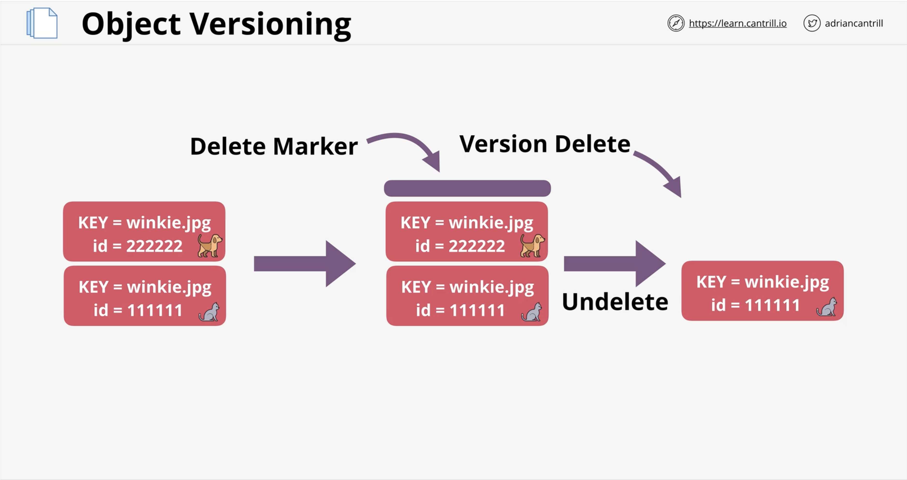
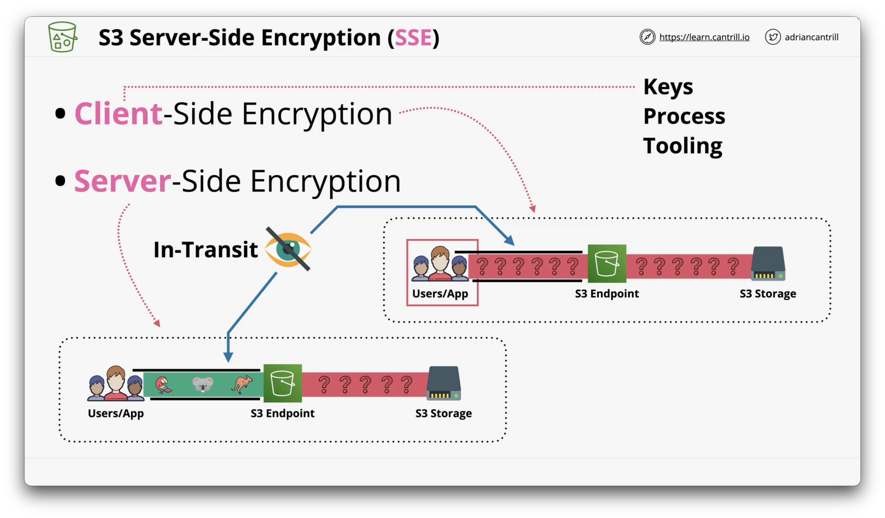
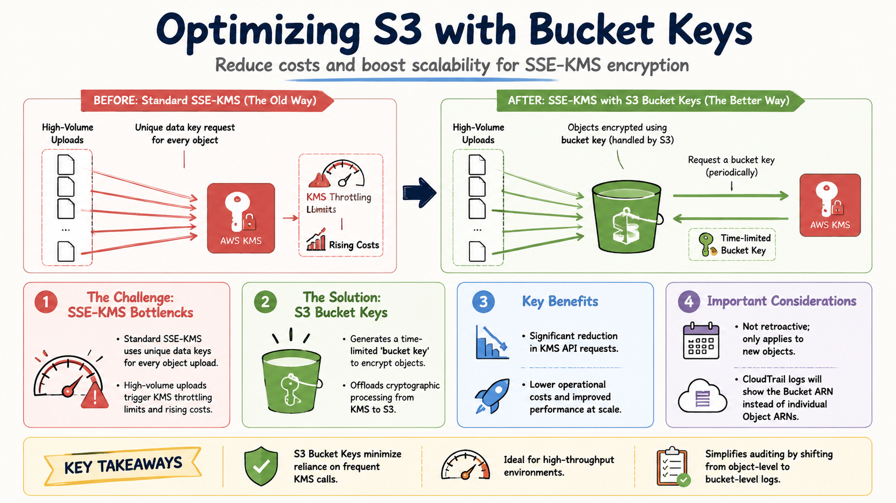
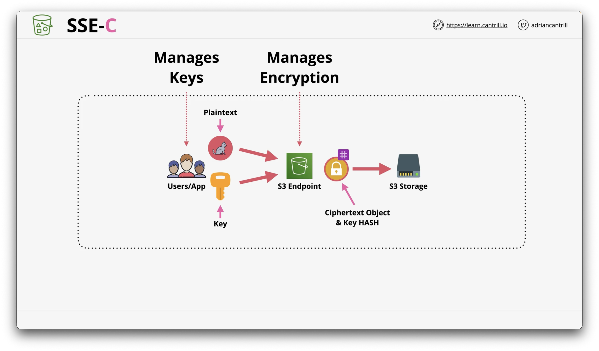
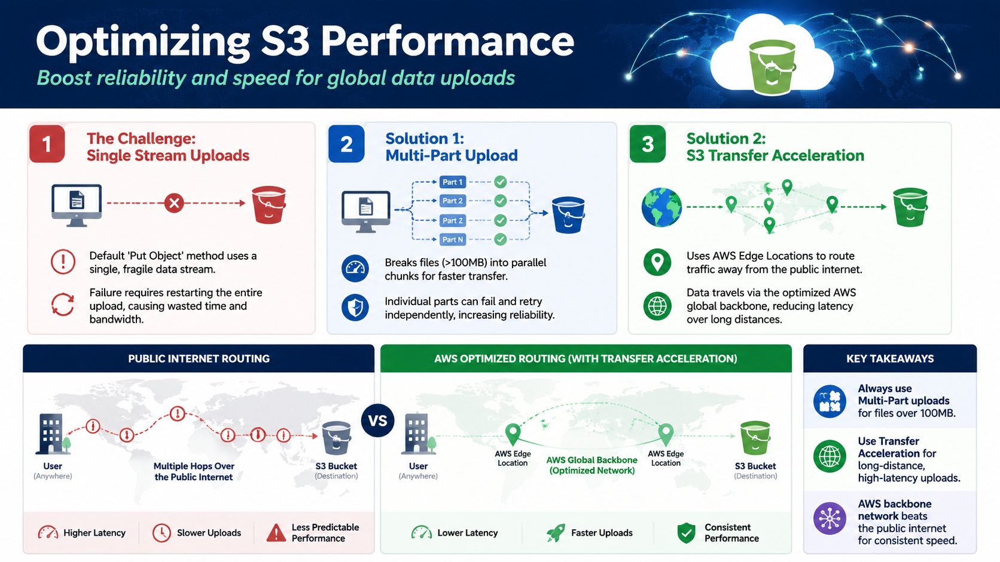

# S3 — Simple Storage Service

Amazon S3 is AWS's **object storage** service. Objects live in **buckets**; buckets are **regional** but have a **globally unique** name. This page covers four orthogonal concerns: **access control** (buckets start private; grants must be explicit), **data protection** ([Versioning and MFA Delete](#versioning-and-mfa-delete)), **encryption at rest** ([SSE and CSE](#object-encryption--sse-and-cse)), and **upload performance** ([Multipart Upload and Transfer Acceleration](#upload-performance)). For the conceptual frame on grant mechanisms, see [Resource Policies vs Identity Policies](../concepts/resource-vs-identity-policies.md).


## The "Private by Default" Baseline

Every new S3 bucket starts in a fully locked-down state:

- The **account root user** of the bucket's owning account has access. Nobody else does.
- Every other principal — IAM users/roles in the same account, identities in other accounts, anonymous requesters — must be **explicitly granted** access.

There are four mechanisms that can grant that access. The first three are the ones in active use today:

1. **[IAM identity policies](iam.md#iam-identity-policies)** — attach to a user/group/role; works only for identities in the bucket's own account.
2. **Bucket policies** — a [resource policy](../concepts/resource-vs-identity-policies.md) attached directly to the bucket.
3. **Block Public Access** — not a grant, but a hard *override* that blocks public exposure regardless of what the policies say.
4. **ACLs** — a legacy mechanism, kept for backward compatibility. AWS recommends not using them.

## Bucket Policies

A **bucket policy** is a [resource policy](../concepts/resource-vs-identity-policies.md) attached to one S3 bucket. Like every resource policy it must contain a `Principal` element on every statement — that's how the policy says *who* is being granted (or denied) what.

A bucket policy is the right tool when:

- Many identities need the same access to **one bucket** — one policy on the bucket beats N policies on N identities.
- The grant has to cross an **AWS account boundary** — bucket policies are how account B opts in to access from account A.
- The grant has to allow **anonymous / public** access — `Principal: "*"` is the only way to express "anyone", and [identity policies cannot do this](../concepts/resource-vs-identity-policies.md) because there is no identity to attach them to.
- The grant needs a **condition** beyond what IAM identity policies normally express — see [Advanced Conditions](#advanced-conditions).

### Anatomy

A minimal "public read" bucket policy:

```json
{
  "Version": "2012-10-17",
  "Statement": [
    {
      "Sid": "AllowPublicRead",
      "Effect": "Allow",
      "Principal": "*",
      "Action": "s3:GetObject",
      "Resource": "arn:aws:s3:::my-public-bucket/*"
    }
  ]
}
```

Important field-level details:

- **`Principal`** — must be present (the marker that distinguishes a resource policy from an identity policy). `"*"` means *any* principal including anonymous requesters.
- **`Resource`** — the bucket itself is `arn:aws:s3:::name`; objects inside are `arn:aws:s3:::name/*`. List operations target the bucket; object operations target the object ARN. Many policies need both.
- A bucket policy is a **single document** — multiple grants and denies are combined as additional statements rather than as multiple policies.

### Same-account vs Cross-account vs Anonymous

How a bucket policy combines with identity policies depends on where the requester lives:

| Requester | Identity policy needed? | Bucket policy needed? |
| --- | --- | --- |
| IAM user/role in **same account** | An **Allow in either** is sufficient | An **Allow in either** is sufficient |
| IAM user/role in **another AWS account** | Yes — their admin must grant the action | Yes — your bucket policy must name them |
| **Anonymous** (no AWS identity) | N/A — there is no identity | Yes — only the bucket policy can grant |

See [Resource Policies vs Identity Policies — How the two combine](../concepts/resource-vs-identity-policies.md#how-the-two-combine) for the underlying evaluation model. Cross-account is the only case where the policies form a genuine **intersection** (both sides must allow).

### Advanced Conditions

Bucket policies support **`Condition`** blocks, which gives them expressive power that ACLs do not have. Two common patterns:

#### Lock a bucket to a single source IP

```json
{
  "Version": "2012-10-17",
  "Id": "BlockUnLeet",
  "Statement": [
    {
      "Sid": "DenyAllExceptCorporateIP",
      "Effect": "Deny",
      "Principal": "*",
      "Action": "s3:*",
      "Resource": "arn:aws:s3:::secretcatproject/*",
      "Condition": {
        "NotIpAddress": { "aws:SourceIp": "1.3.3.7/32" }
      }
    }
  ]
}
```

A blanket `Deny` against everything *not* matching the corporate IP. Because [explicit Deny always wins](iam.md#policy-evaluation--priority), this overrides any Allow elsewhere.

#### Require MFA on a sensitive prefix

```json
{
  "Version": "2012-10-17",
  "Id": "protectboris",
  "Statement": [
    {
      "Sid": "DenyNonMFAOnBoris",
      "Effect": "Deny",
      "Principal": "*",
      "Action": "s3:*",
      "Resource": "arn:aws:s3:::secretcatproject/boris/*",
      "Condition": { "Null": { "aws:MultiFactorAuthAge": true } }
    },
    {
      "Sid": "AllowRestPublicRead",
      "Effect": "Allow",
      "Principal": "*",
      "Action": ["s3:GetObject"],
      "Resource": "arn:aws:s3:::secretcatproject/*"
    }
  ]
}
```

The `Null` condition with `aws:MultiFactorAuthAge: true` matches requests where the MFA context key is **absent** — i.e. the requester did *not* authenticate with MFA. Combined with `Deny`, this means "no MFA → no access to the `boris/` prefix", while the rest of the bucket stays public-readable.

> [!tip] Exam Tip
> Conditional access patterns (IP allow-list, MFA-required, VPC endpoint-only) are *bucket-policy-only* features. ACLs cannot express conditions, and identity policies cannot express anonymous principals — only bucket policies cover both axes.

## Access Control Lists (ACLs) — Legacy

ACLs predate IAM and bucket policies. They are sub-resources attached to a bucket or to an individual object, and they support exactly **five** permission types:

| Permission | Bucket | Object |
| --- | --- | --- |
| **READ** | List objects in the bucket | Read the object data and metadata |
| **WRITE** | Create, overwrite, and delete any object in the bucket | Not applicable |
| **READ_ACP** | Read the bucket's ACL | Read the object's ACL |
| **WRITE_ACP** | Modify the bucket's ACL | Modify the object's ACL |
| **FULL_CONTROL** | All of the above on the bucket | READ + READ_ACP + WRITE_ACP on the object |

ACL limitations vs bucket policies:

- No `Condition` support — cannot express IP / MFA / VPC-endpoint rules.
- Coarse — applied per-bucket or per-object, with no way to target groups of objects by prefix.
- No deny semantics — only grants.
- No cross-account-via-account-id model, no anonymous wildcard equivalent of `Principal: "*"`.

> [!warning] Gotcha
> AWS now defaults new buckets to **ACLs disabled** (Object Ownership = Bucket owner enforced). Once ACLs are disabled, the bucket owner owns every object and access is controlled entirely by [bucket policy](#bucket-policies) and [IAM](iam.md). Re-enabling ACLs is only correct for unusual legacy interop — pattern-match this as the *wrong* answer on the exam unless the question specifically describes a legacy ACL workflow.

When AWS recommends ACLs:

- *Almost never* on new designs. The official guidance is to use [bucket policies](#bucket-policies) or [IAM identity policies](iam.md#iam-identity-policies) instead.
- A few legacy edge cases remain — e.g. an uploader in account A writes an object that account B's bucket should own; canned ACLs like `bucket-owner-full-control` were the historical fix. Object Ownership settings have largely replaced even that use case.

## Block Public Access

**Block Public Access** is a separate setting (per-bucket *and* account-wide) that was introduced after a string of high-profile data leaks caused by misconfigured bucket policies. It is **not** a grant or a policy — it is a hard override that blocks public exposure regardless of any bucket policy, ACL, or future change.

> [!warning] Disabling Block Public Access ≠ making the bucket public
> The two switches are independent. Buckets are [private by default](#the-private-by-default-baseline) — disabling Block Public Access only *removes the failsafe*. The bucket stays private until a **bucket policy** (or ACL) explicitly grants `Principal: "*"`. Conversely, leaving Block Public Access on while attaching a public policy yields a 403 to anonymous requesters. Both pieces have to line up: a grant *and* the absence of an override.

Key behaviour:

- Applies **only to anonymous / public** access. Authenticated IAM principals (same-account and cross-account) are unaffected.
- Sits **above** bucket policies and ACLs in the evaluation chain. A bucket policy that says `Principal: "*"` is silently rendered inert if Block Public Access is on.
- Can be set at bucket creation or toggled later. New buckets get all four switches enabled by default.

The four independent switches:

| Switch | Blocks |
| --- | --- |
| `BlockPublicAcls` | New ACLs that grant public access |
| `IgnorePublicAcls` | Existing public ACLs are ignored at request time |
| `BlockPublicPolicy` | New bucket policies that grant public access |
| `RestrictPublicBuckets` | Existing public bucket policies are ignored at request time |

> [!tip] Exam Tip
> Block Public Access is a **failsafe**, not a grant mechanism. If a question describes a bucket "configured with a public-read policy" but "still returning 403 to anonymous requests", the answer is almost always Block Public Access blocking it at the account or bucket level. Disabling Block Public Access is a deliberate, audited action.

## Versioning and MFA Delete

The features above govern *who can reach the data*. Versioning and MFA Delete govern *whether the data survives mistakes* — accidental overwrites, accidental deletes, and rogue or compromised credentials. They are configured at the **bucket** level and apply to every object inside.

![[wiki/assets/s3-bucket-versioning-infographic.png]]

### Object Versioning

Without versioning, an object's identity is its **key** (e.g. `images/winkie.jpg`). A `PUT` to that key overwrites the previous bytes; a `DELETE` removes them. With versioning enabled each write generates a new **version ID** and old versions are kept side-by-side under the same key.


Read semantics:

- A `GetObject` without a version ID returns the **current** (latest) version.
- A `GetObject` with an explicit `versionId` returns that specific version. Older versions are first-class objects — they have full ARNs and can be read, copied, and lifecycled.

#### State machine — one-way door

Versioning has three states with one critical asymmetry:


| State | Allowed transition | Notes |
| --- | --- | --- |
| **Disabled** | → Enabled | The default on new buckets. Writes overwrite; no version IDs assigned. |
| **Enabled** | → Suspended (only) | Every write generates a new version. |
| **Suspended** | → Enabled (only) | New writes use a `null` version ID; **existing versions are retained**. |

> [!warning] Gotcha
> **Enabled is a one-way door.** Once versioning has been turned on, a bucket can only be **Suspended** — never returned to the original Disabled state. The only way back to a truly version-free bucket is to delete the bucket and recreate it.

#### Deletion behaviour — delete markers

With versioning on, `DELETE object` is not a destructive operation by default. S3 inserts a special zero-byte version called a **delete marker** on top of the version stack; subsequent `GetObject` calls without a `versionId` return `404`, making the object appear deleted.


Two distinct delete operations:

- **`DELETE object`** (no `versionId`) — adds a delete marker. Reversible: deleting the delete marker restores visibility of the previous current version. This is the **soft delete**.
- **`DELETE object?versionId=…`** — permanently removes that specific version. **Irreversible.** If the deleted version was the current one, the next-newest version becomes current. If it was the last remaining version, the object is gone.



In the S3 console, the **Show versions** toggle is required to see delete markers and per-version IDs — without it, soft-deleted objects look gone.

#### Storage cost implications

Every version is a billable object at its full size — there is no diff/dedup storage:

- 5 versions of a 5 GB object = **25 GB** charged at the bucket's storage class.
- **Suspending versioning does not free space.** Existing versions remain until explicitly deleted.
- The standard cost-control pattern is a [lifecycle policy](https://docs.aws.amazon.com/AmazonS3/latest/userguide/lifecycle-configuration-examples.html) that transitions or expires **noncurrent versions** after N days.

### MFA Delete

**MFA Delete** is an additional safety lock layered on top of versioning. It can only be enabled on a bucket that already has versioning enabled. Once active, two operations require **MFA**:

1. Changing the bucket's versioning state (Enabled ↔ Suspended).
2. Permanently deleting a specific object **version** (a `DELETE` with a `versionId`).

What MFA Delete does **not** gate: ordinary deletes (which create delete markers), normal reads and writes, and lifecycle-driven expirations are unaffected — the protection is targeted at the two operations that can destroy data irrecoverably.

API mechanics: requests that perform a gated operation must carry both the **MFA device serial number** and the **current one-time code**, supplied via the `x-amz-mfa` header (or the `--mfa` flag in the CLI). The request is signed by the **bucket owner's root credentials** — MFA Delete can only be enabled/disabled by the root user of the owning account, not by IAM users or roles. That root-only requirement is itself part of the protection: an attacker who compromises an IAM admin still cannot turn MFA Delete off.

> [!tip] Exam Tip
> If a scenario calls for "protect against accidental *and* malicious permanent deletion of S3 objects", the answer combines **versioning + MFA Delete**. Versioning alone protects against the *accidental* case (soft deletes, restore from history); MFA Delete adds the second factor that a compromised IAM credential cannot satisfy.

> [!warning] Gotcha
> MFA Delete cannot be enabled from the AWS Console — it requires the CLI/API and root credentials. And because only the root user can toggle it, automating it through normal IAM-based pipelines is not possible. This is by design but trips people up in practice.

## Object Encryption — SSE and CSE

The features above protect data from accidental deletion and unauthorised reads at the API layer. Encryption protects the bytes **on disk** — if someone bypassed S3 entirely and physically stole the storage media, encryption at rest is the layer that keeps the contents unreadable. Heavily integrated with [KMS](kms.md) and built on the same envelope-encryption pattern.

### Bucket vs object — the framing trap

Encryption is defined **at the object level**, not the bucket level. The "bucket default encryption" setting is a *separate feature* that just sets the default behaviour for newly-uploaded objects in that bucket — different objects in the same bucket can use entirely different encryption settings.

In practice this almost never matters: AWS made **server-side encryption mandatory** on S3 (since 2023, every PUT is encrypted before it lands on disk; there is no opt-out). The question is only **which** SSE method, not *whether* to encrypt.

### Encryption at rest vs in transit

Two layers that both happen, but solve different problems:

| Layer | Mechanism | What it protects against |
| --- | --- | --- |
| **In transit** | HTTPS tunnel between client and the S3 endpoint (automatic, always on) | Network eavesdroppers between you and AWS |
| **At rest** | SSE / CSE encrypts the stored bytes | An attacker with physical access to the storage media |

This section is about **at rest**. In transit is handled transparently by HTTPS and is not a configurable concern.

### Client-side vs server-side — the trust boundary



The fundamental split is **who does the encryption** — which determines **whether AWS ever sees plaintext**.

| Dimension | Client-Side Encryption (CSE) | Server-Side Encryption (SSE) |
| --- | --- | --- |
| Who encrypts? | You, before upload | S3, after receipt |
| What S3 sees inside the HTTPS tunnel | Ciphertext only | Plaintext (still inside HTTPS) |
| Who manages the keys? | You | Varies by SSE flavour |
| CPU cost of encryption | Your client | AWS |
| Trust model | Zero trust in AWS for plaintext | Some trust required |

Both still use HTTPS in transit — the question is whether the bytes *inside* that tunnel are already ciphertext (CSE) or still plaintext (SSE).

> [!warning] CSE is **not** the same as SSE-C
> SSE-C is still **server-side** encryption — S3 performs the crypto, you just provide the key per request. CSE means S3 never touches plaintext, ever. The names are confusingly close; the trust models are opposite.

### The three SSE methods

Every SSE method splits into two questions: **who manages the keys** and **who performs the encryption**. S3 always does the encryption in SSE; the methods differ in key management.

| Method | Full Name | Key management | Encryption |
| --- | --- | --- | --- |
| **SSE-S3** | Server-Side Encryption with **S3**-managed keys | S3 (invisible) | S3 |
| **SSE-KMS** | Server-Side Encryption with **KMS** keys | You + KMS | S3 (calls KMS) |
| **SSE-C** | Server-Side Encryption with **C**ustomer-provided keys | You (sent on every request) | S3 |

#### SSE-S3 — S3-managed keys (AES-256 default)


The lowest-overhead option. S3 handles **everything** — keys, rotation, algorithm — and surfaces nothing.

Flow under the hood (it's just envelope encryption, see [KMS DEKs](kms.md#data-encryption-keys-deks)):

1. You upload plaintext to S3.
2. S3 generates a unique **per-object DEK**.
3. S3 encrypts the object with that DEK using **AES-256**.
4. S3 encrypts the DEK with an internal, service-managed **S3 master key**.
5. The plaintext DEK is discarded; the ciphertext object + encrypted DEK are stored.

Three things you give up by picking SSE-S3:

1. ❌ **No key control** — you can't view, choose, or import the key.
2. ❌ **No rotation control** — rotation happens on S3's schedule, opaque to you.
3. ❌ **No role separation** — anyone with full S3 admin permissions can read the object data. There is no way to grant "manage the bucket" without also granting "read the objects".

> [!tip] Exam Tip
> *"AES-256"* in a question almost always points at **SSE-S3**. Other SSE flavours also use AES-256 under the hood, but the exam uses "AES-256" as shorthand for the S3-managed-keys option specifically.

#### SSE-KMS — KMS-managed keys


The default choice for any workload that needs **role separation, key-rotation control, or audited key usage**. Mechanically, SSE-KMS is just the [generic KMS envelope-encryption pattern](kms.md#data-encryption-keys-deks) applied per-object:

1. You create (or pick) a **Customer Managed KMS key** in the bucket's region.
2. On PUT, S3 calls `GenerateDataKey` against your KMS key.
3. KMS returns **two versions of the same DEK** — plaintext (for one-time use) and ciphertext (encrypted under the KMS key).
4. S3 uses the plaintext DEK to encrypt the object, then discards the plaintext.
5. Stored on disk: **ciphertext object + ciphertext DEK** (in object metadata).

This is necessary because [KMS keys can only directly encrypt ≤ 4 KB](kms.md#cryptographic-operations) — DEKs are how S3 gets around that limit, regardless of object size.

What SSE-KMS gives you that SSE-S3 cannot:

- ✅ **Key rotation control** — set the rotation policy on your KMS key.
- ✅ **Fine-grained access control** — the [KMS key policy](kms.md#key-policies) is independent of the bucket policy.
- ✅ **CloudTrail auditing** — every `Encrypt`/`Decrypt`/`GenerateDataKey` call is logged with the calling principal.
- ✅ **Role separation** — the killer feature; see below.

> [!tip] Role separation — the SSE-KMS killer feature
> Imagine **Phil**, an **S3 full administrator** — full control over the bucket, lifecycle, policies, the lot. Phil has **zero permissions on the KMS key**. Result: Phil can manage the bucket *but cannot read object contents*, because he can't decrypt the DEK without the KMS key. Impossible to achieve with SSE-S3. Essential in regulated industries (finance, healthcare) where infrastructure admins must not see customer data.

#### S3 Bucket Keys — SSE-KMS cost and throttling fix

Vanilla SSE-KMS has the same scaling problem on *both* the read and the write side: **every PUT and every GET calls KMS**. That hits two ceilings at scale:

1. **💰 KMS request cost.** KMS charges per API request. With billions of objects under heavy traffic, you can pay more for KMS requests than for S3 storage itself.
2. **🚦 KMS throughput throttling.** `GenerateDataKey` and `Decrypt` share a **per-region, per-account** request quota — historically **5,500 / 10,000 / 50,000 RPS** depending on the region tier, **shared across the region for a given KMS key**. Past the cap, KMS returns `ThrottlingException`. For a workload doing hundreds of thousands of PUTs/sec into SSE-KMS buckets, KMS — not S3 — becomes the throughput cap.

**S3 Bucket Keys** are an opt-in feature that addresses both problems simultaneously: AWS quotes up to **99% reduction in KMS requests** (and therefore both KMS cost *and* KMS throttle pressure), without changing the trust model or the client API.



> [!tip] Quick mental model
> **Without Bucket Keys:** KMS is on the critical path for every single object operation.
> **With Bucket Keys:** KMS is on the critical path only when the cached bucket-level key needs (re)fetching. Everything in between is handled inside S3.


##### The three-layer key hierarchy

Bucket Keys add **one extra wrapping layer** between the KMS CMK and the per-object DEK. (**CMK** = **Customer Master Key**, AWS's legacy name for what's now formally just called a [KMS key](kms.md#kms-keys) — the customer-managed key you create in [KMS](kms.md). Used as a shorthand throughout this section.) The mental model that the AWS docs gloss over is a three-tier chain of KEKs (Key Encryption Keys):

```text
KMS CMK              ← lives only inside KMS, never leaves
  │ encrypts         (KMS-side; this is the only step KMS ever sees)
  ▼
Bucket-level key     ← plaintext form cached briefly inside S3
  │ encrypts         (S3-side; pure local AES, no network)
  ▼
Per-object DEK       ← unique per object, random at upload time
  │ encrypts         (AES-GCM, local)
  ▼
Object ciphertext
```

Each arrow is encryption. Each decryption step needs the plaintext key one layer above it. Critically, **KMS only ever participates in the top arrow** — it never sees the per-object DEK and never knows the object exists.

> [!tip] Terminology — "wrap" and "ciphertext form"
> Throughout this section, **"wrap a key K under key K₁"** means **"encrypt the bytes of K using K₁, producing a ciphertext blob."** The **"ciphertext form of K"** (sometimes called the "wrapped form" in AWS docs) is exactly that blob — the bytes of K, encrypted under the next-higher key. Examples in concrete terms:
>
> - **Ciphertext form of a per-object DEK** = the per-object DEK's raw bytes, encrypted under the bucket-level key with AES. Stored in object metadata.
> - **Ciphertext form of a bucket-level key** = the bucket-level key's raw bytes, encrypted under your KMS CMK. Stored in S3-internal durable state. KMS `Decrypt` is what recovers the plaintext bucket-level key from this blob.
>
> "Unwrap" = the reverse: decrypt the ciphertext blob with the parent key to get the plaintext bytes back.

What S3 actually stores on disk:

| Artifact stored | Concretely, what it is | Stored where |
| --- | --- | --- |
| Object ciphertext | Object bytes encrypted under the per-object DEK (AES-GCM) | Object data |
| Ciphertext form of the per-object DEK + a bucket-level-key-ID | Per-object DEK bytes encrypted under *some specific* bucket-level key, plus an identifier saying *which* bucket-level key | Object metadata |
| Map of `bucket-level-key-ID → ciphertext form of that bucket-level key` | **One entry per bucket-level key ever used by this bucket.** Each ciphertext form is that bucket-level key's bytes encrypted under the KMS CMK | S3-internal durable state (AWS doesn't publish the exact location) |

> [!warning] Many bucket-level keys accumulate over time
> A single bucket does **not** have one bucket-level key — it has a sequence of them (`bk-001`, `bk-002`, …) that get rotated out as each one's "active-for-encryption" window ends. **Every** historical bucket-level key remains in the durable map for as long as objects it wrapped exist, because those objects' decryption depends on recovering its specific plaintext via KMS `Decrypt`. The "ciphertext form of the bucket-level key" phrasing used throughout this section is always *that-specific-one*, not the one. See [What "expires" actually means](#what-the-bucket-level-key-expires-actually-means) below.

##### Encrypt and decrypt walks — the one KMS call per cold cache

The cache works **symmetrically for both PUTs and GETs**. Cold-cache operations of either direction pay exactly one KMS request to warm the cache; subsequent operations of either direction during the same cache window pay nothing. Two parallel walks below; the warm-cache version of each is "cache hit, no KMS call, do the rest locally."

**Encryption walk — cold cache (cold PUT)**:

1. S3 doesn't have a usable plaintext bucket-level key in memory.
2. **→ Calls KMS `GenerateDataKey`** against your CMK. KMS returns **two artifacts** — (a) the **plaintext bucket-level key** (the raw key bytes, for immediate use), and (b) the **ciphertext bucket-level key** (those same bytes encrypted under your CMK, for durable storage). This is the standard envelope output documented at [KMS DEKs](kms.md#data-encryption-keys-deks). *This is the only KMS call.*
3. S3 caches the plaintext bucket-level key in memory (keyed by its bucket-level-key-ID) and **adds a new entry to the durable map** of bucket-level keys (`bucket-level-key-ID → ciphertext form`). The map already contains entries for every previously-used bucket-level key in this bucket; this is a new entry appended to it. Future GETs against objects encrypted by this specific bucket-level key can recover the plaintext via `Decrypt` on its ciphertext form.
4. S3 generates a random **per-object DEK** locally. (The bucket-level key is not yet involved — that comes in step 5.)
5. S3 encrypts the per-object DEK bytes under the bucket-level key with AES, producing the **ciphertext form of the per-object DEK**. Pure local AES inside S3 — no KMS call.
6. S3 encrypts the object bytes with the plaintext per-object DEK (AES-GCM).
7. S3 writes to disk: object ciphertext (the data) + ciphertext form of the per-object DEK + the **bucket-level-key-ID** that identifies which bucket-level key wrapped this DEK (the latter two stored in object metadata; the ID is the lookup key future GETs use to find the right entry in the durable map).


**Decryption walk — cold cache (cold GET)**:

1. S3 reads the object's metadata → finds the **ciphertext form of the per-object DEK** (per-object DEK bytes encrypted under *some specific* bucket-level key) and the **bucket-level-key-ID** identifying *which* bucket-level key wrapped it.
2. S3 looks up that bucket-level-key-ID in its durable map of bucket-level keys → finds the **ciphertext form of that specific bucket-level key** (bucket-level key bytes encrypted under the CMK). The map may contain many entries — one per historical bucket-level key for this bucket — and this lookup picks out the exact one that matches the object's ID.
3. **→ Calls KMS `Decrypt`** with that ciphertext blob as input, under your CMK. KMS returns the plaintext bucket-level key. *This is the only KMS call.*
4. S3 caches the plaintext bucket-level key in memory.
5. S3 decrypts the ciphertext form of the per-object DEK using the plaintext bucket-level key — pure local AES, no KMS. Now S3 has the plaintext per-object DEK.
6. S3 decrypts the object ciphertext with the plaintext per-object DEK (AES-GCM).

Once the cache is warm, any subsequent PUT or GET against an object that uses the same bucket-level key skips the KMS call entirely. A burst of 10,000 PUTs in the cache window costs **1** `GenerateDataKey` call instead of 10,000; the same holds for reads.

**Which KMS API gets called on a cold operation**:

The two verbs line up cleanly with the direction of the operation:

| Operation | KMS API | Why |
| --- | --- | --- |
| **Cold PUT** (encrypt) | `GenerateDataKey` | The PUT needs *new* key material to encrypt with — S3 mints a fresh bucket-level key (KMS returns plaintext + ciphertext forms; the ciphertext is persisted for future GETs) |
| **Cold GET** (decrypt) | `Decrypt` | The object was encrypted under some prior bucket-level key whose ciphertext form is already in S3's durable state — S3 passes that blob to KMS to recover the plaintext (KMS returns plaintext only) |

The intuition: `GenerateDataKey` is for creating new material (encrypt path); `Decrypt` is for recovering existing material (decrypt path). PUTs only ever call `GenerateDataKey`; GETs only ever call `Decrypt`.

The AWS docs use "fetched" loosely to cover both `GenerateDataKey` (fresh mint) and `Decrypt` (re-warm). From a CloudTrail and billing perspective they're equivalent — **one billable KMS request per cold cache miss per requester**.

> [!warning] The bucket-level key encrypts per-object DEKs; KMS does **not**
> A common confusion: people assume KMS decrypts (or generates) the per-object DEK. It doesn't. KMS only ever sees the bucket-level key — specifically, it produces or consumes the **ciphertext form of the bucket-level key** (bucket-level key bytes encrypted under the CMK). The per-object DEK is generated locally in S3, encrypted with the plaintext bucket-level key to produce its ciphertext form (stored in object metadata), and later decrypted with the plaintext bucket-level key — **all inside S3 with pure AES, no KMS call**. The CMK is the KEK for bucket-level keys; the bucket-level key is the KEK for per-object DEKs. This is what makes the savings symmetric across encrypt and decrypt — neither direction needs KMS for the per-object key.

> [!tip] Where the savings dominate
> **Encrypt-side wins**: high-volume log/metric/event ingestion (millions of small PUTs per hour), bulk data migrations (DataSync, S3 Transfer Family). **Decrypt-side wins**: CDN-origin asset buckets serving heavy read fanout, analytics scans (Athena, Spark/EMR, Glue) reading raw layers. Data-lake landing zones and feature stores typically benefit on both sides of every operation.

##### What "the bucket-level key expires" actually means

Over a bucket's history, **many bucket-level keys accumulate** — each persisted as its own entry in the durable `bucket-level-key-ID → ciphertext form` map. Each one has **two distinct phases of life**, and the word "expires" only ever refers to the transition between them:

| Phase | Duration | What's true during this phase |
| --- | --- | --- |
| **Active for encryption** | Limited time window after the bucket-level key was minted (AWS doesn't publish the exact window) | This is the *current* bucket-level key. New PUTs wrap their per-object DEK under it. There is exactly one active bucket-level key at a time per (bucket, requester scope). |
| **Retired but recoverable** | Effectively forever — until the CMK is deleted or the last object it wrapped is deleted | This bucket-level key no longer wraps new DEKs, but its ciphertext form remains in the durable map. Any GET against an object it wrapped will recover its plaintext via KMS `Decrypt`. |

When AWS docs say a bucket-level key "expires," they mean it **transitions from active to retired**. It is **still fully recoverable for decryption** — only `GenerateDataKey`-for-new-PUTs stops. The next cold PUT mints a fresh bucket-level key via `GenerateDataKey` and that new key becomes the active one; the old one keeps sitting in the durable map and is used on demand by GETs against old objects.

```text
Bucket lifetime: ────────────────────────────────────────────────►

  ┌─ bk-001 ──┐
  │  ACTIVE   │
  │  for enc  ├───── retired but recoverable for GET (forever) ─────►
  └───────────┘  ↑
                 │ any GET against an object wrapped by bk-001 pays
                 │ one KMS Decrypt if its plaintext isn't cached
                 ▼
                 ┌─ bk-002 ──┐
                 │  ACTIVE   │
                 │  for enc  ├───── retired but recoverable ─────────►
                 └───────────┘
                                ┌─ bk-003 ──┐
                                │  ACTIVE   │ ◄── current; wraps new
                                │  for enc  │     PUTs' DEKs
                                └───────────┘

S3's durable map grows monotonically over the bucket's lifetime:

   bk-001 ──► ciphertext form (recoverable forever)
   bk-002 ──► ciphertext form (recoverable forever)
   bk-003 ──► ciphertext form (recoverable forever; currently active)
   ⋯
```

**The cache (in-memory plaintext of bucket-level keys) is orthogonal to the active/retired phase.** Any bucket-level key — currently active or long retired — can be cached or not at any moment. A cold-cache GET against an object wrapped by *any* bucket-level key pays exactly one KMS `Decrypt` on that specific bucket-level key's ciphertext form to re-warm it; once warm, subsequent GETs against any other object wrapped by the same bucket-level key are free until eviction.

The **only** way to make any bucket-level key truly unrecoverable is to **delete the CMK itself** — at which point every entry in the durable map becomes unusable garbage (the standard KMS [crypto-shred](kms.md#rotation) property) and every object in the bucket is permanently undecryptable. This composes correctly with KMS key rotation: KMS retains all previous backing key material under the same logical Key ID, so a bucket-level key whose ciphertext form was produced under a rotation-old backing key still decrypts.

##### Trust model preservation

The bucket-level key is short-lived, never written to disk in plaintext, and S3 still fetches it from KMS **at least once per requester** so that access is captured in a CloudTrail `kms:Decrypt` / `kms:GenerateDataKey` event. AWS treats different IAM roles, different accounts, and even the same role with different scoping policies as different requesters — so a compromised principal can't read objects without leaving a KMS audit trail on the bucket-level key fetch.

The security property "only holders of `kms:Decrypt` on the CMK can read your data" is preserved end-to-end: no CMK access → no plaintext bucket-level key → no unwrapped per-object DEK → no object plaintext.

##### Behaviour changes to understand before enabling

| Aspect | Without Bucket Keys (default) | With Bucket Keys enabled |
| --- | --- | --- |
| KMS calls per object | One `GenerateDataKey` per PUT, one `Decrypt` per GET | Amortised — many objects per KMS call |
| Encryption context in KMS requests | **Object ARN** | **Bucket ARN** |
| CloudTrail KMS events | One per object operation | One per requester per bucket-key lifetime |
| Cost | Standard KMS request pricing | Up to ~99% lower KMS request bill |
| Trust / data confidentiality | Unchanged | Unchanged |

Enabling is a per-bucket setting (`PutBucketEncryption` with `BucketKeyEnabled: true`, or the matching console toggle, or the CloudFormation property of the same name on `AWS::S3::Bucket`). It can also be overridden per-request via the `x-amz-server-side-encryption-bucket-key-enabled` header on `PutObject`/`CopyObject`/`CreateMultipartUpload`.

In the S3 console it appears on the bucket's **Default encryption** panel as a simple "Bucket Key — Enabled / Disabled" line right under the encryption type and key ARN:


> [!warning] SSE-C is being blocked by default (rolling out Nov 2025)
> The same Default encryption panel shows a **Blocked encryption types** row that increasingly defaults to including SSE-C. AWS started deploying an update in November 2025 that blocks server-side encryption with customer-provided keys (SSE-C) by default for all new buckets and specific existing buckets. To keep using [SSE-C](#sse-c--customer-provided-keys), you have to explicitly un-block it under "Blocked encryption types". This is a separate axis from Bucket Keys — but it's the same console surface.

> [!warning] Gotcha — encryption context changes from object ARN to bucket ARN
> If any [IAM policy](iam.md) or [KMS key policy](kms.md#key-policies) uses a `kms:EncryptionContext:aws:s3:arn` condition to scope access to specific object ARNs, those conditions **stop matching** once Bucket Keys are on, because S3 starts passing the bucket ARN instead. Update the conditions to use bucket ARN **before** flipping the switch, or you'll lock yourself out of decrypts.

> [!warning] Gotcha — only new objects
> Enabling Bucket Keys on an existing bucket doesn't retroactively migrate any objects. Existing objects keep their original per-object encryption metadata and continue to incur per-object KMS calls on GET. To migrate, **re-write them** (`CopyObject` onto themselves with the same key) — this is the standard pattern.

> [!warning] Gotcha — replication ETags
> S3 Bucket Keys are compatible with both Same-Region and Cross-Region Replication. The subtle case: if the **source object is unencrypted** but the destination bucket has Bucket Keys + SSE-KMS as its default, the replica gets re-encrypted on arrival — and the replica's **`ETag` differs from the source's**. Any application logic that uses ETag for source/replica equality checks needs to handle this.

> [!warning] Gotcha — not supported on DSSE-KMS
> Bucket Keys are an **SSE-KMS** optimization only. They aren't available for DSSE-KMS (dual-layer SSE-KMS), and they're a no-op for SSE-S3, SSE-C, and CSE — those don't call KMS per object in the first place.

> [!tip] Exam Tip
> Pattern-match: *"SSE-KMS costs are very high on a bucket with millions of objects, how do you reduce them without weakening encryption?"* → **Enable S3 Bucket Keys**. Cost reduction is on **KMS request charges**, not storage or S3 request charges; trust model and SSE-KMS guarantees are unchanged.

#### SSE-C — customer-provided keys



The niche option: **you own the keys end-to-end**, but you let S3 do the crypto.

Upload flow:

1. You send **plaintext object + your encryption key** to S3 over HTTPS.
2. S3 encrypts the object with your key.
3. S3 stores the ciphertext **plus a one-way hash of your key** alongside it.
4. S3 **destroys the key** from memory — it is never persisted.

Download flow:

1. You re-supply the **same key** with the GET request.
2. S3 hashes it and compares against the stored hash — wrong key → 403.
3. If valid, S3 decrypts and returns plaintext over HTTPS, discarding the key again.

The one-way hash is the clever piece: it lets S3 **verify** a key without **storing** one. Lose your key and the data is unrecoverable — by design.

> [!warning] Gotcha
> SSE-C still requires AWS to handle plaintext in memory during the encrypt step. If your compliance posture says "AWS must never see plaintext, even transiently", **SSE-C is not enough — you need CSE**.

#### CSE — client-side encryption (for completeness)

CSE isn't really an S3 feature — S3 just stores whatever bytes you upload, including bytes you encrypted client-side. Typically implemented via the **AWS Encryption SDK** (which can call KMS to wrap your local DEK, mirroring the envelope pattern but with the boundary on your side). Use when zero-trust-in-AWS is a hard requirement. CSE and SSE can be **combined** — nothing stops the bytes from being encrypted on the way in (CSE) *and* re-encrypted at rest by S3 (SSE).

### Summary and decision guide


| Method | Key management | Encryption | Notable property |
| --- | --- | --- | --- |
| **CSE** | YOU | YOU | S3 never sees plaintext |
| **SSE-C** | YOU | S3 | You supply key per request; S3 stores only a hash |
| **SSE-S3** | S3 | S3 | AES-256; zero key control; **no role separation** |
| **SSE-KMS** | You + KMS | S3 | Key rotation control + **role separation** + CloudTrail audit |

Pick by the constraint that matters most:

- **CSE** — you cannot trust AWS with plaintext, ever. Accept the client-side CPU cost and key-management burden.
- **SSE-C** — *you* must own the keys (compliance) but want AWS to do the heavy crypto. Trust AWS to discard keys after each request.
- **SSE-S3** — sensible default if you don't need key control, rotation control, or role separation.
- **SSE-KMS** — standard for regulated workloads. Required if **anyone with S3 admin must not read the data**, or if you need rotation/audit.

> [!tip] Exam Tip
> Pattern-match: *"AES-256"* → **SSE-S3**. *"Role separation / S3 admin must not read the data"* → **SSE-KMS**. *"Audit key usage in CloudTrail / control rotation"* → **SSE-KMS**. *"Customer provides key on every request, S3 stores only a hash"* → **SSE-C**. *"AWS must never see plaintext"* → **CSE** (not really an S3 feature).

> [!warning] Gotcha
> "Buckets are encrypted" is **wrong**. Objects are encrypted; *bucket default encryption* is a per-bucket setting that determines what SSE flavour newly-uploaded objects get if the client doesn't specify one. Two objects in the same bucket can be under different SSE methods.

## Upload Performance

The features above govern access and durability. This section governs **throughput and reliability of the bytes-in transfer itself** — how a client gets a large object into S3 without wasting bandwidth or restarting from scratch on a flaky link. Two mechanisms cover it: **multipart upload** (a client-side strategy that splits a single object across many parallel HTTP requests) and **Transfer Acceleration** (a network-path optimization that routes the request through AWS edge infrastructure instead of the public internet).



### Single PUT vs Multipart Upload

A vanilla `PutObject` uploads the entire object in **one HTTP request as a single byte stream**. It is simple but has two fundamental weaknesses:

- **All-or-nothing failure.** If the connection drops at 4.5 GB of a 5 GB upload, the entire 4.5 GB is wasted — the client must restart from byte 0.
- **Bound by single-stream throughput.** A single TCP connection is rate-limited by per-flow congestion control and the slowest hop on the route. Even on a fat pipe, one stream often leaves capacity on the table; parallel streams can saturate it.

AWS caps a single `PutObject` at **5 GB**. For anything larger, multipart upload is mandatory; for anything reasonably large, it's also the better choice on reliability and throughput.

| Mechanism | Max object size | Reliability on failure | Throughput |
| --- | --- | --- | --- |
| **Single PUT** (`PutObject`) | 5 GB hard limit | Restart entire upload | One TCP stream |
| **Multipart upload** | ~5 TB (10,000 parts × 5 GiB) | Retry only the failed part | Parts upload in parallel |

#### Multipart upload API flow

Multipart upload is not a single API call — it is a **sequence** of four operations:

1. **`CreateMultipartUpload`** — initiates the upload; returns an `UploadId` that ties subsequent calls together.
2. **`UploadPart`** — called once per part (5 MiB–5 GiB per part, except the last which may be smaller; max **10,000 parts**), each referencing the `UploadId`. Each call returns an `ETag` for that part.
3. **`CompleteMultipartUpload`** — sent with the ordered list of `(partNumber, ETag)` pairs; S3 assembles the parts into the final object server-side.
4. **`AbortMultipartUpload`** — cancels and cleans up if something goes wrong.

Two helper APIs are common in practice: `ListParts` (which parts of an upload have been received) and `ListMultipartUploads` (in-progress uploads on a bucket — useful for finding orphans).

> [!warning] Gotcha
> **Incomplete multipart uploads keep accruing storage charges** until they are either completed or aborted — even though the partial object is invisible to normal reads. The standard remedy is a lifecycle rule with `AbortIncompleteMultipartUpload` that auto-cleans after N days. On any bucket that sees programmatic uploads, this should be considered table stakes.

#### When multipart kicks in

The 5 GB cap is the **hard** boundary. The **practical** threshold is much lower:

- AWS guidance: use multipart for objects **≥ 100 MB**, because that's where the parallelism and per-part-retry benefits start clearly outweighing the small protocol overhead.
- The high-level transfer clients in the AWS SDKs (boto3's `upload_file`, the Java v2 transfer manager, etc.) and the AWS CLI (`aws s3 cp`) handle the choice automatically — they pick single PUT vs multipart based on file size, parallelise part uploads, and retry failed parts transparently. The default threshold in the CLI is around 8 MB, well below the 100 MB recommendation.
- You typically only call the low-level multipart APIs directly when you need fine-grained control — resumable uploads across processes, custom parallelism, or server-side composition of independently-produced parts.

### S3 Transfer Acceleration

Multipart upload optimizes how the bytes are *packaged*. Transfer Acceleration (TA) optimizes the **network path** they travel over. It addresses a different root cause: when the client and the bucket region are far apart, the public internet path between them goes through unpredictable, often suboptimal routes, and end-to-end throughput suffers.

How TA works:

- The client uploads to a **CloudFront edge location** near them (using the special endpoint `<bucket>.s3-accelerate.amazonaws.com`) instead of directly to the bucket's regional endpoint.
- From the edge, the bytes traverse the **AWS global backbone** — a private high-speed network with optimized, AWS-controlled routes — the rest of the way to the bucket's home region.

The trick is that the slow, lossy, congested segment of the trip — the public-internet long-haul — is replaced by a short hop to the nearest edge plus a long hop over AWS's own optimized network.

| Property | Public internet path | TA via AWS backbone |
| --- | --- | --- |
| Routing | Multi-hop, decided by ISPs | Direct, AWS-controlled |
| Performance | Variable, often poor over long distances | Consistent, high throughput |
| Design goal | Flexibility & resilience | Speed & reliability |
| Loss/jitter | Worst on long international links | Engineered for predictability |

Benefits scale with distance and with how degraded the baseline internet path is — a client uploading from Sydney to a London bucket sees a much bigger speedup than one uploading within the same continent. TA is **bidirectional** — it accelerates downloads as well as uploads — though uploads from far-flung clients are the canonical use case.

#### Requirements and trade-offs

- **Bucket-level opt-in**, disabled by default. Enable per-bucket; the regional endpoint still works after enabling.
- **Bucket name must be DNS-compatible and contain no periods** — TA uses the virtual-hosted–style endpoint, which can't validly include a `.` in the bucket name without breaking TLS hostname matching.
- **Extra cost per GB transferred** on top of normal S3 request and transfer charges. AWS provides a [Transfer Acceleration Speed Comparison tool](https://s3-accelerate-speedtest.s3-accelerate.amazonaws.com/en/accelerate-speed-comparsion.html) to measure whether your specific client→region pair actually benefits before enabling it.

#### TA vs multipart — orthogonal, often combined

The two features answer different questions and **compose**:

- **Multipart** answers "how do I move a large object reliably and use all my client bandwidth?" — it's client-side, free, and applies to any upload above the threshold.
- **Transfer Acceleration** answers "how do I avoid the public-internet long-haul?" — it's a bucket setting, costs extra, and pays off when client and bucket are geographically far apart.

A globally distributed team uploading large datasets to a centralised bucket typically wants **both** — multipart to parallelize each upload and survive part failures, plus TA to shrink the long-haul distance.

> [!tip] Exam Tip
> Pattern-match: *"large file, unreliable connection"* → **multipart upload**. *"globally distributed users, central bucket, slow uploads"* → **Transfer Acceleration**. *"object > 5 GB"* → **multipart is required** (not a choice). *"need to upload from on-prem datacenter to S3 in another region, lots of data"* → multipart + TA (or, for genuinely huge bulk transfers, AWS DataSync / Snowball — out of scope here).

## Choosing the Right Mechanism

| Situation | Best tool |
| --- | --- |
| One identity, many buckets in the same account | [IAM identity policy](iam.md#iam-identity-policies) |
| Many identities, one bucket | [Bucket policy](#bucket-policies) |
| Cross-account access | [Bucket policy](#bucket-policies) on the resource side + identity policy on the consumer side |
| Anonymous / public-read | [Bucket policy](#bucket-policies) + Block Public Access disabled (deliberately) |
| Conditional access (IP / MFA / VPC endpoint) | [Bucket policy](#bucket-policies) with `Condition` |
| Legacy interop with pre-IAM ACL workflows | [ACL](#access-control-lists-acls--legacy) — last resort |
| Defence-in-depth against accidental public exposure | [Block Public Access](#block-public-access) — always on unless you have a reason |

> [!tip] Exam Tip
> Pattern-match: *"grant access to another AWS account"* → bucket policy. *"website hosts public images"* → bucket policy with `Principal: "*"` + Block Public Access switches off. *"deny access unless from corporate IP"* → bucket policy with `Condition` + explicit Deny. *"protect a sensitive prefix with MFA"* → bucket policy with `Null/aws:MultiFactorAuthAge` Deny. *"users in many accounts upload to a central bucket but the bucket owner keeps owning the objects"* → enable Object Ownership = Bucket owner enforced (ACLs disabled).

## References

- [Resource Policies vs Identity Policies](../concepts/resource-vs-identity-policies.md)
- [IAM](iam.md)
- [Identity and Access Concepts](../concepts/identity-and-access.md)
- [AWS S3 Documentation — Access management](https://docs.aws.amazon.com/AmazonS3/latest/userguide/s3-access-control.html)
- [AWS S3 — Block Public Access](https://docs.aws.amazon.com/AmazonS3/latest/userguide/access-control-block-public-access.html)
- [AWS S3 — Using versioning in S3 buckets](https://docs.aws.amazon.com/AmazonS3/latest/userguide/Versioning.html)
- [AWS S3 — Configuring MFA delete](https://docs.aws.amazon.com/AmazonS3/latest/userguide/MultiFactorAuthenticationDelete.html)
- [AWS S3 — Uploading and copying objects using multipart upload](https://docs.aws.amazon.com/AmazonS3/latest/userguide/mpuoverview.html)
- [AWS S3 — Transfer Acceleration](https://docs.aws.amazon.com/AmazonS3/latest/userguide/transfer-acceleration.html)
- [Transfer Acceleration Speed Comparison Tool](https://s3-accelerate-speedtest.s3-accelerate.amazonaws.com/en/accelerate-speed-comparsion.html)
- [AWS S3 — Protecting data with server-side encryption](https://docs.aws.amazon.com/AmazonS3/latest/userguide/serv-side-encryption.html)
- [AWS S3 — Reducing the cost of SSE-KMS with Amazon S3 Bucket Keys](https://docs.aws.amazon.com/AmazonS3/latest/userguide/bucket-key.html)
- [KMS](kms.md) — the underlying key-management service used by SSE-KMS
- Sources: `raw/aws-cert-study-notes/aws-solution-architect/s3_resource_policies_and_acl.md`, `raw/aws-cert-study-notes/aws-solution-architect/s3_bucket_versioning.md`, `raw/aws-cert-study-notes/aws-solution-architect/s3_transfer_acceleration.md`, `raw/aws-cert-study-notes/aws-solution-architect/s3_sse.md`, `raw/web-clippings/Reducing the cost of SSE-KMS with Amazon S3 Bucket Keys - Amazon Simple Storage Service.md`
