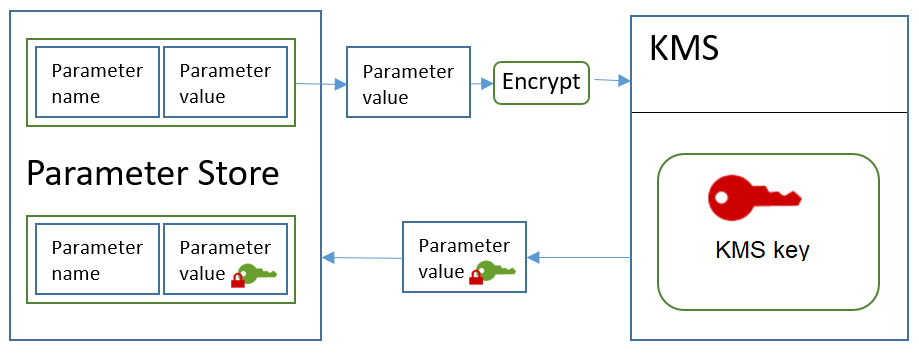

# Systems Manager (SSM)

**AWS Systems Manager (SSM)** is a suite of operations-management capabilities for AWS and on-premises resources: **Parameter Store** (config/secrets storage), **Session Manager** (browser/CLI shell without SSH), **Run Command** (remote command execution), **Patch Manager**, **State Manager**, **Automation**, **Fleet Manager**, **Inventory**, and more. Most run through the **SSM Agent** preinstalled on current AWS AMIs.

[AWS Config](config.md#native-remediation-with-ssm-automation) uses **Automation** documents for its native remediation of non-compliant resources.

This page currently documents **Parameter Store** in depth; other SSM capabilities will be added as sibling sections as they are ingested.

## Parameter Store

**Parameter Store** is a managed store for configuration data and secrets — strings, lists, and encrypted values — delivered to applications, [EC2](ec2.md) instances, and Lambda functions in a resilient, [IAM](iam.md)-controlled, and scalable way.

Its headline reason to exist: it is the correct alternative to baking secrets into [EC2 user data](ec2.md#bootstrapping). User data is readable by anyone who can reach the instance metadata or the launch configuration, so it is not a secret store. Parameter Store replaces that anti-pattern with authenticated, auditable, optionally-encrypted retrieval.

A parameter is just a **name** plus a **value**, where the value holds the actual configuration data.

### What You Can Store

Three parameter **types**:

| Type             | Description                                       |
| ---------------- | ------------------------------------------------- |
| **String**       | A single plain-text value                         |
| **StringList**   | A comma-separated list of values                  |
| **SecureString** | An encrypted value, integrated with [KMS](kms.md) |

Typical uses: license codes, database connection strings (hostnames, ports), DB usernames, full application configs, and passwords.

> [!tip] Exam Tip
> If a question asks where to store **configuration and secrets** for EC2 / Lambda / applications in a way that integrates natively with AWS services and IAM, the answer is **Parameter Store** (or [Secrets Manager](#parameter-store-vs-secrets-manager) when rotation is required).

### Key Capabilities

- **Hierarchical storage** — parameters organize into a tree of paths (see [Hierarchical Structure](#hierarchical-structure)).
- **Versioning** — keeps prior versions of a parameter, conceptually like [S3 object versioning](s3.md).
- **Plaintext or ciphertext** — plaintext suits non-sensitive values (a connection string, a DB username); SecureString integrates with [KMS](kms.md) for sensitive values such as passwords.
- **Public parameters** — read-only parameters published and maintained by AWS.
- **Change events** — a parameter change can emit an event that drives processes in other AWS services (via EventBridge).

#### Public parameters (AWS-published)

The classic example: when [CloudFormation](cloudformation.md) launches EC2 instances, you don't hard-code an AMI ID. You reference an AWS-published public parameter that resolves to the **latest AMI ID** for a given OS in a given Region, so the template always picks up the current image. The exact path is AWS-maintained per OS and Region; it follows a path-style name and is not worth memorizing.

### Hierarchical Structure

Parameters can be flat or organized into a tree, which makes both naming and permissions flexible:

```text
/wordpress/dbuser
/wordpress/dbpassword
/my-cat-app/...
/dev/...
```

- A simple parameter might just be `mydbpassword` (e.g. an encrypted DB password).
- Under a branch like `/wordpress/` you might keep `dbuser` and `dbpassword`.
- Items can be retrieved **individually** by full name (`/wordpress/dbpassword`) **or** as a group by requesting a whole branch (the entire `/wordpress` tree).
- Branches can be organized by **application** (`/my-cat-app/`) or by **organizational division** (a `/dev/` branch for the dev team's secrets).

> [!tip] Exam Tip
> IAM permissions can be applied to an **individual parameter** or to a **whole tree**. This per-parameter vs per-tree granularity is a key exam point and the main reason to design a sensible hierarchy up front.

#### Retrieving parameters from the CLI

The two retrieval modes — by name vs by branch — map onto two API operations:

```bash
# Get a single parameter (or several explicitly named ones) by full name
aws ssm get-parameters --names /my-cat-app/dbstring

# Get every parameter under a branch of the tree in one call
aws ssm get-parameters-by-path --path /my-cat-app/

# Same, but decrypt any SecureString values in the result
aws ssm get-parameters-by-path --path /my-cat-app/ --with-decryption
```

- `get-parameters --names` fetches one or more parameters by **full name**.
- `get-parameters-by-path --path` fetches a **whole branch** of the hierarchy at once — the practical payoff of a good tree design.
- `--with-decryption` is required to return the **plaintext** of SecureString values; this is the call that triggers the KMS `Decrypt` operation, so the caller additionally needs `kms:Decrypt`.

### Architecture

Parameter Store is a **public AWS service**, so any consumer must be an AWS service or otherwise reach the AWS public endpoints. Consumers include **applications**, **EC2 instances** (and the software on them), and **Lambda functions**.

Because it is an AWS service, it is **tightly integrated with [IAM](iam.md)**:

- Every access is **authenticated and authorized**.
- Credentials can be **long-term** (access keys) or, preferably, delivered via an [EC2 instance role](ec2.md#instance-roles--instance-profiles) / IAM role.
- If a parameter is encrypted, **[KMS](kms.md)** is involved and the caller also needs the appropriate permissions on the **KMS key**.

> [!warning] Gotcha
> A SecureString adds a **second permission layer**: a caller needs both the SSM/Parameter Store permissions **and** KMS permissions on the relevant key. That extra layer is the security benefit — and a common trap. It also enables **role separation**: someone with `ssm:GetParameter` but no `kms:Decrypt` can list the parameter but never read the secret.

#### Regional service

Systems Manager — and Parameter Store within it — is a **regional service**. Parameters live in the Region where they are created, and the limits (10,000 standard / 100,000 advanced) are **per account, per Region**. For a full cross-service comparison see [Resource Scope](../concepts/resource-scope.md).

- **Resilient within a Region** — hosted across **multiple Availability Zones** in one Region, so it survives an AZ failure.
- **Isolated across Regions** — there is **no built-in cross-Region replication**. The same name can exist in different Regions, but only once per Region. To make a parameter available in multiple Regions you create it in each Region separately (one `put-parameter` per Region) or build your own replication.

> [!tip] Exam Tip
> Mental model: **highly available within one Region, isolated across Regions.** Don't assume a parameter created in one Region is reachable from another — same default as [KMS keys](kms.md) and [EBS snapshots](ebs.md).

### SecureString Encryption with KMS

Parameter Store performs **no cryptographic operations itself**. It relies on [KMS](kms.md) to encrypt and decrypt SecureString values. You can use the **AWS managed key** (alias `aws/ssm`) that Systems Manager creates automatically, or a **customer managed key** for fine-grained control.

> [!warning] Gotcha
> Parameter Store supports **only symmetric KMS keys**. Asymmetric KMS keys cannot encrypt parameters.

There are **two tiers** of SecureString, and they encrypt differently.

#### Standard SecureString — direct encryption

A standard parameter (max **4 KB**) is encrypted **directly** under the chosen KMS key. Parameter Store calls KMS `Encrypt` with the plaintext value; KMS returns the ciphertext, which is stored against the parameter name. On retrieval with `WithDecryption`, Parameter Store calls KMS `Decrypt` to return the plaintext. This is the same **4 KB direct-encrypt ceiling** described on the [KMS page](kms.md#direct-encrypt--decrypt--4-kb).



#### Advanced SecureString — envelope encryption

An advanced parameter (max **8 KB**) uses **[envelope encryption](kms.md#data-encryption-keys-deks)** via the **AWS Encryption SDK**. Each value is encrypted under a **unique data key**, and that data key is itself encrypted under the KMS key. The result — an **encrypted message** bundling the encrypted value together with the encrypted data key — is stored as the parameter value. This is the same DEK pattern that lets [S3 SSE-KMS](s3.md#object-encryption--sse-and-cse) and [EBS](ebs.md#ebs-encryption) encrypt payloads larger than 4 KB.


> [!warning] Gotcha
> You can **upgrade** a standard parameter to advanced, but you **cannot downgrade** an advanced parameter back to standard — doing so would truncate 8 KB to 4 KB and drop any attached parameter policies. To stop paying for an advanced parameter, delete it and recreate it as standard.

#### IAM / KMS permissions for SecureString

| Action                               | Required KMS permission |
| ------------------------------------ | ----------------------- |
| Encrypt a **standard** SecureString  | `kms:Encrypt`           |
| Encrypt an **advanced** SecureString | `kms:GenerateDataKey`   |
| Decrypt **either** tier              | `kms:Decrypt`           |

The split mirrors the crypto: standard does a direct encrypt, advanced generates a data key. You **cannot** set access-control policies on the default `aws/ssm` managed key — fine-grained encrypt/decrypt control requires a **customer managed key**.

#### Encryption context

KMS operations use an **encryption context** of `PARAMETER_ARN` set to the ARN of the parameter being encrypted. It is cryptographically bound to the data, appears in plaintext in [CloudTrail](cloudtrail.md) logs, and can be referenced in IAM policy `Condition` blocks to scope decrypt permission to a specific parameter — the same `kms:EncryptionContext` mechanism S3 uses for [per-object scoping](s3.md#s3-bucket-keys-for-sse-kms-cost-and-throttling).

### Standard vs. Advanced Tier

Tiers are configured **per parameter** (standard is the default) and affect cost, scale, and capabilities:

|                               | **Standard**             | **Advanced**                             |
| ----------------------------- | ------------------------ | ---------------------------------------- |
| Parameters per account/Region | 10,000                   | 100,000                                  |
| Max value size                | 4 KB                     | 8 KB                                     |
| Parameter policies            | No                       | Yes                                      |
| Encryption method             | Direct KMS encrypt       | Envelope encryption (AWS Encryption SDK) |
| **Cost**                      | **No additional charge** | **Charged per parameter + per API call** |

**Pricing** (confirm current numbers on the AWS pricing page before quoting):

- **Standard** — the first 10,000 parameters and standard-throughput API calls for standard parameters are free.
- **Advanced** — roughly **$0.05 per advanced parameter per month**, plus a per-API-interaction charge. Advanced parameters always incur a charge.

> [!warning] Gotcha
> Standard parameters are free but capped at 10,000 per Region and 4 KB per value. Reach for **advanced** only when you need the higher limits, 8 KB values, or **parameter policies** — and remember it is billable and **one-way** (no downgrade).

### Parameter Store vs Secrets Manager

Both store secrets and both encrypt with [KMS](kms.md), so exam questions pit them against each other. The deciding factor is **automatic rotation**:

| Capability                                 | Parameter Store     | Secrets Manager           |
| ------------------------------------------ | ------------------- | ------------------------- |
| Store strings / secrets                    | Yes                 | Yes                       |
| KMS encryption                             | SecureString        | Always                    |
| Built-in **automatic rotation**            | No                  | **Yes** (Lambda-driven)   |
| Native RDS/Redshift/DocumentDB integration | No                  | **Yes**                   |
| Cross-Region replication                   | No (build your own) | **Yes**                   |
| Cost                                       | Standard tier free  | Per secret + per API call |

> [!tip] Exam Tip
> *"Store a DB password and rotate it automatically every 30 days"* points to **Secrets Manager**. *"Store config / secrets cheaply with native CloudFormation and CLI integration, no rotation needed"* points to **Parameter Store** (standard tier). Note Secrets Manager can be referenced **through** Parameter Store using the `/aws/reference/secretsmanager/` prefix, so an app coded against the Parameter Store API can read a Secrets Manager secret.

## Quick Reference

- **Purpose** — centrally store strings, lists, and secrets; the correct alternative to baking secrets into [EC2 user data](ec2.md#bootstrapping).
- **Types** — String, StringList, SecureString (SecureString = KMS-encrypted).
- **Public service** — consumers need AWS public-endpoint access; integrates natively with services like [CloudFormation](cloudformation.md) and is reachable via the CLI on EC2.
- **Regional** — parameters and the 10K/100K limits are per account, per Region; multi-AZ within a Region but **no cross-Region replication**.
- **IAM-integrated** — authenticated/authorized via access keys or IAM roles; encrypted parameters additionally require **KMS permissions on the key** (enables role separation).
- **Hierarchies** — tree-structured names; retrieve individually (`get-parameters`) or by branch (`get-parameters-by-path`); set permissions per-parameter or per-tree.
- **Versioning** — built in, S3-style.
- **Public parameters** — AWS-published (classic: latest AMI ID per OS/Region, used by CloudFormation).
- **SecureString tiers** — standard (4 KB, direct KMS encrypt, free) vs advanced (8 KB, envelope encryption + parameter policies, billable, no downgrade).
- **Permissions cheat** — standard encrypt `kms:Encrypt`; advanced encrypt `kms:GenerateDataKey`; decrypt (both) `kms:Decrypt`.
- **vs Secrets Manager** — choose Secrets Manager when you need **automatic rotation** or native DB integration; choose Parameter Store for cheap config/secret storage without rotation.

## References

- [KMS](kms.md) — encryption root of trust; direct-encrypt 4 KB ceiling and the DEK / envelope-encryption pattern the advanced tier relies on
- [EC2](ec2.md) — the user-data anti-pattern Parameter Store replaces; instance roles deliver the credentials to read parameters
- [IAM](iam.md) — authenticates and authorizes every parameter access
- [CloudFormation](cloudformation.md) — heaviest native integration; consumes public parameters (latest AMI ID)
- [Resource Scope](../concepts/resource-scope.md) — why Parameter Store is regional and isolated across Regions
- [AWS SAA Exam Notes — SSM Parameter Store](../certifications/aws-saa.md#ssm-parameter-store)
- Source: `raw/aws-cert-study-notes/aws-solution-architect/ssm_parameter_store.md`
- [AWS KMS encryption for Parameter Store SecureString parameters](https://docs.aws.amazon.com/systems-manager/latest/userguide/secure-string-parameter-kms-encryption.html)
- [Managing parameter tiers](https://docs.aws.amazon.com/systems-manager/latest/userguide/parameter-store-advanced-parameters.html)
- [Systems Manager Pricing](https://aws.amazon.com/systems-manager/pricing/)
