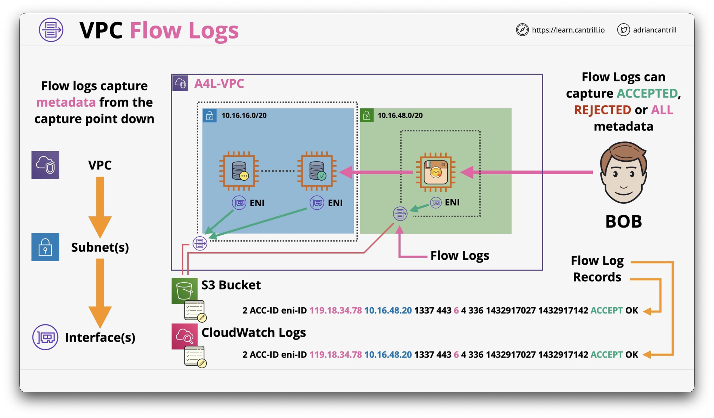
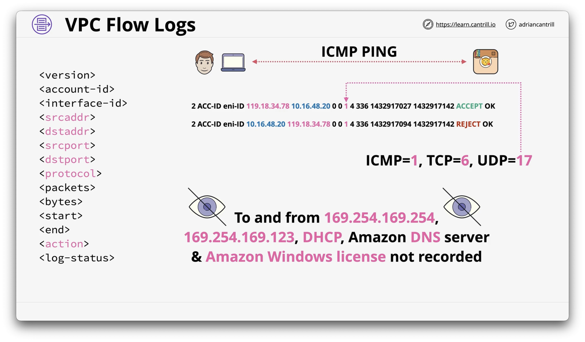

# VPC Flow Logs

VPC Flow Logs is a [VPC](vpc.md) feature for recording **IP traffic metadata** at [network interfaces (ENIs)](../concepts/networking.md#elastic-network-interfaces-enis): addresses, ports, protocol, volume, and acceptance or rejection. It helps investigate connectivity and traffic patterns; it does not capture packet payloads. Collection happens outside the traffic path and does not affect network throughput or latency. [AWS overview](https://docs.aws.amazon.com/vpc/latest/userguide/flow-logs.html)

Use packet capture or VPC Traffic Mirroring when the question requires packet contents. Use [CloudTrail](cloudtrail.md) for AWS API/account activity. Flow logs describe network traffic, not what an application did with a request.

## Capture Scope and Filters

Choose the scope and traffic filter when creating the flow log:

| Scope | Interfaces monitored |
| --- | --- |
| VPC | ENIs across the VPC's subnets |
| Subnet | ENIs in that subnet |
| ENI | One interface |

The filter selects **ACCEPT**, **REJECT**, or **ALL** traffic. Wider scopes also cover newly created interfaces as they begin carrying traffic. These are coverage boundaries, not guarantees that every packet is recorded; exclusions still apply. [AWS basics](https://docs.aws.amazon.com/vpc/latest/userguide/flow-logs-basics.html)

In the source diagram, the blue subnet's log covers both database ENIs, while the green subnet's log covers just the application ENI. The footer illustrates delivery options and a text record, not packet contents.



## Destinations and Analysis

The slide shows two destinations; current AWS also supports **Amazon Data Firehose**. [AWS destination overview](https://docs.aws.amazon.com/vpc/latest/userguide/flow-logs.html)

| Destination | Useful when |
| --- | --- |
| [CloudWatch Logs](cloudwatch.md#cloudwatch-logs) | Operators want log searches, metric filters, and alarms |
| [S3](s3.md) | Logs need durable storage and SQL analysis with [Athena](athena.md) |
| [Amazon Data Firehose](kinesis.md#kinesis-data-firehose-now-amazon-data-firehose) | Logs need delivery into a supported analytics or third-party destination |

For Athena, publish to S3 and define a table matching the files' format and fields. The VPC console can generate a CloudFormation template for the Athena resources and example queries; alternatively, create the table directly. A custom text field order must match the table schema. [AWS Athena guide](https://docs.aws.amazon.com/athena/latest/ug/vpc-flow-logs.html)

Firehose is a direct destination; CloudWatch Logs need not sit between it and VPC Flow Logs. Its downstream buffering does not remove the upstream flow-log delay. [AWS Firehose delivery](https://docs.aws.amazon.com/vpc/latest/userguide/flow-logs-firehose.html)

[GuardDuty](guardduty.md) also analyzes flow log data for threat detection, but it reads its own independent stream. You do not need to create a flow log for GuardDuty, and GuardDuty does not keep the logs for you. [AWS GuardDuty data sources](https://docs.aws.amazon.com/guardduty/latest/ug/guardduty_data-sources.html)

## Timing and Record Format

Flow logs are **delayed telemetry**. Maximum aggregation is normally **10 minutes**, optionally **1 minute**; Nitro instance interfaces aggregate in at most one minute. Publishing then typically takes about **5 minutes to CloudWatch Logs** or **10 minutes to S3**, with no guaranteed delivery deadline. [AWS records guide](https://docs.aws.amazon.com/vpc/latest/userguide/flow-log-records.html)

The source note's default version-2 text format has 14 fields:

```text
version account-id interface-id srcaddr dstaddr srcport dstport protocol packets bytes start end action log-status
```

Read these in groups: **ownership/interface**, **addresses/ports/protocol**, **packet and byte counts**, **time window**, then **action and logging status**. Protocol numbers in the note are ICMP = `1`, TCP = `6`, and UDP = `17`.

Custom formats can add fields such as `vpc-id`, `subnet-id`, `instance-id`, `tcp-flags`, and packet-level `pkt-srcaddr`/`pkt-dstaddr`. For ordinary ENI incoming IPv4 traffic, `dstaddr` represents a private interface address, even when the client connects through a public address. IPv6 and regional NAT records have different address semantics; avoid the rule “always private IPv4.” [AWS field definitions](https://docs.aws.amazon.com/vpc/latest/userguide/flow-log-records.html)

## Reading Request and Response Records

The second slide shows an ICMP request accepted on the application's interface and a rejected reply with the addresses reversed. Its `0 0` port fields reflect the ICMP example, which has no TCP/UDP ports.



[Security groups](vpc.md#security-groups-sg) permit responses to allowed traffic through connection tracking; [NACLs](vpc.md#network-acl-nacl) evaluate each direction separately. In the illustrated scenario, inbound ICMP is allowed by both controls, but the outbound NACL denies the reply. If that NACL allowed the reply, both directions would have ACCEPT records. [AWS request/reply example](https://docs.aws.amazon.com/vpc/latest/userguide/flow-logs-records-examples.html)

> [!warning] Gotcha
> **Statefulness does not determine record count.** The source note's “SG only = one record; NACL = two” shortcut is incorrect. Logging records directional traffic, independently of whether a firewall tracks the conversation.

For a confirmed request/reply pair in this scenario, inspect the return-path NACL. Do not diagnose arbitrary ACCEPT and REJECT records from address reversal alone: correlate interface, protocol, ports where applicable, and timing. The default record does not identify the rejecting rule; REJECT can also occur after a connection closes. [AWS action field](https://docs.aws.amazon.com/vpc/latest/userguide/flow-log-records.html)

Distinguish the traffic decision from logging health: **OK** means normal logging, **NODATA** means no traffic during the interval, and **SKIPDATA** means records were omitted. A missing record is not proof that no packet existed. [AWS logging-status examples](https://docs.aws.amazon.com/vpc/latest/userguide/flow-logs-records-examples.html)

## Exclusions and Configuration Limits

AWS documents exclusions including:

- [EC2 instance metadata](ec2.md#instance-metadata-service-imds) traffic to/from `169.254.169.254` and Time Sync traffic to/from `169.254.169.123`.
- DHCP, Amazon Windows license activation, and instance queries to the Amazon [DNS](../concepts/dns.md) server. Queries to your own DNS server can be logged.
- Mirrored source traffic (the mirrored target traffic is visible), the reserved VPC router address, and ARP.
- Traffic between endpoint and Network Load Balancer interfaces, and traffic on a regional NAT gateway deleted only minutes after creation.

Flow-log configuration and record format cannot be edited in place; create a replacement with the desired settings. See the [AWS limitations](https://docs.aws.amazon.com/vpc/latest/userguide/flow-logs-limitations.html) for the complete current restrictions. Deleting a flow log stops collection but does not delete previously delivered logs. [AWS lifecycle behavior](https://docs.aws.amazon.com/vpc/latest/userguide/flow-logs-basics.html)

Transit Gateway and attachment flow logs are documented separately; do not assume this ENI-focused default schema applies unchanged. [AWS overview and Transit Gateway guide link](https://docs.aws.amazon.com/vpc/latest/userguide/flow-logs.html)

## Troubleshooting Workflow

1. Identify the affected interface and expected request/reply path using [networking concepts](../concepts/networking.md). Select a scope that covers the interfaces you need.
2. Capture **ALL** while investigating both allowed and denied traffic. Configure the destination and its required [IAM](iam.md) permissions; native collection does not require an agent inside the instance.
3. Generate known traffic, allow for delivery delay, and correlate the records with that traffic's time window and endpoints.
4. Check `action` and `log-status` separately. Compare suspected denials with the actual SG and NACL rules; an ACCEPT does not prove application success.
5. If records are missing, check scope, filter, exclusions, delivery configuration, and skipped data before drawing conclusions. Set log retention or an S3 lifecycle policy for ongoing collection.

> [!tip] Exam Tip
> **Payload inspection** calls for packet capture; **SQL analysis of stored flow metadata** points to S3 + Athena; **an allowed request with a NACL-blocked reply** illustrates stateless return-path filtering. See the [SAA flow-log tips](../certifications/aws-saa.md#vpc-flow-logs).

## References

- Source note: [VPC Flow Logs](../../raw/aws-cert-study-notes/aws-solution-architect/vpc-flow-logs.md); both source diagrams copied into `wiki/assets/`.
- [AWS — Logging IP traffic using VPC Flow Logs](https://docs.aws.amazon.com/vpc/latest/userguide/flow-logs.html)
- [AWS — Flow logs basics](https://docs.aws.amazon.com/vpc/latest/userguide/flow-logs-basics.html)
- [AWS — Flow log records](https://docs.aws.amazon.com/vpc/latest/userguide/flow-log-records.html)
- [AWS — Flow log record examples](https://docs.aws.amazon.com/vpc/latest/userguide/flow-logs-records-examples.html)
- [AWS — Flow log limitations](https://docs.aws.amazon.com/vpc/latest/userguide/flow-logs-limitations.html)
- [AWS — Publish flow logs to Amazon Data Firehose](https://docs.aws.amazon.com/vpc/latest/userguide/flow-logs-firehose.html)
- [AWS — Query Amazon VPC flow logs with Athena](https://docs.aws.amazon.com/athena/latest/ug/vpc-flow-logs.html)
