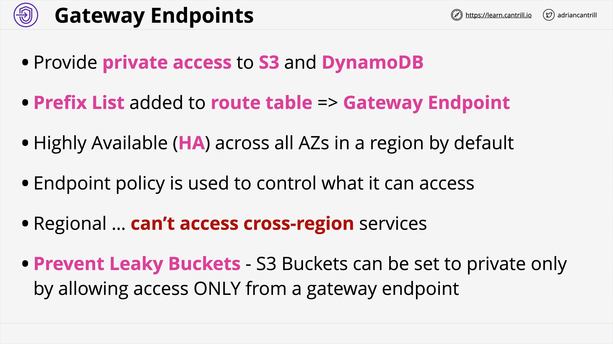
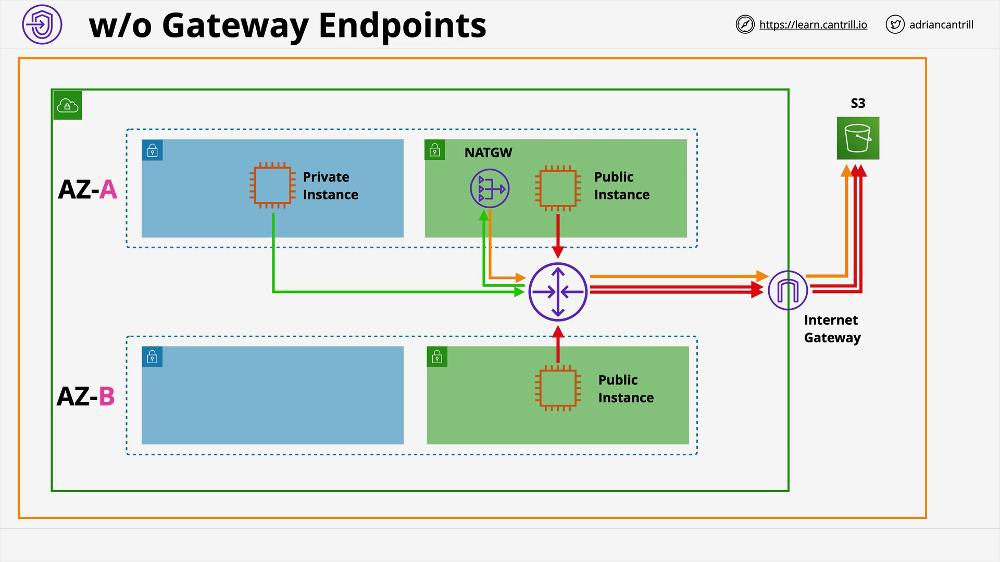
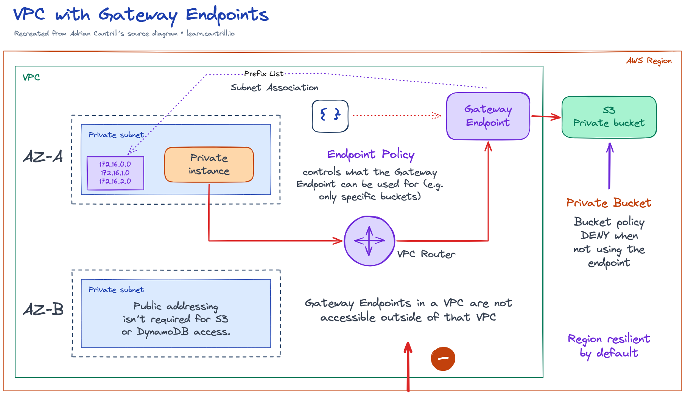

# VPC Gateway Endpoints

A gateway endpoint gives resources inside a [VPC](vpc.md) a route to [Amazon S3](s3.md) or DynamoDB without requiring an internet gateway, NAT device, or public address on the client. The service remains outside the VPC; the endpoint changes the network path to it. This is a [networking](../concepts/networking.md) feature, separate from the [IAM](iam.md) permissions needed to use the service.

Two common designs are an isolated VPC that retrieves approved software from S3, and a bucket that rejects requests unless they arrive through an approved endpoint. Both combine service-specific routing with access-control policies, as summarized below.



## Architecture: Replace the NAT Path for Service Traffic

Without an endpoint, a typical IPv4 architecture reaches S3 through public networking: a public instance uses its public IPv4 address and the [internet gateway](vpc.md#internet-gateway-igw); a private instance uses a public [NAT gateway](vpc.md#nat--nat-gateway), then the internet gateway. The diagram below shows both paths. This design requires public egress infrastructure even if the application only needs S3. Calling a public AWS endpoint does not by itself mean traffic leaves AWS's network. ([AWS gateway endpoint overview](https://docs.aws.amazon.com/vpc/latest/privatelink/gateway-endpoints.html))



With the endpoint, the instance follows a service-specific route through the VPC router to the gateway endpoint and S3. The diagram below shows this architecture with editable shapes and text. Open the [Excalidraw source](../assets/vpc-gateway-endpoints.excalidraw) to edit it.



> [!warning] Gotcha
> The diagram's “Subnet Association” is shorthand: the configured association is with **route tables** serving those subnets. Its `172.16.x.x` labels are illustrative, not actual S3 address ranges to copy into a configuration. Use the AWS-managed service prefix list.

Adding an endpoint does **not** remove an existing default route to NAT or the internet. An isolated design must also omit unwanted egress paths. Conversely, retaining NAT for other destinations while directing S3 traffic through the endpoint is valid.

## How Prefix-List Routing Works

A [prefix list](https://docs.aws.amazon.com/vpc/latest/userguide/managed-prefix-lists.html) groups CIDR ranges under one identifier. AWS maintains the service ranges, so applications and administrators need not track individual S3 or DynamoDB IP changes.

1. Create a gateway endpoint for the service in the VPC's Region, for example `com.amazonaws.us-east-1.s3` for general-purpose S3 access.
2. Select the VPC route tables that should use it. AWS adds a route with the service's prefix list as **destination** and the endpoint ID as **target**.
3. Every subnet associated with one of those tables receives that route. Other subnets do not automatically gain it.
4. The VPC router matches service traffic against that destination and sends it to the endpoint.

An illustrative route table is:

| Destination | Target | Purpose |
| --- | --- | --- |
| `10.16.0.0/16` | `local` | Within-VPC traffic |
| `pl-<regional-s3-prefix-list>` | `vpce-<s3-endpoint>` | Regional S3 traffic |
| `0.0.0.0/0` | `nat-<optional-nat-gateway>` | Other IPv4 destinations, only if general egress is intended |

The service route is more specific than the default route, so matching S3 traffic bypasses NAT. A matching explicit service CIDR route can take precedence over the prefix-list route; check all matching routes when troubleshooting. AWS manages endpoint-route insertion/removal through route-table associations. ([AWS routing rules](https://docs.aws.amazon.com/vpc/latest/privatelink/gateway-endpoints.html))

Unlike a [PrivateLink interface endpoint](vpc-interface-endpoints.md), a gateway endpoint does not place an endpoint ENI with a private IP into each selected subnet. Clients still address the service's public endpoint; **private access describes the path**, not a conversion of S3 into a private-IP service.

## Scope, Availability, and Endpoint Choice

The endpoint belongs to one VPC, serves its Region, and is highly available across the VPC's AZs by design. There is no per-AZ gateway endpoint placement to manage. This is [regional availability](../concepts/resource-scope.md), not cross-Region disaster recovery.

| Requirement | Gateway endpoint fit |
| --- | --- |
| Private VPC workloads need same-Region S3 or DynamoDB | Yes; use the relevant service endpoint and route tables |
| Reach a bucket or table in another Region through this endpoint | No; the endpoint does not provide that route |
| Reuse the endpoint from another VPC or on-premises network | No; peering, Transit Gateway, VPN, and Direct Connect do not extend its use |
| Private access to other supported services | Consider an interface endpoint using [AWS PrivateLink](vpc.md#aws-privatelink) |
| Need S3/DynamoDB access from hybrid or connected networks | Consider an interface endpoint and its DNS/connectivity design |

S3 and DynamoDB support both gateway and interface endpoints; they are not exclusively gateway-accessible services. Gateway endpoints have no additional endpoint charge; normal service charges still apply. ([AWS S3 endpoint considerations](https://docs.aws.amazon.com/vpc/latest/privatelink/vpc-endpoints-s3.html), [AWS DynamoDB endpoint considerations](https://docs.aws.amazon.com/vpc/latest/privatelink/vpc-endpoints-ddb.html))

> [!warning] Gotcha
> Gateway endpoints **do not use AWS PrivateLink**. Gateway and interface endpoints are two service-access mechanisms; other VPC endpoint types also exist. ([AWS PrivateLink overview](https://docs.aws.amazon.com/vpc/latest/privatelink/what-is-privatelink.html))

For the full side-by-side comparison of routing, DNS, ENIs, security groups, availability, hybrid access, and cost, see [Gateway Endpoint vs Interface Endpoint](vpc-interface-endpoints.md#gateway-endpoint-vs-interface-endpoint). The [SNS private hosted zone walkthrough](vpc-interface-endpoints.md#sns-walkthrough-keep-the-hostname-change-the-dns-answer) shows how DNS selects the interface path instead of a service-prefix-list route.

## Endpoint Policy vs Bucket Policy

These controls answer different questions. Review [resource versus identity policies](../concepts/resource-vs-identity-policies.md) for the underlying authorization model.

| Control | Question it answers | Example |
| --- | --- | --- |
| Endpoint policy | What may callers access **through this endpoint**? | Only read an approved software bucket |
| S3 bucket policy | Under what conditions may requests access **this bucket**? | Deny data access unless the approved endpoint was used |
| IAM identity policy | What may this workload's identity do? | Permit its EC2 role to list the bucket and read objects |

An endpoint policy is an additional restriction, not a replacement for IAM or bucket authorization. The default endpoint policy permits full use of the endpoint; it does not make resources public or grant otherwise missing permissions. A custom policy can restrict resources/actions. Gateway endpoint policies use `Principal: "*"`; filter an intended identity with `aws:PrincipalArn` where needed. ([AWS endpoint policy rules](https://docs.aws.amazon.com/vpc/latest/privatelink/vpc-endpoints-access.html))

For a bucket that must reject data access through any other path, use an explicit deny with `aws:SourceVpce`. This illustrative statement is a **guardrail**, not a complete access grant; replace the bucket and endpoint identifiers, and separately grant required access:

```json
{
  "Version": "2012-10-17",
  "Statement": [
    {
      "Sid": "DenyObjectAccessOutsideApprovedEndpoint",
      "Effect": "Deny",
      "Principal": "*",
      "Action": ["s3:GetObject", "s3:PutObject", "s3:DeleteObject"],
      "Resource": "arn:aws:s3:::example-approved-software/*",
      "Condition": {
        "StringNotEquals": {
          "aws:SourceVpce": "vpce-0123456789abcdef0"
        }
      }
    }
  ]
}
```

The example limits only the listed object operations; it does not constrain bucket listing, administrative actions, or every possible S3 operation. Choose the intended action/resource scope deliberately. Ordinary console data access and service integrations that do not traverse that endpoint can also be denied. ([AWS bucket-policy examples](https://docs.aws.amazon.com/vpc/latest/privatelink/vpc-endpoints-s3.html))

> [!warning] Gotcha
> A conditional **Allow** grants access when its condition matches; it does not prohibit access granted by another applicable policy when the condition does not match. For example, a role with `s3:GetObject` permission may still read an object through the public endpoint even if the bucket policy also allows reads through an approved VPC endpoint. An explicit **Deny** for requests that do not use the approved endpoint overrides that competing grant. A private bucket therefore does not automatically mean endpoint-only access: authenticated public-endpoint access can still be authorized.

## Practical Checks

- **Routes and Region:** inspect the source subnet's actual route table and verify the endpoint's service and Region match the target.
- **DNS and address family:** ensure the service name resolves and its returned address family has a matching endpoint route. Do not assume IPv4 and IPv6 support/settings are interchangeable; check current service-specific documentation.
- **Network filtering:** the instance's [security group](vpc.md#security-groups-sg) must permit the service traffic, typically outbound TCP 443. It can reference the service prefix list. [NACLs](vpc.md#network-acl-nacl) require service CIDRs and return-path rules; they cannot reference a prefix-list ID. There is no gateway endpoint ENI security group to attach.
- **Authorization:** check the workload role, endpoint policy, and bucket/table permissions separately. Working routing does not prove the request is authorized.
- **Changing routes:** applications should reconnect/retry; introducing or modifying an endpoint can interrupt established service connections. ([AWS S3 considerations](https://docs.aws.amazon.com/vpc/latest/privatelink/vpc-endpoints-s3.html), [DynamoDB considerations](https://docs.aws.amazon.com/vpc/latest/privatelink/vpc-endpoints-ddb.html))

> [!tip] Exam Tip
> Private S3/DynamoDB access + no NAT/IGW → **gateway endpoint**. Prefix-list destination + endpoint target → **route-table integration**. One endpoint across AZs → **built-in regional HA**. Restrict reachable buckets → **endpoint policy**; require a particular access path to the bucket → **bucket policy with `aws:SourceVpce`**. See the [SAA gateway endpoint checklist](../certifications/aws-saa.md#vpc-gateway-endpoints).

## References

- Adrian Cantrill, **VPC Endpoints (Gateway)** — source lesson and slide illustrations from [AWS training](https://learn.cantrill.io/). The explanations and relevant diagrams are included on this page.
- [Editable architecture diagram](../assets/vpc-gateway-endpoints.excalidraw), with its PNG export embedded above alongside the summary and NAT/internet-gateway architecture illustrations.
- [AWS — Gateway endpoints](https://docs.aws.amazon.com/vpc/latest/privatelink/gateway-endpoints.html)
- [AWS — Gateway endpoints for Amazon S3](https://docs.aws.amazon.com/vpc/latest/privatelink/vpc-endpoints-s3.html)
- [AWS — Gateway endpoints for Amazon DynamoDB](https://docs.aws.amazon.com/vpc/latest/privatelink/vpc-endpoints-ddb.html)
- [AWS — Control access using endpoint policies](https://docs.aws.amazon.com/vpc/latest/privatelink/vpc-endpoints-access.html)
- [AWS — Managed prefix lists](https://docs.aws.amazon.com/vpc/latest/userguide/managed-prefix-lists.html)
- [AWS — What is AWS PrivateLink?](https://docs.aws.amazon.com/vpc/latest/privatelink/what-is-privatelink.html)
