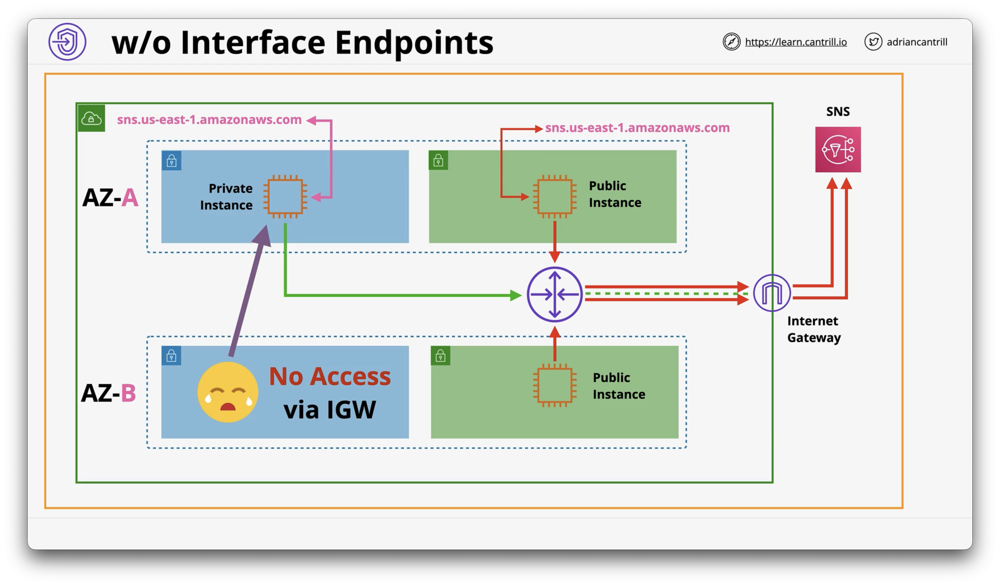
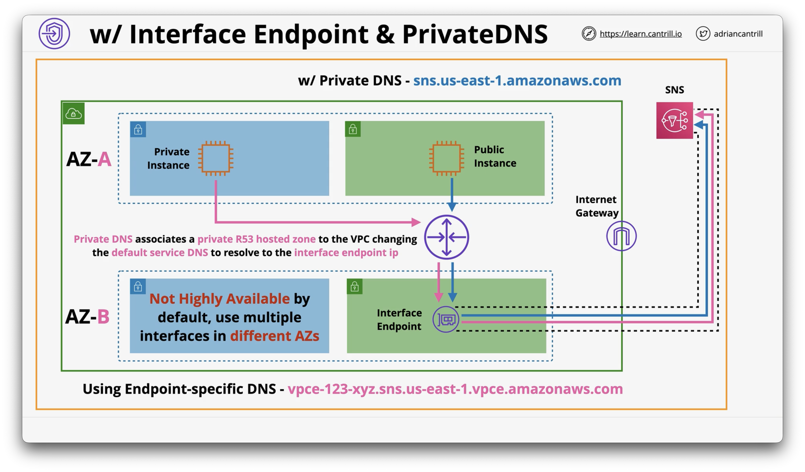

# VPC Interface Endpoints

An interface endpoint gives clients private access to a supported service through **endpoint [ENIs](../concepts/networking.md#elastic-network-interfaces-enis) in their [VPC](vpc.md)**. AWS PrivateLink connects these entry points to the provider; it does not move the provider's application into your subnets. Examples include [SNS](sns.md), [SQS](sqs.md), and supported partner or customer-owned endpoint services.

The practical distinction from [gateway endpoints](vpc-gateway-endpoints.md) is how clients reach the entry point: a gateway endpoint uses service-prefix-list routes, while an interface endpoint exposes addresses in your subnets. [DNS](../concepts/dns.md) can make the usual service hostname resolve to those addresses. **DNS chooses the address; normal IP routing still carries the packets.**

## Architecture: From Public Service Address to Private ENI

Without an endpoint, `sns.us-east-1.amazonaws.com` resolves publicly. A public IPv4 instance can reach it through the internet gateway if addressing, routes, and firewall rules permit. A private IPv4 instance needs a suitable egress path, typically NAT; DNS resolution alone does not provide connectivity. The illustration omits NAT, so the private instance cannot reach SNS through the IGW alone. It should not be read as a rule that private instances can never reach public services.



With an interface endpoint and Private DNS, the same SNS name resolves to endpoint ENI addresses. Both public and private subnet clients using the VPC's resolver take this path. The ENI drawn in a public subnet does **not** require an IGW or public IP; it could be in a private subnet. Within this VPC, the ordinary local route reaches it, then PrivateLink carries the connection to SNS.



The diagram has only one endpoint ENI in AZ-B. That makes AZ-B a dependency for clients in AZ-A too. **One endpoint resource can contain ENIs in multiple AZs**: select one subnet per desired AZ, typically at least two for resilience. You do not need a separate endpoint resource for every AZ. See [AWS interface endpoint architecture and availability](https://docs.aws.amazon.com/vpc/latest/privatelink/privatelink-access-aws-services.html).

## Gateway Endpoint vs Interface Endpoint

| Attribute | Gateway endpoint | Interface endpoint |
| --- | --- | --- |
| Which services can I reach? | **S3 and DynamoDB only.** For example, an EC2 instance can read an S3 bucket in the same Region without NAT or an internet gateway. | **Many supported AWS services**, such as SNS and SQS, as well as S3, DynamoDB, and supported partner/custom services. Create an endpoint for the particular service you need. |
| How does a request reach the service? | The application resolves the normal service name. A route matching the service's AWS-managed IP ranges sends the request to the gateway endpoint instead of NAT/IGW. For example: S3 destination prefix list → `vpce-…`. | The application resolves a name to an endpoint ENI's **private address in your subnet**. Normal VPC routing delivers the request to that ENI, then PrivateLink carries it to the service. For example: SNS name → `10.16.16.50` → endpoint ENI → SNS. |
| What do I create or select? | Create a gateway endpoint and **associate the route tables** used by the client subnets. AWS adds the service route to each selected table. There is no endpoint ENI or subnet IP address to allocate. | Create an interface endpoint and **select subnets in the AZs you want to use**. AWS creates one ENI per selected subnet, consuming subnet addresses. You can select at most one subnet per AZ for that endpoint. |
| Availability and AZ failures | **Highly available by default, with regional resilience across AZs.** You do not deploy a separate gateway endpoint in each AZ. One endpoint can serve subnets across the VPC's AZs through their associated route tables; it does not protect against a whole-Region outage. | **Not automatically multi-AZ: a single selected subnet gives you only one AZ's ENI.** If that AZ fails, clients in other AZs can lose the endpoint path too. For HA, select subnets in multiple AZs so there is **one endpoint ENI in each selected AZ**; use a regional/private DNS name and client retries to reach available interfaces. |
| Must I change the application or DNS? | **Usually no application change:** keep the ordinary S3/DynamoDB hostname and add the endpoint route. The destination remains a service address; the route changes how traffic gets there. | **No application change when the service supports Private DNS and you enable it:** the usual hostname resolves to endpoint ENIs. Otherwise configure the application to use an endpoint-specific URL. DynamoDB has its own DNS restrictions, described below. |
| Can I attach a security group? | **No SG on the gateway endpoint itself.** The client's SG and subnet NACL still need to permit service traffic; client SG rules can reference the service prefix list. | **Yes, on the endpoint ENIs.** For SNS, allow inbound TCP 443 from the clients on the endpoint SG. Client egress rules and subnet NACLs must also allow the connection and replies. |
| What does an endpoint policy control? | Restricts requests **through this endpoint**, such as permitting reads only from one approved S3 bucket. It does not replace IAM/bucket permissions or block requests through other paths. | Where the service supports endpoint policies, restrict callers, actions, and resources **through this endpoint**. For example, permit `sns:Publish` only to an approved topic. Network SG rules and IAM/topic permissions remain separate checks. |
| Can on-premises or another VPC use it? | **No.** Clients across VPN, Direct Connect, VPC peering, or Transit Gateway cannot reuse this VPC's gateway endpoint. Create a gateway endpoint in each client VPC where appropriate. | **Yes, with a network and DNS design that reaches the ENIs.** For example, on-premises clients can connect over VPN/Direct Connect, with DNS forwarding to obtain endpoint addresses. Creating the endpoint alone does not configure these routes or share its private DNS zone. |
| Does it use AWS PrivateLink? | **No.** It is a route-table-based mechanism specifically for S3/DynamoDB. | **Yes.** PrivateLink connects your endpoint ENIs to the provider without requiring NAT, IGW, or peering with the provider's VPC. The service itself remains outside your subnets. |
| What am I charged for? | **No additional gateway-endpoint hourly or processing charge.** Normal S3/DynamoDB and other applicable charges remain. | **An hourly endpoint charge for each enabled AZ, plus data processed.** Enabling two AZs creates two AZ-hours of endpoint usage per elapsed hour, even when idle; other applicable charges remain. |

**Terminology matters for HA:** “one endpoint per AZ” should mean **one endpoint ENI per selected AZ**, not necessarily separate endpoint resources. For a two-AZ deployment, create **one interface endpoint**, select one subnet in AZ-A and one in AZ-B, and AWS creates **two endpoint ENIs**. DNS must allow clients to use the available interfaces; pinning every client to AZ-A's zonal name would preserve an AZ-A dependency.

For same-Region in-VPC [S3](s3.md)/DynamoDB access, a gateway endpoint usually avoids unnecessary endpoint charges. Interface endpoints serve additional services and connectivity designs. Neither endpoint grants missing [IAM](iam.md) permissions or removes other egress paths. Service support and DNS behavior must be checked individually. Sources: [AWS gateway endpoints](https://docs.aws.amazon.com/vpc/latest/privatelink/gateway-endpoints.html), [interface endpoint creation](https://docs.aws.amazon.com/vpc/latest/privatelink/create-interface-endpoint.html), and [DynamoDB endpoint comparison](https://docs.aws.amazon.com/amazondynamodb/latest/developerguide/privatelink-interface-endpoints.html).

## EC2 Instance Connect Endpoint vs SNS Interface Endpoint

**EC2 Instance Connect Endpoint (EICE) and an SNS interface endpoint are different kinds of resources**, even though both use an ENI in your subnet. EICE gives administrators a controlled connection to private [EC2 instances](ec2.md); the SNS interface endpoint gives applications a private entry point to the SNS API.

| Question | EC2 Instance Connect Endpoint (EICE) | SNS interface endpoint |
| --- | --- | --- |
| Who connects to what? | An administrator connects to an EC2 instance for SSH or RDP. | An application calls SNS, for example to publish a message to a topic over HTTPS. |
| What does the subnet ENI do? | Provides the VPC entry point for authorized management traffic, which is forwarded to the target instance. | Provides private destination addresses that applications connect to when calling SNS. |
| What mechanism does AWS document? | An identity-aware TCP proxy with an IAM-authorized tunnel. | An interface VPC endpoint powered by AWS PrivateLink. |
| What does “no public IP or internet gateway required” mean? | The target EC2 and VPC need neither. An administrator can still connect from the internet through the AWS service. | Applications can reach SNS through the endpoint without NAT or an IGW; this service-access path does not traverse the public internet. |
| Which security-group rules matter? | Allow endpoint **outbound** traffic to the instance's management port, and instance **inbound** traffic from the endpoint. | Allow endpoint **inbound TCP 443** from application clients, with matching client egress permissions. |

Sources: [AWS EICE architecture](https://docs.aws.amazon.com/AWSEC2/latest/UserGuide/connect-with-ec2-instance-connect-endpoint.html), [EICE security groups](https://docs.aws.amazon.com/AWSEC2/latest/UserGuide/eice-security-groups.html), and [PrivateLink service access](https://docs.aws.amazon.com/vpc/latest/privatelink/privatelink-access-aws-services.html).

### Connection paths and the public-internet question

For EICE, the useful mental model is **an authorized tunnel between an external client and a private EC2 instance**. For SNS, it is **a private service entry point placed inside the application's VPC**. The following shows connection initiation; established connections carry replies too.

```text
EICE — administrator connecting from the internet:
Browser / SSH client
  → AWS EICE service entry point reached over the internet
  → IAM-authorized tunnel to the EICE ENI in your subnet
  → EC2 private IP:22 (SSH example)

SNS interface endpoint — application calling SNS privately:
Application in the VPC
  → SNS endpoint ENI private IP:443
  → AWS PrivateLink
  → SNS API
```

The browser does not need a direct internet route to the EICE ENI's private IP. AWS provides the managed tunnel into the VPC. “The instance needs no public IP” therefore does **not** mean the administrator's entire connection avoids the internet. See [connecting through EICE](https://docs.aws.amazon.com/AWSEC2/latest/UserGuide/connect-using-eice.html).

By comparison, resolving an SNS `vpce-…` hostname from outside the VPC does not create a tunnel: it returns endpoint addresses that still require network reachability. A publicly resolvable DNS name is not the same as a publicly reachable service entry point.

### When IAM authorization happens

In the console, select **Connect using a Private IP**, choose the EICE, and click the final **Connect** button. The resulting tunnel request requires `ec2-instance-connect:OpenTunnel` authorization for your current [IAM identity](iam.md). Merely signing in to the console or selecting an endpoint does not grant permission to connect. Policies can constrain the endpoint, target private IP, remote port, and tunnel duration. [AWS EICE permissions](https://docs.aws.amazon.com/AWSEC2/latest/UserGuide/permissions-for-ec2-instance-connect-endpoint.html)

Once authorized, the tunnel carries traffic to the instance through the endpoint. SSH authentication still takes place between the SSH client and the instance; the endpoint forwards the traffic. The console's Linux connection also uses EC2 Instance Connect to supply a temporary SSH public key, requiring `ec2-instance-connect:SendSSHPublicKey` and EC2 Instance Connect installed on the instance. [AWS console and SSH connection methods](https://docs.aws.amazon.com/AWSEC2/latest/UserGuide/connect-using-eice.html)

EICE service traffic reaches the endpoint regardless of its inbound SG rules; IAM controls who may open the tunnel. Endpoint outbound and instance inbound rules must still permit the target connection. This differs from an SNS interface endpoint, whose inbound SG rules admit application connections. [AWS EICE security-group behavior](https://docs.aws.amazon.com/AWSEC2/latest/UserGuide/eice-security-groups.html)

> [!warning] Gotcha
> An ENI and the word “endpoint” do not identify a resource as a PrivateLink interface endpoint. AWS explicitly documents SNS interface endpoints as using PrivateLink, while the cited EICE documentation describes an authorized TCP tunnel. It does not establish whether EICE internally reuses PrivateLink technology; do not record that speculation as an architectural fact.

## DNS Names and Private DNS

| Name | Address returned | Typical use |
| --- | --- | --- |
| Regional endpoint-specific name | Addresses for the endpoint across its enabled AZs | One endpoint URL without pinning a single AZ |
| Zonal endpoint-specific name | Address in the named AZ | Deliberate AZ selection; narrows resilience |
| Usual service name with Private DNS | Endpoint ENI addresses in the associated VPC's DNS view | Existing applications keep their service URL |

Copy endpoint-specific names from the endpoint's DNS entries; do not construct them from an example. Their DNS records can be publicly resolvable while returning **private addresses**. Resolving such a name does not give an internet client network access.

With supported **Private DNS** enabled, AWS creates a hidden, AWS-managed [Route 53 private hosted zone](route53.md#private-hosted-zone). It changes the answer for the service name inside the associated VPC. With Private DNS disabled and no custom override, the default name continues to resolve publicly; the endpoint-specific name still resolves to the endpoint. [AWS DNS behavior](https://docs.aws.amazon.com/vpc/latest/privatelink/privatelink-access-aws-services.html)

## SNS Walkthrough: Keep the Hostname, Change the DNS Answer

This example uses IPv4, `us-east-1`, and the ordinary SNS HTTPS hostname. It illustrates [split-view DNS](route53.md#split-view-split-horizon-dns): the application continues requesting `https://sns.us-east-1.amazonaws.com`, but inside the VPC it connects to the endpoint's private addresses.

### Common endpoint and VPC setup

1. In the VPC endpoint creation form, select **Interface** and the SNS **service name** `com.amazonaws.us-east-1.sns`; choose the client VPC and subnets in two AZs. After creation, AWS assigns the endpoint an ID and DNS names such as `vpce-<id>-<suffix>.sns.us-east-1.vpce.amazonaws.com` (illustrative format). The service name is a creation-time identifier; the generated `vpce-…` name is the DNS destination used below. [AWS SNS service selection](https://docs.aws.amazon.com/sns/latest/dg/sns-vpc-create-endpoint.html), [AWS endpoint DNS names](https://docs.aws.amazon.com/vpc/latest/privatelink/privatelink-access-aws-services.html)
2. Set **`enableDnsSupport=true`** so Amazon-provided DNS resolution works; also set **`enableDnsHostnames=true`**, which AWS requires for private hosted zones and interface endpoint Private DNS. Clients must use the VPC resolver, directly or through correctly configured DNS forwarding. [AWS DNS prerequisites](https://docs.aws.amazon.com/vpc/latest/userguide/AmazonDNS-concepts.html)
3. Allow inbound **TCP 443** on the endpoint's [security group](vpc.md#security-groups-sg) from the client security group or appropriate source CIDRs. Allow client egress and any necessary [NACL](vpc.md#network-acl-nacl) traffic, including replies. Configure endpoint-policy and IAM/topic permissions for the intended SNS actions.

Keep these three names distinct:

| Value in this SNS example | Meaning | Where to use it |
| --- | --- | --- |
| `com.amazonaws.us-east-1.sns` | AWS service identifier for SNS in this Region | Select it when creating the interface endpoint; it is not a hostname to resolve |
| `vpce-<id>-<suffix>.sns.us-east-1.vpce.amazonaws.com` | Generated regional DNS name for your particular endpoint; placeholders shown | Copy the actual value from the endpoint's DNS entries and use it as the Route 53 alias target |
| `sns.us-east-1.amazonaws.com` | Normal regional SNS hostname | Keep it in the application's HTTPS URL and use it as the private hosted zone/record name |

### Option A: Let AWS manage the private hosted zone

Enable **Private DNS** on the SNS endpoint. AWS creates and associates the hidden zone; there is no customer-managed Route 53 zone to create. The normal SNS name now returns endpoint ENI addresses for clients using that VPC's DNS view. Applications can retain their regional SNS URL. This is the usual single-VPC setup described in the [SNS endpoint tutorial](https://docs.aws.amazon.com/sns/latest/dg/sns-vpc-tutorial.html).

### Option B: Create the private hosted zone yourself

Use this when you need explicit zone ownership or associations with additional connected VPCs. The following applies AWS's documented [customer-managed endpoint DNS pattern](https://aws.amazon.com/blogs/networking-and-content-delivery/centralize-access-using-vpc-interface-endpoints/) to SNS:

1. Leave the SNS endpoint's automatic **Private DNS disabled** for this setup. Avoid a conflicting hidden zone for the same name in the VPC.
2. Create a Route 53 **private hosted zone named `sns.us-east-1.amazonaws.com`**, and associate the client VPC. This is a private DNS namespace; no public domain registration or delegation of `amazonaws.com` is involved.
3. At the zone apex, create an **A alias record**. Leave the record-name prefix blank, enable Alias, choose **Alias to VPC endpoint**, select `us-east-1`, and target the endpoint's **regional endpoint-specific DNS entry**: the actual value matching `vpce-<id>-<suffix>.sns.us-east-1.vpce.amazonaws.com` from its DNS entries. Set **Evaluate target health = No**. Use the endpoint DNS name/hosted-zone ID returned by AWS if entering the target programmatically. [Route 53 alias configuration](https://docs.aws.amazon.com/Route53/latest/DeveloperGuide/routing-to-vpc-interface-endpoint.html)
4. Keep the application's URL as `https://sns.us-east-1.amazonaws.com`. The alias changes its resolved address, not the URL, TLS hostname, or service identity.

For illustration, if the two endpoint ENIs have `10.16.16.50` and `10.16.48.50`, a VPC lookup now returns endpoint private addresses rather than public SNS addresses. Those IPs are examples, not configuration values. Target the regional endpoint with the alias instead of maintaining copied IP addresses.

**Why A alias instead of CNAME?** The record `sns.us-east-1.amazonaws.com` is the **apex of this private hosted zone**, even though it is a subdomain of `amazonaws.com`. The apex already needs NS and SOA records, and a CNAME cannot coexist with other record types at the same name. A Route 53 **A alias** is allowed there: it targets the endpoint DNS name but answers the client with IPv4 addresses, without requiring you to maintain individual ENI IPs. A CNAME can work at a non-apex name; the restriction here is the zone apex. [AWS CNAME rules](https://docs.aws.amazon.com/Route53/latest/DeveloperGuide/ResourceRecordTypes.html#CNAMEFormat), [alias versus CNAME](https://docs.aws.amazon.com/Route53/latest/DeveloperGuide/resource-record-sets-choosing-alias-non-alias.html)

```text
Application asks for sns.us-east-1.amazonaws.com
  → VPC Route 53 Resolver consults the associated private hosted zone
  → apex A alias resolves via the interface endpoint's regional DNS entry
  → client connects to an endpoint ENI private address on TCP 443
  → PrivateLink carries the request to SNS
```

Route 53 supplies the DNS answer; **it is not an HTTP redirect or a proxy in the request path**. The SNS hostname remains unchanged, preserving normal [TLS hostname validation](../concepts/tls-https.md). A different friendly hostname would require its own TLS compatibility; a DNS alias alone cannot provide that.

> [!warning] Gotcha
> Scope the private zone narrowly to `sns.us-east-1.amazonaws.com`, not all of `amazonaws.com`. A matching private zone does not fall back to public DNS for missing records. This example also does not override alternate `api.aws`, FIPS, or other-Region hostnames: check which name the application actually uses. See [private-zone namespace resolution](route53.md#how-association-and-namespace-resolution-work).

For other VPCs, associate the customer-managed zone **and** provide routes to the endpoint ENIs. For on-premises clients, use appropriate private connectivity and Route 53 Resolver inbound forwarding. Zone association creates DNS visibility, not network connectivity; an endpoint's hidden zone is not automatically shared by VPC peering.

### Check the result

From a client in the associated VPC, these illustrative commands check DNS and TCP reachability:

```bash
dig +short sns.us-east-1.amazonaws.com A
nc -vz sns.us-east-1.amazonaws.com 443
```

Compare the DNS answers with the endpoint ENI addresses. A public answer suggests the wrong resolver, hostname, VPC association, or private-DNS setting; a private answer followed by a timeout suggests routing/SG/NACL issues. Successful TCP connection does not prove IAM authorization. Validate the intended SNS action separately with the workload's role. Interface endpoints do not answer ICMP ping. [AWS endpoint connectivity prerequisites](https://docs.aws.amazon.com/vpc/latest/privatelink/create-interface-endpoint.html)

## Security and Service-Specific Limits

Endpoint SGs control **network connections**. Endpoint policies constrain **principals, actions, and resources using that endpoint**; they do not replace IAM or SNS topic permissions. A policy allowing only `sns:Publish` to one topic does not prevent an otherwise-authorized caller from using another network path. See [SNS endpoint policies](https://docs.aws.amazon.com/sns/latest/dg/sns-vpc-endpoint-policy.html) and the [endpoint versus resource-policy distinction](vpc-gateway-endpoints.md#endpoint-policy-vs-bucket-policy).

- **SNS direction matters:** this is a private path for clients to call SNS. It does not enable SNS to deliver HTTP/S notifications directly to private-IP subscribers. [AWS SNS privacy guide](https://docs.aws.amazon.com/sns/latest/dg/sns-internetwork-traffic-privacy.html)
- **DynamoDB supports both endpoint types**, but its interface endpoint documentation requires endpoint-specific URLs and warns against custom private hosted zone overrides. Do not generalize the SNS DNS recipe to DynamoDB. [AWS DynamoDB restrictions](https://docs.aws.amazon.com/amazondynamodb/latest/developerguide/privatelink-interface-endpoints.html)
- **S3 can combine both types:** with private DNS only for inbound Resolver queries, VPC clients retain the gateway path while on-premises clients use interface ENIs. This option requires an S3 gateway endpoint; the Resolver inbound endpoint and hybrid connectivity must also be configured. [AWS S3 DNS design](https://docs.aws.amazon.com/vpc/latest/privatelink/vpc-endpoints-s3.html)
- **IPv4-only and TCP-only are outdated blanket rules.** Interface endpoints can support IPv6/dual-stack and TCP/UDP where the service and configuration support them. This SNS example uses HTTPS over TCP; do not infer UDP support for SNS. [AWS PrivateLink concepts](https://docs.aws.amazon.com/vpc/latest/privatelink/concepts.html)

> [!tip] Exam Tip
> **Private SNS/SQS access without NAT** → interface endpoint. **Keep the application's service hostname** → supported Private DNS. **Endpoint SG + ENI per selected AZ** → interface endpoint. **S3/DynamoDB prefix-list route with no endpoint charge** → gateway endpoint. See [SAA interface endpoint tips](../certifications/aws-saa.md#vpc-interface-endpoints).

## References

- Source: [VPC Interface Endpoints study note](../../raw/aws-cert-study-notes/aws-solution-architect/vpc-interface-endpoint.md); both lesson diagrams copied into `wiki/assets/`.
- [AWS — Access AWS services through AWS PrivateLink](https://docs.aws.amazon.com/vpc/latest/privatelink/privatelink-access-aws-services.html)
- [AWS — Create an interface endpoint](https://docs.aws.amazon.com/vpc/latest/privatelink/create-interface-endpoint.html)
- [AWS — Gateway endpoints](https://docs.aws.amazon.com/vpc/latest/privatelink/gateway-endpoints.html)
- [AWS — Creating an SNS endpoint](https://docs.aws.amazon.com/sns/latest/dg/sns-vpc-create-endpoint.html)
- [AWS — EC2 Instance Connect Endpoint architecture](https://docs.aws.amazon.com/AWSEC2/latest/UserGuide/connect-with-ec2-instance-connect-endpoint.html)
- [AWS — Connecting through EC2 Instance Connect Endpoint](https://docs.aws.amazon.com/AWSEC2/latest/UserGuide/connect-using-eice.html)
- [AWS — EC2 Instance Connect Endpoint permissions](https://docs.aws.amazon.com/AWSEC2/latest/UserGuide/permissions-for-ec2-instance-connect-endpoint.html)
- [AWS — EC2 Instance Connect Endpoint security groups](https://docs.aws.amazon.com/AWSEC2/latest/UserGuide/eice-security-groups.html)
- [AWS — Publishing an SNS message from a VPC](https://docs.aws.amazon.com/sns/latest/dg/sns-vpc-tutorial.html)
- [AWS — SNS traffic privacy](https://docs.aws.amazon.com/sns/latest/dg/sns-internetwork-traffic-privacy.html)
- [AWS — SNS endpoint policies](https://docs.aws.amazon.com/sns/latest/dg/sns-vpc-endpoint-policy.html)
- [AWS — Understanding Amazon DNS](https://docs.aws.amazon.com/vpc/latest/userguide/AmazonDNS-concepts.html)
- [AWS — Private hosted zone considerations](https://docs.aws.amazon.com/Route53/latest/DeveloperGuide/hosted-zone-private-considerations.html)
- [AWS — Alias records for interface endpoints](https://docs.aws.amazon.com/Route53/latest/DeveloperGuide/routing-to-vpc-interface-endpoint.html)
- [AWS — Centralized interface endpoints and customer-managed private DNS](https://aws.amazon.com/blogs/networking-and-content-delivery/centralize-access-using-vpc-interface-endpoints/)
- [AWS — DynamoDB interface endpoint restrictions](https://docs.aws.amazon.com/amazondynamodb/latest/developerguide/privatelink-interface-endpoints.html)
- [AWS — S3 gateway/interface private DNS](https://docs.aws.amazon.com/vpc/latest/privatelink/vpc-endpoints-s3.html)
- [AWS — PrivateLink concepts](https://docs.aws.amazon.com/vpc/latest/privatelink/concepts.html)
