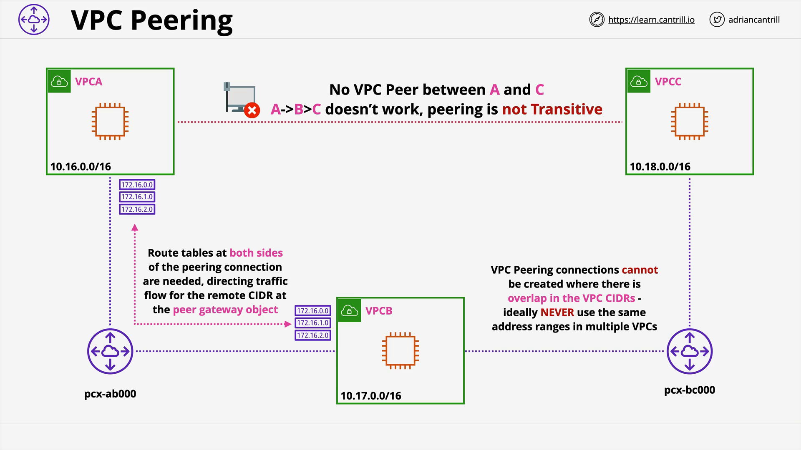

# VPC Peering

VPC peering connects **two [VPCs](vpc.md)** so their resources can communicate using private IPv4 or IPv6 addresses. The VPCs can belong to the same or different accounts and Regions. For example, an application in one VPC can connect to a database's private address in another without an internet gateway, NAT gateway, or [VPN](site-to-site-vpn.md). [Routing and firewalls](../concepts/networking.md) still determine which resources can communicate.

## Connection Model and Scope

Each connection represents one VPC pair and has a `pcx-...` ID. AWS implements it in the existing VPC infrastructure: there is no gateway appliance to deploy, size, or duplicate in each AZ. Peering itself has no single point of failure; application availability still depends on the resources at each end. ([AWS peering overview](https://docs.aws.amazon.com/vpc/latest/peering/what-is-vpc-peering.html))

| Property                        | What it means in practice                                                                                                           |
| ------------------------------- | ----------------------------------------------------------------------------------------------------------------------------------- |
| Exactly two VPCs per connection | A–B peering connects A and B. Connecting A to C requires another connection.                                                        |
| Same or different accounts      | One owner requests the connection; the other accepts it. Each owner manages their own routes and security rules.                    |
| Same or different Regions       | Cross-Region peering uses AWS's global backbone without traversing the public internet.                                             |
| Non-overlapping address space   | A `10.16.0.0/16` VPC can peer with `10.17.0.0/16`; it cannot peer with `10.16.128.0/17`, which overlaps. Check secondary CIDRs too. |
| No automatic routes             | Accepting the connection does not add remote-network routes to either VPC.                                                          |
| No connection creation charge   | Same-AZ peering data transfer is free, including across accounts; cross-AZ and cross-Region transfer charges apply.                 |

## Non-Transitive Routing

Suppose A is `10.16.0.0/16`, B is `10.17.0.0/16`, and C is `10.18.0.0/16`. With A–B and B–C peering, A can reach B and B can reach C, once routes and firewalls permit it. **A cannot route through B to reach C.** Adding a route for C to A's A–B connection does not make B a transit router.

The diagram's purple peering symbols represent `pcx-...` route targets, not deployed gateways. Its small `172.16.x.x` route labels do not match these VPC CIDRs; use the concrete destinations in the route table below.

For all three VPCs to communicate directly, add A–C peering and its routes and rules. A full mesh of **n VPCs needs n(n − 1)/2 connections**: three VPCs need three, while ten need 45. Create only the relationships required by the architecture. For a routed hub connecting many networks, consider [AWS Transit Gateway](https://docs.aws.amazon.com/vpc/latest/tgw/what-is-transit-gateway.html), with its own attachments and route tables.

> [!warning] Gotcha
> Peering also cannot make a peer's internet gateway, NAT device, VPN, Direct Connect connection, or [gateway endpoint](vpc-gateway-endpoints.md) available as a transit exit. A VPC peered to a shared-services VPC does not automatically inherit that VPC's internet or on-premises connectivity. See [AWS peering limitations](https://docs.aws.amazon.com/vpc/latest/peering/vpc-peering-basics.html).

## Routes on Both Sides

Use the remote destination CIDR and the corresponding peering connection as the target. These are illustrative connection IDs, not IDs to paste into AWS:

| Route table serving workloads in | Destination    | Target      | Purpose                  |
| -------------------------------- | -------------- | ----------- | ------------------------ |
| A                                | `10.16.0.0/16` | `local`     | A's own network          |
| A                                | `10.17.0.0/16` | `pcx-<a-b>` | A → B                    |
| B                                | `10.17.0.0/16` | `local`     | B's own network          |
| B                                | `10.16.0.0/16` | `pcx-<a-b>` | B → A, including replies |
| B                                | `10.18.0.0/16` | `pcx-<b-c>` | B → C                    |
| C                                | `10.18.0.0/16` | `local`     | C's own network          |
| C                                | `10.17.0.0/16` | `pcx-<b-c>` | C → B, including replies |

For example, A's client `10.16.1.10` sends to B's server `10.17.2.20` using A's B-CIDR route. The server replies using B's A-CIDR route. A missing return route breaks the exchange even when the forward route is correct.

Update the [route tables associated with the participating subnets](vpc.md#route-tables), which may be custom tables rather than the main table. You can route a narrower subnet or host range instead of the whole peer CIDR. IPv6 requires its own destination routes; IPv4 routes do not cover it. ([AWS peering route configuration](https://docs.aws.amazon.com/vpc/latest/peering/vpc-peering-routing.html))

## Security Groups and NACLs

[Security groups](vpc.md#security-groups-sg) must permit client egress and server ingress for the intended protocol and port. Their stateful handling permits tracked response traffic. [NACLs](vpc.md#network-acl-nacl) are stateless: check both subnet boundaries in both directions, including client ephemeral ports for TCP replies.

| Peering placement               | How to identify permitted peer workloads in a security-group rule                                 |
| ------------------------------- | ------------------------------------------------------------------------------------------------- |
| Same Region, same account       | Reference the peer workload's security group, such as `sg-...`.                                   |
| Same Region, different accounts | Reference the peer account and group, such as `123456789012/sg-...`.                              |
| Different Regions               | Use the appropriate private IP/CIDR; cross-Region peer security-group references are unsupported. |

For example, B's database group can allow inbound TCP 5432 from A's application group when both VPCs are in the same Region. The reference identifies workloads associated with that group; it does not copy the group's rules or create routes. The peering connection must be active. ([AWS peer security-group rules](https://docs.aws.amazon.com/vpc/latest/peering/vpc-peering-security-groups.html))

## DNS: Public EC2 Hostnames vs Private Hosted Zones

Peering DNS options affect how **[EC2 public IPv4 DNS hostnames](ec2.md)** resolve from the peer VPC. By default, those names resolve to public addresses. Enabling the relevant option lets the peer resolve them to the instance's private IPv4 address instead. It does not create a public hostname for an instance that lacks one.

1. Set **`enableDnsSupport=true` and `enableDnsHostnames=true` in both VPCs**.
2. Once peering is active, enable the option allowing the peer to resolve this VPC's public hostnames to private addresses.
3. Enable the corresponding option on the other side if resolution is needed in both directions. Across accounts, each owner updates their side.
4. Test from the client VPC using its normal resolver, then verify that the returned private address has a working route and permitted port.

This works for same-Region and inter-Region peering. ([AWS peering DNS options](https://docs.aws.amazon.com/vpc/latest/peering/vpc-peering-dns.html))

Custom names such as `db.internal.example.com` in a [Route 53 private hosted zone](route53.md#private-hosted-zone) require a separate DNS association design. Associate the zone with the client VPC as well; peering and its DNS options do **not** automatically share that zone. Clients query their own VPC resolver, not the peer VPC's Amazon DNS server. DNS visibility and packet reachability are separate requirements. ([AWS private-zone associations](https://docs.aws.amazon.com/Route53/latest/DeveloperGuide/hosted-zone-private-associate-vpcs.html))

## Encryption Boundaries

Inter-Region peering traffic stays on AWS's backbone and is encrypted before leaving AWS facilities. Avoid interpreting “private peering” as a blanket guarantee of application-to-application encryption for every same-Region path. AWS also provides physical-layer encryption between AZs and hardware encryption for supported instance paths; [TLS](../concepts/tls-https.md) provides application-layer protection independently of those network mechanisms. ([AWS EC2 encryption in transit](https://docs.aws.amazon.com/AWSEC2/latest/UserGuide/data-protection.html))

## Setup and Troubleshooting Checklist

1. **Plan addresses:** verify both VPCs' CIDRs do not overlap, including secondary blocks.
2. **Request and accept:** select the peer's VPC, account, and Region; have the accepter owner accept the request.
3. **Route both ways:** add the remote CIDRs to each participating subnet's actual route table using the correct `pcx-...` target.
4. **Permit the application:** configure security groups and NACLs; confirm the server is listening and its host firewall allows the connection.
5. **Configure DNS if needed:** distinguish EC2 public-hostname resolution options from private hosted zone associations.
6. **Test the intended port:** first check the private IP path, then the DNS name. A failed ping alone does not prove TCP connectivity is broken. Use [VPC Flow Logs](vpc-flow-logs.md) to investigate accepted/rejected traffic alongside routes and firewall rules.

An `active` peering status establishes the relationship; it does not prove routes, DNS, or application access work.

> [!tip] Exam Tip
> **Two VPCs, direct connection, non-overlapping CIDRs, routes on both sides.** A–B plus B–C does not provide A–C. Same-Region peers can reference security groups; cross-Region peers use IP/CIDR rules. See the [SAA peering checklist](../certifications/aws-saa.md#vpc-peering).

## References

- Adrian Cantrill, **VPC Peering** — supplied lesson `ASSOCIATESHARED VPC Peering.mp4` from [AWS training](https://learn.cantrill.io/); narration synthesized above, with one topology diagram retained. The hands-on demo is a separate lesson.
- [AWS — What is VPC peering?](https://docs.aws.amazon.com/vpc/latest/peering/what-is-vpc-peering.html)
- [AWS — Peering lifecycle and limitations](https://docs.aws.amazon.com/vpc/latest/peering/vpc-peering-basics.html)
- [AWS — Update peering route tables](https://docs.aws.amazon.com/vpc/latest/peering/vpc-peering-routing.html)
- [AWS — Reference peer security groups](https://docs.aws.amazon.com/vpc/latest/peering/vpc-peering-security-groups.html)
- [AWS — Enable peering DNS resolution](https://docs.aws.amazon.com/vpc/latest/peering/vpc-peering-dns.html)
- [AWS — Associate VPCs with a private hosted zone](https://docs.aws.amazon.com/Route53/latest/DeveloperGuide/hosted-zone-private-associate-vpcs.html)
- [AWS — EC2 data protection and encryption in transit](https://docs.aws.amazon.com/AWSEC2/latest/UserGuide/data-protection.html)
