# VPC — Virtual Private Cloud

A VPC is a **private, isolated network** within AWS. It lives within **1 account & 1 region**.

## VPC Basics

- Two types: **Default VPC** and **Custom VPC**
- A region can have at most 1 default VPC and unlimited custom VPCs
- Custom VPCs are **private by default** (no internet access until you configure it)
- Default VPC: CIDR `172.31.0.0/16`, a `/20` subnet in each AZ, with a default IGW and NACL attached
- **Valid VPC CIDR sizes: `/16` (largest — 65,536 IPs) to `/28` (smallest — 16 IPs)** ([AWS docs: VPC CIDR blocks](https://docs.aws.amazon.com/vpc/latest/userguide/vpc-cidr-blocks.html))
- **Default VPC = fixed scheme; custom VPC = flexible configuration.** The default VPC's CIDR, subnet layout, IGW, NACL, and SG are all pre-set by AWS; custom VPCs let you choose every aspect (CIDR, subnet count, AZ placement, routing, gateways). ([AWS docs: Default VPCs](https://docs.aws.amazon.com/vpc/latest/userguide/default-vpc.html))
- **The default VPC can be deleted and recreated** — but only via the VPC console's "Create default VPC" action (or `CreateDefaultVpc` API). A deleted default VPC cannot be restored to its original state, and an existing custom VPC cannot be promoted to "default". ([AWS docs: Work with your default VPC](https://docs.aws.amazon.com/vpc/latest/userguide/work-with-default-vpc.html) — direct quote: *"You cannot restore a previous default VPC that you deleted, and you cannot mark an existing nondefault VPC as a default VPC."*)
- **Some AWS services behave oddly or fail if no default VPC exists** in the region. Historical examples: certain SDK/CLI calls that omit a subnet ID assume a default VPC, and some legacy services (EC2-Classic-aware APIs, older RDS/ElastiCache/Redshift launch flows) expect one. If you delete the default VPC, recreate it before relying on those flows. ([AWS re:Post: No Default VPC in my Account](https://repost.aws/questions/QUxzdux0ntQTat1v68CLgdnQ/no-default-vpc-in-my-account))

> [!warning] Gotcha
> Avoid the default VPC in production — its `172.31.0.0/16` range can overlap with Azure's default VPC and on-premises networks.

> [!tip] Exam Tip
> Memorize these default-vs-custom facts: 1 default VPC max per region; unlimited custom VPCs; default has a fixed scheme; custom is flexible; default VPCs can be recreated; some services behave oddly without one.

### Designing VPC IP Ranges

- Prefer `10.x.y.z/16` ranges; avoid common ones:
  - `10.0.x.x`, `10.1.x.x`, `10.10.x.x` — too commonly used
  - `10.128.0.0/9` — reserved by Google Cloud
  - Suggested start: `10.16.0.0` onwards
- Rule of thumb: **2+ networks per region per account** (for redundancy/peering room)

### DNS in VPC

- DNS is provided by **Route 53 Resolver**, reachable at `VPC base IP + 2` (e.g. `10.0.0.2` for `10.0.0.0/16`)
- Two key settings:
  - `enableDnsSupport` — enables DNS resolution in the VPC (default: `true`)
  - `enableDnsHostnames` — assigns public DNS names to instances with public IPs (default: `false` for custom VPCs)

### DHCP Options Set

- Controls DNS servers, NTP servers, NetBIOS settings for all instances in the VPC
- One options set per VPC at a time; flows down to all subnets
- Cannot be edited in place — create a new set and associate it

## Subnets

- A subnet lives in **exactly 1 AZ** — if the AZ fails, the subnet fails
- 1 AZ can have 0 or more subnets; 1 subnet belongs to exactly 1 AZ
- Subnet CIDR must be a subset of the VPC CIDR and must not overlap other subnets
- **Valid subnet CIDR sizes: `/16` (largest) to `/28` (smallest — 16 IPs, 11 usable after the 5 AWS-reserved addresses)** ([AWS docs: Subnet CIDR blocks](https://docs.aws.amazon.com/vpc/latest/userguide/subnet-sizing.html))
- **5 reserved IPs** in every subnet (e.g. `10.16.16.0/20`) ([AWS docs: Subnet CIDR blocks](https://docs.aws.amazon.com/vpc/latest/userguide/subnet-sizing.html)):

| Address | Purpose |
| --- | --- |
| `10.16.16.0` | Network address |
| `10.16.16.1` | VPC router |
| `10.16.16.2` | DNS nameserver |
| `10.16.16.3` | Reserved for future use |
| `10.16.31.255` | Broadcast address |

A typical VPC subnet design uses tiers (WEB, APP, DB, Spare) across AZs, each tier getting a `/20` per AZ:

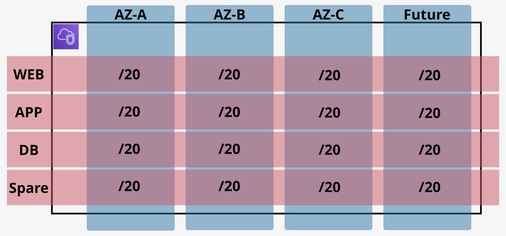

## Route Tables

- Every subnet is associated with a route table that controls where traffic is directed.
- The VPC router (at `network + 1`) handles inter-subnet and egress routing.
- Route tables operate at **Layer 3 only** — they deal purely with IP destinations and next hops; no awareness of ports or protocols.
- **A subnet can only be associated with 1 route table at a time, but you can associate multiple subnets with the same subnet route table.** ([AWS docs: Subnet route tables](https://docs.aws.amazon.com/vpc/latest/userguide/subnet-route-tables.html))

### Main Route Table vs Custom Route Tables

- Every VPC is created with exactly 1 **main route table** automatically — you don't create it. It starts with a single **local route** that allows intra-VPC traffic between all subnets. ([AWS docs: Configure route tables](https://docs.aws.amazon.com/vpc/latest/userguide/VPC_Route_Tables.html))
- A **custom route table** is any route table you create yourself in addition to the main one. You can have multiple custom route tables per VPC.
- **Fallback rule:** if a subnet is not explicitly associated with any route table, it implicitly uses the main route table. This makes the main route table the "default" for every unassociated subnet.
- **The main route table cannot be deleted.** To get rid of it, first promote a custom route table to be the new main one via the **Set main route table** action — the displaced table becomes a regular custom route table that you can then delete. ([AWS docs: Replace the main route table](https://docs.aws.amazon.com/vpc/latest/userguide/Route_Replacing_Main_Table.html))
- **Changing the main route table also changes the default for all subnets** that have no explicit association — they immediately start using the new main route table.
- **Best practice:** leave the main route table in its default state (local route only), and explicitly associate every subnet with a custom route table. This way no subnet accidentally inherits unintended routes. ([AWS docs: Configure route tables](https://docs.aws.amazon.com/vpc/latest/userguide/VPC_Route_Tables.html))

## Internet Gateway (IGW)

- **1 VPC ↔ 0 or 1 IGW** (one-to-one relationship)
- **Regionally resilient** — one IGW covers all AZs in the region; no per-AZ IGW needed
- Handles traffic between the VPC and the public internet / AWS public zone (S3, SQS, SNS…)
- AWS-managed; scales automatically
- For **IPv4**: public IPs are not configured in the EC2 OS — the IGW holds the mapping (private IP ↔ Elastic IP). The OS only sees the private IP.
- For **IPv6**: all IPv6 addresses are publicly routable, so they're configured directly in the OS.

**Outbound** — the IGW rewrites the source IP from private to Elastic IP as the packet leaves:

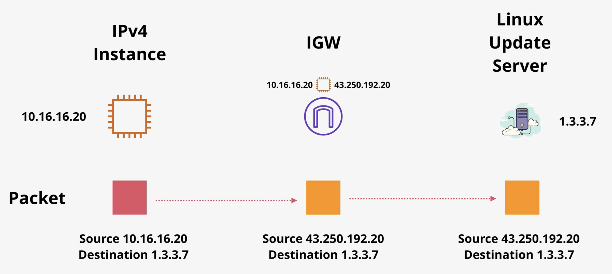

**Inbound** — the IGW rewrites the destination IP from Elastic IP back to the instance's private IP:

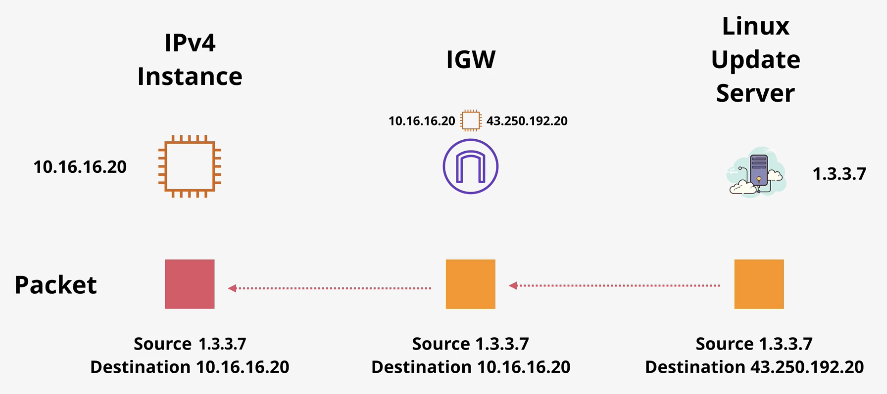

## Stateful vs Stateless Firewalls

| | Stateless | Stateful |
| --- | --- | --- |
| AWS implementation | NACL | Security Group |
| OSI layer | 3/4 | 3/4 |
| Attaches to | Subnet | ENI |
| Tracks connections? | No | Yes |
| Return traffic | Must be explicitly allowed | Automatically allowed |

Both operate at **Layer 3/4** — they filter by IP/CIDR (L3) and by protocol + port (L4). A rule for ICMP (no ports) is purely L3; a rule for TCP/UDP with a port range is L4. Neither inspects application-layer content (HTTP headers, URLs, etc.) — that is AWS WAF's job (Layer 7).

**Stateless** — every connection needs two explicit rules (request port + ephemeral response port):

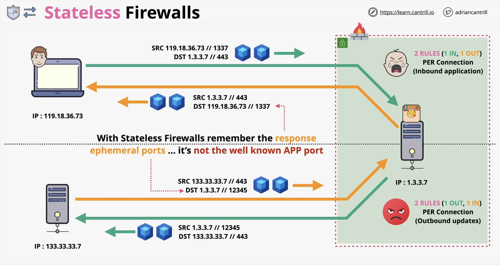

**Stateful** — allowing the request automatically allows the response:

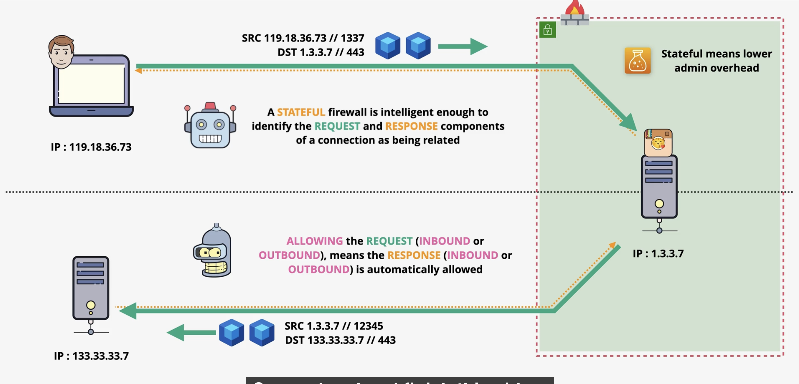

## Network ACL (NACL)

- Operates at **Layer 3/4** — attaches to subnets, which are Layer 3 constructs (IP address ranges)
- Associated with a **subnet** — filters traffic crossing the subnet boundary
- Traffic *within* a subnet is unaffected by NACLs
- **Stateless** — request and response must each be explicitly allowed
- Rules evaluated in order (lowest number first); processing stops at first match
- Supports **explicit Allow AND explicit Deny** (`*` = implicit deny if no rule matches)
- Filters by: IP/CIDR, ports, protocols — **not by logical resources**
- Cannot be assigned to AWS resources directly — only to subnets
- **1 subnet → exactly 1 NACL; 1 NACL → many subnets**
- Best use: **blocking specific bad IPs/CIDRs** (explicit deny)

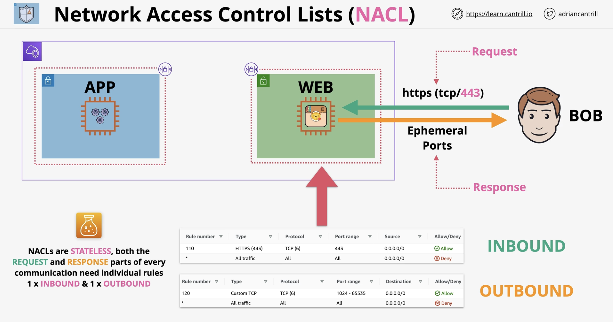

In complex multi-subnet scenarios, rule pairs are needed for every communication path — within a VPC, to a VPC, and from a VPC:

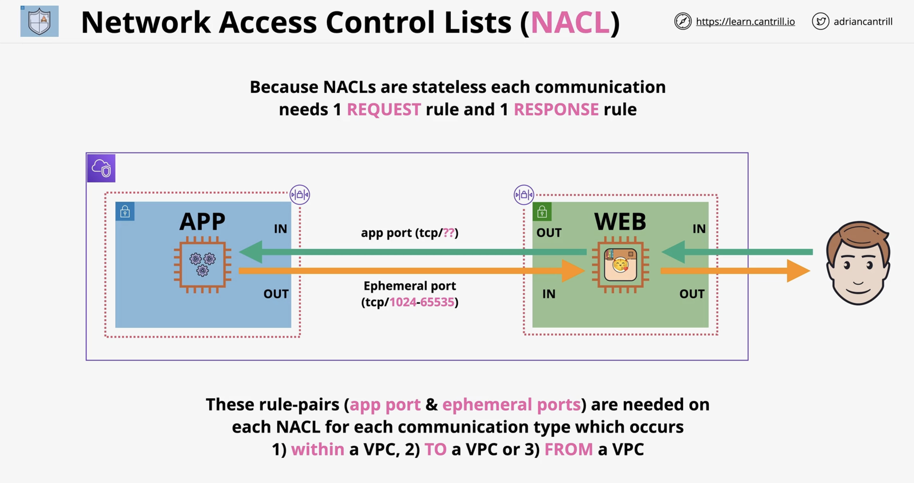

> [!tip] Exam Tip
> Because NACLs are stateless, you must allow both the request port (e.g. 443) AND the **ephemeral port range (1024–65535)** for return traffic. Security Groups handle this automatically.

## Security Groups (SG)

- Operates at **Layer 3/4** — attaches to ENIs, which are Layer 3/4 constructs (IP address + TCP/UDP connection handling)
- **Stateful** — response traffic is automatically allowed when the request is allowed
- **No explicit Deny** — only Allow rules or implicit deny (cannot block a specific IP)
- Attached to **ENIs** (Elastic Network Interfaces), not instances or subnets
- Up to **5 SGs per resource**; many-to-many relationship with resources
- Supports **logical references** as source/destination: other SGs, prefix lists, or self-reference
  - Self-reference is useful for auto-scaling groups where all instances should talk to each other

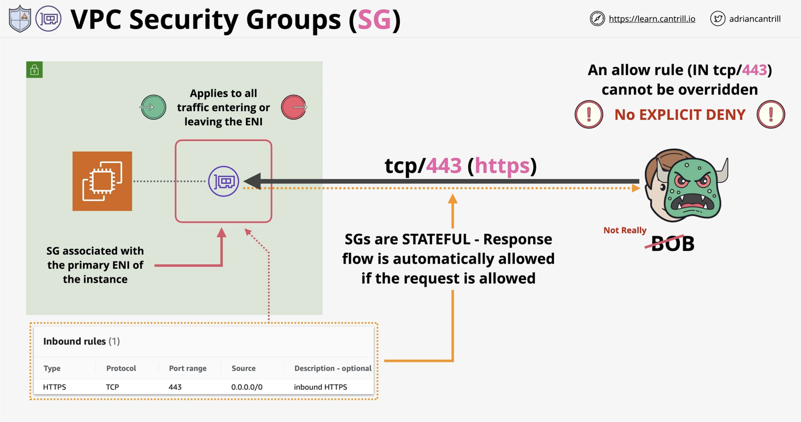

**Logical references** let you reference another SG as the source/destination instead of hardcoding IPs — any new instance added to the referenced SG is automatically covered:

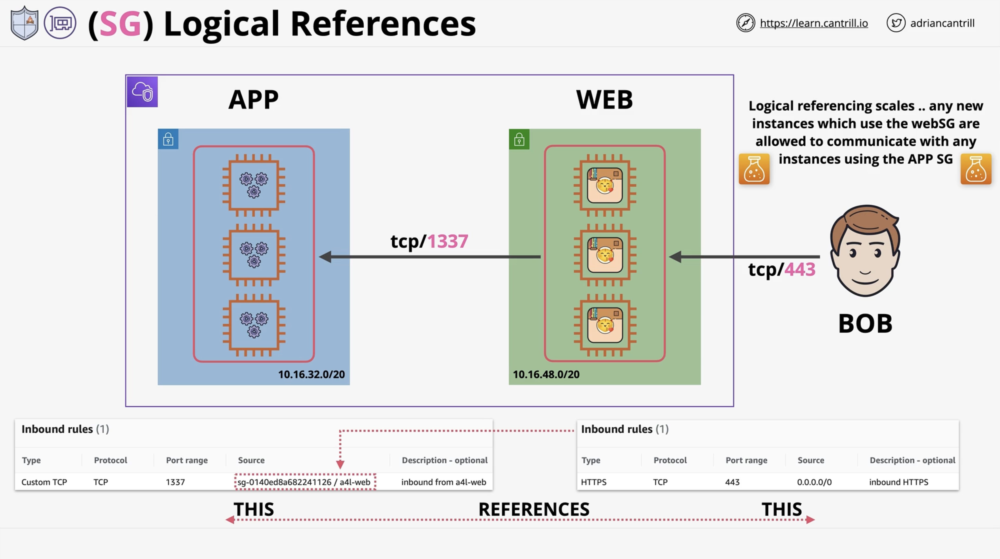

**Self-reference** lets all instances sharing the same SG communicate freely with each other — IP changes are handled automatically:

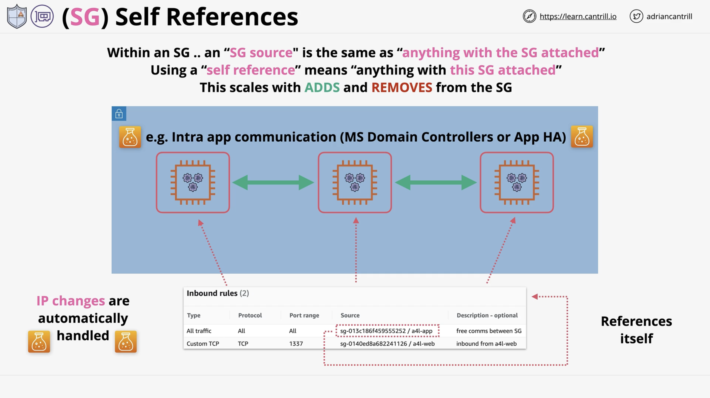

### Which Resources Have Security Groups

The correct mental model: **SG attaches to ENIs**. Any resource that creates an ENI inside your VPC can have a SG. The "server/instance" heuristic is mostly right but breaks for some serverless services:

| Resource | Has SG? | Reason |
| --- | --- | --- |
| EC2 | Yes | Has ENI |
| RDS | Yes | Has ENI |
| ALB / NLB | Yes | Has ENI |
| MSK | Yes | Has ENI |
| ECS Fargate | Yes | Has ENI (serverless, but VPC-attached) |
| Lambda (in VPC) | Yes | Gets an ENI when deployed in a VPC |
| Lambda (no VPC) | No | No ENI |
| S3, DynamoDB | No | Live outside your VPC; use resource-based policies instead |

> [!warning] Gotcha
> SGs cannot block a specific bad IP — use a NACL with an explicit Deny for that.

## NACL vs Security Group

| Feature | NACL | Security Group |
| --- | --- | --- |
| OSI layer | 3/4 | 3/4 |
| Attaches to | Subnet (L3 construct) | ENI (L3/4 construct) |
| Stateful? | No (stateless) | Yes (stateful) |
| Rule types | Allow + Deny | Allow only |
| Rule evaluation | Ordered (stops at first match) | All rules evaluated |
| Explicit Deny | Yes | No |
| Return traffic | Must be explicitly allowed | Automatic |
| Logical resource references | No | Yes |
| Best use | Block bad IPs; subnet-level baseline | Fine-grained per-resource control |

## NAT & NAT Gateway

NAT (**Network Address Translation**) = **IP masquerading** — hides a private CIDR behind a single public IP.

NAT Gateways have two independent dimensions:

- **Connectivity type**: Public (egress to internet) vs Private (VPC-to-VPC or hybrid)
- **Availability mode**: Zonal (original) vs Regional (new as of Nov 2025)

### Connectivity Type

| | Public NAT GW | Private NAT GW |
| --- | --- | --- |
| Lives in | Public subnet (zonal) or VPC-level (regional) | Private subnet |
| Has Elastic IP? | Yes | No |
| Use case | Private instances → internet | VPC-to-VPC or hybrid (overlapping CIDRs via TGW/VGW) |

### Availability Mode

| | Zonal NAT GW | Regional NAT GW (RNAT) |
| --- | --- | --- |
| Introduced | Original | Nov 2025 |
| Scope | Single AZ | VPC-level (all AZs) |
| Public subnet required? | Yes | **No** |
| High availability | Manual — deploy one per AZ, route each AZ to its local NAT GW | **Automatic** — expands/contracts across AZs based on workload ENI presence |
| Route table | One entry per AZ pointing to local NAT GW | **Single NAT GW ID** shared across all AZs |
| Max IPs per AZ | 8 | 32 |
| Private NAT support | Yes | **No** — use zonal for private NAT |
| Use when | Private NAT; strict per-AZ IP control | Most public egress use cases; simplified architecture |

#### Zonal NAT GW

- Lives in a specific AZ within a public subnet
- AZ-resilient: if the AZ fails, the NAT GW in that AZ fails
- For **region resilience**: deploy one per AZ, configure each AZ's private subnet route table to route `0.0.0.0/0` to its local NAT GW
- Charged by duration + data volume

> [!tip] Exam Tip
> For region resilience with **zonal** NAT GW, **deploy one per AZ** and configure each AZ's route table to use its local NAT GW. This was the only option before Nov 2025.

#### Regional NAT GW (RNAT) — Nov 2025

- Operates at the **VPC level** — not bound to any specific subnet
- **No public subnet required** — eliminates risk of accidentally placing sensitive workloads in public subnets
- Automatically detects new workload ENIs in an AZ and expands there (up to 60 min; average 15–20 min; cross-AZ traffic during expansion window)
- AWS creates a managed route table for the RNAT with `0.0.0.0/0 → IGW` pre-configured
- Supports up to **5 RNATs per VPC** (useful when different workloads need different allowlisted IPs)

**Two configuration methods:**

- **Automatic** (recommended): AWS manages IP address allocation and AZ expansion; integrates with VPC IPAM for governed IP allocation
- **Manual**: you control which AZs are enabled and which EIPs are associated; responsible for expansion/contraction

**Port exhaustion protection (automatic):**

- Scales up IPs when concurrent connections to the same destination approach ~40K
- Scales down conservatively after <20K connections for ~1 hour
- Up to 32 IPs per AZ; each IP supports 55K concurrent connections to a unique destination
- Bandwidth: 5 Gbps per AZ, scales to 100 Gbps

> [!warning] Gotcha
> RNAT expands to a new AZ only after detecting an ENI there, and this can take up to 60 minutes. Until expansion completes, traffic from that AZ is routed cross-AZ. Plan accordingly for latency-sensitive or cost-sensitive workloads.
> [!warning] Gotcha
> RNAT does **not** support private NAT (VPC-to-VPC or hybrid). Use zonal NAT GW for those use cases.

**Converting zonal → regional:**

- Option A (new IPs): create RNAT → update route tables → delete zonal NAT GWs
- Option B (preserve IPs): delete zonal NAT GWs first to release EIPs → create RNAT using released EIPs → update route tables (requires maintenance window)

### How a Public NAT GW Works

The packet translation steps are the same for both zonal and regional:

**Outbound:**

1. Instance sends: `(src: 10.16.32.10, dst: 1.3.3.7)`
2. Route table: `0.0.0.0/0 → NAT GW` → VPC router forwards to NAT GW
3. NAT GW rewrites src to its private IP, records mapping
4. NAT GW route: `0.0.0.0/0 → IGW`
5. IGW maps NAT GW's private IP → Elastic IP → internet

**Return:**

1. Response arrives at IGW: `(src: 1.3.3.7, dst: NAT_GW_EIP)`
2. IGW maps EIP → NAT GW private IP
3. NAT GW looks up state table, rewrites dst back to original instance

### NAT GW vs NAT Instance

| | NAT Gateway | NAT Instance |
| --- | --- | --- |
| Managed by | AWS | You |
| Availability | Zonal (AZ-resilient) or Regional (auto multi-AZ) | Single EC2 instance |
| Security Groups | Not supported (use NACLs only) | Supported |
| Cost model | Duration + data volume | EC2 instance cost |
| Best when | High availability needed | High data volume, cost-sensitive |

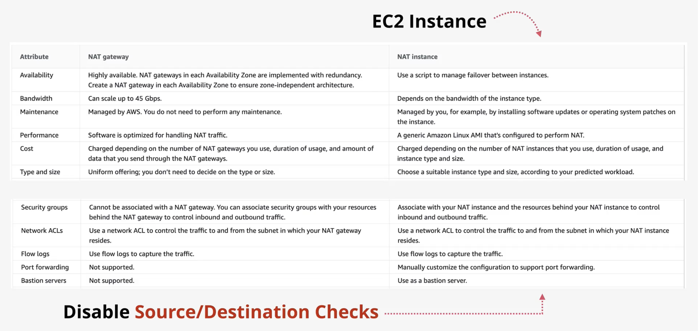

> [!warning] Gotcha
> **NAT does not work with IPv6.** IPv6 addresses are all publicly routable in AWS. For outbound-only IPv6, use an **Egress-Only Internet Gateway** with a `::/0` route instead.
> [!warning] Gotcha
> To use an EC2 as a NAT instance, you must **disable source/destination checks** on the instance — otherwise EC2 drops packets it isn't the source/destination of.

## AWS PrivateLink

An **endpoint** is an object within your VPC that connects to AWS services or other VPCs using private IP addressing — traffic never leaves the AWS network.

## References

- [IGW vs NAT Gateway](https://medium.com/awesome-cloud/aws-vpc-difference-between-internet-gateway-and-nat-gateway-c9177e710af6)
- [Regional NAT gateways for automatic multi-AZ expansion — Amazon VPC User Guide](https://docs.aws.amazon.com/vpc/latest/userguide/nat-gateways-regional.html)
- [Default VPCs — Amazon VPC User Guide](https://docs.aws.amazon.com/vpc/latest/userguide/default-vpc.html)
- [Work with your default VPC and default subnets — Amazon VPC](https://docs.aws.amazon.com/vpc/latest/userguide/work-with-default-vpc.html)
- [Delete your VPC — Amazon VPC](https://docs.aws.amazon.com/vpc/latest/userguide/delete-vpc.html)
- [No Default VPC in my Account — AWS re:Post](https://repost.aws/questions/QUxzdux0ntQTat1v68CLgdnQ/no-default-vpc-in-my-account)
- [Subnet route tables — Amazon VPC](https://docs.aws.amazon.com/vpc/latest/userguide/subnet-route-tables.html)
- [Configure route tables — Amazon VPC](https://docs.aws.amazon.com/vpc/latest/userguide/VPC_Route_Tables.html)
- Source: `raw/aws-cert-study-notes/aws-solution-architect/vpc.md`
- Source: `raw/web-clippings/Introducing Amazon VPC Regional NAT Gateway.md` (AWS blog, Nov 2025)
- Source: `raw/web-clippings/Regional NAT gateways for automatic multi-AZ expansion - Amazon Virtual Private Cloud.md` (AWS docs)
